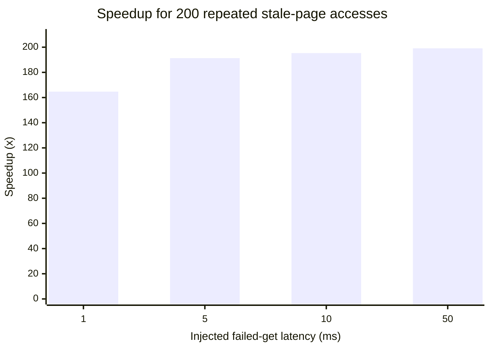

# [HiCache] Avoid repeated Mooncake gets after stale hits

[Upstream PR](https://github.com/sgl-project/sglang/pull/31315) · state: closed · merged: False

## Original PR description

## Motivation

Mooncake metadata may briefly report a page as present after the page's only data segment becomes unavailable. During this stale window, SGLang currently repeats `batch_exists -> get timeout -> abort` for every request touching the same physical page key. Under load, repeated transfer timeouts can create a request-queue bubble even though Mooncake eventually removes the stale segment.

This PR addresses the remaining live-replica tolerance gap discussed in #29955. It does not change graceful shutdown, does not call `remove_all()` during process teardown, and does not overlap the SIGTERM work in #16484.

I searched open issues and PRs for `Mooncake stale negative cache`, `Mooncake failed get cache`, `HiCache fallback`, and #29955 immediately before opening this PR and found no implementation in flight. I also left the intended scope on #29955 before starting.

## Modifications

- Add a process-local, thread-safe, bounded TTL cache for physical Mooncake keys whose most recent page get failed.
- Batch cache filtering and updates under one lock acquisition per storage operation, rather than one acquisition per physical key.
- Suppress Mooncake `batch_is_exist` hits for those keys during the short TTL so HiCache falls back instead of repeating the remote timeout.
- Clear an entry immediately after a successful put/get; retain it after a failed put.
- Clear the local cache when the storage backend is explicitly cleared.
- Add two backend options:
  - `failed_get_ttl_seconds` (default `1.0`; `0` disables the cache)
  - `failed_get_cache_max_entries` (default `65536`)
- Document the behavior and add a reproducible stale-hit benchmark.

The cache affects performance/fallback decisions only. It never returns KV data. Once the TTL expires, the next existence check reaches Mooncake again, so recovered data becomes visible without manual invalidation.

## Accuracy Tests

This change does not affect model computation or model output.

### Unit and regression tests

Run on commit `427ac11cb` in an isolated cluster container:

```bash
python scripts/ci/check_registered_tests.py
python scripts/ci/check_no_registered_tests_in_package.py
pytest -q \
  test/registered/unit/mem_cache/test_mooncake_failed_get_cache.py \
  test/registered/unit/mem_cache/test_mooncake_group_semantics.py \
  test/registered/unit/mem_cache/test_mooncake_standalone_dummy_mamba.py
```

Result: `17 passed, 21 warnings in 19.43s`; both CI registry checks passed. The new cases cover partial get failure, get exception, successful and failed put behavior, TTL expiry/retry, explicit clear, and capacity eviction.

### Real Mooncake TCP backend smoke

Environment:

- host: `lingjun-099`, Linux `5.10.134-16.3.al8.x86_64`
- CPU: 2-socket Intel Xeon Platinum 8575C, 192 logical CPUs, 2 NUMA nodes
- GPU used only to load the Mooncake extension: NVIDIA H20-3e GPU 1, driver `580.105.08`
- container image: `sha256:b8fdd23aa507e59a2d892f82cf6d04c8c86c876235d9ef5e2ab98842c4bea59c`
- Python `3.12.3`, PyTorch `2.11.0+cu129`, Mooncake Transfer Engine `0.3.11.post1`
- isolated Mooncake services: metadata `:18080`, master `:15051`, metrics `:19003`, store `:18081`; TCP protocol; 256 MiB client segment

Command:

```bash
python python/sglang/srt/mem_cache/storage/mooncake_store/test_mooncake_store.py
```

Result: all five real-backend flows passed:

- single put/exists/get with byte-for-byte tensor equality
- MHA batch path, TP=1
- MLA batch path, TP=1
- MHA batch path, TP=4
- MLA batch path, TP=8

The single get reported 0.131 ms, and the four batch gets reported 0.238-0.478 ms for 13 logical pages (13 or 26 physical keys).

## Speed Tests and Profiling

The benchmark models the exact stale-window sequence: the backend reports a hit, each data get waits for an injected transfer delay and fails, and the caller retries the same physical page 200 times. Each point has five independent repetitions. The enabled case uses a 1-second TTL.

```bash
python benchmark/kvcache/benchmark_mooncake_failed_get_cache.py \
  --iterations 200 --get-delay-ms <1|5|10|50> --ttl-seconds 1
```

| Injected failed-get delay | Baseline elapsed, mean +/- stdev | TTL cache elapsed, mean +/- stdev | Elapsed reduction | Remote gets | Suppression |
|---:|---:|---:|---:|---:|---:|
| 1 ms | 211.235 +/- 0.113 ms | 1.283 +/- 0.009 ms | 99.393% | 200 -> 1 | 99.5% |
| 5 ms | 1011.481 +/- 0.098 ms | 5.287 +/- 0.002 ms | 99.477% | 200 -> 1 | 99.5% |
| 10 ms | 2011.766 +/- 0.176 ms | 10.303 +/- 0.035 ms | 99.488% | 200 -> 1 | 99.5% |
| 50 ms | 10012.179 +/- 0.238 ms | 50.300 +/- 0.020 ms | 99.498% | 200 -> 1 | 99.5% |



Raw elapsed values (ms):

<details>
<summary>Five repetitions per point</summary>

| Delay | Baseline | TTL cache |
|---:|---|---|
| 1 ms | 211.087, 211.374, 211.271, 211.285, 211.158 | 1.282, 1.279, 1.278, 1.277, 1.299 |
| 5 ms | 1011.645, 1011.486, 1011.403, 1011.414, 1011.457 | 5.285, 5.288, 5.286, 5.289, 5.285 |
| 10 ms | 2011.680, 2011.660, 2012.009, 2011.591, 2011.891 | 10.286, 10.283, 10.365, 10.283, 10.300 |
| 50 ms | 10012.541, 10011.911, 10012.138, 10012.253, 10012.054 | 50.317, 50.303, 50.305, 50.309, 50.265 |

</details>

All 20 runs verified that the first existence check after TTL expiry reached the backend and observed the backend hit. Raw JSON was retained on the test host with one file per repetition; the aggregate SHA-256 manifest hash is `6a9ddfd5bee5e50d695642489e53f6fe5b4d68827299cfb5a9e2eb16e21bfb0d`.

## Formatting

The full pre-commit suite passed on all changed files in a clean Python 3.12 hook environment, including isort, Ruff, Black, codespell, executable-shebang validation, and the SGLang CI registry validators.

## Checklist

- [x] Format code with pre-commit.
- [x] Add unit tests and register them in CPU CI.
- [x] Update Mooncake backend documentation.
- [x] Provide correctness and speed benchmark results.
- [x] Follow the SGLang code style guidance.

AI assistance was used for code drafting, test generation, and experiment/report preparation. The resulting changes were validated on the cluster described above.

<!-- pr-states:start -->
---
### CI States

Latest PR Test (Base): <!-- slot:pr-test:start -->:white_check_mark: [Run #30060739341](https://github.com/sgl-project/sglang/actions/runs/30060739341)<!-- slot:pr-test:end -->
Latest PR Test (Extra): <!-- slot:pr-test-extra:start -->:x: [Run #30060739169](https://github.com/sgl-project/sglang/actions/runs/30060739169)<!-- slot:pr-test-extra:end -->
<!-- pr-states:end -->

## Review and discussion

### reviews

- gemini-code-assist[bot] · COMMENTED · 2026-07-15T09:41:50Z · [source](https://github.com/sgl-project/sglang/pull/31315#pullrequestreview-4702864271)

## Code Review

This pull request introduces a bounded TTL negative cache (`_FailedGetCache`) to the Mooncake store to temporarily suppress existence checks for physical keys that recently failed to load, preventing redundant remote get requests. The feedback focuses on optimizing performance and reducing lock contention in the critical path by introducing batch-oriented methods (`add_batch`, `remove_batch`, `filter_failed`, and `update_batch`) to the cache, allowing lock acquisition to occur once per batch operation instead of repeatedly in loops.

> [!IMPORTANT]
> The [consumer version of Gemini Code Assist on GitHub](https://developers.google.com/gemini-code-assist/docs/review-repo-code) is being sunset. Starting **June 18, 2026**, new organization installations will be blocked, and all code review activity will officially cease on **July 17, 2026**.
> For more details on the timeline and next steps, please review the [Help Documentation](https://developers.google.com/gemini-code-assist/docs/deprecations/consumer-code-review).

- catyans · COMMENTED · 2026-07-15T10:05:23Z · [source](https://github.com/sgl-project/sglang/pull/31315#pullrequestreview-4703041557)

(No body; status only.)

- catyans · COMMENTED · 2026-07-15T10:05:27Z · [source](https://github.com/sgl-project/sglang/pull/31315#pullrequestreview-4703042139)

(No body; status only.)

- catyans · COMMENTED · 2026-07-15T10:05:31Z · [source](https://github.com/sgl-project/sglang/pull/31315#pullrequestreview-4703042568)

(No body; status only.)

- catyans · COMMENTED · 2026-07-15T10:05:35Z · [source](https://github.com/sgl-project/sglang/pull/31315#pullrequestreview-4703043006)

(No body; status only.)

### issue_comments

- catyans · comment · 2026-07-15T10:07:34Z · [source](https://github.com/sgl-project/sglang/pull/31315#issuecomment-4979372524)

/tag-and-rerun-ci

- catyans · comment · 2026-07-15T14:01:14Z · [source](https://github.com/sgl-project/sglang/pull/31315#issuecomment-4981447436)

CI status clarification: the Ready-state rerun reached pr-gate successfully, but every platform workflow stopped before tests with `Missing required label run-ci`. As the PR author I can rerun failed jobs, but the slash-command policy does not allow me to add the maintainer-only label. The final commit 427ac11cb has passed the full changed-file pre-commit suite, 17 related CPU tests, five real Mooncake TCP store flows, and a 20-run stale-hit matrix documented in the PR body. Could a maintainer please add `run-ci` (or invoke the authorized CI command) so the actual upstream test jobs can start?

- catyans · comment · 2026-07-16T01:29:27Z · [source](https://github.com/sgl-project/sglang/pull/31315#issuecomment-4987107481)

@huangtingwei9988 All review threads are resolved in `427ac11cb`, and lint/check-changes pass. The platform workflows are currently failing at `pr-gate` only because the maintainer-only `run-ci` label is missing; no test job has started yet. Could you please review and add `run-ci` (or approve the Actions run) when convenient?

- catyans · comment · 2026-07-16T01:32:41Z · [source](https://github.com/sgl-project/sglang/pull/31315#issuecomment-4987132883)

@ispobock @xiezhq-hermann Could one of the KV Cache merge oncalls please run `/tag-and-rerun-ci` on this PR? The author-triggered runs cannot pass `pr-gate` because `run-ci` is maintainer-only. All four review threads are resolved in `427ac11cb`; lint and changed-file checks are green. No platform test has executed yet.

- huangtingwei9988 · comment · 2026-07-16T01:54:25Z · [source](https://github.com/sgl-project/sglang/pull/31315#issuecomment-4987314871)

/tag-and-rerun-ci

- ykwd · comment · 2026-07-16T02:04:34Z · [source](https://github.com/sgl-project/sglang/pull/31315#issuecomment-4987387421)

> Mooncake metadata may briefly report a page as present after the page's only data segment becomes unavailable

Thanks for submitting this PR! Could you share under what circumstances you encountered this issue?

- catyans · comment · 2026-07-16T06:01:12Z · [source](https://github.com/sgl-project/sglang/pull/31315#issuecomment-4988707461)

/rerun-failed-ci

- catyans · comment · 2026-07-16T06:20:23Z · [source](https://github.com/sgl-project/sglang/pull/31315#issuecomment-4988830587)

Thanks for asking. To be precise, I did **not** first observe this as a production incident; I isolated it while testing the stale data-plane failure mode of the Mooncake-backed HiCache path.

The concrete sequence is:

1. SGLang calls `batch_is_exist` and receives a metadata hit for a physical KV key.
2. Before or during `batch_get_into`, that key's only usable data segment becomes unavailable (for example, a Store/segment process restart, node/transport interruption, replica removal, or another transient data-plane failure).
3. The get returns a negative result or raises, but the next HiCache lookup queries Mooncake again. While metadata still reports the key, SGLang repeats the same failing remote get on every request instead of recomputing once and moving on.

The regression test models that exact observable contract (`exists=1`, followed by `get=-5`); it is a failure-injection reproduction, not a claim that Mooncake metadata remains stale permanently. That is why the cache is deliberately bounded and short-lived (1 s by default): it only suppresses the immediate retry loop, rechecks Mooncake after TTL expiry, and a successful put clears the entry immediately.

I also fixed the registered-test entry-point issue in `bc952af96`. On the H20 cluster, the target tests pass 7/7, the CI parser now reports `has_main=True`, and the repository's no-bare-pytest-main check passes. A 1,000-iteration 10 ms stale-get run reduced remote gets from 1,000 to 1 (99.9% suppression), then confirmed the remote hit is visible again after TTL expiry.


- ykwd · comment · 2026-07-16T12:44:57Z · [source](https://github.com/sgl-project/sglang/pull/31315#issuecomment-4991995997)

 1. A network issue occurs, or a Mooncake Store node crashes. (If the node does not shut down gracefully, the master takes 10 seconds by default before marking it as unavailable.)

 2. Within a very short period of time (for example, 1 second), a large number of requests try to access the same KV cache.

I think the probability of these two situations happening at the same time is quite low. Even if they do occur simultaneously, I personally think a slight performance degradation for up to 10 seconds is acceptable, especially compared to introducing a more complicated prevention mechanism into SGLang.

That said, this is just my personal opinion. Ultimately, whether such a mechanism should be added is up to the HiCache maintainers.


- catyans · comment · 2026-07-24T02:32:59Z · [source](https://github.com/sgl-project/sglang/pull/31315#issuecomment-5065578452)

CI refresh: merged the latest `main` into this branch (89929f04) to replace the stale runs. The focused Mooncake negative-cache test passes on the H20 smoke host (`7 passed`), and local Ruff checks pass. The remaining red `*-extra` finish jobs are label-gated skipped matrices; the normal `run-ci` hardware matrix is still running.

- catyans · comment · 2026-07-24T07:30:22Z · [source](https://github.com/sgl-project/sglang/pull/31315#issuecomment-5067315113)

/rerun-failed-ci

- riZZZhik · comment · 2026-07-29T12:43:49Z · [source](https://github.com/sgl-project/sglang/pull/31315#issuecomment-5117902152)

FYI: this PR helped a lot in our case when replicas exit ungracefully. \
We run 12 Qwen3.5 397B replicas, with up to ~50k tokens/sec/replica prefetch throughput.

- catyans · comment · 2026-07-31T07:24:06Z · [source](https://github.com/sgl-project/sglang/pull/31315#issuecomment-5140412931)

Thanks for sharing the production evidence — the 12-replica Qwen3.5 397B case is especially useful. If you have it available, could you share whether the main observed improvement was fewer repeated Mooncake gets, lower error amplification during the master’s failure-detection window, or improved tail latency after an ungraceful replica exit? Even a qualitative breakdown would help validate the negative-cache boundary.

- catyans · comment · 2026-07-31T07:24:08Z · [source](https://github.com/sgl-project/sglang/pull/31315#issuecomment-5140413131)

/rerun-failed-ci

- github-actions[bot] · comment · 2026-10-31T01:07:53Z · [source](https://github.com/sgl-project/sglang/pull/31315#issuecomment-6536950645)

Thanks @catyans. Closing this because it has had no updates in 91 days.

Reopen it if the work is still relevant.

Some directories moved recently, so an older branch may need retargeting:
`sgl-kernel/` -> `python/sglang/kernels/aot/`, `python/sglang/jit_kernel/`
-> `python/sglang/kernels/jit/`, `docs/` -> `docs/docs/` (`.mdx`),
`bench_serving.py` -> `benchmark/serving.py`, `test/srt/` -> `test/registered/`.

### inline_comments

- gemini-code-assist[bot] · comment · 2026-07-15T09:41:50Z · [source](https://github.com/sgl-project/sglang/pull/31315#discussion_r3586151096)

File: `python/sglang/srt/mem_cache/storage/mooncake_store/mooncake_store.py` · line 119


To avoid acquiring and releasing the lock multiple times in a loop when processing batches of keys, we can introduce batch-oriented methods (`add_batch`, `remove_batch`, `filter_failed`, and `update_batch`) to `_FailedGetCache`. This allows us to acquire the lock exactly once per batch operation, significantly reducing lock contention and overhead in the critical path of existence checks and cache updates.

```python
class _FailedGetCache:
    """Bounded TTL cache for physical keys that recently failed to load."""

    def __init__(self, ttl_seconds: float, max_entries: int):
        self.ttl_seconds = ttl_seconds
        self.max_entries = max_entries
        self.cache: OrderedDict[str, float] = OrderedDict()
        self.lock = threading.Lock()

    def add(self, key: str) -> None:
        self.add_batch([key])

    def add_batch(self, keys: List[str]) -> None:
        now = time.monotonic()
        with self.lock:
            for key in keys:
                self.cache.pop(key, None)
                self.cache[key] = now
            while self.cache:
                oldest_key = next(iter(self.cache))
                oldest_time = self.cache[oldest_key]
                if (
                    len(self.cache) <= self.max_entries
                    and now - oldest_time <= self.ttl_seconds
                ):
                    break
                self.cache.popitem(last=False)

    def remove(self, key: str) -> None:
        self.remove_batch([key])

    def remove_batch(self, keys: List[str]) -> None:
        with self.lock:
            for key in keys:
                self.cache.pop(key, None)

    def contains(self, key: str) -> bool:
        now = time.monotonic()
        with self.lock:
            failed_at = self.cache.get(key)
            if failed_at is None:
                return False
            if now - failed_at > self.ttl_seconds:
                del self.cache[key]
                return False
            return True

    def filter_failed(self, keys: List[str]) -> Tuple[List[int], List[str]]:
        now = time.monotonic()
        query_indices = []
        query_keys = []
        with self.lock:
            for i, key in enumerate(keys):
                failed_at = self.cache.get(key)
                if failed_at is None:
                    query_indices.append(i)
                    query_keys.append(key)
                elif now - failed_at > self.ttl_seconds:
                    del self.cache[key]
                    query_indices.append(i)
                    query_keys.append(key)
        return query_indices, query_keys

    def update_batch(self, successes: List[str], failures: List[str]) -> None:
        now = time.monotonic()
        with self.lock:
            for key in successes:
                self.cache.pop(key, None)
            for key in failures:
                self.cache.pop(key, None)
                self.cache[key] = now
            while self.cache:
                oldest_key = next(iter(self.cache))
                oldest_time = self.cache[oldest_key]
                if (
                    len(self.cache) <= self.max_entries
                    and now - oldest_time <= self.ttl_seconds
                ):
                    break
                self.cache.popitem(last=False)

    def clear(self) -> None:
        with self.lock:
            self.cache.clear()
```

- gemini-code-assist[bot] · comment · 2026-07-15T09:41:50Z · [source](https://github.com/sgl-project/sglang/pull/31315#discussion_r3586151107)

File: `python/sglang/srt/mem_cache/storage/mooncake_store/mooncake_store.py` · line None


Optimize cache removal by using the batch-oriented `remove_batch` method. This reduces lock acquisition overhead by locking only once for the entire batch of successful puts.

```suggestion
        if self.failed_get_cache is not None:
            successes = [key for key, result in zip(key_strs, results) if result >= 0]
            if successes:
                self.failed_get_cache.remove_batch(successes)
```

- gemini-code-assist[bot] · comment · 2026-07-15T09:41:50Z · [source](https://github.com/sgl-project/sglang/pull/31315#discussion_r3586151120)

File: `python/sglang/srt/mem_cache/storage/mooncake_store/mooncake_store.py` · line None


Optimize cache updates by using the batch-oriented `add_batch` and `update_batch` methods. This reduces lock acquisition overhead by locking only once for the entire batch of gets.

```suggestion
        except Exception:
            if self.failed_get_cache is not None:
                self.failed_get_cache.add_batch(key_strs)
            raise

        if self.failed_get_cache is not None:
            successes = []
            failures = []
            for key, result in zip(key_strs, results):
                if result <= 0:
                    failures.append(key)
                else:
                    successes.append(key)
            self.failed_get_cache.update_batch(successes, failures)
```

- gemini-code-assist[bot] · comment · 2026-07-15T09:41:50Z · [source](https://github.com/sgl-project/sglang/pull/31315#discussion_r3586151129)

File: `python/sglang/srt/mem_cache/storage/mooncake_store/mooncake_store.py` · line 1432


Optimize the existence check by using the batch-oriented `filter_failed` method. This avoids repeatedly calling `contains` in a loop, which would otherwise acquire and release the lock for every single key in the batch.

```suggestion
    def _batch_exist(self, key_strs: List[str]) -> List[int]:
        if self.failed_get_cache is None:
            return self.store.batch_is_exist(key_strs)

        results = [0] * len(key_strs)
        query_indices, query_keys = self.failed_get_cache.filter_failed(key_strs)
        if not query_indices:
            return results

        query_results = self.store.batch_is_exist(query_keys)
        for i, result in zip(query_indices, query_results):
            results[i] = result
        return results
```

- catyans · comment · 2026-07-15T10:05:23Z · [source](https://github.com/sgl-project/sglang/pull/31315#discussion_r3586305883)

File: `python/sglang/srt/mem_cache/storage/mooncake_store/mooncake_store.py` · line 119

Implemented in 427ac11cb. The cache now provides add_batch, remove_batch, update_batch, and filter_failed; each batch operation takes the lock once. I reran pre-commit, 17 related tests, the real Mooncake TCP smoke suite, and the 20-run benchmark matrix after this change.

- catyans · comment · 2026-07-15T10:05:27Z · [source](https://github.com/sgl-project/sglang/pull/31315#discussion_r3586306302)

File: `python/sglang/srt/mem_cache/storage/mooncake_store/mooncake_store.py` · line None

Addressed in 427ac11cb: successful put keys are collected and passed to remove_batch, so the cache takes one lock for the whole put result.

- catyans · comment · 2026-07-15T10:05:31Z · [source](https://github.com/sgl-project/sglang/pull/31315#discussion_r3586306671)

File: `python/sglang/srt/mem_cache/storage/mooncake_store/mooncake_store.py` · line None

Addressed in 427ac11cb: exceptions use add_batch, while completed gets partition keys once and call update_batch for a single lock acquisition.

- catyans · comment · 2026-07-15T10:05:35Z · [source](https://github.com/sgl-project/sglang/pull/31315#discussion_r3586307098)

File: `python/sglang/srt/mem_cache/storage/mooncake_store/mooncake_store.py` · line 1432

Addressed in 427ac11cb: _batch_exist now calls filter_failed, which filters and evicts expired entries under one lock and returns both query indices and keys.

## Changed files and fixed code

- `benchmark/kvcache/benchmark_mooncake_failed_get_cache.py` · added · additions 90 / deletions 0
  - [head](https://github.com/catyans/sglang/blob/89929f04d18ff54ace29efc8bbf6581e9acbdb64/benchmark/kvcache/benchmark_mooncake_failed_get_cache.py)
  - [base](https://github.com/sgl-project/sglang/blob/bd3f6a79358cd6f21639b8bd2ea03dd4f90bd3bf/benchmark/kvcache/benchmark_mooncake_failed_get_cache.py)
- `python/sglang/srt/mem_cache/storage/mooncake_store/README.md` · modified · additions 12 / deletions 0
  - [head](https://github.com/catyans/sglang/blob/89929f04d18ff54ace29efc8bbf6581e9acbdb64/python/sglang/srt/mem_cache/storage/mooncake_store/README.md)
  - [base](https://github.com/sgl-project/sglang/blob/bd3f6a79358cd6f21639b8bd2ea03dd4f90bd3bf/python/sglang/srt/mem_cache/storage/mooncake_store/README.md)
- `python/sglang/srt/mem_cache/storage/mooncake_store/mooncake_store.py` · modified · additions 151 / deletions 10
  - [head](https://github.com/catyans/sglang/blob/89929f04d18ff54ace29efc8bbf6581e9acbdb64/python/sglang/srt/mem_cache/storage/mooncake_store/mooncake_store.py)
  - [base](https://github.com/sgl-project/sglang/blob/bd3f6a79358cd6f21639b8bd2ea03dd4f90bd3bf/python/sglang/srt/mem_cache/storage/mooncake_store/mooncake_store.py)
- `test/registered/unit/mem_cache/test_mooncake_failed_get_cache.py` · added · additions 112 / deletions 0
  - [head](https://github.com/catyans/sglang/blob/89929f04d18ff54ace29efc8bbf6581e9acbdb64/test/registered/unit/mem_cache/test_mooncake_failed_get_cache.py)
  - [base](https://github.com/sgl-project/sglang/blob/bd3f6a79358cd6f21639b8bd2ea03dd4f90bd3bf/test/registered/unit/mem_cache/test_mooncake_failed_get_cache.py)

## Evidence and interpretation boundary

[Original JSON, discussions and patches](../../../../../../evidence/prs/sgl-project--sglang/31315-07c39b07866b2783ab60314d3fa65a4738b38007a2df198bdf49377fa5218e08.json) · SHA-256 `07c39b07866b2783ab60314d3fa65a4738b38007a2df198bdf49377fa5218e08`.

Diff complete: True. Missing/binary/truncated patches require pinned source inspection. This is a source page, not an independently verified optimization case. Open, merged and released are different states; recheck the deployed dependency.
