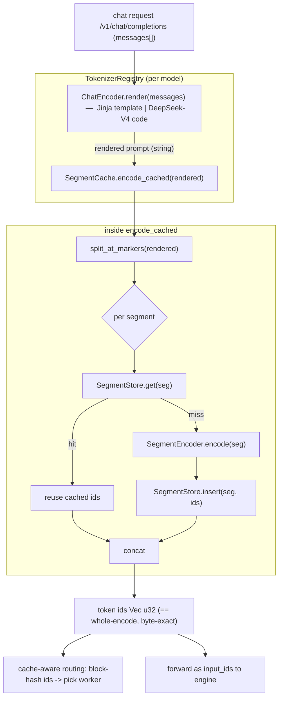
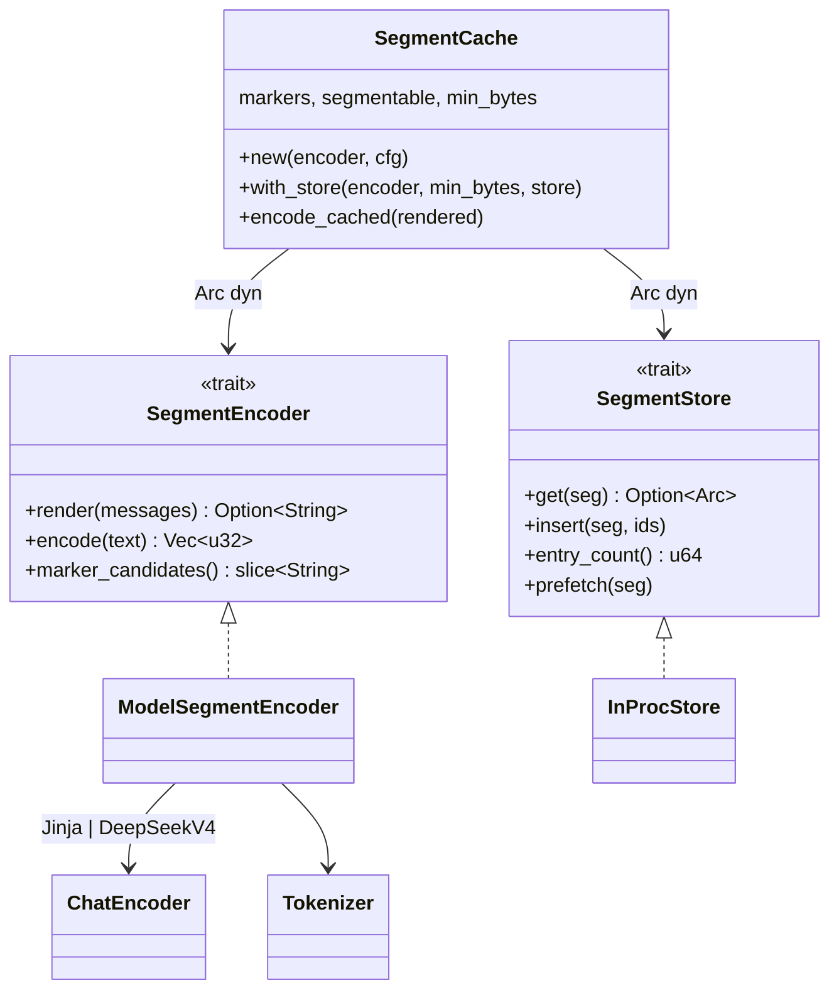

# Feat/sgl router segment cache

[Upstream PR](https://github.com/sgl-project/sglang/pull/32599) · state: closed · merged: False

## Original PR description

# [router] Opt-in segment tokenize-cache for multi-turn chat

## Summary
Adds an **opt-in** (`--segment-cache`, default off) **per-model** tokenize-cache to
`sgl-router`. A chat prompt is split at its chat-template marker tokens (turn
boundaries) and each segment's token ids are cached, so a multi-turn conversation
only re-tokenizes the **newest turn** instead of the whole history every request.
`encode_cached` is **byte-identical** to whole-prompt encode; when disabled,
behavior is unchanged.

## Architecture — request path




## Architecture — two pluggable axes (trait objects)



## Correctness

The only guarantee: token ids **identical to a one-shot encode**. Three layers
keep this **universal** (never wrong ids on any tokenizer):

1. **Markers are HuggingFace hard split boundaries** (added tokens), so splitting
   there is byte-exact — with `lstrip`/`rstrip` tokens **excluded** (they absorb
   adjacent whitespace across the boundary, so are not byte-exact split points).
   `normalized`/`single_word` tokens are kept (they don't move the boundary;
   validated, e.g. DeepSeek-V4's `normalized` `<｜User｜>`/`<｜Assistant｜>`).
2. **Startup self-check = universal oracle.** A synthetic probe puts each marker
   in four adjacencies (space-before / space-after / glued / adjacent-marker) and
   asserts `concat(encode(seg_i)) == encode(whole)`. This catches ANY tokenizer
   where per-segment encoding diverges — Metaspace/SentencePiece prefix-space,
   context-dependent normalizers, etc. — which then **self-disable** (fall back to
   whole-prompt encode, staying correct).
3. **Collision-free store**: `InProcStore` keys by the segment bytes, so a hit is
   always the exact segment's ids.

**Verified byte-exact (0 mismatches)** across three real tokenizers / both encoder paths:

| tokenizer | encoder path | grid | result |
|---|---|---|---|
| Qwen3-0.6B | Jinja template | 16k→1M step 8k (127 pts) | ✅ 0 |
| DeepSeek-V4-Pro | code encoder | 16k/65k/262k/524k/1M | ✅ 0 |
| Kimi-K2.6 | im-markers | 16k/65k/262k/524k/1M | ✅ 0 |

Plus **ShareGPT real multi-turn**: 21,456 turns / ~20M tokens, **0 mismatches**
(Qwen & DSV4).

**Universality envelope:** byte-level-BPE-style models (Qwen / DSV4 / Kimi /
Llama-BPE) segment and are byte-exact; Metaspace/SentencePiece (or heavy
lstrip/rstrip/normalizer) models self-disable via the self-check — correct, just
no caching benefit.

## Performance (real tokenizers, median ms)

| tokenizer | 1M whole | 1M cold (single-round) | 1M warm (multi-turn) | warm speedup |
|---|---:|---:|---:|---:|
| Qwen3-0.6B | 471.5 | 415.6 | 13.9 | ~34× |
| DeepSeek-V4-Pro | 927.4 | 775.2 | 18.4 | ~50× |
| Kimi-K2.6 | 517.5 | 407.8 | 12.7 | ~41× |

- Warm (history cached) **~34–55×**, scaling with conversation depth. On real
  ShareGPT (~7-turn avg): **2.5–3.4× end-to-end** (short convos cap the gain).
- Cold single-round **≈ whole** (~10–15% faster) — the cache never hurts latency
  even with zero reuse (splitting avoids some per-call pretokenize overhead).
- `--segment-cache-min-bytes` (default 4096) bypasses the cache for short prompts,
  where the per-segment bookkeeping would outweigh re-tokenizing.

## Scope / design notes
- **Per-model**: `segment_cache` is a `ModelConfig` field (like `cache_aware` /
  `sticky`); the registry holds one `SegmentCache` per model — ready for the router
  serving multiple different-model engines.
- **Backend-agnostic**: the dynamo tokenizer is untouched; a future HF backend
  needs no change to this layer (encode goes through the `SegmentEncoder` closure).
- **No routing changes**: the cache only produces token ids; cache-aware routing's
  block-hashing consumes those ids downstream, unchanged.

## Usage
```bash
sgl-router --model-id qwen3 --tokenizer-path /models/qwen3/tokenizer.json \
           --segment-cache [--segment-cache-capacity N] [--segment-cache-min-bytes B] \
           --worker-urls ...
```

## Testing
`cargo test` covers: byte-exact differential (fake + real dynamo BPE), self-check
disable-on-unsafe, lstrip/rstrip marker exclusion (fixture), concurrent encode,
marker derivation (Jinja + dsv4), split-at-markers edge cases. Offline reproduce:

```bash
cd experimental/sgl-router
cargo test --all-targets
cargo clippy --all-targets -- -D warnings
cargo fmt --check
```

<!-- pr-states:start -->
---
### CI States

Latest PR Test (Base): <!-- slot:pr-test:start -->:white_check_mark: [Run #30324622543](https://github.com/sgl-project/sglang/actions/runs/30324622543)<!-- slot:pr-test:end -->
Latest PR Test (Extra): <!-- slot:pr-test-extra:start -->:x: [Run #30324622535](https://github.com/sgl-project/sglang/actions/runs/30324622535)<!-- slot:pr-test-extra:end -->
<!-- pr-states:end -->

## Review and discussion

### reviews

### issue_comments

- gemini-code-assist[bot] · comment · 2026-07-28T02:51:20Z · [source](https://github.com/sgl-project/sglang/pull/32599#issuecomment-5099373684)

> [!CAUTION]
> The consumer version of Gemini Code Assist on GitHub has been sunset. All code review activity has officially ceased.


- github-actions[bot] · comment · 2026-10-28T01:09:14Z · [source](https://github.com/sgl-project/sglang/pull/32599#issuecomment-6457930583)

Thanks @ZhaiFeiyue. Closing this because it has had no updates in 91 days.

Reopen it if the work is still relevant.

Some directories moved recently, so an older branch may need retargeting:
`sgl-kernel/` -> `python/sglang/kernels/aot/`, `python/sglang/jit_kernel/`
-> `python/sglang/kernels/jit/`, `docs/` -> `docs/docs/` (`.mdx`),
`bench_serving.py` -> `benchmark/serving.py`, `test/srt/` -> `test/registered/`.

### inline_comments

## Changed files and fixed code

- `experimental/sgl-router/Cargo.toml` · modified · additions 7 / deletions 0
  - [head](https://github.com/ZhaiFeiyue/sglang/blob/514eda3b138b4545639e4b20d6adec4a873b556a/experimental/sgl-router/Cargo.toml)
  - [base](https://github.com/sgl-project/sglang/blob/b79388f33856d40a40dfb622c05cedb131637d61/experimental/sgl-router/Cargo.toml)
- `experimental/sgl-router/src/config/cli.rs` · modified · additions 36 / deletions 1
  - [head](https://github.com/ZhaiFeiyue/sglang/blob/514eda3b138b4545639e4b20d6adec4a873b556a/experimental/sgl-router/src/config/cli.rs)
  - [base](https://github.com/sgl-project/sglang/blob/b79388f33856d40a40dfb622c05cedb131637d61/experimental/sgl-router/src/config/cli.rs)
- `experimental/sgl-router/src/config/mod.rs` · modified · additions 1 / deletions 0
  - [head](https://github.com/ZhaiFeiyue/sglang/blob/514eda3b138b4545639e4b20d6adec4a873b556a/experimental/sgl-router/src/config/mod.rs)
  - [base](https://github.com/sgl-project/sglang/blob/b79388f33856d40a40dfb622c05cedb131637d61/experimental/sgl-router/src/config/mod.rs)
- `experimental/sgl-router/src/config/types.rs` · modified · additions 25 / deletions 0
  - [head](https://github.com/ZhaiFeiyue/sglang/blob/514eda3b138b4545639e4b20d6adec4a873b556a/experimental/sgl-router/src/config/types.rs)
  - [base](https://github.com/sgl-project/sglang/blob/b79388f33856d40a40dfb622c05cedb131637d61/experimental/sgl-router/src/config/types.rs)
- `experimental/sgl-router/src/policies/cache_aware_zmq.rs` · modified · additions 1 / deletions 0
  - [head](https://github.com/ZhaiFeiyue/sglang/blob/514eda3b138b4545639e4b20d6adec4a873b556a/experimental/sgl-router/src/policies/cache_aware_zmq.rs)
  - [base](https://github.com/sgl-project/sglang/blob/b79388f33856d40a40dfb622c05cedb131637d61/experimental/sgl-router/src/policies/cache_aware_zmq.rs)
- `experimental/sgl-router/src/policies/factory.rs` · modified · additions 1 / deletions 0
  - [head](https://github.com/ZhaiFeiyue/sglang/blob/514eda3b138b4545639e4b20d6adec4a873b556a/experimental/sgl-router/src/policies/factory.rs)
  - [base](https://github.com/sgl-project/sglang/blob/b79388f33856d40a40dfb622c05cedb131637d61/experimental/sgl-router/src/policies/factory.rs)
- `experimental/sgl-router/src/server/app_context.rs` · modified · additions 1 / deletions 0
  - [head](https://github.com/ZhaiFeiyue/sglang/blob/514eda3b138b4545639e4b20d6adec4a873b556a/experimental/sgl-router/src/server/app_context.rs)
  - [base](https://github.com/sgl-project/sglang/blob/b79388f33856d40a40dfb622c05cedb131637d61/experimental/sgl-router/src/server/app_context.rs)
- `experimental/sgl-router/src/server/routes/models.rs` · modified · additions 1 / deletions 0
  - [head](https://github.com/ZhaiFeiyue/sglang/blob/514eda3b138b4545639e4b20d6adec4a873b556a/experimental/sgl-router/src/server/routes/models.rs)
  - [base](https://github.com/sgl-project/sglang/blob/b79388f33856d40a40dfb622c05cedb131637d61/experimental/sgl-router/src/server/routes/models.rs)
- `experimental/sgl-router/src/server/routes/tokenize.rs` · modified · additions 1 / deletions 0
  - [head](https://github.com/ZhaiFeiyue/sglang/blob/514eda3b138b4545639e4b20d6adec4a873b556a/experimental/sgl-router/src/server/routes/tokenize.rs)
  - [base](https://github.com/sgl-project/sglang/blob/b79388f33856d40a40dfb622c05cedb131637d61/experimental/sgl-router/src/server/routes/tokenize.rs)
- `experimental/sgl-router/src/tokenizer/adapter.rs` · modified · additions 105 / deletions 0
  - [head](https://github.com/ZhaiFeiyue/sglang/blob/514eda3b138b4545639e4b20d6adec4a873b556a/experimental/sgl-router/src/tokenizer/adapter.rs)
  - [base](https://github.com/sgl-project/sglang/blob/b79388f33856d40a40dfb622c05cedb131637d61/experimental/sgl-router/src/tokenizer/adapter.rs)
- `experimental/sgl-router/src/tokenizer/mod.rs` · modified · additions 60 / deletions 6
  - [head](https://github.com/ZhaiFeiyue/sglang/blob/514eda3b138b4545639e4b20d6adec4a873b556a/experimental/sgl-router/src/tokenizer/mod.rs)
  - [base](https://github.com/sgl-project/sglang/blob/b79388f33856d40a40dfb622c05cedb131637d61/experimental/sgl-router/src/tokenizer/mod.rs)
- `experimental/sgl-router/src/tokenizer/segment/cache.rs` · added · additions 97 / deletions 0
  - [head](https://github.com/ZhaiFeiyue/sglang/blob/514eda3b138b4545639e4b20d6adec4a873b556a/experimental/sgl-router/src/tokenizer/segment/cache.rs)
  - [base](https://github.com/sgl-project/sglang/blob/b79388f33856d40a40dfb622c05cedb131637d61/experimental/sgl-router/src/tokenizer/segment/cache.rs)
- `experimental/sgl-router/src/tokenizer/segment/markers.rs` · added · additions 242 / deletions 0
  - [head](https://github.com/ZhaiFeiyue/sglang/blob/514eda3b138b4545639e4b20d6adec4a873b556a/experimental/sgl-router/src/tokenizer/segment/markers.rs)
  - [base](https://github.com/sgl-project/sglang/blob/b79388f33856d40a40dfb622c05cedb131637d61/experimental/sgl-router/src/tokenizer/segment/markers.rs)
- `experimental/sgl-router/src/tokenizer/segment/mod.rs` · added · additions 434 / deletions 0
  - [head](https://github.com/ZhaiFeiyue/sglang/blob/514eda3b138b4545639e4b20d6adec4a873b556a/experimental/sgl-router/src/tokenizer/segment/mod.rs)
  - [base](https://github.com/sgl-project/sglang/blob/b79388f33856d40a40dfb622c05cedb131637d61/experimental/sgl-router/src/tokenizer/segment/mod.rs)
- `experimental/sgl-router/src/workers/manager.rs` · modified · additions 1 / deletions 0
  - [head](https://github.com/ZhaiFeiyue/sglang/blob/514eda3b138b4545639e4b20d6adec4a873b556a/experimental/sgl-router/src/workers/manager.rs)
  - [base](https://github.com/sgl-project/sglang/blob/b79388f33856d40a40dfb622c05cedb131637d61/experimental/sgl-router/src/workers/manager.rs)
- `experimental/sgl-router/tests/component/discovery/static_urls.rs` · modified · additions 1 / deletions 0
  - [head](https://github.com/ZhaiFeiyue/sglang/blob/514eda3b138b4545639e4b20d6adec4a873b556a/experimental/sgl-router/tests/component/discovery/static_urls.rs)
  - [base](https://github.com/sgl-project/sglang/blob/b79388f33856d40a40dfb622c05cedb131637d61/experimental/sgl-router/tests/component/discovery/static_urls.rs)
- `experimental/sgl-router/tests/component/policies/cache_aware_zmq.rs` · modified · additions 1 / deletions 0
  - [head](https://github.com/ZhaiFeiyue/sglang/blob/514eda3b138b4545639e4b20d6adec4a873b556a/experimental/sgl-router/tests/component/policies/cache_aware_zmq.rs)
  - [base](https://github.com/sgl-project/sglang/blob/b79388f33856d40a40dfb622c05cedb131637d61/experimental/sgl-router/tests/component/policies/cache_aware_zmq.rs)
- `experimental/sgl-router/tests/fixtures/added_tokens_flags.json` · added · additions 11 / deletions 0
  - [head](https://github.com/ZhaiFeiyue/sglang/blob/514eda3b138b4545639e4b20d6adec4a873b556a/experimental/sgl-router/tests/fixtures/added_tokens_flags.json)
  - [base](https://github.com/sgl-project/sglang/blob/b79388f33856d40a40dfb622c05cedb131637d61/experimental/sgl-router/tests/fixtures/added_tokens_flags.json)
- `experimental/sgl-router/tests/proxy/cache_aware_input_ids.rs` · modified · additions 1 / deletions 0
  - [head](https://github.com/ZhaiFeiyue/sglang/blob/514eda3b138b4545639e4b20d6adec4a873b556a/experimental/sgl-router/tests/proxy/cache_aware_input_ids.rs)
  - [base](https://github.com/sgl-project/sglang/blob/b79388f33856d40a40dfb622c05cedb131637d61/experimental/sgl-router/tests/proxy/cache_aware_input_ids.rs)
- `experimental/sgl-router/tests/proxy/chat_routing.rs` · modified · additions 1 / deletions 0
  - [head](https://github.com/ZhaiFeiyue/sglang/blob/514eda3b138b4545639e4b20d6adec4a873b556a/experimental/sgl-router/tests/proxy/chat_routing.rs)
  - [base](https://github.com/sgl-project/sglang/blob/b79388f33856d40a40dfb622c05cedb131637d61/experimental/sgl-router/tests/proxy/chat_routing.rs)
- `experimental/sgl-router/tests/proxy/failover.rs` · modified · additions 1 / deletions 0
  - [head](https://github.com/ZhaiFeiyue/sglang/blob/514eda3b138b4545639e4b20d6adec4a873b556a/experimental/sgl-router/tests/proxy/failover.rs)
  - [base](https://github.com/sgl-project/sglang/blob/b79388f33856d40a40dfb622c05cedb131637d61/experimental/sgl-router/tests/proxy/failover.rs)
- `experimental/sgl-router/tests/proxy/graceful_shutdown.rs` · modified · additions 1 / deletions 0
  - [head](https://github.com/ZhaiFeiyue/sglang/blob/514eda3b138b4545639e4b20d6adec4a873b556a/experimental/sgl-router/tests/proxy/graceful_shutdown.rs)
  - [base](https://github.com/sgl-project/sglang/blob/b79388f33856d40a40dfb622c05cedb131637d61/experimental/sgl-router/tests/proxy/graceful_shutdown.rs)
- `experimental/sgl-router/tests/proxy/header_forwarding.rs` · modified · additions 1 / deletions 0
  - [head](https://github.com/ZhaiFeiyue/sglang/blob/514eda3b138b4545639e4b20d6adec4a873b556a/experimental/sgl-router/tests/proxy/header_forwarding.rs)
  - [base](https://github.com/sgl-project/sglang/blob/b79388f33856d40a40dfb622c05cedb131637d61/experimental/sgl-router/tests/proxy/header_forwarding.rs)
- `experimental/sgl-router/tests/proxy/pd_bootstrap_injection.rs` · modified · additions 1 / deletions 0
  - [head](https://github.com/ZhaiFeiyue/sglang/blob/514eda3b138b4545639e4b20d6adec4a873b556a/experimental/sgl-router/tests/proxy/pd_bootstrap_injection.rs)
  - [base](https://github.com/sgl-project/sglang/blob/b79388f33856d40a40dfb622c05cedb131637d61/experimental/sgl-router/tests/proxy/pd_bootstrap_injection.rs)
- `experimental/sgl-router/tests/proxy/pd_pool_isolation.rs` · modified · additions 1 / deletions 0
  - [head](https://github.com/ZhaiFeiyue/sglang/blob/514eda3b138b4545639e4b20d6adec4a873b556a/experimental/sgl-router/tests/proxy/pd_pool_isolation.rs)
  - [base](https://github.com/sgl-project/sglang/blob/b79388f33856d40a40dfb622c05cedb131637d61/experimental/sgl-router/tests/proxy/pd_pool_isolation.rs)
- `experimental/sgl-router/tests/proxy/roundrobin_input_ids.rs` · modified · additions 1 / deletions 0
  - [head](https://github.com/ZhaiFeiyue/sglang/blob/514eda3b138b4545639e4b20d6adec4a873b556a/experimental/sgl-router/tests/proxy/roundrobin_input_ids.rs)
  - [base](https://github.com/sgl-project/sglang/blob/b79388f33856d40a40dfb622c05cedb131637d61/experimental/sgl-router/tests/proxy/roundrobin_input_ids.rs)
- `experimental/sgl-router/tests/proxy/sticky_input_ids.rs` · modified · additions 1 / deletions 0
  - [head](https://github.com/ZhaiFeiyue/sglang/blob/514eda3b138b4545639e4b20d6adec4a873b556a/experimental/sgl-router/tests/proxy/sticky_input_ids.rs)
  - [base](https://github.com/sgl-project/sglang/blob/b79388f33856d40a40dfb622c05cedb131637d61/experimental/sgl-router/tests/proxy/sticky_input_ids.rs)
- `experimental/sgl-router/tests/proxy/sticky_routing.rs` · modified · additions 1 / deletions 0
  - [head](https://github.com/ZhaiFeiyue/sglang/blob/514eda3b138b4545639e4b20d6adec4a873b556a/experimental/sgl-router/tests/proxy/sticky_routing.rs)
  - [base](https://github.com/sgl-project/sglang/blob/b79388f33856d40a40dfb622c05cedb131637d61/experimental/sgl-router/tests/proxy/sticky_routing.rs)
- `experimental/sgl-router/tests/proxy/timeout.rs` · modified · additions 1 / deletions 0
  - [head](https://github.com/ZhaiFeiyue/sglang/blob/514eda3b138b4545639e4b20d6adec4a873b556a/experimental/sgl-router/tests/proxy/timeout.rs)
  - [base](https://github.com/sgl-project/sglang/blob/b79388f33856d40a40dfb622c05cedb131637d61/experimental/sgl-router/tests/proxy/timeout.rs)

## Evidence and interpretation boundary

[Original JSON, discussions and patches](../../../../../../evidence/prs/sgl-project--sglang/32599-edbc0f23600f0a55065f8cbd3373606237ca65abacbc27aa86e21b6043549e18.json) · SHA-256 `edbc0f23600f0a55065f8cbd3373606237ca65abacbc27aa86e21b6043549e18`.

Diff complete: True. Missing/binary/truncated patches require pinned source inspection. This is a source page, not an independently verified optimization case. Open, merged and released are different states; recheck the deployed dependency.
