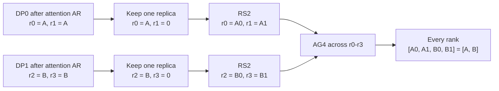
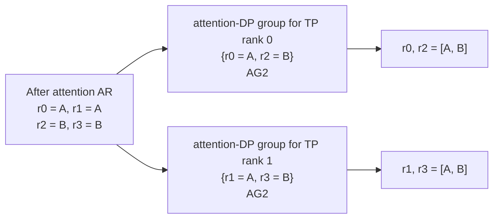

# perf(kimi k3): eliminate redudant comm in mixed tp and ep

[Upstream PR](https://github.com/sgl-project/sglang/pull/33390) · state: closed · merged: False

## Original PR description

## Motivation

When deploying Kimi K3 on H100 GPU with EP64/TP32/DP2, the post-attention path performs AR -> RS -> AG before entering MoE. The RS is redundant because the attention outputs are already replicated within each attention-TP group.

## Modifications

- Add attention-DP process groups that connect matching attention-TP ranks.
- For replicated inputs with CP=1, replace RS32 + AG64 with a direct AG2 across the attention-DP group.
- Keep the existing path as the fallback for other configurations.
- Add a unit test for attention-DP group construction.

### Communication Flow

Consider a smaller configuration with four ranks, attention TP2, DP2, and CP1. `A` and `B` are the complete local token tensors from the two DP replicas; `A0/A1` and `B0/B1` are their TP shards.

**Before: RS2 + AG4**

The old path splits tensors that are already replicated, then gathers the shards back together across the full TP group.

**After: direct AG2**

Both paths produce the same `[A, B]` tensor on every rank. The new path avoids reduce-scatter and uses a smaller DP-only all-gather group.

## Accuracy Tests

This is a communication-only optimization and does not change model computation. But feel free to ask if that's necessary.

## Speed Tests and Profiling

On Kimi K3 with H100 EP64/TP32/DP2, this change improves performance by approximately 20%.

Torch profiler traces before and after the optimization will be added below to show the reduction in communication kernels.

**Before**

**After**

## Checklist

- [x] Format your code according to the [Format code with pre-commit](https://docs.sglang.io/developer_guide/contribution_guide.html#format-code-with-pre-commit).
- [x] Add unit tests according to the [Run and add unit tests](https://docs.sglang.io/developer_guide/contribution_guide.html#run-and-add-unit-tests).
- [ ] Update documentation according to [Write documentations](https://docs.sglang.io/developer_guide/contribution_guide.html#write-documentations).
- [ ] Provide accuracy and speed benchmark results according to [Test the accuracy](https://docs.sglang.io/developer_guide/contribution_guide.html#test-the-accuracy) and [Benchmark the speed](https://docs.sglang.io/developer_guide/contribution_guide.html#benchmark-the-speed).
- [x] Follow the SGLang code style [guidance](https://docs.sglang.io/developer_guide/contribution_guide.html#code-style-guidance).

<!-- pr-states:start -->
---
### CI States

Latest PR Test (Base): <!-- slot:pr-test:start -->:x: [Run #30813936106](https://github.com/sgl-project/sglang/actions/runs/30813936106)<!-- slot:pr-test:end -->
Latest PR Test (Extra): <!-- slot:pr-test-extra:start -->:x: [Run #30813935863](https://github.com/sgl-project/sglang/actions/runs/30813935863)<!-- slot:pr-test-extra:end -->
<!-- pr-states:end -->

## Review and discussion

### reviews

- copilot-pull-request-reviewer[bot] · COMMENTED · 2026-08-03T12:35:47Z · [source](https://github.com/sgl-project/sglang/pull/33390#pullrequestreview-4844041128)

## Pull request overview

This PR optimizes Kimi K3’s post-attention communication path for mixed TP+EP deployments by introducing attention-DP process groups and using them to avoid redundant reduce-scatter + all-gather sequences when inputs are already replicated within attention-TP groups.

**Changes:**
- Add construction/lifecycle management for a new `attention_dp` process group in `parallel_state.initialize_model_parallel()`.
- Introduce a fast-path in `dp_attention._dp_gather_via_all_gather()` to perform a direct all-gather over the attention-DP group when `CP==1`.
- Add a unit test verifying `attention_dp` group rank construction.

### Reviewed changes

Copilot reviewed 3 out of 3 changed files in this pull request and generated 2 comments.

| File | Description |
| ---- | ----------- |
| `test/registered/unit/distributed/test_parallel_state.py` | Adds a unit test to validate `attention_dp` group construction for a TP8 / attn-DP2 configuration. |
| `python/sglang/srt/layers/dp_attention.py` | Adds a new fast-path gather that uses the attention-DP group to eliminate redundant comms when inputs are replicated and `CP==1`. |
| `python/sglang/srt/distributed/parallel_state.py` | Adds `_ATTN_DP`, `get_attn_dp_group()`, initializes `attention_dp` groups, and destroys them during teardown. |

---

💡 <a href="/sgl-project/sglang/new/main?filename=.github/instructions/*.instructions.md" class="Link--inTextBlock" target="_blank" rel="noopener noreferrer">Add Copilot custom instructions</a> for smarter, more guided reviews. <a href="https://docs.github.com/en/copilot/customizing-copilot/adding-repository-custom-instructions-for-github-copilot" class="Link--inTextBlock" target="_blank" rel="noopener noreferrer">Learn how to get started</a>.

### issue_comments

- gemini-code-assist[bot] · comment · 2026-08-03T12:31:37Z · [source](https://github.com/sgl-project/sglang/pull/33390#issuecomment-5166332369)

> [!CAUTION]
> The consumer version of Gemini Code Assist on GitHub has been sunset. All code review activity has officially ceased.

- github-actions[bot] · comment · 2026-11-03T01:07:30Z · [source](https://github.com/sgl-project/sglang/pull/33390#issuecomment-6592663906)

Thanks @jpy794. Closing this because it has had no updates in 91 days.

Reopen it if the work is still relevant.

Some directories moved recently, so an older branch may need retargeting:
`sgl-kernel/` -> `python/sglang/kernels/aot/`, `python/sglang/jit_kernel/`
-> `python/sglang/kernels/jit/`, `docs/` -> `docs/docs/` (`.mdx`),
`bench_serving.py` -> `benchmark/serving.py`, `test/srt/` -> `test/registered/`.

### inline_comments

- copilot-pull-request-reviewer[bot] · comment · 2026-08-03T12:35:46Z · [source](https://github.com/sgl-project/sglang/pull/33390#discussion_r3703895372)

File: `python/sglang/srt/layers/dp_attention.py` · line 516

The new fast-path calls get_attn_dp_group() whenever CP==1, but _ATTN_DP is only initialized when attention_data_parallel_size > 1. For the common case attention_data_parallel_size==1 (default) with attn TP > 1, this branch will assert and crash during dp_gather_replicate(). Gate the optimization on attention-DP actually being enabled (e.g., by checking that attention TP size differs from full TP size).

- copilot-pull-request-reviewer[bot] · comment · 2026-08-03T12:35:46Z · [source](https://github.com/sgl-project/sglang/pull/33390#discussion_r3703895413)

File: `python/sglang/srt/distributed/parallel_state.py` · line 2350

initialize_model_parallel() now uses attention_data_parallel_size to compute attn_tp_size, but there are still no parameter validations for attention_data_parallel_size/attention_context_model_parallel_size. Passing 0 (or a combination that doesn't divide tensor_model_parallel_size) will currently produce a ZeroDivisionError or silently construct incorrect groups. Consider adding explicit >=1 and divisibility checks alongside the existing decode_context_parallel_size validation, so misconfigurations fail fast with a clear error.

## Changed files and fixed code

- `python/sglang/srt/distributed/parallel_state.py` · modified · additions 37 / deletions 0
  - [head](https://github.com/jpy794/sglang/blob/97c44594002aa963d727e2ce06a13526958b4b2a/python/sglang/srt/distributed/parallel_state.py)
  - [base](https://github.com/sgl-project/sglang/blob/d48ab2d386e0287f471d5fafd1e39f35de148eed/python/sglang/srt/distributed/parallel_state.py)
- `python/sglang/srt/layers/dp_attention.py` · modified · additions 9 / deletions 0
  - [head](https://github.com/jpy794/sglang/blob/97c44594002aa963d727e2ce06a13526958b4b2a/python/sglang/srt/layers/dp_attention.py)
  - [base](https://github.com/sgl-project/sglang/blob/d48ab2d386e0287f471d5fafd1e39f35de148eed/python/sglang/srt/layers/dp_attention.py)
- `test/registered/unit/distributed/test_parallel_state.py` · modified · additions 52 / deletions 0
  - [head](https://github.com/jpy794/sglang/blob/97c44594002aa963d727e2ce06a13526958b4b2a/test/registered/unit/distributed/test_parallel_state.py)
  - [base](https://github.com/sgl-project/sglang/blob/d48ab2d386e0287f471d5fafd1e39f35de148eed/test/registered/unit/distributed/test_parallel_state.py)

## Evidence and interpretation boundary

[Original JSON, discussions and patches](../../../../../../evidence/prs/sgl-project--sglang/33390-6eb0678d07e534ed8bb30eea4d172f21b60e542cafe099775e0236025cb142b8.json) · SHA-256 `6eb0678d07e534ed8bb30eea4d172f21b60e542cafe099775e0236025cb142b8`.

Diff complete: True. Missing/binary/truncated patches require pinned source inspection. This is a source page, not an independently verified optimization case. Open, merged and released are different states; recheck the deployed dependency.
