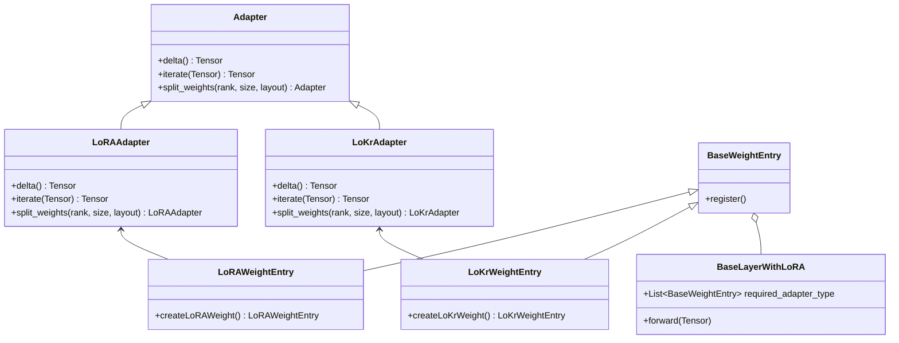

# [Diffusion][LoRA] Rework adapters and implement LoKr adapter

[Upstream PR](https://github.com/sgl-project/sglang/pull/34383) · state: closed · merged: False

## Original PR description

Implementation LoKr adapter base on Roadmap issue #25897

## Motivation

LoKr (Low-Rank Kronecker Product) is a parameter-efficient fine-tuning method and a variant of the popular LoRA technique. LoKr approximates a large weight update matrix by decomposing it into two low-rank matrices and combining them using the **Kronecker product**. 


LoKr introduces more expressive adaptation layers by utilising Kronecker products, allowing the model to capture more complex interactions and patterns within the data without significantly increasing the number of parameters.
This boosts expressive power, enabling the model to capture complex data patterns without a heavy parameter increase.

For Stable Diffusion, LoKr offers clear benefits:

- Superior detail by modeling complex spatial textures for more realistic outputs.
- Better style transfer, capturing aesthetic nuances for faithful artistic adaptation.
- Efficient adaptation, achieving strong performance without full parameter updates, saving resources.
- Flexible application, as it can be deployed across various model layers for task-specific tuning.


## Modifications

1. Rework sglang.multimodal_gen.runtime.layers module: generalise behaviour for parallel execution for case inherited from LinearBase, and create ParallelLinear, which implements such behaviour
2. Implementation LoKr based on diagram in  #25897



## Accuracy Tests

For test **Tongyi-MAI/Z-Image-Turbo** has been used as a base model, **Ttio2/Z-Image-Turbo-pencil-sketch** as a LoRA adapter, **F16/z-image-turbo-flow-dpo** as LoKr adapter.

| Model | Peak Memory in MB | Inference Time in sec |
|--------|--------|--------|
| Base Model | 15342 | 3.3874373009894043 |
| Base Model with LoRA | 16180 | 3.44018611201318 |
| Base Model with LoKr | 16216 | 3.44269112899201 |

<details>
<summary>Command line for server launch and request</summary>

Server launch
`HCCL_BUFFSIZE=256 sglang serve --model-path Tongyi-MAI/Z-Image-Turbo --model-type diffusion --dit-cpu-offload false   --num-gpus 1 --port <port number>`

Request 
`curl -sS -X POST "http://localhost:<port number>/v1/images/generations" -H "Content-Type: application/json"  -H "Authorization: Bearer sk-proj-1234567890"  -d '{ "prompt": "woman, Asian ethnicity, white dress, looking away, long hair, outdoor setting, building facade, plants, serene expression, elegance, side profile, standing, daylight, soft focus, pastel colors, fashion, youthful, casual elegance, architectural elements, natural light, tassel detail on dress",  "size": "1024x1024", "response_format": "b64_json"}'`

</details>

<details>
<summary>Command line for setup adapter</summary>

For LoRA adapter:
```
curl -X POST http://localhost:<port number>/v1/set_lora -H "Content-Type: application/json" -d '{"lora_nickname": "lora_name", "lora_path": "Ttio2/Z-Image-Turbo-pencil-sketch", "target": "all", "strength": 1}'
curl -X POST http://localhost:<port number>/v1/merge_lora_weights -H "Content-Type: application/json" -d '{"strength": 1.0}'
```

For LoKr adapter:
```
curl -X POST http://localhost:<port number>/v1/set_lora -H "Content-Type: application/json" -d '{"lora_nickname": "lora_name", "lora_path": "F16/z-image-turbo-flow-dpo", "target": "all", "strength": 1}'
curl -X POST http://localhost:<port number>/v1/merge_lora_weights -H "Content-Type: application/json" -d '{"strength": 1.0}'
```
</details>

<details>
<summary>Output images:</summary>


*Base Model*

*Base Model with LoRA Adapter*

*Base Model with LoKr Adapter*

### Closer look for images with different adapters
Adapter **ifmylove2011/girlslike-zimage** has been trained for drawing different faces. Example below has been shown how woman face is changed depending on used adapter.

*Base Model with different LoKr Adapters*

</details>


## Speed Tests and Profiling

<!-- If this pull request impacts inference speed, provide benchmarking and profiling results. -->

## Checklist

- [x] Format your code according to the [Format code with pre-commit](https://docs.sglang.io/developer_guide/contribution_guide.html#format-code-with-pre-commit).
- [x] Add unit tests according to the [Run and add unit tests](https://docs.sglang.io/developer_guide/contribution_guide.html#run-and-add-unit-tests).
- [ ] Update documentation according to [Write documentations](https://docs.sglang.io/developer_guide/contribution_guide.html#write-documentations).
- [ ] Provide accuracy and speed benchmark results according to [Test the accuracy](https://docs.sglang.io/developer_guide/contribution_guide.html#test-the-accuracy) and [Benchmark the speed](https://docs.sglang.io/developer_guide/contribution_guide.html#benchmark-the-speed).
- [x] Follow the SGLang code style [guidance](https://docs.sglang.io/developer_guide/contribution_guide.html#code-style-guidance).

## Review and Merge Process

1. Ping Merge Oncalls to start the process. See the [PR Merge Process](https://github.com/sgl-project/sglang/blob/main/.github/MAINTAINER.md#pull-request-merge-process).
4. Get approvals from [CODEOWNERS](https://github.com/sgl-project/sglang/blob/main/.github/CODEOWNERS) and other reviewers.
5. Trigger CI tests with [comments](https://docs.sglang.io/developer_guide/contribution_guide.html#how-to-trigger-ci-tests) or contact authorized users to do so.
   - Common commands include `/tag-and-rerun-ci`, `/tag-run-ci-label`, `/rerun-failed-ci`
6. After green CI and required approvals, ask Merge Oncalls or people with Write permission to merge the PR.


<!-- pr-states:start -->
---
### CI States

Latest PR Test (Base): <!-- slot:pr-test:start -->:x: **Missing `run-ci` label** -- add it to run CI tests.<!-- slot:pr-test:end -->
Latest PR Test (Extra): <!-- slot:pr-test-extra:start -->:x: **Blocked** -- `run-ci` is required first.<!-- slot:pr-test-extra:end -->
Latest PR Test (AMD ROCm 7.2): <!-- slot:pr-test-amd-rocm720:start -->:heavy_minus_sign: **No AMD PR run found for this commit**.<!-- slot:pr-test-amd-rocm720:end -->
<!-- pr-states:end -->

## Review and discussion

### reviews

- ping1jing2 · COMMENTED · 2026-08-28T20:08:41Z · [source](https://github.com/sgl-project/sglang/pull/34383#pullrequestreview-5054522654)

(No body; status only.)

- vlserov · COMMENTED · 2026-09-02T12:04:32Z · [source](https://github.com/sgl-project/sglang/pull/34383#pullrequestreview-5089360964)

(No body; status only.)

### issue_comments

- ping1jing2 · comment · 2026-08-28T20:09:57Z · [source](https://github.com/sgl-project/sglang/pull/34383#issuecomment-5457264101)

there are more refactor works in your PR, please add more descriptions for this part

- github-actions[bot] · comment · 2026-10-11T01:36:55Z · [source](https://github.com/sgl-project/sglang/pull/34383#issuecomment-6104256756)

Thanks @vlserov. Closing this because it is still a draft and has not been updated in 33 days.

Reopen it if the work is still relevant.

Some directories moved recently, so an older branch may need retargeting:
`sgl-kernel/` -> `python/sglang/kernels/aot/`, `python/sglang/jit_kernel/`
-> `python/sglang/kernels/jit/`, `docs/` -> `docs/docs/` (`.mdx`),
`bench_serving.py` -> `benchmark/serving.py`, `test/srt/` -> `test/registered/`.

### inline_comments

- ping1jing2 · comment · 2026-08-28T19:43:22Z · [source](https://github.com/sgl-project/sglang/pull/34383#discussion_r3883542245)

File: `python/sglang/multimodal_gen/runtime/layers/lora/linear.py` · line 78

this function is neither `self` nor `staticmethod`, please double check it

- ping1jing2 · comment · 2026-08-28T19:55:00Z · [source](https://github.com/sgl-project/sglang/pull/34383#discussion_r3883611316)

File: `python/sglang/multimodal_gen/runtime/layers/lora/linear.py` · line 82

i don't think we need `_recursive_apply` here, you just need to reuse `named_parameters` from PyTorch

```python
for name, param in self.named_parameters(recurse=False):
    if isinstance(param.data, DTensor):
        setattr(self, name, nn.Parameter(param.data.to_local()))
```

- ping1jing2 · comment · 2026-08-28T19:55:25Z · [source](https://github.com/sgl-project/sglang/pull/34383#discussion_r3883613834)

File: `python/sglang/multimodal_gen/runtime/layers/lora/linear.py` · line 93

same problems as before

- ping1jing2 · comment · 2026-08-28T19:57:05Z · [source](https://github.com/sgl-project/sglang/pull/34383#discussion_r3883623921)

File: `python/sglang/multimodal_gen/runtime/layers/lora/linear.py` · line 138

there is no `base_layer` in Base class

- ping1jing2 · comment · 2026-08-28T20:02:47Z · [source](https://github.com/sgl-project/sglang/pull/34383#discussion_r3883662227)

File: `python/sglang/multimodal_gen/runtime/layers/lora/linear.py` · line 77

you are supposed to use `abc.ABC` here, then `@abstractmethod` will make affect

- ping1jing2 · comment · 2026-08-28T20:06:16Z · [source](https://github.com/sgl-project/sglang/pull/34383#discussion_r3883696305)

File: `python/sglang/multimodal_gen/runtime/layers/linear.py` · line 223

can you explain why you add one more class here

- ping1jing2 · comment · 2026-08-28T20:06:49Z · [source](https://github.com/sgl-project/sglang/pull/34383#discussion_r3883700077)

File: `python/sglang/multimodal_gen/runtime/pipelines_core/lora_format_adapter.py` · line 14

please update the class name 

- ping1jing2 · comment · 2026-08-28T20:08:31Z · [source](https://github.com/sgl-project/sglang/pull/34383#discussion_r3883712053)

File: `python/sglang/multimodal_gen/runtime/pipelines_core/lora_format_adapter.py` · line 24

how about we add one more `LoKrFormat` rather than change the exist class?

- vlserov · comment · 2026-09-02T12:04:32Z · [source](https://github.com/sgl-project/sglang/pull/34383#discussion_r3913865753)

File: `python/sglang/multimodal_gen/runtime/layers/linear.py` · line 223

Made separate PR #37460 for explaining reason for changes

## Changed files and fixed code

- `python/sglang/multimodal_gen/runtime/layers/linear.py` · modified · additions 58 / deletions 27
  - [head](https://github.com/vlserov/open-source-sglang/blob/8ac6b13eb39d248576928e13c9bff5db4554081e/python/sglang/multimodal_gen/runtime/layers/linear.py)
  - [base](https://github.com/sgl-project/sglang/blob/d8a61c26a662de2cc3791c33235b024c25bd61d7/python/sglang/multimodal_gen/runtime/layers/linear.py)
- `python/sglang/multimodal_gen/runtime/layers/lora/linear.py` · modified · additions 489 / deletions 369
  - [head](https://github.com/vlserov/open-source-sglang/blob/8ac6b13eb39d248576928e13c9bff5db4554081e/python/sglang/multimodal_gen/runtime/layers/lora/linear.py)
  - [base](https://github.com/sgl-project/sglang/blob/d8a61c26a662de2cc3791c33235b024c25bd61d7/python/sglang/multimodal_gen/runtime/layers/lora/linear.py)
- `python/sglang/multimodal_gen/runtime/pipelines_core/lora_format_adapter.py` · modified · additions 59 / deletions 29
  - [head](https://github.com/vlserov/open-source-sglang/blob/8ac6b13eb39d248576928e13c9bff5db4554081e/python/sglang/multimodal_gen/runtime/pipelines_core/lora_format_adapter.py)
  - [base](https://github.com/sgl-project/sglang/blob/d8a61c26a662de2cc3791c33235b024c25bd61d7/python/sglang/multimodal_gen/runtime/pipelines_core/lora_format_adapter.py)
- `python/sglang/multimodal_gen/runtime/pipelines_core/lora_pipeline.py` · modified · additions 62 / deletions 188
  - [head](https://github.com/vlserov/open-source-sglang/blob/8ac6b13eb39d248576928e13c9bff5db4554081e/python/sglang/multimodal_gen/runtime/pipelines_core/lora_pipeline.py)
  - [base](https://github.com/sgl-project/sglang/blob/d8a61c26a662de2cc3791c33235b024c25bd61d7/python/sglang/multimodal_gen/runtime/pipelines_core/lora_pipeline.py)
- `python/sglang/multimodal_gen/runtime/pipelines_core/lora_pipeline_utils.py` · added · additions 134 / deletions 0
  - [head](https://github.com/vlserov/open-source-sglang/blob/8ac6b13eb39d248576928e13c9bff5db4554081e/python/sglang/multimodal_gen/runtime/pipelines_core/lora_pipeline_utils.py)
  - [base](https://github.com/sgl-project/sglang/blob/d8a61c26a662de2cc3791c33235b024c25bd61d7/python/sglang/multimodal_gen/runtime/pipelines_core/lora_pipeline_utils.py)
- `python/sglang/multimodal_gen/test/unit/test_lora_commit_as_base.py` · modified · additions 131 / deletions 15
  - [head](https://github.com/vlserov/open-source-sglang/blob/8ac6b13eb39d248576928e13c9bff5db4554081e/python/sglang/multimodal_gen/test/unit/test_lora_commit_as_base.py)
  - [base](https://github.com/sgl-project/sglang/blob/d8a61c26a662de2cc3791c33235b024c25bd61d7/python/sglang/multimodal_gen/test/unit/test_lora_commit_as_base.py)
- `python/sglang/multimodal_gen/test/unit/test_lora_format_adapter.py` · modified · additions 31 / deletions 19
  - [head](https://github.com/vlserov/open-source-sglang/blob/8ac6b13eb39d248576928e13c9bff5db4554081e/python/sglang/multimodal_gen/test/unit/test_lora_format_adapter.py)
  - [base](https://github.com/sgl-project/sglang/blob/d8a61c26a662de2cc3791c33235b024c25bd61d7/python/sglang/multimodal_gen/test/unit/test_lora_format_adapter.py)
- `python/sglang/multimodal_gen/test/unit/test_lora_inference_mode.py` · modified · additions 36 / deletions 4
  - [head](https://github.com/vlserov/open-source-sglang/blob/8ac6b13eb39d248576928e13c9bff5db4554081e/python/sglang/multimodal_gen/test/unit/test_lora_inference_mode.py)
  - [base](https://github.com/sgl-project/sglang/blob/d8a61c26a662de2cc3791c33235b024c25bd61d7/python/sglang/multimodal_gen/test/unit/test_lora_inference_mode.py)

## Evidence and interpretation boundary

[Original JSON, discussions and patches](../../../../../../evidence/prs/sgl-project--sglang/34383-e1cdf9637be067b7c41d9974d473be1790334a408b334b039ba5a5541b75861c.json) · SHA-256 `e1cdf9637be067b7c41d9974d473be1790334a408b334b039ba5a5541b75861c`.

Diff complete: True. Missing/binary/truncated patches require pinned source inspection. This is a source page, not an independently verified optimization case. Open, merged and released are different states; recheck the deployed dependency.
