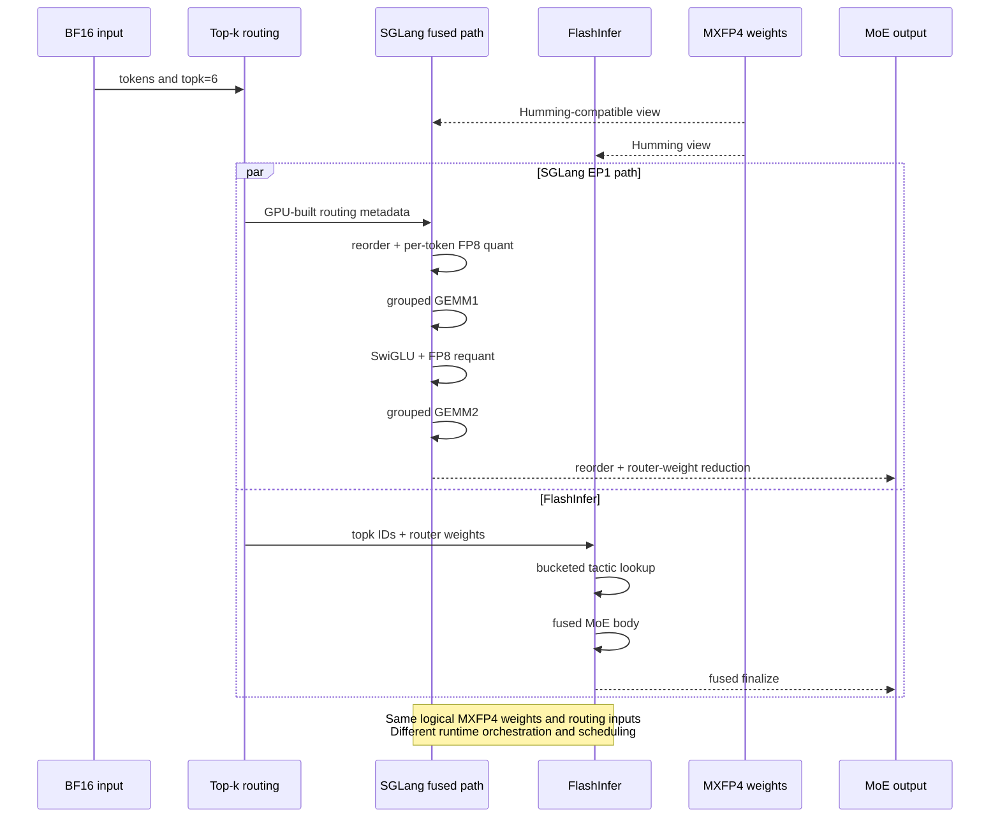

# [Feature] Add a fused CUTLASS MXFP4A8 MoE backend for SM90.

[Upstream PR](https://github.com/sgl-project/sglang/pull/34682) · state: open · merged: False

## Original PR description

## Motivation

This PR adds an SGLang-native CUTLASS **MXFP4A8 fused MoE backend for
SM90/Hopper**, targeting MXFP4-expert models such as DeepSeek-V4-Flash.

The implementation keeps expert weights in MXFP4 (E2M1 with block-32 E8M0
scales), dynamically quantizes activations to FP8 E4M3, and executes both
expert GEMMs on Hopper FP8 tensor cores.

The current scope is deliberately limited to **TP deployments with EP=1**.
`EP>1` is not supported by this PR and is rejected explicitly during weight
initialization.

## Summary

- Add an MXFP4-to-FP8 mixed-input CUTLASS path for SM90.
- Add load-time Humming-compatible MXFP4 weight preprocessing.
- Add an EP1 fused runtime covering routing metadata preparation, input
  permutation and quantization, GEMM1, SwiGLU, requantization, GEMM2, output
  permutation, router weighting, and top-k reduction.
- Add shape-specialized SM90 schedulers for serving-time token buckets.
- Preserve the existing INT4A8 path unchanged.
- Add numerical tests for MXFP4 conversion, scale layouts, grouped GEMM, and
  cross-backend consistency against FlashInfer.

The backend is selected with:

```bash
--moe-runner-backend cutlass
```

### Execution flow



## Implementation

### MXFP4A8 tensor-core path

Weights remain in checkpoint-native MXFP4. Activations are quantized per token
to FP8 E4M3. The E2M1 values
`{0, 0.5, 1, 1.5, 2, 3, 4, 6}` are exactly representable in E4M3, so the
E2M1-to-E4M3 conversion uses a lossless signed-nibble lookup.

The mixed-input mainloop derives the scale group from
`TileK / PackedScalesNum`, allowing the existing INT4A8 group-128 path and the
new MXFP4A8 group-32 path to share the same mainloop without changing INT4
behavior.

### Load-time weight preprocessing

The EP1 path prepares one runtime representation after checkpoint loading:

- interleaved MXFP4 weights;
- folded E8M0 offsets;
- one residual scale per expert.

The representation follows the SM90 Humming preprocessing semantics. Runtime
execution is implemented by SGLang AOT kernels.

Only the fused representation is retained for EP1 to avoid storing two complete
weight layouts on H20.

### Fused EP1 execution

`cutlass_mxfp4a8_fused_moe_core` performs:

1. expert-offset, problem-size, and permutation preparation;
2. routed-input reorder and per-token FP8 quantization;
3. grouped GEMM1;
4. fused SwiGLU, optional clamp, and FP8 requantization;
5. grouped GEMM2;
6. output reorder, FP32 router-weight multiplication,
   `routed_scaling_factor`, and top-k reduction.

For `M <= 64`, metadata preparation and shuffled input quantization use a
bounded fused CUDA path. Larger batches use the AOT metadata and quantization
kernels without host synchronization. Intermediate tensors are retained in
reusable workspaces.

### SM90 scheduling

The implementation includes:

- a persistent single-warpgroup ping-pong kernel for tiny and arbitrary
  serving-time shapes;
- a precomputed grouped scheduler with prebuilt TMA descriptors for validated
  large-M buckets;
- a packed warp-shuffle GEMM2 epilogue.

| Tokens | GEMM1 config | GEMM2 config |
|---:|---:|---:|
| `M <= 64` | 100 | 100 |
| `M = 2048` | 313 | 313 |
| `M = 4096` | 320 | 334 |
| `M >= 8192` | 322 | 334 |
| Other shapes | 101 | 101 |

## Validation

### DeepSeek-V4-Flash end-to-end A/B

Hardware and runtime:

- 8x NVIDIA H20;
- native DeepSeek-V4-Flash checkpoint;
- TP8 / EP1;
- FP8 KV cache and DSV4 attention;
- separate fresh containers for the two backends;
- identical package versions except for the locally built `sglang-kernel`
  wheel;
- FlashInfer 0.6.18 W4A8 as the upstream baseline.

Serving workload:

- exact paired token-ID prompts;
- 128 requests;
- concurrency 32;
- output length 1536;
- repeat 1.

| Input -> output | CUTLASS output tok/s | FlashInfer output tok/s | Throughput | Mean TTFT |
|---|---:|---:|---:|---:|
| 8192 -> 1536 | 1399.19 | 1247.18 | **+12.19%** | **-17.26%** |
| 16384 -> 1536 | 933.52 | 814.49 | **+14.61%** | **-16.95%** |
| 32768 -> 1536 | 541.48 | 466.34 | **+16.11%** | **-16.18%** |

All 384 requests completed successfully. Neither server log contained a CUDA
error, OOM, or traceback.

### GSM8K

The complete 1319-question GSM8K set was evaluated with five fixed shots,
temperature 0, 32 threads, and repeat 1.

| Backend | Correct | Accuracy |
|---|---:|---:|
| CUTLASS MXFP4A8 | 1252 / 1319 | 94.9204% |
| FlashInfer | 1246 / 1319 | 94.4655% |

The paired discordance was 16 CUTLASS-only correct versus 10 Humming-only
correct (exact McNemar `p=0.3269`). This run does not establish a statistically
significant accuracy difference.

### Kernel and operator tests

| Test suite | Result |
|---|---:|
| CUTLASS MXFP4 grouped GEMM | 11 passed |
| CUTLASS vs FlashInfer fused MoE | 3 passed |
| Existing INT4 grouped GEMM | 605 passed |
| Focused DSV4 norm/RoPE | 16 passed |

The cross-backend test generates one logical MXFP4 weight set and uses the same
BF16 input, top-k IDs, and router weights for both implementations. It covers
`M=1`, `M=16`, and `M=65` with DeepSeek-V4-Flash `topk=6`, and requires:

- normalized L2 error `< 2.5%`;
- cosine similarity `> 0.9995`.

## Limitations

- Supported hardware: SM90/Hopper.
- Supported expert-parallel configuration: **EP=1 only**.
- `EP>1` is explicitly rejected; this PR does not claim a legacy or DeepEP
  fallback.
- Hidden size must be divisible by 128; intermediate size must be divisible by
  32 and may be padded for validated GEMM shapes.
- The load-time representation reuses FlashInfer's SM90 preprocessing
  semantics; runtime execution uses SGLang AOT kernels.
- The reported performance results are specific to DeepSeek-V4-Flash on 8x H20
  with the configuration above.

## Checklist

- [x] Format code with the repository pre-commit configuration.
- [x] Add unit tests.
- [x] Validate MXFP4, INT4, and DSV4 regressions.
- [x] Provide complete GSM8K accuracy results.
- [x] Provide paired end-to-end performance results against current upstream
      FlashInfer.
- [ ] Add user-facing documentation if maintainers request it.

<!-- pr-states:start -->
---
### CI States

Latest PR Test (Base): <!-- slot:pr-test:start -->:x: [Run #38031843663](https://github.com/sgl-project/sglang/actions/runs/38031843663)<!-- slot:pr-test:end -->
Latest PR Test (Extra): <!-- slot:pr-test-extra:start -->:x: [Run #38031843457](https://github.com/sgl-project/sglang/actions/runs/38031843457)<!-- slot:pr-test-extra:end -->
Latest PR Test (AMD ROCm 10): <!-- slot:pr-test-amd:start -->:x: [Run #38031843607](https://github.com/sgl-project/sglang/actions/runs/38031843607)<!-- slot:pr-test-amd:end -->
<!-- pr-states:end -->

## Review and discussion

### reviews

- AniZpZ · COMMENTED · 2026-09-03T06:33:04Z · [source](https://github.com/sgl-project/sglang/pull/34682#pullrequestreview-5098583211)

(No body; status only.)

- AniZpZ · COMMENTED · 2026-09-03T06:38:33Z · [source](https://github.com/sgl-project/sglang/pull/34682#pullrequestreview-5098624396)

(No body; status only.)

- yuyu5333 · COMMENTED · 2026-09-03T09:09:41Z · [source](https://github.com/sgl-project/sglang/pull/34682#pullrequestreview-5099995481)

(No body; status only.)

- yuyu5333 · COMMENTED · 2026-09-04T09:57:37Z · [source](https://github.com/sgl-project/sglang/pull/34682#pullrequestreview-5111573155)

(No body; status only.)

### issue_comments

- AniZpZ · comment · 2026-08-26T12:17:01Z · [source](https://github.com/sgl-project/sglang/pull/34682#issuecomment-5425132190)

/rerun-failed-ci

- yuyu5333 · comment · 2026-08-31T02:15:19Z · [source](https://github.com/sgl-project/sglang/pull/34682#issuecomment-5472868591)

### Update fused CUTLASS MXFP4A8 MoE backend for SM90

Using the following deployment method, I compared the gsm8k test approach provided in https://github.com/sgl-project/sglang/pull/34967, and the results are as follows:

``` bash
PYTHONPATH=/sgl-workspace/sglang/python \
  FLASHINFER_DISABLE_VERSION_CHECK=1 \
  SGLANG_ENABLE_THINKING=1 \
  osl=200k \
  SGLANG_DSV4_2604_SUBMODE=2604B \
  SGLANG_DSV4_FP4_EXPERTS=1 \
  SGLANG_JIT_DEEPGEMM_PRECOMPILE=0 \
  GLOO_SOCKET_IFNAME=eth0 \
  NCCL_MIN_NCHANNELS=24 \
  NCCL_IB_QPS_PER_CONNECTION=8 \
  python -m sglang.launch_server \
    --model-path /data/models/DeepSeek-V4-Flash \
    --trust-remote-code \
    --tp 8 \
    --attention-backend dsv4 \
    --moe-runner-backend cutlass \  # 34967 with flashinfer_mxfp4
    --cuda-graph-max-bs 32 \
    --max-running-requests 32 \
    --mem-fraction-static 0.8 \
    --speculative-algo EAGLE \
    --speculative-num-steps 3 \
    --speculative-eagle-topk 1 \
    --speculative-num-draft-tokens 4 \
    --tool-call-parser deepseekv4 \
    --reasoning-parser deepseek-v4 \
    --enable-metrics \
    --host 0.0.0.0 \
    --port 30000
```

``` bash
PYTHONPATH=/sgl-workspace/sglang/python \
python -m sglang.test.run_eval \
  --port 30000 \
  --eval-name gsm8k \
  --num-examples 200 \
  --api chat \
  --max-tokens 1024 \
  --num-threads 32 \
  --temperature 0 \
  --gsm8k-data-path /tmp/gsm8k-test.jsonl
```

``` bash
# cutlass
100%|████████████████████████████████████████████████| 200/200 [01:04<00:00,  3.11it/s]
Total latency: 64.299 s
Score: 0.980
Output throughput: 942.364 token/s

# flashinfer  pr 34967
100%|████████████████████████████████████████████████| 200/200 [01:09<00:00,  2.88it/s]
Total latency: 69.557 s
Score: 0.970
Output throughput: 853.817 token/s
```

- AniZpZ · comment · 2026-09-07T09:28:53Z · [source](https://github.com/sgl-project/sglang/pull/34682#issuecomment-5568526439)

/rerun-failed-ci

- AniZpZ · comment · 2026-09-07T09:29:12Z · [source](https://github.com/sgl-project/sglang/pull/34682#issuecomment-5568530663)

fix lint plz @yuyu5333 

- yuyu5333 · comment · 2026-09-07T13:39:19Z · [source](https://github.com/sgl-project/sglang/pull/34682#issuecomment-5571488854)

> fix lint plz @yuyu5333

Done.

- yuyu5333 · comment · 2026-09-07T13:39:38Z · [source](https://github.com/sgl-project/sglang/pull/34682#issuecomment-5571492597)

/rerun-failed-ci

- yuyu5333 · comment · 2026-09-10T03:10:22Z · [source](https://github.com/sgl-project/sglang/pull/34682#issuecomment-5612062319)

/rerun-failed-ci

- yuyu5333 · comment · 2026-09-17T07:48:26Z · [source](https://github.com/sgl-project/sglang/pull/34682#issuecomment-5710893925)

/rerun-failed-ci

### inline_comments

- AniZpZ · comment · 2026-09-03T06:33:04Z · [source](https://github.com/sgl-project/sglang/pull/34682#discussion_r3921739592)

File: `python/sglang/kernels/aot/csrc/gemm/per_token_quant_fp8.cu` · line None

how to prevent scale to be zero

- AniZpZ · comment · 2026-09-03T06:38:34Z · [source](https://github.com/sgl-project/sglang/pull/34682#discussion_r3921775218)

File: `python/sglang/kernels/aot/tests/test_cutlass_mxfp4a8_moe_mm.py` · line None

not a valid test for CI？

- yuyu5333 · comment · 2026-09-03T09:09:40Z · [source](https://github.com/sgl-project/sglang/pull/34682#discussion_r3922922078)

File: `python/sglang/kernels/aot/csrc/gemm/per_token_quant_fp8.cu` · line None

We did not previously add a guard for this because a zero scaling factor is a valid case: when the token row is entirely zero, such as with CUDA-graph dummy inputs or padding rows, the computation `scale = amax / FP8_E4M3_MAX` naturally evaluates to zero, and the caller cannot rule out this scenario.

However, this causes `1/scale` to become infinity, and `0 * Inf` produces a non-numeric value (`NaN`). Therefore, I will add a protective change: `scale_inv = (scale == 0) ? 0 : 1/scale`. This yields `q = 0` and `scale = 0`, allowing exact reconstruction during dequantization. This is also the handling convention already used in the warp kernel (`sgl-kernel #8130`); this change extends that convention to the three kernels that had not previously implemented this logic.

- yuyu5333 · comment · 2026-09-04T09:57:37Z · [source](https://github.com/sgl-project/sglang/pull/34682#discussion_r3932894217)

File: `python/sglang/kernels/aot/tests/test_cutlass_mxfp4a8_moe_mm.py` · line None

Fixed: converted to parametrized pytest cases with assert_close against a fp32-dequant golden, skipif(not is_hopper()) like the w4a8 test, covering single/multi-expert and both act-scale layouts.

## Changed files and fixed code

- `python/sglang/kernels/aot/CMakeLists.txt` · modified · additions 3 / deletions 0
  - [head](https://github.com/bytedance-iaas/sglang/blob/7f05683894ad26ea046f565d4570b4b63dc85ea8/python/sglang/kernels/aot/CMakeLists.txt)
  - [base](https://github.com/sgl-project/sglang/blob/6e8f3e09dd03a95e9a903d940427d007427bff47/python/sglang/kernels/aot/CMakeLists.txt)
- `python/sglang/kernels/aot/csrc/common_extension.cc` · modified · additions 40 / deletions 0
  - [head](https://github.com/bytedance-iaas/sglang/blob/7f05683894ad26ea046f565d4570b4b63dc85ea8/python/sglang/kernels/aot/csrc/common_extension.cc)
  - [base](https://github.com/sgl-project/sglang/blob/6e8f3e09dd03a95e9a903d940427d007427bff47/python/sglang/kernels/aot/csrc/common_extension.cc)
- `python/sglang/kernels/aot/csrc/cutlass_extensions/detail/collective/mixed_input_utils.hpp` · modified · additions 310 / deletions 2
  - [head](https://github.com/bytedance-iaas/sglang/blob/7f05683894ad26ea046f565d4570b4b63dc85ea8/python/sglang/kernels/aot/csrc/cutlass_extensions/detail/collective/mixed_input_utils.hpp)
  - [base](https://github.com/sgl-project/sglang/blob/6e8f3e09dd03a95e9a903d940427d007427bff47/python/sglang/kernels/aot/csrc/cutlass_extensions/detail/collective/mixed_input_utils.hpp)
- `python/sglang/kernels/aot/csrc/cutlass_extensions/detail/collective/mxfp4_numeric_conversion.hpp` · added · additions 147 / deletions 0
  - [head](https://github.com/bytedance-iaas/sglang/blob/7f05683894ad26ea046f565d4570b4b63dc85ea8/python/sglang/kernels/aot/csrc/cutlass_extensions/detail/collective/mxfp4_numeric_conversion.hpp)
  - [base](https://github.com/sgl-project/sglang/blob/6e8f3e09dd03a95e9a903d940427d007427bff47/python/sglang/kernels/aot/csrc/cutlass_extensions/detail/collective/mxfp4_numeric_conversion.hpp)
- `python/sglang/kernels/aot/csrc/cutlass_extensions/epilogue/collective/default_epilogue_array_per_token_scale.hpp` · added · additions 641 / deletions 0
  - [head](https://github.com/bytedance-iaas/sglang/blob/7f05683894ad26ea046f565d4570b4b63dc85ea8/python/sglang/kernels/aot/csrc/cutlass_extensions/epilogue/collective/default_epilogue_array_per_token_scale.hpp)
  - [base](https://github.com/sgl-project/sglang/blob/6e8f3e09dd03a95e9a903d940427d007427bff47/python/sglang/kernels/aot/csrc/cutlass_extensions/epilogue/collective/default_epilogue_array_per_token_scale.hpp)
- `python/sglang/kernels/aot/csrc/cutlass_extensions/epilogue/collective/default_epilogue_array_swiglu_quant.hpp` · added · additions 270 / deletions 0
  - [head](https://github.com/bytedance-iaas/sglang/blob/7f05683894ad26ea046f565d4570b4b63dc85ea8/python/sglang/kernels/aot/csrc/cutlass_extensions/epilogue/collective/default_epilogue_array_swiglu_quant.hpp)
  - [base](https://github.com/sgl-project/sglang/blob/6e8f3e09dd03a95e9a903d940427d007427bff47/python/sglang/kernels/aot/csrc/cutlass_extensions/epilogue/collective/default_epilogue_array_swiglu_quant.hpp)
- `python/sglang/kernels/aot/csrc/cutlass_extensions/epilogue/collective/sm90_epilogue_array_tma_warpspecialized_mixed_input.hpp` · added · additions 1223 / deletions 0
  - [head](https://github.com/bytedance-iaas/sglang/blob/7f05683894ad26ea046f565d4570b4b63dc85ea8/python/sglang/kernels/aot/csrc/cutlass_extensions/epilogue/collective/sm90_epilogue_array_tma_warpspecialized_mixed_input.hpp)
  - [base](https://github.com/sgl-project/sglang/blob/6e8f3e09dd03a95e9a903d940427d007427bff47/python/sglang/kernels/aot/csrc/cutlass_extensions/epilogue/collective/sm90_epilogue_array_tma_warpspecialized_mixed_input.hpp)
- `python/sglang/kernels/aot/csrc/cutlass_extensions/epilogue/fusion/sm90_ptr_array_per_token_scale_callbacks_tma_warpspecialized.hpp` · added · additions 127 / deletions 0
  - [head](https://github.com/bytedance-iaas/sglang/blob/7f05683894ad26ea046f565d4570b4b63dc85ea8/python/sglang/kernels/aot/csrc/cutlass_extensions/epilogue/fusion/sm90_ptr_array_per_token_scale_callbacks_tma_warpspecialized.hpp)
  - [base](https://github.com/sgl-project/sglang/blob/6e8f3e09dd03a95e9a903d940427d007427bff47/python/sglang/kernels/aot/csrc/cutlass_extensions/epilogue/fusion/sm90_ptr_array_per_token_scale_callbacks_tma_warpspecialized.hpp)
- `python/sglang/kernels/aot/csrc/cutlass_extensions/gemm/collective/builders/sm90_gmma_builder_mixed_input.inl` · modified · additions 121 / deletions 28
  - [head](https://github.com/bytedance-iaas/sglang/blob/7f05683894ad26ea046f565d4570b4b63dc85ea8/python/sglang/kernels/aot/csrc/cutlass_extensions/gemm/collective/builders/sm90_gmma_builder_mixed_input.inl)
  - [base](https://github.com/sgl-project/sglang/blob/6e8f3e09dd03a95e9a903d940427d007427bff47/python/sglang/kernels/aot/csrc/cutlass_extensions/gemm/collective/builders/sm90_gmma_builder_mixed_input.inl)
- `python/sglang/kernels/aot/csrc/cutlass_extensions/gemm/collective/collective_builder_mixed_input.hpp` · modified · additions 1 / deletions 0
  - [head](https://github.com/bytedance-iaas/sglang/blob/7f05683894ad26ea046f565d4570b4b63dc85ea8/python/sglang/kernels/aot/csrc/cutlass_extensions/gemm/collective/collective_builder_mixed_input.hpp)
  - [base](https://github.com/sgl-project/sglang/blob/6e8f3e09dd03a95e9a903d940427d007427bff47/python/sglang/kernels/aot/csrc/cutlass_extensions/gemm/collective/collective_builder_mixed_input.hpp)
- `python/sglang/kernels/aot/csrc/cutlass_extensions/gemm/collective/collective_mma_array_mixed_input.hpp` · modified · additions 35 / deletions 0
  - [head](https://github.com/bytedance-iaas/sglang/blob/7f05683894ad26ea046f565d4570b4b63dc85ea8/python/sglang/kernels/aot/csrc/cutlass_extensions/gemm/collective/collective_mma_array_mixed_input.hpp)
  - [base](https://github.com/sgl-project/sglang/blob/6e8f3e09dd03a95e9a903d940427d007427bff47/python/sglang/kernels/aot/csrc/cutlass_extensions/gemm/collective/collective_mma_array_mixed_input.hpp)
- `python/sglang/kernels/aot/csrc/cutlass_extensions/gemm/collective/sm90_mma_array_tma_gmma_rs_warpspecialized_mixed_input_.hpp` · modified · additions 302 / deletions 26
  - [head](https://github.com/bytedance-iaas/sglang/blob/7f05683894ad26ea046f565d4570b4b63dc85ea8/python/sglang/kernels/aot/csrc/cutlass_extensions/gemm/collective/sm90_mma_array_tma_gmma_rs_warpspecialized_mixed_input_.hpp)
  - [base](https://github.com/sgl-project/sglang/blob/6e8f3e09dd03a95e9a903d940427d007427bff47/python/sglang/kernels/aot/csrc/cutlass_extensions/gemm/collective/sm90_mma_array_tma_gmma_rs_warpspecialized_mixed_input_.hpp)
- `python/sglang/kernels/aot/csrc/cutlass_extensions/gemm/collective/sm90_mma_array_tma_gmma_rs_warpspecialized_mixed_input_prescale.hpp` · added · additions 1342 / deletions 0
  - [head](https://github.com/bytedance-iaas/sglang/blob/7f05683894ad26ea046f565d4570b4b63dc85ea8/python/sglang/kernels/aot/csrc/cutlass_extensions/gemm/collective/sm90_mma_array_tma_gmma_rs_warpspecialized_mixed_input_prescale.hpp)
  - [base](https://github.com/sgl-project/sglang/blob/6e8f3e09dd03a95e9a903d940427d007427bff47/python/sglang/kernels/aot/csrc/cutlass_extensions/gemm/collective/sm90_mma_array_tma_gmma_rs_warpspecialized_mixed_input_prescale.hpp)
- `python/sglang/kernels/aot/csrc/cutlass_extensions/gemm/kernel/sm90_gemm_array_tma_single_warpgroup_persistent.hpp` · added · additions 445 / deletions 0
  - [head](https://github.com/bytedance-iaas/sglang/blob/7f05683894ad26ea046f565d4570b4b63dc85ea8/python/sglang/kernels/aot/csrc/cutlass_extensions/gemm/kernel/sm90_gemm_array_tma_single_warpgroup_persistent.hpp)
  - [base](https://github.com/sgl-project/sglang/blob/6e8f3e09dd03a95e9a903d940427d007427bff47/python/sglang/kernels/aot/csrc/cutlass_extensions/gemm/kernel/sm90_gemm_array_tma_single_warpgroup_persistent.hpp)
- `python/sglang/kernels/aot/csrc/cutlass_extensions/gemm/kernel/sm90_gemm_array_tma_warpspecialized_pingpong_precomputed.hpp` · added · additions 1042 / deletions 0
  - [head](https://github.com/bytedance-iaas/sglang/blob/7f05683894ad26ea046f565d4570b4b63dc85ea8/python/sglang/kernels/aot/csrc/cutlass_extensions/gemm/kernel/sm90_gemm_array_tma_warpspecialized_pingpong_precomputed.hpp)
  - [base](https://github.com/sgl-project/sglang/blob/6e8f3e09dd03a95e9a903d940427d007427bff47/python/sglang/kernels/aot/csrc/cutlass_extensions/gemm/kernel/sm90_gemm_array_tma_warpspecialized_pingpong_precomputed.hpp)
- `python/sglang/kernels/aot/csrc/cutlass_extensions/gemm/kernel/sm90_gemm_array_tma_warpspecialized_precomputed_decl.hpp` · added · additions 43 / deletions 0
  - [head](https://github.com/bytedance-iaas/sglang/blob/7f05683894ad26ea046f565d4570b4b63dc85ea8/python/sglang/kernels/aot/csrc/cutlass_extensions/gemm/kernel/sm90_gemm_array_tma_warpspecialized_precomputed_decl.hpp)
  - [base](https://github.com/sgl-project/sglang/blob/6e8f3e09dd03a95e9a903d940427d007427bff47/python/sglang/kernels/aot/csrc/cutlass_extensions/gemm/kernel/sm90_gemm_array_tma_warpspecialized_precomputed_decl.hpp)
- `python/sglang/kernels/aot/csrc/cutlass_extensions/gemm/kernel/sm90_tile_scheduler_group_precomputed.hpp` · added · additions 559 / deletions 0
  - [head](https://github.com/bytedance-iaas/sglang/blob/7f05683894ad26ea046f565d4570b4b63dc85ea8/python/sglang/kernels/aot/csrc/cutlass_extensions/gemm/kernel/sm90_tile_scheduler_group_precomputed.hpp)
  - [base](https://github.com/sgl-project/sglang/blob/6e8f3e09dd03a95e9a903d940427d007427bff47/python/sglang/kernels/aot/csrc/cutlass_extensions/gemm/kernel/sm90_tile_scheduler_group_precomputed.hpp)
- `python/sglang/kernels/aot/csrc/elementwise/activation.cu` · modified · additions 152 / deletions 0
  - [head](https://github.com/bytedance-iaas/sglang/blob/7f05683894ad26ea046f565d4570b4b63dc85ea8/python/sglang/kernels/aot/csrc/elementwise/activation.cu)
  - [base](https://github.com/sgl-project/sglang/blob/6e8f3e09dd03a95e9a903d940427d007427bff47/python/sglang/kernels/aot/csrc/elementwise/activation.cu)
- `python/sglang/kernels/aot/csrc/gemm/per_token_quant_fp8.cu` · modified · additions 433 / deletions 44
  - [head](https://github.com/bytedance-iaas/sglang/blob/7f05683894ad26ea046f565d4570b4b63dc85ea8/python/sglang/kernels/aot/csrc/gemm/per_token_quant_fp8.cu)
  - [base](https://github.com/sgl-project/sglang/blob/6e8f3e09dd03a95e9a903d940427d007427bff47/python/sglang/kernels/aot/csrc/gemm/per_token_quant_fp8.cu)
- `python/sglang/kernels/aot/csrc/moe/cutlass_moe/w4a8/scaled_mm_entry.cu` · modified · additions 265 / deletions 0
  - [head](https://github.com/bytedance-iaas/sglang/blob/7f05683894ad26ea046f565d4570b4b63dc85ea8/python/sglang/kernels/aot/csrc/moe/cutlass_moe/w4a8/scaled_mm_entry.cu)
  - [base](https://github.com/sgl-project/sglang/blob/6e8f3e09dd03a95e9a903d940427d007427bff47/python/sglang/kernels/aot/csrc/moe/cutlass_moe/w4a8/scaled_mm_entry.cu)
- `python/sglang/kernels/aot/csrc/moe/cutlass_moe/w4a8/w4a8_get_group_starts.cuh` · modified · additions 139 / deletions 56
  - [head](https://github.com/bytedance-iaas/sglang/blob/7f05683894ad26ea046f565d4570b4b63dc85ea8/python/sglang/kernels/aot/csrc/moe/cutlass_moe/w4a8/w4a8_get_group_starts.cuh)
  - [base](https://github.com/sgl-project/sglang/blob/6e8f3e09dd03a95e9a903d940427d007427bff47/python/sglang/kernels/aot/csrc/moe/cutlass_moe/w4a8/w4a8_get_group_starts.cuh)
- `python/sglang/kernels/aot/csrc/moe/cutlass_moe/w4a8/w4a8_grouped_mm_c3x.cu` · modified · additions 433 / deletions 6
  - [head](https://github.com/bytedance-iaas/sglang/blob/7f05683894ad26ea046f565d4570b4b63dc85ea8/python/sglang/kernels/aot/csrc/moe/cutlass_moe/w4a8/w4a8_grouped_mm_c3x.cu)
  - [base](https://github.com/sgl-project/sglang/blob/6e8f3e09dd03a95e9a903d940427d007427bff47/python/sglang/kernels/aot/csrc/moe/cutlass_moe/w4a8/w4a8_grouped_mm_c3x.cu)
- `python/sglang/kernels/aot/csrc/moe/cutlass_moe/w4a8/w4a8_grouped_mm_c3x.cuh` · modified · additions 490 / deletions 71
  - [head](https://github.com/bytedance-iaas/sglang/blob/7f05683894ad26ea046f565d4570b4b63dc85ea8/python/sglang/kernels/aot/csrc/moe/cutlass_moe/w4a8/w4a8_grouped_mm_c3x.cuh)
  - [base](https://github.com/sgl-project/sglang/blob/6e8f3e09dd03a95e9a903d940427d007427bff47/python/sglang/kernels/aot/csrc/moe/cutlass_moe/w4a8/w4a8_grouped_mm_c3x.cuh)
- `python/sglang/kernels/aot/csrc/moe/cutlass_moe/w4a8/w4a8_moe_data.cu` · modified · additions 230 / deletions 0
  - [head](https://github.com/bytedance-iaas/sglang/blob/7f05683894ad26ea046f565d4570b4b63dc85ea8/python/sglang/kernels/aot/csrc/moe/cutlass_moe/w4a8/w4a8_moe_data.cu)
  - [base](https://github.com/sgl-project/sglang/blob/6e8f3e09dd03a95e9a903d940427d007427bff47/python/sglang/kernels/aot/csrc/moe/cutlass_moe/w4a8/w4a8_moe_data.cu)
- `python/sglang/kernels/aot/csrc/moe/cutlass_moe/w4a8/w4a8_swg_precomputed_work_map.cuh` · added · additions 486 / deletions 0
  - [head](https://github.com/bytedance-iaas/sglang/blob/7f05683894ad26ea046f565d4570b4b63dc85ea8/python/sglang/kernels/aot/csrc/moe/cutlass_moe/w4a8/w4a8_swg_precomputed_work_map.cuh)
  - [base](https://github.com/sgl-project/sglang/blob/6e8f3e09dd03a95e9a903d940427d007427bff47/python/sglang/kernels/aot/csrc/moe/cutlass_moe/w4a8/w4a8_swg_precomputed_work_map.cuh)
- `python/sglang/kernels/aot/include/sgl_kernel_ops.h` · modified · additions 119 / deletions 0
  - [head](https://github.com/bytedance-iaas/sglang/blob/7f05683894ad26ea046f565d4570b4b63dc85ea8/python/sglang/kernels/aot/include/sgl_kernel_ops.h)
  - [base](https://github.com/sgl-project/sglang/blob/6e8f3e09dd03a95e9a903d940427d007427bff47/python/sglang/kernels/aot/include/sgl_kernel_ops.h)
- `python/sglang/kernels/aot/python/sgl_kernel/__init__.py` · modified · additions 5 / deletions 0
  - [head](https://github.com/bytedance-iaas/sglang/blob/7f05683894ad26ea046f565d4570b4b63dc85ea8/python/sglang/kernels/aot/python/sgl_kernel/__init__.py)
  - [base](https://github.com/sgl-project/sglang/blob/6e8f3e09dd03a95e9a903d940427d007427bff47/python/sglang/kernels/aot/python/sgl_kernel/__init__.py)
- `python/sglang/kernels/aot/python/sgl_kernel/cutlass_moe.py` · modified · additions 118 / deletions 0
  - [head](https://github.com/bytedance-iaas/sglang/blob/7f05683894ad26ea046f565d4570b4b63dc85ea8/python/sglang/kernels/aot/python/sgl_kernel/cutlass_moe.py)
  - [base](https://github.com/sgl-project/sglang/blob/6e8f3e09dd03a95e9a903d940427d007427bff47/python/sglang/kernels/aot/python/sgl_kernel/cutlass_moe.py)
- `python/sglang/kernels/aot/tests/test_cutlass_mxfp4a8_moe_mm.py` · added · additions 227 / deletions 0
  - [head](https://github.com/bytedance-iaas/sglang/blob/7f05683894ad26ea046f565d4570b4b63dc85ea8/python/sglang/kernels/aot/tests/test_cutlass_mxfp4a8_moe_mm.py)
  - [base](https://github.com/sgl-project/sglang/blob/6e8f3e09dd03a95e9a903d940427d007427bff47/python/sglang/kernels/aot/tests/test_cutlass_mxfp4a8_moe_mm.py)
- `python/sglang/kernels/aot/tests/test_cutlass_mxfp4a8_vs_flashinfer_humming.py` · added · additions 253 / deletions 0
  - [head](https://github.com/bytedance-iaas/sglang/blob/7f05683894ad26ea046f565d4570b4b63dc85ea8/python/sglang/kernels/aot/tests/test_cutlass_mxfp4a8_vs_flashinfer_humming.py)
  - [base](https://github.com/sgl-project/sglang/blob/6e8f3e09dd03a95e9a903d940427d007427bff47/python/sglang/kernels/aot/tests/test_cutlass_mxfp4a8_vs_flashinfer_humming.py)
- `python/sglang/kernels/jit/csrc/gemm/per_token_quant_fp8.cuh` · modified · additions 1 / deletions 1
  - [head](https://github.com/bytedance-iaas/sglang/blob/7f05683894ad26ea046f565d4570b4b63dc85ea8/python/sglang/kernels/jit/csrc/gemm/per_token_quant_fp8.cuh)
  - [base](https://github.com/sgl-project/sglang/blob/6e8f3e09dd03a95e9a903d940427d007427bff47/python/sglang/kernels/jit/csrc/gemm/per_token_quant_fp8.cuh)
- `python/sglang/kernels/ops/moe/ep_moe_kernels.py` · modified · additions 25 / deletions 1
  - [head](https://github.com/bytedance-iaas/sglang/blob/7f05683894ad26ea046f565d4570b4b63dc85ea8/python/sglang/kernels/ops/moe/ep_moe_kernels.py)
  - [base](https://github.com/sgl-project/sglang/blob/6e8f3e09dd03a95e9a903d940427d007427bff47/python/sglang/kernels/ops/moe/ep_moe_kernels.py)
- `python/sglang/srt/layers/moe/cutlass_mxfp4a8_fused_moe.py` · added · additions 499 / deletions 0
  - [head](https://github.com/bytedance-iaas/sglang/blob/7f05683894ad26ea046f565d4570b4b63dc85ea8/python/sglang/srt/layers/moe/cutlass_mxfp4a8_fused_moe.py)
  - [base](https://github.com/sgl-project/sglang/blob/6e8f3e09dd03a95e9a903d940427d007427bff47/python/sglang/srt/layers/moe/cutlass_mxfp4a8_fused_moe.py)
- `python/sglang/srt/layers/moe/cutlass_mxfp4a8_moe.py` · added · additions 566 / deletions 0
  - [head](https://github.com/bytedance-iaas/sglang/blob/7f05683894ad26ea046f565d4570b4b63dc85ea8/python/sglang/srt/layers/moe/cutlass_mxfp4a8_moe.py)
  - [base](https://github.com/sgl-project/sglang/blob/6e8f3e09dd03a95e9a903d940427d007427bff47/python/sglang/srt/layers/moe/cutlass_mxfp4a8_moe.py)
- `python/sglang/srt/layers/mxfp4a8_utils.py` · added · additions 971 / deletions 0
  - [head](https://github.com/bytedance-iaas/sglang/blob/7f05683894ad26ea046f565d4570b4b63dc85ea8/python/sglang/srt/layers/mxfp4a8_utils.py)
  - [base](https://github.com/sgl-project/sglang/blob/6e8f3e09dd03a95e9a903d940427d007427bff47/python/sglang/srt/layers/mxfp4a8_utils.py)
- `python/sglang/srt/layers/quantization/fp8.py` · modified · additions 15 / deletions 0
  - [head](https://github.com/bytedance-iaas/sglang/blob/7f05683894ad26ea046f565d4570b4b63dc85ea8/python/sglang/srt/layers/quantization/fp8.py)
  - [base](https://github.com/sgl-project/sglang/blob/6e8f3e09dd03a95e9a903d940427d007427bff47/python/sglang/srt/layers/quantization/fp8.py)
- `python/sglang/srt/layers/quantization/mxfp4_cutlass_moe.py` · added · additions 359 / deletions 0
  - [head](https://github.com/bytedance-iaas/sglang/blob/7f05683894ad26ea046f565d4570b4b63dc85ea8/python/sglang/srt/layers/quantization/mxfp4_cutlass_moe.py)
  - [base](https://github.com/sgl-project/sglang/blob/6e8f3e09dd03a95e9a903d940427d007427bff47/python/sglang/srt/layers/quantization/mxfp4_cutlass_moe.py)
- `python/sglang/srt/layers/quantization/mxfp4_padding.py` · added · additions 47 / deletions 0
  - [head](https://github.com/bytedance-iaas/sglang/blob/7f05683894ad26ea046f565d4570b4b63dc85ea8/python/sglang/srt/layers/quantization/mxfp4_padding.py)
  - [base](https://github.com/sgl-project/sglang/blob/6e8f3e09dd03a95e9a903d940427d007427bff47/python/sglang/srt/layers/quantization/mxfp4_padding.py)
- `python/sglang/srt/layers/quantization/w4afp8.py` · modified · additions 11 / deletions 4
  - [head](https://github.com/bytedance-iaas/sglang/blob/7f05683894ad26ea046f565d4570b4b63dc85ea8/python/sglang/srt/layers/quantization/w4afp8.py)
  - [base](https://github.com/sgl-project/sglang/blob/6e8f3e09dd03a95e9a903d940427d007427bff47/python/sglang/srt/layers/quantization/w4afp8.py)

## Evidence and interpretation boundary

[Original JSON, discussions and patches](../../../../../../evidence/prs/sgl-project--sglang/34682-d42b2635f466d309350851be2d8d7026ff0b2f5252aec6354cb44a71de1eb474.json) · SHA-256 `d42b2635f466d309350851be2d8d7026ff0b2f5252aec6354cb44a71de1eb474`.

Diff complete: True. Missing/binary/truncated patches require pinned source inspection. This is a source page, not an independently verified optimization case. Open, merged and released are different states; recheck the deployed dependency.
