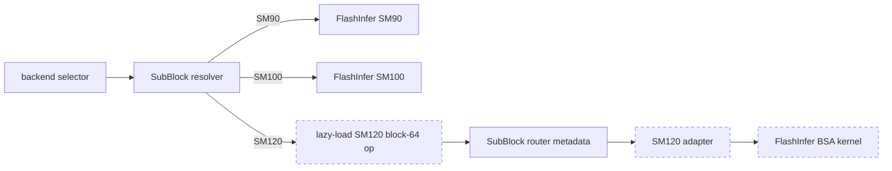

# [Diffusion][minimax-h3] Add SM120 support for SubBlock sparse attention

[Upstream PR](https://github.com/sgl-project/sglang/pull/37332) · state: closed · merged: True

## Original PR description

## Motivation

SubBlock sparse attention provides architecture-specific paths for Hopper
(SM90) and datacenter Blackwell (SM100). An SM120 path for Blackwell devices
with compute capability 12.0 is currently missing.

This PR adds SM120 support through FlashInfer's SM120 blk64 operator.

In a fixed 8x RTX PRO 5000 MiniMax-H3 request benchmark, pure SubBlock 0.75
reduced measured inference latency by 18.23%-45.89% (1.223x-1.848x) versus
SGLang lossless, with SSIM from 0.7882 to 0.9860.

## Modifications

- Add a lazy import for
  `flashinfer.cute_dsl.sparse.bsa_attn_sm120.bsa_attn_sm120_blk64_fwd`.
- Add the SGLang SM120 adapter and exact `(12, 0)` device dispatch.
- Allow compute capability 12.0 in the CUDA SubBlock backend resolver and
  validate the SM120 dependency during backend resolution.
- Add unit coverage for SM120 dispatch, dependency resolution, adapter
  argument/block-count forwarding, ragged block sizes, heterogeneous query
  masks, and unsupported-device rejection.
- Add SM120 numerical kernel tests for full-budget, ragged-tail,
  routed-sparsity, mixed-query-mask, and packed-varlen inputs.
- Update the SubBlock backend documentation with the SM120 requirements.

## Accuracy Tests

Validated on NVIDIA RTX PRO 5000 72GB Blackwell (compute capability 12.0),
BF16, and head dimension 128. Dependency versions:
`flashinfer-python==0.6.18rc2+g68693c2` and
`nvidia-cutlass-dsl==4.7.0`.

- Direct FlashInfer SM120 output and the SGLang adapter output were bit-equal.
- A 257-token ragged case used block sizes `[64, 64, 64, 64, 1]` and matched
  an FP32 dense oracle:
  - max absolute error: `0.0018635988235473633`
  - mean absolute error: `0.00016255080117844045`
- All 18 backend unit tests passed, including SM120 dispatch, adapter
  forwarding, and related resolver/router coverage.
- All 19 SM120-applicable numerical tests passed on an RTX PRO 5000,
  including full-budget, ragged-tail, and related kernel correctness coverage.

Python compilation, Ruff lint and format checks, and `git diff --check` also
passed.

## Speed Tests and Profiling

Synthetic steady-state kernel benchmark at sequence length 16,385, BF16, head
dimension 128, and 2 heads. The measured SubBlock path includes both
`SubBlockRouter.route` and SM120 sparse attention.

| Requested sparsity | Actual density | Dense SDPA | Router + SM120 sparse | Speedup |
| ---: | ---: | ---: | ---: | ---: |
| 0.50 | 52.92% | 1.5706 ms | 0.7474 ms | 2.101x |
| 0.75 | 28.02% | 1.5294 ms | 0.4122 ms | 3.710x |

The values are medians. Sparsity 0.50 summarizes six devices, with a
cross-device speedup range of `2.084x-2.118x`; sparsity 0.75 is a single-device
measurement.

## MiniMax-H3 End-to-End Request Benchmark

MiniMax-H3 was benchmarked on 8x NVIDIA RTX PRO 5000 72GB GPUs, comparing
SGLang lossless attention with pure SubBlock at requested sparsity 0.75.

| Task | Size | lossless | SubBlock 0.75 | Speedup | Latency change | SSIM |
| --- | --- | ---: | ---: | ---: | ---: | ---: |
| T2VA | 1344x768 24fps 5s | 145.813s | 112.035s | 1.301x | -23.17% | 0.8335 |
|  | 1344x768 24fps 10s | 391.125s | 262.120s | 1.492x | -32.98% | 0.8570 |
|  | 1344x768 24fps 15s | 740.765s | 453.089s | 1.635x | -38.84% | 0.9026 |
| FL2VA | 1344x768 24fps 5s | 153.293s | 120.105s | 1.276x | -21.65% | 0.8826 |
|  | 1344x768 24fps 10s | 405.119s | 271.500s | 1.492x | -32.98% | 0.8920 |
|  | 1344x768 24fps 15s | 760.453s | 468.479s | 1.623x | -38.39% | 0.8546 |
| Ref2VA-I | 1344x768 24fps 5s | 297.392s | 243.185s | 1.223x | -18.23% | 0.7882 |
|  | 1344x768 24fps 10s | 614.695s | 443.114s | 1.387x | -27.91% | 0.8276 |
|  | 1344x768 24fps 15s | 1034.273s | 689.263s | 1.501x | -33.36% | 0.8219 |
| Ref2VA-V | 1344x768 24fps 5s | 464.855s | 306.010s | 1.519x | -34.17% | 0.9417 |
|  | 1344x768 24fps 10s | 1389.971s | 797.778s | 1.742x | -42.60% | 0.9860 |
|  | 1344x768 24fps 15s | 2727.714s | 1475.869s | 1.848x | -45.89% | 0.9718 |

The topology and workload were fixed at TP2 x SP4/Ulysses4 x Ring1,
1344x768, 24 fps, 50 steps, and flow shift 12. Each cell reports the arithmetic
mean of three matching-seed repeats of server-side `inference_time_s`,
excluding server startup and warmup.

`speedup = lossless / SubBlock 0.75`

`latency change = 100 × (SubBlock 0.75 - lossless) / lossless`

`SSIM` uses the `All` value from FFmpeg's `ssim` filter. For each frame, the
component SSIM values are combined in proportion to their pixel counts
(`Y:U:V = 4:1:1` for YUV420), and the per-frame `All` values are averaged
arithmetically over the full video. Each SubBlock output is paired with the
lossless output for the same task, duration, seed, and repeat; the table then
reports the arithmetic mean of the three paired video-level SSIM values.

SubBlock activation was verified for every accelerated run, confirming that
MiniMax-H3 exercised the SM120 backend.

## Checklist

- [x] Format your code according to the [Format code with pre-commit](https://docs.sglang.io/developer_guide/contribution_guide.html#format-code-with-pre-commit).
- [x] Add unit tests according to the [Run and add unit tests](https://docs.sglang.io/developer_guide/contribution_guide.html#run-and-add-unit-tests).
- [x] Update documentation according to [Write documentations](https://docs.sglang.io/developer_guide/contribution_guide.html#write-documentations).
- [x] Provide accuracy and speed benchmark results according to [Test the accuracy](https://docs.sglang.io/developer_guide/contribution_guide.html#test-the-accuracy) and [Benchmark the speed](https://docs.sglang.io/developer_guide/contribution_guide.html#benchmark-the-speed).
- [x] Follow the SGLang code style [guidance](https://docs.sglang.io/developer_guide/contribution_guide.html#code-style-guidance).

## Review and Merge Process

1. Ping Merge Oncalls to start the process. See the [PR Merge Process](https://github.com/sgl-project/sglang/blob/main/.github/MAINTAINER.md#pull-request-merge-process).
2. Get approvals from [CODEOWNERS](https://github.com/sgl-project/sglang/blob/main/.github/CODEOWNERS) and other reviewers.
3. Trigger CI tests with [comments](https://docs.sglang.io/developer_guide/contribution_guide.html#how-to-trigger-ci-tests) or contact authorized users to do so.
   - Common commands include `/tag-and-rerun-ci`, `/tag-run-ci-label`, `/rerun-failed-ci`
4. After green CI and required approvals, ask Merge Oncalls or people with Write permission to merge the PR.

<!-- pr-states:start -->
---
### CI States

Latest PR Test (Base): <!-- slot:pr-test:start -->:hourglass_flowing_sand: [Run #33711779256](https://github.com/sgl-project/sglang/actions/runs/33711779256)<!-- slot:pr-test:end -->
Latest PR Test (Extra): <!-- slot:pr-test-extra:start -->:x: [Run #33711779029](https://github.com/sgl-project/sglang/actions/runs/33711779029)<!-- slot:pr-test-extra:end -->
Latest PR Test (AMD ROCm 7.2): <!-- slot:pr-test-amd-rocm720:start -->:hourglass_flowing_sand: [Run #33711779213](https://github.com/sgl-project/sglang/actions/runs/33711779213)<!-- slot:pr-test-amd-rocm720:end -->
<!-- pr-states:end -->

## Review and discussion

### reviews

- BBuf · APPROVED · 2026-09-01T13:25:43Z · [source](https://github.com/sgl-project/sglang/pull/37332#pullrequestreview-5078586191)

### Change comprehension

- Adds an SM120 adapter for FlashInfer's `bsa_attn_sm120_blk64_fwd` and lazy dependency loading.
- Extends SubBlock backend resolution to exact compute capability `(12, 0)` while preserving the SM90/SM100 paths and failing closed elsewhere.
- Adds dispatch/ABI unit coverage, an SM120 numerical case, and backend documentation.

At startup the resolver validates the selected architecture-specific dependency. At execution, the common router produces block indices/counts/sizes, and the SM120 adapter passes them to the pinned FlashInfer kernel without changing the higher-level attention contract.

### Historical review synthesis

I swept all seven touched paths plus SubBlock/sparse-attention/SM120/CUDA/Blackwell/fallback/kernel/test keywords across the maintainer corpus: 32,639 inline threads scanned, five matching threads across four PRs (nine human comments), plus a conversation-level sweep. The relevant pattern was exact architecture gating, fail-closed dependency checks with actionable errors, and real target-hardware numerical/performance evidence (#13263/#15382/#15668/#17507). I also checked the Blackwell compatibility evidence and the pinned FlashInfer `0.6.18` source: SM100 and SM120 are distinct targets, and the adapter matches the stable SM120 block-64 ABI and constraints.

### Review result

No blocking correctness issue found. Exact `(12, 0)` dispatch is appropriate for this PR's declared scope, dependency validation happens before serving, and the author supplied target-SM120 adapter/numerical tests plus end-to-end MiniMax-H3 accuracy and performance data.

`git diff --check` and Python compilation pass locally. I could not rerun CUDA tests on this macOS machine, so approval relies on the PR's RTX PRO 5000 SM120 results for GPU execution.

### issue_comments

- tristan-me · comment · 2026-09-02T09:06:20Z · [source](https://github.com/sgl-project/sglang/pull/37332#issuecomment-5507166581)

@BBuf Thanks for the review and approval! When convenient, could you please help add the run-ci label and trigger the base CI for the current commit?

- mickqian · comment · 2026-09-02T10:45:10Z · [source](https://github.com/sgl-project/sglang/pull/37332#issuecomment-5508334576)

/tag-and-rerun-ci

### inline_comments

## Changed files and fixed code

- `python/sglang/multimodal_gen/runtime/layers/attention/backends/subblock_sparse/README.md` · modified · additions 19 / deletions 13
  - [head](https://github.com/antgroup/sglang/blob/72c71bbae0a7f5438cde0e7dca4ff87dbd56ce23/python/sglang/multimodal_gen/runtime/layers/attention/backends/subblock_sparse/README.md)
  - [base](https://github.com/sgl-project/sglang/blob/cf3173aeb92af1885628cd02085e3809e2cfcadf/python/sglang/multimodal_gen/runtime/layers/attention/backends/subblock_sparse/README.md)
- `python/sglang/multimodal_gen/runtime/layers/attention/backends/subblock_sparse/__init__.py` · modified · additions 13 / deletions 5
  - [head](https://github.com/antgroup/sglang/blob/72c71bbae0a7f5438cde0e7dca4ff87dbd56ce23/python/sglang/multimodal_gen/runtime/layers/attention/backends/subblock_sparse/__init__.py)
  - [base](https://github.com/sgl-project/sglang/blob/cf3173aeb92af1885628cd02085e3809e2cfcadf/python/sglang/multimodal_gen/runtime/layers/attention/backends/subblock_sparse/__init__.py)
- `python/sglang/multimodal_gen/runtime/layers/attention/backends/subblock_sparse/router.py` · modified · additions 16 / deletions 0
  - [head](https://github.com/antgroup/sglang/blob/72c71bbae0a7f5438cde0e7dca4ff87dbd56ce23/python/sglang/multimodal_gen/runtime/layers/attention/backends/subblock_sparse/router.py)
  - [base](https://github.com/sgl-project/sglang/blob/cf3173aeb92af1885628cd02085e3809e2cfcadf/python/sglang/multimodal_gen/runtime/layers/attention/backends/subblock_sparse/router.py)
- `python/sglang/multimodal_gen/runtime/layers/attention/backends/subblock_sparse_attn.py` · modified · additions 42 / deletions 12
  - [head](https://github.com/antgroup/sglang/blob/72c71bbae0a7f5438cde0e7dca4ff87dbd56ce23/python/sglang/multimodal_gen/runtime/layers/attention/backends/subblock_sparse_attn.py)
  - [base](https://github.com/sgl-project/sglang/blob/cf3173aeb92af1885628cd02085e3809e2cfcadf/python/sglang/multimodal_gen/runtime/layers/attention/backends/subblock_sparse_attn.py)
- `python/sglang/multimodal_gen/runtime/platforms/cuda.py` · modified · additions 20 / deletions 9
  - [head](https://github.com/antgroup/sglang/blob/72c71bbae0a7f5438cde0e7dca4ff87dbd56ce23/python/sglang/multimodal_gen/runtime/platforms/cuda.py)
  - [base](https://github.com/sgl-project/sglang/blob/cf3173aeb92af1885628cd02085e3809e2cfcadf/python/sglang/multimodal_gen/runtime/platforms/cuda.py)
- `python/sglang/multimodal_gen/test/unit/test_subblock_sparse_attention.py` · modified · additions 16 / deletions 3
  - [head](https://github.com/antgroup/sglang/blob/72c71bbae0a7f5438cde0e7dca4ff87dbd56ce23/python/sglang/multimodal_gen/test/unit/test_subblock_sparse_attention.py)
  - [base](https://github.com/sgl-project/sglang/blob/cf3173aeb92af1885628cd02085e3809e2cfcadf/python/sglang/multimodal_gen/test/unit/test_subblock_sparse_attention.py)
- `test/registered/cpu/test_subblock_sparse_attention.py` · modified · additions 70 / deletions 1
  - [head](https://github.com/antgroup/sglang/blob/72c71bbae0a7f5438cde0e7dca4ff87dbd56ce23/test/registered/cpu/test_subblock_sparse_attention.py)
  - [base](https://github.com/sgl-project/sglang/blob/cf3173aeb92af1885628cd02085e3809e2cfcadf/test/registered/cpu/test_subblock_sparse_attention.py)

## Evidence and interpretation boundary

[Original JSON, discussions and patches](../../../../../../evidence/prs/sgl-project--sglang/37332-7183e293838eb1a6fdff8c26122e39f429f34a3f4744d48bf3de1af83544668c.json) · SHA-256 `7183e293838eb1a6fdff8c26122e39f429f34a3f4744d48bf3de1af83544668c`.

Diff complete: True. Missing/binary/truncated patches require pinned source inspection. This is a source page, not an independently verified optimization case. Open, merged and released are different states; recheck the deployed dependency.
