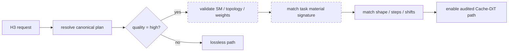

# [diffusion] Extend MiniMax-H3 quality="high" SM100 B200

[Upstream PR](https://github.com/sgl-project/sglang/pull/37400) · state: closed · merged: False

## Original PR description

## Motivation

Extend the fail-closed, request-scoped MiniMax-H3 `quality="high"` contract to
CUDA SM90 and SM100 without a fixed GPU-count allowlist:

- T2VA on the FL2VA checkpoint partition;
- FL2VA with a first keyframe, a last keyframe, or both keyframes;
- Ref2VA with one `role="reference", type="video_audio"` condition.

Both hardware classes admit the FL2VA and Ref2VA checkpoint partitions. The
request contract remains task-specific: FL2VA keyframe requests are SM100-only,
while T2VA and the audited Ref2VA request are admitted on SM90/SM100.

## Modifications

- Admit CUDA SM90/SM100 by compute capability instead of product name, without
  an explicit GPU-count allowlist.
- Continue to require full Ulysses sequence parallelism
  (`sp_degree == ulysses_degree == num_gpus`).
- Admit both the FL2VA and Ref2VA checkpoint partitions on SM90/SM100.
- Extend the exact high-quality request allowlist to:
  - T2VA with no input material;
  - FL2VA keyframe signatures `(0)`, `(-1)`, and `(0, -1)`;
  - Ref2VA with exactly one audio-bearing video reference.
- Include `frame_index` in material-signature matching so first, last, and
  first-plus-last keyframes remain distinct and reversed/middle-frame payloads
  stay rejected.
- Reuse the existing audited Cache-DiT configuration `(W=4, R=0.04, MC=1)`;
  denoising and cache execution are unchanged.
- Add concise deployment admission tests covering SM90/SM100 crossed with the
  FL2VA/Ref2VA checkpoint partitions on a non-4/8 GPU count.

Other hardware, partial-Ulysses topologies, request shapes, step counts,
shifts, input-material combinations, backends, precision modes,
offload/compile settings, and quantized/overridden weights remain fail-closed.
This PR updates the runtime admission logic, focused admission tests, and the MiniMax-H3 cookbook/configurator contract in the same change.

## Validation environment

- Hardware: NVIDIA B200 (SM100), tested with 2, 4, and 8 GPUs
- Model: MiniMax-H3, BF16, SGLang backend, FlashAttention,
  `performance_mode=speed`
- Parallelism: `sp_degree=N`, `ulysses_degree=N`, `tp_size=1`, `ring_degree=1`
- Compile, FSDP, breakable CUDA graphs, quantization, and layerwise offload:
  disabled
- Output workload: 1344x768, 124 frames, 24 FPS, 50 steps, fixed seed

The runtime measurements used SGLang v0.5.18 with the required upstream
Cache-DiT and Ref2VA fixes backported. They are single-run validation results,
not multi-run benchmark means.

The topology under test was selected with `N=2`, `N=4`, or `N=8`:

```bash
sglang serve \
  --model-type diffusion \
  --model-path MiniMaxAI/MiniMax-H3 \
  --model-id MiniMax-H3 \
  --pipeline-class-name MiniMaxH3Pipeline \
  --model-variant <fl2va|ref2va> \
  --backend sglang \
  --num-gpus N \
  --ulysses-degree N \
  --attention-backend fa \
  --performance-mode speed \
  --trust-remote-code \
  --warmup-resolutions 1344x768 \
  --port 8188
```

## FL2VA validation

The first-plus-last request below was used for the paired quality comparison.
First-only and last-only validation removed the other condition without
changing the remaining fields.

```json
{
  "prompt": "A cinematic scene transitions smoothly between the supplied keyframes, with coherent motion and synchronized ambient audio.",
  "task": "fl2va",
  "conditions": [
    {
      "type": "image",
      "uri": "file:///data/first.png",
      "role": "keyframe",
      "frame_index": 0
    },
    {
      "type": "image",
      "uri": "file:///data/last.png",
      "role": "keyframe",
      "frame_index": -1
    }
  ],
  "target": {
    "short_edge": 768,
    "aspect_ratio": "16:9",
    "duration_seconds": 5.0
  },
  "seed": 4201,
  "num_inference_steps": 50,
  "flow_shift": 12.0,
  "audio_flow_shift": 3.0,
  "quality": "high"
}
```

All six high-quality FL2VA requests completed without OOM:

| Topology | First only | Last only | First + last |
| --- | ---: | ---: | ---: |
| Ulysses=4 | 30.916 s | 28.927 s | 31.308 s |
| Ulysses=8 | 17.642 s | 15.584 s | 15.777 s |

An additional post-change smoke test covered a topology that the former
4/8-GPU allowlist rejected:

| Topology | Case | high | Client wall | Server peak MB |
| --- | --- | ---: | ---: | ---: |
| Ulysses=2 | First + last | 61.753 s | 62.598 s | 112,178 |
| Ulysses=8 | First + last | 17.775 s | 18.666 s | 88,280 |

For the fixed-seed first-plus-last pair, only `quality` changed:

| Topology | lossless | high | Speedup | Time reduction | Server peak MB (lossless/high) |
| --- | ---: | ---: | ---: | ---: | ---: |
| Ulysses=4 | 45.054 s | 31.308 s | 1.439x | 30.5% | 92,332 / 93,170 |
| Ulysses=8 | 23.322 s | 15.777 s | 1.478x | 32.4% | 85,108 / 85,344 |

Fixed-seed high-versus-lossless output comparison:

| Topology | Video SSIM | Video PSNR | Audio correlation L/R | Audio SI-SDR L/R |
| --- | ---: | ---: | ---: | ---: |
| Ulysses=4 | 0.984176 | 38.2816 dB | 0.989677 / 0.992577 | 16.78 / 18.24 dB |
| Ulysses=8 | 0.984353 | 39.3810 dB | 0.994723 / 0.996208 | 19.73 / 21.18 dB |

## Ref2VA validation

The Ref2VA pair used one audio-bearing video reference and differed only in
`quality`:

```json
{
  "prompt": "Follow the motion and appearance of <Video 1> while moving the scene to a quiet moonlit room, and use <Audio 1> as the sound reference with coherent timing.",
  "task": "ref2va",
  "conditions": [
    {
      "type": "video_audio",
      "uri": "file:///data/ref2va.mp4",
      "role": "reference"
    }
  ],
  "target": {
    "short_edge": 768,
    "aspect_ratio": "16:9",
    "duration_seconds": 5.0
  },
  "seed": 4101,
  "num_inference_steps": 50,
  "flow_shift": 12.0,
  "audio_flow_shift": 3.0,
  "quality": "high"
}
```

| Topology | lossless | high | Speedup | Time reduction | Server peak MB (lossless/high) |
| --- | ---: | ---: | ---: | ---: | ---: |
| Ulysses=4 | 132.257 s | 67.975 s | 1.946x | 48.6% | 95,938 / 99,506 |
| Ulysses=8 | 68.572 s | 36.808 s | 1.863x | 46.3% | 87,556 / 91,468 |

| Topology | Video SSIM | Video PSNR | Audio correlation L/R | Audio SI-SDR L/R |
| --- | ---: | ---: | ---: | ---: |
| Ulysses=4 | 0.934343 | 31.6499 dB | 0.999696 / 0.999571 | 32.16 / 30.66 dB |
| Ulysses=8 | 0.917334 | 29.3952 dB | 0.999604 / 0.999309 | 31.01 / 28.59 dB |

The speedup comes from Cache-DiT reuse across eligible denoising steps; this
PR does not reduce the cost of an individual computed step.

## Tests

```text
python3 -m pytest \
  python/sglang/multimodal_gen/test/unit/test_minimax_h3_admission.py \
  -q -k "high_quality_deployment"

6 passed, 24 deselected
```

Also passed:

- `git diff --check`;
- real 50-step FL2VA first-plus-last high-quality generation on Ulysses=2 and
  Ulysses=8 after removing the fixed GPU-count allowlist;
- real 50-step FL2VA first-only, last-only, and first-plus-last high-quality
  generation on Ulysses=4 and Ulysses=8;
- real 50-step lossless/high paired generation for FL2VA and Ref2VA on both
  topologies.

## Related work

- #33453 introduced request-scoped `lossless` / `high` and the original strict
  4xH200 contract.
- #33827 fixed MiniMax-H3 Cache-DiT execution.
- #35511 supplies Ref2VA audio preprocessing context and adds audio-consistency
  and peak-VRAM coverage.
- #36398 fixes Ref2VA cross-request audio determinism and a DP deadlock.

## Review and Merge Process

1. Ping Merge Oncalls to start the process. See the [PR Merge Process](https://github.com/sgl-project/sglang/blob/main/.github/MAINTAINER.md#pull-request-merge-process).
2. Get approvals from [CODEOWNERS](https://github.com/sgl-project/sglang/blob/main/.github/CODEOWNERS) and other reviewers.
3. Trigger CI tests with [comments](https://docs.sglang.io/developer_guide/contribution_guide.html#how-to-trigger-ci-tests) or contact authorized users to do so.
   - Common commands include `/tag-and-rerun-ci`, `/tag-run-ci-label`, `/rerun-failed-ci`
4. After green CI and required approvals, ask Merge Oncalls or people with Write permission to merge the PR.


<!-- pr-states:start -->
---
### CI States

Latest PR Test (Base): <!-- slot:pr-test:start -->:x: [Run #34449029415](https://github.com/sgl-project/sglang/actions/runs/34449029415)<!-- slot:pr-test:end -->
Latest PR Test (Extra): <!-- slot:pr-test-extra:start -->:x: [Run #34449029122](https://github.com/sgl-project/sglang/actions/runs/34449029122)<!-- slot:pr-test-extra:end -->
Latest PR Test (AMD ROCm 10): <!-- slot:pr-test-amd-rocm720:start -->:x: [Run #34449029107](https://github.com/sgl-project/sglang/actions/runs/34449029107)<!-- slot:pr-test-amd-rocm720:end -->
<!-- pr-states:end -->

## Review and discussion

### reviews

- BBuf · CHANGES_REQUESTED · 2026-09-01T13:25:46Z · [source](https://github.com/sgl-project/sglang/pull/37400#pullrequestreview-5078586611)

### Change comprehension

- Broadens MiniMax-H3 `quality="high"` deployment admission from one 4xH200 T2VA recipe to full-Ulysses SM90/SM100 deployments and both checkpoint partitions.
- Adds exact material signatures for T2VA, three FL2VA keyframe layouts, and one Ref2VA `video_audio` reference.
- Adds admission tests for the new capability/task/topology matrix; the Cache-DiT execution policy itself is unchanged.



The request is admitted only after both the resident deployment and the resolved task/material workload match the allowlist. FL2VA is restricted to SM100; T2VA and the admitted Ref2VA signature use SM90/SM100.

### Historical review synthesis

I swept the three exact touched paths, their parent H3 paths, and MiniMax-H3/quality/high/release-metadata/admission/SM100/B200 keywords across the maintainer corpus: 32,639 inline threads plus a conversation-level sweep (559 matching PR conversations, 4,054 human comments in the broader hardware/quality set). The consistent requirement is that hardware claims, admission behavior, public configuration, and target validation stay aligned. The directly relevant H3 history is #33453 (strict lossless/high contract), #33827 (Cache-DiT execution correctness), #35511 (Ref2VA audio/VRAM validation), and #36398 (topology and cross-request determinism).

### Blocking finding

**[P1] Update the public high-quality contract in the same PR.** The runtime now admits B200 2/4/8-GPU FL2VA and Ref2VA cases (and a wider SM90/SM100/full-Ulysses matrix), but the cookbook still says `quality="high"` accepts only the exact 4xH200 T2VA deployment and explicitly says B200 remains rejected. The command builder likewise hardcodes `highAudited` to resident 4xH200, marks the newly validated B200/task combinations unverified, and shows the old 1.40x/SSIM 0.931 result. The nearby deployment comment in `minimax_h3.py` also still assumes every non-4xH200 card must stream the DiT. This makes the public contract contradict the code immediately after merge. Please update the cookbook, configurator verification matrix/results, and stale source comments with the exact admitted task/hardware/topology evidence from this PR.

One evidence boundary should also be made explicit in that update: the new paired runs are on B200 at Ulysses 2/4/8, while capability-based admission also includes other SM90/SM100 products and legal full-Ulysses counts. If those are intentionally architecture-inherited rather than directly audited, label them as such instead of presenting every admitted combination as measured.

`git diff --check` and Python compilation pass locally, and repository lint is green. I could not rerun pytest/CUDA on this macOS environment; the PR reports six focused admission tests and the B200 end-to-end runs.


### issue_comments

- coolhok · comment · 2026-09-01T16:36:21Z · [source](https://github.com/sgl-project/sglang/pull/37400#issuecomment-5497205306)

> ### Change comprehension
> * Broadens MiniMax-H3 `quality="high"` deployment admission from one 4xH200 T2VA recipe to full-Ulysses SM90/SM100 deployments and both checkpoint partitions.
> * Adds exact material signatures for T2VA, three FL2VA keyframe layouts, and one Ref2VA `video_audio` reference.
> * Adds admission tests for the new capability/task/topology matrix; the Cache-DiT execution policy itself is unchanged.
> 
> ```mermaid
> flowchart LR
>   A[H3 request] --> B[resolve canonical plan]
>   B --> C{quality = high?}
>   C -->|yes| D[validate SM / topology / weights]:::changed
>   D --> E[match task material signature]:::changed
>   E --> F[match shape / steps / shifts]
>   F --> G[enable audited Cache-DiT path]
>   C -->|no| H[lossless path]
>   classDef changed stroke-dasharray: 5 5
> ```
> Unable to render rich display
> 
> flowchart LR
>   A[H3 request] --> B[resolve canonical plan]
>   B --> C{quality = high?}
>   C -->|yes| D[validate SM / topology / weights]:::changed
>   D --> E[match task material signature]:::changed
>   E --> F[match shape / steps / shifts]
>   F --> G[enable audited Cache-DiT path]
>   C -->|no| H[lossless path]
>   classDef changed stroke-dasharray: 5 5
> The request is admitted only after both the resident deployment and the resolved task/material workload match the allowlist. FL2VA is restricted to SM100; T2VA and the admitted Ref2VA signature use SM90/SM100.
> 
> ### Historical review synthesis
> I swept the three exact touched paths, their parent H3 paths, and MiniMax-H3/quality/high/release-metadata/admission/SM100/B200 keywords across the maintainer corpus: 32,639 inline threads plus a conversation-level sweep (559 matching PR conversations, 4,054 human comments in the broader hardware/quality set). The consistent requirement is that hardware claims, admission behavior, public configuration, and target validation stay aligned. The directly relevant H3 history is #33453 (strict lossless/high contract), #33827 (Cache-DiT execution correctness), #35511 (Ref2VA audio/VRAM validation), and #36398 (topology and cross-request determinism).
> 
> ### Blocking finding
> **[P1] Update the public high-quality contract in the same PR.** The runtime now admits B200 2/4/8-GPU FL2VA and Ref2VA cases (and a wider SM90/SM100/full-Ulysses matrix), but the cookbook still says `quality="high"` accepts only the exact 4xH200 T2VA deployment and explicitly says B200 remains rejected. The command builder likewise hardcodes `highAudited` to resident 4xH200, marks the newly validated B200/task combinations unverified, and shows the old 1.40x/SSIM 0.931 result. The nearby deployment comment in `minimax_h3.py` also still assumes every non-4xH200 card must stream the DiT. This makes the public contract contradict the code immediately after merge. Please update the cookbook, configurator verification matrix/results, and stale source comments with the exact admitted task/hardware/topology evidence from this PR.
> 
> One evidence boundary should also be made explicit in that update: the new paired runs are on B200 at Ulysses 2/4/8, while capability-based admission also includes other SM90/SM100 products and legal full-Ulysses counts. If those are intentionally architecture-inherited rather than directly audited, label them as such instead of presenting every admitted combination as measured.
> 
> `git diff --check` and Python compilation pass locally, and repository lint is green. I could not rerun pytest/CUDA on this macOS environment; the PR reports six focused admission tests and the B200 end-to-end runs.

Thanks for the detailed review. Addressed in f3f87b8dfe.

- Updated the MiniMax-H3 cookbook and configurator to match the runtime quality="high" contract.
- Clearly distinguished paired B200 measurements, smoke-only coverage, and architecture-inherited combinations.
- Updated the stale deployment comments and added cookbook configuration checks.

The cookbook config check, Python compilation, pre-commit, and git diff check all pass.

Could you please re-review the PR?

### inline_comments

## Changed files and fixed code

- `docs/cookbook/diffusion/MiniMax/MiniMax-H3.mdx` · modified · additions 18 / deletions 10
  - [head](https://github.com/coolhok/sglang/blob/96913167888f412a3b45d1783d72d1c06c3b1cd8/docs/cookbook/diffusion/MiniMax/MiniMax-H3.mdx)
  - [base](https://github.com/sgl-project/sglang/blob/c0b790cf7fe6dc1516c3ec1f23de9b37baca654a/docs/cookbook/diffusion/MiniMax/MiniMax-H3.mdx)
- `docs/scripts/check_cookbook_configs.mjs` · modified · additions 13 / deletions 1
  - [head](https://github.com/coolhok/sglang/blob/96913167888f412a3b45d1783d72d1c06c3b1cd8/docs/scripts/check_cookbook_configs.mjs)
  - [base](https://github.com/sgl-project/sglang/blob/c0b790cf7fe6dc1516c3ec1f23de9b37baca654a/docs/scripts/check_cookbook_configs.mjs)
- `docs/src/snippets/configs/MiniMaxAI/minimax-h3.jsx` · modified · additions 64 / deletions 11
  - [head](https://github.com/coolhok/sglang/blob/96913167888f412a3b45d1783d72d1c06c3b1cd8/docs/src/snippets/configs/MiniMaxAI/minimax-h3.jsx)
  - [base](https://github.com/sgl-project/sglang/blob/c0b790cf7fe6dc1516c3ec1f23de9b37baca654a/docs/src/snippets/configs/MiniMaxAI/minimax-h3.jsx)
- `python/sglang/multimodal_gen/configs/pipeline_configs/minimax_h3.py` · modified · additions 22 / deletions 20
  - [head](https://github.com/coolhok/sglang/blob/96913167888f412a3b45d1783d72d1c06c3b1cd8/python/sglang/multimodal_gen/configs/pipeline_configs/minimax_h3.py)
  - [base](https://github.com/sgl-project/sglang/blob/c0b790cf7fe6dc1516c3ec1f23de9b37baca654a/python/sglang/multimodal_gen/configs/pipeline_configs/minimax_h3.py)
- `python/sglang/multimodal_gen/runtime/pipelines_core/stages/model_specific_stages/minimax_h3/release_metadata.py` · modified · additions 35 / deletions 13
  - [head](https://github.com/coolhok/sglang/blob/96913167888f412a3b45d1783d72d1c06c3b1cd8/python/sglang/multimodal_gen/runtime/pipelines_core/stages/model_specific_stages/minimax_h3/release_metadata.py)
  - [base](https://github.com/sgl-project/sglang/blob/c0b790cf7fe6dc1516c3ec1f23de9b37baca654a/python/sglang/multimodal_gen/runtime/pipelines_core/stages/model_specific_stages/minimax_h3/release_metadata.py)
- `python/sglang/multimodal_gen/test/unit/test_minimax_h3_admission.py` · modified · additions 191 / deletions 0
  - [head](https://github.com/coolhok/sglang/blob/96913167888f412a3b45d1783d72d1c06c3b1cd8/python/sglang/multimodal_gen/test/unit/test_minimax_h3_admission.py)
  - [base](https://github.com/sgl-project/sglang/blob/c0b790cf7fe6dc1516c3ec1f23de9b37baca654a/python/sglang/multimodal_gen/test/unit/test_minimax_h3_admission.py)

## Evidence and interpretation boundary

[Original JSON, discussions and patches](../../../../../../evidence/prs/sgl-project--sglang/37400-fad7c9dc7ad3f8eff140011f25670f753fb68828e12e2b37ad3c33177daf991b.json) · SHA-256 `fad7c9dc7ad3f8eff140011f25670f753fb68828e12e2b37ad3c33177daf991b`.

Diff complete: True. Missing/binary/truncated patches require pinned source inspection. This is a source page, not an independently verified optimization case. Open, merged and released are different states; recheck the deployed dependency.
