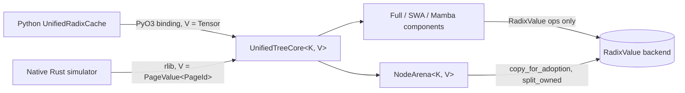

# [Feat] Torch-free RadixValue backend and suffix continuation inserts

[Upstream PR](https://github.com/sgl-project/sglang/pull/38636) · state: open · merged: False

## Original PR description

<!-- codex-pr-description:start -->
Makes the `sglang-radix-tree` core generic over a `RadixValue` storage backend so the same tree logic builds and runs without libtorch, with `tch::Tensor` remaining the production PyO3 backend and a torch-free `PageValue<T>` for native consumers, and adds a suffix-only continuation insert plus a read-only Full-KV prefix score, Full-only admission snapshots, and caller-selected leaf-suffix eviction. This lets a Rust KV-cache simulator drive the exact production radix tree through retained-node continuation inserts, keyed by KV pages, without a PyTorch dependency.

### How This Was Implemented
- `RadixValue` (`src/value.rs`) abstracts the per-node index value: length, shallow clone, compact copy-on-adoption, slice, split, concat, empty, and `to_i64_vec`. `Tensor` implements it behind the new `torch` Cargo feature; `PageValue<T>` is an `Arc<[T]>` view type for `T: Copy + TryInto<i64>`.
- Every tree type gained an explicit `V` parameter (`UnifiedTreeCore<K, V>`, `Node<K, V>`, `InsertParams`, `MatchResult`, `CacheAction`, ...). The PyO3 binding and the torch test suite name `Tensor` through local aliases, so the production surface and the Tensor tests are unchanged in behavior.
- `insert_suffix_from_node(anchor, prefix_len, params)` inserts only the atoms past a retained prefix node returned by `match_prefix`. It validates alignment, anchor position, and device residency, and non-chunked inserts replay the root walk's access-tick, hit-count, and write-through effects on the retained path.
- `snapshot_full_device()` forks idle Full-only device metadata for admission rollback; immutable keys and page values share buffers. The caller snapshots its allocator and leases and commits only one branch. `full_device_eviction_candidates()` and `evict_full_device_suffix()` support a caller-selected unlocked leaf suffix (for page-wise Belady eviction) while reusing core split, lock, and eviction accounting.
- `full_kv_prefix_len(key, namespace)` is a read-only device Full-KV prefix length for LPM scoring; on FULL-only trees it equals what `match_prefix` admits.
- The crate is now `cdylib` plus `rlib` named `sglang_radix_tree`; the loader reads `lib.name`, and the inspection-module CI step copies the renamed artifact. CI runs the torch-free tests alongside the torch run.

Walkthrough

#### Mental model

The radix tree stores, per node and per component (Full, SWA, Mamba) and per tier (device, host), an opaque index value. Before this change that value was always a `tch::Tensor`, so the crate could not be built or tested without libtorch. Now the tree only asks the value type for a handful of operations through `RadixValue`, and the backend decides what a value is: the production binding stores tensors on the configured device, a simulator stores page ids.

Backend semantics that matter: `copy_for_adoption` and `split_owned` produce compact owned values, because node values outlive the insert that produced them. For `PageValue` this is an exact-size `Arc<[T]>` copy; a shared slice would pin the caller's whole request buffer until the last node holding a piece of it died. `slice` and `concat` stay views because their results (match results, load-back chunks) are transient. Pool-shape conversions do not live in the trait: the binding unsqueezes Python's 0-dim Mamba slot into a one-atom tensor before it reaches the core.

#### State and ordering

A root `insert` walks from the root, and for every node it overlaps it stamps the access tick, raises the priority floor, and bumps the hit count; the hit count is where HiCache write-through `BackupKV` actions originate. `insert_suffix_from_node` starts at the anchor instead. To keep LFU/SLRU ordering and write-through behavior identical to the reference, a non-chunked continuation insert first replays those per-node effects on the path from the root down to the anchor, then emits at most one `BackupKV` for the deepest node that crossed the threshold; its chain already covers every unbacked ancestor, which is what a root walk's barriers converge to. Chunked inserts never bump hit counts, so they touch only the anchor; anchor validation still walks its ancestor path, and the intended use is chunked per-step growth and a non-chunked insert when the request finishes.

Example with `write_through_threshold = 2`: after one finished request through prefix `A`, `A.hit_count = 1`. A chunked continuation below `A` emits nothing. A second finished request through `A` makes `hit_count = 2` and the insert returns `BackupKV([A])` before the suffix walk begins.

#### Request lifecycle

`match_prefix` returns the retained `NodeId` (`last_device_node_id`). The caller locks it, computes the suffix, and calls `insert_suffix_from_node`. The core validates that `prefix_len` is page aligned and within the key, that the value covers the suffix, that the anchor ends exactly at `prefix_len`, shares the namespace, and still holds Full KV on device (a host-only anchor is rejected with `InsertAnchorNotDeviceResident`, since Full eviction only removes leaves and a device child under an evicted parent breaks that invariant). Then it runs the same resumable walk as `insert`, with the walk state holding only the suffix key and value. If the prefix replay produced a `BackupKV`, the first step returns it as a barrier, mirroring how a root walk suspends after a step that emits one; the single-shot `insert_suffix_from_node` pumps through that barrier itself.

Failures surface as `TreeCoreRuntimeError` variants (`InsertPrefixNotPageAligned`, `InsertPrefixExceedsKey`, `InsertValueTooShort`, `InsertAnchorPrefixMismatch`, `InsertContinuationNamespaceMismatch`, `InsertAnchorNotDeviceResident`) before any state changes. An empty aligned suffix returns `mamba_exist = true`, matching the Python reference, so the caller frees its donated Mamba slot.

#### Boundaries and limitations

The Tensor path is behavior-preserving: same copy-on-adoption, same device placement through `new_on_device`, same actions and results; the Python adapter and binding API did not change except that the binding now normalizes the Mamba slot shape. `full_kv_prefix_len` follows only Full device values, so on SWA or Mamba trees it can exceed what `match_prefix` admits (it equals `full_kv_hit_length`); use `match_prefix` to score those trees. Component overlap hooks on the retained prefix (SWA tombstone recovery, duplicate-slot release) are never replayed by continuation inserts because they need the prefix KV, which the API does not receive. The Tensor tests still run only under `--features torch`; the torch-free suite covers the `PageValue` backend and the new APIs.

### Validation
- After merging main at `a0fcebb3bb` and adding the native transaction/policy APIs (`f0fda25fc9`): CPU Torch 2.13 configuration passes 921 unit + 12 integration tests (one ignored); Torch-free configuration passes 3 unit + 12 integration tests.
- Strict Clippy with all targets passes for the native inspection build; both backends passed strict Clippy before the final documentation and guard additions. Rust 1.92.0 passes the final Torch-free suite.
- `cargo fmt --check` and `cargo check --features python-extension,inspection` pass.
- New boundary coverage includes snapshot isolation across splits, locks and eviction, rejected locked/unaligned suffix eviction, and active-eviction snapshot rejection. Current AISimulate's rollback and Belady tests also pass using these APIs.
- GPU-backed serving tests were not run. AISimulate growth microbenchmarks expose a simulation CPU regression versus its specialized tree; continuation avoids replaying key matching, but ancestor validation and production tree topology remain relevant costs.
<!-- codex-pr-description:end -->

## Motivation

A native Rust KV-cache simulator needs the production radix tree without a PyTorch dependency, plus retained-node continuation inserts to grow a cached request one decode step at a time. See the walkthrough above.

## Modifications

Generic `RadixValue` backend with `Tensor` and `PageValue<T>` implementations, explicit `V` on the tree types, `insert_suffix_from_node`, `full_kv_prefix_len`, Full-only snapshots and selected suffix eviction, `cdylib` plus `rlib` output, and a torch-free CI test run. Details above.

## Accuracy Tests

Not applicable: no model forward or kernel code changes.

## Speed Tests and Profiling

Not applicable: the Tensor path performs the same operations as before.

## Checklist

- [x] Format your code according to the [Format code with pre-commit](https://docs.sglang.io/developer_guide/contribution_guide.html#format-code-with-pre-commit).
- [x] Add unit tests according to the [Run and add unit tests](https://docs.sglang.io/developer_guide/contribution_guide.html#run-and-add-unit-tests).
- [ ] Update documentation according to [Write documentations](https://docs.sglang.io/developer_guide/contribution_guide.html#write-documentations).
- [ ] Provide accuracy and speed benchmark results according to [Test the accuracy](https://docs.sglang.io/developer_guide/contribution_guide.html#test-the-accuracy) and [Benchmark the speed](https://docs.sglang.io/developer_guide/contribution_guide.html#benchmark-the-speed).
- [x] Follow the SGLang code style [guidance](https://docs.sglang.io/developer_guide/contribution_guide.html#code-style-guidance).

## Review and Merge Process

1. Ping Merge Oncalls to start the process. See the [PR Merge Process](https://github.com/sgl-project/sglang/blob/main/.github/MAINTAINER.md#pull-request-merge-process).
2. Get approvals from [CODEOWNERS](https://github.com/sgl-project/sglang/blob/main/.github/CODEOWNERS) and other reviewers.
3. Trigger CI tests with [comments](https://docs.sglang.io/developer_guide/contribution_guide.html#how-to-trigger-ci-tests) or contact authorized users to do so.
   - Common commands include `/tag-and-rerun-ci`, `/tag-run-ci-label`, `/rerun-failed-ci`
4. After green CI and required approvals, ask Merge Oncalls or people with Write permission to merge the PR.

<!-- pr-states:start -->
---
### CI States

Latest PR Test (Base): <!-- slot:pr-test:start -->:white_check_mark: [Run #39109417717](https://github.com/sgl-project/sglang/actions/runs/39109417717)<!-- slot:pr-test:end -->
Latest PR Test (Extra): <!-- slot:pr-test-extra:start -->:x: [Run #39109417668](https://github.com/sgl-project/sglang/actions/runs/39109417668)<!-- slot:pr-test-extra:end -->
Latest PR Test (AMD ROCm 10): <!-- slot:pr-test-amd:start -->:x: [Run #39109417663](https://github.com/sgl-project/sglang/actions/runs/39109417663)<!-- slot:pr-test-amd:end -->
<!-- pr-states:end -->

## Review and discussion

### reviews

- Jialin · APPROVED · 2026-09-09T07:43:36Z · [source](https://github.com/sgl-project/sglang/pull/38636#pullrequestreview-5151243923)

Looks good as long as all the CI signals are green :)

### issue_comments

- ishandhanani · comment · 2026-09-09T16:50:03Z · [source](https://github.com/sgl-project/sglang/pull/38636#issuecomment-5605518393)

/tag-and-rerun-ci

- ZenAlexa · comment · 2026-09-09T17:34:50Z · [source](https://github.com/sgl-project/sglang/pull/38636#issuecomment-5606107781)

I'm exploring a scheduler consumer for `full_kv_prefix_len`, especially HRRN queues above the current 128-request cutoff. On the current Python TreeCore (`0027af2e`, M4 Pro, CPU PyTorch 2.13), matching 1,024 requests against a 4,096-token prefix split across 16 edges took 47 ms and retained 32 MiB of index tensors.

Would you prefer the Python binding and Full-KV scheduler integration in a follow-up PR? I would keep component-validating matching for SWA and Mamba and measure the complete scheduling path before changing the cutoff.

- ishandhanani · comment · 2026-09-13T00:18:33Z · [source](https://github.com/sgl-project/sglang/pull/38636#issuecomment-5649630712)

> I'm exploring a scheduler consumer for `full_kv_prefix_len`, especially HRRN queues above the current 128-request cutoff. On the current Python TreeCore (`0027af2e`, M4 Pro, CPU PyTorch 2.13), matching 1,024 requests against a 4,096-token prefix split across 16 edges took 47 ms and retained 32 MiB of index tensors.
> 
> Would you prefer the Python binding and Full-KV scheduler integration in a follow-up PR? I would keep component-validating matching for SWA and Mamba and measure the complete scheduling path before changing the cutoff.

Im not sure I follow. Is this related to this PR? 

- ZenAlexa · comment · 2026-09-13T03:34:00Z · [source](https://github.com/sgl-project/sglang/pull/38636#issuecomment-5650819561)

yes, i was referring to the `full_kv_prefix_len` added here as a possible way to score queued requests without building index tensors. i jumped ahead to scheduler integration; i’ll keep that in a separate discussion.

- ishandhanani · comment · 2026-09-23T17:26:33Z · [source](https://github.com/sgl-project/sglang/pull/38636#issuecomment-5799581444)

/rerun-failed-ci

- ishandhanani · comment · 2026-10-02T02:18:49Z · [source](https://github.com/sgl-project/sglang/pull/38636#issuecomment-5944387354)

/rerun-failed-ci

- github-actions[bot] · comment · 2026-10-18T07:39:24Z · [source](https://github.com/sgl-project/sglang/pull/38636#issuecomment-6247229315)

<!-- pr-check-comment runs=39108229201 -->
Required checks failed on dd9c8f3; this PR cannot be merged until they pass.

**PR title** ([run](https://github.com/sgl-project/sglang/actions/runs/39108229201))
> PR title must use "[Type] scope: title" or "[Type] [Hardware] scope: title". Type must be one of: Feat, Fix, Refactor, Perf, Doc, Test, CI, Chore. Scope is required and may be any module or model name, with unrestricted letter case (letters, numbers, dots, underscores, slashes, or hyphens). Hardware is optional; use a single tag without spaces. Use uppercase hardware tags (AMD, NVIDIA, NPU, MI300X), except for exactly these four spellings: Intel, Apple, Huawei, Ascend. Reverts must use GitHub's default format: Revert "original title". Use one space between fields and after the colon, with a non-empty title and no leading or trailing whitespace. Examples: "[Fix] attention: Fix KV cache indexing", "[Feat] qwen3: Add model support", "[Perf] [AMD] flash-attn: Optimize decode performance".
Edit the title; the check reruns on its own.

- github-actions[bot] · comment · 2026-10-18T07:58:38Z · [source](https://github.com/sgl-project/sglang/pull/38636#issuecomment-6247384721)

<!-- pr-check-comment runs=39109417591 -->
Required checks failed on 4da561f; this PR cannot be merged until they pass.

**PR title** ([run](https://github.com/sgl-project/sglang/actions/runs/39109417591))
> PR title must use "[Type] scope: title" or "[Type] [Hardware] scope: title". Type must be one of: Feat, Fix, Refactor, Perf, Doc, Test, CI, Chore. Scope is required and may be any module or model name, with unrestricted letter case (letters, numbers, dots, underscores, slashes, or hyphens). Hardware is optional; use a single tag without spaces. Use uppercase hardware tags (AMD, NVIDIA, NPU, MI300X), except for exactly these four spellings: Intel, Apple, Huawei, Ascend. Reverts must use GitHub's default format: Revert "original title". Use one space between fields and after the colon, with a non-empty title and no leading or trailing whitespace. Examples: "[Fix] attention: Fix KV cache indexing", "[Feat] qwen3: Add model support", "[Perf] [AMD] flash-attn: Optimize decode performance".
Edit the title; the check reruns on its own.

### inline_comments

## Changed files and fixed code

- `.github/workflows/_pr-test-rust-ext-build.yml` · modified · additions 1 / deletions 1
  - [head](https://github.com/sgl-project/sglang/blob/4da561f3cc2dfb29732e1aff204d4c0bfd3c29e4/.github/workflows/_pr-test-rust-ext-build.yml)
  - [base](https://github.com/sgl-project/sglang/blob/80914b7c9bb412720c0896862aede98faf5bc264/.github/workflows/_pr-test-rust-ext-build.yml)
- `.github/workflows/pr-test-rust-workspace.yml` · modified · additions 15 / deletions 13
  - [head](https://github.com/sgl-project/sglang/blob/4da561f3cc2dfb29732e1aff204d4c0bfd3c29e4/.github/workflows/pr-test-rust-workspace.yml)
  - [base](https://github.com/sgl-project/sglang/blob/80914b7c9bb412720c0896862aede98faf5bc264/.github/workflows/pr-test-rust-workspace.yml)
- `rust/sglang-radix-tree/Cargo.toml` · modified · additions 5 / deletions 4
  - [head](https://github.com/sgl-project/sglang/blob/4da561f3cc2dfb29732e1aff204d4c0bfd3c29e4/rust/sglang-radix-tree/Cargo.toml)
  - [base](https://github.com/sgl-project/sglang/blob/80914b7c9bb412720c0896862aede98faf5bc264/rust/sglang-radix-tree/Cargo.toml)
- `rust/sglang-radix-tree/README.md` · modified · additions 13 / deletions 3
  - [head](https://github.com/sgl-project/sglang/blob/4da561f3cc2dfb29732e1aff204d4c0bfd3c29e4/rust/sglang-radix-tree/README.md)
  - [base](https://github.com/sgl-project/sglang/blob/80914b7c9bb412720c0896862aede98faf5bc264/rust/sglang-radix-tree/README.md)
- `rust/sglang-radix-tree/src/components/full.rs` · modified · additions 55 / deletions 52
  - [head](https://github.com/sgl-project/sglang/blob/4da561f3cc2dfb29732e1aff204d4c0bfd3c29e4/rust/sglang-radix-tree/src/components/full.rs)
  - [base](https://github.com/sgl-project/sglang/blob/80914b7c9bb412720c0896862aede98faf5bc264/rust/sglang-radix-tree/src/components/full.rs)
- `rust/sglang-radix-tree/src/components/mamba.rs` · modified · additions 64 / deletions 55
  - [head](https://github.com/sgl-project/sglang/blob/4da561f3cc2dfb29732e1aff204d4c0bfd3c29e4/rust/sglang-radix-tree/src/components/mamba.rs)
  - [base](https://github.com/sgl-project/sglang/blob/80914b7c9bb412720c0896862aede98faf5bc264/rust/sglang-radix-tree/src/components/mamba.rs)
- `rust/sglang-radix-tree/src/components/mod.rs` · modified · additions 65 / deletions 66
  - [head](https://github.com/sgl-project/sglang/blob/4da561f3cc2dfb29732e1aff204d4c0bfd3c29e4/rust/sglang-radix-tree/src/components/mod.rs)
  - [base](https://github.com/sgl-project/sglang/blob/80914b7c9bb412720c0896862aede98faf5bc264/rust/sglang-radix-tree/src/components/mod.rs)
- `rust/sglang-radix-tree/src/components/swa.rs` · modified · additions 139 / deletions 145
  - [head](https://github.com/sgl-project/sglang/blob/4da561f3cc2dfb29732e1aff204d4c0bfd3c29e4/rust/sglang-radix-tree/src/components/swa.rs)
  - [base](https://github.com/sgl-project/sglang/blob/80914b7c9bb412720c0896862aede98faf5bc264/rust/sglang-radix-tree/src/components/swa.rs)
- `rust/sglang-radix-tree/src/lib.rs` · modified · additions 17 / deletions 2
  - [head](https://github.com/sgl-project/sglang/blob/4da561f3cc2dfb29732e1aff204d4c0bfd3c29e4/rust/sglang-radix-tree/src/lib.rs)
  - [base](https://github.com/sgl-project/sglang/blob/80914b7c9bb412720c0896862aede98faf5bc264/rust/sglang-radix-tree/src/lib.rs)
- `rust/sglang-radix-tree/src/node.rs` · modified · additions 118 / deletions 71
  - [head](https://github.com/sgl-project/sglang/blob/4da561f3cc2dfb29732e1aff204d4c0bfd3c29e4/rust/sglang-radix-tree/src/node.rs)
  - [base](https://github.com/sgl-project/sglang/blob/80914b7c9bb412720c0896862aede98faf5bc264/rust/sglang-radix-tree/src/node.rs)
- `rust/sglang-radix-tree/src/python_bindings.rs` · modified · additions 22 / deletions 8
  - [head](https://github.com/sgl-project/sglang/blob/4da561f3cc2dfb29732e1aff204d4c0bfd3c29e4/rust/sglang-radix-tree/src/python_bindings.rs)
  - [base](https://github.com/sgl-project/sglang/blob/80914b7c9bb412720c0896862aede98faf5bc264/rust/sglang-radix-tree/src/python_bindings.rs)
- `rust/sglang-radix-tree/src/tests/components/base.rs` · modified · additions 3 / deletions 1
  - [head](https://github.com/sgl-project/sglang/blob/4da561f3cc2dfb29732e1aff204d4c0bfd3c29e4/rust/sglang-radix-tree/src/tests/components/base.rs)
  - [base](https://github.com/sgl-project/sglang/blob/80914b7c9bb412720c0896862aede98faf5bc264/rust/sglang-radix-tree/src/tests/components/base.rs)
- `rust/sglang-radix-tree/src/tests/components/full.rs` · modified · additions 28 / deletions 23
  - [head](https://github.com/sgl-project/sglang/blob/4da561f3cc2dfb29732e1aff204d4c0bfd3c29e4/rust/sglang-radix-tree/src/tests/components/full.rs)
  - [base](https://github.com/sgl-project/sglang/blob/80914b7c9bb412720c0896862aede98faf5bc264/rust/sglang-radix-tree/src/tests/components/full.rs)
- `rust/sglang-radix-tree/src/tests/components/mamba.rs` · modified · additions 5 / deletions 3
  - [head](https://github.com/sgl-project/sglang/blob/4da561f3cc2dfb29732e1aff204d4c0bfd3c29e4/rust/sglang-radix-tree/src/tests/components/mamba.rs)
  - [base](https://github.com/sgl-project/sglang/blob/80914b7c9bb412720c0896862aede98faf5bc264/rust/sglang-radix-tree/src/tests/components/mamba.rs)
- `rust/sglang-radix-tree/src/tests/components/swa.rs` · modified · additions 18 / deletions 20
  - [head](https://github.com/sgl-project/sglang/blob/4da561f3cc2dfb29732e1aff204d4c0bfd3c29e4/rust/sglang-radix-tree/src/tests/components/swa.rs)
  - [base](https://github.com/sgl-project/sglang/blob/80914b7c9bb412720c0896862aede98faf5bc264/rust/sglang-radix-tree/src/tests/components/swa.rs)
- `rust/sglang-radix-tree/src/tests/node.rs` · modified · additions 8 / deletions 7
  - [head](https://github.com/sgl-project/sglang/blob/4da561f3cc2dfb29732e1aff204d4c0bfd3c29e4/rust/sglang-radix-tree/src/tests/node.rs)
  - [base](https://github.com/sgl-project/sglang/blob/80914b7c9bb412720c0896862aede98faf5bc264/rust/sglang-radix-tree/src/tests/node.rs)
- `rust/sglang-radix-tree/src/tests/test_utils.rs` · modified · additions 13 / deletions 1
  - [head](https://github.com/sgl-project/sglang/blob/4da561f3cc2dfb29732e1aff204d4c0bfd3c29e4/rust/sglang-radix-tree/src/tests/test_utils.rs)
  - [base](https://github.com/sgl-project/sglang/blob/80914b7c9bb412720c0896862aede98faf5bc264/rust/sglang-radix-tree/src/tests/test_utils.rs)
- `rust/sglang-radix-tree/src/tests/unified_lru_list.rs` · modified · additions 11 / deletions 9
  - [head](https://github.com/sgl-project/sglang/blob/4da561f3cc2dfb29732e1aff204d4c0bfd3c29e4/rust/sglang-radix-tree/src/tests/unified_lru_list.rs)
  - [base](https://github.com/sgl-project/sglang/blob/80914b7c9bb412720c0896862aede98faf5bc264/rust/sglang-radix-tree/src/tests/unified_lru_list.rs)
- `rust/sglang-radix-tree/src/tests/unified_tree_core.rs` · modified · additions 9 / deletions 6
  - [head](https://github.com/sgl-project/sglang/blob/4da561f3cc2dfb29732e1aff204d4c0bfd3c29e4/rust/sglang-radix-tree/src/tests/unified_tree_core.rs)
  - [base](https://github.com/sgl-project/sglang/blob/80914b7c9bb412720c0896862aede98faf5bc264/rust/sglang-radix-tree/src/tests/unified_tree_core.rs)
- `rust/sglang-radix-tree/src/unified_lru_list.rs` · modified · additions 44 / deletions 38
  - [head](https://github.com/sgl-project/sglang/blob/4da561f3cc2dfb29732e1aff204d4c0bfd3c29e4/rust/sglang-radix-tree/src/unified_lru_list.rs)
  - [base](https://github.com/sgl-project/sglang/blob/80914b7c9bb412720c0896862aede98faf5bc264/rust/sglang-radix-tree/src/unified_lru_list.rs)
- `rust/sglang-radix-tree/src/unified_tree_core.rs` · modified · additions 749 / deletions 325
  - [head](https://github.com/sgl-project/sglang/blob/4da561f3cc2dfb29732e1aff204d4c0bfd3c29e4/rust/sglang-radix-tree/src/unified_tree_core.rs)
  - [base](https://github.com/sgl-project/sglang/blob/80914b7c9bb412720c0896862aede98faf5bc264/rust/sglang-radix-tree/src/unified_tree_core.rs)
- `rust/sglang-radix-tree/src/value.rs` · added · additions 279 / deletions 0
  - [head](https://github.com/sgl-project/sglang/blob/4da561f3cc2dfb29732e1aff204d4c0bfd3c29e4/rust/sglang-radix-tree/src/value.rs)
  - [base](https://github.com/sgl-project/sglang/blob/80914b7c9bb412720c0896862aede98faf5bc264/rust/sglang-radix-tree/src/value.rs)
- `rust/sglang-radix-tree/tests/page_value_core.rs` · added · additions 686 / deletions 0
  - [head](https://github.com/sgl-project/sglang/blob/4da561f3cc2dfb29732e1aff204d4c0bfd3c29e4/rust/sglang-radix-tree/tests/page_value_core.rs)
  - [base](https://github.com/sgl-project/sglang/blob/80914b7c9bb412720c0896862aede98faf5bc264/rust/sglang-radix-tree/tests/page_value_core.rs)
- `test/registered/rust/test_rust_extension.py` · modified · additions 1 / deletions 1
  - [head](https://github.com/sgl-project/sglang/blob/4da561f3cc2dfb29732e1aff204d4c0bfd3c29e4/test/registered/rust/test_rust_extension.py)
  - [base](https://github.com/sgl-project/sglang/blob/80914b7c9bb412720c0896862aede98faf5bc264/test/registered/rust/test_rust_extension.py)

## Evidence and interpretation boundary

[Original JSON, discussions and patches](../../../../../../evidence/prs/sgl-project--sglang/38636-d246cf28f8effacfdc931a7f893152dfe69814872b736337e0b8fa44362f08a2.json) · SHA-256 `d246cf28f8effacfdc931a7f893152dfe69814872b736337e0b8fa44362f08a2`.

Diff complete: True. Missing/binary/truncated patches require pinned source inspection. This is a source page, not an independently verified optimization case. Open, merged and released are different states; recheck the deployed dependency.
