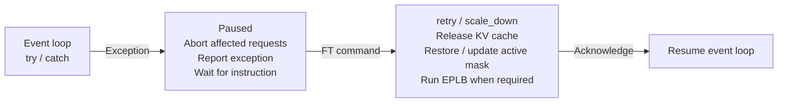
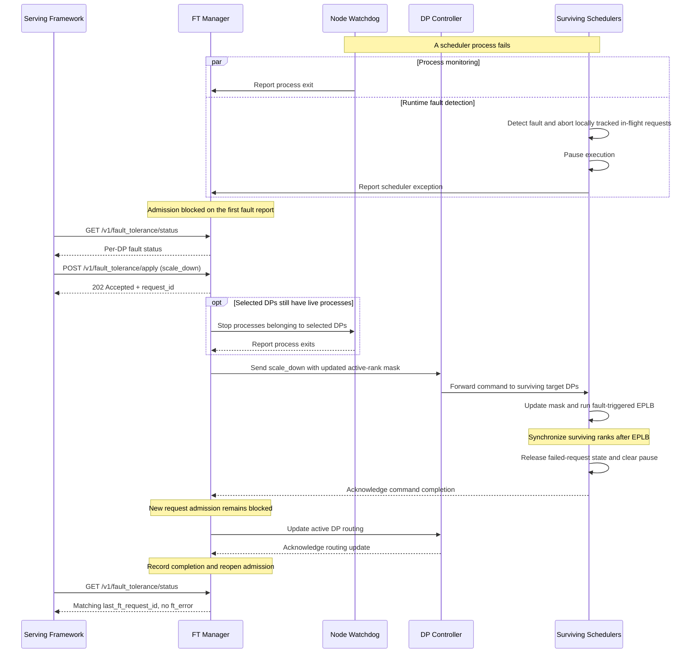

# [Feat] fault-tolerance: Introduce a fault-tolerance framework for SGLang (1/N)

[Upstream PR](https://github.com/sgl-project/sglang/pull/40078) · state: open · merged: False

## Original PR description

## Summary

- Implement the engine-level fault-tolerance framework proposed in #22344 for coordinated fault handling across a distributed SGLang deployment.
- Expose status and control APIs that let upper-layer serving frameworks control the fault-handling process.
- Integrate with Mooncake Elastic EP to support fault-driven scale-down and continued serving on surviving ranks.

## Motivation

Mooncake Elastic EP already provides **runtime-level elasticity** for MoE inference, including failed-rank isolation, expert redistribution, continued execution on surviving ranks, and replacement-rank recovery. This PR builds on the Elastic EP work #8961 , with runtime scaling discussed in #22788 .

The recovery action appropriate for a service depends on more than a runtime failure signal. A communication timeout caused by transient network disruption may call for waiting and retrying, while a persistent failure may require removing workers. Maintenance policy may also require taking an entire node out of service when only one device fails. Choosing among these actions requires information from monitoring and orchestration outside the inference runtime. The [Dynamo DP-aware health check](https://github.com/ai-dynamo/dynamo/pull/7466) illustrates why serving frameworks need visibility into the health of individual DP ranks within an engine. [vLLM’s fault-tolerance framework](https://github.com/vllm-project/vllm/pull/44428) also implements fault reporting and an interface for externally directed recovery in DP+EP deployments.

This motivates a consistent **engine-level interface** through which the serving framework can observe fault state and coordinate its chosen response. The engine must turn that response into consistent worker actions and request-routing decisions. Keeping this control path separate from backend execution also provides a common integration boundary for devices whose recovery procedures differ.

We therefore separate fault handling into three responsibilities: the runtime performs backend-specific isolation and recovery; SGLang aggregates engine state and executes control instructions; the serving framework chooses and orchestrates the recovery policy. The FT framework adds this control path alongside the existing serving architecture, using Mooncake Elastic EP as the initial data-plane integration.

## Architecture Overview

The FT Manager collects scheduler and process reports and coordinates instructions from the serving framework. The FT Manager is drawn separately for clarity; it is hosted in TokenizerManager. Yellow marks the new component; dashed lines mark FT reporting and control.


The API labels refer to HTTP-server endpoints. The reporting line groups scheduler reports and independently sent watchdog reports.

| API | Purpose |
| --- | --- |
| `GET /v1/fault_tolerance/status` | Query cluster fault state and the result of a control request. |
| `POST /v1/fault_tolerance/apply` | Submit the recovery action selected by the serving framework. |

The serving framework chooses between two actions:

- **`retry`:** retry execution while retaining the current serving topology.
- **`scale_down`:** remove the selected DP replicas and resume serving with the remaining capacity.

Accepted actions return HTTP 202. The caller polls status for the matching request ID to confirm completion.

## Modifications

### 1. Add per-node fault-tolerance watchdogs

Add a dedicated watchdog on each node to monitor local scheduler processes, report process exits and periodic heartbeats, and execute targeted DP shutdown requests. The FT Manager aggregates these reports and marks the node's scheduler processes unavailable when its heartbeat expires.

```text
Node 0 watchdog -- process reports / heartbeat --+
Node 1 watchdog -- process reports / heartbeat --+--> FT Manager
Node N watchdog -- process reports / heartbeat --+
```

Unlike the fail-fast subprocess watchdog, the FT watchdog reports individual scheduler-process exits while continuing to monitor the remaining processes. Its control endpoint and heartbeat loop remain active even after all local scheduler processes have exited.

### 2. Add the FT Manager

The FT Manager provides a cluster-wide view of faults and coordinates the response selected by the serving framework.

- Combine scheduler exceptions, process liveness, and runtime membership to identify affected DP replicas and determine whether new requests can be admitted.
- Coordinate `retry` and `scale_down` across the relevant schedulers, tracking acknowledgments and preventing overlapping control operations.
- Update admission and routing as the operation completes, and expose its result through the status API.
### 3. Guard scheduler execution

Add an exception boundary around the scheduler event loop and command handling for recovery. The state-transition diagram shows the `pause` strategy:



Schedulers pause locally while continuing to receive control commands. They execute the selected action, clean up the failed request state, and acknowledge completion before resuming inference. The exception boundary and command handling are independent of the communication backend; backend-specific actions are invoked during command execution.

### Scale-down Sequence

The following sequence illustrates fault-driven scale-down with the `pause` strategy. Process-exit reports and scheduler-exception reports arrive independently; either causes the FT Manager to block new request admission. The serving framework selects the DP replicas to remove, and the engine coordinates shutdown, expert redistribution, and routing updates before reopening admission.



This diagram shows the successful recovery path. Timeout and failure behavior is described below.

## How to Use

### Launch

Enable the framework on a Mooncake Elastic EP deployment with DP attention:

```bash

python3 -u -m sglang.launch_server \
  --model-path <MODEL_PATH> \
  --tp-size 4 \
  --dp-size 4 \
  --enable-dp-attention \
  --enable-dp-attention-local-control-broadcast \
  --enable-dp-lm-head \
  --moe-dense-tp-size 1 \
  --moe-a2a-backend mooncake \
  --elastic-ep-backend mooncake \
  --enable-eplb \
  --ep-num-redundant-experts 64 \
  --deepep-mode low_latency \
  --moe-runner-backend deep_gemm \
  --attention-backend triton \
  --sampling-backend pytorch \
  --disable-custom-all-reduce \
  --cuda-graph-backend-decode full \
  --cuda-graph-backend-prefill disabled \
  --enable-fault-tolerance \
  --fault-tolerance-on-error-strategy pause \
  --fault-tolerance-timeout 30 \
  --fault-tolerance-pause-timeout 120 \
  --host 0.0.0.0 \
  --port 30000
```

- `--enable-fault-tolerance`: enable the fault-tolerance framework.
- `--fault-tolerance-pause-timeout`: maximum time, in seconds, a scheduler waits for a recovery command after pausing on an exception. If the deadline expires, the scheduler signals its node's main process to terminate the local process tree.
- `--fault-tolerance-timeout`: timeout, in seconds, for each control phase: targeted process shutdown, scheduler-command acknowledgments, and routing-update acknowledgment. This is a per-phase timeout, not a deadline for the entire recovery operation.

Control-phase timeouts and unexpected exceptions in the FT Manager's asynchronous tasks trigger fail-stop termination of the process tree containing the FT Manager. In these cases, the status endpoint may become unavailable instead of returning `ft_error`. The serving framework should handle both reported operation errors and loss of endpoint availability.

For a killed rank, the two strategies behave as follows:

| Strategy | Fault handling | Scale-down |
| --- | --- | --- |
| `continue` | Mooncake detects the lost rank and continues runtime recovery. | Automatically exclude unavailable ranks from execution and routing based on observed state. |
| `pause` | Raise the fault to the scheduler, pause execution, and block new admission. | The serving framework submits `scale_down` to remove the affected DP and resume serving. |

`pause` is the default. Use `continue` to retain automatic runtime handling.

### Fault-tolerant Serving

1. Start normal serving with four ranks (`TP/DP/EP = 4`) and the `pause` strategy. Check that all four DP engines are `healthy` and inference succeeds. Keep inference running on a surviving rank while injecting the failure.

2. Kill the scheduler process for rank 3:

   ```bash
   kill -9 <RANK_3_SCHEDULER_PID>
   ```

3. Query fault status. DP 3 should be `dead`; surviving schedulers that report an exception appear as `unhealthy`. New inference admission is paused.

   ```bash
   curl http://localhost:30000/v1/fault_tolerance/status
   ```

   Example response after the surviving schedulers have reported the fault:

   ```json
   {
     "schema_version": 1,
     "total_engines": 4,
     "engines": [
       {"id": 0, "status": "unhealthy"},
       {"id": 1, "status": "unhealthy"},
       {"id": 2, "status": "unhealthy"},
       {"id": 3, "status": "dead"}
     ]
   }
   ```

4. Ask the engine to remove DP 3, then query status again:

   ```bash
   curl -X POST http://localhost:30000/v1/fault_tolerance/apply \
     -H 'Content-Type: application/json' \
     -d '{"instruction":"scale_down","params":{"removed_dp_ranks":[3]},"request_id":"scale-down-1"}'
   curl http://localhost:30000/v1/fault_tolerance/status
   ```

   After completion, status includes the matching `last_ft_request_id` without `ft_error`. DPs 0–2 are `healthy` and DP 3 remains `dead`:

   ```json
   {
     "schema_version": 1,
     "total_engines": 4,
     "engines": [
       {"id": 0, "status": "healthy"},
       {"id": 1, "status": "healthy"},
       {"id": 2, "status": "healthy"},
       {"id": 3, "status": "dead"}
     ],
     "last_ft_request_id": "scale-down-1"
   }
   ```

5. Send inference requests again and confirm that the remaining three ranks serve normally.

## Test Plan

The results below were obtained with the combined FT integration on DeepSeek-V2-Lite-Chat and the paired Mooncake adaptation, using 256 GSM8K questions, 5-shot completion, and temperature 0.

| Scenario | Main checks | GSM8K accuracy |
| --- | --- | --- |
| Kill one rank: 4 → 3, `pause` | External scale-down, completion polling, survivor generation/logprobs, removed-DP routing rejection | 68.36% |
| Kill one rank: 4 → 3, `continue` | Automatic shrink, survivor generation/logprobs and routing | 68.36% |
| Repeated failures: 4 → 3 → 2, `pause` | Successive control operations, generation/logprobs after each shrink, final accuracy | 68.36% |
| Recoverable execution error → `retry` | External retry command, unchanged topology, resumed generation | 68.36% |

## Limitations

- The current target platforms are GPU and NPU; MLX and other platforms are outside the scope of this PR.

- Both Mooncake backends must be enabled: `--elastic-ep-backend mooncake` for process-group communication and `--moe-a2a-backend mooncake` for MoE dispatch/combine. Other backend combinations are not supported.
- The deployment scope is DP attention. Prefill/decode disaggregation support and compatibility with runtime scale-up are follow-up work.
- The Mooncake backends currently depend on RDMA. Single-host use depends on an additional Mooncake adaptation, currently in progress, for local communication setup and deferred connection handling on the no-HCA path. The dependency link will be added when submitted.
- Requests affected by the fault are discarded. Resuming interrupted requests is follow-up work.

## Cross-References

- RFC #22344
- PR #8961
- #30164 


<!-- pr-states:start -->
---
### CI States

Latest PR Test (Base): <!-- slot:pr-test:start -->:white_check_mark: [Run #39185425089](https://github.com/sgl-project/sglang/actions/runs/39185425089)<!-- slot:pr-test:end -->
Latest PR Test (Extra): <!-- slot:pr-test-extra:start -->:white_check_mark: [Run #39185425001](https://github.com/sgl-project/sglang/actions/runs/39185425001)<!-- slot:pr-test-extra:end -->
Latest PR Test (AMD ROCm 10): <!-- slot:pr-test-amd:start -->:x: [Run #39185425039](https://github.com/sgl-project/sglang/actions/runs/39185425039)<!-- slot:pr-test-amd:end -->
<!-- pr-states:end -->

## Review and discussion

### reviews

- UNIDY2002 · COMMENTED · 2026-09-28T01:20:10Z · [source](https://github.com/sgl-project/sglang/pull/40078#pullrequestreview-5329497750)

Thank you for your contribution!

Overall a good starting point as a framework.

I have some comments.

- gaidandawang-afk · COMMENTED · 2026-09-28T20:48:06Z · [source](https://github.com/sgl-project/sglang/pull/40078#pullrequestreview-5344449658)

(No body; status only.)

- gaidandawang-afk · COMMENTED · 2026-09-28T21:23:23Z · [source](https://github.com/sgl-project/sglang/pull/40078#pullrequestreview-5344819272)

(No body; status only.)

- gaidandawang-afk · COMMENTED · 2026-09-28T21:32:24Z · [source](https://github.com/sgl-project/sglang/pull/40078#pullrequestreview-5344895760)

(No body; status only.)

- gaidandawang-afk · COMMENTED · 2026-09-28T21:38:57Z · [source](https://github.com/sgl-project/sglang/pull/40078#pullrequestreview-5344951364)

(No body; status only.)

- gaidandawang-afk · COMMENTED · 2026-09-28T22:27:34Z · [source](https://github.com/sgl-project/sglang/pull/40078#pullrequestreview-5345364245)

(No body; status only.)

- UNIDY2002 · COMMENTED · 2026-09-29T00:56:19Z · [source](https://github.com/sgl-project/sglang/pull/40078#pullrequestreview-5346437060)

(No body; status only.)

### issue_comments

- UNIDY2002 · comment · 2026-09-29T03:48:35Z · [source](https://github.com/sgl-project/sglang/pull/40078#issuecomment-5883259870)

/tag-run-ci-label extra

- UNIDY2002 · comment · 2026-09-29T03:49:41Z · [source](https://github.com/sgl-project/sglang/pull/40078#issuecomment-5883270391)

/tag-and-rerun-ci

- UNIDY2002 · comment · 2026-09-29T03:56:17Z · [source](https://github.com/sgl-project/sglang/pull/40078#issuecomment-5883337802)

@gaidandawang-afk Please take a look at the CI failure: https://github.com/sgl-project/sglang/actions/runs/36488281665/job/109247370537?pr=40078

- gaidandawang-afk · comment · 2026-09-30T01:49:37Z · [source](https://github.com/sgl-project/sglang/pull/40078#issuecomment-5902474027)

> @gaidandawang-afk Please take a look at the CI failure: https://github.com/sgl-project/sglang/actions/runs/36488281665/job/109247370537?pr=40078

Got it, working on it~

- gaidandawang-afk · comment · 2026-10-13T01:29:12Z · [source](https://github.com/sgl-project/sglang/pull/40078#issuecomment-6136093085)

/rerun-failed-ci

- UNIDY2002 · comment · 2026-10-13T02:00:18Z · [source](https://github.com/sgl-project/sglang/pull/40078#issuecomment-6136455357)

/rerun-failed-ci

- UNIDY2002 · comment · 2026-10-13T15:50:43Z · [source](https://github.com/sgl-project/sglang/pull/40078#issuecomment-6149509941)

/rerun-failed-ci

- gaidandawang-afk · comment · 2026-10-14T01:00:30Z · [source](https://github.com/sgl-project/sglang/pull/40078#issuecomment-6158500892)

/rerun-failed-ci

- gaidandawang-afk · comment · 2026-10-14T08:00:55Z · [source](https://github.com/sgl-project/sglang/pull/40078#issuecomment-6163746933)

Hi [**@tzulingk**](https://github.com/tzulingk), this is the first PR implementing the fault-tolerance framework discussed in [#22344](https://github.com/sgl-project/sglang/issues/22344). Could you take a look when you have a chance? Thanks!

- gaidandawang-afk · comment · 2026-10-16T08:21:10Z · [source](https://github.com/sgl-project/sglang/pull/40078#issuecomment-6211260563)

/rerun-failed-ci

- gaidandawang-afk · comment · 2026-10-18T08:21:53Z · [source](https://github.com/sgl-project/sglang/pull/40078#issuecomment-6247582081)

/rerun-failed-ci

### inline_comments

- UNIDY2002 · comment · 2026-09-27T08:20:41Z · [source](https://github.com/sgl-project/sglang/pull/40078#discussion_r4114631221)

File: `python/sglang/srt/entrypoints/http_server.py` · line None

Don't use `hasattr` if we are sure `auto_create_handle_loop` always exists as a method.

- UNIDY2002 · comment · 2026-09-27T09:33:43Z · [source](https://github.com/sgl-project/sglang/pull/40078#discussion_r4114832290)

File: `python/sglang/srt/managers/scheduler.py` · line 1942

We have another call site of `dispatch_event_loop` here. How do the FT framework co-work with the MLX system?

- UNIDY2002 · comment · 2026-09-27T09:34:33Z · [source](https://github.com/sgl-project/sglang/pull/40078#discussion_r4114834227)

File: `python/sglang/srt/managers/scheduler.py` · line None

I think we'd better move the FT methods to a separate `scheduler_ft_mixin.py` if feasible.

- UNIDY2002 · comment · 2026-09-27T09:37:37Z · [source](https://github.com/sgl-project/sglang/pull/40078#discussion_r4114841990)

File: `python/sglang/srt/managers/scheduler.py` · line None

This could be changed to a `with`-context, something like this:
```python3
# just pseudo code
with fault_tolerance_wrapper():
    dispatch_event_loop(self)
```

- gaidandawang-afk · comment · 2026-09-28T20:48:05Z · [source](https://github.com/sgl-project/sglang/pull/40078#discussion_r4126882194)

File: `python/sglang/srt/entrypoints/http_server.py` · line None

You're right, this check is unnecessary. I also checked the rest of the code for similar cases.

- gaidandawang-afk · comment · 2026-09-28T21:23:22Z · [source](https://github.com/sgl-project/sglang/pull/40078#discussion_r4127161118)

File: `python/sglang/srt/managers/scheduler.py` · line 1942

Good catch. MLX is not considered in this PR, and I missed making that explicit.  I'll add a clarification in the limitation of the PR description.  

- gaidandawang-afk · comment · 2026-09-28T21:32:24Z · [source](https://github.com/sgl-project/sglang/pull/40078#discussion_r4127225166)

File: `python/sglang/srt/managers/scheduler.py` · line None

Agreed, a context manager would make the FT boundary clearer and the call site easier to read. I’ll try this approach.

- gaidandawang-afk · comment · 2026-09-28T21:38:57Z · [source](https://github.com/sgl-project/sglang/pull/40078#discussion_r4127272275)

File: `python/sglang/srt/managers/scheduler.py` · line None

Thanks for the suggestion. This is a better way to organize the code. I’ll try extracting the FT methods into a separate mixin.

- gaidandawang-afk · comment · 2026-09-28T22:27:33Z · [source](https://github.com/sgl-project/sglang/pull/40078#discussion_r4127626872)

File: `python/sglang/srt/managers/scheduler.py` · line None

> Agreed, a context manager would make the FT boundary clearer and the call site easier to read. I’ll try this approach.

After looking into this further, a `with` context alone doesn't seem to preserve the original semantics: after handling an exception, we need to re-enter the event loop. A context manager can suppress the exception, but it cannot rerun the enclosed block, so we would still need an outer retry loop.

I agree that a wrapper is a reasonable way to express this boundary, though I haven't found a cleaner approach yet. Perhaps a `@fault_tolerance` decorator could achieve a similar effect while keeping the retry logic inside the wrapper?

Something like this, and the fault-handling logic would live in the FT mixin.:

```python
# Call site, inside the existing stream context.
dispatch_event_loop(self)

@fault_tolerance
def dispatch_event_loop(scheduler):
    ...  # Existing dispatch logic

def fault_tolerance(loop):
    @wraps(loop)
    def wrapped(scheduler):
        if not ft_enabled_for(scheduler):
            return loop(scheduler)
        while True:
            try:
                return loop(scheduler)
            except Exception as exc:
                scheduler.handle_fault(exc)
    return wrapped
```
Would you prefer this decorator approach, or keeping the explicit retry wrapper in the FT mixin?

- UNIDY2002 · comment · 2026-09-29T00:56:19Z · [source](https://github.com/sgl-project/sglang/pull/40078#discussion_r4128526013)

File: `python/sglang/srt/managers/scheduler.py` · line None

I see. I oversimplified the case. I think keeping the logic explicit in the FT mixin is good enough, just like what you designed originally.

## Changed files and fixed code

- `docs/docs/advanced_features/server_arguments.mdx` · modified · additions 39 / deletions 0
  - [head](https://github.com/gaidandawang-afk/sglang/blob/e47ce63280625bab9d88ae03a33a2a242d15ebbc/docs/docs/advanced_features/server_arguments.mdx)
  - [base](https://github.com/sgl-project/sglang/blob/0dc6de2e74e999464b5e63a9a059db2e4e0518a3/docs/docs/advanced_features/server_arguments.mdx)
- `python/sglang/srt/arg_groups/fields/exec_.py` · modified · additions 16 / deletions 0
  - [head](https://github.com/gaidandawang-afk/sglang/blob/e47ce63280625bab9d88ae03a33a2a242d15ebbc/python/sglang/srt/arg_groups/fields/exec_.py)
  - [base](https://github.com/sgl-project/sglang/blob/0dc6de2e74e999464b5e63a9a059db2e4e0518a3/python/sglang/srt/arg_groups/fields/exec_.py)
- `python/sglang/srt/arg_groups/parallel_hook.py` · modified · additions 14 / deletions 0
  - [head](https://github.com/gaidandawang-afk/sglang/blob/e47ce63280625bab9d88ae03a33a2a242d15ebbc/python/sglang/srt/arg_groups/parallel_hook.py)
  - [base](https://github.com/sgl-project/sglang/blob/0dc6de2e74e999464b5e63a9a059db2e4e0518a3/python/sglang/srt/arg_groups/parallel_hook.py)
- `python/sglang/srt/arg_groups/pipeline.py` · modified · additions 5 / deletions 0
  - [head](https://github.com/gaidandawang-afk/sglang/blob/e47ce63280625bab9d88ae03a33a2a242d15ebbc/python/sglang/srt/arg_groups/pipeline.py)
  - [base](https://github.com/sgl-project/sglang/blob/0dc6de2e74e999464b5e63a9a059db2e4e0518a3/python/sglang/srt/arg_groups/pipeline.py)
- `python/sglang/srt/arg_groups/resolution_hooks.py` · modified · additions 1 / deletions 0
  - [head](https://github.com/gaidandawang-afk/sglang/blob/e47ce63280625bab9d88ae03a33a2a242d15ebbc/python/sglang/srt/arg_groups/resolution_hooks.py)
  - [base](https://github.com/sgl-project/sglang/blob/0dc6de2e74e999464b5e63a9a059db2e4e0518a3/python/sglang/srt/arg_groups/resolution_hooks.py)
- `python/sglang/srt/elastic_ep/elastic_ep.py` · modified · additions 6 / deletions 7
  - [head](https://github.com/gaidandawang-afk/sglang/blob/e47ce63280625bab9d88ae03a33a2a242d15ebbc/python/sglang/srt/elastic_ep/elastic_ep.py)
  - [base](https://github.com/sgl-project/sglang/blob/0dc6de2e74e999464b5e63a9a059db2e4e0518a3/python/sglang/srt/elastic_ep/elastic_ep.py)
- `python/sglang/srt/entrypoints/http_server.py` · modified · additions 48 / deletions 0
  - [head](https://github.com/gaidandawang-afk/sglang/blob/e47ce63280625bab9d88ae03a33a2a242d15ebbc/python/sglang/srt/entrypoints/http_server.py)
  - [base](https://github.com/sgl-project/sglang/blob/0dc6de2e74e999464b5e63a9a059db2e4e0518a3/python/sglang/srt/entrypoints/http_server.py)
- `python/sglang/srt/eplb/expert_location.py` · modified · additions 46 / deletions 0
  - [head](https://github.com/gaidandawang-afk/sglang/blob/e47ce63280625bab9d88ae03a33a2a242d15ebbc/python/sglang/srt/eplb/expert_location.py)
  - [base](https://github.com/sgl-project/sglang/blob/0dc6de2e74e999464b5e63a9a059db2e4e0518a3/python/sglang/srt/eplb/expert_location.py)
- `python/sglang/srt/eplb/expert_location_updater.py` · modified · additions 3 / deletions 1
  - [head](https://github.com/gaidandawang-afk/sglang/blob/e47ce63280625bab9d88ae03a33a2a242d15ebbc/python/sglang/srt/eplb/expert_location_updater.py)
  - [base](https://github.com/sgl-project/sglang/blob/0dc6de2e74e999464b5e63a9a059db2e4e0518a3/python/sglang/srt/eplb/expert_location_updater.py)
- `python/sglang/srt/fault_tolerance/__init__.py` · added · additions 0 / deletions 0
  - [head](https://github.com/gaidandawang-afk/sglang/blob/e47ce63280625bab9d88ae03a33a2a242d15ebbc/python/sglang/srt/fault_tolerance/__init__.py)
  - [base](https://github.com/sgl-project/sglang/blob/0dc6de2e74e999464b5e63a9a059db2e4e0518a3/python/sglang/srt/fault_tolerance/__init__.py)
- `python/sglang/srt/fault_tolerance/constants.py` · added · additions 2 / deletions 0
  - [head](https://github.com/gaidandawang-afk/sglang/blob/e47ce63280625bab9d88ae03a33a2a242d15ebbc/python/sglang/srt/fault_tolerance/constants.py)
  - [base](https://github.com/sgl-project/sglang/blob/0dc6de2e74e999464b5e63a9a059db2e4e0518a3/python/sglang/srt/fault_tolerance/constants.py)
- `python/sglang/srt/fault_tolerance/dpc_watchdog.py` · added · additions 162 / deletions 0
  - [head](https://github.com/gaidandawang-afk/sglang/blob/e47ce63280625bab9d88ae03a33a2a242d15ebbc/python/sglang/srt/fault_tolerance/dpc_watchdog.py)
  - [base](https://github.com/sgl-project/sglang/blob/0dc6de2e74e999464b5e63a9a059db2e4e0518a3/python/sglang/srt/fault_tolerance/dpc_watchdog.py)
- `python/sglang/srt/fault_tolerance/ft_state.py` · added · additions 110 / deletions 0
  - [head](https://github.com/gaidandawang-afk/sglang/blob/e47ce63280625bab9d88ae03a33a2a242d15ebbc/python/sglang/srt/fault_tolerance/ft_state.py)
  - [base](https://github.com/sgl-project/sglang/blob/0dc6de2e74e999464b5e63a9a059db2e4e0518a3/python/sglang/srt/fault_tolerance/ft_state.py)
- `python/sglang/srt/fault_tolerance/manager.py` · added · additions 460 / deletions 0
  - [head](https://github.com/gaidandawang-afk/sglang/blob/e47ce63280625bab9d88ae03a33a2a242d15ebbc/python/sglang/srt/fault_tolerance/manager.py)
  - [base](https://github.com/sgl-project/sglang/blob/0dc6de2e74e999464b5e63a9a059db2e4e0518a3/python/sglang/srt/fault_tolerance/manager.py)
- `python/sglang/srt/fault_tolerance/protocol.py` · added · additions 46 / deletions 0
  - [head](https://github.com/gaidandawang-afk/sglang/blob/e47ce63280625bab9d88ae03a33a2a242d15ebbc/python/sglang/srt/fault_tolerance/protocol.py)
  - [base](https://github.com/sgl-project/sglang/blob/0dc6de2e74e999464b5e63a9a059db2e4e0518a3/python/sglang/srt/fault_tolerance/protocol.py)
- `python/sglang/srt/fault_tolerance/utils.py` · added · additions 10 / deletions 0
  - [head](https://github.com/gaidandawang-afk/sglang/blob/e47ce63280625bab9d88ae03a33a2a242d15ebbc/python/sglang/srt/fault_tolerance/utils.py)
  - [base](https://github.com/sgl-project/sglang/blob/0dc6de2e74e999464b5e63a9a059db2e4e0518a3/python/sglang/srt/fault_tolerance/utils.py)
- `python/sglang/srt/managers/data_parallel_controller.py` · modified · additions 102 / deletions 2
  - [head](https://github.com/gaidandawang-afk/sglang/blob/e47ce63280625bab9d88ae03a33a2a242d15ebbc/python/sglang/srt/managers/data_parallel_controller.py)
  - [base](https://github.com/sgl-project/sglang/blob/0dc6de2e74e999464b5e63a9a059db2e4e0518a3/python/sglang/srt/managers/data_parallel_controller.py)
- `python/sglang/srt/managers/io_struct.py` · modified · additions 37 / deletions 0
  - [head](https://github.com/gaidandawang-afk/sglang/blob/e47ce63280625bab9d88ae03a33a2a242d15ebbc/python/sglang/srt/managers/io_struct.py)
  - [base](https://github.com/sgl-project/sglang/blob/0dc6de2e74e999464b5e63a9a059db2e4e0518a3/python/sglang/srt/managers/io_struct.py)
- `python/sglang/srt/managers/scheduler.py` · modified · additions 12 / deletions 1
  - [head](https://github.com/gaidandawang-afk/sglang/blob/e47ce63280625bab9d88ae03a33a2a242d15ebbc/python/sglang/srt/managers/scheduler.py)
  - [base](https://github.com/sgl-project/sglang/blob/0dc6de2e74e999464b5e63a9a059db2e4e0518a3/python/sglang/srt/managers/scheduler.py)
- `python/sglang/srt/managers/scheduler_components/dp_attn.py` · modified · additions 18 / deletions 0
  - [head](https://github.com/gaidandawang-afk/sglang/blob/e47ce63280625bab9d88ae03a33a2a242d15ebbc/python/sglang/srt/managers/scheduler_components/dp_attn.py)
  - [base](https://github.com/sgl-project/sglang/blob/0dc6de2e74e999464b5e63a9a059db2e4e0518a3/python/sglang/srt/managers/scheduler_components/dp_attn.py)
- `python/sglang/srt/managers/scheduler_ft_mixin.py` · added · additions 155 / deletions 0
  - [head](https://github.com/gaidandawang-afk/sglang/blob/e47ce63280625bab9d88ae03a33a2a242d15ebbc/python/sglang/srt/managers/scheduler_ft_mixin.py)
  - [base](https://github.com/sgl-project/sglang/blob/0dc6de2e74e999464b5e63a9a059db2e4e0518a3/python/sglang/srt/managers/scheduler_ft_mixin.py)
- `python/sglang/srt/managers/tokenizer_manager.py` · modified · additions 52 / deletions 0
  - [head](https://github.com/gaidandawang-afk/sglang/blob/e47ce63280625bab9d88ae03a33a2a242d15ebbc/python/sglang/srt/managers/tokenizer_manager.py)
  - [base](https://github.com/sgl-project/sglang/blob/0dc6de2e74e999464b5e63a9a059db2e4e0518a3/python/sglang/srt/managers/tokenizer_manager.py)
- `python/sglang/srt/model_executor/model_runner.py` · modified · additions 33 / deletions 12
  - [head](https://github.com/gaidandawang-afk/sglang/blob/e47ce63280625bab9d88ae03a33a2a242d15ebbc/python/sglang/srt/model_executor/model_runner.py)
  - [base](https://github.com/sgl-project/sglang/blob/0dc6de2e74e999464b5e63a9a059db2e4e0518a3/python/sglang/srt/model_executor/model_runner.py)
- `python/sglang/srt/server_args.py` · modified · additions 2 / deletions 2
  - [head](https://github.com/gaidandawang-afk/sglang/blob/e47ce63280625bab9d88ae03a33a2a242d15ebbc/python/sglang/srt/server_args.py)
  - [base](https://github.com/sgl-project/sglang/blob/0dc6de2e74e999464b5e63a9a059db2e4e0518a3/python/sglang/srt/server_args.py)
- `python/sglang/srt/utils/common.py` · modified · additions 9 / deletions 0
  - [head](https://github.com/gaidandawang-afk/sglang/blob/e47ce63280625bab9d88ae03a33a2a242d15ebbc/python/sglang/srt/utils/common.py)
  - [base](https://github.com/sgl-project/sglang/blob/0dc6de2e74e999464b5e63a9a059db2e4e0518a3/python/sglang/srt/utils/common.py)
- `test/registered/unit/eplb/test_expert_location_recovery.py` · added · additions 56 / deletions 0
  - [head](https://github.com/gaidandawang-afk/sglang/blob/e47ce63280625bab9d88ae03a33a2a242d15ebbc/test/registered/unit/eplb/test_expert_location_recovery.py)
  - [base](https://github.com/sgl-project/sglang/blob/0dc6de2e74e999464b5e63a9a059db2e4e0518a3/test/registered/unit/eplb/test_expert_location_recovery.py)
- `test/registered/unit/fault_tolerance/test_manager.py` · added · additions 83 / deletions 0
  - [head](https://github.com/gaidandawang-afk/sglang/blob/e47ce63280625bab9d88ae03a33a2a242d15ebbc/test/registered/unit/fault_tolerance/test_manager.py)
  - [base](https://github.com/sgl-project/sglang/blob/0dc6de2e74e999464b5e63a9a059db2e4e0518a3/test/registered/unit/fault_tolerance/test_manager.py)
- `test/registered/unit/fault_tolerance/test_scheduler_ft_mixin.py` · added · additions 178 / deletions 0
  - [head](https://github.com/gaidandawang-afk/sglang/blob/e47ce63280625bab9d88ae03a33a2a242d15ebbc/test/registered/unit/fault_tolerance/test_scheduler_ft_mixin.py)
  - [base](https://github.com/sgl-project/sglang/blob/0dc6de2e74e999464b5e63a9a059db2e4e0518a3/test/registered/unit/fault_tolerance/test_scheduler_ft_mixin.py)
- `test/registered/unit/managers/scheduler_components/test_dp_attn.py` · modified · additions 6 / deletions 3
  - [head](https://github.com/gaidandawang-afk/sglang/blob/e47ce63280625bab9d88ae03a33a2a242d15ebbc/test/registered/unit/managers/scheduler_components/test_dp_attn.py)
  - [base](https://github.com/sgl-project/sglang/blob/0dc6de2e74e999464b5e63a9a059db2e4e0518a3/test/registered/unit/managers/scheduler_components/test_dp_attn.py)
- `test/registered/unit/managers/test_tokenizer_manager_rid_cleanup.py` · modified · additions 1 / deletions 0
  - [head](https://github.com/gaidandawang-afk/sglang/blob/e47ce63280625bab9d88ae03a33a2a242d15ebbc/test/registered/unit/managers/test_tokenizer_manager_rid_cleanup.py)
  - [base](https://github.com/sgl-project/sglang/blob/0dc6de2e74e999464b5e63a9a059db2e4e0518a3/test/registered/unit/managers/test_tokenizer_manager_rid_cleanup.py)

## Evidence and interpretation boundary

[Original JSON, discussions and patches](../../../../../../evidence/prs/sgl-project--sglang/40078-c144b591fb68a2ffd86b7620d0161c15e3983b1f1e7ca3d2d13747d3fdb029b5.json) · SHA-256 `c144b591fb68a2ffd86b7620d0161c15e3983b1f1e7ca3d2d13747d3fdb029b5`.

Diff complete: False. Missing/binary/truncated patches require pinned source inspection. This is a source page, not an independently verified optimization case. Open, merged and released are different states; recheck the deployed dependency.
