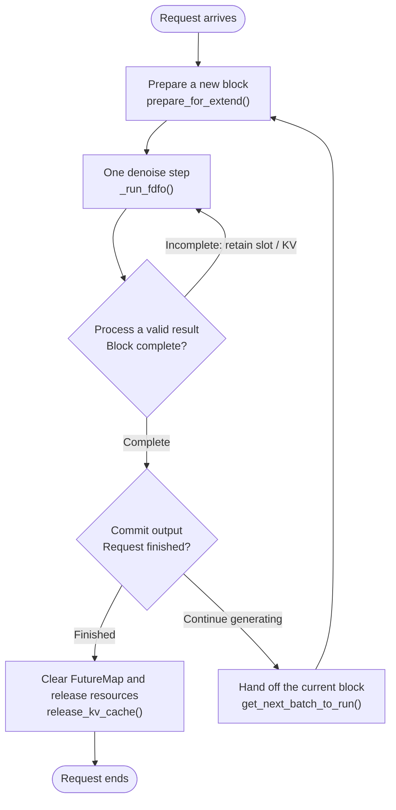
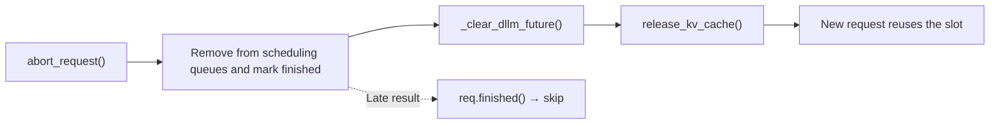

# [dLLM][feature][1/N] support overlap scheduling for FDFO

[Upstream PR](https://github.com/sgl-project/sglang/pull/40756) · state: open · merged: False

## Original PR description

# Motivation
This PR enables dLLM overlap scheduling only for FDFO + LowConfidence. 
FDFO executes one forward pass and one denoise step per `run_batch()`, requiring frequent scheduling. 
Sync mode completes multiple denoise steps within one `run_batch()`, amortizing scheduling overhead; 

overlap is not currently supported for sync mode.

# Design

## Asynchronous run_batch()

Overlap scheduling requires the scheduler to submit `run_batch()` and continue without waiting for GPU results.

Some existing paths frequently synchronize the scheduler with the GPU. These paths need to return GPU tensors first and defer CPU consumption. For example, FDFO's `LowConfidence.step()` updates tokens and computes completion flags directly on GPU tensors, without calling `.tolist()` or reading GPU booleans inside the step. `DllmRunOutput.block_tokens` and `block_done` both remain tensors.

## Dependencies between batches

Overlap requires the scheduler to schedule batch N+1 before receiving batch N's results.

At that point, the CPU has not processed batch N's results. However, the next forward pass must use the updated block tokens from the previous step, rather than the CPU inputs that have not yet been updated.

FutureMap adds `dllm_block_tokens_buf`, which stores a full block of tokens per request slot. After batch N's step, it writes the tokens into the corresponding row. Before its forward pass, N+1 reads that row and replaces its block input. This dependency stays on the GPU without passing through CPU result processing.

Each row starts at `-1`, indicating that no result is available. A new block's first execution keeps the input prepared by the scheduler; FutureMap replaces it only when the row is valid. Block handoff and request completion clear the old row to `-1`, preventing the next block or a new request from reading stale tokens.

`result.dllm_algo_state` retains the interface for returning algorithm state, but that state is not forwarded through FutureMap to the next step submitted ahead of result processing. Overlap for general stateful algorithms requires further adaptation.

## Request and resource lifecycle

An FDFO request proceeds through block preparation, denoising, block handoff, and request completion.

A request may contain multiple blocks. Both `req` and its request slot are retained across block transitions; the slot is released only when the request finishes or is aborted.



### Resource handoff driven by block state

#### State and transitions

| Field | Meaning and purpose |
|---|---|
| GPU `done` returned by `step()` | Per-block completion flag. Returned through `DllmRunOutput.block_done` → `result.dllm_block_done` and consumed once the result is readable on the CPU; not stored in FutureMap. |
| `req.dllm_block_done` | Set to `True` for an accepted completion result; prompt-only blocks can set it early during preparation. Reset to `False` after a new block is admitted. |
| `req.dllm_block_id` | ID of the current block. Incremented when `prepare_for_extend()` opens a new block; unchanged within a block. |
| `result.dllm_block_ids` | An immutable tuple captured when a batch is submitted. Each entry snapshots the corresponding request's block ID; result processing compares it with the current ID to identify stale results. |

GPU `done=True` means that this forward pass has computed KV for the final tokens. LowConfidence checks completion before updating tokens, so the step that fills the last mask still returns `False`; another forward pass is needed to complete the block. CPU-side `dllm_block_done` records whether the scheduler has accepted that completion result. These are separate states.

### Block advancement and resource handoff

**Handing off the old block** and **opening a new block** are separate stages, each performed once:

```text
Prepare the batch
  → If the block is prompt-only, mark done=True early
  → Submit GPU execution

Start the next scheduling iteration
  → Hand off the old block: hand off completed KV and clear FutureMap
  → Retain the old block ID, done=True, and request slot

Check resources in the adder
  ├─ Insufficient: keep waiting
  └─ Sufficient: enter prepare_for_extend()
                 Open a new block: block ID + 1, done=False
```

Denoise steps within a block reuse its KV allocation. At handoff, completed KV is passed to the prefix-cache manager. The request slot is retained across blocks and released only on completion or abort. FutureMap clearing runs after the old GPU writeback and before the new block reads the row, ordered by the forward stream.

#### 1. Avoid scheduling a prompt block twice

If `done` is set only during result processing, overlap scheduling still sees the current prompt block as incomplete when preparing the next batch and schedules the same forward pass again.

Instead, at the end of `prepare_for_extend()`, a block entirely within the prompt is marked `done=True` early. The next scheduling iteration knows that it needs only one forward pass and can advance without waiting for result processing.

Here, `done` means that scheduling can advance; it does not mean GPU execution has finished. The current batch still executes its forward pass to compute KV. Mixed blocks and decode blocks containing positions to generate still require a valid completion result.

#### 2. Avoid repeated handoff while waiting for resources

At the start of scheduling, hand off only completed blocks that have not yet been handed off:

```python
if req.dllm_block_done and req.extend_end > req.prefix_len:
    # Clear FutureMap and hand off the current block's KV.
```

Handoff leaves `prefix_len == extend_end`. Even if resources remain insufficient for several iterations, handoff is not repeated. While waiting, the next block is not initialized, and the old block ID and `done=True` remain unchanged.

Only requests actually added to the batch reach `prepare_for_extend()`, which initializes the new block, increments its ID, and resets `done`. `NO_TOKEN` can also mean that the current request joined the batch but exhausted the remaining budget, so this return value alone does not indicate whether admission succeeded.

Late results from the old block are rejected by `done=True` while waiting, and by the block ID mismatch after the new block opens. This prevents duplicate output commits and updates to the new block's state.

In sync mode, one `_run_sync()` completes the current block, and `done` is set after it returns. The request slot is likewise retained if generation continues.

## Resource reuse

At block handoff, request completion, or abort, resources are reused as follows:

- **Request slot:** Retain the ReqToTokenPool row across blocks. Return it for reuse by another request only on completion or abort. The WAR barrier orders subsequent scheduler writes to the shared mapping after the old forward pass has finished reading it.
- **KV pages:** Valid prefix KV may remain in the radix cache for reuse; the rest is reclaimed according to the cache policy. Old and new forward passes execute in order on the same forward stream. Even if the CPU has reassigned page indices, new computation cannot overwrite KV still in use by the old computation.
- **FutureMap:** Clear the row at block handoff, and before returning the slot on completion or abort. Enqueue the clear to `-1` on the forward stream. It executes after the old denoise round's last writeback and before the new forward pass reads the row, preventing stale tokens from leaking into the next block or a new request.

**Returning resource indices on the CPU** and **accessing those resources on the GPU** are separate operations. The CPU can reclaim and reassign indices before the old GPU work finishes, while stream dependencies order GPU accesses without requiring the CPU to wait for the entire round. Late CPU results are discarded through the finished, block ID, and block-done checks, preventing duplicate output commits or resource releases.

## Extra denoise cancellation

When the scheduler submits batch N+1 ahead of result processing, it does not yet know whether batch N completed the current block. If N completed it, N+1 is an extra round. Already-submitted GPU work continues to execute; its result is discarded during result processing.

`process_batch_result_dllm()` uses these early-exit conditions to discard stale results:

```python
if (
    req.finished()
    or result.dllm_block_ids[i] != req.dllm_block_id
    or req.dllm_block_done
):
    continue
```

The checks cover these cases:

1. The old block has ended, making its denoise result stale. Comparing `result.dllm_block_ids[i]` with the request's current block ID detects this transition.
2. The request has finished before another block opens. Its block ID will not advance further, so `dllm_block_done` also rejects the result.
3. The request was aborted and marked finished, making its denoise result irrelevant.

The extra round still reads and writes KV and writes its result to FutureMap. These operations must finish before the corresponding FutureMap row is cleared and the resources are reused by the next block or a new request. CUDA stream ordering enforces this dependency without requiring the CPU to wait for the extra round to finish.

## Prompt block handling

At the end of `prepare_for_extend()`, a prompt-only block is marked complete early:

```python
if req.extend_end <= len(req.origin_input_ids):
    req.dllm_block_done = True
```

The current block still executes one forward pass to compute KV. The early flag lets the next scheduling iteration advance without waiting for result processing. The old block hands off resources at the start of that iteration; the next input is initialized and the ID advances only after admission succeeds. The flag does not mean that GPU execution has finished; stream ordering still enforces GPU dependencies.

Decode blocks containing positions to generate, including mixed blocks that cross the prompt boundary, do not take this shortcut. A new block starts with `dllm_block_done=False`. Until a valid completion result is processed, work submitted ahead of result processing continues denoising the current block rather than opening the next one.

## Request abort handling

Aborting a request requires both invalidating old results and clearing stale data in its slot.

The finished flag prevents late results from modifying the request. `_clear_dllm_future()` prevents a new request from reading the old block when it reuses the slot. Clearing must run after the old GPU work's final stash; otherwise, that work could write stale data back into the cleared row.



The diagram shows the CPU call order. The forward stream and scheduler stream dependencies enforce safe GPU ordering without requiring the CPU to wait for the entire extra denoise round.

# Performance

> Retested on 2026-10-09: PR commit `d746802c1b`, main baseline `121aa8dcc7`. Sources are archives of these two commits, excluding uncommitted JointThreshold and design-document changes.

Single H20 (GPU4), TP1, LLaDA2.0-mini, LowConfidence + FDFO, block/page size 32, FlashInfer, CUDA Graph and radix cache enabled. `max-running-requests=16`, `context-length=8192`, `mem-fraction-static=0.7`, seed 42.

The native serving benchmark used fixed input/output lengths of 128/128 tokens and 8 warmup requests. Each repetition used 32 requests at concurrency 1 and 64 at concurrency 4/16. The table reports the mean of two repetitions. Off and on use the same implementation, toggling only `--disable-overlap-schedule`. **The off configuration still uses FDFO, not the sync algorithm.**

| Concurrency | Main output tok/s | Off output tok/s | On output tok/s | On/off throughput change | TTFT off → on (ms) | TPOT off → on (ms) |
| --- | --- | --- | --- | --- | --- | --- |
| 1 | 238.39 | 242.64 | 280.58 | +15.63% | 150.13 → 126.52 | 2.96 → 2.59 |
| 4 | 566.14 | 564.32 | 627.64 | +11.22% | 238.40 → 214.38 | 5.13 → 4.63 |
| 16 | 1020.56 | 988.93 | 1093.45 | +10.57% | 542.65 → 486.91 | 11.05 → 10.03 |

Each configuration completed 320 benchmark requests, with input/output lengths verified as 128/128. Measurements exclude profiler overhead. Main, off, and on ran sequentially on the same GPU with two repetitions each. At concurrency 16, off differs from main by -3.10% and on by +7.14%; the results apply to this model, length, and concurrency configuration.

# Correctness and accuracy

Unit tests: 246 passed, 1 skipped, plus 264 passing subtests. Direct runners passed for 8 files; changed-line coverage was 89% (126/141 lines); all pre-commit hooks passed. All three serving runs passed generation probes and cache-drain checks, with no KV-leak, scheduler exception, or assertion errors.

All three configurations used the same 256 GSM8K questions, zero-shot prompting, temperature 0, batch size 4, and a maximum output length of 1024.

| Mode | Correct | Accuracy | Outputs reaching the limit | API errors |
| --- | --- | --- | --- | --- |
| Before PR / main | 241/256 | 94.14% | 9 | 0 |
| Overlap off | 240/256 | 93.75% | 11 | 0 |
| Overlap on | 241/256 | 94.14% | 9 | 0 |

The on − off accuracy difference in this run was +0.39 percentage points. This result applies to this question set and run and does not establish strict accuracy equivalence; paired analysis is in the report.

# Profiling

All three configurations use FDFO + LowConfidence, concurrency 4, and input/output lengths of 128/128 tokens. Each profile uses 32 requests, 8 warmup requests, `profile-start-step=12`, and `profile-steps=40`. Each panel has **two lanes: CPU and GPU**, with the same 80 ms window covering at least five complete batches. Actual batch size is verified as 4 throughout the plotted interval.


Green identifies CPU scheduling/preparation, purple execution/submission, gray GPU waits, and blue result processing. Yellow Compute covers GPU forward + denoise. The figure shows the CPU scheduling/submitting the next batch and processing the previous result while the GPU computes.

The full-trace overlap ratios for CPU scheduling, preparation/submission, and result processing with GPU kernels are:

| Mode | Scheduling / preparation overlap | Execution / submission overlap | Result-processing overlap | Total CPU stage time (ms) | Time overlapping GPU (ms) | Combined overlap |
| --- | --- | --- | --- | --- | --- | --- |
| Before PR / main | 0.8% | 7.9% | 0.0% | 419.706 | 25.121 | 6.0% |
| Overlap off | 0.6% | 12.6% | 26.4% | 415.516 | 47.867 | 11.5% |
| Overlap on | 95.3% | 29.8% | 97.6% | 448.398 | 199.761 | 44.5% |

The stages correspond to `get_next_batch_to_run`, the CPU portion of `run_batch`, and `process_batch_result`. Combined overlap = duration of (CPU three-stage active union ∩ actual GPU kernel union) / duration of CPU active union. Active intervals come only from the scheduler thread, with its blocking CUDA waits (including `cuCtxSynchronize`) removed. Individual stage columns use their own active time as the denominator. This ratio is neither GPU utilization nor end-to-end speedup. Compute rectangles can include internal gaps; statistics use actual kernel intervals.

## raw trace
* before PR: 
[before-pr.trace.json.gz](https://github.com/user-attachments/files/33258995/before-pr.trace.json.gz)
* overlap off: 
[overlap-off.trace.json.gz](https://github.com/user-attachments/files/33259018/overlap-off.trace.json.gz)
* overlap on: 
[overlap-on.trace.json.gz](https://github.com/user-attachments/files/33259023/overlap-on.trace.json.gz)


# Follow-up PRs

1. Support other algorithms, including JointThreshold.
2. Align with related PRs:
   - Host overhead (#33047).
   - Multi-step FDFO (#33190).
   - Mixed prefill/decode rounds (#33196).
3. Remove CPU/GPU synchronization triggered during batch preparation, focusing on FlashInfer planning and KV allocation to improve overlap.
4. In `schedule_policy.py`, `PrefillAdder.add_dllm_staging_req()` uses `new_len = min(cand_extend_input_len, _rem_tokens)`, which may truncate a new block when the remaining budget is smaller than one block, conflicting with the full-block requirement of ordinary dLLM denoising.

To keep the current PR easier to review, I plan to address these items in follow-up PRs.

# Environment

The experiments used the repository's `.venv` with `PYTHONPATH` configured to load the newer dependencies in `/home/wuxiaojia/experiments/dllm-merge-main-20261009/runtime-deps` first. The original shared virtual environment was not upgraded.

```text
Python: 3.12.11 (main, Jun 12 2025, 12:40:51) [Clang 20.1.4 ]
CUDA available: True
GPU 0: NVIDIA H20
GPU 0 Compute Capability: 9.0
CUDA_HOME: /usr/local/cuda
NVCC: Cuda compilation tools, release 13.2, V13.2.78
CUDA Driver Version: 595.91.07
PyTorch: 2.14.1+cu130
sglang: 0.0.0
sglang-kernel: 0.4.9
flashinfer_python: 0.7.0.post1
flashinfer_cubin: Module Not Found
flashinfer_jit_cache: Module Not Found
triton: 3.8.0
transformers: 5.19.0
torchao: 0.17.0
numpy: 2.5.3
aiohttp: 3.14.3
fastapi: 0.141.1
huggingface_hub: 1.33.0
interegular: 0.3.3
modelscope: 1.39.1
orjson: 3.11.9
outlines: 0.1.11
packaging: 26.3
psutil: 7.2.2
pydantic: 2.13.4
python-multipart: 0.0.32
pyzmq: 27.1.0
uvicorn: 0.52.1
uvloop: 0.22.1
vllm: Module Not Found
xgrammar: 0.2.1
openai: 2.6.1
tiktoken: 0.13.0
anthropic: 0.121.0
litellm: 1.96.2
torchcodec: 0.15.0
NVIDIA Topology: 
	GPU0	GPU1	GPU2	GPU3	GPU4	GPU5	GPU6	GPU7	CPU Affinity	NUMA Affinity	GPU NUMA ID
GPU0	 X 	NV18	NV18	NV18	NV18	NV18	NV18	NV18	0-47,96-143	0		N/A
GPU1	NV18	 X 	NV18	NV18	NV18	NV18	NV18	NV18	0-47,96-143	0		N/A
GPU2	NV18	NV18	 X 	NV18	NV18	NV18	NV18	NV18	0-47,96-143	0		N/A
GPU3	NV18	NV18	NV18	 X 	NV18	NV18	NV18	NV18	0-47,96-143	0		N/A
GPU4	NV18	NV18	NV18	NV18	 X 	NV18	NV18	NV18	48-95,144-191	1		N/A
GPU5	NV18	NV18	NV18	NV18	NV18	 X 	NV18	NV18	48-95,144-191	1		N/A
GPU6	NV18	NV18	NV18	NV18	NV18	NV18	 X 	NV18	48-95,144-191	1		N/A
GPU7	NV18	NV18	NV18	NV18	NV18	NV18	NV18	 X 	48-95,144-191	1		N/A

Legend:

  X    = Self
  SYS  = Connection traversing PCIe as well as the SMP interconnect between NUMA nodes (e.g., QPI/UPI)
  NODE = Connection traversing PCIe as well as the interconnect between PCIe Host Bridges within a NUMA node
  PHB  = Connection traversing PCIe as well as a PCIe Host Bridge (typically the CPU)
  PXB  = Connection traversing multiple PCIe bridges (without traversing the PCIe Host Bridge)
  PIX  = Connection traversing at most a single PCIe bridge
  NV#  = Connection traversing a bonded set of # NVLinks

ulimit soft: 65535
```

## Review and discussion

### reviews

- rwang5203 · COMMENTED · 2026-10-12T01:23:23Z · [source](https://github.com/sgl-project/sglang/pull/40756#pullrequestreview-5485851498)

(No body; status only.)

- rwang5203 · COMMENTED · 2026-10-12T01:23:37Z · [source](https://github.com/sgl-project/sglang/pull/40756#pullrequestreview-5485852321)

(No body; status only.)

- rwang5203 · COMMENTED · 2026-10-12T01:23:49Z · [source](https://github.com/sgl-project/sglang/pull/40756#pullrequestreview-5485852946)

(No body; status only.)

- rwang5203 · COMMENTED · 2026-10-12T01:24:16Z · [source](https://github.com/sgl-project/sglang/pull/40756#pullrequestreview-5485854375)

(No body; status only.)

- rwang5203 · CHANGES_REQUESTED · 2026-10-12T01:25:13Z · [source](https://github.com/sgl-project/sglang/pull/40756#pullrequestreview-5485857534)

(No body; status only.)

### issue_comments

- Betelgeu · comment · 2026-10-09T16:19:50Z · [source](https://github.com/sgl-project/sglang/pull/40756#issuecomment-6084830938)

Hi @rwang5203, this PR is now ready for review.
Could you take a look and help trigger CI? Thanks!

- rwang5203 · comment · 2026-10-12T01:25:04Z · [source](https://github.com/sgl-project/sglang/pull/40756#issuecomment-6116103436)

Thanks for the detailed design notes, they made the block lifecycle easy to follow. I compared this branch with main on one H200 using LLaDA2.0-mini, the default `--dllm-algorithm LowConfidence` launch plus `--max-running-requests 16`, 128 input and 128 output tokens, and fresh servers in alternating order. At concurrency 1 output throughput improves about 22%, GSM8K is unchanged, and cancelling live streams under overlap left the server healthy. At concurrency 16 throughput drops about 12% with overlap, about 25% with `--disable-overlap-schedule`, and about 20% with `--no-dllm-fdfo`, and the logs trace this to the phase refresh in the first comment, because that run repeats earlier prompts and hits the prefix cache. With phases refreshed before grouping, overlap beats main by about 17% at concurrency 16 and overlap off matches main, so the scheduling approach holds up well once that is fixed.

### inline_comments

- rwang5203 · comment · 2026-10-12T01:23:23Z · [source](https://github.com/sgl-project/sglang/pull/40756#discussion_r4244034459)

File: `python/sglang/srt/dllm/mixin/scheduler.py` · line 54

`dllm_phase` refreshes only when a block opens, so a cached-prompt request stays prefill for a whole block and decode requests wait, losing up to 25% throughput at concurrency 16. Could we refresh phases before grouping?

- rwang5203 · comment · 2026-10-12T01:23:37Z · [source](https://github.com/sgl-project/sglang/pull/40756#discussion_r4244035252)

File: `python/sglang/srt/arg_groups/overrides.py` · line 1637

Overlap runs one discarded forward per completed block, a larger share of GPU work at small block sizes. Could we skip that forward for rows whose block just completed?

- rwang5203 · comment · 2026-10-12T01:23:49Z · [source](https://github.com/sgl-project/sglang/pull/40756#discussion_r4244035842)

File: `python/sglang/srt/dllm/algorithm/low_confidence.py` · line 52

`step` now returns a device tensor, so the unchanged `if all(done)` in `_run_sync` converts each row to a bool, one device sync per row on every `--no-dllm-fdfo` denoise step. Consider checking `done.all()` once there.

- rwang5203 · comment · 2026-10-12T01:24:16Z · [source](https://github.com/sgl-project/sglang/pull/40756#discussion_r4244037182)

File: `python/sglang/srt/dllm/algorithm/base.py` · line 161

For list results from JointThreshold or Gemma4Renoise, this adds a `done` upload and a download back on every FDFO step, although overlap stays off there. Consider dropping `device=` so list results stay on the host.

## Changed files and fixed code

- `python/sglang/srt/arg_groups/overrides.py` · modified · additions 2 / deletions 0
  - [head](https://github.com/Betelgeu/sglang/blob/d746802c1be17c49cbc72ceea9043af0194de596/python/sglang/srt/arg_groups/overrides.py)
  - [base](https://github.com/sgl-project/sglang/blob/121aa8dcc72ff81db69b17c80bed2db5513e7ed4/python/sglang/srt/arg_groups/overrides.py)
- `python/sglang/srt/dllm/algorithm/base.py` · modified · additions 24 / deletions 28
  - [head](https://github.com/Betelgeu/sglang/blob/d746802c1be17c49cbc72ceea9043af0194de596/python/sglang/srt/dllm/algorithm/base.py)
  - [base](https://github.com/sgl-project/sglang/blob/121aa8dcc72ff81db69b17c80bed2db5513e7ed4/python/sglang/srt/dllm/algorithm/base.py)
- `python/sglang/srt/dllm/algorithm/gemma4_renoise.py` · modified · additions 14 / deletions 2
  - [head](https://github.com/Betelgeu/sglang/blob/d746802c1be17c49cbc72ceea9043af0194de596/python/sglang/srt/dllm/algorithm/gemma4_renoise.py)
  - [base](https://github.com/sgl-project/sglang/blob/121aa8dcc72ff81db69b17c80bed2db5513e7ed4/python/sglang/srt/dllm/algorithm/gemma4_renoise.py)
- `python/sglang/srt/dllm/algorithm/low_confidence.py` · modified · additions 5 / deletions 5
  - [head](https://github.com/Betelgeu/sglang/blob/d746802c1be17c49cbc72ceea9043af0194de596/python/sglang/srt/dllm/algorithm/low_confidence.py)
  - [base](https://github.com/sgl-project/sglang/blob/121aa8dcc72ff81db69b17c80bed2db5513e7ed4/python/sglang/srt/dllm/algorithm/low_confidence.py)
- `python/sglang/srt/dllm/mixin/req.py` · modified · additions 2 / deletions 0
  - [head](https://github.com/Betelgeu/sglang/blob/d746802c1be17c49cbc72ceea9043af0194de596/python/sglang/srt/dllm/mixin/req.py)
  - [base](https://github.com/sgl-project/sglang/blob/121aa8dcc72ff81db69b17c80bed2db5513e7ed4/python/sglang/srt/dllm/mixin/req.py)
- `python/sglang/srt/dllm/mixin/scheduler.py` · modified · additions 66 / deletions 66
  - [head](https://github.com/Betelgeu/sglang/blob/d746802c1be17c49cbc72ceea9043af0194de596/python/sglang/srt/dllm/mixin/scheduler.py)
  - [base](https://github.com/sgl-project/sglang/blob/121aa8dcc72ff81db69b17c80bed2db5513e7ed4/python/sglang/srt/dllm/mixin/scheduler.py)
- `python/sglang/srt/managers/overlap_utils.py` · modified · additions 35 / deletions 0
  - [head](https://github.com/Betelgeu/sglang/blob/d746802c1be17c49cbc72ceea9043af0194de596/python/sglang/srt/managers/overlap_utils.py)
  - [base](https://github.com/sgl-project/sglang/blob/121aa8dcc72ff81db69b17c80bed2db5513e7ed4/python/sglang/srt/managers/overlap_utils.py)
- `python/sglang/srt/managers/schedule_batch.py` · modified · additions 16 / deletions 0
  - [head](https://github.com/Betelgeu/sglang/blob/d746802c1be17c49cbc72ceea9043af0194de596/python/sglang/srt/managers/schedule_batch.py)
  - [base](https://github.com/sgl-project/sglang/blob/121aa8dcc72ff81db69b17c80bed2db5513e7ed4/python/sglang/srt/managers/schedule_batch.py)
- `python/sglang/srt/managers/schedule_policy.py` · modified · additions 23 / deletions 3
  - [head](https://github.com/Betelgeu/sglang/blob/d746802c1be17c49cbc72ceea9043af0194de596/python/sglang/srt/managers/schedule_policy.py)
  - [base](https://github.com/sgl-project/sglang/blob/121aa8dcc72ff81db69b17c80bed2db5513e7ed4/python/sglang/srt/managers/schedule_policy.py)
- `python/sglang/srt/managers/scheduler.py` · modified · additions 41 / deletions 9
  - [head](https://github.com/Betelgeu/sglang/blob/d746802c1be17c49cbc72ceea9043af0194de596/python/sglang/srt/managers/scheduler.py)
  - [base](https://github.com/sgl-project/sglang/blob/121aa8dcc72ff81db69b17c80bed2db5513e7ed4/python/sglang/srt/managers/scheduler.py)
- `python/sglang/srt/managers/tp_worker.py` · modified · additions 12 / deletions 13
  - [head](https://github.com/Betelgeu/sglang/blob/d746802c1be17c49cbc72ceea9043af0194de596/python/sglang/srt/managers/tp_worker.py)
  - [base](https://github.com/sgl-project/sglang/blob/121aa8dcc72ff81db69b17c80bed2db5513e7ed4/python/sglang/srt/managers/tp_worker.py)
- `python/sglang/srt/managers/utils.py` · modified · additions 7 / deletions 6
  - [head](https://github.com/Betelgeu/sglang/blob/d746802c1be17c49cbc72ceea9043af0194de596/python/sglang/srt/managers/utils.py)
  - [base](https://github.com/sgl-project/sglang/blob/121aa8dcc72ff81db69b17c80bed2db5513e7ed4/python/sglang/srt/managers/utils.py)
- `python/sglang/srt/mem_cache/allocation.py` · modified · additions 9 / deletions 4
  - [head](https://github.com/Betelgeu/sglang/blob/d746802c1be17c49cbc72ceea9043af0194de596/python/sglang/srt/mem_cache/allocation.py)
  - [base](https://github.com/sgl-project/sglang/blob/121aa8dcc72ff81db69b17c80bed2db5513e7ed4/python/sglang/srt/mem_cache/allocation.py)
- `test/registered/unit/dllm/algorithm/test_joint_threshold_indel.py` · modified · additions 94 / deletions 50
  - [head](https://github.com/Betelgeu/sglang/blob/d746802c1be17c49cbc72ceea9043af0194de596/test/registered/unit/dllm/algorithm/test_joint_threshold_indel.py)
  - [base](https://github.com/sgl-project/sglang/blob/121aa8dcc72ff81db69b17c80bed2db5513e7ed4/test/registered/unit/dllm/algorithm/test_joint_threshold_indel.py)
- `test/registered/unit/dllm/test_dllm_fdfo_abort.py` · added · additions 226 / deletions 0
  - [head](https://github.com/Betelgeu/sglang/blob/d746802c1be17c49cbc72ceea9043af0194de596/test/registered/unit/dllm/test_dllm_fdfo_abort.py)
  - [base](https://github.com/sgl-project/sglang/blob/121aa8dcc72ff81db69b17c80bed2db5513e7ed4/test/registered/unit/dllm/test_dllm_fdfo_abort.py)
- `test/registered/unit/dllm/test_dllm_fdfo_admission.py` · added · additions 103 / deletions 0
  - [head](https://github.com/Betelgeu/sglang/blob/d746802c1be17c49cbc72ceea9043af0194de596/test/registered/unit/dllm/test_dllm_fdfo_admission.py)
  - [base](https://github.com/sgl-project/sglang/blob/121aa8dcc72ff81db69b17c80bed2db5513e7ed4/test/registered/unit/dllm/test_dllm_fdfo_admission.py)
- `test/registered/unit/dllm/test_dllm_fdfo_overlap.py` · added · additions 536 / deletions 0
  - [head](https://github.com/Betelgeu/sglang/blob/d746802c1be17c49cbc72ceea9043af0194de596/test/registered/unit/dllm/test_dllm_fdfo_overlap.py)
  - [base](https://github.com/sgl-project/sglang/blob/121aa8dcc72ff81db69b17c80bed2db5513e7ed4/test/registered/unit/dllm/test_dllm_fdfo_overlap.py)
- `test/registered/unit/dllm/test_gemma4_renoise.py` · modified · additions 11 / deletions 5
  - [head](https://github.com/Betelgeu/sglang/blob/d746802c1be17c49cbc72ceea9043af0194de596/test/registered/unit/dllm/test_gemma4_renoise.py)
  - [base](https://github.com/sgl-project/sglang/blob/121aa8dcc72ff81db69b17c80bed2db5513e7ed4/test/registered/unit/dllm/test_gemma4_renoise.py)
- `test/registered/unit/dllm/test_gemma4_uniform_lifecycle.py` · modified · additions 54 / deletions 7
  - [head](https://github.com/Betelgeu/sglang/blob/d746802c1be17c49cbc72ceea9043af0194de596/test/registered/unit/dllm/test_gemma4_uniform_lifecycle.py)
  - [base](https://github.com/sgl-project/sglang/blob/121aa8dcc72ff81db69b17c80bed2db5513e7ed4/test/registered/unit/dllm/test_gemma4_uniform_lifecycle.py)
- `test/registered/unit/mem_cache/test_dllm_fdfo_kv_reuse.py` · modified · additions 285 / deletions 5
  - [head](https://github.com/Betelgeu/sglang/blob/d746802c1be17c49cbc72ceea9043af0194de596/test/registered/unit/mem_cache/test_dllm_fdfo_kv_reuse.py)
  - [base](https://github.com/sgl-project/sglang/blob/121aa8dcc72ff81db69b17c80bed2db5513e7ed4/test/registered/unit/mem_cache/test_dllm_fdfo_kv_reuse.py)
- `test/registered/unit/test_model_overrides.py` · modified · additions 11 / deletions 3
  - [head](https://github.com/Betelgeu/sglang/blob/d746802c1be17c49cbc72ceea9043af0194de596/test/registered/unit/test_model_overrides.py)
  - [base](https://github.com/sgl-project/sglang/blob/121aa8dcc72ff81db69b17c80bed2db5513e7ed4/test/registered/unit/test_model_overrides.py)

## Evidence and interpretation boundary

[Original JSON, discussions and patches](../../../../../../evidence/prs/sgl-project--sglang/40756-005d062472a98619f76dad508e8b2ff7b8cf05784389e15693b2c1e41b0affd5.json) · SHA-256 `005d062472a98619f76dad508e8b2ff7b8cf05784389e15693b2c1e41b0affd5`.

Diff complete: True. Missing/binary/truncated patches require pinned source inspection. This is a source page, not an independently verified optimization case. Open, merged and released are different states; recheck the deployed dependency.
