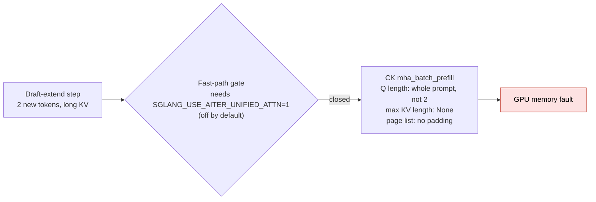
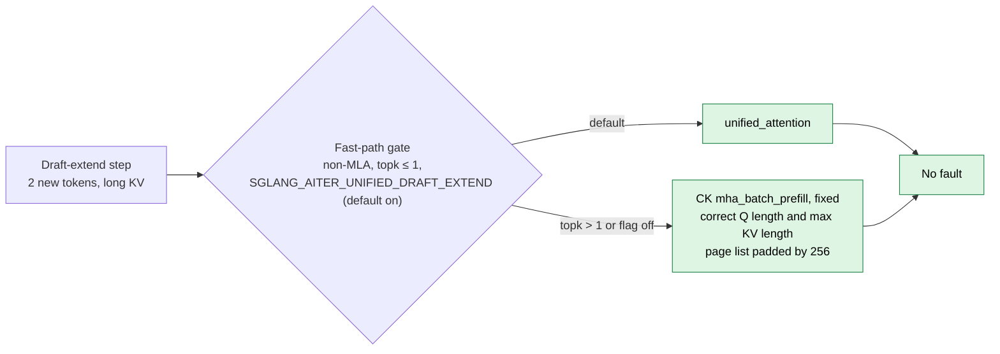

# [Fix] [AMD] aiter: Fix NEXTN draft extend crash on the CK kernel

[Upstream PR](https://github.com/sgl-project/sglang/pull/40872) · state: open · merged: False

## Original PR description

<!-- Thank you for your contribution! Please follow these guidelines to enhance your pull request. If anything is unclear, submit your PR and reach out to maintainers for assistance. Join our Slack community at https://slack.sglang.io to discuss further. -->

## Motivation

#39517 reports that NEXTN on Qwen3.5-122B-A10B-FP8 memory-faults on MI300X, MI325X, and MI355X when the attention backend is aiter (ROCm 10 nightlies, both fp8 and bf16 KV). A plain server is fine. The faulting kernel is CK `mha_batch_prefill` (`FmhaBatchPrefillWithPagedKVCacheKernel`), with `HSA_STATUS_ERROR_MEMORY_FAULT`, on the first draft step.

#### Root cause

On HIP, Qwen3.5 MTP draft attention is `HybridAttnBackend` over `AiterAttnBackend`, and `supports_hip_draft_extend_graph` is false for that backend, so every `draft_extend` is eager. Eager `DRAFT_EXTEND_V2` builds a short `qo_indptr` (one entry per draft token) and an exact-sized page-id list, then stores them only on `ForwardMetadata`. The CK launch reads `self.qo_indptr[:bs]`, which the prompt extend just filled with the prompt length, and `metadata.max_kv_len`, which that branch leaves as `None`. The kernel trusts `cu_seqlens_q` and reads off the end of a 2-token Q. It also reads 128 page ids past the last token; the prefill updater pads that tail, `generate_attn_arg_prefill` does not.

#30105 already routes this step through `unified_attention` (GQA-packed + split-KV) and defaults `SGLANG_AITER_UNIFIED_DRAFT_EXTEND` on. The call site still AND-ed `_use_unified_verify`, which requires `SGLANG_USE_AITER_UNIFIED_ATTN`. On the default aiter backend that kernel never runs. This PR does not add a kernel. It lets the existing one run, and it repairs the CK fallback for `topk>1` and for the env kill switch.

#### In pictures

Before (default aiter server with NEXTN):

After (same server, same settings):

Why the padding matters (the CK kernel reads 128 page ids past the end of the list):

| | Real page ids | What the kernel over-reads |
|---|---|---|
| Before | `7 8 9` | `? ? ? …` memory the list does not own |
| After | `7 8 9` | `7 7 7 …` 256 copies of a real page id |

## Modifications

- `aiter_backend.py`, call site: gate `draft_extend_v2` on a new `_use_unified_draft_extend` instead of `_use_unified_verify` (and drop the redundant env conjunct). It is computed once at init as `not use_mla and SGLANG_AITER_UNIFIED_DRAFT_EXTEND and topk<=1`, reading `speculative_eagle_topk` from the spec config (the registry constructs `AiterAttnBackend` without the eagle topk, so `self.topk` is always the default 1). Non-MLA `topk<=1` now takes `unified_attention` even when prefill and target verify stay on their current kernels. `topk>1` stays on CK, because `unified_attention`'s causal flag does not represent a tree mask.
- Same file, CK fallback (producer side only): in eager `DRAFT_EXTEND_V2` metadata, publish the short `qo_indptr` into the shared buffer, set `max_kv_len` (via the existing `seq_lens_cpu.max()` idiom), and pad the page-id tail by 256 with a live page id, matching `AiterIndicesUpdaterPrefill`. The `forward_extend` consumer is left identical to upstream.
- `environ.py`: document that `SGLANG_AITER_UNIFIED_DRAFT_EXTEND` now applies without `SGLANG_USE_AITER_UNIFIED_ATTN`. The default stays `True`. Target verify is unchanged.
- `test/registered/amd/test_aiter_draft_extend_metadata.py`: unit test for the CK-fallback page-id pad.

## Accuracy Tests

`test/registered/amd/test_aiter_draft_extend_metadata.py` (`stage-b-test-1-gpu-small-amd`) covers the CK-fallback pad (live-id tail, empty stays empty). Rerun pending on `rocm/sgl-dev:v0.5.20-rocm10-mi35x-20260920` after the test was trimmed to a single case.

End-to-end, the issue's NEXTN shape on the local Qwen3.5-397B-A17B-MXFP4 checkpoint (same eager `draft_extend_v2` path; no 122B download). TP=2, `--attention-backend aiter`, `SGLANG_USE_AITER_UNIFIED_ATTN=0`, page size 16, fp8 KV, `--speculative-algorithm NEXTN`, topk 1, 2 draft tokens. MI355X, gfx950.

| Run | What the log shows | 32-token completion |
|---|---|---|
| default (`SGLANG_AITER_UNIFIED_DRAFT_EXTEND` unset) | `Aiter draft extend uses unified_attention` on both ranks; gfx950 asm verify kernel loads | HTTP 200, no `HSA_STATUS_ERROR_MEMORY_FAULT` |
| `SGLANG_AITER_UNIFIED_DRAFT_EXTEND=0` | that line is absent; aiter JIT-builds `mha_batch_prefill` | HTTP 200, no memory fault |

Server warmup itself is a generation, and it returned 200 on both runs before the explicit request.

## Speed Tests and Profiling

No new kernel and no launch-geometry change. #30105 already measured the short-Q CK kernel at about 0.2% of HBM bandwidth; this PR is what lets that unified path run when unified attention is not also turned on for prefill and target verify. No throughput sweep in this PR.

## Checklist

- [x] Format your code according to the [Format code with pre-commit](https://docs.sglang.io/developer_guide/contribution_guide.html#format-code-with-pre-commit).
- [x] Add unit tests according to the [Run and add unit tests](https://docs.sglang.io/developer_guide/contribution_guide.html#run-and-add-unit-tests).
- [ ] Update documentation according to [Write documentations](https://docs.sglang.io/developer_guide/contribution_guide.html#write-documentations). — no user-facing docs change; the env flag comment is updated in code.
- [x] Provide accuracy and speed benchmark results according to [Test the accuracy](https://docs.sglang.io/developer_guide/contribution_guide.html#test-the-accuracy) and [Benchmark the speed](https://docs.sglang.io/developer_guide/contribution_guide.html#benchmark-the-speed).
- [x] Follow the SGLang code style [guidance](https://docs.sglang.io/developer_guide/contribution_guide.html#code-style-guidance).

## Review and Merge Process

1. Ping Merge Oncalls to start the process. See the [PR Merge Process](https://github.com/sgl-project/sglang/blob/main/.github/MAINTAINER.md#pull-request-merge-process).
2. Get approvals from [CODEOWNERS](https://github.com/sgl-project/sglang/blob/main/.github/CODEOWNERS) and other reviewers.
3. Trigger CI tests with [comments](https://docs.sglang.io/developer_guide/contribution_guide.html#how-to-trigger-ci-tests) or contact authorized users to do so.
   - Common commands include `/tag-and-rerun-ci`, `/tag-run-ci-label`, `/rerun-failed-ci`
4. After green CI and required approvals, ask Merge Oncalls or people with Write permission to merge the PR.

<!-- pr-states:start -->
---
### CI States

Latest PR Test (Base): <!-- slot:pr-test:start -->:white_check_mark: [Run #36719146405](https://github.com/sgl-project/sglang/actions/runs/36719146405)<!-- slot:pr-test:end -->
Latest PR Test (Extra): <!-- slot:pr-test-extra:start -->:x: [Run #36719146590](https://github.com/sgl-project/sglang/actions/runs/36719146590)<!-- slot:pr-test-extra:end -->
Latest PR Test (AMD ROCm 10): <!-- slot:pr-test-amd:start -->:x: [Run #36719146829](https://github.com/sgl-project/sglang/actions/runs/36719146829)<!-- slot:pr-test-amd:end -->
<!-- pr-states:end -->

## Review and discussion

### reviews

- yichiche · APPROVED · 2026-10-01T08:09:12Z · [source](https://github.com/sgl-project/sglang/pull/40872#pullrequestreview-5376630782)

- **Existing bug**, already on main. [#39517](https://github.com/sgl-project/sglang/issues/39517): NEXTN on Qwen3.5 faults on MI300X, MI325X, and MI355X with the aiter backend. A server without NEXTN is fine. The fault is CK mha_batch_prefill on the first draft step, because that launch reads the prompt-length qo_indptr left in the shared buffer.
- **AMD-only**. NVIDIA never enters this backend. Keeping the fix here is the right place.
- **No new kernel**. Default non-MLA topk <= 1 now reaches the existing unified_attention path from #30105 without SGLANG_USE_AITER_UNIFIED_ATTN. topk > 1 and SGLANG_AITER_UNIFIED_DRAFT_EXTEND=0 stay on CK, with the short qo_indptr published and the page-id tail padded by 256, matching AiterIndicesUpdaterPrefill.
LGTM.

### issue_comments

- chuyeh · comment · 2026-09-30T05:25:33Z · [source](https://github.com/sgl-project/sglang/pull/40872#issuecomment-5904683932)

/rerun-failed-ci

- chuyeh · comment · 2026-10-01T07:18:27Z · [source](https://github.com/sgl-project/sglang/pull/40872#issuecomment-5926638355)

@yichiche CI clear. Feel free to review and happy to adjust if you have any feedback.

- jolpindo96 · comment · 2026-10-02T00:14:18Z · [source](https://github.com/sgl-project/sglang/pull/40872#issuecomment-5943135846)

I'm the reporter of #39517. CI only got as far as the first AMD stage here, so I ran the setup from that issue on two cards, gfx950 and gfx942.

**Setup:** `rocm/sgl-dev:v0.5.21-rocm10-mi35x-20261001` and `-mi30x-20261001` (sglang `0.5.21.dev20261001+g41cbe65de0`), with this PR's two python files patched in (head `1eb32bd8b`; applies cleanly). `Qwen/Qwen3.5-122B-A10B-FP8`, TP1, `--attention-backend aiter --page-size 16 --kv-cache-dtype fp8_e4m3 --disable-radix-cache`, NEXTN with 1 step / topk 1 / 2 draft tokens. Batch 1, 128 output tokens, prompts of 186 / 1,862 / 11,150 tokens, best of two.

- **Without the PR, same image:** the `ck_tile ... FmhaBatchPrefillWithPagedKVCacheKernel` memory fault on the first prefill (the 80-token warm-up) on both cards, same as #39517.
- **With the PR:** no fault on either card. `Aiter draft extend uses unified_attention (topk<=1).` shows at startup, and the new unit test passes. With `SGLANG_AITER_UNIFIED_DRAFT_EXTEND=0`, the CK fallback also runs clean.

Decode tok/s (186 / 1,862 / 11,150 prompt tokens):

| | MI350X (gfx950) | MI325X (gfx942) |
|---|---|---|
| no spec | 144.6 / 144.2 / 143.6 | 65.1 / 65.1 / 65.0 |
| NEXTN, this PR | 215.8 / 176.1 / 108.4 | 61.4 / 56.0 / 48.4 |
| NEXTN, this PR, `SGLANG_AITER_UNIFIED_DRAFT_EXTEND=0` | 212.4 / 173.1 / 106.3 | 62.5 / 54.4 / 47.6 |
| NEXTN, `--attention-backend triton` | 206.0 / 185.2 / 174.7 | 59.8 / 52.8 / 45.9 |

So the crash is fixed on both. One thing I noticed: on gfx950, NEXTN is +49% at short context but drops to 0.75x of no-spec at ~11k tokens, while triton holds 1.22x there. My guess is that's target verify still going through `mha_batch_prefill`, as the env comment says. Not a blocker for this PR, just mentioning it in case it's useful.

*I used an AI assistant for the test harness and to tidy this up; the runs are mine, and I have the logs.*

- chuyeh · comment · 2026-10-02T01:31:39Z · [source](https://github.com/sgl-project/sglang/pull/40872#issuecomment-5943911428)

@jolpindo96 Thanks for the feedback! The slowdown reproduces on my MI355X (`Qwen3.5-397B-A17B-FP8`, TP2, your flags). The cause I found is target verify running Triton `extend_attention_fwd` (no split-KV). 

Setting `SGLANG_USE_AITER_UNIFIED_ATTN=1` can help here:

| Decode tok/s | 186 | 1,862 | 11,150 | 30,000 |
|---|---|---|---|---|
| no spec | 138.0 | 137.7 | 137.1 | 134.5 |
| NEXTN, this PR | 177.3 | 164.4 | 103.0 | 59.0 |
| NEXTN, this PR, `SGLANG_USE_AITER_UNIFIED_ATTN=1` | 191.3 | 196.6 | 190.4 | 188.7 |
| NEXTN, `--attention-backend triton` | 174.0 | 170.4 | 158.1 | 141.8 |

At 11k, that Triton kernel takes 554 µs per call vs 14 µs with unified verify. This predates the PR, so I'll handle it in a follow-up.

- jolpindo96 · comment · 2026-10-02T10:15:35Z · [source](https://github.com/sgl-project/sglang/pull/40872#issuecomment-5950133074)

Confirmed on MI350X (gfx950) with my setup (Qwen3.5-122B-A10B-FP8, TP1, same flags, this PR patched into the 20261001 nightly): with `SGLANG_USE_AITER_UNIFIED_ATTN=1`, NEXTN stays flat.

| Decode tok/s | 186 | 1,862 | 11,150 | 29,070 |
|---|---|---|---|---|
| no spec | 143.8 | 143.4 | 142.9 | 141.9 |
| NEXTN, this PR | 218.1 | 173.3 | 105.0 | 59.8 |
| NEXTN, this PR, `SGLANG_USE_AITER_UNIFIED_ATTN=1` | 219.9 | 205.1 | 207.2 | 205.5 |

The env doesn't change no-spec decode (144.1 / 143.9 / 143.0 / 141.7), and it no longer dies at CUDA-graph capture on gfx950 like it did for me in September (#39517). Thanks, happy to test the follow-up.

*Same AI-assisted harness as my earlier comment.*

### inline_comments

## Changed files and fixed code

- `python/sglang/srt/environ.py` · modified · additions 4 / deletions 4
  - [head](https://github.com/chuyeh/sglang/blob/1eb32bd8b50e70ba52ff8054307c260cf10e5543/python/sglang/srt/environ.py)
  - [base](https://github.com/sgl-project/sglang/blob/bd66ce343e4f6e2f2b75d7e820fe4d0718a8d824/python/sglang/srt/environ.py)
- `python/sglang/srt/layers/attention/aiter_backend.py` · modified · additions 39 / deletions 8
  - [head](https://github.com/chuyeh/sglang/blob/1eb32bd8b50e70ba52ff8054307c260cf10e5543/python/sglang/srt/layers/attention/aiter_backend.py)
  - [base](https://github.com/sgl-project/sglang/blob/bd66ce343e4f6e2f2b75d7e820fe4d0718a8d824/python/sglang/srt/layers/attention/aiter_backend.py)
- `test/registered/amd/test_aiter_draft_extend_metadata.py` · added · additions 28 / deletions 0
  - [head](https://github.com/chuyeh/sglang/blob/1eb32bd8b50e70ba52ff8054307c260cf10e5543/test/registered/amd/test_aiter_draft_extend_metadata.py)
  - [base](https://github.com/sgl-project/sglang/blob/bd66ce343e4f6e2f2b75d7e820fe4d0718a8d824/test/registered/amd/test_aiter_draft_extend_metadata.py)

## Evidence and interpretation boundary

[Original JSON, discussions and patches](../../../../../../evidence/prs/sgl-project--sglang/40872-96b9b23b1feef9a15036be29ed7834ea0f5328e4bd6fa63fc6badf0267e9419d.json) · SHA-256 `96b9b23b1feef9a15036be29ed7834ea0f5328e4bd6fa63fc6badf0267e9419d`.

Diff complete: True. Missing/binary/truncated patches require pinned source inspection. This is a source page, not an independently verified optimization case. Open, merged and released are different states; recheck the deployed dependency.
