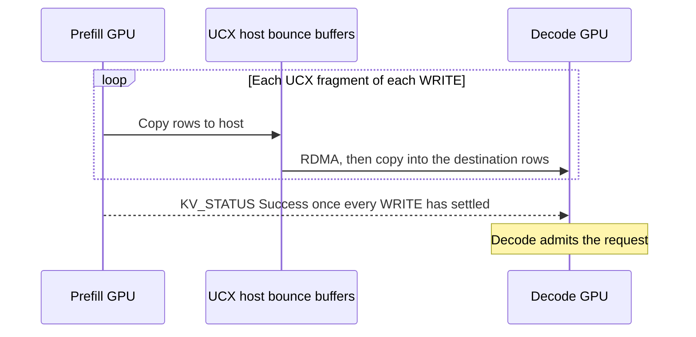
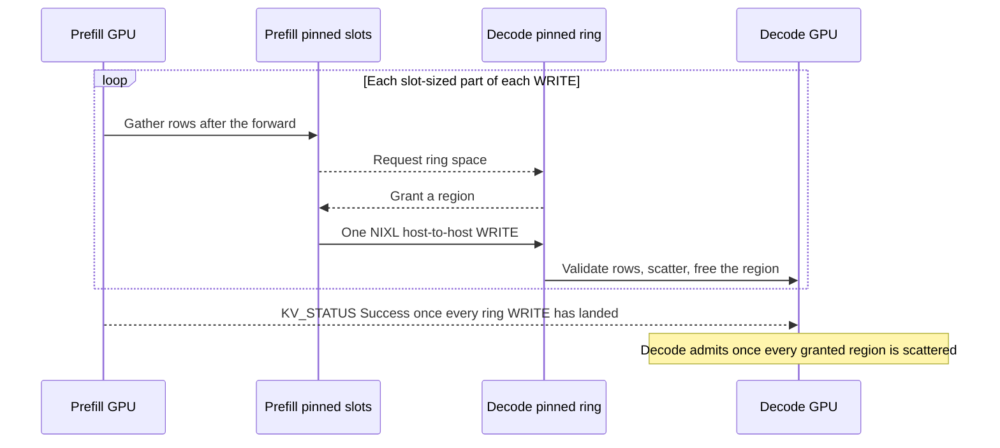

# [PD] Add NIXL HOST staging for PD transfers through pinned host memory

[Upstream PR](https://github.com/sgl-project/sglang/pull/41182) · state: open · merged: False

## Original PR description

## Summary

Adds opt-in **HOST staging for NIXL prefill → decode transfers**: gather GPU rows into pinned host slots, transfer them into decode's pinned ring, then scatter into decode GPU memory. The existing NIXL planner still supplies the KV/state layouts and transfer rows.

```bash
# Set the same pinned-memory budget (MiB per worker) on prefill and decode.
export SGLANG_NIXL_HOST_STAGING_MB=1024
```

Unset or `0` disables HOST staging. The transfer backend is NIXL; auxiliary metadata continues through the existing NIXL path.

## Original and new SGL flow

### Stock NIXL / UCX — without GPUDirect RDMA



### HOST staging — beneath the same planner



Solid arrows: data. Dashed arrows: control. Gather and ring allocation can overlap; regions are freed after their scatter completes.

## Performance

### Latest · pure-upstream A/B · 2026-10-29

| Setup | Value |
|---|---|
| Build | Stock: upstream nightly `c10e0e17`; HOST: same image + PR files at `07e61a0555`. No downstream patches. |
| Hardware / model | B300, RoCE · Qwen3-8B · TP1 · 1 prefill + 1 decode |
| Requests per arm | Concurrency 1 · 32 × 29k and 16 × 64k cold prompts · 8 output tokens |
| KV payload / outcome | ≈4.0 / 8.8 GiB per request · all requests cold · zero request errors |

| Run | Handoff p50, 29k | Handoff p50, 64k | KV rate at 29k | TTFT p50, 29k / 64k |
|---|---:|---:|---:|---:|
| **HOST staging — this PR** | **250 ms** | **265 ms** | **16 GiB/s** | **783 / 1,927 ms** |
| Stock NIXL, GPUDirect RDMA off | 8,610 ms | 17,712 ms | 0.5 GiB/s | 9,095 / 19,237 ms |
| Stock NIXL, GPUDirect RDMA on | 47 ms | 51 ms | 86 GiB/s | 530 / 1,575 ms |

*Handoff* = `prefill_transfer_kv_cache`: end of the last chunk's forward → prefill observes transfer completion, for the slowest rank. At 64k, transfer overlaps earlier prefill work, so this is not the full transfer duration. *TTFT* = time to first token. Rates are in binary GiB/s.

### GLM-5.3 · GB300 · 2026-10-07

Earlier build; these measurements predate the latest upstream rebase.

GLM-5.3 NVFP4, GB300 1P1D, TP4/aDP4/EP4 per role, `UCX_IB_GPU_DIRECT_RDMA=n`. 32 unique cold prompts at 29k (single chunk), 16 at 64k (two chunks), concurrency 1. Handoff and TTFT are p50.

| Path | Optimistic prefill | Handoff, 29k | TTFT, 29k | Handoff, 64k | TTFT, 64k |
|---|---|---:|---:|---:|---:|
| Stock | Off | 926.0 ms | 3.22 s | 1,414.5 ms | 6.52 s |
| HOST | Off | 15.9 ms | 2.31 s | 26.5 ms | 5.23 s |
| Stock | On | 926.0 ms | 3.20 s | 1,410.9 ms | 6.52 s |
| HOST | On | 16.3 ms | 2.30 s | 26.7 ms | 5.14 s |

## Correctness and failure handling

| Mechanism | Behavior |
|---|---|
| **Source lifetime** | Holds KV pages and metadata while asynchronous gathers or outstanding WRITEs can still read them, including failed requests across ranks. |
| **Decode completion** | Waits for prefill's Success and every granted ring region's scatter before admission. |
| **Destination validation** | Checks rows against registered memory and request-owned destinations before scatter. |
| **Large / strided transfers** | Splits oversized rows across slots; adapts HOST descriptors to the strided NIXL API without changing native descriptors. |
| **Cancellation** | Existing ABORT → drain → ABORT_ACK protocol gates release. |
| **Transport errors** | Settled errors fail the request; a WRITE unresolved past its deadline fail-stops its worker. Disconnected ring WRITEs fail their request; abandoned rooms notify decode promptly. |
| **Control backpressure** | Drain ACKs run off the progress thread; staging requests use nonblocking sends and lock acquisition. |
| **HiCache restore failure** | Fences prefill and waits for local restore DMA before freeing memory. |
| **Peer mismatch** | Refuses incompatible HOST configurations without crashing the worker. |

## Validation

### Earlier live stress · additional checks

| Check | GLM-5.3 | Kimi-K3 |
|---|---|---|
| Recall, 1k–108k tokens | 10/10 | 10/10 |
| Mixed 1k–120k load, 20–30% mid-stream cancels | ~11k requests, 0 KV-checksum mismatches | 354/354 at concurrency 32 |
| 150k–250k-token prompts | 58/58 | — |
| Cancel storm → recovery | 2,000 cancels → 534/534 | 715 cancels → 97/97 |
| Forced prefill kill | Decode stays up | Decode stays up |
| Forced decode kill | Prefill stays up | Prefill stays up |

<!-- pr-states:start -->
---
### CI States

Latest PR Test (Base): <!-- slot:pr-test:start -->:x: [Run #40801690211](https://github.com/sgl-project/sglang/actions/runs/40801690211)<!-- slot:pr-test:end -->
Latest PR Test (Extra): <!-- slot:pr-test-extra:start -->:x: [Run #40801690029](https://github.com/sgl-project/sglang/actions/runs/40801690029)<!-- slot:pr-test-extra:end -->
Latest PR Test (AMD ROCm 10): <!-- slot:pr-test-amd:start -->:x: [Run #40801690085](https://github.com/sgl-project/sglang/actions/runs/40801690085)<!-- slot:pr-test-amd:end -->
<!-- pr-states:end -->


## Review and discussion

### reviews

- jy-zzz · COMMENTED · 2026-10-30T01:36:37Z · [source](https://github.com/sgl-project/sglang/pull/41182#pullrequestreview-5707106898)

(No body; status only.)

- ShangmingCai · COMMENTED · 2026-11-02T14:41:14Z · [source](https://github.com/sgl-project/sglang/pull/41182#pullrequestreview-5738252551)

(No body; status only.)

- ShangmingCai · COMMENTED · 2026-11-02T14:50:14Z · [source](https://github.com/sgl-project/sglang/pull/41182#pullrequestreview-5738377584)

(No body; status only.)

- ShangmingCai · COMMENTED · 2026-11-02T15:48:31Z · [source](https://github.com/sgl-project/sglang/pull/41182#pullrequestreview-5738943582)

Layering question before the line comments. What this PR does is transport work: pack strided descriptors into a contiguous pinned buffer, send one message, unpack on the far side. NIXL already receives the full descriptor list, so a staged-DRAM path inside the UCX backend (or a NIXL plugin) would keep sglang's contract unchanged: pages are owned by the sender until the transfer status is terminal. Every lifetime hook in this PR (`is_source_pending`, `holds_failed_source`, the extra collective, the guards in `mem_cache/common.py`, the PP rework) exists only because the gather reads source pages after `send()` returns on a stream outside the transfer worker. Has this been raised with the NIXL maintainers?   CC: @iyastreb @ovidiusm

Two things I think would be better to provide in the description regardless of where the code ends up:

1. Which deployments cannot get GPUDirect through either `nvidia-peermem` or DMA-BUF. That is the audience for the feature and it is not named.
2. A tuned baseline. The stock number (0.46 GiB/s) was taken with `UCX_IB_GPU_DIRECT_RDMA=n` and no UCX rendezvous tuning mentioned.

I would prefer everything needed to live entirely under `nixl/` behind the existing staging-handler interface, with the gather finished before `send()` returns. That costs some gather/WRITE overlap and tries hard to remove every change outside the NIXL directory (we are unifying the general logic: https://github.com/sgl-project/sglang/issues/34510, backend-specific code in the prefill.py or decode.py will make it harder to refactor and maintain). Line comments below.

### issue_comments

- Stelath · comment · 2026-09-24T22:51:11Z · [source](https://github.com/sgl-project/sglang/pull/41182#issuecomment-5823527412)

`python/sglang/srt/disaggregation/nixl/host_staging.py` is the file with the main logic for anyone reviewing

- github-actions[bot] · comment · 2026-10-29T01:43:02Z · [source](https://github.com/sgl-project/sglang/pull/41182#issuecomment-6485551584)

<!-- pr-check-comment runs=40801721456 -->
Required checks failed on 07e61a0; this PR cannot be merged until they pass.

**PR title** ([run](https://github.com/sgl-project/sglang/actions/runs/40801721456))
> PR title must use "[Type] scope: title" or "[Type] [Hardware] scope: title". Type must be one of: Feat, Fix, Refactor, Perf, Doc, Test, CI, Chore. Scope is required and may be any module or model name, with unrestricted letter case (letters, numbers, dots, underscores, slashes, or hyphens). Hardware is optional; use a single tag without spaces. Use uppercase hardware tags (AMD, NVIDIA, NPU, MI300X), except for exactly these four spellings: Intel, Apple, Huawei, Ascend. Reverts must use GitHub's default format: Revert "original title". Use one space between fields and after the colon, with a non-empty title and no leading or trailing whitespace. Examples: "[Fix] attention: Fix KV cache indexing", "[Feat] qwen3: Add model support", "[Perf] [AMD] flash-attn: Optimize decode performance".
Edit the title; the check reruns on its own.

- github-actions[bot] · comment · 2026-10-29T17:48:43Z · [source](https://github.com/sgl-project/sglang/pull/41182#issuecomment-6504184116)

<!-- pr-check-comment runs=40924815043 -->
Required checks failed on 07e61a0; this PR cannot be merged until they pass.

**PR title** ([run](https://github.com/sgl-project/sglang/actions/runs/40924815043))
> PR title must use "[Type] scope: title" or "[Type] [Hardware] scope: title". Type must be one of: Feat, Fix, Refactor, Perf, Doc, Test, CI, Chore. Scope is required and may be any module or model name, with unrestricted letter case (letters, numbers, dots, underscores, slashes, or hyphens). Hardware is optional; use a single tag without spaces. Use uppercase hardware tags (AMD, NVIDIA, NPU, MI300X), except for exactly these four spellings: Intel, Apple, Huawei, Ascend. Reverts must use GitHub's default format: Revert "original title". Use one space between fields and after the colon, with a non-empty title and no leading or trailing whitespace. Examples: "[Fix] attention: Fix KV cache indexing", "[Feat] qwen3: Add model support", "[Perf] [AMD] flash-attn: Optimize decode performance".
Edit the title; the check reruns on its own.

- github-actions[bot] · comment · 2026-10-29T18:00:41Z · [source](https://github.com/sgl-project/sglang/pull/41182#issuecomment-6504447702)

<!-- pr-check-comment runs=40926669005 -->
Required checks failed on 07e61a0; this PR cannot be merged until they pass.

**PR title** ([run](https://github.com/sgl-project/sglang/actions/runs/40926669005))
> PR title must use "[Type] scope: title" or "[Type] [Hardware] scope: title". Type must be one of: Feat, Fix, Refactor, Perf, Doc, Test, CI, Chore. Scope is required and may be any module or model name, with unrestricted letter case (letters, numbers, dots, underscores, slashes, or hyphens). Hardware is optional; use a single tag without spaces. Use uppercase hardware tags (AMD, NVIDIA, NPU, MI300X), except for exactly these four spellings: Intel, Apple, Huawei, Ascend. Reverts must use GitHub's default format: Revert "original title". Use one space between fields and after the colon, with a non-empty title and no leading or trailing whitespace. Examples: "[Fix] attention: Fix KV cache indexing", "[Feat] qwen3: Add model support", "[Perf] [AMD] flash-attn: Optimize decode performance".
Edit the title; the check reruns on its own.

- github-actions[bot] · comment · 2026-10-29T18:05:21Z · [source](https://github.com/sgl-project/sglang/pull/41182#issuecomment-6504545942)

<!-- pr-check-comment runs=40927420068 -->
Required checks failed on 07e61a0; this PR cannot be merged until they pass.

**PR title** ([run](https://github.com/sgl-project/sglang/actions/runs/40927420068))
> PR title must use "[Type] scope: title" or "[Type] [Hardware] scope: title". Type must be one of: Feat, Fix, Refactor, Perf, Doc, Test, CI, Chore. Scope is required and may be any module or model name, with unrestricted letter case (letters, numbers, dots, underscores, slashes, or hyphens). Hardware is optional; use a single tag without spaces. Use uppercase hardware tags (AMD, NVIDIA, NPU, MI300X), except for exactly these four spellings: Intel, Apple, Huawei, Ascend. Reverts must use GitHub's default format: Revert "original title". Use one space between fields and after the colon, with a non-empty title and no leading or trailing whitespace. Examples: "[Fix] attention: Fix KV cache indexing", "[Feat] qwen3: Add model support", "[Perf] [AMD] flash-attn: Optimize decode performance".
Edit the title; the check reruns on its own.

- github-actions[bot] · comment · 2026-10-29T18:08:43Z · [source](https://github.com/sgl-project/sglang/pull/41182#issuecomment-6504617161)

<!-- pr-check-comment runs=40927950384 -->
Required checks failed on 07e61a0; this PR cannot be merged until they pass.

**PR title** ([run](https://github.com/sgl-project/sglang/actions/runs/40927950384))
> PR title must use "[Type] scope: title" or "[Type] [Hardware] scope: title". Type must be one of: Feat, Fix, Refactor, Perf, Doc, Test, CI, Chore. Scope is required and may be any module or model name, with unrestricted letter case (letters, numbers, dots, underscores, slashes, or hyphens). Hardware is optional; use a single tag without spaces. Use uppercase hardware tags (AMD, NVIDIA, NPU, MI300X), except for exactly these four spellings: Intel, Apple, Huawei, Ascend. Reverts must use GitHub's default format: Revert "original title". Use one space between fields and after the colon, with a non-empty title and no leading or trailing whitespace. Examples: "[Fix] attention: Fix KV cache indexing", "[Feat] qwen3: Add model support", "[Perf] [AMD] flash-attn: Optimize decode performance".
Edit the title; the check reruns on its own.

- ShangmingCai · comment · 2026-10-30T12:03:44Z · [source](https://github.com/sgl-project/sglang/pull/41182#issuecomment-6522283389)

Thank you, will check it these days

- jlee5814 · comment · 2026-10-30T13:58:09Z · [source](https://github.com/sgl-project/sglang/pull/41182#issuecomment-6524590609)

Do you have per stage timing (gather, WRITE, scatter) on an x86 host? The B300 number from the talk works out to about 17 GB/s on a 4.3 GB handoff, well under PCIe or the NIC. My guess is `copy_byte_ranges` reading host memory from the SMs over PCIe.

Did you try `cuMemcpyBatchAsync` (CUDA 12.8)?

### inline_comments

- jy-zzz · comment · 2026-10-30T01:36:28Z · [source](https://github.com/sgl-project/sglang/pull/41182#discussion_r4419644606)

File: `python/sglang/srt/disaggregation/nixl/host_staging.py` · line 747

Can we retain and retry the latest watermark on `zmq.Again`? The “next free” isn’t guaranteed: after wraparound, both prefill slots can be waiting on the final freeing scatter’s update. Drop that update and neither WRITE can post, so nothing else can scatter/free; the room hits the 15s post deadline. A regression test that drops that last update would catch this.

- ShangmingCai · comment · 2026-11-02T14:41:14Z · [source](https://github.com/sgl-project/sglang/pull/41182#discussion_r4443695772)

File: `python/sglang/srt/environ.py` · line 890

move these down after `SGLANG_STAGING_USE_TORCH` since the above are general env vars, and this new one is nixl specific

- ShangmingCai · comment · 2026-11-02T14:50:14Z · [source](https://github.com/sgl-project/sglang/pull/41182#discussion_r4443793365)

File: `python/sglang/srt/disaggregation/nixl/conn.py` · line 461

this need a rebase

- ShangmingCai · comment · 2026-11-02T15:27:50Z · [source](https://github.com/sgl-project/sglang/pull/41182#discussion_r4444233240)

File: `python/sglang/srt/disaggregation/decode.py` · line 463

This reads a NIXL-specific env var in transport-agnostic scheduler code (also at L2640 and L2646). Can the KV manager expose a capability instead, e.g. `kv_manager.requires_staging` or the `stages_source_async()` you already added, so `decode.py` does not need to know a backend's config name?

- ShangmingCai · comment · 2026-11-02T15:27:51Z · [source](https://github.com/sgl-project/sglang/pull/41182#discussion_r4444233252)

File: `python/sglang/srt/disaggregation/decode.py` · line 2646

Silently turning on deferred KV release because HOST is set hides a hard dependency. If HOST cannot work without it, fail at startup with a clear message when the user has it off, or at least log once at INFO that it was enabled implicitly.

- ShangmingCai · comment · 2026-11-02T15:27:51Z · [source](https://github.com/sgl-project/sglang/pull/41182#discussion_r4444233283)

File: `python/sglang/srt/disaggregation/prefill.py` · line 177

A release helper that can raise, and under HOST can `fail_stop` the worker through `NixlKVSender.failure_exception`. If a metadata slot is still in flight here, the bug is in the hold logic upstream of this call. I would rather assert and log than exit the process from inside a free path.

- ShangmingCai · comment · 2026-11-02T15:27:51Z · [source](https://github.com/sgl-project/sglang/pull/41182#discussion_r4444233291)

File: `python/sglang/srt/disaggregation/prefill.py` · line 1161

This is where the contract change becomes visible. Today, once `send()` returns, the sender owns the pages until the poll is terminal and the scheduler never asks again. HOST reads the source after `send()` on a CUDA stream outside the transfer worker, which is why this collective, the four new base-class methods, and the guards in `mem_cache/common.py` are needed.

Have you considered finishing the gather before `send()` returns, or having the transfer worker own it? That loses some gather/WRITE overlap and removes every change outside `nixl/`.

- ShangmingCai · comment · 2026-11-02T15:27:51Z · [source](https://github.com/sgl-project/sglang/pull/41182#discussion_r4444233304)

File: `python/sglang/srt/disaggregation/prefill.py` · line 1178

One more CPU collective per scheduler step whenever any inflight request is Failed. The early return keeps it free in the happy path, but under a cancel storm this runs every step on every rank. A cheaper rank-local check if the hold can be made config-level.

- ShangmingCai · comment · 2026-11-02T15:27:51Z · [source](https://github.com/sgl-project/sglang/pull/41182#discussion_r4444233315)

File: `python/sglang/srt/disaggregation/prefill.py` · line 1801

The scheduler setting a private attribute on the sender is a layering leak, and `envs.SGLANG_NIXL_HOST_STAGING_MB` is the backend's config name in generic code again. Could this be a public hook such as `req.disagg_kv_sender.mark_source_ready(stream)`, or folded into `send()` with the stream passed in?

- ShangmingCai · comment · 2026-11-02T15:27:51Z · [source](https://github.com/sgl-project/sglang/pull/41182#discussion_r4444233323)

File: `python/sglang/srt/mem_cache/common.py` · line 278

This disables intermediate radix checkpoints for every request when HOST is on, so concurrent requests lose mid-prefill prefix sharing. That is a real behavior change and only this comment mentions it. Please call it out in the PR description and docs.

Alternative: have the checkpoint wait on the gather's `copy_done` event instead of skipping it. The TP divergence concern applies to a rank-local predicate, not to a rank-local wait.

- ShangmingCai · comment · 2026-11-02T15:27:51Z · [source](https://github.com/sgl-project/sglang/pull/41182#discussion_r4444233332)

File: `python/sglang/srt/mem_cache/common.py` · line 427

Memory-pool code now has a path to `os._exit(70)` through `failure_exception`. `release_kv_cache` is called from many places and I do not think the memory layer should be able to exit the process. If a pending source here is unreachable by construction, make it an assertion. If it is reachable, the caller should handle it.

- ShangmingCai · comment · 2026-11-02T15:27:51Z · [source](https://github.com/sgl-project/sglang/pull/41182#discussion_r4444233341)

File: `python/sglang/srt/disaggregation/nixl/host_staging.py` · line 241

`run()` turns any exception into `os._exit(70)`, and `allocate` / `on_write` raise `ValueError` on bytes the peer sent (endpoint outside the room at L806, bad header at L870, size, conflicting allocation). So one misbehaving prefill exits the decode worker, and the other TP ranks then hang at their next collective. Native transport errors fail the room instead. Can peer-input validation fail the room and keep fail-stop for internal invariants only?

- ShangmingCai · comment · 2026-11-02T15:27:51Z · [source](https://github.com/sgl-project/sglang/pull/41182#discussion_r4444233359)

File: `python/sglang/srt/disaggregation/nixl/host_staging.py` · line 570

A WRITE unresolved for 25 s exits the prefill process, and the sibling TP ranks hang at their next collective. The PR body says this plainly. I would like a maintainer decision on whether process exit is acceptable here versus failing the room and quarantining the slot until the peer answers.

- ShangmingCai · comment · 2026-11-02T15:27:51Z · [source](https://github.com/sgl-project/sglang/pull/41182#discussion_r4444233367)

File: `python/sglang/srt/managers/scheduler_pp_mixin.py` · line 614

Main changed `_pp_pd_get_prefill_transferred_ids` to return `{rid: failed}` and force a failure on any stage onto every stage (#47045, #47063), and renamed the queue to `disagg_prefill_transfer_queue`. This hunk cannot be re-applied as-is: the held rids need to be dropped from the dict before the intersection, on every stage.

## Changed files and fixed code

- `python/sglang/kernels/ops/kvcache/pd_dcp_gather.py` · modified · additions 29 / deletions 0
  - [head](https://github.com/Stelath/sglang/blob/07e61a05550cb6be877e79d4a404caef47f6f5ee/python/sglang/kernels/ops/kvcache/pd_dcp_gather.py)
  - [base](https://github.com/sgl-project/sglang/blob/f2d31889258d22214d9541e40b1e1e6961ce95e7/python/sglang/kernels/ops/kvcache/pd_dcp_gather.py)
- `python/sglang/srt/arg_groups/pd_disaggregation_hook.py` · modified · additions 9 / deletions 0
  - [head](https://github.com/Stelath/sglang/blob/07e61a05550cb6be877e79d4a404caef47f6f5ee/python/sglang/srt/arg_groups/pd_disaggregation_hook.py)
  - [base](https://github.com/sgl-project/sglang/blob/f2d31889258d22214d9541e40b1e1e6961ce95e7/python/sglang/srt/arg_groups/pd_disaggregation_hook.py)
- `python/sglang/srt/disaggregation/base/conn.py` · modified · additions 17 / deletions 0
  - [head](https://github.com/Stelath/sglang/blob/07e61a05550cb6be877e79d4a404caef47f6f5ee/python/sglang/srt/disaggregation/base/conn.py)
  - [base](https://github.com/sgl-project/sglang/blob/f2d31889258d22214d9541e40b1e1e6961ce95e7/python/sglang/srt/disaggregation/base/conn.py)
- `python/sglang/srt/disaggregation/common/staging_buffer.py` · modified · additions 18 / deletions 4
  - [head](https://github.com/Stelath/sglang/blob/07e61a05550cb6be877e79d4a404caef47f6f5ee/python/sglang/srt/disaggregation/common/staging_buffer.py)
  - [base](https://github.com/sgl-project/sglang/blob/f2d31889258d22214d9541e40b1e1e6961ce95e7/python/sglang/srt/disaggregation/common/staging_buffer.py)
- `python/sglang/srt/disaggregation/decode.py` · modified · additions 35 / deletions 6
  - [head](https://github.com/Stelath/sglang/blob/07e61a05550cb6be877e79d4a404caef47f6f5ee/python/sglang/srt/disaggregation/decode.py)
  - [base](https://github.com/sgl-project/sglang/blob/f2d31889258d22214d9541e40b1e1e6961ce95e7/python/sglang/srt/disaggregation/decode.py)
- `python/sglang/srt/disaggregation/nixl/conn.py` · modified · additions 466 / deletions 103
  - [head](https://github.com/Stelath/sglang/blob/07e61a05550cb6be877e79d4a404caef47f6f5ee/python/sglang/srt/disaggregation/nixl/conn.py)
  - [base](https://github.com/sgl-project/sglang/blob/f2d31889258d22214d9541e40b1e1e6961ce95e7/python/sglang/srt/disaggregation/nixl/conn.py)
- `python/sglang/srt/disaggregation/nixl/host_staging.py` · added · additions 931 / deletions 0
  - [head](https://github.com/Stelath/sglang/blob/07e61a05550cb6be877e79d4a404caef47f6f5ee/python/sglang/srt/disaggregation/nixl/host_staging.py)
  - [base](https://github.com/sgl-project/sglang/blob/f2d31889258d22214d9541e40b1e1e6961ce95e7/python/sglang/srt/disaggregation/nixl/host_staging.py)
- `python/sglang/srt/disaggregation/prefill.py` · modified · additions 59 / deletions 1
  - [head](https://github.com/Stelath/sglang/blob/07e61a05550cb6be877e79d4a404caef47f6f5ee/python/sglang/srt/disaggregation/prefill.py)
  - [base](https://github.com/sgl-project/sglang/blob/f2d31889258d22214d9541e40b1e1e6961ce95e7/python/sglang/srt/disaggregation/prefill.py)
- `python/sglang/srt/disaggregation/utils.py` · modified · additions 26 / deletions 0
  - [head](https://github.com/Stelath/sglang/blob/07e61a05550cb6be877e79d4a404caef47f6f5ee/python/sglang/srt/disaggregation/utils.py)
  - [base](https://github.com/sgl-project/sglang/blob/f2d31889258d22214d9541e40b1e1e6961ce95e7/python/sglang/srt/disaggregation/utils.py)
- `python/sglang/srt/environ.py` · modified · additions 12 / deletions 0
  - [head](https://github.com/Stelath/sglang/blob/07e61a05550cb6be877e79d4a404caef47f6f5ee/python/sglang/srt/environ.py)
  - [base](https://github.com/sgl-project/sglang/blob/f2d31889258d22214d9541e40b1e1e6961ce95e7/python/sglang/srt/environ.py)
- `python/sglang/srt/managers/scheduler_pp_mixin.py` · modified · additions 19 / deletions 10
  - [head](https://github.com/Stelath/sglang/blob/07e61a05550cb6be877e79d4a404caef47f6f5ee/python/sglang/srt/managers/scheduler_pp_mixin.py)
  - [base](https://github.com/sgl-project/sglang/blob/f2d31889258d22214d9541e40b1e1e6961ce95e7/python/sglang/srt/managers/scheduler_pp_mixin.py)
- `python/sglang/srt/mem_cache/common.py` · modified · additions 8 / deletions 1
  - [head](https://github.com/Stelath/sglang/blob/07e61a05550cb6be877e79d4a404caef47f6f5ee/python/sglang/srt/mem_cache/common.py)
  - [base](https://github.com/sgl-project/sglang/blob/f2d31889258d22214d9541e40b1e1e6961ce95e7/python/sglang/srt/mem_cache/common.py)
- `test/registered/unit/disaggregation/test_nixl_host_abort.py` · added · additions 654 / deletions 0
  - [head](https://github.com/Stelath/sglang/blob/07e61a05550cb6be877e79d4a404caef47f6f5ee/test/registered/unit/disaggregation/test_nixl_host_abort.py)
  - [base](https://github.com/sgl-project/sglang/blob/f2d31889258d22214d9541e40b1e1e6961ce95e7/test/registered/unit/disaggregation/test_nixl_host_abort.py)
- `test/registered/unit/disaggregation/test_nixl_host_staging.py` · added · additions 1354 / deletions 0
  - [head](https://github.com/Stelath/sglang/blob/07e61a05550cb6be877e79d4a404caef47f6f5ee/test/registered/unit/disaggregation/test_nixl_host_staging.py)
  - [base](https://github.com/sgl-project/sglang/blob/f2d31889258d22214d9541e40b1e1e6961ce95e7/test/registered/unit/disaggregation/test_nixl_host_staging.py)
- `test/registered/unit/disaggregation/test_prefill_complete_integration.py` · modified · additions 1 / deletions 0
  - [head](https://github.com/Stelath/sglang/blob/07e61a05550cb6be877e79d4a404caef47f6f5ee/test/registered/unit/disaggregation/test_prefill_complete_integration.py)
  - [base](https://github.com/sgl-project/sglang/blob/f2d31889258d22214d9541e40b1e1e6961ce95e7/test/registered/unit/disaggregation/test_prefill_complete_integration.py)
- `test/registered/unit/mem_cache/test_decode_radix_lock_ref.py` · modified · additions 1 / deletions 0
  - [head](https://github.com/Stelath/sglang/blob/07e61a05550cb6be877e79d4a404caef47f6f5ee/test/registered/unit/mem_cache/test_decode_radix_lock_ref.py)
  - [base](https://github.com/sgl-project/sglang/blob/f2d31889258d22214d9541e40b1e1e6961ce95e7/test/registered/unit/mem_cache/test_decode_radix_lock_ref.py)

## Evidence and interpretation boundary

[Original JSON, discussions and patches](../../../../../../evidence/prs/sgl-project--sglang/41182-82b8ab9b9777284b762779f4559c281a16bac53b5483f82f26b794bac80c85d2.json) · SHA-256 `82b8ab9b9777284b762779f4559c281a16bac53b5483f82f26b794bac80c85d2`.

Diff complete: True. Missing/binary/truncated patches require pinned source inspection. This is a source page, not an independently verified optimization case. Open, merged and released are different states; recheck the deployed dependency.
