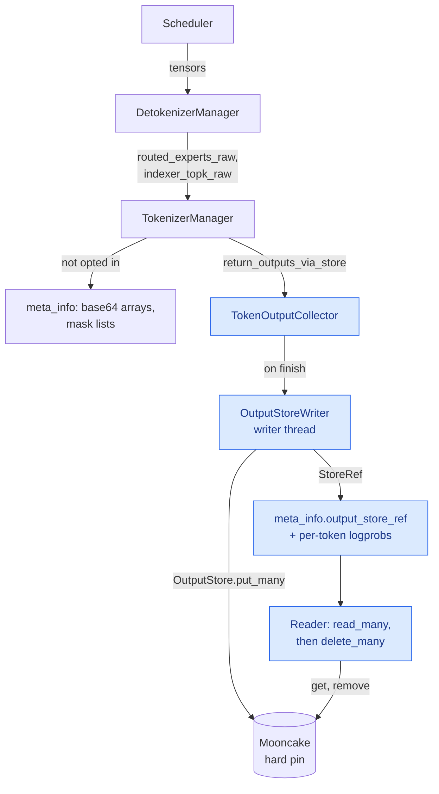
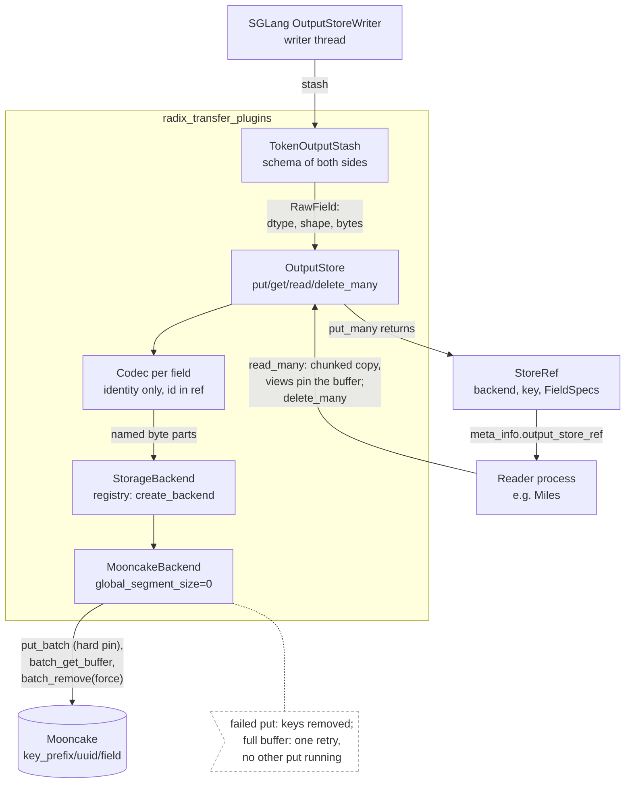
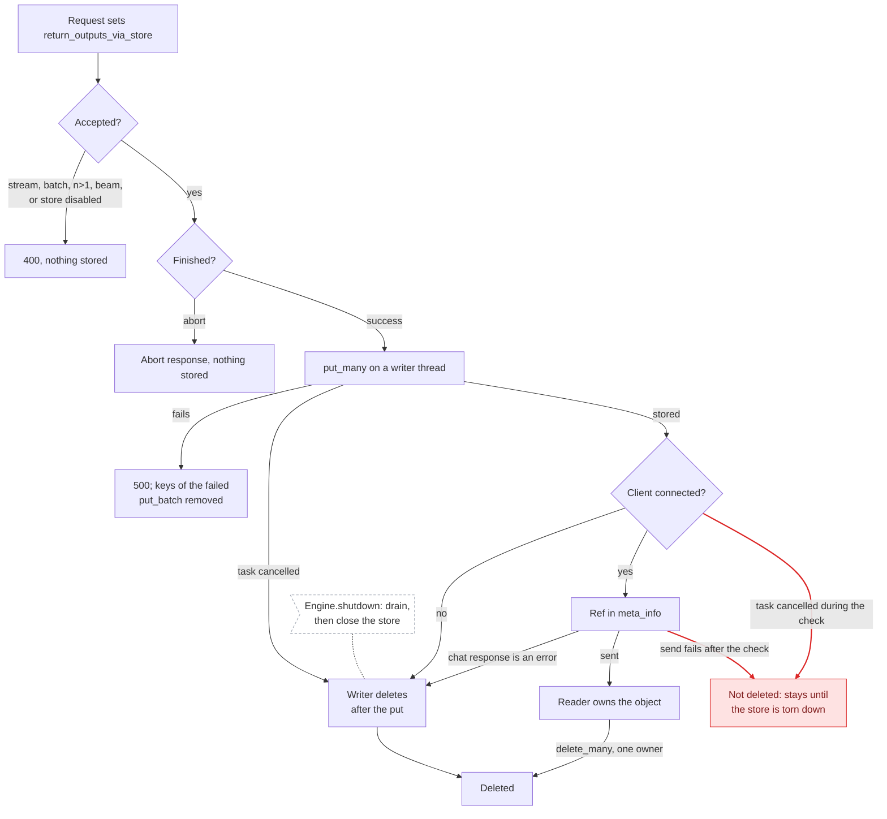

# [Feat] RL: Add radix transfer plugins

[Upstream PR](https://github.com/sgl-project/sglang/pull/42647) · state: closed · merged: True

## Original PR description

## Summary
Return replay outputs through a shared output-store package instead of inline.

## Motivation
Routed experts, indexer top-k, and sampling masks dominate long RL rollout responses as inline base64 or lists: 6.3 MB for 2048 prompt and 1024 output tokens. Readers in other processes need the same field names, ref format, and storage client.

## Usage
```bash
python -m sglang.launch_server --model-path <model> --enable-return-routed-experts \
  --output-store-backend mooncake --output-store-backend-extra-config \
  '{"master_server_address": "10.0.0.1:50051", "local_hostname": "10.0.0.2",
    "local_buffer_size": "1gb", "key_prefix": "run-1/output-store"}'
curl -s localhost:30000/generate -d '{"text": "Hi", "return_routed_experts": true,
  "return_outputs_via_store": true}' | jq '.meta_info.output_store_ref'
```
```python
# pip install -e radix_transfer_plugins: needed by readers, and by servers only with the store
store = OutputStore(backend=create_backend("mooncake", config_json))
ref = StoreRef.from_builtins(meta_info["output_store_ref"])
# Many objects, chunked to the client's read buffer and copied out: arrays the caller owns.
(stash,) = store.read_many([(ref, ["routed_experts"])], stash_type=TokenOutputStash, buffer_bytes=1 << 30)
store.delete_many([ref])
```

## Design Notes
- **Mental model:** an opted-in request collects its outputs in a `TokenOutputCollector`; on a successful finish `OutputStoreWriter` stores them with one `OutputStore.put_many` off the event loop, so `meta_info` carries a `StoreRef` instead of the arrays; the package owns the stored format, SGLang owns collection plus cleanup, and other requests stay inline.
- `radix_transfer_plugins` imports neither sglang nor torch; SGLang imports it only with `--output-store-backend`.
- One prompt, n=1, no beam search: a failed sub-request's siblings would leak.
- Only support-sized mask rows are stored; sampled tokens' logprobs stay in `meta_info` (support mode: `output_token_sampling_selected_logprobs`).
- `read_many` copies fields out with numpy, which releases the GIL.

Store path with `--output-store-backend` (blue: new):



Store backend layers, shared by writer and reader:



Who deletes a stored object (red: not deleted):



## Verification
- `radix_transfer_plugins/tests` (macOS, fake Mooncake): 32 passed, including two puts that both find the buffer full (hang before `f396edb143`).
- 1 GiB copy-out (macOS): another Python thread stalls 0.3 ms, vs 93 ms with `bytearray()`.
- `test_output_store.py`, `test_tokenizer_manager_rid_cleanup.py`, `test_sampling_mask_validation.py`, `test_multi_tokenizer_mixin.py`, `test_batch_result_processor_hidden_states.py`, `test_output_streamer_customized_info.py`, `test_serving_chat.py`, `test_io_struct.py` (macOS CPU): 343 passed, 2 skipped (CUDA only), including a put running at writer shutdown (leaked before this head).
- `test_server_args_docs_coverage.py` fails only on 8 base-branch flags.
- Not run: GPU and a real Mooncake client.

## Review Focus
- `TokenizerManager._store_token_outputs` / `OutputStoreWriter`: cancellation, disconnect, and shutdown cleanup.
- `add_sampling_mask_return_values` / `SamplingMaskChunk.selected_logprobs`: one mask row per returned token.
- `_LocalBufferGate`: a waiting put holds no buffer.

<!-- pr-states:start -->
---
### CI States

Latest PR Test (Base): <!-- slot:pr-test:start -->:x: [Run #39730249903](https://github.com/sgl-project/sglang/actions/runs/39730249903)<!-- slot:pr-test:end -->
Latest PR Test (Extra): <!-- slot:pr-test-extra:start -->:x: [Run #39730249856](https://github.com/sgl-project/sglang/actions/runs/39730249856)<!-- slot:pr-test-extra:end -->
Latest PR Test (AMD ROCm 10): <!-- slot:pr-test-amd:start -->:x: [Run #39730249940](https://github.com/sgl-project/sglang/actions/runs/39730249940)<!-- slot:pr-test-amd:end -->
<!-- pr-states:end -->


## Review and discussion

### reviews

- guapisolo · COMMENTED · 2026-10-21T22:11:38Z · [source](https://github.com/sgl-project/sglang/pull/42647#pullrequestreview-5606869027)

(No body; status only.)

### issue_comments

- github-actions[bot] · comment · 2026-10-16T17:32:49Z · [source](https://github.com/sgl-project/sglang/pull/42647#issuecomment-6221112299)

<!-- pr-check-comment runs=38939903928 -->
Required checks failed on f0da509; this PR cannot be merged until they pass.

**PR title** ([run](https://github.com/sgl-project/sglang/actions/runs/38939903928))
> PR title must use "[Type] scope: title" or "[Type] [Hardware] scope: title". Type must be one of: Feat, Fix, Refactor, Perf, Doc, Test, CI, Chore. Scope is required and may be any module or model name, with unrestricted letter case (letters, numbers, dots, underscores, slashes, or hyphens). Hardware is optional; use a single tag without spaces. Use uppercase hardware tags (AMD, NVIDIA, NPU, MI300X), except for exactly these four spellings: Intel, Apple, Huawei, Ascend. Reverts must use GitHub's default format: Revert "original title". Use one space between fields and after the colon, with a non-empty title and no leading or trailing whitespace. Examples: "[Fix] attention: Fix KV cache indexing", "[Feat] qwen3: Add model support", "[Perf] [AMD] flash-attn: Optimize decode performance".
Edit the title; the check reruns on its own.

- github-actions[bot] · comment · 2026-10-17T20:29:38Z · [source](https://github.com/sgl-project/sglang/pull/42647#issuecomment-6240537371)

<!-- pr-check-comment runs=39066666654 -->
Required checks failed on 1298e54; this PR cannot be merged until they pass.

**PR title** ([run](https://github.com/sgl-project/sglang/actions/runs/39066666654))
> PR title must use "[Type] scope: title" or "[Type] [Hardware] scope: title". Type must be one of: Feat, Fix, Refactor, Perf, Doc, Test, CI, Chore. Scope is required and may be any module or model name, with unrestricted letter case (letters, numbers, dots, underscores, slashes, or hyphens). Hardware is optional; use a single tag without spaces. Use uppercase hardware tags (AMD, NVIDIA, NPU, MI300X), except for exactly these four spellings: Intel, Apple, Huawei, Ascend. Reverts must use GitHub's default format: Revert "original title". Use one space between fields and after the colon, with a non-empty title and no leading or trailing whitespace. Examples: "[Fix] attention: Fix KV cache indexing", "[Feat] qwen3: Add model support", "[Perf] [AMD] flash-attn: Optimize decode performance".
Edit the title; the check reruns on its own.

- github-actions[bot] · comment · 2026-10-20T05:01:19Z · [source](https://github.com/sgl-project/sglang/pull/42647#issuecomment-6283775842)

<!-- pr-check-comment runs=39372273090 -->
Required checks failed on eb7d3d0; this PR cannot be merged until they pass.

**PR title** ([run](https://github.com/sgl-project/sglang/actions/runs/39372273090))
> PR title must use "[Type] scope: title" or "[Type] [Hardware] scope: title". Type must be one of: Feat, Fix, Refactor, Perf, Doc, Test, CI, Chore. Scope is required and may be any module or model name, with unrestricted letter case (letters, numbers, dots, underscores, slashes, or hyphens). Hardware is optional; use a single tag without spaces. Use uppercase hardware tags (AMD, NVIDIA, NPU, MI300X), except for exactly these four spellings: Intel, Apple, Huawei, Ascend. Reverts must use GitHub's default format: Revert "original title". Use one space between fields and after the colon, with a non-empty title and no leading or trailing whitespace. Examples: "[Fix] attention: Fix KV cache indexing", "[Feat] qwen3: Add model support", "[Perf] [AMD] flash-attn: Optimize decode performance".
Edit the title; the check reruns on its own.

- github-actions[bot] · comment · 2026-10-20T22:35:13Z · [source](https://github.com/sgl-project/sglang/pull/42647#issuecomment-6303299610)

<!-- pr-check-comment runs=39508777276 -->
Required checks failed on baef68b; this PR cannot be merged until they pass.

**PR title** ([run](https://github.com/sgl-project/sglang/actions/runs/39508777276))
> PR title must use "[Type] scope: title" or "[Type] [Hardware] scope: title". Type must be one of: Feat, Fix, Refactor, Perf, Doc, Test, CI, Chore. Scope is required and may be any module or model name, with unrestricted letter case (letters, numbers, dots, underscores, slashes, or hyphens). Hardware is optional; use a single tag without spaces. Use uppercase hardware tags (AMD, NVIDIA, NPU, MI300X), except for exactly these four spellings: Intel, Apple, Huawei, Ascend. Reverts must use GitHub's default format: Revert "original title". Use one space between fields and after the colon, with a non-empty title and no leading or trailing whitespace. Examples: "[Fix] attention: Fix KV cache indexing", "[Feat] qwen3: Add model support", "[Perf] [AMD] flash-attn: Optimize decode performance".
Edit the title; the check reruns on its own.

- github-actions[bot] · comment · 2026-10-21T20:25:53Z · [source](https://github.com/sgl-project/sglang/pull/42647#issuecomment-6325782568)

<!-- pr-check-comment runs=39670202782 -->
Required checks failed on baef68b; this PR cannot be merged until they pass.

**PR title** ([run](https://github.com/sgl-project/sglang/actions/runs/39670202782))
> PR title must use "[Type] scope: title" or "[Type] [Hardware] scope: title". Type must be one of: Feat, Fix, Refactor, Perf, Doc, Test, CI, Chore. Scope is required and may be any module or model name, with unrestricted letter case (letters, numbers, dots, underscores, slashes, or hyphens). Hardware is optional; use a single tag without spaces. Use uppercase hardware tags (AMD, NVIDIA, NPU, MI300X), except for exactly these four spellings: Intel, Apple, Huawei, Ascend. Reverts must use GitHub's default format: Revert "original title". Use one space between fields and after the colon, with a non-empty title and no leading or trailing whitespace. Examples: "[Fix] attention: Fix KV cache indexing", "[Feat] qwen3: Add model support", "[Perf] [AMD] flash-attn: Optimize decode performance".
Edit the title; the check reruns on its own.

### inline_comments

- guapisolo · comment · 2026-10-21T22:11:38Z · [source](https://github.com/sgl-project/sglang/pull/42647#discussion_r4342503837)

File: `radix_transfer_plugins/pyproject.toml` · line None

Need discussion: Where to maintain SoT? currently prefer sglang.
In sglang: 
- pros: miles, miles-d, specforge can share the same sot.
- cons: cannot be gated by ci very well

In miles:
- pros: easy for ci gate
- cons: hard to maintain single sot

Another repo:
too many repos for RL framework.

## Changed files and fixed code

- `.github/workflows/_pr-test-stage-cpu.yml` · modified · additions 1 / deletions 1
  - [head](https://github.com/sgl-project/sglang/blob/c577937f1730e5c51344f1a15569480ab8027860/.github/workflows/_pr-test-stage-cpu.yml)
  - [base](https://github.com/sgl-project/sglang/blob/92fec6958d4a41a9b24027d726c621a21dd5978c/.github/workflows/_pr-test-stage-cpu.yml)
- `docs/docs/advanced_features/server_arguments.mdx` · modified · additions 12 / deletions 0
  - [head](https://github.com/sgl-project/sglang/blob/c577937f1730e5c51344f1a15569480ab8027860/docs/docs/advanced_features/server_arguments.mdx)
  - [base](https://github.com/sgl-project/sglang/blob/92fec6958d4a41a9b24027d726c621a21dd5978c/docs/docs/advanced_features/server_arguments.mdx)
- `python/sglang/srt/arg_groups/fields/exec_.py` · modified · additions 14 / deletions 0
  - [head](https://github.com/sgl-project/sglang/blob/c577937f1730e5c51344f1a15569480ab8027860/python/sglang/srt/arg_groups/fields/exec_.py)
  - [base](https://github.com/sgl-project/sglang/blob/92fec6958d4a41a9b24027d726c621a21dd5978c/python/sglang/srt/arg_groups/fields/exec_.py)
- `python/sglang/srt/entrypoints/engine.py` · modified · additions 6 / deletions 0
  - [head](https://github.com/sgl-project/sglang/blob/c577937f1730e5c51344f1a15569480ab8027860/python/sglang/srt/entrypoints/engine.py)
  - [base](https://github.com/sgl-project/sglang/blob/92fec6958d4a41a9b24027d726c621a21dd5978c/python/sglang/srt/entrypoints/engine.py)
- `python/sglang/srt/entrypoints/openai/protocol.py` · modified · additions 1 / deletions 0
  - [head](https://github.com/sgl-project/sglang/blob/c577937f1730e5c51344f1a15569480ab8027860/python/sglang/srt/entrypoints/openai/protocol.py)
  - [base](https://github.com/sgl-project/sglang/blob/92fec6958d4a41a9b24027d726c621a21dd5978c/python/sglang/srt/entrypoints/openai/protocol.py)
- `python/sglang/srt/entrypoints/openai/serving_chat.py` · modified · additions 26 / deletions 6
  - [head](https://github.com/sgl-project/sglang/blob/c577937f1730e5c51344f1a15569480ab8027860/python/sglang/srt/entrypoints/openai/serving_chat.py)
  - [base](https://github.com/sgl-project/sglang/blob/92fec6958d4a41a9b24027d726c621a21dd5978c/python/sglang/srt/entrypoints/openai/serving_chat.py)
- `python/sglang/srt/managers/detokenizer_manager.py` · modified · additions 14 / deletions 2
  - [head](https://github.com/sgl-project/sglang/blob/c577937f1730e5c51344f1a15569480ab8027860/python/sglang/srt/managers/detokenizer_manager.py)
  - [base](https://github.com/sgl-project/sglang/blob/92fec6958d4a41a9b24027d726c621a21dd5978c/python/sglang/srt/managers/detokenizer_manager.py)
- `python/sglang/srt/managers/io_struct.py` · modified · additions 25 / deletions 4
  - [head](https://github.com/sgl-project/sglang/blob/c577937f1730e5c51344f1a15569480ab8027860/python/sglang/srt/managers/io_struct.py)
  - [base](https://github.com/sgl-project/sglang/blob/92fec6958d4a41a9b24027d726c621a21dd5978c/python/sglang/srt/managers/io_struct.py)
- `python/sglang/srt/managers/multi_tokenizer_mixin.py` · modified · additions 8 / deletions 0
  - [head](https://github.com/sgl-project/sglang/blob/c577937f1730e5c51344f1a15569480ab8027860/python/sglang/srt/managers/multi_tokenizer_mixin.py)
  - [base](https://github.com/sgl-project/sglang/blob/92fec6958d4a41a9b24027d726c621a21dd5978c/python/sglang/srt/managers/multi_tokenizer_mixin.py)
- `python/sglang/srt/managers/output_store.py` · added · additions 173 / deletions 0
  - [head](https://github.com/sgl-project/sglang/blob/c577937f1730e5c51344f1a15569480ab8027860/python/sglang/srt/managers/output_store.py)
  - [base](https://github.com/sgl-project/sglang/blob/92fec6958d4a41a9b24027d726c621a21dd5978c/python/sglang/srt/managers/output_store.py)
- `python/sglang/srt/managers/scheduler_components/batch_result_processor.py` · modified · additions 3 / deletions 2
  - [head](https://github.com/sgl-project/sglang/blob/c577937f1730e5c51344f1a15569480ab8027860/python/sglang/srt/managers/scheduler_components/batch_result_processor.py)
  - [base](https://github.com/sgl-project/sglang/blob/92fec6958d4a41a9b24027d726c621a21dd5978c/python/sglang/srt/managers/scheduler_components/batch_result_processor.py)
- `python/sglang/srt/managers/tokenizer_manager.py` · modified · additions 181 / deletions 30
  - [head](https://github.com/sgl-project/sglang/blob/c577937f1730e5c51344f1a15569480ab8027860/python/sglang/srt/managers/tokenizer_manager.py)
  - [base](https://github.com/sgl-project/sglang/blob/92fec6958d4a41a9b24027d726c621a21dd5978c/python/sglang/srt/managers/tokenizer_manager.py)
- `python/sglang/srt/sampling/sampling_mask.py` · modified · additions 7 / deletions 1
  - [head](https://github.com/sgl-project/sglang/blob/c577937f1730e5c51344f1a15569480ab8027860/python/sglang/srt/sampling/sampling_mask.py)
  - [base](https://github.com/sgl-project/sglang/blob/92fec6958d4a41a9b24027d726c621a21dd5978c/python/sglang/srt/sampling/sampling_mask.py)
- `radix_transfer_plugins/pyproject.toml` · added · additions 14 / deletions 0
  - [head](https://github.com/sgl-project/sglang/blob/c577937f1730e5c51344f1a15569480ab8027860/radix_transfer_plugins/pyproject.toml)
  - [base](https://github.com/sgl-project/sglang/blob/92fec6958d4a41a9b24027d726c621a21dd5978c/radix_transfer_plugins/pyproject.toml)
- `radix_transfer_plugins/radix_transfer_plugins/__init__.py` · added · additions 20 / deletions 0
  - [head](https://github.com/sgl-project/sglang/blob/c577937f1730e5c51344f1a15569480ab8027860/radix_transfer_plugins/radix_transfer_plugins/__init__.py)
  - [base](https://github.com/sgl-project/sglang/blob/92fec6958d4a41a9b24027d726c621a21dd5978c/radix_transfer_plugins/radix_transfer_plugins/__init__.py)
- `radix_transfer_plugins/radix_transfer_plugins/backend.py` · added · additions 70 / deletions 0
  - [head](https://github.com/sgl-project/sglang/blob/c577937f1730e5c51344f1a15569480ab8027860/radix_transfer_plugins/radix_transfer_plugins/backend.py)
  - [base](https://github.com/sgl-project/sglang/blob/92fec6958d4a41a9b24027d726c621a21dd5978c/radix_transfer_plugins/radix_transfer_plugins/backend.py)
- `radix_transfer_plugins/radix_transfer_plugins/backends/__init__.py` · added · additions 0 / deletions 0
  - [head](https://github.com/sgl-project/sglang/blob/c577937f1730e5c51344f1a15569480ab8027860/radix_transfer_plugins/radix_transfer_plugins/backends/__init__.py)
  - [base](https://github.com/sgl-project/sglang/blob/92fec6958d4a41a9b24027d726c621a21dd5978c/radix_transfer_plugins/radix_transfer_plugins/backends/__init__.py)
- `radix_transfer_plugins/radix_transfer_plugins/backends/mooncake.py` · added · additions 213 / deletions 0
  - [head](https://github.com/sgl-project/sglang/blob/c577937f1730e5c51344f1a15569480ab8027860/radix_transfer_plugins/radix_transfer_plugins/backends/mooncake.py)
  - [base](https://github.com/sgl-project/sglang/blob/92fec6958d4a41a9b24027d726c621a21dd5978c/radix_transfer_plugins/radix_transfer_plugins/backends/mooncake.py)
- `radix_transfer_plugins/radix_transfer_plugins/codec.py` · added · additions 50 / deletions 0
  - [head](https://github.com/sgl-project/sglang/blob/c577937f1730e5c51344f1a15569480ab8027860/radix_transfer_plugins/radix_transfer_plugins/codec.py)
  - [base](https://github.com/sgl-project/sglang/blob/92fec6958d4a41a9b24027d726c621a21dd5978c/radix_transfer_plugins/radix_transfer_plugins/codec.py)
- `radix_transfer_plugins/radix_transfer_plugins/schema.py` · added · additions 70 / deletions 0
  - [head](https://github.com/sgl-project/sglang/blob/c577937f1730e5c51344f1a15569480ab8027860/radix_transfer_plugins/radix_transfer_plugins/schema.py)
  - [base](https://github.com/sgl-project/sglang/blob/92fec6958d4a41a9b24027d726c621a21dd5978c/radix_transfer_plugins/radix_transfer_plugins/schema.py)
- `radix_transfer_plugins/radix_transfer_plugins/stashes/__init__.py` · added · additions 0 / deletions 0
  - [head](https://github.com/sgl-project/sglang/blob/c577937f1730e5c51344f1a15569480ab8027860/radix_transfer_plugins/radix_transfer_plugins/stashes/__init__.py)
  - [base](https://github.com/sgl-project/sglang/blob/92fec6958d4a41a9b24027d726c621a21dd5978c/radix_transfer_plugins/radix_transfer_plugins/stashes/__init__.py)
- `radix_transfer_plugins/radix_transfer_plugins/stashes/token_output.py` · added · additions 59 / deletions 0
  - [head](https://github.com/sgl-project/sglang/blob/c577937f1730e5c51344f1a15569480ab8027860/radix_transfer_plugins/radix_transfer_plugins/stashes/token_output.py)
  - [base](https://github.com/sgl-project/sglang/blob/92fec6958d4a41a9b24027d726c621a21dd5978c/radix_transfer_plugins/radix_transfer_plugins/stashes/token_output.py)
- `radix_transfer_plugins/radix_transfer_plugins/store.py` · added · additions 222 / deletions 0
  - [head](https://github.com/sgl-project/sglang/blob/c577937f1730e5c51344f1a15569480ab8027860/radix_transfer_plugins/radix_transfer_plugins/store.py)
  - [base](https://github.com/sgl-project/sglang/blob/92fec6958d4a41a9b24027d726c621a21dd5978c/radix_transfer_plugins/radix_transfer_plugins/store.py)
- `radix_transfer_plugins/tests/conftest.py` · added · additions 72 / deletions 0
  - [head](https://github.com/sgl-project/sglang/blob/c577937f1730e5c51344f1a15569480ab8027860/radix_transfer_plugins/tests/conftest.py)
  - [base](https://github.com/sgl-project/sglang/blob/92fec6958d4a41a9b24027d726c621a21dd5978c/radix_transfer_plugins/tests/conftest.py)
- `radix_transfer_plugins/tests/test_mooncake_backend.py` · added · additions 181 / deletions 0
  - [head](https://github.com/sgl-project/sglang/blob/c577937f1730e5c51344f1a15569480ab8027860/radix_transfer_plugins/tests/test_mooncake_backend.py)
  - [base](https://github.com/sgl-project/sglang/blob/92fec6958d4a41a9b24027d726c621a21dd5978c/radix_transfer_plugins/tests/test_mooncake_backend.py)
- `radix_transfer_plugins/tests/test_store.py` · added · additions 344 / deletions 0
  - [head](https://github.com/sgl-project/sglang/blob/c577937f1730e5c51344f1a15569480ab8027860/radix_transfer_plugins/tests/test_store.py)
  - [base](https://github.com/sgl-project/sglang/blob/92fec6958d4a41a9b24027d726c621a21dd5978c/radix_transfer_plugins/tests/test_store.py)
- `test/registered/sampling/test_sampling_mask.py` · modified · additions 5 / deletions 0
  - [head](https://github.com/sgl-project/sglang/blob/c577937f1730e5c51344f1a15569480ab8027860/test/registered/sampling/test_sampling_mask.py)
  - [base](https://github.com/sgl-project/sglang/blob/92fec6958d4a41a9b24027d726c621a21dd5978c/test/registered/sampling/test_sampling_mask.py)
- `test/registered/unit/entrypoints/openai/test_serving_chat.py` · modified · additions 60 / deletions 0
  - [head](https://github.com/sgl-project/sglang/blob/c577937f1730e5c51344f1a15569480ab8027860/test/registered/unit/entrypoints/openai/test_serving_chat.py)
  - [base](https://github.com/sgl-project/sglang/blob/92fec6958d4a41a9b24027d726c621a21dd5978c/test/registered/unit/entrypoints/openai/test_serving_chat.py)
- `test/registered/unit/managers/test_batch_result_processor_hidden_states.py` · modified · additions 22 / deletions 0
  - [head](https://github.com/sgl-project/sglang/blob/c577937f1730e5c51344f1a15569480ab8027860/test/registered/unit/managers/test_batch_result_processor_hidden_states.py)
  - [base](https://github.com/sgl-project/sglang/blob/92fec6958d4a41a9b24027d726c621a21dd5978c/test/registered/unit/managers/test_batch_result_processor_hidden_states.py)
- `test/registered/unit/managers/test_multi_tokenizer_mixin.py` · modified · additions 30 / deletions 0
  - [head](https://github.com/sgl-project/sglang/blob/c577937f1730e5c51344f1a15569480ab8027860/test/registered/unit/managers/test_multi_tokenizer_mixin.py)
  - [base](https://github.com/sgl-project/sglang/blob/92fec6958d4a41a9b24027d726c621a21dd5978c/test/registered/unit/managers/test_multi_tokenizer_mixin.py)
- `test/registered/unit/managers/test_output_store.py` · added · additions 301 / deletions 0
  - [head](https://github.com/sgl-project/sglang/blob/c577937f1730e5c51344f1a15569480ab8027860/test/registered/unit/managers/test_output_store.py)
  - [base](https://github.com/sgl-project/sglang/blob/92fec6958d4a41a9b24027d726c621a21dd5978c/test/registered/unit/managers/test_output_store.py)
- `test/registered/unit/managers/test_sampling_mask_validation.py` · modified · additions 35 / deletions 0
  - [head](https://github.com/sgl-project/sglang/blob/c577937f1730e5c51344f1a15569480ab8027860/test/registered/unit/managers/test_sampling_mask_validation.py)
  - [base](https://github.com/sgl-project/sglang/blob/92fec6958d4a41a9b24027d726c621a21dd5978c/test/registered/unit/managers/test_sampling_mask_validation.py)
- `test/registered/unit/managers/test_tokenizer_manager_rid_cleanup.py` · modified · additions 156 / deletions 0
  - [head](https://github.com/sgl-project/sglang/blob/c577937f1730e5c51344f1a15569480ab8027860/test/registered/unit/managers/test_tokenizer_manager_rid_cleanup.py)
  - [base](https://github.com/sgl-project/sglang/blob/92fec6958d4a41a9b24027d726c621a21dd5978c/test/registered/unit/managers/test_tokenizer_manager_rid_cleanup.py)

## Evidence and interpretation boundary

[Original JSON, discussions and patches](../../../../../../evidence/prs/sgl-project--sglang/42647-8bf0f382dd5d9510effe0210dde05f1c0beb6ac9a71e39d6b2aa2cab6423f62a.json) · SHA-256 `8bf0f382dd5d9510effe0210dde05f1c0beb6ac9a71e39d6b2aa2cab6423f62a`.

Diff complete: False. Missing/binary/truncated patches require pinned source inspection. This is a source page, not an independently verified optimization case. Open, merged and released are different states; recheck the deployed dependency.
