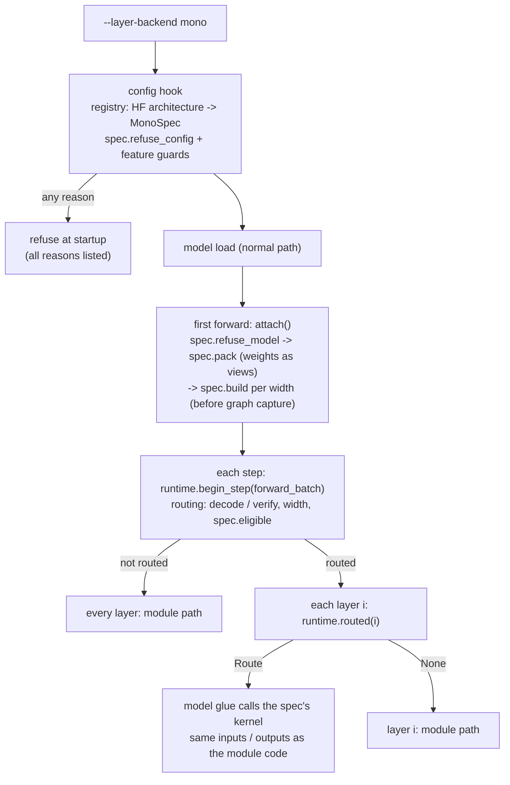
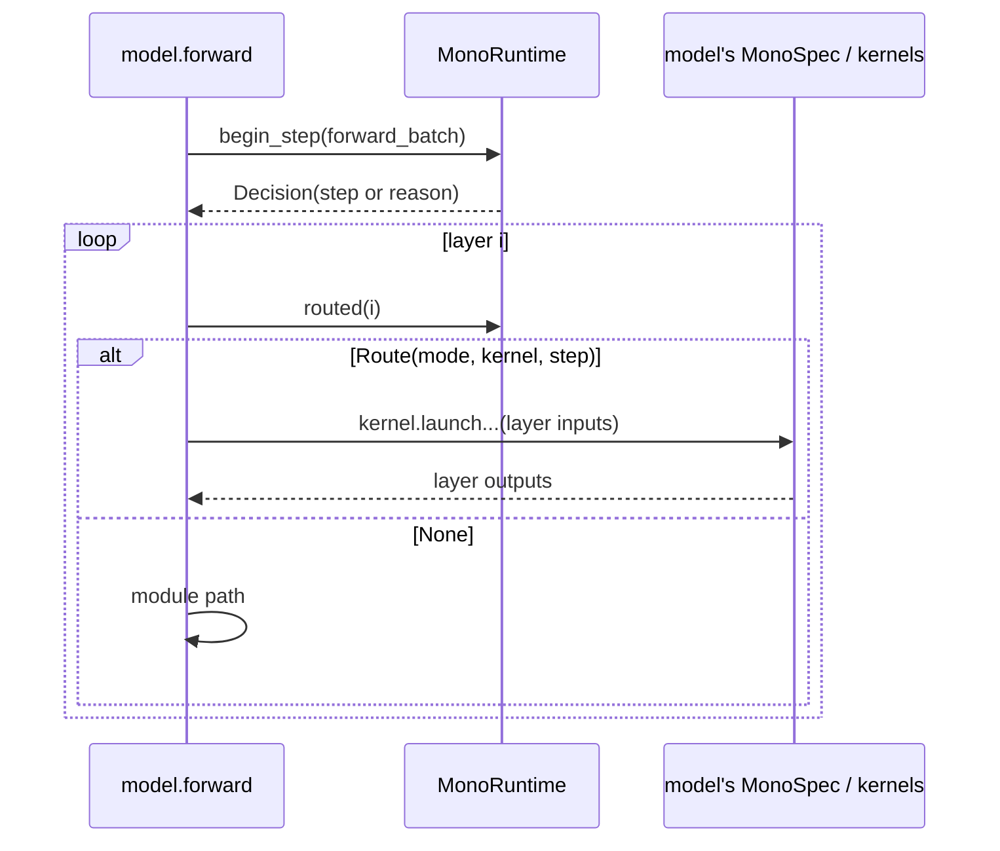
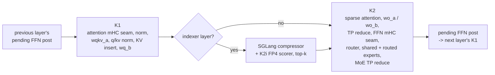

# [AMD][V4.1] Mono kernel framework (--layer-backend mono) and DeepSeek-V4.1 decode layers

[Upstream PR](https://github.com/sgl-project/sglang/pull/43984) · state: closed · merged: False

## Original PR description

<!-- Thank you for your contribution! Please follow these guidelines to enhance your pull request. If anything is unclear, submit your PR and reach out to maintainers for assistance. Join our Slack community at https://slack.sglang.io to discuss further. -->

## Motivation

At decode batch sizes a DeepSeek-V4.1-Flash layer is dozens of small launches plus two all-reduces, and on MI355X the launch gaps and reduce latency dominate the step. This PR adds a model-agnostic framework for persistent fused "mono" kernels in SGLang, and uses it to run every DeepSeek-V4.1-Flash decoder layer (and the DSpark draft stages) as two launches on gfx950.

## Modifications

- **One switch:** `--layer-backend {module,mono}` (default `module`). With `mono`, decode and target-verify steps the model's spec supports run on its kernels; every other step (prefill, unsupported widths) runs the normal module path. Unsupported deployments are refused at startup with every reason listed, never silently degraded.
- **Framework** in `python/sglang/srt/layers/mono/` (no model code): spec contract, registry, startup guards, per-step routing, peer memory, check mode and fail-stop plumbing.
- **Kernels** in `python/sglang/kernels/ops/mono/gfx950/`: a shared device library (`common/`, adapted from ROCm/ATOM) and the DeepSeek-V4.1 kernels (`deepseek_v41/`). The model glue lives next to the model in `srt/models/deepseek_common/amd/mono/`.
- **DeepSeek-V4.1-Flash:** all 40 layers as K1 (attention seam + front) and K2 (attention back + FFN seam + MoE, TP all-reduce inside the kernel), on the production KV layouts; the 8 indexer layers run SGLang's compressor between K1 and K2 and score with a persistent FP4 scorer (K2i, from ATOM's K2a); DSpark draft stages on their own runner; the per-step host sync in DSpark decode is removed. A MiniMax-M3 spec skeleton is included (refuses until its kernels land) to keep the contract honest for a second model.

### How the framework fits into SGLang



A step is decided once for all layers, from the CUDA-graph key (step type, rows), so a captured graph and its replays always take the same path. Kernel layers and module layers can alternate inside one step because a kernel takes and returns exactly what the model's own layer code does at that point.



### Layout

```
python/sglang/srt/layers/mono/          framework (model-agnostic)
  spec.py        MonoSpec, LayerMode, Feature, MonoContext, MonoStep, LayerKernel
  registry.py    HF architecture -> "module:MONO_SPEC" (config code never imports the model)
  guards.py      --layer-backend handling, default-deny feature list, MonoRefused
  routing.py     per-step decision (decode / verify, width, rows per request)
  layer.py       MonoRuntime: attach, begin_step, routed, per-width builds
  check.py       SGLANG_MONO_CHECK=1: each routed layer vs the module path (eager)
  failstop.py, runtime/   peer memory, mailboxes, step fences, consensus, timelines
python/sglang/kernels/ops/mono/gfx950/
  common/        shared FlyDSL device helpers (one copy for every model)
  deepseek_v41/  K1 / K2 / MoE stages, K2i indexer scorer, runner
python/sglang/srt/models/deepseek_common/amd/mono/   DeepSeek-V4.1 spec + glue
python/sglang/srt/models/minimax_m3_mono/            MiniMax-M3 spec skeleton
```

### DeepSeek-V4.1 layer on mono



### Adding another model

1. **Kernels:** put them under `kernels/ops/mono/<arch>/<model>/` and build on `common/` (a CPU test fails if a model directory redefines a shared helper).
2. **Spec:** write a `MonoSpec` next to the model (see `srt/models/minimax_m3_mono/spec.py` for a minimal one):
   - `architectures`, `layers(hf_config) -> {layer id: LayerMode.WHOLE | FFN}`, `widths` (rows per launch, built before capture), `supported_tp`
   - `supports`: the features the kernels handle (e.g. `Feature.SPEC_VERIFY`); anything else in use is refused
   - `refuse_config(server_args, hf_config)` / `refuse_model(model)`: return reasons, empty when fine
   - `pack(model, ctx)`: weights as views of the loaded tensors (or a one-time conversion), plus the per-layer modes
   - `build(ctx, packed, width) -> LayerKernel` with `launch(...)` and `health()`
   - optional: `eligible(ctx, step)` for per-step limits, `state_bindings` for per-layer cache readiness (HiCache)
3. **Register** the architecture in `registry.py` as an import path.
4. **Glue in the model:** call `attach` once the weights are final (DeepSeek-V4.1 does it on the first forward, before any capture), `begin_step(forward_batch)` at the top of `forward`, and per layer `route = mono.routed(i)`: launch the kernel when it returns a route, otherwise run the module code unchanged.
5. **Validate:** CPU tests in `test/registered/mono/`, `SGLANG_MONO_CHECK=1` with `--disable-cuda-graph` (logs each routed layer's difference from the module path), then GSM8K and a long-context check.

## Accuracy Tests

GSM8K (1319, TP4, `--layer-backend mono`): 0.901 (module path 0.911); TP2 0.908; NIAH 32k/64k/120k 60/60.

## Speed Tests and Profiling

AgentX (DSpark, TP4), TTT/GPU / P90 interactivity, vs the SGLang AgentX CI baseline (module path, same recipe): c1 6,019 / 406.5 -> 7,401 / 610.3, c4 8,807 / 331.6 -> 9,561 / 516.0, c8 15,362 / 282.2 -> 16,357 / 409.9, c16 28,106 / 214.6 -> 29,078 / 272.5.

## Checklist

- [ ] Format your code according to the [Format code with pre-commit](https://docs.sglang.io/developer_guide/contribution_guide.html#format-code-with-pre-commit).
- [ ] Add unit tests according to the [Run and add unit tests](https://docs.sglang.io/developer_guide/contribution_guide.html#run-and-add-unit-tests).
- [ ] Update documentation according to [Write documentations](https://docs.sglang.io/developer_guide/contribution_guide.html#write-documentations).
- [ ] Provide accuracy and speed benchmark results according to [Test the accuracy](https://docs.sglang.io/developer_guide/contribution_guide.html#test-the-accuracy) and [Benchmark the speed](https://docs.sglang.io/developer_guide/contribution_guide.html#benchmark-the-speed).
- [ ] Follow the SGLang code style [guidance](https://docs.sglang.io/developer_guide/contribution_guide.html#code-style-guidance).

## Review and Merge Process

1. Ping Merge Oncalls to start the process. See the [PR Merge Process](https://github.com/sgl-project/sglang/blob/main/.github/MAINTAINER.md#pull-request-merge-process).
2. Get approvals from [CODEOWNERS](https://github.com/sgl-project/sglang/blob/main/.github/CODEOWNERS) and other reviewers.
3. Trigger CI tests with [comments](https://docs.sglang.io/developer_guide/contribution_guide.html#how-to-trigger-ci-tests) or contact authorized users to do so.
   - Common commands include `/tag-and-rerun-ci`, `/tag-run-ci-label`, `/rerun-failed-ci`
4. After green CI and required approvals, ask Merge Oncalls or people with Write permission to merge the PR.

<!-- pr-states:start -->
---
### CI States

Latest PR Test (Base): <!-- slot:pr-test:start -->:x: [Run #38399664249](https://github.com/sgl-project/sglang/actions/runs/38399664249)<!-- slot:pr-test:end -->
Latest PR Test (Extra): <!-- slot:pr-test-extra:start -->:x: [Run #38399663724](https://github.com/sgl-project/sglang/actions/runs/38399663724)<!-- slot:pr-test-extra:end -->
Latest PR Test (AMD ROCm 10): <!-- slot:pr-test-amd:start -->:x: [Run #38399664574](https://github.com/sgl-project/sglang/actions/runs/38399664574)<!-- slot:pr-test-amd:end -->
<!-- pr-states:end -->


## Review and discussion

### reviews

### issue_comments

- amd-pedghazi · comment · 2026-10-13T13:47:41Z · [source](https://github.com/sgl-project/sglang/pull/43984#issuecomment-6147026284)

Hi @kkHuang-amd, thanks for sharing this. This PR and #43497 both port the DeepSeek-V4.1 mono decode kernels from vllm-project/vllm#60397 to SGLang on gfx950, so I want to link them to avoid duplicate work.

- About 88% of the kernel code in #43497 also appears here. Almost all of these shared lines (99%) come from vllm-project/vllm#60397, so it is the same source, ported twice.
- The SGLang side is different. #43497 (open since Oct 10) runs the FFN launch on all 40 layers and the attention-front launch on 30 layers, in decode and DSpark verify steps of up to 48 rows. It is behind `SGLANG_ROCM_MONO_DECODE` / `SGLANG_ROCM_MONO_K1`, with startup checks and serving results on the 10-10 image. This PR adds a general framework with `--layer-backend`, the attention back (K2), the indexer and the DSpark draft stages.
- RFC #43949 lists #43497 as the DeepSeek-V4.1 step.

Could we agree on one path? One option: the framework part of this PR follows RFC #43949, #43497 moves onto it as the DeepSeek-V4.1 PR, and your K2, indexer and draft stages come on top. Happy to discuss here or offline.

- kkHuang-amd · comment · 2026-10-14T03:47:10Z · [source](https://github.com/sgl-project/sglang/pull/43984#issuecomment-6160431531)

Thanks @amd-pedghazi, agreed that we should not carry two ports of the same kernels. Happy to converge on RFC #43949.

What we plan to change on our side:

- Move the framework out of `srt/layers/mono/` into `kernels/ops/mono/` with the RFC's `hooks.py` / `spec.py` shape, and keep SGLang's side to the hook calls. The DeepSeek-V4.1 glue moves next to its kernels.
- Attach in `precompile_kernels_after_loading()` (today it happens on the first forward), so all memory is allocated before KV sizing, and add the `load_tensor` hook for weights that loading rewrites.
- Add the spec fields we are missing: `numerics`, per-ISA `devices`, `requires`. The A/B env vars become `SGLANG_TEST_MONO_*`.
- Bounded waits with error words and fail-stop in the DeepSeek-V4.1 kernels, plus the fault-injection test.
- Split the PR: framework (no kernels), the shared HIP runtime, the DeepSeek-V4.1 kernels, and the DSpark draft stages / host-sync change separately, since draft layers are a non-goal of the RFC.

For DeepSeek-V4.1 itself, two options, either is fine with us:

1. #43497 lands on the framework as the DeepSeek-V4.1 PR (FFN launch on 40 layers, attention front on 30), and our K2, the indexer layers (compressor between the launches + an FP4 scorer) and the draft stages come on top as follow-ups.
2. The whole-layer version (K1 + K2 on all 40 layers, indexer layers included) is the DeepSeek-V4.1 PR, and the FFN-only / front-only splits stay as spans for layers that cannot go whole.

It may be easiest to decide with numbers from both on the same image and recipe; we can run that.

A few things from our side that might be worth folding into the RFC:

- `--layer-backend {module,mono}` instead of `--enable-monokernel`: same single switch, but it leaves room for other layer backends later.
- A check mode (`SGLANG_TEST_MONO_CHECK=1`, eager only) that runs the normal path on copies of each routed layer's inputs and logs the difference per output. It has been the fastest way to localize a numerics issue.
- Per-layer state readiness in the spec (`state_bindings`), so a spec can support HiCache instead of refusing it.

Glad to sync offline as well to settle the split and the order.


- kevin-mii · comment · 2026-10-14T06:19:00Z · [source](https://github.com/sgl-project/sglang/pull/43984#issuecomment-6162225740)

Thanks @kkHuang-amd, that plan lines up with RFC #43949.

For reference, the plugin shape is implemented on [`kevin-mii/sglang` `amd/monokernel-dsv41`](https://github.com/kevin-mii/sglang/tree/amd/monokernel-dsv41), with all 40 DeepSeek-V4.1 layers. Could you model this PR's `srt/` change on it? This is everything it touches in `srt/` (39 lines, 7 files):

| File | What |
| --- | --- |
| `arg_groups/fields/exec_.py` | the `--enable-monokernel` flag |
| `arg_groups/pipeline.py`, `arg_groups/resolution_hooks.py` | `run_hook(handle_monokernel, ...)` and its whitelist entry |
| `environ.py` | `SGLANG_TEST_MONO_FAULT_INJECT` |
| `models/deepseek_v4.py` | `mono.load_tensor`, `mono.attach`, `mono.route` |
| `models/deepseek_common/amd/deepseek_v4_hip.py` | passes the plan to the layer boundary |
| `models/deepseek_common/amd/deepseek_v4_fused_mhc.py` | `mono.kernel(plan, layer_id, "layer_in")`: each layer runs whole |

Everything else (the framework, the model glue, your FP4 indexer scorer) belongs in the plugin. `srt/` changes that matter with monokernels off, like the DSpark host-sync removal and the simulated-acceptance fold, would be their own PRs.

Three runtime points beyond your list, all from the RFC's rules:

- Build every width at attach and refuse startup if a build fails. Today each width compiles on its first step, and a failed build sends that width to the normal path.
- Drop the ATOM code the DeepSeek-V4.1 path never uses: everything in `srt/layers/mono/runtime/` except `consensus` and `peer_memory` (about 590 lines, including the step fence nothing calls), plus `gfx950/common/device/select.py` and `gfx950/common/plan/check.py` (about 190). The host `health()` / `failstop` path can go too: nothing calls it, and once the kernels' waits have deadlines nothing on the host needs to check.
- Compare every rank's routing plan at attach, as `runtime.attach` does on the branch.

One heads-up: on the branch, the RFC's `hooks.py` is now two modules. `guards.py` holds the startup refusals, capture sizes and deadlines; `runtime.py` holds `load_tensor`, `attach`, `route` and `kernel`. The package re-exports the five calls, so model code does `from sglang.kernels.ops import mono` and calls `mono.route(...)`.

Everything else looks good.

- billishyahao · comment · 2026-10-14T16:35:07Z · [source](https://github.com/sgl-project/sglang/pull/43984#issuecomment-6173266791)

I am adapting https://github.com/sgl-project/sglang/pull/43481 into either this mono framework or rfc https://github.com/sgl-project/sglang/issues/43949 . I didn't observe any blockers. But I think that we still need to eliminate most of the kernel related change from srt/layers/mono/runtime/ e.g. runtime/abi.py specifically.  It would be good to drop it and keep KernelAbi on the kernel side. Also mono kernels are under active development so we need to consider it as experimental feature as well.

- kkHuang-amd · comment · 2026-10-15T04:49:52Z · [source](https://github.com/sgl-project/sglang/pull/43984#issuecomment-6184668631)

Superseded by a 4-part split following the RFC #43949 review: #44405 (DSpark host sync), #44406 (monokernel framework and shared HIP runtime), #44407 (DeepSeek-V4.1 decode layers), #44408 (DSpark draft stages). Closing this one.

### inline_comments

## Changed files and fixed code

- `python/sglang/kernels/ops/mono/__init__.py` · added · additions 0 / deletions 0
  - [head](https://github.com/HaiShaw/sglang/blob/134919476ca6e6d1c7ccab52bd29a04e701984d7/python/sglang/kernels/ops/mono/__init__.py)
  - [base](https://github.com/sgl-project/sglang/blob/ea13359da99e869534d28ead3989c6f9293c01a0/python/sglang/kernels/ops/mono/__init__.py)
- `python/sglang/kernels/ops/mono/gfx950/__init__.py` · added · additions 0 / deletions 0
  - [head](https://github.com/HaiShaw/sglang/blob/134919476ca6e6d1c7ccab52bd29a04e701984d7/python/sglang/kernels/ops/mono/gfx950/__init__.py)
  - [base](https://github.com/sgl-project/sglang/blob/ea13359da99e869534d28ead3989c6f9293c01a0/python/sglang/kernels/ops/mono/gfx950/__init__.py)
- `python/sglang/kernels/ops/mono/gfx950/common/SOURCE.md` · added · additions 34 / deletions 0
  - [head](https://github.com/HaiShaw/sglang/blob/134919476ca6e6d1c7ccab52bd29a04e701984d7/python/sglang/kernels/ops/mono/gfx950/common/SOURCE.md)
  - [base](https://github.com/sgl-project/sglang/blob/ea13359da99e869534d28ead3989c6f9293c01a0/python/sglang/kernels/ops/mono/gfx950/common/SOURCE.md)
- `python/sglang/kernels/ops/mono/gfx950/common/__init__.py` · added · additions 13 / deletions 0
  - [head](https://github.com/HaiShaw/sglang/blob/134919476ca6e6d1c7ccab52bd29a04e701984d7/python/sglang/kernels/ops/mono/gfx950/common/__init__.py)
  - [base](https://github.com/sgl-project/sglang/blob/ea13359da99e869534d28ead3989c6f9293c01a0/python/sglang/kernels/ops/mono/gfx950/common/__init__.py)
- `python/sglang/kernels/ops/mono/gfx950/common/device/__init__.py` · added · additions 5 / deletions 0
  - [head](https://github.com/HaiShaw/sglang/blob/134919476ca6e6d1c7ccab52bd29a04e701984d7/python/sglang/kernels/ops/mono/gfx950/common/device/__init__.py)
  - [base](https://github.com/sgl-project/sglang/blob/ea13359da99e869534d28ead3989c6f9293c01a0/python/sglang/kernels/ops/mono/gfx950/common/device/__init__.py)
- `python/sglang/kernels/ops/mono/gfx950/common/device/mx.py` · added · additions 82 / deletions 0
  - [head](https://github.com/HaiShaw/sglang/blob/134919476ca6e6d1c7ccab52bd29a04e701984d7/python/sglang/kernels/ops/mono/gfx950/common/device/mx.py)
  - [base](https://github.com/sgl-project/sglang/blob/ea13359da99e869534d28ead3989c6f9293c01a0/python/sglang/kernels/ops/mono/gfx950/common/device/mx.py)
- `python/sglang/kernels/ops/mono/gfx950/common/device/ops.py` · added · additions 429 / deletions 0
  - [head](https://github.com/HaiShaw/sglang/blob/134919476ca6e6d1c7ccab52bd29a04e701984d7/python/sglang/kernels/ops/mono/gfx950/common/device/ops.py)
  - [base](https://github.com/sgl-project/sglang/blob/ea13359da99e869534d28ead3989c6f9293c01a0/python/sglang/kernels/ops/mono/gfx950/common/device/ops.py)
- `python/sglang/kernels/ops/mono/gfx950/common/device/ranks.py` · added · additions 28 / deletions 0
  - [head](https://github.com/HaiShaw/sglang/blob/134919476ca6e6d1c7ccab52bd29a04e701984d7/python/sglang/kernels/ops/mono/gfx950/common/device/ranks.py)
  - [base](https://github.com/sgl-project/sglang/blob/ea13359da99e869534d28ead3989c6f9293c01a0/python/sglang/kernels/ops/mono/gfx950/common/device/ranks.py)
- `python/sglang/kernels/ops/mono/gfx950/common/device/select.py` · added · additions 101 / deletions 0
  - [head](https://github.com/HaiShaw/sglang/blob/134919476ca6e6d1c7ccab52bd29a04e701984d7/python/sglang/kernels/ops/mono/gfx950/common/device/select.py)
  - [base](https://github.com/sgl-project/sglang/blob/ea13359da99e869534d28ead3989c6f9293c01a0/python/sglang/kernels/ops/mono/gfx950/common/device/select.py)
- `python/sglang/kernels/ops/mono/gfx950/common/device/stamps.py` · added · additions 46 / deletions 0
  - [head](https://github.com/HaiShaw/sglang/blob/134919476ca6e6d1c7ccab52bd29a04e701984d7/python/sglang/kernels/ops/mono/gfx950/common/device/stamps.py)
  - [base](https://github.com/sgl-project/sglang/blob/ea13359da99e869534d28ead3989c6f9293c01a0/python/sglang/kernels/ops/mono/gfx950/common/device/stamps.py)
- `python/sglang/kernels/ops/mono/gfx950/common/device/sync.py` · added · additions 245 / deletions 0
  - [head](https://github.com/HaiShaw/sglang/blob/134919476ca6e6d1c7ccab52bd29a04e701984d7/python/sglang/kernels/ops/mono/gfx950/common/device/sync.py)
  - [base](https://github.com/sgl-project/sglang/blob/ea13359da99e869534d28ead3989c6f9293c01a0/python/sglang/kernels/ops/mono/gfx950/common/device/sync.py)
- `python/sglang/kernels/ops/mono/gfx950/common/plan/__init__.py` · added · additions 6 / deletions 0
  - [head](https://github.com/HaiShaw/sglang/blob/134919476ca6e6d1c7ccab52bd29a04e701984d7/python/sglang/kernels/ops/mono/gfx950/common/plan/__init__.py)
  - [base](https://github.com/sgl-project/sglang/blob/ea13359da99e869534d28ead3989c6f9293c01a0/python/sglang/kernels/ops/mono/gfx950/common/plan/__init__.py)
- `python/sglang/kernels/ops/mono/gfx950/common/plan/arith.py` · added · additions 44 / deletions 0
  - [head](https://github.com/HaiShaw/sglang/blob/134919476ca6e6d1c7ccab52bd29a04e701984d7/python/sglang/kernels/ops/mono/gfx950/common/plan/arith.py)
  - [base](https://github.com/sgl-project/sglang/blob/ea13359da99e869534d28ead3989c6f9293c01a0/python/sglang/kernels/ops/mono/gfx950/common/plan/arith.py)
- `python/sglang/kernels/ops/mono/gfx950/common/plan/build_key.py` · added · additions 71 / deletions 0
  - [head](https://github.com/HaiShaw/sglang/blob/134919476ca6e6d1c7ccab52bd29a04e701984d7/python/sglang/kernels/ops/mono/gfx950/common/plan/build_key.py)
  - [base](https://github.com/sgl-project/sglang/blob/ea13359da99e869534d28ead3989c6f9293c01a0/python/sglang/kernels/ops/mono/gfx950/common/plan/build_key.py)
- `python/sglang/kernels/ops/mono/gfx950/common/plan/check.py` · added · additions 90 / deletions 0
  - [head](https://github.com/HaiShaw/sglang/blob/134919476ca6e6d1c7ccab52bd29a04e701984d7/python/sglang/kernels/ops/mono/gfx950/common/plan/check.py)
  - [base](https://github.com/sgl-project/sglang/blob/ea13359da99e869534d28ead3989c6f9293c01a0/python/sglang/kernels/ops/mono/gfx950/common/plan/check.py)
- `python/sglang/kernels/ops/mono/gfx950/common/plan/execution.py` · added · additions 21 / deletions 0
  - [head](https://github.com/HaiShaw/sglang/blob/134919476ca6e6d1c7ccab52bd29a04e701984d7/python/sglang/kernels/ops/mono/gfx950/common/plan/execution.py)
  - [base](https://github.com/sgl-project/sglang/blob/ea13359da99e869534d28ead3989c6f9293c01a0/python/sglang/kernels/ops/mono/gfx950/common/plan/execution.py)
- `python/sglang/kernels/ops/mono/gfx950/common/plan/layout.py` · added · additions 20 / deletions 0
  - [head](https://github.com/HaiShaw/sglang/blob/134919476ca6e6d1c7ccab52bd29a04e701984d7/python/sglang/kernels/ops/mono/gfx950/common/plan/layout.py)
  - [base](https://github.com/sgl-project/sglang/blob/ea13359da99e869534d28ead3989c6f9293c01a0/python/sglang/kernels/ops/mono/gfx950/common/plan/layout.py)
- `python/sglang/kernels/ops/mono/gfx950/common/plan/shard.py` · added · additions 64 / deletions 0
  - [head](https://github.com/HaiShaw/sglang/blob/134919476ca6e6d1c7ccab52bd29a04e701984d7/python/sglang/kernels/ops/mono/gfx950/common/plan/shard.py)
  - [base](https://github.com/sgl-project/sglang/blob/ea13359da99e869534d28ead3989c6f9293c01a0/python/sglang/kernels/ops/mono/gfx950/common/plan/shard.py)
- `python/sglang/kernels/ops/mono/gfx950/common/plan/trace.py` · added · additions 74 / deletions 0
  - [head](https://github.com/HaiShaw/sglang/blob/134919476ca6e6d1c7ccab52bd29a04e701984d7/python/sglang/kernels/ops/mono/gfx950/common/plan/trace.py)
  - [base](https://github.com/sgl-project/sglang/blob/ea13359da99e869534d28ead3989c6f9293c01a0/python/sglang/kernels/ops/mono/gfx950/common/plan/trace.py)
- `python/sglang/kernels/ops/mono/gfx950/deepseek_v41/README.md` · added · additions 94 / deletions 0
  - [head](https://github.com/HaiShaw/sglang/blob/134919476ca6e6d1c7ccab52bd29a04e701984d7/python/sglang/kernels/ops/mono/gfx950/deepseek_v41/README.md)
  - [base](https://github.com/sgl-project/sglang/blob/ea13359da99e869534d28ead3989c6f9293c01a0/python/sglang/kernels/ops/mono/gfx950/deepseek_v41/README.md)
- `python/sglang/kernels/ops/mono/gfx950/deepseek_v41/SOURCE.md` · added · additions 27 / deletions 0
  - [head](https://github.com/HaiShaw/sglang/blob/134919476ca6e6d1c7ccab52bd29a04e701984d7/python/sglang/kernels/ops/mono/gfx950/deepseek_v41/SOURCE.md)
  - [base](https://github.com/sgl-project/sglang/blob/ea13359da99e869534d28ead3989c6f9293c01a0/python/sglang/kernels/ops/mono/gfx950/deepseek_v41/SOURCE.md)
- `python/sglang/kernels/ops/mono/gfx950/deepseek_v41/__init__.py` · added · additions 6 / deletions 0
  - [head](https://github.com/HaiShaw/sglang/blob/134919476ca6e6d1c7ccab52bd29a04e701984d7/python/sglang/kernels/ops/mono/gfx950/deepseek_v41/__init__.py)
  - [base](https://github.com/sgl-project/sglang/blob/ea13359da99e869534d28ead3989c6f9293c01a0/python/sglang/kernels/ops/mono/gfx950/deepseek_v41/__init__.py)
- `python/sglang/kernels/ops/mono/gfx950/deepseek_v41/attention/__init__.py` · added · additions 5 / deletions 0
  - [head](https://github.com/HaiShaw/sglang/blob/134919476ca6e6d1c7ccab52bd29a04e701984d7/python/sglang/kernels/ops/mono/gfx950/deepseek_v41/attention/__init__.py)
  - [base](https://github.com/sgl-project/sglang/blob/ea13359da99e869534d28ead3989c6f9293c01a0/python/sglang/kernels/ops/mono/gfx950/deepseek_v41/attention/__init__.py)
- `python/sglang/kernels/ops/mono/gfx950/deepseek_v41/attention/back.py` · added · additions 1028 / deletions 0
  - [head](https://github.com/HaiShaw/sglang/blob/134919476ca6e6d1c7ccab52bd29a04e701984d7/python/sglang/kernels/ops/mono/gfx950/deepseek_v41/attention/back.py)
  - [base](https://github.com/sgl-project/sglang/blob/ea13359da99e869534d28ead3989c6f9293c01a0/python/sglang/kernels/ops/mono/gfx950/deepseek_v41/attention/back.py)
- `python/sglang/kernels/ops/mono/gfx950/deepseek_v41/attention/device.py` · added · additions 197 / deletions 0
  - [head](https://github.com/HaiShaw/sglang/blob/134919476ca6e6d1c7ccab52bd29a04e701984d7/python/sglang/kernels/ops/mono/gfx950/deepseek_v41/attention/device.py)
  - [base](https://github.com/sgl-project/sglang/blob/ea13359da99e869534d28ead3989c6f9293c01a0/python/sglang/kernels/ops/mono/gfx950/deepseek_v41/attention/device.py)
- `python/sglang/kernels/ops/mono/gfx950/deepseek_v41/attention/front.py` · added · additions 727 / deletions 0
  - [head](https://github.com/HaiShaw/sglang/blob/134919476ca6e6d1c7ccab52bd29a04e701984d7/python/sglang/kernels/ops/mono/gfx950/deepseek_v41/attention/front.py)
  - [base](https://github.com/sgl-project/sglang/blob/ea13359da99e869534d28ead3989c6f9293c01a0/python/sglang/kernels/ops/mono/gfx950/deepseek_v41/attention/front.py)
- `python/sglang/kernels/ops/mono/gfx950/deepseek_v41/attention/gemv.py` · added · additions 235 / deletions 0
  - [head](https://github.com/HaiShaw/sglang/blob/134919476ca6e6d1c7ccab52bd29a04e701984d7/python/sglang/kernels/ops/mono/gfx950/deepseek_v41/attention/gemv.py)
  - [base](https://github.com/sgl-project/sglang/blob/ea13359da99e869534d28ead3989c6f9293c01a0/python/sglang/kernels/ops/mono/gfx950/deepseek_v41/attention/gemv.py)
- `python/sglang/kernels/ops/mono/gfx950/deepseek_v41/attention/plan.py` · added · additions 167 / deletions 0
  - [head](https://github.com/HaiShaw/sglang/blob/134919476ca6e6d1c7ccab52bd29a04e701984d7/python/sglang/kernels/ops/mono/gfx950/deepseek_v41/attention/plan.py)
  - [base](https://github.com/sgl-project/sglang/blob/ea13359da99e869534d28ead3989c6f9293c01a0/python/sglang/kernels/ops/mono/gfx950/deepseek_v41/attention/plan.py)
- `python/sglang/kernels/ops/mono/gfx950/deepseek_v41/indexer/__init__.py` · added · additions 0 / deletions 0
  - [head](https://github.com/HaiShaw/sglang/blob/134919476ca6e6d1c7ccab52bd29a04e701984d7/python/sglang/kernels/ops/mono/gfx950/deepseek_v41/indexer/__init__.py)
  - [base](https://github.com/sgl-project/sglang/blob/ea13359da99e869534d28ead3989c6f9293c01a0/python/sglang/kernels/ops/mono/gfx950/deepseek_v41/indexer/__init__.py)
- `python/sglang/kernels/ops/mono/gfx950/deepseek_v41/indexer/candidate_table.py` · added · additions 160 / deletions 0
  - [head](https://github.com/HaiShaw/sglang/blob/134919476ca6e6d1c7ccab52bd29a04e701984d7/python/sglang/kernels/ops/mono/gfx950/deepseek_v41/indexer/candidate_table.py)
  - [base](https://github.com/sgl-project/sglang/blob/ea13359da99e869534d28ead3989c6f9293c01a0/python/sglang/kernels/ops/mono/gfx950/deepseek_v41/indexer/candidate_table.py)
- `python/sglang/kernels/ops/mono/gfx950/deepseek_v41/indexer/index_plan.py` · added · additions 265 / deletions 0
  - [head](https://github.com/HaiShaw/sglang/blob/134919476ca6e6d1c7ccab52bd29a04e701984d7/python/sglang/kernels/ops/mono/gfx950/deepseek_v41/indexer/index_plan.py)
  - [base](https://github.com/sgl-project/sglang/blob/ea13359da99e869534d28ead3989c6f9293c01a0/python/sglang/kernels/ops/mono/gfx950/deepseek_v41/indexer/index_plan.py)
- `python/sglang/kernels/ops/mono/gfx950/deepseek_v41/indexer/k2i.py` · added · additions 180 / deletions 0
  - [head](https://github.com/HaiShaw/sglang/blob/134919476ca6e6d1c7ccab52bd29a04e701984d7/python/sglang/kernels/ops/mono/gfx950/deepseek_v41/indexer/k2i.py)
  - [base](https://github.com/sgl-project/sglang/blob/ea13359da99e869534d28ead3989c6f9293c01a0/python/sglang/kernels/ops/mono/gfx950/deepseek_v41/indexer/k2i.py)
- `python/sglang/kernels/ops/mono/gfx950/deepseek_v41/indexer/runner.py` · added · additions 184 / deletions 0
  - [head](https://github.com/HaiShaw/sglang/blob/134919476ca6e6d1c7ccab52bd29a04e701984d7/python/sglang/kernels/ops/mono/gfx950/deepseek_v41/indexer/runner.py)
  - [base](https://github.com/sgl-project/sglang/blob/ea13359da99e869534d28ead3989c6f9293c01a0/python/sglang/kernels/ops/mono/gfx950/deepseek_v41/indexer/runner.py)
- `python/sglang/kernels/ops/mono/gfx950/deepseek_v41/indexer/score.py` · added · additions 238 / deletions 0
  - [head](https://github.com/HaiShaw/sglang/blob/134919476ca6e6d1c7ccab52bd29a04e701984d7/python/sglang/kernels/ops/mono/gfx950/deepseek_v41/indexer/score.py)
  - [base](https://github.com/sgl-project/sglang/blob/ea13359da99e869534d28ead3989c6f9293c01a0/python/sglang/kernels/ops/mono/gfx950/deepseek_v41/indexer/score.py)
- `python/sglang/kernels/ops/mono/gfx950/deepseek_v41/indexer/score_fp4.py` · added · additions 515 / deletions 0
  - [head](https://github.com/HaiShaw/sglang/blob/134919476ca6e6d1c7ccab52bd29a04e701984d7/python/sglang/kernels/ops/mono/gfx950/deepseek_v41/indexer/score_fp4.py)
  - [base](https://github.com/sgl-project/sglang/blob/ea13359da99e869534d28ead3989c6f9293c01a0/python/sglang/kernels/ops/mono/gfx950/deepseek_v41/indexer/score_fp4.py)
- `python/sglang/kernels/ops/mono/gfx950/deepseek_v41/indexer/topk.py` · added · additions 171 / deletions 0
  - [head](https://github.com/HaiShaw/sglang/blob/134919476ca6e6d1c7ccab52bd29a04e701984d7/python/sglang/kernels/ops/mono/gfx950/deepseek_v41/indexer/topk.py)
  - [base](https://github.com/sgl-project/sglang/blob/ea13359da99e869534d28ead3989c6f9293c01a0/python/sglang/kernels/ops/mono/gfx950/deepseek_v41/indexer/topk.py)
- `python/sglang/kernels/ops/mono/gfx950/deepseek_v41/indexer/walk_plan.py` · added · additions 110 / deletions 0
  - [head](https://github.com/HaiShaw/sglang/blob/134919476ca6e6d1c7ccab52bd29a04e701984d7/python/sglang/kernels/ops/mono/gfx950/deepseek_v41/indexer/walk_plan.py)
  - [base](https://github.com/sgl-project/sglang/blob/ea13359da99e869534d28ead3989c6f9293c01a0/python/sglang/kernels/ops/mono/gfx950/deepseek_v41/indexer/walk_plan.py)
- `python/sglang/kernels/ops/mono/gfx950/deepseek_v41/layer.py` · added · additions 1101 / deletions 0
  - [head](https://github.com/HaiShaw/sglang/blob/134919476ca6e6d1c7ccab52bd29a04e701984d7/python/sglang/kernels/ops/mono/gfx950/deepseek_v41/layer.py)
  - [base](https://github.com/sgl-project/sglang/blob/ea13359da99e869534d28ead3989c6f9293c01a0/python/sglang/kernels/ops/mono/gfx950/deepseek_v41/layer.py)
- `python/sglang/kernels/ops/mono/gfx950/deepseek_v41/runner.py` · added · additions 515 / deletions 0
  - [head](https://github.com/HaiShaw/sglang/blob/134919476ca6e6d1c7ccab52bd29a04e701984d7/python/sglang/kernels/ops/mono/gfx950/deepseek_v41/runner.py)
  - [base](https://github.com/sgl-project/sglang/blob/ea13359da99e869534d28ead3989c6f9293c01a0/python/sglang/kernels/ops/mono/gfx950/deepseek_v41/runner.py)
- `python/sglang/kernels/ops/mono/gfx950/deepseek_v41/sources.py` · added · additions 10 / deletions 0
  - [head](https://github.com/HaiShaw/sglang/blob/134919476ca6e6d1c7ccab52bd29a04e701984d7/python/sglang/kernels/ops/mono/gfx950/deepseek_v41/sources.py)
  - [base](https://github.com/sgl-project/sglang/blob/ea13359da99e869534d28ead3989c6f9293c01a0/python/sglang/kernels/ops/mono/gfx950/deepseek_v41/sources.py)
- `python/sglang/kernels/ops/mono/gfx950/deepseek_v41/stages/__init__.py` · added · additions 5 / deletions 0
  - [head](https://github.com/HaiShaw/sglang/blob/134919476ca6e6d1c7ccab52bd29a04e701984d7/python/sglang/kernels/ops/mono/gfx950/deepseek_v41/stages/__init__.py)
  - [base](https://github.com/sgl-project/sglang/blob/ea13359da99e869534d28ead3989c6f9293c01a0/python/sglang/kernels/ops/mono/gfx950/deepseek_v41/stages/__init__.py)
- `python/sglang/kernels/ops/mono/gfx950/deepseek_v41/stages/dims.py` · added · additions 61 / deletions 0
  - [head](https://github.com/HaiShaw/sglang/blob/134919476ca6e6d1c7ccab52bd29a04e701984d7/python/sglang/kernels/ops/mono/gfx950/deepseek_v41/stages/dims.py)
  - [base](https://github.com/sgl-project/sglang/blob/ea13359da99e869534d28ead3989c6f9293c01a0/python/sglang/kernels/ops/mono/gfx950/deepseek_v41/stages/dims.py)
- `python/sglang/kernels/ops/mono/gfx950/deepseek_v41/stages/gemv.py` · added · additions 290 / deletions 0
  - [head](https://github.com/HaiShaw/sglang/blob/134919476ca6e6d1c7ccab52bd29a04e701984d7/python/sglang/kernels/ops/mono/gfx950/deepseek_v41/stages/gemv.py)
  - [base](https://github.com/sgl-project/sglang/blob/ea13359da99e869534d28ead3989c6f9293c01a0/python/sglang/kernels/ops/mono/gfx950/deepseek_v41/stages/gemv.py)
- `python/sglang/kernels/ops/mono/gfx950/deepseek_v41/stages/moe.py` · added · additions 1639 / deletions 0
  - [head](https://github.com/HaiShaw/sglang/blob/134919476ca6e6d1c7ccab52bd29a04e701984d7/python/sglang/kernels/ops/mono/gfx950/deepseek_v41/stages/moe.py)
  - [base](https://github.com/sgl-project/sglang/blob/ea13359da99e869534d28ead3989c6f9293c01a0/python/sglang/kernels/ops/mono/gfx950/deepseek_v41/stages/moe.py)
- `python/sglang/kernels/ops/mono/gfx950/deepseek_v41/stages/moe_plan.py` · added · additions 55 / deletions 0
  - [head](https://github.com/HaiShaw/sglang/blob/134919476ca6e6d1c7ccab52bd29a04e701984d7/python/sglang/kernels/ops/mono/gfx950/deepseek_v41/stages/moe_plan.py)
  - [base](https://github.com/sgl-project/sglang/blob/ea13359da99e869534d28ead3989c6f9293c01a0/python/sglang/kernels/ops/mono/gfx950/deepseek_v41/stages/moe_plan.py)
- `python/sglang/kernels/ops/mono/gfx950/deepseek_v41/stages/moe_shape.py` · added · additions 237 / deletions 0
  - [head](https://github.com/HaiShaw/sglang/blob/134919476ca6e6d1c7ccab52bd29a04e701984d7/python/sglang/kernels/ops/mono/gfx950/deepseek_v41/stages/moe_shape.py)
  - [base](https://github.com/sgl-project/sglang/blob/ea13359da99e869534d28ead3989c6f9293c01a0/python/sglang/kernels/ops/mono/gfx950/deepseek_v41/stages/moe_shape.py)
- `python/sglang/kernels/ops/mono/gfx950/deepseek_v41/stages/router.py` · added · additions 86 / deletions 0
  - [head](https://github.com/HaiShaw/sglang/blob/134919476ca6e6d1c7ccab52bd29a04e701984d7/python/sglang/kernels/ops/mono/gfx950/deepseek_v41/stages/router.py)
  - [base](https://github.com/sgl-project/sglang/blob/ea13359da99e869534d28ead3989c6f9293c01a0/python/sglang/kernels/ops/mono/gfx950/deepseek_v41/stages/router.py)
- `python/sglang/kernels/ops/mono/gfx950/deepseek_v41/stages/seam.py` · added · additions 410 / deletions 0
  - [head](https://github.com/HaiShaw/sglang/blob/134919476ca6e6d1c7ccab52bd29a04e701984d7/python/sglang/kernels/ops/mono/gfx950/deepseek_v41/stages/seam.py)
  - [base](https://github.com/sgl-project/sglang/blob/ea13359da99e869534d28ead3989c6f9293c01a0/python/sglang/kernels/ops/mono/gfx950/deepseek_v41/stages/seam.py)
- `python/sglang/kernels/ops/speculative/dspark/simulated_bonus.py` · modified · additions 93 / deletions 0
  - [head](https://github.com/HaiShaw/sglang/blob/134919476ca6e6d1c7ccab52bd29a04e701984d7/python/sglang/kernels/ops/speculative/dspark/simulated_bonus.py)
  - [base](https://github.com/sgl-project/sglang/blob/ea13359da99e869534d28ead3989c6f9293c01a0/python/sglang/kernels/ops/speculative/dspark/simulated_bonus.py)
- `python/sglang/srt/arg_groups/choices.py` · modified · additions 3 / deletions 0
  - [head](https://github.com/HaiShaw/sglang/blob/134919476ca6e6d1c7ccab52bd29a04e701984d7/python/sglang/srt/arg_groups/choices.py)
  - [base](https://github.com/sgl-project/sglang/blob/ea13359da99e869534d28ead3989c6f9293c01a0/python/sglang/srt/arg_groups/choices.py)
- `python/sglang/srt/arg_groups/fields/exec_.py` · modified · additions 13 / deletions 0
  - [head](https://github.com/HaiShaw/sglang/blob/134919476ca6e6d1c7ccab52bd29a04e701984d7/python/sglang/srt/arg_groups/fields/exec_.py)
  - [base](https://github.com/sgl-project/sglang/blob/ea13359da99e869534d28ead3989c6f9293c01a0/python/sglang/srt/arg_groups/fields/exec_.py)
- `python/sglang/srt/arg_groups/mono_hook.py` · added · additions 35 / deletions 0
  - [head](https://github.com/HaiShaw/sglang/blob/134919476ca6e6d1c7ccab52bd29a04e701984d7/python/sglang/srt/arg_groups/mono_hook.py)
  - [base](https://github.com/sgl-project/sglang/blob/ea13359da99e869534d28ead3989c6f9293c01a0/python/sglang/srt/arg_groups/mono_hook.py)
- `python/sglang/srt/arg_groups/pipeline.py` · modified · additions 5 / deletions 0
  - [head](https://github.com/HaiShaw/sglang/blob/134919476ca6e6d1c7ccab52bd29a04e701984d7/python/sglang/srt/arg_groups/pipeline.py)
  - [base](https://github.com/sgl-project/sglang/blob/ea13359da99e869534d28ead3989c6f9293c01a0/python/sglang/srt/arg_groups/pipeline.py)
- `python/sglang/srt/environ.py` · modified · additions 3 / deletions 0
  - [head](https://github.com/HaiShaw/sglang/blob/134919476ca6e6d1c7ccab52bd29a04e701984d7/python/sglang/srt/environ.py)
  - [base](https://github.com/sgl-project/sglang/blob/ea13359da99e869534d28ead3989c6f9293c01a0/python/sglang/srt/environ.py)
- `python/sglang/srt/layers/attention/deepseek_v4_backend_hip_radix.py` · modified · additions 15 / deletions 7
  - [head](https://github.com/HaiShaw/sglang/blob/134919476ca6e6d1c7ccab52bd29a04e701984d7/python/sglang/srt/layers/attention/deepseek_v4_backend_hip_radix.py)
  - [base](https://github.com/sgl-project/sglang/blob/ea13359da99e869534d28ead3989c6f9293c01a0/python/sglang/srt/layers/attention/deepseek_v4_backend_hip_radix.py)
- `python/sglang/srt/layers/attention/dsv4/low_ratio_backend_hip.py` · modified · additions 49 / deletions 13
  - [head](https://github.com/HaiShaw/sglang/blob/134919476ca6e6d1c7ccab52bd29a04e701984d7/python/sglang/srt/layers/attention/dsv4/low_ratio_backend_hip.py)
  - [base](https://github.com/sgl-project/sglang/blob/ea13359da99e869534d28ead3989c6f9293c01a0/python/sglang/srt/layers/attention/dsv4/low_ratio_backend_hip.py)
- `python/sglang/srt/layers/mono/__init__.py` · added · additions 5 / deletions 0
  - [head](https://github.com/HaiShaw/sglang/blob/134919476ca6e6d1c7ccab52bd29a04e701984d7/python/sglang/srt/layers/mono/__init__.py)
  - [base](https://github.com/sgl-project/sglang/blob/ea13359da99e869534d28ead3989c6f9293c01a0/python/sglang/srt/layers/mono/__init__.py)
- `python/sglang/srt/layers/mono/check.py` · added · additions 60 / deletions 0
  - [head](https://github.com/HaiShaw/sglang/blob/134919476ca6e6d1c7ccab52bd29a04e701984d7/python/sglang/srt/layers/mono/check.py)
  - [base](https://github.com/sgl-project/sglang/blob/ea13359da99e869534d28ead3989c6f9293c01a0/python/sglang/srt/layers/mono/check.py)
- `python/sglang/srt/layers/mono/failstop.py` · added · additions 44 / deletions 0
  - [head](https://github.com/HaiShaw/sglang/blob/134919476ca6e6d1c7ccab52bd29a04e701984d7/python/sglang/srt/layers/mono/failstop.py)
  - [base](https://github.com/sgl-project/sglang/blob/ea13359da99e869534d28ead3989c6f9293c01a0/python/sglang/srt/layers/mono/failstop.py)
- `python/sglang/srt/layers/mono/guards.py` · added · additions 99 / deletions 0
  - [head](https://github.com/HaiShaw/sglang/blob/134919476ca6e6d1c7ccab52bd29a04e701984d7/python/sglang/srt/layers/mono/guards.py)
  - [base](https://github.com/sgl-project/sglang/blob/ea13359da99e869534d28ead3989c6f9293c01a0/python/sglang/srt/layers/mono/guards.py)
- `python/sglang/srt/layers/mono/layer.py` · added · additions 186 / deletions 0
  - [head](https://github.com/HaiShaw/sglang/blob/134919476ca6e6d1c7ccab52bd29a04e701984d7/python/sglang/srt/layers/mono/layer.py)
  - [base](https://github.com/sgl-project/sglang/blob/ea13359da99e869534d28ead3989c6f9293c01a0/python/sglang/srt/layers/mono/layer.py)
- `python/sglang/srt/layers/mono/registry.py` · added · additions 28 / deletions 0
  - [head](https://github.com/HaiShaw/sglang/blob/134919476ca6e6d1c7ccab52bd29a04e701984d7/python/sglang/srt/layers/mono/registry.py)
  - [base](https://github.com/sgl-project/sglang/blob/ea13359da99e869534d28ead3989c6f9293c01a0/python/sglang/srt/layers/mono/registry.py)
- `python/sglang/srt/layers/mono/routing.py` · added · additions 82 / deletions 0
  - [head](https://github.com/HaiShaw/sglang/blob/134919476ca6e6d1c7ccab52bd29a04e701984d7/python/sglang/srt/layers/mono/routing.py)
  - [base](https://github.com/sgl-project/sglang/blob/ea13359da99e869534d28ead3989c6f9293c01a0/python/sglang/srt/layers/mono/routing.py)
- `python/sglang/srt/layers/mono/runtime/__init__.py` · added · additions 7 / deletions 0
  - [head](https://github.com/HaiShaw/sglang/blob/134919476ca6e6d1c7ccab52bd29a04e701984d7/python/sglang/srt/layers/mono/runtime/__init__.py)
  - [base](https://github.com/sgl-project/sglang/blob/ea13359da99e869534d28ead3989c6f9293c01a0/python/sglang/srt/layers/mono/runtime/__init__.py)
- `python/sglang/srt/layers/mono/runtime/abi.py` · added · additions 51 / deletions 0
  - [head](https://github.com/HaiShaw/sglang/blob/134919476ca6e6d1c7ccab52bd29a04e701984d7/python/sglang/srt/layers/mono/runtime/abi.py)
  - [base](https://github.com/sgl-project/sglang/blob/ea13359da99e869534d28ead3989c6f9293c01a0/python/sglang/srt/layers/mono/runtime/abi.py)
- `python/sglang/srt/layers/mono/runtime/compare.py` · added · additions 16 / deletions 0
  - [head](https://github.com/HaiShaw/sglang/blob/134919476ca6e6d1c7ccab52bd29a04e701984d7/python/sglang/srt/layers/mono/runtime/compare.py)
  - [base](https://github.com/sgl-project/sglang/blob/ea13359da99e869534d28ead3989c6f9293c01a0/python/sglang/srt/layers/mono/runtime/compare.py)
- `python/sglang/srt/layers/mono/runtime/compile.py` · added · additions 175 / deletions 0
  - [head](https://github.com/HaiShaw/sglang/blob/134919476ca6e6d1c7ccab52bd29a04e701984d7/python/sglang/srt/layers/mono/runtime/compile.py)
  - [base](https://github.com/sgl-project/sglang/blob/ea13359da99e869534d28ead3989c6f9293c01a0/python/sglang/srt/layers/mono/runtime/compile.py)
- `python/sglang/srt/layers/mono/runtime/consensus.py` · added · additions 40 / deletions 0
  - [head](https://github.com/HaiShaw/sglang/blob/134919476ca6e6d1c7ccab52bd29a04e701984d7/python/sglang/srt/layers/mono/runtime/consensus.py)
  - [base](https://github.com/sgl-project/sglang/blob/ea13359da99e869534d28ead3989c6f9293c01a0/python/sglang/srt/layers/mono/runtime/consensus.py)
- `python/sglang/srt/layers/mono/runtime/debug.py` · added · additions 59 / deletions 0
  - [head](https://github.com/HaiShaw/sglang/blob/134919476ca6e6d1c7ccab52bd29a04e701984d7/python/sglang/srt/layers/mono/runtime/debug.py)
  - [base](https://github.com/sgl-project/sglang/blob/ea13359da99e869534d28ead3989c6f9293c01a0/python/sglang/srt/layers/mono/runtime/debug.py)
- `python/sglang/srt/layers/mono/runtime/lifecycle.py` · added · additions 21 / deletions 0
  - [head](https://github.com/HaiShaw/sglang/blob/134919476ca6e6d1c7ccab52bd29a04e701984d7/python/sglang/srt/layers/mono/runtime/lifecycle.py)
  - [base](https://github.com/sgl-project/sglang/blob/ea13359da99e869534d28ead3989c6f9293c01a0/python/sglang/srt/layers/mono/runtime/lifecycle.py)
- `python/sglang/srt/layers/mono/runtime/mailboxes.py` · added · additions 30 / deletions 0
  - [head](https://github.com/HaiShaw/sglang/blob/134919476ca6e6d1c7ccab52bd29a04e701984d7/python/sglang/srt/layers/mono/runtime/mailboxes.py)
  - [base](https://github.com/sgl-project/sglang/blob/ea13359da99e869534d28ead3989c6f9293c01a0/python/sglang/srt/layers/mono/runtime/mailboxes.py)
- `python/sglang/srt/layers/mono/runtime/peer_memory.py` · added · additions 119 / deletions 0
  - [head](https://github.com/HaiShaw/sglang/blob/134919476ca6e6d1c7ccab52bd29a04e701984d7/python/sglang/srt/layers/mono/runtime/peer_memory.py)
  - [base](https://github.com/sgl-project/sglang/blob/ea13359da99e869534d28ead3989c6f9293c01a0/python/sglang/srt/layers/mono/runtime/peer_memory.py)
- `python/sglang/srt/layers/mono/runtime/route.py` · added · additions 45 / deletions 0
  - [head](https://github.com/HaiShaw/sglang/blob/134919476ca6e6d1c7ccab52bd29a04e701984d7/python/sglang/srt/layers/mono/runtime/route.py)
  - [base](https://github.com/sgl-project/sglang/blob/ea13359da99e869534d28ead3989c6f9293c01a0/python/sglang/srt/layers/mono/runtime/route.py)
- `python/sglang/srt/layers/mono/runtime/step_fence.py` · added · additions 75 / deletions 0
  - [head](https://github.com/HaiShaw/sglang/blob/134919476ca6e6d1c7ccab52bd29a04e701984d7/python/sglang/srt/layers/mono/runtime/step_fence.py)
  - [base](https://github.com/sgl-project/sglang/blob/ea13359da99e869534d28ead3989c6f9293c01a0/python/sglang/srt/layers/mono/runtime/step_fence.py)
- `python/sglang/srt/layers/mono/runtime/timeline.py` · added · additions 43 / deletions 0
  - [head](https://github.com/HaiShaw/sglang/blob/134919476ca6e6d1c7ccab52bd29a04e701984d7/python/sglang/srt/layers/mono/runtime/timeline.py)
  - [base](https://github.com/sgl-project/sglang/blob/ea13359da99e869534d28ead3989c6f9293c01a0/python/sglang/srt/layers/mono/runtime/timeline.py)
- `python/sglang/srt/layers/mono/runtime/widths.py` · added · additions 74 / deletions 0
  - [head](https://github.com/HaiShaw/sglang/blob/134919476ca6e6d1c7ccab52bd29a04e701984d7/python/sglang/srt/layers/mono/runtime/widths.py)
  - [base](https://github.com/sgl-project/sglang/blob/ea13359da99e869534d28ead3989c6f9293c01a0/python/sglang/srt/layers/mono/runtime/widths.py)
- `python/sglang/srt/layers/mono/spec.py` · added · additions 124 / deletions 0
  - [head](https://github.com/HaiShaw/sglang/blob/134919476ca6e6d1c7ccab52bd29a04e701984d7/python/sglang/srt/layers/mono/spec.py)
  - [base](https://github.com/sgl-project/sglang/blob/ea13359da99e869534d28ead3989c6f9293c01a0/python/sglang/srt/layers/mono/spec.py)
- `python/sglang/srt/managers/overlap_utils.py` · modified · additions 6 / deletions 2
  - [head](https://github.com/HaiShaw/sglang/blob/134919476ca6e6d1c7ccab52bd29a04e701984d7/python/sglang/srt/managers/overlap_utils.py)
  - [base](https://github.com/sgl-project/sglang/blob/ea13359da99e869534d28ead3989c6f9293c01a0/python/sglang/srt/managers/overlap_utils.py)
- `python/sglang/srt/managers/scheduler.py` · modified · additions 9 / deletions 1
  - [head](https://github.com/HaiShaw/sglang/blob/134919476ca6e6d1c7ccab52bd29a04e701984d7/python/sglang/srt/managers/scheduler.py)
  - [base](https://github.com/sgl-project/sglang/blob/ea13359da99e869534d28ead3989c6f9293c01a0/python/sglang/srt/managers/scheduler.py)
- `python/sglang/srt/models/deepseek_common/amd/deepseek_v4_fused_mhc.py` · modified · additions 223 / deletions 1
  - [head](https://github.com/HaiShaw/sglang/blob/134919476ca6e6d1c7ccab52bd29a04e701984d7/python/sglang/srt/models/deepseek_common/amd/deepseek_v4_fused_mhc.py)
  - [base](https://github.com/sgl-project/sglang/blob/ea13359da99e869534d28ead3989c6f9293c01a0/python/sglang/srt/models/deepseek_common/amd/deepseek_v4_fused_mhc.py)
- `python/sglang/srt/models/deepseek_common/amd/deepseek_v4_hip.py` · modified · additions 2 / deletions 0
  - [head](https://github.com/HaiShaw/sglang/blob/134919476ca6e6d1c7ccab52bd29a04e701984d7/python/sglang/srt/models/deepseek_common/amd/deepseek_v4_hip.py)
  - [base](https://github.com/sgl-project/sglang/blob/ea13359da99e869534d28ead3989c6f9293c01a0/python/sglang/srt/models/deepseek_common/amd/deepseek_v4_hip.py)
- `python/sglang/srt/models/deepseek_common/amd/mono/__init__.py` · added · additions 0 / deletions 0
  - [head](https://github.com/HaiShaw/sglang/blob/134919476ca6e6d1c7ccab52bd29a04e701984d7/python/sglang/srt/models/deepseek_common/amd/mono/__init__.py)
  - [base](https://github.com/sgl-project/sglang/blob/ea13359da99e869534d28ead3989c6f9293c01a0/python/sglang/srt/models/deepseek_common/amd/mono/__init__.py)
- `python/sglang/srt/models/deepseek_common/amd/mono/indexer_hook.py` · added · additions 226 / deletions 0
  - [head](https://github.com/HaiShaw/sglang/blob/134919476ca6e6d1c7ccab52bd29a04e701984d7/python/sglang/srt/models/deepseek_common/amd/mono/indexer_hook.py)
  - [base](https://github.com/sgl-project/sglang/blob/ea13359da99e869534d28ead3989c6f9293c01a0/python/sglang/srt/models/deepseek_common/amd/mono/indexer_hook.py)
- `python/sglang/srt/models/deepseek_common/amd/mono/spec.py` · added · additions 532 / deletions 0
  - [head](https://github.com/HaiShaw/sglang/blob/134919476ca6e6d1c7ccab52bd29a04e701984d7/python/sglang/srt/models/deepseek_common/amd/mono/spec.py)
  - [base](https://github.com/sgl-project/sglang/blob/ea13359da99e869534d28ead3989c6f9293c01a0/python/sglang/srt/models/deepseek_common/amd/mono/spec.py)
- `python/sglang/srt/models/deepseek_v4.py` · modified · additions 31 / deletions 0
  - [head](https://github.com/HaiShaw/sglang/blob/134919476ca6e6d1c7ccab52bd29a04e701984d7/python/sglang/srt/models/deepseek_v4.py)
  - [base](https://github.com/sgl-project/sglang/blob/ea13359da99e869534d28ead3989c6f9293c01a0/python/sglang/srt/models/deepseek_v4.py)
- `python/sglang/srt/models/deepseek_v4_dspark.py` · modified · additions 67 / deletions 2
  - [head](https://github.com/HaiShaw/sglang/blob/134919476ca6e6d1c7ccab52bd29a04e701984d7/python/sglang/srt/models/deepseek_v4_dspark.py)
  - [base](https://github.com/sgl-project/sglang/blob/ea13359da99e869534d28ead3989c6f9293c01a0/python/sglang/srt/models/deepseek_v4_dspark.py)
- `python/sglang/srt/models/minimax_m3_mono/__init__.py` · added · additions 0 / deletions 0
  - [head](https://github.com/HaiShaw/sglang/blob/134919476ca6e6d1c7ccab52bd29a04e701984d7/python/sglang/srt/models/minimax_m3_mono/__init__.py)
  - [base](https://github.com/sgl-project/sglang/blob/ea13359da99e869534d28ead3989c6f9293c01a0/python/sglang/srt/models/minimax_m3_mono/__init__.py)
- `python/sglang/srt/models/minimax_m3_mono/spec.py` · added · additions 65 / deletions 0
  - [head](https://github.com/HaiShaw/sglang/blob/134919476ca6e6d1c7ccab52bd29a04e701984d7/python/sglang/srt/models/minimax_m3_mono/spec.py)
  - [base](https://github.com/sgl-project/sglang/blob/ea13359da99e869534d28ead3989c6f9293c01a0/python/sglang/srt/models/minimax_m3_mono/spec.py)
- `python/sglang/srt/speculative/dspark_components/dspark_verify.py` · modified · additions 37 / deletions 0
  - [head](https://github.com/HaiShaw/sglang/blob/134919476ca6e6d1c7ccab52bd29a04e701984d7/python/sglang/srt/speculative/dspark_components/dspark_verify.py)
  - [base](https://github.com/sgl-project/sglang/blob/ea13359da99e869534d28ead3989c6f9293c01a0/python/sglang/srt/speculative/dspark_components/dspark_verify.py)
- `python/sglang/srt/speculative/dspark_components/dspark_worker_v2.py` · modified · additions 16 / deletions 2
  - [head](https://github.com/HaiShaw/sglang/blob/134919476ca6e6d1c7ccab52bd29a04e701984d7/python/sglang/srt/speculative/dspark_components/dspark_worker_v2.py)
  - [base](https://github.com/sgl-project/sglang/blob/ea13359da99e869534d28ead3989c6f9293c01a0/python/sglang/srt/speculative/dspark_components/dspark_worker_v2.py)
- `test/registered/mono/test_dsv41_k2a_indexer.py` · added · additions 410 / deletions 0
  - [head](https://github.com/HaiShaw/sglang/blob/134919476ca6e6d1c7ccab52bd29a04e701984d7/test/registered/mono/test_dsv41_k2a_indexer.py)
  - [base](https://github.com/sgl-project/sglang/blob/ea13359da99e869534d28ead3989c6f9293c01a0/test/registered/mono/test_dsv41_k2a_indexer.py)
- `test/registered/mono/test_mono_runtime.py` · added · additions 350 / deletions 0
  - [head](https://github.com/HaiShaw/sglang/blob/134919476ca6e6d1c7ccab52bd29a04e701984d7/test/registered/mono/test_mono_runtime.py)
  - [base](https://github.com/sgl-project/sglang/blob/ea13359da99e869534d28ead3989c6f9293c01a0/test/registered/mono/test_mono_runtime.py)
- `test/registered/mono/test_mono_specs.py` · added · additions 184 / deletions 0
  - [head](https://github.com/HaiShaw/sglang/blob/134919476ca6e6d1c7ccab52bd29a04e701984d7/test/registered/mono/test_mono_specs.py)
  - [base](https://github.com/sgl-project/sglang/blob/ea13359da99e869534d28ead3989c6f9293c01a0/test/registered/mono/test_mono_specs.py)

## Evidence and interpretation boundary

[Original JSON, discussions and patches](../../../../../../evidence/prs/sgl-project--sglang/43984-b24b876c13a7eaba0ce018a1be9ffc15d56220feff996dc9e34cba2690c84236.json) · SHA-256 `b24b876c13a7eaba0ce018a1be9ffc15d56220feff996dc9e34cba2690c84236`.

Diff complete: False. Missing/binary/truncated patches require pinned source inspection. This is a source page, not an independently verified optimization case. Open, merged and released are different states; recheck the deployed dependency.
