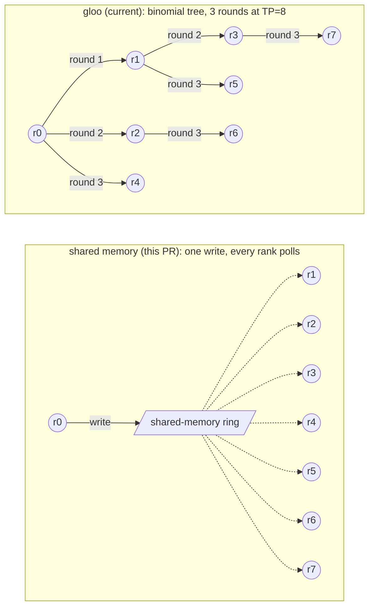

# Scheduler: broadcast TP requests via the shared-memory Message Queue instead of gloo

[Upstream PR](https://github.com/sgl-project/sglang/pull/44202) · state: open · merged: False

## Original PR description

## Motivation

Once per decode step, TP rank 0 broadcasts the newly received requests to the other ranks over gloo, even when the
list is empty. gloo uses a binomial tree, so the last ranks wait for relays through other ranks, and each hop pays a
thread hand-off plus a socket round trip on cores that have meanwhile dropped into deep idle. The TP group already owns
a shared-memory `MessageQueue` broadcaster that nothing uses at runtime; this PR sends the request broadcast through it.

This matters where the host is on the critical path: in eager mode every rank issues all of the step's kernels, so a
rank that starts late behind the tree delays the whole step, while with CUDA graphs the hosts run ahead of the GPU and
the delay is hidden. vLLM made the same switch by default in vllm-project/vllm#5399 (June 2024, +3.5% on Llama-2-7B
TP=8 / 8xH100) and has kept shared memory as its only path since; as there, no flag is added. gloo is kept only under
`--sleep-on-idle`, where shared-memory readers would busy-poll while rank 0 sleeps.

## Accuracy Tests

No change to model execution; greedy output is identical on the shared-memory path, the gloo fallback and
`--sleep-on-idle` (Qwen3-8B TP=8, 8x L40S).

## Speed Tests and Profiling

**8x NVIDIA L40S (PCIe), Qwen3-8B TP=8, `bench_serving` random 256/256, eager (`--cuda-graph-backend-decode disabled`),
radix cache off. base = main 2c1e85964e vs base + this commit, four alternating pairs, one fresh server per run.**

| c | base tok/s (4 servers) | PR tok/s (4 servers) | d tok/s | base TPOT | PR TPOT | p99 ITL base -> PR |
|---|---|---|---|---|---|---|
| 1 | 42.8 / 42.9 / 42.1 / 43.0 | 43.6 / 43.5 / 43.3 / 43.9 | +1.9% | 23.28 ms | 22.84 ms | 29.2 -> 27.6 ms |
| 4 | 159.4 / 160.6 / 159.0 / 160.9 | 162.4 / 163.6 / 162.3 / 163.9 | +1.9% | 24.63 | 24.19 | 30.3 -> 28.4 |
| 16 | 610.9 / 614.6 / 606.2 / 615.8 | 623.6 / 624.9 / 622.6 / 629.1 | +2.2% | 25.04 | 24.48 | 31.0 -> 29.1 |
| 64 | 2,121 / 2,110 / 2,099 / 2,144 | 2,141 / 2,164 / 2,145 / 2,168 | +1.7% | 26.99 | 26.51 | 35.0 -> 32.8 |

Every PR server is above every base server at every concurrency (run-to-run spread 1-2% on both sides); TPOT -1.8 to
-2.2%, p99 inter-token latency 5-6% lower.

## Checklist

- [x] Format your code according to the [Format code with pre-commit](https://docs.sglang.io/developer_guide/contribution_guide.html#format-code-with-pre-commit).
- [x] Add unit tests according to the [Run and add unit tests](https://docs.sglang.io/developer_guide/contribution_guide.html#run-and-add-unit-tests).
- [ ] Update documentation according to [Write documentations](https://docs.sglang.io/developer_guide/contribution_guide.html#write-documentations). (No user-facing option changes.)
- [x] Provide accuracy and speed benchmark results according to [Test the accuracy](https://docs.sglang.io/developer_guide/contribution_guide.html#test-the-accuracy) and [Benchmark the speed](https://docs.sglang.io/developer_guide/contribution_guide.html#benchmark-the-speed).
- [x] Follow the SGLang code style [guidance](https://docs.sglang.io/developer_guide/contribution_guide.html#code-style-guidance).

<!-- pr-states:start -->
---
### CI States

Latest PR Test (Base): <!-- slot:pr-test:start -->:x: [Run #38680895344](https://github.com/sgl-project/sglang/actions/runs/38680895344)<!-- slot:pr-test:end -->
Latest PR Test (Extra): <!-- slot:pr-test-extra:start -->:x: [Run #38680895360](https://github.com/sgl-project/sglang/actions/runs/38680895360)<!-- slot:pr-test-extra:end -->
Latest PR Test (AMD ROCm 10): <!-- slot:pr-test-amd:start -->:x: [Run #38680895337](https://github.com/sgl-project/sglang/actions/runs/38680895337)<!-- slot:pr-test-amd:end -->
<!-- pr-states:end -->

## Review and discussion

### reviews

### issue_comments

### inline_comments

## Changed files and fixed code

- `python/sglang/srt/managers/scheduler_components/request_receiver.py` · modified · additions 12 / deletions 7
  - [head](https://github.com/rahulvijayaraghavan/sglang/blob/edb1005e61e0129d1a8633e371ea540b40da9750/python/sglang/srt/managers/scheduler_components/request_receiver.py)
  - [base](https://github.com/sgl-project/sglang/blob/d4daf523695224ce21608fd5dc2580e08eedf802/python/sglang/srt/managers/scheduler_components/request_receiver.py)
- `test/registered/unit/managers/test_pp_cp_rank_offsets.py` · modified · additions 34 / deletions 1
  - [head](https://github.com/rahulvijayaraghavan/sglang/blob/edb1005e61e0129d1a8633e371ea540b40da9750/test/registered/unit/managers/test_pp_cp_rank_offsets.py)
  - [base](https://github.com/sgl-project/sglang/blob/d4daf523695224ce21608fd5dc2580e08eedf802/test/registered/unit/managers/test_pp_cp_rank_offsets.py)

## Evidence and interpretation boundary

[Original JSON, discussions and patches](../../../../../../evidence/prs/sgl-project--sglang/44202-332623ff7cb5db6c508cefd8588ecfb675db72b9eaf229d74c29b9590f9c33c4.json) · SHA-256 `332623ff7cb5db6c508cefd8588ecfb675db72b9eaf229d74c29b9590f9c33c4`.

Diff complete: True. Missing/binary/truncated patches require pinned source inspection. This is a source page, not an independently verified optimization case. Open, merged and released are different states; recheck the deployed dependency.
