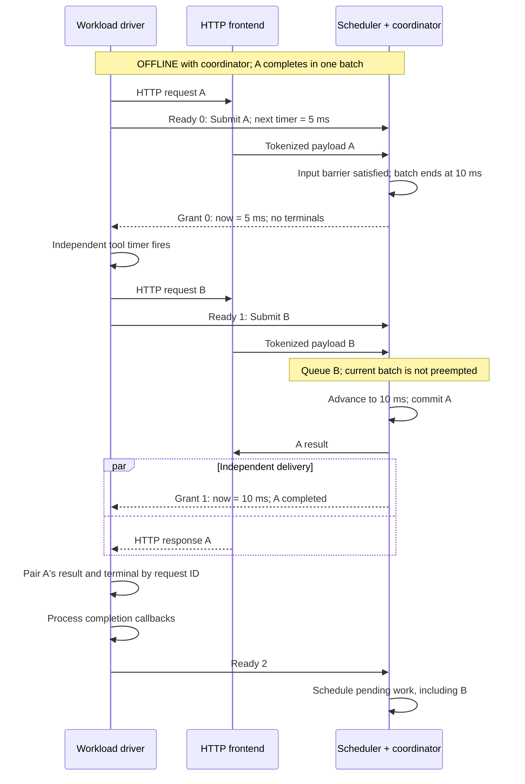

# [Feat] simulator: Support closed-loop agentic workloads

[Upstream PR](https://github.com/sgl-project/sglang/pull/44287) · state: open · merged: False

## Original PR description

## Motivation

Request completion and tool waits determine subsequent arrivals in closed-loop workloads. Fixed traces lose this feedback when inference latency changes. This PR adds optional coordination with external drivers, independent of dataset or harness. Implements the server side of #44221.

## Modifications

Add optional coordination to `OFFLINE`, without introducing a new execution mode or a dependency on a workload harness.

- `Coordinator` maintains transport-independent protocol state.
- `CoordinatedScheduler` connects it to existing request-receive, batch-result and idle hooks.
- External drivers own datasets, dependencies, timers and benchmark phases.

Native scheduling, batching, KV-cache behavior and latency prediction remain responsible for request execution.

### Execution flow

This example shows an independent tool timer releasing B while A is still running. Times are illustrative.

HTTP submissions and `Ready` proceed concurrently; their arrival order does not affect virtual time. The input barrier waits for request payloads, not responses. A timer-only grant requires no HTTP result, and the driver does not wait for every pending request before sending its next `Ready`.

Coordinated responses include virtual timestamps and native token/cache counts. Drivers manage warmup exclusion and measurement windows. Shutdown completes only after requests and native cleanup drain.

Existing clients can use `BLOCKING` without an adapter. This PR also paces visible cache-load latency before delivering `BLOCKING` responses.

Initial scope is one local driver and scheduler, text requests, ordinary radix cache, and completion- or timer-driven workflows. See the [driver contract](https://github.com/Jeff010101/sglang/blob/fe1db04aaed893d1614b69c6cc59f85c863ab174/tools/sglang-simulator/README.md#driver-contract) for configuration restrictions and adapter requirements.

## Accuracy Tests

110 CPU tests passed on Linux (Python 3.10), without AgentX installed. Coverage includes coordination, timing, cancellation, HTTP serving and both modes. The fork/join example preserves its virtual timeline under delayed HTTP sends/reads; failure tests verify task cleanup.

## Speed Tests and Profiling

The example uses fixed 10 ms batch costs to test causality and metrics. It is not a hardware performance prediction.

## Checklist

- [x] Pre-commit checks on changed files passed.
- [x] Added documentation and regression tests.
- [ ] Upstream Python 3.12 CPU CI; pending while this PR is a draft.

<!-- pr-states:start -->
---
### CI States

Latest PR Test (Base): <!-- slot:pr-test:start -->:x: [Run #39212544531](https://github.com/sgl-project/sglang/actions/runs/39212544531)<!-- slot:pr-test:end -->
Latest PR Test (Extra): <!-- slot:pr-test-extra:start -->:x: [Run #39212544522](https://github.com/sgl-project/sglang/actions/runs/39212544522)<!-- slot:pr-test-extra:end -->
Latest PR Test (AMD ROCm 10): <!-- slot:pr-test-amd:start -->:heavy_minus_sign: **No AMD PR run found for this commit**.<!-- slot:pr-test-amd:end -->
<!-- pr-states:end -->

## Review and discussion

### reviews

### issue_comments

### inline_comments

## Changed files and fixed code

- `.github/workflows/_pr-test-simulator-cpu.yml` · modified · additions 8 / deletions 0
  - [head](https://github.com/Jeff010101/sglang/blob/fe1db04aaed893d1614b69c6cc59f85c863ab174/.github/workflows/_pr-test-simulator-cpu.yml)
  - [base](https://github.com/sgl-project/sglang/blob/834bfe4ef0ec11ac5625fac3f94f60c041a36cb8/.github/workflows/_pr-test-simulator-cpu.yml)
- `tools/sglang-simulator/README.md` · modified · additions 179 / deletions 0
  - [head](https://github.com/Jeff010101/sglang/blob/fe1db04aaed893d1614b69c6cc59f85c863ab174/tools/sglang-simulator/README.md)
  - [base](https://github.com/sgl-project/sglang/blob/834bfe4ef0ec11ac5625fac3f94f60c041a36cb8/tools/sglang-simulator/README.md)
- `tools/sglang-simulator/examples/README.md` · modified · additions 38 / deletions 0
  - [head](https://github.com/Jeff010101/sglang/blob/fe1db04aaed893d1614b69c6cc59f85c863ab174/tools/sglang-simulator/examples/README.md)
  - [base](https://github.com/sgl-project/sglang/blob/834bfe4ef0ec11ac5625fac3f94f60c041a36cb8/tools/sglang-simulator/examples/README.md)
- `tools/sglang-simulator/examples/closed_loop.py` · added · additions 85 / deletions 0
  - [head](https://github.com/Jeff010101/sglang/blob/fe1db04aaed893d1614b69c6cc59f85c863ab174/tools/sglang-simulator/examples/closed_loop.py)
  - [base](https://github.com/sgl-project/sglang/blob/834bfe4ef0ec11ac5625fac3f94f60c041a36cb8/tools/sglang-simulator/examples/closed_loop.py)
- `tools/sglang-simulator/examples/fork_join.py` · added · additions 144 / deletions 0
  - [head](https://github.com/Jeff010101/sglang/blob/fe1db04aaed893d1614b69c6cc59f85c863ab174/tools/sglang-simulator/examples/fork_join.py)
  - [base](https://github.com/sgl-project/sglang/blob/834bfe4ef0ec11ac5625fac3f94f60c041a36cb8/tools/sglang-simulator/examples/fork_join.py)
- `tools/sglang-simulator/pyproject.toml` · modified · additions 2 / deletions 0
  - [head](https://github.com/Jeff010101/sglang/blob/fe1db04aaed893d1614b69c6cc59f85c863ab174/tools/sglang-simulator/pyproject.toml)
  - [base](https://github.com/sgl-project/sglang/blob/834bfe4ef0ec11ac5625fac3f94f60c041a36cb8/tools/sglang-simulator/pyproject.toml)
- `tools/sglang-simulator/src/sglang_simulator/compat.py` · modified · additions 64 / deletions 2
  - [head](https://github.com/Jeff010101/sglang/blob/fe1db04aaed893d1614b69c6cc59f85c863ab174/tools/sglang-simulator/src/sglang_simulator/compat.py)
  - [base](https://github.com/sgl-project/sglang/blob/834bfe4ef0ec11ac5625fac3f94f60c041a36cb8/tools/sglang-simulator/src/sglang_simulator/compat.py)
- `tools/sglang-simulator/src/sglang_simulator/simulation/client.py` · added · additions 87 / deletions 0
  - [head](https://github.com/Jeff010101/sglang/blob/fe1db04aaed893d1614b69c6cc59f85c863ab174/tools/sglang-simulator/src/sglang_simulator/simulation/client.py)
  - [base](https://github.com/sgl-project/sglang/blob/834bfe4ef0ec11ac5625fac3f94f60c041a36cb8/tools/sglang-simulator/src/sglang_simulator/simulation/client.py)
- `tools/sglang-simulator/src/sglang_simulator/simulation/coordinator.py` · added · additions 280 / deletions 0
  - [head](https://github.com/Jeff010101/sglang/blob/fe1db04aaed893d1614b69c6cc59f85c863ab174/tools/sglang-simulator/src/sglang_simulator/simulation/coordinator.py)
  - [base](https://github.com/sgl-project/sglang/blob/834bfe4ef0ec11ac5625fac3f94f60c041a36cb8/tools/sglang-simulator/src/sglang_simulator/simulation/coordinator.py)
- `tools/sglang-simulator/src/sglang_simulator/simulation/manager/env.py` · modified · additions 4 / deletions 0
  - [head](https://github.com/Jeff010101/sglang/blob/fe1db04aaed893d1614b69c6cc59f85c863ab174/tools/sglang-simulator/src/sglang_simulator/simulation/manager/env.py)
  - [base](https://github.com/sgl-project/sglang/blob/834bfe4ef0ec11ac5625fac3f94f60c041a36cb8/tools/sglang-simulator/src/sglang_simulator/simulation/manager/env.py)
- `tools/sglang-simulator/src/sglang_simulator/simulation/manager/state.py` · modified · additions 4 / deletions 0
  - [head](https://github.com/Jeff010101/sglang/blob/fe1db04aaed893d1614b69c6cc59f85c863ab174/tools/sglang-simulator/src/sglang_simulator/simulation/manager/state.py)
  - [base](https://github.com/sgl-project/sglang/blob/834bfe4ef0ec11ac5625fac3f94f60c041a36cb8/tools/sglang-simulator/src/sglang_simulator/simulation/manager/state.py)
- `tools/sglang-simulator/src/sglang_simulator/simulation/sglang/coordinated.py` · added · additions 355 / deletions 0
  - [head](https://github.com/Jeff010101/sglang/blob/fe1db04aaed893d1614b69c6cc59f85c863ab174/tools/sglang-simulator/src/sglang_simulator/simulation/sglang/coordinated.py)
  - [base](https://github.com/sgl-project/sglang/blob/834bfe4ef0ec11ac5625fac3f94f60c041a36cb8/tools/sglang-simulator/src/sglang_simulator/simulation/sglang/coordinated.py)
- `tools/sglang-simulator/src/sglang_simulator/simulation/sglang/hook_bootstrap.py` · modified · additions 10 / deletions 0
  - [head](https://github.com/Jeff010101/sglang/blob/fe1db04aaed893d1614b69c6cc59f85c863ab174/tools/sglang-simulator/src/sglang_simulator/simulation/sglang/hook_bootstrap.py)
  - [base](https://github.com/sgl-project/sglang/blob/834bfe4ef0ec11ac5625fac3f94f60c041a36cb8/tools/sglang-simulator/src/sglang_simulator/simulation/sglang/hook_bootstrap.py)
- `tools/sglang-simulator/src/sglang_simulator/simulation/sglang/scheduler.py` · modified · additions 54 / deletions 8
  - [head](https://github.com/Jeff010101/sglang/blob/fe1db04aaed893d1614b69c6cc59f85c863ab174/tools/sglang-simulator/src/sglang_simulator/simulation/sglang/scheduler.py)
  - [base](https://github.com/sgl-project/sglang/blob/834bfe4ef0ec11ac5625fac3f94f60c041a36cb8/tools/sglang-simulator/src/sglang_simulator/simulation/sglang/scheduler.py)
- `tools/sglang-simulator/src/sglang_simulator/simulation/sglang/timing_metadata.py` · added · additions 138 / deletions 0
  - [head](https://github.com/Jeff010101/sglang/blob/fe1db04aaed893d1614b69c6cc59f85c863ab174/tools/sglang-simulator/src/sglang_simulator/simulation/sglang/timing_metadata.py)
  - [base](https://github.com/sgl-project/sglang/blob/834bfe4ef0ec11ac5625fac3f94f60c041a36cb8/tools/sglang-simulator/src/sglang_simulator/simulation/sglang/timing_metadata.py)
- `tools/sglang-simulator/test/test_simulation_blocking_agentic.py` · added · additions 156 / deletions 0
  - [head](https://github.com/Jeff010101/sglang/blob/fe1db04aaed893d1614b69c6cc59f85c863ab174/tools/sglang-simulator/test/test_simulation_blocking_agentic.py)
  - [base](https://github.com/sgl-project/sglang/blob/834bfe4ef0ec11ac5625fac3f94f60c041a36cb8/tools/sglang-simulator/test/test_simulation_blocking_agentic.py)
- `tools/sglang-simulator/test/test_simulation_blocking_pacing.py` · added · additions 110 / deletions 0
  - [head](https://github.com/Jeff010101/sglang/blob/fe1db04aaed893d1614b69c6cc59f85c863ab174/tools/sglang-simulator/test/test_simulation_blocking_pacing.py)
  - [base](https://github.com/sgl-project/sglang/blob/834bfe4ef0ec11ac5625fac3f94f60c041a36cb8/tools/sglang-simulator/test/test_simulation_blocking_pacing.py)
- `tools/sglang-simulator/test/test_simulation_closed_loop_example.py` · added · additions 119 / deletions 0
  - [head](https://github.com/Jeff010101/sglang/blob/fe1db04aaed893d1614b69c6cc59f85c863ab174/tools/sglang-simulator/test/test_simulation_closed_loop_example.py)
  - [base](https://github.com/sgl-project/sglang/blob/834bfe4ef0ec11ac5625fac3f94f60c041a36cb8/tools/sglang-simulator/test/test_simulation_closed_loop_example.py)
- `tools/sglang-simulator/test/test_simulation_coordinated_bridge.py` · added · additions 564 / deletions 0
  - [head](https://github.com/Jeff010101/sglang/blob/fe1db04aaed893d1614b69c6cc59f85c863ab174/tools/sglang-simulator/test/test_simulation_coordinated_bridge.py)
  - [base](https://github.com/sgl-project/sglang/blob/834bfe4ef0ec11ac5625fac3f94f60c041a36cb8/tools/sglang-simulator/test/test_simulation_coordinated_bridge.py)
- `tools/sglang-simulator/test/test_simulation_coordinated_serving.py` · added · additions 537 / deletions 0
  - [head](https://github.com/Jeff010101/sglang/blob/fe1db04aaed893d1614b69c6cc59f85c863ab174/tools/sglang-simulator/test/test_simulation_coordinated_serving.py)
  - [base](https://github.com/sgl-project/sglang/blob/834bfe4ef0ec11ac5625fac3f94f60c041a36cb8/tools/sglang-simulator/test/test_simulation_coordinated_serving.py)
- `tools/sglang-simulator/test/test_simulation_coordinator.py` · added · additions 383 / deletions 0
  - [head](https://github.com/Jeff010101/sglang/blob/fe1db04aaed893d1614b69c6cc59f85c863ab174/tools/sglang-simulator/test/test_simulation_coordinator.py)
  - [base](https://github.com/sgl-project/sglang/blob/834bfe4ef0ec11ac5625fac3f94f60c041a36cb8/tools/sglang-simulator/test/test_simulation_coordinator.py)
- `tools/sglang-simulator/test/test_simulation_fork_join_example.py` · added · additions 131 / deletions 0
  - [head](https://github.com/Jeff010101/sglang/blob/fe1db04aaed893d1614b69c6cc59f85c863ab174/tools/sglang-simulator/test/test_simulation_fork_join_example.py)
  - [base](https://github.com/sgl-project/sglang/blob/834bfe4ef0ec11ac5625fac3f94f60c041a36cb8/tools/sglang-simulator/test/test_simulation_fork_join_example.py)
- `tools/sglang-simulator/test/test_simulation_sglang_serving.py` · modified · additions 8 / deletions 1
  - [head](https://github.com/Jeff010101/sglang/blob/fe1db04aaed893d1614b69c6cc59f85c863ab174/tools/sglang-simulator/test/test_simulation_sglang_serving.py)
  - [base](https://github.com/sgl-project/sglang/blob/834bfe4ef0ec11ac5625fac3f94f60c041a36cb8/tools/sglang-simulator/test/test_simulation_sglang_serving.py)
- `tools/sglang-simulator/test/test_simulation_timing_metadata.py` · added · additions 264 / deletions 0
  - [head](https://github.com/Jeff010101/sglang/blob/fe1db04aaed893d1614b69c6cc59f85c863ab174/tools/sglang-simulator/test/test_simulation_timing_metadata.py)
  - [base](https://github.com/sgl-project/sglang/blob/834bfe4ef0ec11ac5625fac3f94f60c041a36cb8/tools/sglang-simulator/test/test_simulation_timing_metadata.py)

## Evidence and interpretation boundary

[Original JSON, discussions and patches](../../../../../../evidence/prs/sgl-project--sglang/44287-cb90bbdad16119197d025fe4fc38f4619d30fb81ce245eb0f9c232a89136da37.json) · SHA-256 `cb90bbdad16119197d025fe4fc38f4619d30fb81ce245eb0f9c232a89136da37`.

Diff complete: True. Missing/binary/truncated patches require pinned source inspection. This is a source page, not an independently verified optimization case. Open, merged and released are different states; recheck the deployed dependency.
