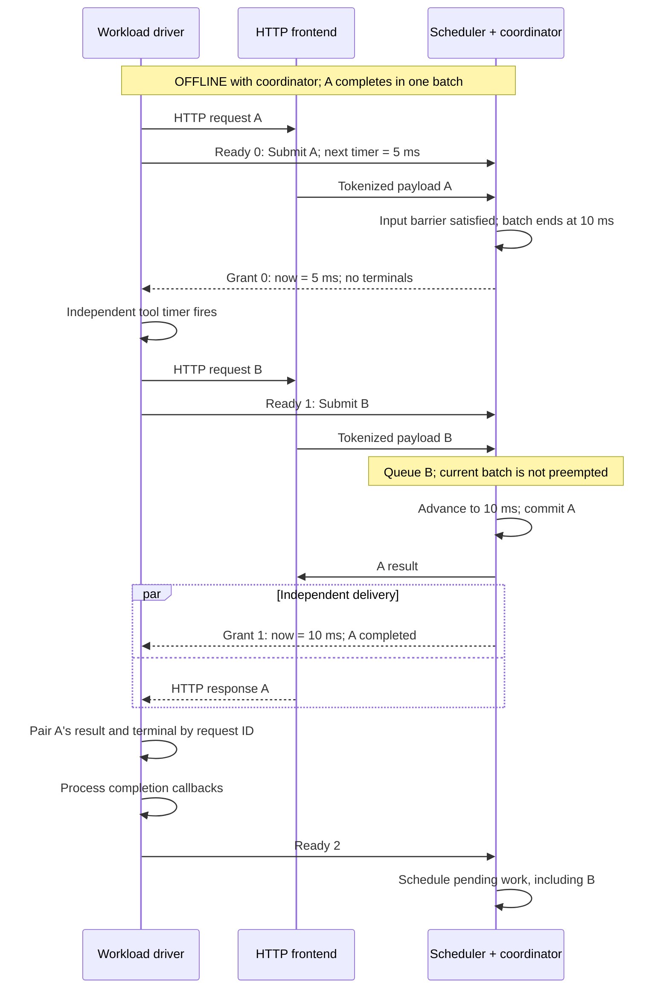

# [Feat] simulator: Support closed-loop agentic workloads

[Upstream PR](https://github.com/sgl-project/sglang/pull/44287) · state: open · merged: False

## Original PR description

## Motivation

Request completion and tool waits determine subsequent arrivals in closed-loop workloads. Fixed traces lose this feedback when inference latency changes. This PR adds optional coordination with external drivers, independent of dataset or harness. Implements the server side of #44221.

## Modifications

Add optional coordination to `OFFLINE`, without introducing a new execution mode or a dependency on a workload harness.

- `Coordinator` maintains transport-independent protocol state.
- `CoordinatedScheduler` connects it to existing request-receive, batch-result and idle hooks.
- External drivers own datasets, dependencies, timers and benchmark phases.
- An opt-in JSONL ledger records native visible output-token increments, preserving earlier committed output and excluding discarded cancellation tails. It does not change scheduling or batch costs.
- Native prefill/decode cadence decisions retain their original return values and countdown. A cadence-only pass with pending native work defers the coordinator idle boundary until the next scheduling pass, without advancing virtual time or granting a tool timer prematurely.

Native scheduling, batching, KV-cache behavior and latency prediction remain responsible for request execution.

### Execution flow

This example shows an independent tool timer releasing B while A is still running. Times are illustrative.

HTTP submissions and `Ready` proceed concurrently; their arrival order does not affect virtual time. The input barrier waits for request payloads, not responses. A timer-only grant requires no HTTP result, and the driver does not wait for every pending request before sending its next `Ready`.

Coordinated responses include virtual timestamps and native token/cache counts. Drivers manage warmup exclusion and measurement windows. Shutdown completes only after requests and native cleanup drain.

Existing clients can use `BLOCKING` without an adapter. This PR also paces visible cache-load latency before delivering `BLOCKING` responses.

Initial scope is one local driver and scheduler, text requests, ordinary radix cache, and completion- or timer-driven workflows. See the [driver contract](https://github.com/Jeff010101/sglang/blob/1e3e9dee8f99c5ae14b22ac75afbbf5b4401e6d2/tools/sglang-simulator/README.md#driver-contract) for configuration restrictions and adapter requirements.

## Accuracy Tests

The native token ledger landed at `1e3e9dee8f99c5ae14b22ac75afbbf5b4401e6d2`. Import-only `cf90d4cf360bf008eda19202efe4bb912935138c` defers unselected optional predictor imports. Head `6cb771e196f86e05a05cde66c0036d5ef0cc5e39` preserves original geometry throughout the native packed-KV factory and removes an assertion-swallowing fallback. Predictor formulas, replay assets, ordinary MHA/MLA compaction and capability guards are unchanged.

- At `1e3`, 116 focused coordinator, bridge, timing and token-ledger tests and all nine distinct native HTTP regressions passed, including wall-time-independent fork/join, SSE, cache counts, terminal pairing and cancellation. Applicable pre-commit checks passed.
- On exact `cf90`, 120 focused tests passed, including four fresh-interpreter tests that block AIC/joblib/sklearn imports while exercising unchanged Replay/KNN. Selecting an optional predictor or automatic AIC memory sizing still requires its dependencies. Two existing native HTTP timing/usage cases (standard and incremental streaming) passed sequentially without readiness retries or limit changes. Final applicable pre-commit checks passed.
- For `6cb`, 128 focused tests passed on byte-identical pre-commit sources, including eight slotted/nested/exception/legacy-pool boundary cases. Both existing HTTP timing/usage cases passed on the exact clean commit, sequentially, without readiness changes or retries. Applicable pre-commit checks passed; the final owned-process scan was empty.
- Independent fresh-process CPU controls on exact reference source `27b68303d043ddbddf9861c55c26bc8617ea7c35` and the actual model configuration verified all 11 common semantic construction results against native code, with all 614 loaded native files SHA-checked in each process. Explicit startup markers, customization origins and executed callable identities distinguish the unhooked baseline from intentional simulator hooks. Native V4/V41/V41-FP4 layouts retain 584/528/288 bytes per token and invalid dimensions retain native assertions; full target-40 nested ownership, request bookkeeping and small CPU page-boundary/free/reuse controls passed. These controls used Python 3.12/Torch 2.13+cu130 with HIP absent and no accelerator initialization, rather than the pinned ROCm runtime. They qualify CPU geometry at the reviewed callable factory seam, not KV contents, model forwards, older missing seams, virtual payloads or large-capacity support. An earlier control's missing startup provenance was retained and corrected with new versioned evidence before publication.
- A real HTTP root/background-child fixture at exact `1e3` with the [AgentX 1.0.7-base adapter](https://github.com/Jeff010101/agentx-harness/pull/1) at `e806152618723393b71a06a544e70a8e9fc017f6` passed: both paused streams continue across official warmup into profiling, with 182 successful responses and 352 native committed tokens agreeing with SSE usage. Parent-only SIGTERM permits native cleanup with exit 0, no forced kill or stragglers. This fixture was not rerun or relabeled as `cf90` or `6cb` evidence.
- That custom two-tree fixture uses the official warmup/snapshot/idle policy with 900-second profiling and 30-second grace; it is explicitly `submission_valid=false` and uses unchanged upstream replay costs. A separate CPU audit completed official/adapted loading, reconstruction and initial snapshots for all 393 official traces, but full-corpus two-phase HTTP/native-versus-virtual equivalence and InferCast/V4.1 accuracy remain separate evidence.
- In the pinned reference HIP image (Python 3.10), exact `cf90` core configuration/bootstrap imports and existing Replay/KNN fixture checks also passed without optional installs, device mappings or accelerator initialization. This did not import SRT leaf modules or qualify the image's native pool/runtime. The HTTP regressions used the separately recorded later-SRT CPU dummy environment.
- One earlier parallel HTTP group at `1e3` exceeded the existing 120-second readiness limit during model-registry import; the failed and subsequently unrun cases passed sequential retries. No readiness policy was changed. The latest two HTTP cases required no retries.

Previous head `b969d03e4f0b2bca8e8ccbebc5786f377f052e43` adds the cadence repair above. Positive intervals require the observed native scheduling/defer/arm signatures and a valid counter before socket binding; unsupported native surfaces fail explicitly. The final 1-to-0 defer pass is retained. Genuine idle timers and stalled-native-work errors keep their existing behavior; non-coordinated execution calls the original methods directly.

- Final bridge suite:64 passed. Existing coordinator/timing/token-ledger/predictor-import/pacing/driver group:152 passed,1 deselected before the final isolated non-coordinator early-return regression; that final regression is covered by the64-test suite.
- Both real HTTP fork/join cases at cadence1 and192 passed in the recorded CPU environment. The first case preceded only the final non-coordinator early-return delta; the second fresh server included it. Native source-body controls at both the simulator source and exact reference source verified the original decision results/counter mutation, including1-to-0.
- A separate InferCast integration composition containing the same cadence change passed64 bridge tests and both real HTTP cadence cases on exact Git/LF sources, using the original120-second startup fixture. Moving byte-verified sources from Windows-mounted storage to native WSL storage resolved an earlier model-registry import timeout; no readiness limit or production source was changed. This is CPU protocol evidence, not V4.1 cost or accuracy evidence.
- Scoped Ruff/import ordering, formatting and diff checks passed. Speculation, DP attention, overlap, disaggregation and HiCache restrictions remain unchanged. Final hosted checks remain subject to the existing draft policy; none is implied by the local results.

Draft status and upstream hosted-CI policy are preserved; a draft-policy gate does not constitute an executed downstream CPU suite. No speculative/ADP/overlap/provider enablement or hardware-performance claim is added by these follow-ups.

## Portable bind-error regression

Head `80e3ea5fe34aabbfa43c5f29f7d729ab9abd4ad1` changes one test to assert `zmq.EADDRINUSE` rather than an operating-system-specific error message, retaining the context-cleanup assertion. Production coordinator and scheduler code are unchanged. The exact test file is byte-identical to the file executed in the full Linux CPU composition at `a52183fc810c3f59c7096b78a2f1934c30678f5d`; that composition completed all 38 files in both optional-SDK modes (907 passed / 135 skipped without SDK; 1088 passed / 7 explicitly configured E2E skips with SDK). These are composition results, not a rerun of every historical HTTP case on this branch or a hardware-accuracy claim. Draft status and upstream CI policy are preserved.

## Coordinator physical wait budget

Head `071479564761cf7492304a5b34ef15bd62d1fd75` exposes the existing coordinated-server `timeout_s` through `SGLANG_SIMULATOR_COORDINATOR_WALL_TIMEOUT`. The default remains 30 seconds; explicit values must be finite and positive. This bounds physical waiting for a driver or payload, without changing OFFLINE virtual time, protocol state, batch costs, client behavior or existing capability restrictions. It allows a driver with expensive completion callbacks to select an appropriate finite budget.

- Five available focused CPU suites passed (161 test instances); independent bridge/pacing verification passed 87 instances. Tests cover environment validation, the installed scheduler-hook wiring and finite failure for an absent driver.
- Four separate source-led loopback controls reproduce a delayed valid driver hitting a shorter physical budget, preserve identical virtual terminal/next-reply state with a sufficient budget, and retain failure for an absent driver. They do not establish the physical cause of any historical delay.
- Changed-file formatting and selected lint passed, with no new full-lint findings. Two broader optional test files require an unavailable local Torch dependency and are not reported as passing. Native hardware performance and end-to-end accuracy are separate evidence. Draft status and hosted-CI policy remain unchanged.

Import-only follow-up `0cab67d41bca91a8f00a0525cbdbe2ac198c8a9d` applies the two import-layout edits reported by hosted isort. The 87 bridge/pacing CPU instances passed again and hosted lint succeeded on that head. The three test-workflow gates explicitly report that the Draft PR blocks CI; downstream hosted CPU/GPU suites have not executed and no all-checks-pass or merge claim is made.

## Speed Tests and Profiling

The example uses fixed 10 ms batch costs to test causality and metrics. It is not a hardware performance prediction.

## Checklist

- [x] Pre-commit checks on changed files passed.
- [x] Added documentation and regression tests.
- [ ] Upstream Python 3.12 CPU CI; pending while this PR is a draft.

<!-- pr-states:start -->
---
### CI States

Latest PR Test (Base): <!-- slot:pr-test:start -->:x: [Run #40453515187](https://github.com/sgl-project/sglang/actions/runs/40453515187)<!-- slot:pr-test:end -->
Latest PR Test (Extra): <!-- slot:pr-test-extra:start -->:x: [Run #40453515322](https://github.com/sgl-project/sglang/actions/runs/40453515322)<!-- slot:pr-test-extra:end -->
Latest PR Test (AMD ROCm 10): <!-- slot:pr-test-amd:start -->:heavy_minus_sign: **No AMD PR run found for this commit**.<!-- slot:pr-test-amd:end -->
<!-- pr-states:end -->

## Review and discussion

### reviews

### issue_comments

- Jeff010101 · comment · 2026-10-25T14:13:07Z · [source](https://github.com/sgl-project/sglang/pull/44287#issuecomment-6398713730)

The existing OFFLINE Coordinator/Ready/Grant route from this PR remains the delivery path. A scoped follow-up for source-bound native DSPark is now in [PR36069](https://github.com/sgl-project/sglang/pull/36069), head881ddf7d9934527bf0cb6dfcb62c62693765aa9e: result-owned duration/reference retirement and complete native-tail/ownership drain. Independent source review and the final75 affected tests passed; actual native coordinated HTTP/official1.0.12 virtual-client integration is still pending. This does not claim that this PR's unchanged80e3 head already supports speculation, and does not replace its original closed-loop workload purpose.

### inline_comments

## Changed files and fixed code

- `.github/workflows/_pr-test-simulator-cpu.yml` · modified · additions 11 / deletions 0
  - [head](https://github.com/Jeff010101/sglang/blob/0cab67d41bca91a8f00a0525cbdbe2ac198c8a9d/.github/workflows/_pr-test-simulator-cpu.yml)
  - [base](https://github.com/sgl-project/sglang/blob/834bfe4ef0ec11ac5625fac3f94f60c041a36cb8/.github/workflows/_pr-test-simulator-cpu.yml)
- `tools/sglang-simulator/README.md` · modified · additions 242 / deletions 1
  - [head](https://github.com/Jeff010101/sglang/blob/0cab67d41bca91a8f00a0525cbdbe2ac198c8a9d/tools/sglang-simulator/README.md)
  - [base](https://github.com/sgl-project/sglang/blob/834bfe4ef0ec11ac5625fac3f94f60c041a36cb8/tools/sglang-simulator/README.md)
- `tools/sglang-simulator/examples/README.md` · modified · additions 38 / deletions 0
  - [head](https://github.com/Jeff010101/sglang/blob/0cab67d41bca91a8f00a0525cbdbe2ac198c8a9d/tools/sglang-simulator/examples/README.md)
  - [base](https://github.com/sgl-project/sglang/blob/834bfe4ef0ec11ac5625fac3f94f60c041a36cb8/tools/sglang-simulator/examples/README.md)
- `tools/sglang-simulator/examples/closed_loop.py` · added · additions 85 / deletions 0
  - [head](https://github.com/Jeff010101/sglang/blob/0cab67d41bca91a8f00a0525cbdbe2ac198c8a9d/tools/sglang-simulator/examples/closed_loop.py)
  - [base](https://github.com/sgl-project/sglang/blob/834bfe4ef0ec11ac5625fac3f94f60c041a36cb8/tools/sglang-simulator/examples/closed_loop.py)
- `tools/sglang-simulator/examples/fork_join.py` · added · additions 144 / deletions 0
  - [head](https://github.com/Jeff010101/sglang/blob/0cab67d41bca91a8f00a0525cbdbe2ac198c8a9d/tools/sglang-simulator/examples/fork_join.py)
  - [base](https://github.com/sgl-project/sglang/blob/834bfe4ef0ec11ac5625fac3f94f60c041a36cb8/tools/sglang-simulator/examples/fork_join.py)
- `tools/sglang-simulator/pyproject.toml` · modified · additions 2 / deletions 0
  - [head](https://github.com/Jeff010101/sglang/blob/0cab67d41bca91a8f00a0525cbdbe2ac198c8a9d/tools/sglang-simulator/pyproject.toml)
  - [base](https://github.com/sgl-project/sglang/blob/834bfe4ef0ec11ac5625fac3f94f60c041a36cb8/tools/sglang-simulator/pyproject.toml)
- `tools/sglang-simulator/src/sglang_simulator/compat.py` · modified · additions 67 / deletions 2
  - [head](https://github.com/Jeff010101/sglang/blob/0cab67d41bca91a8f00a0525cbdbe2ac198c8a9d/tools/sglang-simulator/src/sglang_simulator/compat.py)
  - [base](https://github.com/sgl-project/sglang/blob/834bfe4ef0ec11ac5625fac3f94f60c041a36cb8/tools/sglang-simulator/src/sglang_simulator/compat.py)
- `tools/sglang-simulator/src/sglang_simulator/simulation/client.py` · added · additions 87 / deletions 0
  - [head](https://github.com/Jeff010101/sglang/blob/0cab67d41bca91a8f00a0525cbdbe2ac198c8a9d/tools/sglang-simulator/src/sglang_simulator/simulation/client.py)
  - [base](https://github.com/sgl-project/sglang/blob/834bfe4ef0ec11ac5625fac3f94f60c041a36cb8/tools/sglang-simulator/src/sglang_simulator/simulation/client.py)
- `tools/sglang-simulator/src/sglang_simulator/simulation/coordinator.py` · added · additions 280 / deletions 0
  - [head](https://github.com/Jeff010101/sglang/blob/0cab67d41bca91a8f00a0525cbdbe2ac198c8a9d/tools/sglang-simulator/src/sglang_simulator/simulation/coordinator.py)
  - [base](https://github.com/sgl-project/sglang/blob/834bfe4ef0ec11ac5625fac3f94f60c041a36cb8/tools/sglang-simulator/src/sglang_simulator/simulation/coordinator.py)
- `tools/sglang-simulator/src/sglang_simulator/simulation/manager/config.py` · modified · additions 3 / deletions 4
  - [head](https://github.com/Jeff010101/sglang/blob/0cab67d41bca91a8f00a0525cbdbe2ac198c8a9d/tools/sglang-simulator/src/sglang_simulator/simulation/manager/config.py)
  - [base](https://github.com/sgl-project/sglang/blob/834bfe4ef0ec11ac5625fac3f94f60c041a36cb8/tools/sglang-simulator/src/sglang_simulator/simulation/manager/config.py)
- `tools/sglang-simulator/src/sglang_simulator/simulation/manager/env.py` · modified · additions 20 / deletions 0
  - [head](https://github.com/Jeff010101/sglang/blob/0cab67d41bca91a8f00a0525cbdbe2ac198c8a9d/tools/sglang-simulator/src/sglang_simulator/simulation/manager/env.py)
  - [base](https://github.com/sgl-project/sglang/blob/834bfe4ef0ec11ac5625fac3f94f60c041a36cb8/tools/sglang-simulator/src/sglang_simulator/simulation/manager/env.py)
- `tools/sglang-simulator/src/sglang_simulator/simulation/manager/state.py` · modified · additions 4 / deletions 0
  - [head](https://github.com/Jeff010101/sglang/blob/0cab67d41bca91a8f00a0525cbdbe2ac198c8a9d/tools/sglang-simulator/src/sglang_simulator/simulation/manager/state.py)
  - [base](https://github.com/sgl-project/sglang/blob/834bfe4ef0ec11ac5625fac3f94f60c041a36cb8/tools/sglang-simulator/src/sglang_simulator/simulation/manager/state.py)
- `tools/sglang-simulator/src/sglang_simulator/simulation/sglang/coordinated.py` · added · additions 460 / deletions 0
  - [head](https://github.com/Jeff010101/sglang/blob/0cab67d41bca91a8f00a0525cbdbe2ac198c8a9d/tools/sglang-simulator/src/sglang_simulator/simulation/sglang/coordinated.py)
  - [base](https://github.com/sgl-project/sglang/blob/834bfe4ef0ec11ac5625fac3f94f60c041a36cb8/tools/sglang-simulator/src/sglang_simulator/simulation/sglang/coordinated.py)
- `tools/sglang-simulator/src/sglang_simulator/simulation/sglang/hook_bootstrap.py` · modified · additions 10 / deletions 1
  - [head](https://github.com/Jeff010101/sglang/blob/0cab67d41bca91a8f00a0525cbdbe2ac198c8a9d/tools/sglang-simulator/src/sglang_simulator/simulation/sglang/hook_bootstrap.py)
  - [base](https://github.com/sgl-project/sglang/blob/834bfe4ef0ec11ac5625fac3f94f60c041a36cb8/tools/sglang-simulator/src/sglang_simulator/simulation/sglang/hook_bootstrap.py)
- `tools/sglang-simulator/src/sglang_simulator/simulation/sglang/mem_pool_host.py` · modified · additions 0 / deletions 39
  - [head](https://github.com/Jeff010101/sglang/blob/0cab67d41bca91a8f00a0525cbdbe2ac198c8a9d/tools/sglang-simulator/src/sglang_simulator/simulation/sglang/mem_pool_host.py)
  - [base](https://github.com/sgl-project/sglang/blob/834bfe4ef0ec11ac5625fac3f94f60c041a36cb8/tools/sglang-simulator/src/sglang_simulator/simulation/sglang/mem_pool_host.py)
- `tools/sglang-simulator/src/sglang_simulator/simulation/sglang/model_runner.py` · modified · additions 42 / deletions 7
  - [head](https://github.com/Jeff010101/sglang/blob/0cab67d41bca91a8f00a0525cbdbe2ac198c8a9d/tools/sglang-simulator/src/sglang_simulator/simulation/sglang/model_runner.py)
  - [base](https://github.com/sgl-project/sglang/blob/834bfe4ef0ec11ac5625fac3f94f60c041a36cb8/tools/sglang-simulator/src/sglang_simulator/simulation/sglang/model_runner.py)
- `tools/sglang-simulator/src/sglang_simulator/simulation/sglang/scheduler.py` · modified · additions 61 / deletions 8
  - [head](https://github.com/Jeff010101/sglang/blob/0cab67d41bca91a8f00a0525cbdbe2ac198c8a9d/tools/sglang-simulator/src/sglang_simulator/simulation/sglang/scheduler.py)
  - [base](https://github.com/sgl-project/sglang/blob/834bfe4ef0ec11ac5625fac3f94f60c041a36cb8/tools/sglang-simulator/src/sglang_simulator/simulation/sglang/scheduler.py)
- `tools/sglang-simulator/src/sglang_simulator/simulation/sglang/timing_metadata.py` · added · additions 151 / deletions 0
  - [head](https://github.com/Jeff010101/sglang/blob/0cab67d41bca91a8f00a0525cbdbe2ac198c8a9d/tools/sglang-simulator/src/sglang_simulator/simulation/sglang/timing_metadata.py)
  - [base](https://github.com/sgl-project/sglang/blob/834bfe4ef0ec11ac5625fac3f94f60c041a36cb8/tools/sglang-simulator/src/sglang_simulator/simulation/sglang/timing_metadata.py)
- `tools/sglang-simulator/src/sglang_simulator/simulation/sglang/token_events.py` · added · additions 113 / deletions 0
  - [head](https://github.com/Jeff010101/sglang/blob/0cab67d41bca91a8f00a0525cbdbe2ac198c8a9d/tools/sglang-simulator/src/sglang_simulator/simulation/sglang/token_events.py)
  - [base](https://github.com/sgl-project/sglang/blob/834bfe4ef0ec11ac5625fac3f94f60c041a36cb8/tools/sglang-simulator/src/sglang_simulator/simulation/sglang/token_events.py)
- `tools/sglang-simulator/src/sglang_simulator/simulation/utils.py` · modified · additions 2 / deletions 1
  - [head](https://github.com/Jeff010101/sglang/blob/0cab67d41bca91a8f00a0525cbdbe2ac198c8a9d/tools/sglang-simulator/src/sglang_simulator/simulation/utils.py)
  - [base](https://github.com/sgl-project/sglang/blob/834bfe4ef0ec11ac5625fac3f94f60c041a36cb8/tools/sglang-simulator/src/sglang_simulator/simulation/utils.py)
- `tools/sglang-simulator/src/sglang_simulator/time_predictor/__init__.py` · modified · additions 21 / deletions 10
  - [head](https://github.com/Jeff010101/sglang/blob/0cab67d41bca91a8f00a0525cbdbe2ac198c8a9d/tools/sglang-simulator/src/sglang_simulator/time_predictor/__init__.py)
  - [base](https://github.com/sgl-project/sglang/blob/834bfe4ef0ec11ac5625fac3f94f60c041a36cb8/tools/sglang-simulator/src/sglang_simulator/time_predictor/__init__.py)
- `tools/sglang-simulator/test/test_simulation_blocking_agentic.py` · added · additions 156 / deletions 0
  - [head](https://github.com/Jeff010101/sglang/blob/0cab67d41bca91a8f00a0525cbdbe2ac198c8a9d/tools/sglang-simulator/test/test_simulation_blocking_agentic.py)
  - [base](https://github.com/sgl-project/sglang/blob/834bfe4ef0ec11ac5625fac3f94f60c041a36cb8/tools/sglang-simulator/test/test_simulation_blocking_agentic.py)
- `tools/sglang-simulator/test/test_simulation_blocking_pacing.py` · added · additions 162 / deletions 0
  - [head](https://github.com/Jeff010101/sglang/blob/0cab67d41bca91a8f00a0525cbdbe2ac198c8a9d/tools/sglang-simulator/test/test_simulation_blocking_pacing.py)
  - [base](https://github.com/sgl-project/sglang/blob/834bfe4ef0ec11ac5625fac3f94f60c041a36cb8/tools/sglang-simulator/test/test_simulation_blocking_pacing.py)
- `tools/sglang-simulator/test/test_simulation_closed_loop_example.py` · added · additions 119 / deletions 0
  - [head](https://github.com/Jeff010101/sglang/blob/0cab67d41bca91a8f00a0525cbdbe2ac198c8a9d/tools/sglang-simulator/test/test_simulation_closed_loop_example.py)
  - [base](https://github.com/sgl-project/sglang/blob/834bfe4ef0ec11ac5625fac3f94f60c041a36cb8/tools/sglang-simulator/test/test_simulation_closed_loop_example.py)
- `tools/sglang-simulator/test/test_simulation_coordinated_bridge.py` · added · additions 870 / deletions 0
  - [head](https://github.com/Jeff010101/sglang/blob/0cab67d41bca91a8f00a0525cbdbe2ac198c8a9d/tools/sglang-simulator/test/test_simulation_coordinated_bridge.py)
  - [base](https://github.com/sgl-project/sglang/blob/834bfe4ef0ec11ac5625fac3f94f60c041a36cb8/tools/sglang-simulator/test/test_simulation_coordinated_bridge.py)
- `tools/sglang-simulator/test/test_simulation_coordinated_serving.py` · added · additions 596 / deletions 0
  - [head](https://github.com/Jeff010101/sglang/blob/0cab67d41bca91a8f00a0525cbdbe2ac198c8a9d/tools/sglang-simulator/test/test_simulation_coordinated_serving.py)
  - [base](https://github.com/sgl-project/sglang/blob/834bfe4ef0ec11ac5625fac3f94f60c041a36cb8/tools/sglang-simulator/test/test_simulation_coordinated_serving.py)
- `tools/sglang-simulator/test/test_simulation_coordinator.py` · added · additions 383 / deletions 0
  - [head](https://github.com/Jeff010101/sglang/blob/0cab67d41bca91a8f00a0525cbdbe2ac198c8a9d/tools/sglang-simulator/test/test_simulation_coordinator.py)
  - [base](https://github.com/sgl-project/sglang/blob/834bfe4ef0ec11ac5625fac3f94f60c041a36cb8/tools/sglang-simulator/test/test_simulation_coordinator.py)
- `tools/sglang-simulator/test/test_simulation_fork_join_example.py` · added · additions 131 / deletions 0
  - [head](https://github.com/Jeff010101/sglang/blob/0cab67d41bca91a8f00a0525cbdbe2ac198c8a9d/tools/sglang-simulator/test/test_simulation_fork_join_example.py)
  - [base](https://github.com/sgl-project/sglang/blob/834bfe4ef0ec11ac5625fac3f94f60c041a36cb8/tools/sglang-simulator/test/test_simulation_fork_join_example.py)
- `tools/sglang-simulator/test/test_simulation_packed_geometry.py` · added · additions 208 / deletions 0
  - [head](https://github.com/Jeff010101/sglang/blob/0cab67d41bca91a8f00a0525cbdbe2ac198c8a9d/tools/sglang-simulator/test/test_simulation_packed_geometry.py)
  - [base](https://github.com/sgl-project/sglang/blob/834bfe4ef0ec11ac5625fac3f94f60c041a36cb8/tools/sglang-simulator/test/test_simulation_packed_geometry.py)
- `tools/sglang-simulator/test/test_simulation_predictor_imports.py` · added · additions 119 / deletions 0
  - [head](https://github.com/Jeff010101/sglang/blob/0cab67d41bca91a8f00a0525cbdbe2ac198c8a9d/tools/sglang-simulator/test/test_simulation_predictor_imports.py)
  - [base](https://github.com/sgl-project/sglang/blob/834bfe4ef0ec11ac5625fac3f94f60c041a36cb8/tools/sglang-simulator/test/test_simulation_predictor_imports.py)
- `tools/sglang-simulator/test/test_simulation_sglang_serving.py` · modified · additions 8 / deletions 1
  - [head](https://github.com/Jeff010101/sglang/blob/0cab67d41bca91a8f00a0525cbdbe2ac198c8a9d/tools/sglang-simulator/test/test_simulation_sglang_serving.py)
  - [base](https://github.com/sgl-project/sglang/blob/834bfe4ef0ec11ac5625fac3f94f60c041a36cb8/tools/sglang-simulator/test/test_simulation_sglang_serving.py)
- `tools/sglang-simulator/test/test_simulation_timing_metadata.py` · added · additions 370 / deletions 0
  - [head](https://github.com/Jeff010101/sglang/blob/0cab67d41bca91a8f00a0525cbdbe2ac198c8a9d/tools/sglang-simulator/test/test_simulation_timing_metadata.py)
  - [base](https://github.com/sgl-project/sglang/blob/834bfe4ef0ec11ac5625fac3f94f60c041a36cb8/tools/sglang-simulator/test/test_simulation_timing_metadata.py)
- `tools/sglang-simulator/test/test_simulation_token_events.py` · added · additions 171 / deletions 0
  - [head](https://github.com/Jeff010101/sglang/blob/0cab67d41bca91a8f00a0525cbdbe2ac198c8a9d/tools/sglang-simulator/test/test_simulation_token_events.py)
  - [base](https://github.com/sgl-project/sglang/blob/834bfe4ef0ec11ac5625fac3f94f60c041a36cb8/tools/sglang-simulator/test/test_simulation_token_events.py)

## Evidence and interpretation boundary

[Original JSON, discussions and patches](../../../../../../evidence/prs/sgl-project--sglang/44287-d506cae383e467548198e10ed410df92897bf3f007afc9cf6abc1821541696fa.json) · SHA-256 `d506cae383e467548198e10ed410df92897bf3f007afc9cf6abc1821541696fa`.

Diff complete: True. Missing/binary/truncated patches require pinned source inspection. This is a source page, not an independently verified optimization case. Open, merged and released are different states; recheck the deployed dependency.
