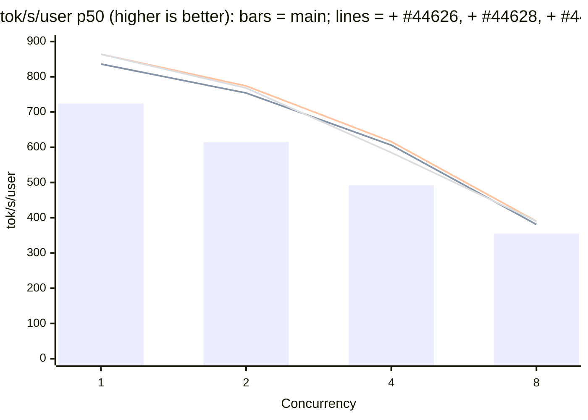

# [Perf] [NVIDIA] DSv4.1: Low-latency decode for DeepSeek-V4.1-Flash on GB300

[Upstream PR](https://github.com/sgl-project/sglang/pull/44626) · state: closed · merged: False

## Original PR description

## Motivation

**Joint result vs `main`, all three PRs on one GB300 node in one job.** Each column adds one PR to the previous one: `main` (`c5a5bf0d0bd`), + #44626, + #44628, + #44627; each uses its own PR's launch command (Speed Tests below). TP4, DSpark with a fixed 3.51 accepted tokens per step, 8K input / 1K output tokens, closed loop at each concurrency; one server per column, two rounds (the second in reverse concurrency order), mean shown; % vs `main`. This PR is the **+ #44626** column.

| Concurrency | Metric | `main` | **+ #44626** | + #44628 | + #44627 |
| ---: | --- | ---: | ---: | ---: | ---: |
| 1 | Decode step p50 (ms) | 4.850 | **4.162 (-14.2%)** | 4.062 (-16.2%) | 4.082 (-15.8%) |
|  | tok/s/user p50 | 724 | **836 (+15.5%)** | 864 (+19.3%) | 864 (+19.3%) |
|  | Output tok/s | 641 | **723 (+12.8%)** | 743 (+15.9%) | 765 (+19.3%) |
|  | TTFT p50 (ms) | 187 | **188 (+0.5%)** | 191 (+2.1%) | 145 (-22.5%) |
| 2 | Decode step p50 (ms) | 5.735 | **4.623 (-19.4%)** | 4.533 (-21.0%) | 4.485 (-21.8%) |
|  | tok/s/user p50 | 614 | **754 (+22.8%)** | 774 (+26.1%) | 768 (+25.1%) |
|  | Output tok/s | 1,001 | **1,169 (+16.8%)** | 1,209 (+20.8%) | 1,281 (+28.0%) |
|  | TTFT p50 (ms) | 363 | **366 (+0.8%)** | 365 (+0.6%) | 280 (-22.9%) |
| 4 | Decode step p50 (ms) | 6.649 | **5.558 (-16.4%)** | 5.460 (-17.9%) | 5.514 (-17.1%) |
|  | tok/s/user p50 | 492 | **606 (+23.2%)** | 616 (+25.2%) | 585 (+18.9%) |
|  | Output tok/s | 1,519 | **1,733 (+14.1%)** | 1,757 (+15.7%) | 1,875 (+23.4%) |
|  | TTFT p50 (ms) | 712 | **715 (+0.4%)** | 708 (-0.6%) | 494 (-30.6%) |
| 8 | Decode step p50 (ms) | 8.473 | **7.755 (-8.5%)** | 7.591 (-10.4%) | 7.656 (-9.6%) |
|  | tok/s/user p50 | 355 | **381 (+7.3%)** | 390 (+9.9%) | 390 (+9.9%) |
|  | Output tok/s | 2,085 | **2,186 (+4.8%)** | 2,227 (+6.8%) | 2,444 (+17.2%) |
|  | TTFT p50 (ms) | 1,069 | **1,082 (+1.2%)** | 1,066 (-0.3%) | 769 (-28.1%) |

#44626 shortens the decode step by 8.5-19.4% against `main`. #44628 takes another 0.09-0.16 ms off (1.8-2.4%). #44627 leaves the decode step unchanged within round noise (-0.05 to +0.07 ms) and cuts TTFT by 23-30% with the prefill CUDA graph, which lifts output throughput at concurrency 8 from 2,227 to 2,444 tok/s. All three together: decode step -9.6% to -21.8%, tok/s/user +9.9% to +25.1%, output tok/s +17.2% to +28.0%.



Agentic workloads such as the InferenceX AgentX traces send long, mostly prefix-cached conversations and wait for each reply before sending the next turn. A DeepSeek-V4.1-Flash server therefore decodes only a few requests at a time with DSpark speculative decoding (6 verify rows per request), and users see the time per output token.

At these batch sizes a decode step on one GB300 node (TP4) is a long chain of small kernels, several of them sized for larger batches:

- `wqkv_a`, `wq_b` and `wo_b` run the persistent CuTe DSL MXFP8 GEMM.
- The routed experts run FlashInfer's TRT-LLM-gen routing and batched GEMMs, tuned for larger M.
- The compressor and indexer projections give cuBLAS and the JIT small GEMMs only a few output tiles, and the indexer query waits behind `wq_b` on the sources stream.
- `wo_b` writes its rows to memory, and the fused all-reduce + mHC kernel reads them back.
- The LM head runs cuBLAS split-K plus a reduce.
- Past 8 rows, sparse decode attention leaves the 16-head swap-AB kernel for FlashMLA on 64 heads, 48 of them zero padding at TP4.

This PR adds an opt-in switch, `--enable-dsv41-low-latency-decode`, that replaces these calls with kernels sized for 1 to 48 rows on the deployment it was validated on. With the switch on, the decode step is 15.2%, 20.0%, 16.3% and 8.2% shorter at batch 1, 2, 4 and 8 than with it off, measured on one node. With the switch off, the model runs as on `main`.

A stacked follow-up PR puts the DSpark draft model on the same paths.

## Modifications

All new code is in `python/sglang/srt/models/dsv41_low_latency/` (README inside). Each adapted file names its source and keeps that source's SPDX and copyright headers.

| Path | Why | Rows |
| --- | --- | --- |
| `wqkv_a`, `wq_b`, `wo_b` on FlashInfer's `cutedsl_low_latency` MXFP8 GEMM; the 5-8-row tactic pinned per GB300 shape during startup autotune (`mxfp8_linear.py`) | The persistent kernel is sized for larger batches. The pinned tactics were picked jointly over a 40-layer chain; a single-call autotune picks worse ones. | 1-8 |
| `wo_b`'s epilogue publishes its rows into the mailbox of a Lamport all-reduce + mHC kernel; the attention boundary launches only the consumer (`wo_b_publish.py`, `lamport/`) | Removes the store and reload between `wo_b` and the fused post. | 1-8 |
| Routed experts on one route kernel and two `tcgen05` block-scaled GEMMs of 8-row tiles, NVRTC-compiled and cached; an expert chosen by more than 8 rows gets several tiles (`routed_expert_gemm.py`, `routed_expert_gemm_src/`) | FlashInfer's routing + batched GEMMs are tuned for larger M. The pair returns FlashInfer's deferred-finalize triple, so the fused finalize + all-reduce + mHC consumer is unchanged. | 1-48 |
| Compressor `wkv` / `wkv_gate` and indexer `weights_proj` / `wk` on split-K low-M BF16 GEMMs; the indexer query (`weights_proj`, `wq_b`, RoPE + FP4 pack) on its own side stream (`indexer.py`, `low_m_gemm.py`, `ll_bf16/`) | Skinny shapes; the query reads only `x` and `q_lora`. | 1-8 |
| LM head on FlashInfer's CuTe DSL low-M BF16 GEMM (`lm_head.py`) | cuBLAS split-K plus a reduce kernel. | 1-16 |
| Gluon swap-AB sparse decode attention up to 24 rows, launched with PDL, with a one-warp combine | FlashMLA pads to 64 heads. PDL lets `wo_a_fused` stream its weights during the attention; the narrow combine is 2.1 vs 3.1 µs at 12 rows. | 6-24 |

**The switch and its refusal.** `--enable-dsv41-low-latency-decode` (an `ExecFeatures` field, with a row in `server_arguments.mdx`) is validated on one deployment. `validate_deepseek_v41_features` calls `switch.check_deployment`, which raises once and lists every unmet requirement:

- DeepSeek-V4.1 on one SM103 node, `--tp-size 4`;
- `--ep-size 1` and `--moe-a2a-backend none`;
- no PP, DP attention or CP, and no two-batch overlap;
- `--speculative-algorithm DSPARK`, the default DSV4 attention backend, and decode CUDA graphs;
- no SWA bounded replay, PD disaggregation, LoRA or deterministic inference;
- no `--enable-fp32-lm-head` and no `--rl-on-policy-target`.

**Hooks outside the package** (+316 / −46 lines in 15 files). Each stock class gains one `None` override field plus one guarded call, and `install.py` sets the fields once the target model is built. With the switch off, every field stays `None`.

- `fp8.py`: `Fp8LinearMethod.mxfp8_cutedsl_override`.
- `mxfp4_flashinfer_trtllm_moe.py`: `low_batch_gemm_factory` / `low_batch_gemm`, used only on deferred-finalize calls.
- `dsv41_sparse.py`: compressor `low_m_bf16_gemm` / `low_m_fp32_gemm` (and `project_kv` for the ratio-1 projection), indexer `low_m_gemm`.
- `deepseek_v4_backend.py`, `v41_indexer/{scoring,types}.py`: the prepared index query of a decode step, and the swap-AB row bound / PDL / narrow combine as backend attributes.
- `decode_attention_sm100{,_gluon}.py`: `max_rows`, `pdl` and `narrow_combine` arguments (defaults keep today's kernels).
- `deepseek_v4.py`, `deepseek_v4_boundary.py`, `deepseek_v4_mhc.py`: the `wo_b_publish` and `low_latency_index_q` fields, `defers_attn_sum` (now shared by the attention transport and the publisher), the install calls, and the mailbox consumer in `run_attn_post`.
- `flashinfer_autotune.py`: the pinned-tactic context and an autotune cache-key part.
- The LM head is a `UnquantizedEmbeddingMethod` subclass, so `logits_processor.py` and the DSpark draft's LM-head call are untouched.

**Rank lockstep.** The mailbox and the fused all-reduce are collectives, so every rank must take the same path at every step. Each gate reads only host state that all TP ranks share: row counts and load-time facts. A wo_b publish happens only when the attention transport defers its sum to the fused post (`defers_attn_sum`), and a second publish before the first was reduced raises instead of desynchronizing the mailbox.

## Accuracy Tests

`sgl-eval run gsm8k --num-examples 200 --num-threads 64 --max-tokens 4096` (sgl-eval 0.1.2, temperature 0), DSpark with real acceptance, GB300 TP4:

| arm | GSM8K-200 |
| --- | --- |
| this PR, switch off (cookbook EP4 launch), image `nightly-dev-cu13-20261012` | 0.980 |
| this PR, switch on (`--ep-size 1 --enable-dsv41-low-latency-decode`), same image | 0.980 |

Error rate 0 and truncation 0 in both runs.

## Speed Tests and Profiling

**Repro.** One GB300 node (4 GPUs), image `lmsysorg/sglang:nightly-dev-cu13-20261012-e6072935`, this branch mounted as the source. Switch-off arm (the cookbook GB300 low-latency launch, with decode graphs to batch 8):

```bash
SGLANG_SPEC_TP_SYNC=rng \
SGLANG_SIMULATE_ACC_LEN=3.51 SGLANG_SIMULATE_ACC_METHOD=match-expected SGLANG_SIMULATE_ACC_TOKEN_MODE=real-draft-token \
python3 -m sglang.launch_server --model-path deepseek-ai/DeepSeek-V4.1-Flash --trust-remote-code \
  --tp 4 --ep-size 4 --mem-fraction-static 0.8 --cuda-graph-max-bs-decode 8 --max-running-requests 16 \
  --chunked-prefill-size 8192 --speculative-algorithm DSPARK --speculative-dspark-block-size 5
```

Switch-on arm: the same command with `--ep-size 1 --enable-dsv41-low-latency-decode`.

The `SGLANG_SIMULATE_ACC_*` variables fix the accepted length at 3.51 tokens per step (the AgentX average), so both arms decode the same number of steps. Client: streaming `/generate` requests with 8,192 random input token ids (seeded per point, identical across arms), 1,024 output tokens, `ignore_eos`, temperature 0. The client runs a closed loop at concurrency C: 2·C warm-up requests, then 5·C timed requests. The **step** is the median gap between streamed chunks; each chunk is one speculative step.

**Decode step, same node, one server per launch, both arms from this branch's head.** The launches ran in the order switch off, switch on, `main`. Each launch ran two rounds, the second in reverse concurrency order; the table shows the mean of the two.

| Batch (rows) | Switch off (ms) | Switch on (ms) | Change | `main` (ms) |
| ---: | ---: | ---: | ---: | ---: |
| 1 (6) | 4.912 | 4.164 | −15.2% | 4.884 |
| 2 (12) | 5.703 | 4.564 | −20.0% | |
| 4 (24) | 6.637 | 5.552 | −16.3% | |
| 8 (48) | 8.417 | 7.729 | −8.2% | 8.402 |

- Every switch-on round is below every switch-off round at every batch. Rounds within an arm differ by at most 0.09 ms.
- With the switch off the branch measures as `main` (+0.03 ms at batch 1, +0.02 ms at batch 8, within round noise).
- Output throughput at batch 8: 2,069 tok/s off, 2,177 on, 2,083 on `main`. TTFT is unchanged (prefill takes the stock path): 192-198 ms off, 184-185 ms on at batch 1.
- `--ep-size 1` alone (switch off) accounts for part of the gain. In an earlier same-node run without the swap-AB PDL commit, it took the switch-off step from 4.871 to 4.601 ms at batch 1 and from 8.453 to 8.023 ms at batch 8; the switch's kernels then made the rest.

**Which paths ran.** A torch-profiler window of 30 decode steps at batch 1 (TP0, switch on) shows every path's kernels:

- `dsv41_routed_expert_route` / `gemm1` / `gemm2`: 1,160 each (40 MoE layers × 29 steps).
- `PublishingLowLatencyBlockscaledGemmKernel` and the Lamport consumer: 1,160 each.
- FlashInfer `LowLatencyBlockscaledGemmKernel`: 2,320.
- `LLBf16Dotprod`: 232.
- Swap-AB `partial_gluon` + `_combine`: 1,247 each.

The remaining FlashInfer MoE and persistent MXFP8 calls belong to the DSpark draft and the shared experts, which the follow-up PR covers. No arm logged a serving-time compile or an error line.

## Tests

```bash
# CPU and one-GPU tests (the GPU cases skip without an SM100-family GPU)
python3 -m pytest -q test/registered/unit/models/test_dsv41_low_latency_switch.py \
  test/registered/unit/layers/quantization/test_mxfp8_low_latency_pinned_tactics.py \
  test/registered/unit/layers/test_low_latency_lm_head.py \
  test/registered/unit/layers/attention/test_dsv41_low_latency_compressor.py \
  test/registered/unit/layers/attention/test_dsv41_low_latency_indexer.py \
  test/registered/unit/layers/moe/test_dsv41_routed_expert_gemm_wide.py \
  test/registered/unit/models/test_deepseek_v41_wo_b_publish.py \
  test/registered/kernels/ops/attention/dsv4/test_swapab_attention.py
# Four GPUs: the publishing wo_b GEMM and the Lamport consumer against FlashInfer + a separate publish
torchrun --nproc-per-node 4 -m pytest -q test/registered/kernels/ops/communication/test_dsv41_wo_b_publish.py
```

| Check | What it covers | Result (GB300) |
| --- | --- | --- |
| Switch | Every refusal reported on its own and all together in one error; the validated deployment passes; the row bounds | Passed |
| Kernel tests | Low-latency MXFP8 vs the stock GEMM and the pinned-tactic plumbing; the LM head; the compressor and indexer projections and the side-stream index query (bit-equal to the serial one, eager and graph replay); routed experts at 1-48 rows vs FlashInfer (eager and graph); swap-AB attention to 24 rows with PDL and the narrow combine (eager and graph); the wo_b publisher's gating | 77 passed, 179 subtests (plus the pipeline / boundary tests whose fakes gained the new fields) |
| Four-rank wo_b publish | Published rows and the consumer bit-equal to FlashInfer's GEMM + a separate publish; an installed layer publishes only when the boundary defers its sum | 2 passed on each rank |
| pre-commit | All hooks on every changed file | Passes |

## Checklist

- [x] Format your code according to the [Format code with pre-commit](https://docs.sglang.io/developer_guide/contribution_guide.html#format-code-with-pre-commit).
- [x] Add unit tests according to the [Run and add unit tests](https://docs.sglang.io/developer_guide/contribution_guide.html#run-and-add-unit-tests).
- [x] Update documentation according to [Write documentations](https://docs.sglang.io/developer_guide/contribution_guide.html#write-documentations).
- [x] Provide accuracy and speed benchmark results according to [Test the accuracy](https://docs.sglang.io/developer_guide/contribution_guide.html#test-the-accuracy) and [Benchmark the speed](https://docs.sglang.io/developer_guide/contribution_guide.html#benchmark-the-speed).
- [x] Follow the SGLang code style [guidance](https://docs.sglang.io/developer_guide/contribution_guide.html#code-style-guidance).

<!-- pr-states:start -->
---
### CI States

Latest PR Test (Base): <!-- slot:pr-test:start -->:x: [Run #38837305246](https://github.com/sgl-project/sglang/actions/runs/38837305246)<!-- slot:pr-test:end -->
Latest PR Test (Extra): <!-- slot:pr-test-extra:start -->:x: [Run #38837305159](https://github.com/sgl-project/sglang/actions/runs/38837305159)<!-- slot:pr-test-extra:end -->
Latest PR Test (AMD ROCm 10): <!-- slot:pr-test-amd:start -->:x: [Run #38837305306](https://github.com/sgl-project/sglang/actions/runs/38837305306)<!-- slot:pr-test-amd:end -->
<!-- pr-states:end -->


## Review and discussion

### reviews

### issue_comments

- YAMY1234 · comment · 2026-10-18T00:09:52Z · [source](https://github.com/sgl-project/sglang/pull/44626#issuecomment-6243564193)

Closing: superseded by the out-of-tree NVIDIA megakernel package (sgl-project/sgl-nvidia-mega#1), which needs no SGLang changes.

### inline_comments

## Changed files and fixed code

- `docs/docs/advanced_features/server_arguments.mdx` · modified · additions 6 / deletions 0
  - [head](https://github.com/YAMY1234/sglang/blob/e66618f54bbad95942e87370ad3e4192ceba5466/docs/docs/advanced_features/server_arguments.mdx)
  - [base](https://github.com/sgl-project/sglang/blob/c15edf314d20073630e672eb477cbcc3c58fac57/docs/docs/advanced_features/server_arguments.mdx)
- `python/sglang/kernels/ops/attention/dsv4/decode_attention_sm100.py` · modified · additions 32 / deletions 4
  - [head](https://github.com/YAMY1234/sglang/blob/e66618f54bbad95942e87370ad3e4192ceba5466/python/sglang/kernels/ops/attention/dsv4/decode_attention_sm100.py)
  - [base](https://github.com/sgl-project/sglang/blob/c15edf314d20073630e672eb477cbcc3c58fac57/python/sglang/kernels/ops/attention/dsv4/decode_attention_sm100.py)
- `python/sglang/kernels/ops/attention/dsv4/decode_attention_sm100_gluon.py` · modified · additions 19 / deletions 0
  - [head](https://github.com/YAMY1234/sglang/blob/e66618f54bbad95942e87370ad3e4192ceba5466/python/sglang/kernels/ops/attention/dsv4/decode_attention_sm100_gluon.py)
  - [base](https://github.com/sgl-project/sglang/blob/c15edf314d20073630e672eb477cbcc3c58fac57/python/sglang/kernels/ops/attention/dsv4/decode_attention_sm100_gluon.py)
- `python/sglang/srt/arg_groups/deepseek_v4_hook.py` · modified · additions 4 / deletions 0
  - [head](https://github.com/YAMY1234/sglang/blob/e66618f54bbad95942e87370ad3e4192ceba5466/python/sglang/srt/arg_groups/deepseek_v4_hook.py)
  - [base](https://github.com/sgl-project/sglang/blob/c15edf314d20073630e672eb477cbcc3c58fac57/python/sglang/srt/arg_groups/deepseek_v4_hook.py)
- `python/sglang/srt/arg_groups/fields/exec_.py` · modified · additions 6 / deletions 0
  - [head](https://github.com/YAMY1234/sglang/blob/e66618f54bbad95942e87370ad3e4192ceba5466/python/sglang/srt/arg_groups/fields/exec_.py)
  - [base](https://github.com/sgl-project/sglang/blob/c15edf314d20073630e672eb477cbcc3c58fac57/python/sglang/srt/arg_groups/fields/exec_.py)
- `python/sglang/srt/layers/attention/deepseek_v4_backend.py` · modified · additions 79 / deletions 19
  - [head](https://github.com/YAMY1234/sglang/blob/e66618f54bbad95942e87370ad3e4192ceba5466/python/sglang/srt/layers/attention/deepseek_v4_backend.py)
  - [base](https://github.com/sgl-project/sglang/blob/c15edf314d20073630e672eb477cbcc3c58fac57/python/sglang/srt/layers/attention/deepseek_v4_backend.py)
- `python/sglang/srt/layers/attention/dsv4/dsv41_sparse.py` · modified · additions 27 / deletions 1
  - [head](https://github.com/YAMY1234/sglang/blob/e66618f54bbad95942e87370ad3e4192ceba5466/python/sglang/srt/layers/attention/dsv4/dsv41_sparse.py)
  - [base](https://github.com/sgl-project/sglang/blob/c15edf314d20073630e672eb477cbcc3c58fac57/python/sglang/srt/layers/attention/dsv4/dsv41_sparse.py)
- `python/sglang/srt/layers/attention/dsv4/v41_indexer/scoring.py` · modified · additions 30 / deletions 9
  - [head](https://github.com/YAMY1234/sglang/blob/e66618f54bbad95942e87370ad3e4192ceba5466/python/sglang/srt/layers/attention/dsv4/v41_indexer/scoring.py)
  - [base](https://github.com/sgl-project/sglang/blob/c15edf314d20073630e672eb477cbcc3c58fac57/python/sglang/srt/layers/attention/dsv4/v41_indexer/scoring.py)
- `python/sglang/srt/layers/attention/dsv4/v41_indexer/types.py` · modified · additions 4 / deletions 1
  - [head](https://github.com/YAMY1234/sglang/blob/e66618f54bbad95942e87370ad3e4192ceba5466/python/sglang/srt/layers/attention/dsv4/v41_indexer/types.py)
  - [base](https://github.com/sgl-project/sglang/blob/c15edf314d20073630e672eb477cbcc3c58fac57/python/sglang/srt/layers/attention/dsv4/v41_indexer/types.py)
- `python/sglang/srt/layers/quantization/fp8.py` · modified · additions 10 / deletions 0
  - [head](https://github.com/YAMY1234/sglang/blob/e66618f54bbad95942e87370ad3e4192ceba5466/python/sglang/srt/layers/quantization/fp8.py)
  - [base](https://github.com/sgl-project/sglang/blob/c15edf314d20073630e672eb477cbcc3c58fac57/python/sglang/srt/layers/quantization/fp8.py)
- `python/sglang/srt/layers/quantization/mxfp4_flashinfer_trtllm_moe.py` · modified · additions 15 / deletions 0
  - [head](https://github.com/YAMY1234/sglang/blob/e66618f54bbad95942e87370ad3e4192ceba5466/python/sglang/srt/layers/quantization/mxfp4_flashinfer_trtllm_moe.py)
  - [base](https://github.com/sgl-project/sglang/blob/c15edf314d20073630e672eb477cbcc3c58fac57/python/sglang/srt/layers/quantization/mxfp4_flashinfer_trtllm_moe.py)
- `python/sglang/srt/model_executor/runner/flashinfer_autotune.py` · modified · additions 12 / deletions 0
  - [head](https://github.com/YAMY1234/sglang/blob/e66618f54bbad95942e87370ad3e4192ceba5466/python/sglang/srt/model_executor/runner/flashinfer_autotune.py)
  - [base](https://github.com/sgl-project/sglang/blob/c15edf314d20073630e672eb477cbcc3c58fac57/python/sglang/srt/model_executor/runner/flashinfer_autotune.py)
- `python/sglang/srt/models/deepseek_v4.py` · modified · additions 58 / deletions 6
  - [head](https://github.com/YAMY1234/sglang/blob/e66618f54bbad95942e87370ad3e4192ceba5466/python/sglang/srt/models/deepseek_v4.py)
  - [base](https://github.com/sgl-project/sglang/blob/c15edf314d20073630e672eb477cbcc3c58fac57/python/sglang/srt/models/deepseek_v4.py)
- `python/sglang/srt/models/deepseek_v4_boundary.py` · modified · additions 1 / deletions 6
  - [head](https://github.com/YAMY1234/sglang/blob/e66618f54bbad95942e87370ad3e4192ceba5466/python/sglang/srt/models/deepseek_v4_boundary.py)
  - [base](https://github.com/sgl-project/sglang/blob/c15edf314d20073630e672eb477cbcc3c58fac57/python/sglang/srt/models/deepseek_v4_boundary.py)
- `python/sglang/srt/models/deepseek_v4_mhc.py` · modified · additions 13 / deletions 0
  - [head](https://github.com/YAMY1234/sglang/blob/e66618f54bbad95942e87370ad3e4192ceba5466/python/sglang/srt/models/deepseek_v4_mhc.py)
  - [base](https://github.com/sgl-project/sglang/blob/c15edf314d20073630e672eb477cbcc3c58fac57/python/sglang/srt/models/deepseek_v4_mhc.py)
- `python/sglang/srt/models/dsv41_low_latency/README.md` · added · additions 62 / deletions 0
  - [head](https://github.com/YAMY1234/sglang/blob/e66618f54bbad95942e87370ad3e4192ceba5466/python/sglang/srt/models/dsv41_low_latency/README.md)
  - [base](https://github.com/sgl-project/sglang/blob/c15edf314d20073630e672eb477cbcc3c58fac57/python/sglang/srt/models/dsv41_low_latency/README.md)
- `python/sglang/srt/models/dsv41_low_latency/__init__.py` · added · additions 3 / deletions 0
  - [head](https://github.com/YAMY1234/sglang/blob/e66618f54bbad95942e87370ad3e4192ceba5466/python/sglang/srt/models/dsv41_low_latency/__init__.py)
  - [base](https://github.com/sgl-project/sglang/blob/c15edf314d20073630e672eb477cbcc3c58fac57/python/sglang/srt/models/dsv41_low_latency/__init__.py)
- `python/sglang/srt/models/dsv41_low_latency/indexer.py` · added · additions 107 / deletions 0
  - [head](https://github.com/YAMY1234/sglang/blob/e66618f54bbad95942e87370ad3e4192ceba5466/python/sglang/srt/models/dsv41_low_latency/indexer.py)
  - [base](https://github.com/sgl-project/sglang/blob/c15edf314d20073630e672eb477cbcc3c58fac57/python/sglang/srt/models/dsv41_low_latency/indexer.py)
- `python/sglang/srt/models/dsv41_low_latency/install.py` · added · additions 57 / deletions 0
  - [head](https://github.com/YAMY1234/sglang/blob/e66618f54bbad95942e87370ad3e4192ceba5466/python/sglang/srt/models/dsv41_low_latency/install.py)
  - [base](https://github.com/sgl-project/sglang/blob/c15edf314d20073630e672eb477cbcc3c58fac57/python/sglang/srt/models/dsv41_low_latency/install.py)
- `python/sglang/srt/models/dsv41_low_latency/lamport/__init__.py` · added · additions 2 / deletions 0
  - [head](https://github.com/YAMY1234/sglang/blob/e66618f54bbad95942e87370ad3e4192ceba5466/python/sglang/srt/models/dsv41_low_latency/lamport/__init__.py)
  - [base](https://github.com/sgl-project/sglang/blob/c15edf314d20073630e672eb477cbcc3c58fac57/python/sglang/srt/models/dsv41_low_latency/lamport/__init__.py)
- `python/sglang/srt/models/dsv41_low_latency/lamport/_glue.py` · added · additions 6 / deletions 0
  - [head](https://github.com/YAMY1234/sglang/blob/e66618f54bbad95942e87370ad3e4192ceba5466/python/sglang/srt/models/dsv41_low_latency/lamport/_glue.py)
  - [base](https://github.com/sgl-project/sglang/blob/c15edf314d20073630e672eb477cbcc3c58fac57/python/sglang/srt/models/dsv41_low_latency/lamport/_glue.py)
- `python/sglang/srt/models/dsv41_low_latency/lamport/all_reduce_mhc.py` · added · additions 1364 / deletions 0
  - [head](https://github.com/YAMY1234/sglang/blob/e66618f54bbad95942e87370ad3e4192ceba5466/python/sglang/srt/models/dsv41_low_latency/lamport/all_reduce_mhc.py)
  - [base](https://github.com/sgl-project/sglang/blob/c15edf314d20073630e672eb477cbcc3c58fac57/python/sglang/srt/models/dsv41_low_latency/lamport/all_reduce_mhc.py)
- `python/sglang/srt/models/dsv41_low_latency/lamport/primitives.py` · added · additions 398 / deletions 0
  - [head](https://github.com/YAMY1234/sglang/blob/e66618f54bbad95942e87370ad3e4192ceba5466/python/sglang/srt/models/dsv41_low_latency/lamport/primitives.py)
  - [base](https://github.com/sgl-project/sglang/blob/c15edf314d20073630e672eb477cbcc3c58fac57/python/sglang/srt/models/dsv41_low_latency/lamport/primitives.py)
- `python/sglang/srt/models/dsv41_low_latency/lamport/publishing_gemm.py` · added · additions 655 / deletions 0
  - [head](https://github.com/YAMY1234/sglang/blob/e66618f54bbad95942e87370ad3e4192ceba5466/python/sglang/srt/models/dsv41_low_latency/lamport/publishing_gemm.py)
  - [base](https://github.com/sgl-project/sglang/blob/c15edf314d20073630e672eb477cbcc3c58fac57/python/sglang/srt/models/dsv41_low_latency/lamport/publishing_gemm.py)
- `python/sglang/srt/models/dsv41_low_latency/ll_bf16/__init__.py` · added · additions 160 / deletions 0
  - [head](https://github.com/YAMY1234/sglang/blob/e66618f54bbad95942e87370ad3e4192ceba5466/python/sglang/srt/models/dsv41_low_latency/ll_bf16/__init__.py)
  - [base](https://github.com/sgl-project/sglang/blob/c15edf314d20073630e672eb477cbcc3c58fac57/python/sglang/srt/models/dsv41_low_latency/ll_bf16/__init__.py)
- `python/sglang/srt/models/dsv41_low_latency/ll_bf16/_dotprod.py` · added · additions 365 / deletions 0
  - [head](https://github.com/YAMY1234/sglang/blob/e66618f54bbad95942e87370ad3e4192ceba5466/python/sglang/srt/models/dsv41_low_latency/ll_bf16/_dotprod.py)
  - [base](https://github.com/sgl-project/sglang/blob/c15edf314d20073630e672eb477cbcc3c58fac57/python/sglang/srt/models/dsv41_low_latency/ll_bf16/_dotprod.py)
- `python/sglang/srt/models/dsv41_low_latency/ll_bf16/_splitk.py` · added · additions 585 / deletions 0
  - [head](https://github.com/YAMY1234/sglang/blob/e66618f54bbad95942e87370ad3e4192ceba5466/python/sglang/srt/models/dsv41_low_latency/ll_bf16/_splitk.py)
  - [base](https://github.com/sgl-project/sglang/blob/c15edf314d20073630e672eb477cbcc3c58fac57/python/sglang/srt/models/dsv41_low_latency/ll_bf16/_splitk.py)
- `python/sglang/srt/models/dsv41_low_latency/lm_head.py` · added · additions 62 / deletions 0
  - [head](https://github.com/YAMY1234/sglang/blob/e66618f54bbad95942e87370ad3e4192ceba5466/python/sglang/srt/models/dsv41_low_latency/lm_head.py)
  - [base](https://github.com/sgl-project/sglang/blob/c15edf314d20073630e672eb477cbcc3c58fac57/python/sglang/srt/models/dsv41_low_latency/lm_head.py)
- `python/sglang/srt/models/dsv41_low_latency/low_m_gemm.py` · added · additions 60 / deletions 0
  - [head](https://github.com/YAMY1234/sglang/blob/e66618f54bbad95942e87370ad3e4192ceba5466/python/sglang/srt/models/dsv41_low_latency/low_m_gemm.py)
  - [base](https://github.com/sgl-project/sglang/blob/c15edf314d20073630e672eb477cbcc3c58fac57/python/sglang/srt/models/dsv41_low_latency/low_m_gemm.py)
- `python/sglang/srt/models/dsv41_low_latency/mxfp8_linear.py` · added · additions 137 / deletions 0
  - [head](https://github.com/YAMY1234/sglang/blob/e66618f54bbad95942e87370ad3e4192ceba5466/python/sglang/srt/models/dsv41_low_latency/mxfp8_linear.py)
  - [base](https://github.com/sgl-project/sglang/blob/c15edf314d20073630e672eb477cbcc3c58fac57/python/sglang/srt/models/dsv41_low_latency/mxfp8_linear.py)
- `python/sglang/srt/models/dsv41_low_latency/routed_expert_gemm.py` · added · additions 550 / deletions 0
  - [head](https://github.com/YAMY1234/sglang/blob/e66618f54bbad95942e87370ad3e4192ceba5466/python/sglang/srt/models/dsv41_low_latency/routed_expert_gemm.py)
  - [base](https://github.com/sgl-project/sglang/blob/c15edf314d20073630e672eb477cbcc3c58fac57/python/sglang/srt/models/dsv41_low_latency/routed_expert_gemm.py)
- `python/sglang/srt/models/dsv41_low_latency/routed_expert_gemm_src/gemm1.cu` · added · additions 2217 / deletions 0
  - [head](https://github.com/YAMY1234/sglang/blob/e66618f54bbad95942e87370ad3e4192ceba5466/python/sglang/srt/models/dsv41_low_latency/routed_expert_gemm_src/gemm1.cu)
  - [base](https://github.com/sgl-project/sglang/blob/c15edf314d20073630e672eb477cbcc3c58fac57/python/sglang/srt/models/dsv41_low_latency/routed_expert_gemm_src/gemm1.cu)
- `python/sglang/srt/models/dsv41_low_latency/routed_expert_gemm_src/gemm2.cu` · added · additions 2221 / deletions 0
  - [head](https://github.com/YAMY1234/sglang/blob/e66618f54bbad95942e87370ad3e4192ceba5466/python/sglang/srt/models/dsv41_low_latency/routed_expert_gemm_src/gemm2.cu)
  - [base](https://github.com/sgl-project/sglang/blob/c15edf314d20073630e672eb477cbcc3c58fac57/python/sglang/srt/models/dsv41_low_latency/routed_expert_gemm_src/gemm2.cu)
- `python/sglang/srt/models/dsv41_low_latency/routed_expert_gemm_src/launch.json` · added · additions 46 / deletions 0
  - [head](https://github.com/YAMY1234/sglang/blob/e66618f54bbad95942e87370ad3e4192ceba5466/python/sglang/srt/models/dsv41_low_latency/routed_expert_gemm_src/launch.json)
  - [base](https://github.com/sgl-project/sglang/blob/c15edf314d20073630e672eb477cbcc3c58fac57/python/sglang/srt/models/dsv41_low_latency/routed_expert_gemm_src/launch.json)
- `python/sglang/srt/models/dsv41_low_latency/routed_expert_gemm_src/route.cu` · added · additions 35 / deletions 0
  - [head](https://github.com/YAMY1234/sglang/blob/e66618f54bbad95942e87370ad3e4192ceba5466/python/sglang/srt/models/dsv41_low_latency/routed_expert_gemm_src/route.cu)
  - [base](https://github.com/sgl-project/sglang/blob/c15edf314d20073630e672eb477cbcc3c58fac57/python/sglang/srt/models/dsv41_low_latency/routed_expert_gemm_src/route.cu)
- `python/sglang/srt/models/dsv41_low_latency/routed_expert_gemm_src/route.cuh` · added · additions 144 / deletions 0
  - [head](https://github.com/YAMY1234/sglang/blob/e66618f54bbad95942e87370ad3e4192ceba5466/python/sglang/srt/models/dsv41_low_latency/routed_expert_gemm_src/route.cuh)
  - [base](https://github.com/sgl-project/sglang/blob/c15edf314d20073630e672eb477cbcc3c58fac57/python/sglang/srt/models/dsv41_low_latency/routed_expert_gemm_src/route.cuh)
- `python/sglang/srt/models/dsv41_low_latency/routed_expert_gemm_src/route_wide.cu` · added · additions 117 / deletions 0
  - [head](https://github.com/YAMY1234/sglang/blob/e66618f54bbad95942e87370ad3e4192ceba5466/python/sglang/srt/models/dsv41_low_latency/routed_expert_gemm_src/route_wide.cu)
  - [base](https://github.com/sgl-project/sglang/blob/c15edf314d20073630e672eb477cbcc3c58fac57/python/sglang/srt/models/dsv41_low_latency/routed_expert_gemm_src/route_wide.cu)
- `python/sglang/srt/models/dsv41_low_latency/switch.py` · added · additions 92 / deletions 0
  - [head](https://github.com/YAMY1234/sglang/blob/e66618f54bbad95942e87370ad3e4192ceba5466/python/sglang/srt/models/dsv41_low_latency/switch.py)
  - [base](https://github.com/sgl-project/sglang/blob/c15edf314d20073630e672eb477cbcc3c58fac57/python/sglang/srt/models/dsv41_low_latency/switch.py)
- `python/sglang/srt/models/dsv41_low_latency/wo_b_publish.py` · added · additions 125 / deletions 0
  - [head](https://github.com/YAMY1234/sglang/blob/e66618f54bbad95942e87370ad3e4192ceba5466/python/sglang/srt/models/dsv41_low_latency/wo_b_publish.py)
  - [base](https://github.com/sgl-project/sglang/blob/c15edf314d20073630e672eb477cbcc3c58fac57/python/sglang/srt/models/dsv41_low_latency/wo_b_publish.py)
- `test/registered/attention/unittests/dsv4/test_dsv41_fused_compress.py` · modified · additions 2 / deletions 1
  - [head](https://github.com/YAMY1234/sglang/blob/e66618f54bbad95942e87370ad3e4192ceba5466/test/registered/attention/unittests/dsv4/test_dsv41_fused_compress.py)
  - [base](https://github.com/sgl-project/sglang/blob/c15edf314d20073630e672eb477cbcc3c58fac57/test/registered/attention/unittests/dsv4/test_dsv41_fused_compress.py)
- `test/registered/kernels/ops/attention/dsv4/test_swapab_attention.py` · modified · additions 40 / deletions 3
  - [head](https://github.com/YAMY1234/sglang/blob/e66618f54bbad95942e87370ad3e4192ceba5466/test/registered/kernels/ops/attention/dsv4/test_swapab_attention.py)
  - [base](https://github.com/sgl-project/sglang/blob/c15edf314d20073630e672eb477cbcc3c58fac57/test/registered/kernels/ops/attention/dsv4/test_swapab_attention.py)
- `test/registered/kernels/ops/communication/test_dsv41_wo_b_publish.py` · added · additions 307 / deletions 0
  - [head](https://github.com/YAMY1234/sglang/blob/e66618f54bbad95942e87370ad3e4192ceba5466/test/registered/kernels/ops/communication/test_dsv41_wo_b_publish.py)
  - [base](https://github.com/sgl-project/sglang/blob/c15edf314d20073630e672eb477cbcc3c58fac57/test/registered/kernels/ops/communication/test_dsv41_wo_b_publish.py)
- `test/registered/unit/layers/attention/test_dsv41_low_latency_compressor.py` · added · additions 226 / deletions 0
  - [head](https://github.com/YAMY1234/sglang/blob/e66618f54bbad95942e87370ad3e4192ceba5466/test/registered/unit/layers/attention/test_dsv41_low_latency_compressor.py)
  - [base](https://github.com/sgl-project/sglang/blob/c15edf314d20073630e672eb477cbcc3c58fac57/test/registered/unit/layers/attention/test_dsv41_low_latency_compressor.py)
- `test/registered/unit/layers/attention/test_dsv41_low_latency_indexer.py` · added · additions 448 / deletions 0
  - [head](https://github.com/YAMY1234/sglang/blob/e66618f54bbad95942e87370ad3e4192ceba5466/test/registered/unit/layers/attention/test_dsv41_low_latency_indexer.py)
  - [base](https://github.com/sgl-project/sglang/blob/c15edf314d20073630e672eb477cbcc3c58fac57/test/registered/unit/layers/attention/test_dsv41_low_latency_indexer.py)
- `test/registered/unit/layers/moe/test_dsv41_routed_expert_gemm_wide.py` · added · additions 353 / deletions 0
  - [head](https://github.com/YAMY1234/sglang/blob/e66618f54bbad95942e87370ad3e4192ceba5466/test/registered/unit/layers/moe/test_dsv41_routed_expert_gemm_wide.py)
  - [base](https://github.com/sgl-project/sglang/blob/c15edf314d20073630e672eb477cbcc3c58fac57/test/registered/unit/layers/moe/test_dsv41_routed_expert_gemm_wide.py)
- `test/registered/unit/layers/quantization/test_mxfp4_trtllm_padding.py` · modified · additions 2 / deletions 0
  - [head](https://github.com/YAMY1234/sglang/blob/e66618f54bbad95942e87370ad3e4192ceba5466/test/registered/unit/layers/quantization/test_mxfp4_trtllm_padding.py)
  - [base](https://github.com/sgl-project/sglang/blob/c15edf314d20073630e672eb477cbcc3c58fac57/test/registered/unit/layers/quantization/test_mxfp4_trtllm_padding.py)
- `test/registered/unit/layers/quantization/test_mxfp8_low_latency_pinned_tactics.py` · added · additions 223 / deletions 0
  - [head](https://github.com/YAMY1234/sglang/blob/e66618f54bbad95942e87370ad3e4192ceba5466/test/registered/unit/layers/quantization/test_mxfp8_low_latency_pinned_tactics.py)
  - [base](https://github.com/sgl-project/sglang/blob/c15edf314d20073630e672eb477cbcc3c58fac57/test/registered/unit/layers/quantization/test_mxfp8_low_latency_pinned_tactics.py)
- `test/registered/unit/layers/test_low_latency_lm_head.py` · added · additions 117 / deletions 0
  - [head](https://github.com/YAMY1234/sglang/blob/e66618f54bbad95942e87370ad3e4192ceba5466/test/registered/unit/layers/test_low_latency_lm_head.py)
  - [base](https://github.com/sgl-project/sglang/blob/c15edf314d20073630e672eb477cbcc3c58fac57/test/registered/unit/layers/test_low_latency_lm_head.py)
- `test/registered/unit/models/test_deepseek_v41_wo_b_publish.py` · added · additions 307 / deletions 0
  - [head](https://github.com/YAMY1234/sglang/blob/e66618f54bbad95942e87370ad3e4192ceba5466/test/registered/unit/models/test_deepseek_v41_wo_b_publish.py)
  - [base](https://github.com/sgl-project/sglang/blob/c15edf314d20073630e672eb477cbcc3c58fac57/test/registered/unit/models/test_deepseek_v41_wo_b_publish.py)
- `test/registered/unit/models/test_deepseek_v4_amd_tp4.py` · modified · additions 1 / deletions 0
  - [head](https://github.com/YAMY1234/sglang/blob/e66618f54bbad95942e87370ad3e4192ceba5466/test/registered/unit/models/test_deepseek_v4_amd_tp4.py)
  - [base](https://github.com/sgl-project/sglang/blob/c15edf314d20073630e672eb477cbcc3c58fac57/test/registered/unit/models/test_deepseek_v4_amd_tp4.py)
- `test/registered/unit/models/test_deepseek_v4_boundary.py` · modified · additions 4 / deletions 1
  - [head](https://github.com/YAMY1234/sglang/blob/e66618f54bbad95942e87370ad3e4192ceba5466/test/registered/unit/models/test_deepseek_v4_boundary.py)
  - [base](https://github.com/sgl-project/sglang/blob/c15edf314d20073630e672eb477cbcc3c58fac57/test/registered/unit/models/test_deepseek_v4_boundary.py)
- `test/registered/unit/models/test_deepseek_v4_pipeline.py` · modified · additions 5 / deletions 0
  - [head](https://github.com/YAMY1234/sglang/blob/e66618f54bbad95942e87370ad3e4192ceba5466/test/registered/unit/models/test_deepseek_v4_pipeline.py)
  - [base](https://github.com/sgl-project/sglang/blob/c15edf314d20073630e672eb477cbcc3c58fac57/test/registered/unit/models/test_deepseek_v4_pipeline.py)
- `test/registered/unit/models/test_dsv41_low_latency_switch.py` · added · additions 151 / deletions 0
  - [head](https://github.com/YAMY1234/sglang/blob/e66618f54bbad95942e87370ad3e4192ceba5466/test/registered/unit/models/test_dsv41_low_latency_switch.py)
  - [base](https://github.com/sgl-project/sglang/blob/c15edf314d20073630e672eb477cbcc3c58fac57/test/registered/unit/models/test_dsv41_low_latency_switch.py)

## Evidence and interpretation boundary

[Original JSON, discussions and patches](../../../../../../evidence/prs/sgl-project--sglang/44626-7fd6fbf2f00efb754141eeef05b2427e7e52df1e27e08cf564df90cc7b28a352.json) · SHA-256 `7fd6fbf2f00efb754141eeef05b2427e7e52df1e27e08cf564df90cc7b28a352`.

Diff complete: True. Missing/binary/truncated patches require pinned source inspection. This is a source page, not an independently verified optimization case. Open, merged and released are different states; recheck the deployed dependency.
