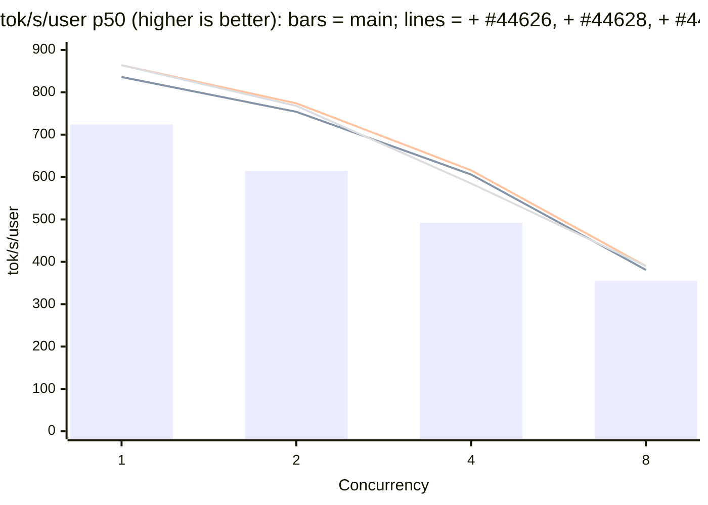
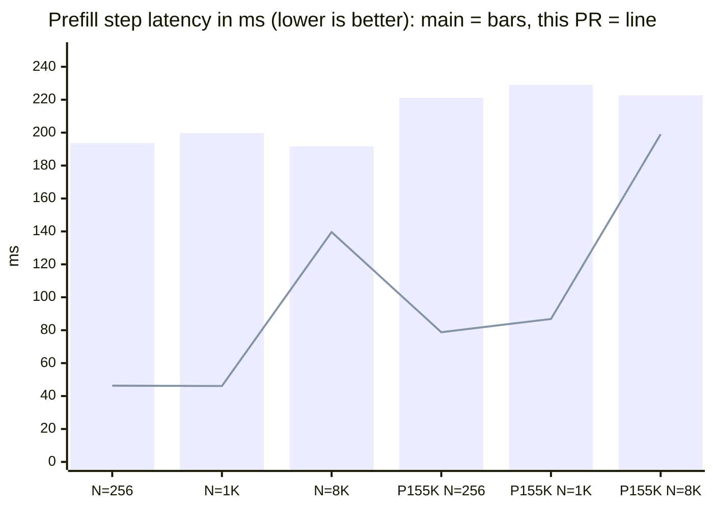

# [Perf] DSv4.1: Make the breakable prefill CUDA graph usable above 16K contexts, and add a serving-shape startup warm-up

[Upstream PR](https://github.com/sgl-project/sglang/pull/44627) · state: open · merged: False

## Original PR description

## Motivation

**Joint result vs `main`, all three PRs on one GB300 node in one job.** Each column adds one PR to the previous one: `main` (`c5a5bf0d0bd`), + #44626, + #44628, + #44627; each uses its own PR's launch command (Speed Tests below). TP4, DSpark with a fixed 3.51 accepted tokens per step, 8K input / 1K output tokens, closed loop at each concurrency; one server per column, two rounds (the second in reverse concurrency order), mean shown; % vs `main`. This PR is the **+ #44627** column.

| Concurrency | Metric | `main` | + #44626 | + #44628 | **+ #44627** |
| ---: | --- | ---: | ---: | ---: | ---: |
| 1 | Decode step p50 (ms) | 4.850 | 4.162 (-14.2%) | 4.062 (-16.2%) | **4.082 (-15.8%)** |
|  | tok/s/user p50 | 724 | 836 (+15.5%) | 864 (+19.3%) | **864 (+19.3%)** |
|  | Output tok/s | 641 | 723 (+12.8%) | 743 (+15.9%) | **765 (+19.3%)** |
|  | TTFT p50 (ms) | 187 | 188 (+0.5%) | 191 (+2.1%) | **145 (-22.5%)** |
| 2 | Decode step p50 (ms) | 5.735 | 4.623 (-19.4%) | 4.533 (-21.0%) | **4.485 (-21.8%)** |
|  | tok/s/user p50 | 614 | 754 (+22.8%) | 774 (+26.1%) | **768 (+25.1%)** |
|  | Output tok/s | 1,001 | 1,169 (+16.8%) | 1,209 (+20.8%) | **1,281 (+28.0%)** |
|  | TTFT p50 (ms) | 363 | 366 (+0.8%) | 365 (+0.6%) | **280 (-22.9%)** |
| 4 | Decode step p50 (ms) | 6.649 | 5.558 (-16.4%) | 5.460 (-17.9%) | **5.514 (-17.1%)** |
|  | tok/s/user p50 | 492 | 606 (+23.2%) | 616 (+25.2%) | **585 (+18.9%)** |
|  | Output tok/s | 1,519 | 1,733 (+14.1%) | 1,757 (+15.7%) | **1,875 (+23.4%)** |
|  | TTFT p50 (ms) | 712 | 715 (+0.4%) | 708 (-0.6%) | **494 (-30.6%)** |
| 8 | Decode step p50 (ms) | 8.473 | 7.755 (-8.5%) | 7.591 (-10.4%) | **7.656 (-9.6%)** |
|  | tok/s/user p50 | 355 | 381 (+7.3%) | 390 (+9.9%) | **390 (+9.9%)** |
|  | Output tok/s | 2,085 | 2,186 (+4.8%) | 2,227 (+6.8%) | **2,444 (+17.2%)** |
|  | TTFT p50 (ms) | 1,069 | 1,082 (+1.2%) | 1,066 (-0.3%) | **769 (-28.1%)** |

#44626 shortens the decode step by 8.5-19.4% against `main`. #44628 takes another 0.09-0.16 ms off (1.8-2.4%). #44627 leaves the decode step unchanged within round noise (-0.05 to +0.07 ms) and cuts TTFT by 23-30% with the prefill CUDA graph, which lifts output throughput at concurrency 8 from 2,227 to 2,444 tok/s. All three together: decode step -9.6% to -21.8%, tok/s/user +9.9% to +25.1%, output tok/s +17.2% to +28.0%.



**Prefill latency, this PR vs `main` defaults** (same node, same tree, cold caches per launch; single request with `max_new_tokens=1`, median of 3; details under Speed Tests):

| | N = 256 | N = 1,024 | N = 8,000 | P = 155,648, N = 256 | P = 155,648, N = 1,024 | P = 155,648, N = 8,000 | First 8K request after ready |
| --- | ---: | ---: | ---: | ---: | ---: | ---: | ---: |
| `main` defaults (ms) | 193.7 | 199.8 | 191.8 | 221.2 | 229.0 | 222.7 | 7,759.8 |
| this PR (ms) | 46.3 | 46.1 | 139.6 | 78.8 | 86.8 | 199.0 | 146.5 |



DeepSeek-V4.1-Flash prefill on GB300 is host-bound. With eager prefill (the DSV4 default on `main`), a single-request prefill step takes about 190-230 ms whether it carries 256 or 8,000 new tokens, because each step launches about 2,300 kernels one by one from Python. The breakable prefill CUDA graph removes most of that launch time. For DSV4.1, however, it is off by default and capped at a 16,384-token context (`deepseek_v4_hook.py`), and raising the cap does not work on `main`:

1. `--cuda-graph-max-seq-len-prefill 262144` fails at capture with `prefill graph indexer width 262144 exceeds the candidate window`. The captured ratio-1/2 indexer takes the full top-k, which equals the candidate top-k only inside the candidate window (2,048 blocks x 8 = 16,384 positions on V4.1-Flash).
2. When those layers stay in their eager break instead, the fused c1/c2 compressor fails at the first prefill (`Tensor match failed ... c1.cuh:285`, `c2.cuh:476`). The break passes the live rows, while the forward metadata is sized for the replayed bucket.
3. Once that works, the sparse-prefill gather in the attention break uploads its per-request lengths with a pageable copy. Under the graph the host runs ahead of the GPU, so that copy waits for every queued graph segment. A torch-profiler trace measured 63 ms of host blocking per 8K-token step.

Separately, graph capture and the server's own warm-up run only short decode-shaped batches. Every other shape compiles its Triton and JIT kernel variants inside serving traffic the first time it appears: long prompts, prefix hits, chunked prompts, multi-request extends, eager decode above the decode graphs, and prompts past the graph's context bucket. On a cold cache, the first 8K-token request on `main` takes 7.8 s instead of 0.19 s. That includes an nvcc build of `mhc_post_combine_norm_prefill`, and about 700 more Triton compile and load events follow during GSM8K traffic.

## Modifications

| change | why | effect (GB300 TP4, same node, same tree) |
|---|---|---|
| Keep ratio-1/2 sources eager when the prefill graph is wider than the candidate window (`_low_ratio_graph_fits_candidates`, last term of `low_ratio_prefill_graph`) | the captured full top-k is exact only inside the window | capture succeeds at any `--cuda-graph-max-seq-len-prefill` (8.40 GB capture pool for 9 buckets up to 8K tokens at a 262,144 context); configurations that captured before are unchanged |
| Fused low-ratio compressor slices `raw_out_loc` / `c1_out_loc` / `c2_out_loc` to the live rows | the eager break passes live rows against bucket-sized metadata, and padding rows sit at the tail | no failure; a no-op for every caller that passes equal lengths (the torch compressor path already slices) |
| `SparsePrefillChunkCache.ensure_compressed` uploads the lengths with `async_h2d` | a pageable copy synchronizes with the stream, so it drains the queued replay | the host no longer blocks in the attention break (63 ms per 8K step in the trace); 8K step 191.8 -> 139.6 ms with all changes |
| With `--enable-decoder-swa-bounded-replay`, the eager ratio-1/2 source break takes the leading rows of the block-sized request indices (`forward_low_ratio_sources`) | inside the late-layer tail the break sees only the tail block's real rows, so the fallback expanded the whole extend's lengths into them | capture no longer fails with `repeat_interleave: the output_size argument (128) must be the same as the sum of the elements in the repeats tensor (8192)`; nothing changes without the flag |
| `--warmups deepseek_v4_serving_shapes` (opt-in; plan in the new module `entrypoints/deepseek_v4_warmup.py`) | serving-time JIT on the first use of each shape class | first 8K request on a cold cache 7,760 -> 147 ms; serving-time compile events after ready 715 + 1 nvcc build -> 8 (one 0.05 s kernel x 4 ranks); +54.7 s startup |

The fixes apply whenever DSV4/4.1 runs the breakable prefill graph (the decoder-replay one only with that flag). They are not behind a new flag. The warm-up is enabled through the existing `--warmups` argument ("custom warmup functions to run before the server starts listening"), so this PR adds no new server argument. Before the server listens, the warm-up sends internal requests through the real serving path:

- extends at each Triton integer class (1, divisible by 16, other), below and above the mHC 4,096-row switch;
- a chunked prompt, and prefix hits with 1-token, short and 4K+ extends;
- concurrent prefills;
- one batched request per batch size 1-16, in both token-count classes (kernels keyed on `next_power_of_2(bs)` also specialize on the total token count);
- mixed batches when `--enable-mixed-chunk` is on;
- with the breakable prefill graph on, one prompt and three extends past the graph's context bucket, where prefill runs eager.

The warm-up alternates greedy and the server's default sampling. It then flushes the cache, and startup fails if the flush fails. Under PD disaggregation it is skipped.

Footprint:

- **Production code:** 214 lines in one new file. Existing files: 51 lines added and 7 removed (`warmup.py` +10, `deepseek_v4_backend.py` +37 / -6, `dsv4/sparse_prefill_utils.py` +4 / -1). No changes to the model file, scheduler, model runner, server args or env vars.
- **Tests:** 171 lines in one new file, plus 119 lines added to three existing test files.

Known limits:

- `get_and_clear_swa_pages_kernel` (0.05 s) still compiles on the first radix SWA eviction. Warming it needs a model-side hook, which this PR leaves out.
- `triton_load_watch` arms before `--warmups` run (documented in its module docstring), so compiles of at least 1 s during the warm-up log as "after serving started" at startup.
- Contexts above the 262,144-token bucket still run eager.

## Accuracy Tests

`sgl-eval run gsm8k --num-examples 200 --num-threads 64 --max-tokens 4096` (sgl-eval 0.1.2, the settings of `test_deepseek_v41_flash_gb300.py`: greedy, no thinking), DSpark with real acceptance. Both arms are from the same tree on the same image:

| arm | GSM8K-200 (sgl-eval) |
|---|---|
| main defaults (eager prefill, no warm-up) | 0.980 |
| this PR, recipe below | 0.980 |

With `--enable-decoder-swa-bounded-replay` added to the recipe below, the head before the decoder-replay commit fails at prefill-graph capture with the `repeat_interleave` assert above. With the commit, on the same node, the server starts, three fresh 8K prompts return normal output, and GSM8K-200 (sgl-eval, same settings) is 0.980.

Second harness, from the A/B run below (200 pre-tokenized prompts through `/generate`, greedy, cold, 64 concurrent requests): 197 / 200 on main defaults and 196 / 200 with this PR.

On an earlier base, I compared graph prefill with eager prefill directly. With the same 8K chunking, the next 4 greedy tokens matched for all six shapes (N = 219 / 1K / 8K at prefixes 0 and 156K). The mean absolute difference of the input logprobs was at most 0.0016 at prefix 0 and 0.004-0.024 at prefix 156K.

## Speed Tests and Profiling

Repro (GB300 x 4, `lmsysorg/sglang:nightly-dev-cu13-20261015-a6a8c560` with this branch's `python/` mounted; cold Triton and JIT caches per launch):

```bash
# both arms
python3 -m sglang.launch_server --model-path deepseek-ai/DeepSeek-V4.1-Flash --trust-remote-code \
  --tp 4 --ep-size 4 --mem-fraction-static 0.8 --cuda-graph-max-bs-decode 8 --max-running-requests 16 \
  --chunked-prefill-size 8192 --speculative-algorithm DSPARK --speculative-dspark-block-size 5 \
  --watchdog-timeout 7200
# this PR adds
  --cuda-graph-backend-prefill breakable \
  --cuda-graph-bs-prefill 128 256 512 1024 2048 3072 4096 6144 8192 \
  --cuda-graph-prefill-max-context 262144 --cuda-graph-max-seq-len-prefill 262144 \
  --warmups deepseek_v4_serving_shapes
```

Each measurement is a single `/generate` request with `max_new_tokens=1` and nothing else running. The table shows wall-clock latency in ms: the median of 3 after 2 warm requests per shape. P is a cached prefix, a radix hit on one 155,648-token prompt. N is the number of new random tokens.

| | P = 0, N = 256 | N = 1,024 | N = 8,000 | P = 155,648, N = 256 | N = 1,024 | N = 8,000 |
|---|---|---|---|---|---|---|
| main defaults | 193.7 | 199.8 | 191.8 | 221.2 | 229.0 | 222.7 |
| this PR | **46.3** | **46.1** | **139.6** | **78.8** | **86.8** | **199.0** |
| change | -76 % | -77 % | -27 % | -64 % | -62 % | -11 % |

| | main defaults | this PR |
|---|---|---|
| first 8K request after ready, cold caches (then 2 more fresh 8K prompts), ms | **7,759.8** (193.1, 185.8) | **146.5** (140.0, 139.9) |
| cold 160K-token prompt, ms | 3,786 | 2,878 |
| GSM8K-200 @ 64 | 197 / 200 | 196 / 200 |
| serving-time Triton compile / load log events after ready (all ranks, through grid + GSM8K) | 715, plus an nvcc build of `mhc_post_combine_norm_prefill` | 8 (`get_and_clear_swa_pages_kernel`, 0.05 s, 4 ranks) |
| startup to ready, s | 695 | 852 (of which warm-up 300 requests 54.7 s, prefill graph capture 24.5 s) |
| `max_total_num_tokens` / free GPU memory at ready | 61,612,288 / 52.5 GB | 61,612,288 / 44.4 GB (capture pool 8.40 GB) |

The 8K step gains less than the short steps because the per-layer attention break and the ratio-1/2 source layers (kept eager above the candidate window) scale with the token count.

Unit tests (run on GB300 in the container):

- `test/registered/unit/entrypoints/test_deepseek_v4_warmup.py`: 7 passed (CPU).
- `test/registered/unit/layers/test_dsv41_candidate_graph_variants.py`: 5 passed (CPU), including the two decoder-replay cases; the tail case fails on the previous head.
- `test/registered/attention/unittests/dsv4/test_dsv41_fused_compress.py`: 2 passed and 3 skipped (HIP-only cases); the new live-rows case covers ratio 1 and 2.
- `test/registered/attention/unittests/dsv4/test_deepseek_v4.py`: 27 passed, including the new pinned-upload case.

The two new GPU regression cases also ran on `main` with only the test files applied. Both fail there as expected:

- live rows: `Tensor match failed ... c1.cuh:285` / `c2.cuh:476`;
- pinned upload: `the gather waited for queued GPU work`.

## Checklist

- [x] Format your code according to the [Format code with pre-commit](https://docs.sglang.io/developer_guide/contribution_guide.html#format-code-with-pre-commit).
- [x] Add unit tests according to the [Run and add unit tests](https://docs.sglang.io/developer_guide/contribution_guide.html#run-and-add-unit-tests).
- [ ] Update documentation according to [Write documentations](https://docs.sglang.io/developer_guide/contribution_guide.html#write-documentations).
- [x] Provide accuracy and speed benchmark results according to [Test the accuracy](https://docs.sglang.io/developer_guide/contribution_guide.html#test-the-accuracy) and [Benchmark the speed](https://docs.sglang.io/developer_guide/contribution_guide.html#benchmark-the-speed).
- [x] Follow the SGLang code style [guidance](https://docs.sglang.io/developer_guide/contribution_guide.html#code-style-guidance).

<!-- pr-states:start -->
---
### CI States

Latest PR Test (Base): <!-- slot:pr-test:start -->:x: **Missing `run-ci` label** -- add it to run CI tests.<!-- slot:pr-test:end -->
Latest PR Test (Extra): <!-- slot:pr-test-extra:start -->:x: **Blocked** -- `run-ci` is required first.<!-- slot:pr-test-extra:end -->
Latest PR Test (AMD ROCm 10): <!-- slot:pr-test-amd:start -->:heavy_minus_sign: **No AMD PR run found for this commit**.<!-- slot:pr-test-amd:end -->
<!-- pr-states:end -->


## Review and discussion

### reviews

### issue_comments

### inline_comments

## Changed files and fixed code

- `python/sglang/srt/entrypoints/deepseek_v4_warmup.py` · added · additions 214 / deletions 0
  - [head](https://github.com/YAMY1234/sglang/blob/c8565b905b42e319584aa13c401559ed0448f606/python/sglang/srt/entrypoints/deepseek_v4_warmup.py)
  - [base](https://github.com/sgl-project/sglang/blob/c15edf314d20073630e672eb477cbcc3c58fac57/python/sglang/srt/entrypoints/deepseek_v4_warmup.py)
- `python/sglang/srt/entrypoints/warmup.py` · modified · additions 10 / deletions 0
  - [head](https://github.com/YAMY1234/sglang/blob/c8565b905b42e319584aa13c401559ed0448f606/python/sglang/srt/entrypoints/warmup.py)
  - [base](https://github.com/sgl-project/sglang/blob/c15edf314d20073630e672eb477cbcc3c58fac57/python/sglang/srt/entrypoints/warmup.py)
- `python/sglang/srt/layers/attention/deepseek_v4_backend.py` · modified · additions 37 / deletions 6
  - [head](https://github.com/YAMY1234/sglang/blob/c8565b905b42e319584aa13c401559ed0448f606/python/sglang/srt/layers/attention/deepseek_v4_backend.py)
  - [base](https://github.com/sgl-project/sglang/blob/c15edf314d20073630e672eb477cbcc3c58fac57/python/sglang/srt/layers/attention/deepseek_v4_backend.py)
- `python/sglang/srt/layers/attention/dsv4/sparse_prefill_utils.py` · modified · additions 4 / deletions 1
  - [head](https://github.com/YAMY1234/sglang/blob/c8565b905b42e319584aa13c401559ed0448f606/python/sglang/srt/layers/attention/dsv4/sparse_prefill_utils.py)
  - [base](https://github.com/sgl-project/sglang/blob/c15edf314d20073630e672eb477cbcc3c58fac57/python/sglang/srt/layers/attention/dsv4/sparse_prefill_utils.py)
- `test/registered/attention/unittests/dsv4/test_deepseek_v4.py` · modified · additions 25 / deletions 0
  - [head](https://github.com/YAMY1234/sglang/blob/c8565b905b42e319584aa13c401559ed0448f606/test/registered/attention/unittests/dsv4/test_deepseek_v4.py)
  - [base](https://github.com/sgl-project/sglang/blob/c15edf314d20073630e672eb477cbcc3c58fac57/test/registered/attention/unittests/dsv4/test_deepseek_v4.py)
- `test/registered/attention/unittests/dsv4/test_dsv41_fused_compress.py` · modified · additions 13 / deletions 0
  - [head](https://github.com/YAMY1234/sglang/blob/c8565b905b42e319584aa13c401559ed0448f606/test/registered/attention/unittests/dsv4/test_dsv41_fused_compress.py)
  - [base](https://github.com/sgl-project/sglang/blob/c15edf314d20073630e672eb477cbcc3c58fac57/test/registered/attention/unittests/dsv4/test_dsv41_fused_compress.py)
- `test/registered/unit/entrypoints/test_deepseek_v4_warmup.py` · added · additions 171 / deletions 0
  - [head](https://github.com/YAMY1234/sglang/blob/c8565b905b42e319584aa13c401559ed0448f606/test/registered/unit/entrypoints/test_deepseek_v4_warmup.py)
  - [base](https://github.com/sgl-project/sglang/blob/c15edf314d20073630e672eb477cbcc3c58fac57/test/registered/unit/entrypoints/test_deepseek_v4_warmup.py)
- `test/registered/unit/layers/test_dsv41_candidate_graph_variants.py` · modified · additions 81 / deletions 0
  - [head](https://github.com/YAMY1234/sglang/blob/c8565b905b42e319584aa13c401559ed0448f606/test/registered/unit/layers/test_dsv41_candidate_graph_variants.py)
  - [base](https://github.com/sgl-project/sglang/blob/c15edf314d20073630e672eb477cbcc3c58fac57/test/registered/unit/layers/test_dsv41_candidate_graph_variants.py)

## Evidence and interpretation boundary

[Original JSON, discussions and patches](../../../../../../evidence/prs/sgl-project--sglang/44627-850d229b3411207b5f140ad37edebab142930f0937fbdda5da7b47f6a1e77cca.json) · SHA-256 `850d229b3411207b5f140ad37edebab142930f0937fbdda5da7b47f6a1e77cca`.

Diff complete: True. Missing/binary/truncated patches require pinned source inspection. This is a source page, not an independently verified optimization case. Open, merged and released are different states; recheck the deployed dependency.
