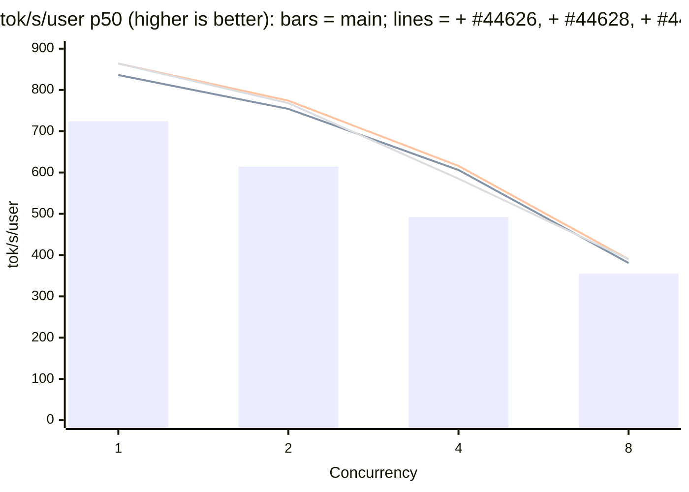

# [Perf] [NVIDIA] DSv4.1: DSpark draft model and sampling on the low-latency decode paths

[Upstream PR](https://github.com/sgl-project/sglang/pull/44628) · state: closed · merged: False

## Original PR description

**Stacked on #44626** (the target-side low-latency decode). Review only the last commit; this PR will be rebased after #44626 merges.

## Motivation

**Joint result vs `main`, all three PRs on one GB300 node in one job.** Each column adds one PR to the previous one: `main` (`c5a5bf0d0bd`), + #44626, + #44628, + #44627; each uses its own PR's launch command (Speed Tests below). TP4, DSpark with a fixed 3.51 accepted tokens per step, 8K input / 1K output tokens, closed loop at each concurrency; one server per column, two rounds (the second in reverse concurrency order), mean shown; % vs `main`. This PR is the **+ #44628** column.

| Concurrency | Metric | `main` | + #44626 | **+ #44628** | + #44627 |
| ---: | --- | ---: | ---: | ---: | ---: |
| 1 | Decode step p50 (ms) | 4.850 | 4.162 (-14.2%) | **4.062 (-16.2%)** | 4.082 (-15.8%) |
|  | tok/s/user p50 | 724 | 836 (+15.5%) | **864 (+19.3%)** | 864 (+19.3%) |
|  | Output tok/s | 641 | 723 (+12.8%) | **743 (+15.9%)** | 765 (+19.3%) |
|  | TTFT p50 (ms) | 187 | 188 (+0.5%) | **191 (+2.1%)** | 145 (-22.5%) |
| 2 | Decode step p50 (ms) | 5.735 | 4.623 (-19.4%) | **4.533 (-21.0%)** | 4.485 (-21.8%) |
|  | tok/s/user p50 | 614 | 754 (+22.8%) | **774 (+26.1%)** | 768 (+25.1%) |
|  | Output tok/s | 1,001 | 1,169 (+16.8%) | **1,209 (+20.8%)** | 1,281 (+28.0%) |
|  | TTFT p50 (ms) | 363 | 366 (+0.8%) | **365 (+0.6%)** | 280 (-22.9%) |
| 4 | Decode step p50 (ms) | 6.649 | 5.558 (-16.4%) | **5.460 (-17.9%)** | 5.514 (-17.1%) |
|  | tok/s/user p50 | 492 | 606 (+23.2%) | **616 (+25.2%)** | 585 (+18.9%) |
|  | Output tok/s | 1,519 | 1,733 (+14.1%) | **1,757 (+15.7%)** | 1,875 (+23.4%) |
|  | TTFT p50 (ms) | 712 | 715 (+0.4%) | **708 (-0.6%)** | 494 (-30.6%) |
| 8 | Decode step p50 (ms) | 8.473 | 7.755 (-8.5%) | **7.591 (-10.4%)** | 7.656 (-9.6%) |
|  | tok/s/user p50 | 355 | 381 (+7.3%) | **390 (+9.9%)** | 390 (+9.9%) |
|  | Output tok/s | 2,085 | 2,186 (+4.8%) | **2,227 (+6.8%)** | 2,444 (+17.2%) |
|  | TTFT p50 (ms) | 1,069 | 1,082 (+1.2%) | **1,066 (-0.3%)** | 769 (-28.1%) |

#44626 shortens the decode step by 8.5-19.4% against `main`. #44628 takes another 0.09-0.16 ms off (1.8-2.4%). #44627 leaves the decode step unchanged within round noise (-0.05 to +0.07 ms) and cuts TTFT by 23-30% with the prefill CUDA graph, which lifts output throughput at concurrency 8 from 2,227 to 2,444 tok/s. All three together: decode step -9.6% to -21.8%, tok/s/user +9.9% to +25.1%, output tok/s +17.2% to +28.0%.

The two-arm run under Speed Tests measured this PR's batch-1 gain at 0.18 ms (-4.3%); across the two launches it is 0.10-0.18 ms.



#44626 adds `--enable-dsv41-low-latency-decode`, which moves DeepSeek-V4.1-Flash's target-model decode on GB300 onto kernels sized for 1 to 48 rows. The DSpark draft and the verify accept still run their stock paths:

- **Draft layers.** The draft MoE runs FlashInfer's routed MoE with its own finalize, and the draft attention projections run the persistent MXFP8 GEMM, both sized for larger batches.
- **Markov head.** The draft proposal runs one Markov step kernel plus a vocabulary gather per draft position.
- **Sampled requests.** The verify accept writes full-vocabulary softmax rows for the target and the draft, runs a single-CTA rejection kernel, and broadcasts its decisions from rank 0. It runs eagerly after the verify graph.

Agentic serving (AgentX) samples at the server's default temperature, so the sampled accept is on every step.

## Modifications

Under the same switch, with no new flag (`python/sglang/srt/models/dsv41_low_latency/dspark/`, README section "DSpark draft and verify").

| Path | Replaces | Applies to |
| --- | --- | --- |
| Draft attention `wq_b`, `wo_b` on the low-latency MXFP8 GEMM (same shapes and pinned tactics as the target) | the persistent CuTe DSL MXFP8 GEMM | 1-8 rows |
| Draft MoE on #44626's routed-expert GEMM pair plus a local finalize (`finalize.cu`, FlashInfer's small-batch finalize arithmetic) | FlashInfer TRT-LLM-gen routed MoE with `do_finalize=True` | 1-48 rows |
| The whole Markov chain in one vocab-sharded cooperative kernel per rank; ranks exchange one key per row and step through symmetric memory | a Markov step kernel + vocab gather per draft position | 1-8 requests |
| Temperature-sampling accept (rejection, bonus, accept-site sync, Engram and KV commits) captured in one CUDA graph per verify batch size and compiled at startup | the eager accept after the replay | all-sampled static verify steps |
| Block-wise rejection sampler: per-vocab-block stats, a one-warp accept, a block-parallel Gumbel-max resample, counter-based draws | target and draft softmax + single-CTA rejection kernel | no top-k / top-p, no block verification |
| Engram history commit recorded in the static verify graph, gated per row; draft context-KV projection on a side stream beside the accept | the eager commit after the replay; the projection after the accept | static verify graphs |

**Rank agreement without the accept broadcast.** The block-wise sampler's draws are functions of (server seed, a device step counter, row, token). Every rank therefore computes the same accept from the same logits, and the accept syncs at the `dspark-accept-greedy` site instead of `dspark-accept-sample`. With `SGLANG_SPEC_TP_SYNC=rng` it broadcasts nothing; with the default `all` it still does, so the variable's meaning is unchanged.

**Fallbacks and lockstep.**

- Mixed greedy / sampled batches, top-k, top-p, grammar and logit-adjusted steps take the eager accept.
- A cross-rank wait in the sharded Markov kernel traps after 20 s instead of hanging.
- Every per-step gate reads batch flags, shapes and which graphs were captured, all shared by the TP ranks.

**Outside the package** (+219 / −53 lines in 7 files):

- `dspark_worker_v2.py`: install, precompile and the graph-accept call.
- `dspark_draft_sampler.py`: the sharded-chain hook with the stock per-step fallback.
- `dspark_verify.py`: the rejection-noise field, the sync-site clause and the static-epilogue override; the package is imported lazily.
- `deepseek_v4_dspark.py`: `project_context_kv` and the install call.
- `engram_hash.py`: optional per-row gating of the history commit.
- `dspark_kv_inject.py`.
- `mxfp4_flashinfer_trtllm_moe.py`: the non-deferred finalize for the draft's pair.

With the switch off, every new field stays `None` and the stock calls run.

## Accuracy Tests

`sgl-eval run gsm8k --num-examples 200 --num-threads 64 --max-tokens 4096` (sgl-eval 0.1.2, the settings of `test_deepseek_v41_flash_gb300.py`: greedy, no thinking), DSpark with real acceptance:

| arm | GSM8K-200 (sgl-eval) |
| --- | --- |
| #44626 only, switch on | 0.980 |
| this PR (#44626 + DSpark paths), switch on | 0.980 |

Error rate 0 and truncation 0 in both. Unit tests cover the block-wise sampler's joint law of accepted length and bonus token against the analytic speculative-sampling law (χ²).

## Speed Tests and Profiling

**Repro.** Same launch as #44626 with the switch on:

```bash
SGLANG_SPEC_TP_SYNC=rng \
SGLANG_SIMULATE_ACC_LEN=3.51 SGLANG_SIMULATE_ACC_METHOD=match-expected SGLANG_SIMULATE_ACC_TOKEN_MODE=real-draft-token \
python3 -m sglang.launch_server --model-path deepseek-ai/DeepSeek-V4.1-Flash --trust-remote-code \
  --tp 4 --ep-size 1 --mem-fraction-static 0.8 --cuda-graph-max-bs-decode 8 --max-running-requests 16 \
  --chunked-prefill-size 8192 --speculative-algorithm DSPARK --speculative-dspark-block-size 5 \
  --enable-dsv41-low-latency-decode
```

The client is the same as in #44626: 8,192 random input tokens, 1,024 output tokens, closed loop at concurrency C, and the step is the median gap between streamed chunks. Rows marked T 1.0 send `temperature=1.0`; every other row is greedy.

**Decode step, same node, one server per launch** (switch on in both arms; #44626 = the target-side paths only). Each launch ran two rounds, the second in reverse concurrency order; the table shows the mean of the two. Rows marked T 1.0 are two more rounds at batch 1 with `temperature=1.0`.

| Batch (rows) | #44626 (ms) | this PR (ms) | Change |
| ---: | ---: | ---: | ---: |
| 1 (6) | 4.136 | 3.960 | −4.3% |
| 2 (12) | 4.609 | 4.538 | −1.5% |
| 4 (24) | 5.586 | 5.496 | −1.6% |
| 8 (48) | 7.734 | 7.633 | −1.3% |
| 1, T 1.0 | 4.784 | 4.204 | −12.1% |

- At temperature 1.0 the gain comes mostly from the in-graph sampling accept and the block-wise sampler; greedy steps never run them.
- A torch-profiler window at batch 1 shows the draft paths running: the draft MoE moves from FlashInfer's routed MoE to the routed-expert pair (+87 route / GEMM launches per 30 steps, FlashInfer `bmm_` 254 → 80), the draft `wq_b` / `wo_b` run the low-latency MXFP8 GEMM, and the per-position Markov kernels are gone (one sharded-chain kernel per step).
- No serving-time compile and no error line in either arm.

Four more host and kernel changes (small-batch mHC coefficient GEMM, host-side Engram table with prefetch, captured attention metadata with leaner input preparation, 8-row compressor tile) are worth about 0.04 ms per step each on the newest `main` and are left out of these MRs.

## Tests

```bash
python3 -m pytest -q test/registered/unit/layers/moe/test_dsv41_draft_routed_expert_gemm.py \
  test/registered/unit/models/test_deepseek_v41_dspark_context_side_stream.py \
  test/registered/unit/models/test_deepseek_v41_dspark_sharded_markov_dispatch.py \
  test/registered/kernels/ops/speculative/test_dspark_sharded_markov.py \
  test/registered/unit/speculative/test_dspark_blockwise_rejection.py \
  test/registered/unit/speculative/test_dspark_engram_commit_in_graph.py \
  test/registered/unit/speculative/test_dspark_sampling_accept_graph.py
```

| Check | What it covers | Result (GB300) |
| --- | --- | --- |
| Draft MoE pair + finalize | vs FlashInfer at 1 / 5 / 8 / 40 rows, eager and graph replay; the draft binding and the finalize decline | Passed |
| Sharded Markov chain | One rank and four ranks (spawned) bit-equal to the per-step loop; dispatch only with the switch on | Passed |
| Block-wise rejection | χ² law at T 1/1, 0.7/1.3 and a one-hot draft; counter determinism; graph and region replay; precompile; the sync site under `rng` and `all` | Passed |
| Sampling-accept graph | Eligibility, warm-up / capture / replay, fallbacks, parity with the eager accept | Passed |
| Engram commit in graph, context side stream | Live-row gating; commit reported only when captured; the store uses the precomputed KV | Passed |
| All #44626 + this PR's test files together | GB300 with GPU cases: 122 passed, 197 subtests, 1 skipped; the four-rank wo_b test 2 passed per rank. CPU on this head: 88 passed, 96 subtests, 0 failed | Passed |
| pre-commit | All hooks on every changed file | Passes |

## Checklist

- [x] Format your code according to the [Format code with pre-commit](https://docs.sglang.io/developer_guide/contribution_guide.html#format-code-with-pre-commit).
- [x] Add unit tests according to the [Run and add unit tests](https://docs.sglang.io/developer_guide/contribution_guide.html#run-and-add-unit-tests).
- [x] Update documentation according to [Write documentations](https://docs.sglang.io/developer_guide/contribution_guide.html#write-documentations).
- [x] Provide accuracy and speed benchmark results according to [Test the accuracy](https://docs.sglang.io/developer_guide/contribution_guide.html#test-the-accuracy) and [Benchmark the speed](https://docs.sglang.io/developer_guide/contribution_guide.html#benchmark-the-speed).
- [x] Follow the SGLang code style [guidance](https://docs.sglang.io/developer_guide/contribution_guide.html#code-style-guidance).

<!-- pr-states:start -->
---
### CI States

Latest PR Test (Base): <!-- slot:pr-test:start -->:x: [Run #38837318580](https://github.com/sgl-project/sglang/actions/runs/38837318580)<!-- slot:pr-test:end -->
Latest PR Test (Extra): <!-- slot:pr-test-extra:start -->:x: [Run #38837318574](https://github.com/sgl-project/sglang/actions/runs/38837318574)<!-- slot:pr-test-extra:end -->
Latest PR Test (AMD ROCm 10): <!-- slot:pr-test-amd:start -->:x: [Run #38837318623](https://github.com/sgl-project/sglang/actions/runs/38837318623)<!-- slot:pr-test-amd:end -->
<!-- pr-states:end -->


## Review and discussion

### reviews

### issue_comments

- YAMY1234 · comment · 2026-10-18T00:09:54Z · [source](https://github.com/sgl-project/sglang/pull/44628#issuecomment-6243564580)

Closing: superseded by the out-of-tree NVIDIA megakernel package (sgl-project/sgl-nvidia-mega#1), which needs no SGLang changes.

### inline_comments

## Changed files and fixed code

- `docs/docs/advanced_features/server_arguments.mdx` · modified · additions 6 / deletions 0
  - [head](https://github.com/YAMY1234/sglang/blob/bb82a27c708e5b75911b80ef31e5b9e869f9210b/docs/docs/advanced_features/server_arguments.mdx)
  - [base](https://github.com/sgl-project/sglang/blob/c15edf314d20073630e672eb477cbcc3c58fac57/docs/docs/advanced_features/server_arguments.mdx)
- `python/sglang/kernels/ops/attention/dsv4/decode_attention_sm100.py` · modified · additions 32 / deletions 4
  - [head](https://github.com/YAMY1234/sglang/blob/bb82a27c708e5b75911b80ef31e5b9e869f9210b/python/sglang/kernels/ops/attention/dsv4/decode_attention_sm100.py)
  - [base](https://github.com/sgl-project/sglang/blob/c15edf314d20073630e672eb477cbcc3c58fac57/python/sglang/kernels/ops/attention/dsv4/decode_attention_sm100.py)
- `python/sglang/kernels/ops/attention/dsv4/decode_attention_sm100_gluon.py` · modified · additions 19 / deletions 0
  - [head](https://github.com/YAMY1234/sglang/blob/bb82a27c708e5b75911b80ef31e5b9e869f9210b/python/sglang/kernels/ops/attention/dsv4/decode_attention_sm100_gluon.py)
  - [base](https://github.com/sgl-project/sglang/blob/c15edf314d20073630e672eb477cbcc3c58fac57/python/sglang/kernels/ops/attention/dsv4/decode_attention_sm100_gluon.py)
- `python/sglang/kernels/ops/embeddings/engram_hash.py` · modified · additions 16 / deletions 1
  - [head](https://github.com/YAMY1234/sglang/blob/bb82a27c708e5b75911b80ef31e5b9e869f9210b/python/sglang/kernels/ops/embeddings/engram_hash.py)
  - [base](https://github.com/sgl-project/sglang/blob/c15edf314d20073630e672eb477cbcc3c58fac57/python/sglang/kernels/ops/embeddings/engram_hash.py)
- `python/sglang/srt/arg_groups/deepseek_v4_hook.py` · modified · additions 4 / deletions 0
  - [head](https://github.com/YAMY1234/sglang/blob/bb82a27c708e5b75911b80ef31e5b9e869f9210b/python/sglang/srt/arg_groups/deepseek_v4_hook.py)
  - [base](https://github.com/sgl-project/sglang/blob/c15edf314d20073630e672eb477cbcc3c58fac57/python/sglang/srt/arg_groups/deepseek_v4_hook.py)
- `python/sglang/srt/arg_groups/fields/exec_.py` · modified · additions 6 / deletions 0
  - [head](https://github.com/YAMY1234/sglang/blob/bb82a27c708e5b75911b80ef31e5b9e869f9210b/python/sglang/srt/arg_groups/fields/exec_.py)
  - [base](https://github.com/sgl-project/sglang/blob/c15edf314d20073630e672eb477cbcc3c58fac57/python/sglang/srt/arg_groups/fields/exec_.py)
- `python/sglang/srt/layers/attention/deepseek_v4_backend.py` · modified · additions 79 / deletions 19
  - [head](https://github.com/YAMY1234/sglang/blob/bb82a27c708e5b75911b80ef31e5b9e869f9210b/python/sglang/srt/layers/attention/deepseek_v4_backend.py)
  - [base](https://github.com/sgl-project/sglang/blob/c15edf314d20073630e672eb477cbcc3c58fac57/python/sglang/srt/layers/attention/deepseek_v4_backend.py)
- `python/sglang/srt/layers/attention/dsv4/dsv41_sparse.py` · modified · additions 27 / deletions 1
  - [head](https://github.com/YAMY1234/sglang/blob/bb82a27c708e5b75911b80ef31e5b9e869f9210b/python/sglang/srt/layers/attention/dsv4/dsv41_sparse.py)
  - [base](https://github.com/sgl-project/sglang/blob/c15edf314d20073630e672eb477cbcc3c58fac57/python/sglang/srt/layers/attention/dsv4/dsv41_sparse.py)
- `python/sglang/srt/layers/attention/dsv4/v41_indexer/scoring.py` · modified · additions 30 / deletions 9
  - [head](https://github.com/YAMY1234/sglang/blob/bb82a27c708e5b75911b80ef31e5b9e869f9210b/python/sglang/srt/layers/attention/dsv4/v41_indexer/scoring.py)
  - [base](https://github.com/sgl-project/sglang/blob/c15edf314d20073630e672eb477cbcc3c58fac57/python/sglang/srt/layers/attention/dsv4/v41_indexer/scoring.py)
- `python/sglang/srt/layers/attention/dsv4/v41_indexer/types.py` · modified · additions 4 / deletions 1
  - [head](https://github.com/YAMY1234/sglang/blob/bb82a27c708e5b75911b80ef31e5b9e869f9210b/python/sglang/srt/layers/attention/dsv4/v41_indexer/types.py)
  - [base](https://github.com/sgl-project/sglang/blob/c15edf314d20073630e672eb477cbcc3c58fac57/python/sglang/srt/layers/attention/dsv4/v41_indexer/types.py)
- `python/sglang/srt/layers/quantization/fp8.py` · modified · additions 10 / deletions 0
  - [head](https://github.com/YAMY1234/sglang/blob/bb82a27c708e5b75911b80ef31e5b9e869f9210b/python/sglang/srt/layers/quantization/fp8.py)
  - [base](https://github.com/sgl-project/sglang/blob/c15edf314d20073630e672eb477cbcc3c58fac57/python/sglang/srt/layers/quantization/fp8.py)
- `python/sglang/srt/layers/quantization/mxfp4_flashinfer_trtllm_moe.py` · modified · additions 16 / deletions 0
  - [head](https://github.com/YAMY1234/sglang/blob/bb82a27c708e5b75911b80ef31e5b9e869f9210b/python/sglang/srt/layers/quantization/mxfp4_flashinfer_trtllm_moe.py)
  - [base](https://github.com/sgl-project/sglang/blob/c15edf314d20073630e672eb477cbcc3c58fac57/python/sglang/srt/layers/quantization/mxfp4_flashinfer_trtllm_moe.py)
- `python/sglang/srt/model_executor/runner/flashinfer_autotune.py` · modified · additions 12 / deletions 0
  - [head](https://github.com/YAMY1234/sglang/blob/bb82a27c708e5b75911b80ef31e5b9e869f9210b/python/sglang/srt/model_executor/runner/flashinfer_autotune.py)
  - [base](https://github.com/sgl-project/sglang/blob/c15edf314d20073630e672eb477cbcc3c58fac57/python/sglang/srt/model_executor/runner/flashinfer_autotune.py)
- `python/sglang/srt/models/deepseek_v4.py` · modified · additions 58 / deletions 6
  - [head](https://github.com/YAMY1234/sglang/blob/bb82a27c708e5b75911b80ef31e5b9e869f9210b/python/sglang/srt/models/deepseek_v4.py)
  - [base](https://github.com/sgl-project/sglang/blob/c15edf314d20073630e672eb477cbcc3c58fac57/python/sglang/srt/models/deepseek_v4.py)
- `python/sglang/srt/models/deepseek_v4_boundary.py` · modified · additions 1 / deletions 6
  - [head](https://github.com/YAMY1234/sglang/blob/bb82a27c708e5b75911b80ef31e5b9e869f9210b/python/sglang/srt/models/deepseek_v4_boundary.py)
  - [base](https://github.com/sgl-project/sglang/blob/c15edf314d20073630e672eb477cbcc3c58fac57/python/sglang/srt/models/deepseek_v4_boundary.py)
- `python/sglang/srt/models/deepseek_v4_dspark.py` · modified · additions 30 / deletions 11
  - [head](https://github.com/YAMY1234/sglang/blob/bb82a27c708e5b75911b80ef31e5b9e869f9210b/python/sglang/srt/models/deepseek_v4_dspark.py)
  - [base](https://github.com/sgl-project/sglang/blob/c15edf314d20073630e672eb477cbcc3c58fac57/python/sglang/srt/models/deepseek_v4_dspark.py)
- `python/sglang/srt/models/deepseek_v4_mhc.py` · modified · additions 13 / deletions 0
  - [head](https://github.com/YAMY1234/sglang/blob/bb82a27c708e5b75911b80ef31e5b9e869f9210b/python/sglang/srt/models/deepseek_v4_mhc.py)
  - [base](https://github.com/sgl-project/sglang/blob/c15edf314d20073630e672eb477cbcc3c58fac57/python/sglang/srt/models/deepseek_v4_mhc.py)
- `python/sglang/srt/models/dsv41_low_latency/README.md` · added · additions 90 / deletions 0
  - [head](https://github.com/YAMY1234/sglang/blob/bb82a27c708e5b75911b80ef31e5b9e869f9210b/python/sglang/srt/models/dsv41_low_latency/README.md)
  - [base](https://github.com/sgl-project/sglang/blob/c15edf314d20073630e672eb477cbcc3c58fac57/python/sglang/srt/models/dsv41_low_latency/README.md)
- `python/sglang/srt/models/dsv41_low_latency/__init__.py` · added · additions 3 / deletions 0
  - [head](https://github.com/YAMY1234/sglang/blob/bb82a27c708e5b75911b80ef31e5b9e869f9210b/python/sglang/srt/models/dsv41_low_latency/__init__.py)
  - [base](https://github.com/sgl-project/sglang/blob/c15edf314d20073630e672eb477cbcc3c58fac57/python/sglang/srt/models/dsv41_low_latency/__init__.py)
- `python/sglang/srt/models/dsv41_low_latency/dspark/__init__.py` · added · additions 4 / deletions 0
  - [head](https://github.com/YAMY1234/sglang/blob/bb82a27c708e5b75911b80ef31e5b9e869f9210b/python/sglang/srt/models/dsv41_low_latency/dspark/__init__.py)
  - [base](https://github.com/sgl-project/sglang/blob/c15edf314d20073630e672eb477cbcc3c58fac57/python/sglang/srt/models/dsv41_low_latency/dspark/__init__.py)
- `python/sglang/srt/models/dsv41_low_latency/dspark/blockwise_rejection.py` · added · additions 617 / deletions 0
  - [head](https://github.com/YAMY1234/sglang/blob/bb82a27c708e5b75911b80ef31e5b9e869f9210b/python/sglang/srt/models/dsv41_low_latency/dspark/blockwise_rejection.py)
  - [base](https://github.com/sgl-project/sglang/blob/c15edf314d20073630e672eb477cbcc3c58fac57/python/sglang/srt/models/dsv41_low_latency/dspark/blockwise_rejection.py)
- `python/sglang/srt/models/dsv41_low_latency/dspark/install.py` · added · additions 33 / deletions 0
  - [head](https://github.com/YAMY1234/sglang/blob/bb82a27c708e5b75911b80ef31e5b9e869f9210b/python/sglang/srt/models/dsv41_low_latency/dspark/install.py)
  - [base](https://github.com/sgl-project/sglang/blob/c15edf314d20073630e672eb477cbcc3c58fac57/python/sglang/srt/models/dsv41_low_latency/dspark/install.py)
- `python/sglang/srt/models/dsv41_low_latency/dspark/sampling_accept_graph.py` · added · additions 326 / deletions 0
  - [head](https://github.com/YAMY1234/sglang/blob/bb82a27c708e5b75911b80ef31e5b9e869f9210b/python/sglang/srt/models/dsv41_low_latency/dspark/sampling_accept_graph.py)
  - [base](https://github.com/sgl-project/sglang/blob/c15edf314d20073630e672eb477cbcc3c58fac57/python/sglang/srt/models/dsv41_low_latency/dspark/sampling_accept_graph.py)
- `python/sglang/srt/models/dsv41_low_latency/dspark/sharded_markov.cu` · added · additions 577 / deletions 0
  - [head](https://github.com/YAMY1234/sglang/blob/bb82a27c708e5b75911b80ef31e5b9e869f9210b/python/sglang/srt/models/dsv41_low_latency/dspark/sharded_markov.cu)
  - [base](https://github.com/sgl-project/sglang/blob/c15edf314d20073630e672eb477cbcc3c58fac57/python/sglang/srt/models/dsv41_low_latency/dspark/sharded_markov.cu)
- `python/sglang/srt/models/dsv41_low_latency/dspark/sharded_markov.py` · added · additions 532 / deletions 0
  - [head](https://github.com/YAMY1234/sglang/blob/bb82a27c708e5b75911b80ef31e5b9e869f9210b/python/sglang/srt/models/dsv41_low_latency/dspark/sharded_markov.py)
  - [base](https://github.com/sgl-project/sglang/blob/c15edf314d20073630e672eb477cbcc3c58fac57/python/sglang/srt/models/dsv41_low_latency/dspark/sharded_markov.py)
- `python/sglang/srt/models/dsv41_low_latency/dspark/static_epilogue.py` · added · additions 174 / deletions 0
  - [head](https://github.com/YAMY1234/sglang/blob/bb82a27c708e5b75911b80ef31e5b9e869f9210b/python/sglang/srt/models/dsv41_low_latency/dspark/static_epilogue.py)
  - [base](https://github.com/sgl-project/sglang/blob/c15edf314d20073630e672eb477cbcc3c58fac57/python/sglang/srt/models/dsv41_low_latency/dspark/static_epilogue.py)
- `python/sglang/srt/models/dsv41_low_latency/dspark/worker.py` · added · additions 202 / deletions 0
  - [head](https://github.com/YAMY1234/sglang/blob/bb82a27c708e5b75911b80ef31e5b9e869f9210b/python/sglang/srt/models/dsv41_low_latency/dspark/worker.py)
  - [base](https://github.com/sgl-project/sglang/blob/c15edf314d20073630e672eb477cbcc3c58fac57/python/sglang/srt/models/dsv41_low_latency/dspark/worker.py)
- `python/sglang/srt/models/dsv41_low_latency/indexer.py` · added · additions 107 / deletions 0
  - [head](https://github.com/YAMY1234/sglang/blob/bb82a27c708e5b75911b80ef31e5b9e869f9210b/python/sglang/srt/models/dsv41_low_latency/indexer.py)
  - [base](https://github.com/sgl-project/sglang/blob/c15edf314d20073630e672eb477cbcc3c58fac57/python/sglang/srt/models/dsv41_low_latency/indexer.py)
- `python/sglang/srt/models/dsv41_low_latency/install.py` · added · additions 57 / deletions 0
  - [head](https://github.com/YAMY1234/sglang/blob/bb82a27c708e5b75911b80ef31e5b9e869f9210b/python/sglang/srt/models/dsv41_low_latency/install.py)
  - [base](https://github.com/sgl-project/sglang/blob/c15edf314d20073630e672eb477cbcc3c58fac57/python/sglang/srt/models/dsv41_low_latency/install.py)
- `python/sglang/srt/models/dsv41_low_latency/lamport/__init__.py` · added · additions 2 / deletions 0
  - [head](https://github.com/YAMY1234/sglang/blob/bb82a27c708e5b75911b80ef31e5b9e869f9210b/python/sglang/srt/models/dsv41_low_latency/lamport/__init__.py)
  - [base](https://github.com/sgl-project/sglang/blob/c15edf314d20073630e672eb477cbcc3c58fac57/python/sglang/srt/models/dsv41_low_latency/lamport/__init__.py)
- `python/sglang/srt/models/dsv41_low_latency/lamport/_glue.py` · added · additions 6 / deletions 0
  - [head](https://github.com/YAMY1234/sglang/blob/bb82a27c708e5b75911b80ef31e5b9e869f9210b/python/sglang/srt/models/dsv41_low_latency/lamport/_glue.py)
  - [base](https://github.com/sgl-project/sglang/blob/c15edf314d20073630e672eb477cbcc3c58fac57/python/sglang/srt/models/dsv41_low_latency/lamport/_glue.py)
- `python/sglang/srt/models/dsv41_low_latency/lamport/all_reduce_mhc.py` · added · additions 1364 / deletions 0
  - [head](https://github.com/YAMY1234/sglang/blob/bb82a27c708e5b75911b80ef31e5b9e869f9210b/python/sglang/srt/models/dsv41_low_latency/lamport/all_reduce_mhc.py)
  - [base](https://github.com/sgl-project/sglang/blob/c15edf314d20073630e672eb477cbcc3c58fac57/python/sglang/srt/models/dsv41_low_latency/lamport/all_reduce_mhc.py)
- `python/sglang/srt/models/dsv41_low_latency/lamport/primitives.py` · added · additions 398 / deletions 0
  - [head](https://github.com/YAMY1234/sglang/blob/bb82a27c708e5b75911b80ef31e5b9e869f9210b/python/sglang/srt/models/dsv41_low_latency/lamport/primitives.py)
  - [base](https://github.com/sgl-project/sglang/blob/c15edf314d20073630e672eb477cbcc3c58fac57/python/sglang/srt/models/dsv41_low_latency/lamport/primitives.py)
- `python/sglang/srt/models/dsv41_low_latency/lamport/publishing_gemm.py` · added · additions 655 / deletions 0
  - [head](https://github.com/YAMY1234/sglang/blob/bb82a27c708e5b75911b80ef31e5b9e869f9210b/python/sglang/srt/models/dsv41_low_latency/lamport/publishing_gemm.py)
  - [base](https://github.com/sgl-project/sglang/blob/c15edf314d20073630e672eb477cbcc3c58fac57/python/sglang/srt/models/dsv41_low_latency/lamport/publishing_gemm.py)
- `python/sglang/srt/models/dsv41_low_latency/ll_bf16/__init__.py` · added · additions 160 / deletions 0
  - [head](https://github.com/YAMY1234/sglang/blob/bb82a27c708e5b75911b80ef31e5b9e869f9210b/python/sglang/srt/models/dsv41_low_latency/ll_bf16/__init__.py)
  - [base](https://github.com/sgl-project/sglang/blob/c15edf314d20073630e672eb477cbcc3c58fac57/python/sglang/srt/models/dsv41_low_latency/ll_bf16/__init__.py)
- `python/sglang/srt/models/dsv41_low_latency/ll_bf16/_dotprod.py` · added · additions 365 / deletions 0
  - [head](https://github.com/YAMY1234/sglang/blob/bb82a27c708e5b75911b80ef31e5b9e869f9210b/python/sglang/srt/models/dsv41_low_latency/ll_bf16/_dotprod.py)
  - [base](https://github.com/sgl-project/sglang/blob/c15edf314d20073630e672eb477cbcc3c58fac57/python/sglang/srt/models/dsv41_low_latency/ll_bf16/_dotprod.py)
- `python/sglang/srt/models/dsv41_low_latency/ll_bf16/_splitk.py` · added · additions 585 / deletions 0
  - [head](https://github.com/YAMY1234/sglang/blob/bb82a27c708e5b75911b80ef31e5b9e869f9210b/python/sglang/srt/models/dsv41_low_latency/ll_bf16/_splitk.py)
  - [base](https://github.com/sgl-project/sglang/blob/c15edf314d20073630e672eb477cbcc3c58fac57/python/sglang/srt/models/dsv41_low_latency/ll_bf16/_splitk.py)
- `python/sglang/srt/models/dsv41_low_latency/lm_head.py` · added · additions 62 / deletions 0
  - [head](https://github.com/YAMY1234/sglang/blob/bb82a27c708e5b75911b80ef31e5b9e869f9210b/python/sglang/srt/models/dsv41_low_latency/lm_head.py)
  - [base](https://github.com/sgl-project/sglang/blob/c15edf314d20073630e672eb477cbcc3c58fac57/python/sglang/srt/models/dsv41_low_latency/lm_head.py)
- `python/sglang/srt/models/dsv41_low_latency/low_m_gemm.py` · added · additions 60 / deletions 0
  - [head](https://github.com/YAMY1234/sglang/blob/bb82a27c708e5b75911b80ef31e5b9e869f9210b/python/sglang/srt/models/dsv41_low_latency/low_m_gemm.py)
  - [base](https://github.com/sgl-project/sglang/blob/c15edf314d20073630e672eb477cbcc3c58fac57/python/sglang/srt/models/dsv41_low_latency/low_m_gemm.py)
- `python/sglang/srt/models/dsv41_low_latency/mxfp8_linear.py` · added · additions 137 / deletions 0
  - [head](https://github.com/YAMY1234/sglang/blob/bb82a27c708e5b75911b80ef31e5b9e869f9210b/python/sglang/srt/models/dsv41_low_latency/mxfp8_linear.py)
  - [base](https://github.com/sgl-project/sglang/blob/c15edf314d20073630e672eb477cbcc3c58fac57/python/sglang/srt/models/dsv41_low_latency/mxfp8_linear.py)
- `python/sglang/srt/models/dsv41_low_latency/routed_expert_gemm.py` · added · additions 604 / deletions 0
  - [head](https://github.com/YAMY1234/sglang/blob/bb82a27c708e5b75911b80ef31e5b9e869f9210b/python/sglang/srt/models/dsv41_low_latency/routed_expert_gemm.py)
  - [base](https://github.com/sgl-project/sglang/blob/c15edf314d20073630e672eb477cbcc3c58fac57/python/sglang/srt/models/dsv41_low_latency/routed_expert_gemm.py)
- `python/sglang/srt/models/dsv41_low_latency/routed_expert_gemm_src/finalize.cu` · added · additions 49 / deletions 0
  - [head](https://github.com/YAMY1234/sglang/blob/bb82a27c708e5b75911b80ef31e5b9e869f9210b/python/sglang/srt/models/dsv41_low_latency/routed_expert_gemm_src/finalize.cu)
  - [base](https://github.com/sgl-project/sglang/blob/c15edf314d20073630e672eb477cbcc3c58fac57/python/sglang/srt/models/dsv41_low_latency/routed_expert_gemm_src/finalize.cu)
- `python/sglang/srt/models/dsv41_low_latency/routed_expert_gemm_src/gemm1.cu` · added · additions 2217 / deletions 0
  - [head](https://github.com/YAMY1234/sglang/blob/bb82a27c708e5b75911b80ef31e5b9e869f9210b/python/sglang/srt/models/dsv41_low_latency/routed_expert_gemm_src/gemm1.cu)
  - [base](https://github.com/sgl-project/sglang/blob/c15edf314d20073630e672eb477cbcc3c58fac57/python/sglang/srt/models/dsv41_low_latency/routed_expert_gemm_src/gemm1.cu)
- `python/sglang/srt/models/dsv41_low_latency/routed_expert_gemm_src/gemm2.cu` · added · additions 2221 / deletions 0
  - [head](https://github.com/YAMY1234/sglang/blob/bb82a27c708e5b75911b80ef31e5b9e869f9210b/python/sglang/srt/models/dsv41_low_latency/routed_expert_gemm_src/gemm2.cu)
  - [base](https://github.com/sgl-project/sglang/blob/c15edf314d20073630e672eb477cbcc3c58fac57/python/sglang/srt/models/dsv41_low_latency/routed_expert_gemm_src/gemm2.cu)
- `python/sglang/srt/models/dsv41_low_latency/routed_expert_gemm_src/launch.json` · added · additions 46 / deletions 0
  - [head](https://github.com/YAMY1234/sglang/blob/bb82a27c708e5b75911b80ef31e5b9e869f9210b/python/sglang/srt/models/dsv41_low_latency/routed_expert_gemm_src/launch.json)
  - [base](https://github.com/sgl-project/sglang/blob/c15edf314d20073630e672eb477cbcc3c58fac57/python/sglang/srt/models/dsv41_low_latency/routed_expert_gemm_src/launch.json)
- `python/sglang/srt/models/dsv41_low_latency/routed_expert_gemm_src/route.cu` · added · additions 35 / deletions 0
  - [head](https://github.com/YAMY1234/sglang/blob/bb82a27c708e5b75911b80ef31e5b9e869f9210b/python/sglang/srt/models/dsv41_low_latency/routed_expert_gemm_src/route.cu)
  - [base](https://github.com/sgl-project/sglang/blob/c15edf314d20073630e672eb477cbcc3c58fac57/python/sglang/srt/models/dsv41_low_latency/routed_expert_gemm_src/route.cu)
- `python/sglang/srt/models/dsv41_low_latency/routed_expert_gemm_src/route.cuh` · added · additions 144 / deletions 0
  - [head](https://github.com/YAMY1234/sglang/blob/bb82a27c708e5b75911b80ef31e5b9e869f9210b/python/sglang/srt/models/dsv41_low_latency/routed_expert_gemm_src/route.cuh)
  - [base](https://github.com/sgl-project/sglang/blob/c15edf314d20073630e672eb477cbcc3c58fac57/python/sglang/srt/models/dsv41_low_latency/routed_expert_gemm_src/route.cuh)
- `python/sglang/srt/models/dsv41_low_latency/routed_expert_gemm_src/route_wide.cu` · added · additions 117 / deletions 0
  - [head](https://github.com/YAMY1234/sglang/blob/bb82a27c708e5b75911b80ef31e5b9e869f9210b/python/sglang/srt/models/dsv41_low_latency/routed_expert_gemm_src/route_wide.cu)
  - [base](https://github.com/sgl-project/sglang/blob/c15edf314d20073630e672eb477cbcc3c58fac57/python/sglang/srt/models/dsv41_low_latency/routed_expert_gemm_src/route_wide.cu)
- `python/sglang/srt/models/dsv41_low_latency/switch.py` · added · additions 92 / deletions 0
  - [head](https://github.com/YAMY1234/sglang/blob/bb82a27c708e5b75911b80ef31e5b9e869f9210b/python/sglang/srt/models/dsv41_low_latency/switch.py)
  - [base](https://github.com/sgl-project/sglang/blob/c15edf314d20073630e672eb477cbcc3c58fac57/python/sglang/srt/models/dsv41_low_latency/switch.py)
- `python/sglang/srt/models/dsv41_low_latency/wo_b_publish.py` · added · additions 125 / deletions 0
  - [head](https://github.com/YAMY1234/sglang/blob/bb82a27c708e5b75911b80ef31e5b9e869f9210b/python/sglang/srt/models/dsv41_low_latency/wo_b_publish.py)
  - [base](https://github.com/sgl-project/sglang/blob/c15edf314d20073630e672eb477cbcc3c58fac57/python/sglang/srt/models/dsv41_low_latency/wo_b_publish.py)
- `python/sglang/srt/speculative/dspark_components/dspark_draft_sampler.py` · modified · additions 44 / deletions 15
  - [head](https://github.com/YAMY1234/sglang/blob/bb82a27c708e5b75911b80ef31e5b9e869f9210b/python/sglang/srt/speculative/dspark_components/dspark_draft_sampler.py)
  - [base](https://github.com/sgl-project/sglang/blob/c15edf314d20073630e672eb477cbcc3c58fac57/python/sglang/srt/speculative/dspark_components/dspark_draft_sampler.py)
- `python/sglang/srt/speculative/dspark_components/dspark_kv_inject.py` · modified · additions 7 / deletions 0
  - [head](https://github.com/YAMY1234/sglang/blob/bb82a27c708e5b75911b80ef31e5b9e869f9210b/python/sglang/srt/speculative/dspark_components/dspark_kv_inject.py)
  - [base](https://github.com/sgl-project/sglang/blob/c15edf314d20073630e672eb477cbcc3c58fac57/python/sglang/srt/speculative/dspark_components/dspark_kv_inject.py)
- `python/sglang/srt/speculative/dspark_components/dspark_verify.py` · modified · additions 46 / deletions 2
  - [head](https://github.com/YAMY1234/sglang/blob/bb82a27c708e5b75911b80ef31e5b9e869f9210b/python/sglang/srt/speculative/dspark_components/dspark_verify.py)
  - [base](https://github.com/sgl-project/sglang/blob/c15edf314d20073630e672eb477cbcc3c58fac57/python/sglang/srt/speculative/dspark_components/dspark_verify.py)
- `python/sglang/srt/speculative/dspark_components/dspark_worker_v2.py` · modified · additions 69 / deletions 18
  - [head](https://github.com/YAMY1234/sglang/blob/bb82a27c708e5b75911b80ef31e5b9e869f9210b/python/sglang/srt/speculative/dspark_components/dspark_worker_v2.py)
  - [base](https://github.com/sgl-project/sglang/blob/c15edf314d20073630e672eb477cbcc3c58fac57/python/sglang/srt/speculative/dspark_components/dspark_worker_v2.py)
- `test/registered/attention/unittests/dsv4/test_dsv41_fused_compress.py` · modified · additions 2 / deletions 1
  - [head](https://github.com/YAMY1234/sglang/blob/bb82a27c708e5b75911b80ef31e5b9e869f9210b/test/registered/attention/unittests/dsv4/test_dsv41_fused_compress.py)
  - [base](https://github.com/sgl-project/sglang/blob/c15edf314d20073630e672eb477cbcc3c58fac57/test/registered/attention/unittests/dsv4/test_dsv41_fused_compress.py)
- `test/registered/kernels/ops/attention/dsv4/test_swapab_attention.py` · modified · additions 40 / deletions 3
  - [head](https://github.com/YAMY1234/sglang/blob/bb82a27c708e5b75911b80ef31e5b9e869f9210b/test/registered/kernels/ops/attention/dsv4/test_swapab_attention.py)
  - [base](https://github.com/sgl-project/sglang/blob/c15edf314d20073630e672eb477cbcc3c58fac57/test/registered/kernels/ops/attention/dsv4/test_swapab_attention.py)
- `test/registered/kernels/ops/communication/test_dsv41_wo_b_publish.py` · added · additions 307 / deletions 0
  - [head](https://github.com/YAMY1234/sglang/blob/bb82a27c708e5b75911b80ef31e5b9e869f9210b/test/registered/kernels/ops/communication/test_dsv41_wo_b_publish.py)
  - [base](https://github.com/sgl-project/sglang/blob/c15edf314d20073630e672eb477cbcc3c58fac57/test/registered/kernels/ops/communication/test_dsv41_wo_b_publish.py)
- `test/registered/kernels/ops/speculative/test_dspark_sharded_markov.py` · added · additions 203 / deletions 0
  - [head](https://github.com/YAMY1234/sglang/blob/bb82a27c708e5b75911b80ef31e5b9e869f9210b/test/registered/kernels/ops/speculative/test_dspark_sharded_markov.py)
  - [base](https://github.com/sgl-project/sglang/blob/c15edf314d20073630e672eb477cbcc3c58fac57/test/registered/kernels/ops/speculative/test_dspark_sharded_markov.py)
- `test/registered/unit/layers/attention/test_dsv41_low_latency_compressor.py` · added · additions 226 / deletions 0
  - [head](https://github.com/YAMY1234/sglang/blob/bb82a27c708e5b75911b80ef31e5b9e869f9210b/test/registered/unit/layers/attention/test_dsv41_low_latency_compressor.py)
  - [base](https://github.com/sgl-project/sglang/blob/c15edf314d20073630e672eb477cbcc3c58fac57/test/registered/unit/layers/attention/test_dsv41_low_latency_compressor.py)
- `test/registered/unit/layers/attention/test_dsv41_low_latency_indexer.py` · added · additions 448 / deletions 0
  - [head](https://github.com/YAMY1234/sglang/blob/bb82a27c708e5b75911b80ef31e5b9e869f9210b/test/registered/unit/layers/attention/test_dsv41_low_latency_indexer.py)
  - [base](https://github.com/sgl-project/sglang/blob/c15edf314d20073630e672eb477cbcc3c58fac57/test/registered/unit/layers/attention/test_dsv41_low_latency_indexer.py)
- `test/registered/unit/layers/moe/test_dsv41_draft_routed_expert_gemm.py` · added · additions 306 / deletions 0
  - [head](https://github.com/YAMY1234/sglang/blob/bb82a27c708e5b75911b80ef31e5b9e869f9210b/test/registered/unit/layers/moe/test_dsv41_draft_routed_expert_gemm.py)
  - [base](https://github.com/sgl-project/sglang/blob/c15edf314d20073630e672eb477cbcc3c58fac57/test/registered/unit/layers/moe/test_dsv41_draft_routed_expert_gemm.py)
- `test/registered/unit/layers/moe/test_dsv41_routed_expert_gemm_wide.py` · added · additions 357 / deletions 0
  - [head](https://github.com/YAMY1234/sglang/blob/bb82a27c708e5b75911b80ef31e5b9e869f9210b/test/registered/unit/layers/moe/test_dsv41_routed_expert_gemm_wide.py)
  - [base](https://github.com/sgl-project/sglang/blob/c15edf314d20073630e672eb477cbcc3c58fac57/test/registered/unit/layers/moe/test_dsv41_routed_expert_gemm_wide.py)
- `test/registered/unit/layers/quantization/test_mxfp4_trtllm_padding.py` · modified · additions 2 / deletions 0
  - [head](https://github.com/YAMY1234/sglang/blob/bb82a27c708e5b75911b80ef31e5b9e869f9210b/test/registered/unit/layers/quantization/test_mxfp4_trtllm_padding.py)
  - [base](https://github.com/sgl-project/sglang/blob/c15edf314d20073630e672eb477cbcc3c58fac57/test/registered/unit/layers/quantization/test_mxfp4_trtllm_padding.py)
- `test/registered/unit/layers/quantization/test_mxfp8_low_latency_pinned_tactics.py` · added · additions 223 / deletions 0
  - [head](https://github.com/YAMY1234/sglang/blob/bb82a27c708e5b75911b80ef31e5b9e869f9210b/test/registered/unit/layers/quantization/test_mxfp8_low_latency_pinned_tactics.py)
  - [base](https://github.com/sgl-project/sglang/blob/c15edf314d20073630e672eb477cbcc3c58fac57/test/registered/unit/layers/quantization/test_mxfp8_low_latency_pinned_tactics.py)
- `test/registered/unit/layers/test_low_latency_lm_head.py` · added · additions 117 / deletions 0
  - [head](https://github.com/YAMY1234/sglang/blob/bb82a27c708e5b75911b80ef31e5b9e869f9210b/test/registered/unit/layers/test_low_latency_lm_head.py)
  - [base](https://github.com/sgl-project/sglang/blob/c15edf314d20073630e672eb477cbcc3c58fac57/test/registered/unit/layers/test_low_latency_lm_head.py)
- `test/registered/unit/models/test_deepseek_v41_dspark_context_side_stream.py` · added · additions 108 / deletions 0
  - [head](https://github.com/YAMY1234/sglang/blob/bb82a27c708e5b75911b80ef31e5b9e869f9210b/test/registered/unit/models/test_deepseek_v41_dspark_context_side_stream.py)
  - [base](https://github.com/sgl-project/sglang/blob/c15edf314d20073630e672eb477cbcc3c58fac57/test/registered/unit/models/test_deepseek_v41_dspark_context_side_stream.py)
- `test/registered/unit/models/test_deepseek_v41_dspark_sharded_markov_dispatch.py` · added · additions 148 / deletions 0
  - [head](https://github.com/YAMY1234/sglang/blob/bb82a27c708e5b75911b80ef31e5b9e869f9210b/test/registered/unit/models/test_deepseek_v41_dspark_sharded_markov_dispatch.py)
  - [base](https://github.com/sgl-project/sglang/blob/c15edf314d20073630e672eb477cbcc3c58fac57/test/registered/unit/models/test_deepseek_v41_dspark_sharded_markov_dispatch.py)
- `test/registered/unit/models/test_deepseek_v41_wo_b_publish.py` · added · additions 307 / deletions 0
  - [head](https://github.com/YAMY1234/sglang/blob/bb82a27c708e5b75911b80ef31e5b9e869f9210b/test/registered/unit/models/test_deepseek_v41_wo_b_publish.py)
  - [base](https://github.com/sgl-project/sglang/blob/c15edf314d20073630e672eb477cbcc3c58fac57/test/registered/unit/models/test_deepseek_v41_wo_b_publish.py)
- `test/registered/unit/models/test_deepseek_v4_amd_tp4.py` · modified · additions 1 / deletions 0
  - [head](https://github.com/YAMY1234/sglang/blob/bb82a27c708e5b75911b80ef31e5b9e869f9210b/test/registered/unit/models/test_deepseek_v4_amd_tp4.py)
  - [base](https://github.com/sgl-project/sglang/blob/c15edf314d20073630e672eb477cbcc3c58fac57/test/registered/unit/models/test_deepseek_v4_amd_tp4.py)
- `test/registered/unit/models/test_deepseek_v4_boundary.py` · modified · additions 4 / deletions 1
  - [head](https://github.com/YAMY1234/sglang/blob/bb82a27c708e5b75911b80ef31e5b9e869f9210b/test/registered/unit/models/test_deepseek_v4_boundary.py)
  - [base](https://github.com/sgl-project/sglang/blob/c15edf314d20073630e672eb477cbcc3c58fac57/test/registered/unit/models/test_deepseek_v4_boundary.py)
- `test/registered/unit/models/test_deepseek_v4_pipeline.py` · modified · additions 5 / deletions 0
  - [head](https://github.com/YAMY1234/sglang/blob/bb82a27c708e5b75911b80ef31e5b9e869f9210b/test/registered/unit/models/test_deepseek_v4_pipeline.py)
  - [base](https://github.com/sgl-project/sglang/blob/c15edf314d20073630e672eb477cbcc3c58fac57/test/registered/unit/models/test_deepseek_v4_pipeline.py)
- `test/registered/unit/models/test_dsv41_low_latency_switch.py` · added · additions 151 / deletions 0
  - [head](https://github.com/YAMY1234/sglang/blob/bb82a27c708e5b75911b80ef31e5b9e869f9210b/test/registered/unit/models/test_dsv41_low_latency_switch.py)
  - [base](https://github.com/sgl-project/sglang/blob/c15edf314d20073630e672eb477cbcc3c58fac57/test/registered/unit/models/test_dsv41_low_latency_switch.py)
- `test/registered/unit/speculative/test_dspark_blockwise_rejection.py` · added · additions 588 / deletions 0
  - [head](https://github.com/YAMY1234/sglang/blob/bb82a27c708e5b75911b80ef31e5b9e869f9210b/test/registered/unit/speculative/test_dspark_blockwise_rejection.py)
  - [base](https://github.com/sgl-project/sglang/blob/c15edf314d20073630e672eb477cbcc3c58fac57/test/registered/unit/speculative/test_dspark_blockwise_rejection.py)
- `test/registered/unit/speculative/test_dspark_engram_commit_in_graph.py` · added · additions 133 / deletions 0
  - [head](https://github.com/YAMY1234/sglang/blob/bb82a27c708e5b75911b80ef31e5b9e869f9210b/test/registered/unit/speculative/test_dspark_engram_commit_in_graph.py)
  - [base](https://github.com/sgl-project/sglang/blob/c15edf314d20073630e672eb477cbcc3c58fac57/test/registered/unit/speculative/test_dspark_engram_commit_in_graph.py)
- `test/registered/unit/speculative/test_dspark_sampling_accept_graph.py` · added · additions 376 / deletions 0
  - [head](https://github.com/YAMY1234/sglang/blob/bb82a27c708e5b75911b80ef31e5b9e869f9210b/test/registered/unit/speculative/test_dspark_sampling_accept_graph.py)
  - [base](https://github.com/sgl-project/sglang/blob/c15edf314d20073630e672eb477cbcc3c58fac57/test/registered/unit/speculative/test_dspark_sampling_accept_graph.py)

## Evidence and interpretation boundary

[Original JSON, discussions and patches](../../../../../../evidence/prs/sgl-project--sglang/44628-704d6a99bb15006a8bcaa35f31fa29a1160ebe2f7f45f733b3d70e91692cf89b.json) · SHA-256 `704d6a99bb15006a8bcaa35f31fa29a1160ebe2f7f45f733b3d70e91692cf89b`.

Diff complete: True. Missing/binary/truncated patches require pinned source inspection. This is a source page, not an independently verified optimization case. Open, merged and released are different states; recheck the deployed dependency.
