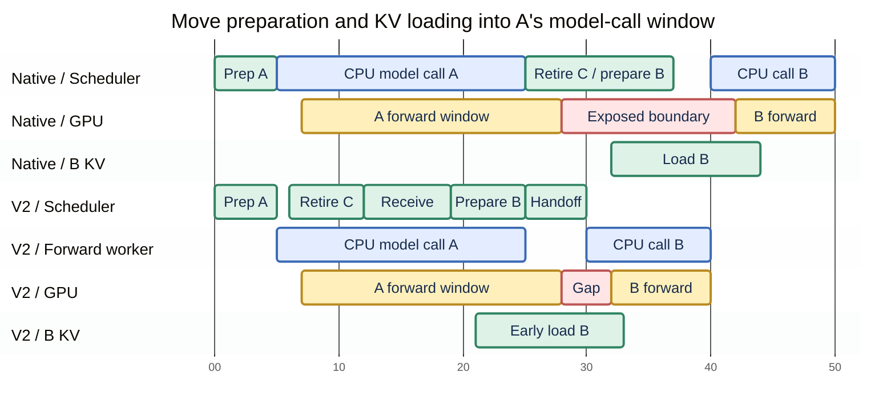
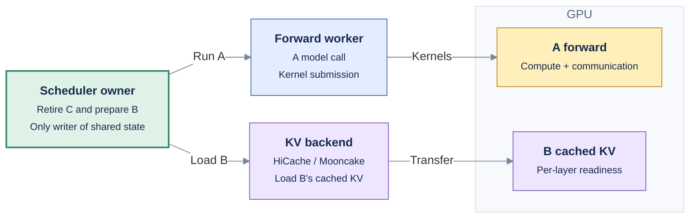

# [Feat] scheduler: Overlap prefill scheduling and KV loading with model execution

[Upstream PR](https://github.com/sgl-project/sglang/pull/44723) · state: open · merged: False

## Original PR description

**Implementation status:** runtime integration, CPU regression checks, and initial PD experiments have been performed locally against main base `92580581da`. The implementation has not been pushed: this Draft PR still has an intentionally empty diff. Supporting authoring files remain local. Further validation and performance investigation are in progress; this is not ready for merge.

**Design RFC:** https://github.com/sgl-project/sglang/issues/44721

## Motivation

**Native overlap can leave only A's GPU tail to hide the next batch's preparation.** The scheduler regains control after the synchronous CPU model call returns. During prefill, layer traversal, input preparation, kernel launches, and communication submission can occupy much of that call. Retiring C, preparing B, and discovering B's cached-KV load can therefore happen late.

**V2 moves that preparation into A's CPU model-call window.** One persistent forward worker runs A's model call while the scheduler retires independent C results, receives ready requests, prepares B, and starts its KV loading earlier.

A = current batch, B = next batch, C = an earlier batch.



*Horizontal positions are schematic, in arbitrary units. Blue = CPU model call, green = scheduler work / KV loading, yellow = GPU forward window, red = exposed batch boundary. The bars do not represent measured durations or continuous GPU activity. B consumes KV as its required layers become ready, so its forward can overlap the loading tail.*

Agent requests can also arrive while A's model call is running. V2 advances bounded, rank-consistent receive and preparation work during that window. A future turn that still depends on Decode completion must wait for that dependency.

## Modifications

### 1. Keep one scheduler-state owner

The scheduler remains the only writer of requests, radix state, allocation, admission, and retirement. The forward worker executes the current model call and submits GPU work; existing backend paths perform KV loading.

- **A:** the current prefill batch.
- **B:** the next batch, prepared early when independent of A.
- **C:** a previous batch whose independent result handling and PD completion can advance during A.

**One state owner, separate execution and loading paths**



### 2. Advance independent work while A is being submitted

At bounded, rank-consistent checkpoints, the scheduler can retire C, receive fresh independent requests, advance bootstrap, and prepare B. Target submission completion ends this preparation window; EAGLE Draft waits for preparation to finish before using shared TP/MoE state.

These checkpoints bound eligibility and repeated progress, not the duration of each Python operation. Current V2 advances work during A's CPU model call; it does not restrict that work to explicit GPU-feedback waits. Evaluation therefore includes any extra A submission time rather than treating early work as free overlap.

Each batch retains its own loading dependency snapshot. Preparing or loading B does not replace A's active dependencies. CUDA device/stream and relevant execution contexts are explicitly established in the forward worker.

### 3. Prepare a full B when safe; otherwise warm eligible KV

| Situation | Early work |
| --- | --- |
| B is independent of A | Match prefixes, allocate, form B, and start its cached-KV load. |
| B advances A's active chunk request | Warm eligible waiting requests' KV; retain shared-request advancement and final grouping at the normal boundary. |
| A future agent turn has not been produced | Preserve the session dependency; it cannot be scheduled before it exists. |

Speculative KV warming uses a shared page-aligned budget across candidates and outstanding transfers, while reserving compute headroom. The prototype scans up to eight candidates and uses an experimental 2M-token envelope for a 16K compute chunk. This is a tuning choice to validate, not an upstream default commitment. Normal admitted demand loads remain complete.

### 4. Use each backend's loading and lifetime rules

| Backend | Loading path and ownership |
| --- | --- |
| HiCache | Background direct DMA; supported demand tails can use a bounded 16-CTA kernel, with direct fallback. Preserve current layout leases, address translation, allocator move protection, and completion events. |
| Mooncake direct linker | Fully prepare an independent B using request-private load slots and a frozen per-batch dependency. Retain slots through its forward and publish through normal successful result handling. Preserve load failures and MLA dedup broadcasts. Chunk-follower KV-only warming is not enabled for this backend. |

Cancelled or stale reservations retain transfer ownership until the associated writes have stopped. Request cancellation does not permit early page reuse.

### 5. Provide one opt-in switch

Proposed switch: `--enable-overlap-schedule-v2`, default off. Existing settings select HiCache or the external linker backend. The switch is not implemented in upstream main yet.

Initial compatibility targets are text-only CUDA PD prefill, PP1/DCP1, no independent DP request replicas, disabled CUDA graphs, and the CP8 DSA layer-split/EAGLE reference deployment. HiCache support here is host-L2 cache mode without a storage tier or buffer pipeline; HiCache L2 plus Mooncake L3 is not enabled. The direct linker bypasses the local host tier. Other combinations require explicit follow-up validation. The disabled path must preserve native scheduling, pause, shutdown, and chunk behavior.

## Accuracy Tests

Local CPU protocol/profiler regressions and targeted real-PD cold/restored/mixed nonce checks have passed. These are not a comprehensive model-accuracy evaluation. Merge validation must retain and extend coverage of:

- Registered owner/worker and cache-lifetime regression tests, including cancellation, delayed loads, failures, shared readers, reset, and shutdown.
- GPU copy checks for nonidentity pages, untouched guards, and target/indexer/packed MTP layer mapping.
- Model-output/logprob and task-appropriate accuracy checks against matched flag-off controls.
- Consistent rank decisions and target/Draft handoff in the supported configurations.

HTTP success, fixed output length, and byte-copy checks alone do not establish model accuracy.

## Speed Tests and Profiling

These are **local main-port results against base 92580581da**, not results from the published empty diff. Each run uses GLM-5.3 FP8 with a separate 8×H200 Prefill node and 8×H200 Decode node. Native overlap remains enabled in both flags.

Each pair is grouped by backend, HTTP concurrency, and repetition, with **OFF above ON**. **Bold identifies the better performance value within that pair**; cache hit and new-input counts are workload controls. Changes are `(ON / OFF − 1) × 100%`, approximately calculated from the displayed values: higher throughput is better; lower TTFT is better.

### HiCache host L2 — concurrency 20

| Pair | V2 | Input tokens/s ↑ | TTFT P50 ↓ | TTFT P99 ↓ | Total token cache hit |
| --- | --- | ---: | ---: | ---: | ---: |
| 1 | OFF | 194,454 | 4.397 s | 20.213 s | 88.834% |
| 1 | ON | **204,389** | **3.978 s** | **19.768 s** | 88.834% |
| 1 | ON vs OFF | **+5.11%** | **−9.53%** | **−2.20%** | — |
| 2 | OFF | 193,790 | 4.437 s | **19.627 s** | 88.849% |
| 2 | ON | **203,438** | **3.881 s** | 22.316 s | 88.834% |
| 2 | ON vs OFF | **+4.98%** | **−12.53%** | +13.70% (worse) | — |

### Mooncake direct linker — concurrency 20

| Pair | V2 | Input tokens/s ↑ | TTFT P50 ↓ | TTFT P99 ↓ | Total token cache hit |
| --- | --- | ---: | ---: | ---: | ---: |
| 1 | OFF | 161,631 | 5.823 s | **20.246 s** | 88.834% |
| 1 | ON | **172,085** | **5.183 s** | 22.724 s | 88.834% |
| 1 | ON vs OFF | **+6.47%** | **−10.99%** | +12.24% (worse) | — |
| 2 | OFF | 162,031 | 5.761 s | **21.715 s** | 88.834% |
| 2 | ON | **171,888** | **5.165 s** | 23.548 s | 88.834% |
| 2 | ON vs OFF | **+6.08%** | **−10.35%** | +8.44% (worse) | — |

HiCache's two-run mean throughput increased **5.04%**, and the mean of run-level median TTFTs fell **11.04%**; mean run-level P99 increased 5.63%. Mooncake changed **+6.28%**, **−10.67%**, and +10.27%, respectively. These are means of run metrics, not pooled percentiles or a statistical guarantee. Tables are regrouped for comparison, not chronological: the order was OFF1 → ON1 → intervening experiments → ON2 → OFF2; a separate diagnostic run also preceded Mooncake OFF2. **Tail latency is not consistently improved.**

Additional pairs change only the global HTTP budget to 10; active roots remain 20 and actual warmup/formal payload sets match concurrency 20:

### HiCache host L2 — concurrency 10

| Pair | V2 | Input tokens/s ↑ | TTFT P50 ↓ | TTFT P99 ↓ | New input tokens |
| --- | --- | ---: | ---: | ---: | ---: |
| 1 | OFF | 184,821 | 2.179 s | 12.585 s | 5,895,331 |
| 1 | ON | **194,906** | **1.996 s** | **11.102 s** | 5,895,395 |
| 1 | ON vs OFF | **+5.46%** | **−8.40%** | **−11.78%** | — |

### Mooncake direct linker — concurrency 10

| Pair | V2 | Input tokens/s ↑ | TTFT P50 ↓ | TTFT P99 ↓ | New input tokens |
| --- | --- | ---: | ---: | ---: | ---: |
| 1 | OFF | 157,597 | 2.726 s | 14.025 s | 5,895,395 |
| 1 | ON | **166,313** | **2.562 s** | **13.581 s** | 5,895,331 |
| 1 | ON vs OFF | **+5.53%** | **−6.02%** | **−3.17%** | — |

The concurrency-10 pairs improve all three displayed performance metrics. Their improved P99 direction does not generalize to concurrency 20.

### Test configuration

GLM-5.3 FP8; separate **8×H200 Prefill** and **8×H200 Decode** nodes. Selected flags from our test setup are shown below; these are configuration excerpts, not full reproduction commands.

**Prefill — common to both cache backends**

```bash
--disaggregation-mode prefill
--tp-size 8 --attn-cp-size 8
--enable-prefill-cp --cp-strategy interleave
--enable-dsa-cache-layer-split
--chunked-prefill-size 16384 --max-prefill-tokens 16384
--prefill-max-requests 8 --max-running-requests 64
--max-total-tokens 524288
--page-size 64 --kv-cache-dtype fp8_e4m3
--moe-a2a-backend deepep --deepep-mode normal
--speculative-algorithm EAGLE
--cuda-graph-backend-prefill disabled
--cuda-graph-backend-decode disabled
```

**Cache backend — choose one**

```bash
# HiCache host L2: about 256 GiB of host-cache payload
--enable-hierarchical-cache
--hicache-host-memory-mode cache
--hicache-ratio 3.5465017306928446
--hicache-mem-layout layer_first
--hicache-io-backend direct
--hicache-write-policy write_through

# Or Mooncake direct linker: 32 GiB per P rank, about 256 GiB total
--enable-unified-cache-external-linker
--unified-cache-external-linker-backend mooncake
# Storage config: protocol=rdma, global_segment_size=32gb per rank;
# master address and device names are deployment-specific.
```

**Decode — unchanged between OFF and ON**

```bash
--disaggregation-mode decode
--tp-size 8 --attn-dp-size 8
--enable-dp-lm-head
--speculative-algorithm EAGLE
--enable-hisparse
--hisparse-config '{"top_k":2048,"device_buffer_size":12288,"host_to_device_ratio":8}'
```

**OFF / ON:** native Prefill overlap remains enabled in both. ON adds `--enable-overlap-schedule-v2` to P; OFF omits it. HiCache ON also uses the bounded demand-transfer policy, so its result measures the combined feature.

**Workload:**

- Public Weka 256K traces: **80 root sessions**, seed `20261016`; **21 historical warmup requests**, then **903 formal requests**, all completed without errors.
- Same formal payloads: **52,867,171 input tokens** and **16 output tokens/request**. Closed-loop HTTP concurrency **20 or 10**; session/subagent dependencies are preserved and slots release after the full response.
- Same configured L1 and backing-cache capacities; total token cache hit is about **88.83%**. Formal prompts are not replayed for warmup; actual grouping and small cache-replacement differences can vary.

**Draft status:** the results support the proposed overlap direction. Detailed trace analysis, final reproduction commands, and broader validation will be added once the implementation is finalized. Mooncake here uses P-host cache segments; cross-host cache scaling and HiCache L2 + Mooncake L3 are outside this measurement.

## Design and implementation plan

- [RFC Issue #44721](https://github.com/sgl-project/sglang/issues/44721)

1. Finalize and review the local owner/worker and backend implementation while preserving main's lifecycle protections.
2. Complete numerical/model and failure/cancellation coverage, and investigate tail-latency regressions.
3. Publish the verified runtime patch and reproduction commands; extend measurements to other supported deployments.

## Checklist

- [x] Describe the design and ownership contract in the RFC and PR bodies, with inline diagrams.
- [x] Report repeated local main-port OFF/ON tables, separate profiles, and observed regressions.
- [ ] Publish and review the locally integrated runtime changes on main.
- [ ] Add and run registered regression and GPU accuracy tests.
- [ ] Publish reproducible main-based OFF/ON benchmarks and profiles.
- [ ] Complete formatting checks, relevant CI, and review before implementation merge.

<!-- pr-states:start -->
---
### CI States

Latest PR Test (Base): <!-- slot:pr-test:start -->:white_check_mark: [Run #38878199380](https://github.com/sgl-project/sglang/actions/runs/38878199380)<!-- slot:pr-test:end -->
Latest PR Test (Extra): <!-- slot:pr-test-extra:start -->:x: [Run #38878199398](https://github.com/sgl-project/sglang/actions/runs/38878199398)<!-- slot:pr-test-extra:end -->
Latest PR Test (AMD ROCm 10): <!-- slot:pr-test-amd:start -->:heavy_minus_sign: **No AMD PR run found for this commit**.<!-- slot:pr-test-amd:end -->
<!-- pr-states:end -->

## Review and discussion

### reviews

### issue_comments

### inline_comments

## Changed files and fixed code


## Evidence and interpretation boundary

[Original JSON, discussions and patches](../../../../../../evidence/prs/sgl-project--sglang/44723-966ea60357267a772331bbf6ac7629f24ae413d940c6ce81ddaf73bc3932da29.json) · SHA-256 `966ea60357267a772331bbf6ac7629f24ae413d940c6ce81ddaf73bc3932da29`.

Diff complete: True. Missing/binary/truncated patches require pinned source inspection. This is a source page, not an independently verified optimization case. Open, merged and released are different states; recheck the deployed dependency.
