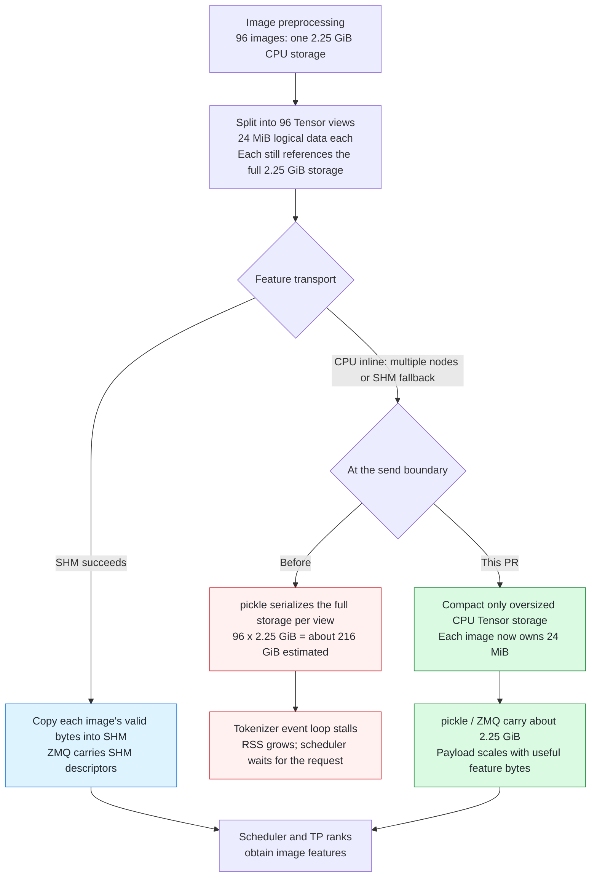

# [Fix] multimodal: Compact CPU tensor views before inline transport

[Upstream PR](https://github.com/sgl-project/sglang/pull/45203) · state: open · merged: False

## Original PR description

## Motivation

Large multi-image requests can block the tokenizer event loop while preparing a message for the scheduler when multimodal features travel inline as CPU tensors (`nnodes > 1`, or fallback after SHM allocation fails).

`get_new_expanded_mm_items()` splits a batched feature tensor into per-image views. A view can be contiguous while still retaining the entire batch's storage. PyTorch's pickle reducer serializes that storage for each distinct view, so the payload grows quadratically with the number of images.

For 96 images at 1024 x 1024, the processed float32 features occupy 2.25 GiB in total. Each image view contains 24 MiB of useful data but references the same 2.25 GiB storage. Pickling one view produces about 2.25 GiB; serializing all 96 would contribute about 216 GiB of storage data. In the serving reproduction, `send_pyobj()` did not return before tokenizer RSS reached the 128 GiB experiment limit, and `/model_info` timed out.

The 216 GiB figure is a storage-size estimate, not a completed wire transfer. The measured 8-image request expands 192 MiB of features into a 1.50 GiB ZMQ message.



## Modifications

- Compact dense CPU tensors whose backing storage is larger than `numel() * element_size()` before inline transport. Use a real clone: `contiguous()` alone can return the original view.
- Apply this to features, precomputed embeddings, and nested model-specific data. Memoize compacted tensors within a request so repeated references share the same replacement.
- Compact the tensor when SHM allocation fails and transport falls back to inline.
- Keep successful SHM feature transport, non-CPU tensors, and tensors with no oversized storage on their existing paths. Model-specific tensors that travel inline are compacted even when the main feature uses SHM.
- Add CPU regression tests through the actual image-splitting and transport-preparation functions, including pickle round trips and payload-size bounds.

This bounds the existing pickle/ZMQ path; it does not introduce a new wire format or make inline transport zero-copy. Affected views incur one logical-size copy before serialization.

## Accuracy Tests

Base: `8e7601ae4a48c1127afd1bcdccf0a0ad61dbf043`. Python 3.12.3, PyTorch 2.14.1+cu130, Transformers 5.19.0, sglang-kernel 0.4.10.

18 local unit tests pass: 8 new inline-storage tests and 10 existing SHM tests. Coverage includes float32/bfloat16 value and dtype preservation, per-image offsets, strided and empty views, repeated references, nested embeddings/metadata, SHM allocation failure, skip-tokenizer mode, and avoiding feature clones on the successful SHM path. The payload-size regressions fail on the unmodified base.

```bash
PYTHONPATH=python python test/registered/unit/multimodal/test_mm_inline_storage.py
PYTHONPATH=python python test/registered/unit/managers/test_mm_shm_error_consensus.py
```

Qwen3.5-35B-A3B serving smoke tests also complete after the fix. The 96-image request reports `prompt_tokens=130048`, `image_tokens=98304`, and, after flushing the radix cache, `cached_tokens=0`. No model-level accuracy benchmark was run; tensor round trips are checked for exact equality.

## Speed Tests and Profiling

One physical H800/SM90 host, TP4, two logical nodes with two GPUs each (`--nnodes 2`) to exercise CPU inline transport. The SHM control uses single-node TP4. This is a transport reproduction, not a cross-host network benchmark.

Inputs are deterministic random JPEGs (1024 x 1024, approximately 1.018 MB each). The 8-image request has 16,384 input tokens; the 96-image request has 130,048. Both generate one token with temperature 0. Relevant settings: context length 131,072, chunked prefill 8,192, static memory fraction 0.75, FA3 attention, and CUDA graphs disabled.

| Measurement | Base | This PR |
| --- | ---: | ---: |
| 8 images: serialized ZMQ message | 1.50 GiB | 192.6 MiB |
| 8 images: `send_pyobj()` call | 1.312 s | 0.156 s |
| 8 images: end-to-end | 10.62 s | 5.34 s |
| 96 images: serialized ZMQ message | Not completed; about 216 GiB storage estimated | 2.25 GiB measured |
| 96 images: `send_pyobj()` call | Still blocked after 36.35 s | 1.925 s |
| 96 images: end-to-end, no cached prefix | No response before experiment termination | 17.07 s, HTTP 200 |
| Tokenizer peak sampled RSS, inline test run | 129.99 GiB, stopped by the guard | 7.64 GiB |
| 96 images: single-node SHM control, end-to-end | 12.09 s | 12.01 s |

These are individual serving observations, not repeated-run medians. RSS was sampled every two seconds, with a 128 GiB per-process stop threshold. `send_pyobj()` time includes serialization but excludes the preceding storage-compaction step; end-to-end time includes that step. The blocked base run was deliberately terminated and is not evidence of a permanent deadlock.

## Checklist

- [x] Ruff lint/format, isort, registered-test validation, and `git diff --check` pass.
- [x] Add CPU regression tests registered in `base-a-test-cpu`.
- [x] Verify exact tensor round trips and existing SHM regressions.
- [x] Provide serving results and measurement limits above.
- [ ] User-facing documentation update: not applicable; no configuration or API change.

<!-- pr-states:start -->
---
### CI States

Latest PR Test (Base): <!-- slot:pr-test:start -->:x: [Run #39287438459](https://github.com/sgl-project/sglang/actions/runs/39287438459)<!-- slot:pr-test:end -->
Latest PR Test (Extra): <!-- slot:pr-test-extra:start -->:x: [Run #39287438369](https://github.com/sgl-project/sglang/actions/runs/39287438369)<!-- slot:pr-test-extra:end -->
Latest PR Test (AMD ROCm 10): <!-- slot:pr-test-amd:start -->:x: [Run #39287438415](https://github.com/sgl-project/sglang/actions/runs/39287438415)<!-- slot:pr-test-amd:end -->
<!-- pr-states:end -->

## Review and discussion

### reviews

### issue_comments

- ggboooy · comment · 2026-10-19T17:16:46Z · [source](https://github.com/sgl-project/sglang/pull/45203#issuecomment-6272949353)

@hnyls2002 @yhyang201 could you help review this multimodal transport fix?

CPU image views can retain the entire batch storage, so pickle serializes the full batch once per view on the inline path (`nnodes > 1`, or SHM allocation fallback). The change compacts oversized CPU storage at the send boundary while preserving successful SHM feature transport.

With Qwen3.5-35B-A3B, 96 images and 130,048 input tokens, the base run reached 129.99 GiB tokenizer RSS and was stopped by our experiment guard. With this fix, the request completes in 17.07 s with no cached prefix, and peak sampled tokenizer RSS is 7.64 GiB. The two-node configuration is simulated on one H800 host. All 18 local unit tests pass; the PR body includes the flow diagram, before/after measurements, and their limits.

Requesting the scheduler/managers code-owner review and multimodal/SHM expertise (related transport work: #21465). Please let me know if a different reviewer or additional CI coverage would be more appropriate. Thanks!

### inline_comments

## Changed files and fixed code

- `python/sglang/srt/managers/mm_utils.py` · modified · additions 50 / deletions 8
  - [head](https://github.com/ggboooy/sglang/blob/526c5ffa737bbecbedd1ea6376562a85ccfe38d6/python/sglang/srt/managers/mm_utils.py)
  - [base](https://github.com/sgl-project/sglang/blob/8e7601ae4a48c1127afd1bcdccf0a0ad61dbf043/python/sglang/srt/managers/mm_utils.py)
- `test/registered/unit/multimodal/test_mm_inline_storage.py` · added · additions 158 / deletions 0
  - [head](https://github.com/ggboooy/sglang/blob/526c5ffa737bbecbedd1ea6376562a85ccfe38d6/test/registered/unit/multimodal/test_mm_inline_storage.py)
  - [base](https://github.com/sgl-project/sglang/blob/8e7601ae4a48c1127afd1bcdccf0a0ad61dbf043/test/registered/unit/multimodal/test_mm_inline_storage.py)

## Evidence and interpretation boundary

[Original JSON, discussions and patches](../../../../../../evidence/prs/sgl-project--sglang/45203-d50fe5f6c0e53109f5e09474eff7b8c833184d5fbb1a3e0265a67c46519aafa3.json) · SHA-256 `d50fe5f6c0e53109f5e09474eff7b8c833184d5fbb1a3e0265a67c46519aafa3`.

Diff complete: True. Missing/binary/truncated patches require pinned source inspection. This is a source page, not an independently verified optimization case. Open, merged and released are different states; recheck the deployed dependency.
