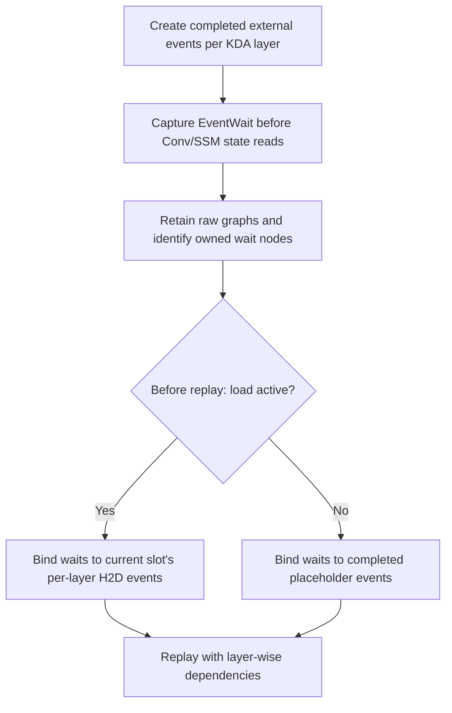

# [Fix] HiCache: bind captured KDA waits to live load events

[Upstream PR](https://github.com/sgl-project/sglang/pull/45839) · state: closed · merged: True

## Original PR description

## 1. Implementation

KDA extend runs inside a breakable CUDA graph (BCG), so replay skips the Python pool accessor and its HiCache layer waits. This change captures explicit per-layer waits and binds them to the **current batch's load events** before replay.



Binding uses `cudaGraphExecEventWaitNodeSetEvent`. Nodes are identified by their owned event handles; unchanged handles skip the update.

This is enabled automatically for captured KDA BCG. Other linear backends execute their waits at eager breaks. Full graphs retain their existing barrier; non-CUDA, graph dedup, and CPU/future counters use conservative waits.

## 2. GLM-5.3 Flash KL results

Tested GLM-5.3 Flash NVFP4 with two TP1 servers, MTP 2/1/3 + ReplaySSM, FlashInfer KDA prefill, HiCache, and memory fraction 0.85. The multi-turn test follows the cold-prefill logprob comparison in #44220: three groups × three branches × three turns, 512 output tokens/turn, two repeats.

Both arms start from the same token fixture and continue with their own generated histories. The **no-wait control** binds KDA waits to completed placeholders; other eager waits remain enabled. Slow loading uses `SGLANG_TEST_HICACHE_H2D_DELAY_CYCLES=50000000` per layer.

KL is a chosen-token estimate against cold-prefill scoring of the same generated tokens, with **18 final-turn samples per cell**.

| Condition | Dynamic: mean KL | No wait: mean KL | Dynamic: median KL | No wait: median KL |
| --- | ---: | ---: | ---: | ---: |
| Device cache hit | 0.010831 | 0.006793 | 0.000381 | 0.000436 |
| L2 load, no extra delay | 0.003277 | 0.004189 | 0.000351 | 0.000483 |
| L2 load, 50M cycles/layer | **0.007733** | **0.019290** | **0.000628** | **0.010370** |

Under slow loading, dynamic waiting reduced the observed mean KL by **59.9%** and median by **93.9%** versus no waiting.

NVFP4 samples still contain outliers. These results support reduced slow-load error, **not bit-exactness or equivalence to zero-delay loading**: the dynamic mean remains 0.007733 versus 0.003277.

<!-- pr-states:start -->
---
### CI States

Latest PR Test (Base): <!-- slot:pr-test:start -->:x: [Run #40838854028](https://github.com/sgl-project/sglang/actions/runs/40838854028)<!-- slot:pr-test:end -->
Latest PR Test (Extra): <!-- slot:pr-test-extra:start -->:white_check_mark: [Run #40838854215](https://github.com/sgl-project/sglang/actions/runs/40838854215)<!-- slot:pr-test-extra:end -->
Latest PR Test (AMD ROCm 10): <!-- slot:pr-test-amd:start -->:hourglass_flowing_sand: [Run #40838854057](https://github.com/sgl-project/sglang/actions/runs/40838854057)<!-- slot:pr-test-amd:end -->
<!-- pr-states:end -->


## Review and discussion

### reviews

- alphabetc1 · APPROVED · 2026-10-24T08:13:43Z · [source](https://github.com/sgl-project/sglang/pull/45839#pullrequestreview-5637472551)

Could we turn the slow-load experiment into a registered KDA BCG E2E regression test using SGLANG_TEST_HICACHE_H2D_DELAY_CYCLES from #44220?

- Oasis-Git · APPROVED · 2026-10-30T03:39:05Z · [source](https://github.com/sgl-project/sglang/pull/45839#pullrequestreview-5707802806)

(No body; status only.)

### issue_comments

- hzh0425 · comment · 2026-10-27T03:26:18Z · [source](https://github.com/sgl-project/sglang/pull/45839#issuecomment-6432986952)

/rerun-test test/registered/radix_cache/unified_radix_tree/test_unified_radix_cache_kl_glm53_bcg.py

- github-actions[bot] · comment · 2026-10-27T03:26:43Z · [source](https://github.com/sgl-project/sglang/pull/45839#issuecomment-6432991938)

🚀 `4-gpu-b200` (1 test): ✅ [View workflow run](https://github.com/sgl-project/sglang/actions/runs/40444199242) <!--rrt:0:done-->
```
cd test/ && python3 registered/radix_cache/unified_radix_tree/test_unified_radix_cache_kl_glm53_bcg.py
```

- hzh0425 · comment · 2026-10-27T03:41:09Z · [source](https://github.com/sgl-project/sglang/pull/45839#issuecomment-6433171351)

/rerun-test test/registered/radix_cache/unified_radix_tree/test_unified_radix_cache_kl_glm53_bcg.py

- github-actions[bot] · comment · 2026-10-27T03:41:35Z · [source](https://github.com/sgl-project/sglang/pull/45839#issuecomment-6433176631)

🚀 `4-gpu-b200` (1 test): ✅ [View workflow run](https://github.com/sgl-project/sglang/actions/runs/40445584088) <!--rrt:0:done-->
```
cd test/ && python3 registered/radix_cache/unified_radix_tree/test_unified_radix_cache_kl_glm53_bcg.py
```

- hzh0425 · comment · 2026-10-27T06:34:49Z · [source](https://github.com/sgl-project/sglang/pull/45839#issuecomment-6435451702)

/rerun-test test/registered/radix_cache/unified_radix_tree/test_unified_radix_cache_kl_glm53_bcg.py

- github-actions[bot] · comment · 2026-10-27T06:35:12Z · [source](https://github.com/sgl-project/sglang/pull/45839#issuecomment-6435456957)

🚀 `4-gpu-b200` (1 test): ✅ [View workflow run](https://github.com/sgl-project/sglang/actions/runs/40461990439) <!--rrt:0:done-->
```
cd test/ && python3 registered/radix_cache/unified_radix_tree/test_unified_radix_cache_kl_glm53_bcg.py
```

- hzh0425 · comment · 2026-10-29T07:58:03Z · [source](https://github.com/sgl-project/sglang/pull/45839#issuecomment-6491215826)

/rerun-test -c

- github-actions[bot] · comment · 2026-10-29T07:58:27Z · [source](https://github.com/sgl-project/sglang/pull/45839#issuecomment-6491222920)

🚀 `4-gpu-b200` (1 test): ✅ [View workflow run](https://github.com/sgl-project/sglang/actions/runs/40838875737) <!--rrt:0:done-->
```
cd test/ && python3 registered/radix_cache/unified_radix_tree/test_unified_radix_cache_kl_glm53_bcg.py
```

🚀 `ubuntu-latest` (1 test): ✅ [View workflow run](https://github.com/sgl-project/sglang/actions/runs/40838888920) <!--rrt:1:done-->
```
cd test/ && python3 registered/unit/model_executor/test_hicache_graph_events.py
```

- hzh0425 · comment · 2026-10-30T06:07:00Z · [source](https://github.com/sgl-project/sglang/pull/45839#issuecomment-6516215312)

The two diffusion CI failures appear unrelated to this PR. The 1-GPU Wan LoRA test failed because Hugging Face returned HTTP 429 during dynamic adapter loading. The 2-GPU LTX test exceeded the peak allocated VRAM limit by 0.97 MiB (55831.69 vs. 55830.72 MiB), with some retries also exceeding the latency threshold. Both failing cases ran with `enable_breakable_cuda_graph=false`, so they did not exercise the BCG path changed here.

https://github.com/sgl-project/sglang/actions/runs/40838854028/job/123330392214?pr=45839

### inline_comments

## Changed files and fixed code

- `python/sglang/srt/layers/attention/linear/kda_backend.py` · modified · additions 5 / deletions 0
  - [head](https://github.com/hzh0425/sglang/blob/e6abc891a275b31e983a35ff0e283c851376f96c/python/sglang/srt/layers/attention/linear/kda_backend.py)
  - [base](https://github.com/sgl-project/sglang/blob/d7522db332b3c6473bade8dd55705631a93430f4/python/sglang/srt/layers/attention/linear/kda_backend.py)
- `python/sglang/srt/model_executor/runner/prefill_cuda_graph_runner.py` · modified · additions 2 / deletions 2
  - [head](https://github.com/hzh0425/sglang/blob/e6abc891a275b31e983a35ff0e283c851376f96c/python/sglang/srt/model_executor/runner/prefill_cuda_graph_runner.py)
  - [base](https://github.com/sgl-project/sglang/blob/d7522db332b3c6473bade8dd55705631a93430f4/python/sglang/srt/model_executor/runner/prefill_cuda_graph_runner.py)
- `python/sglang/srt/model_executor/runner_backend/breakable_cuda_graph_backend.py` · modified · additions 27 / deletions 3
  - [head](https://github.com/hzh0425/sglang/blob/e6abc891a275b31e983a35ff0e283c851376f96c/python/sglang/srt/model_executor/runner_backend/breakable_cuda_graph_backend.py)
  - [base](https://github.com/sgl-project/sglang/blob/d7522db332b3c6473bade8dd55705631a93430f4/python/sglang/srt/model_executor/runner_backend/breakable_cuda_graph_backend.py)
- `python/sglang/srt/model_executor/runner_backend/utils.py` · modified · additions 24 / deletions 1
  - [head](https://github.com/hzh0425/sglang/blob/e6abc891a275b31e983a35ff0e283c851376f96c/python/sglang/srt/model_executor/runner_backend/utils.py)
  - [base](https://github.com/sgl-project/sglang/blob/d7522db332b3c6473bade8dd55705631a93430f4/python/sglang/srt/model_executor/runner_backend/utils.py)
- `python/sglang/srt/model_executor/runner_backend_utils/breakable_cuda_graph/breakable_cuda_graph.py` · modified · additions 26 / deletions 3
  - [head](https://github.com/hzh0425/sglang/blob/e6abc891a275b31e983a35ff0e283c851376f96c/python/sglang/srt/model_executor/runner_backend_utils/breakable_cuda_graph/breakable_cuda_graph.py)
  - [base](https://github.com/sgl-project/sglang/blob/d7522db332b3c6473bade8dd55705631a93430f4/python/sglang/srt/model_executor/runner_backend_utils/breakable_cuda_graph/breakable_cuda_graph.py)
- `python/sglang/srt/model_executor/runner_backend_utils/hicache_graph_events.py` · added · additions 121 / deletions 0
  - [head](https://github.com/hzh0425/sglang/blob/e6abc891a275b31e983a35ff0e283c851376f96c/python/sglang/srt/model_executor/runner_backend_utils/hicache_graph_events.py)
  - [base](https://github.com/sgl-project/sglang/blob/d7522db332b3c6473bade8dd55705631a93430f4/python/sglang/srt/model_executor/runner_backend_utils/hicache_graph_events.py)
- `test/registered/radix_cache/unified_radix_tree/test_unified_radix_cache_kl_glm53_bcg.py` · added · additions 240 / deletions 0
  - [head](https://github.com/hzh0425/sglang/blob/e6abc891a275b31e983a35ff0e283c851376f96c/test/registered/radix_cache/unified_radix_tree/test_unified_radix_cache_kl_glm53_bcg.py)
  - [base](https://github.com/sgl-project/sglang/blob/d7522db332b3c6473bade8dd55705631a93430f4/test/registered/radix_cache/unified_radix_tree/test_unified_radix_cache_kl_glm53_bcg.py)
- `test/registered/unit/model_executor/test_hicache_graph_events.py` · added · additions 197 / deletions 0
  - [head](https://github.com/hzh0425/sglang/blob/e6abc891a275b31e983a35ff0e283c851376f96c/test/registered/unit/model_executor/test_hicache_graph_events.py)
  - [base](https://github.com/sgl-project/sglang/blob/d7522db332b3c6473bade8dd55705631a93430f4/test/registered/unit/model_executor/test_hicache_graph_events.py)

## Evidence and interpretation boundary

[Original JSON, discussions and patches](../../../../../../evidence/prs/sgl-project--sglang/45839-1ea00fbd736540839614866fc4eb5f53ae5387d73a40799314d8dc38f4b66a28.json) · SHA-256 `1ea00fbd736540839614866fc4eb5f53ae5387d73a40799314d8dc38f4b66a28`.

Diff complete: True. Missing/binary/truncated patches require pinned source inspection. This is a source page, not an independently verified optimization case. Open, merged and released are different states; recheck the deployed dependency.
