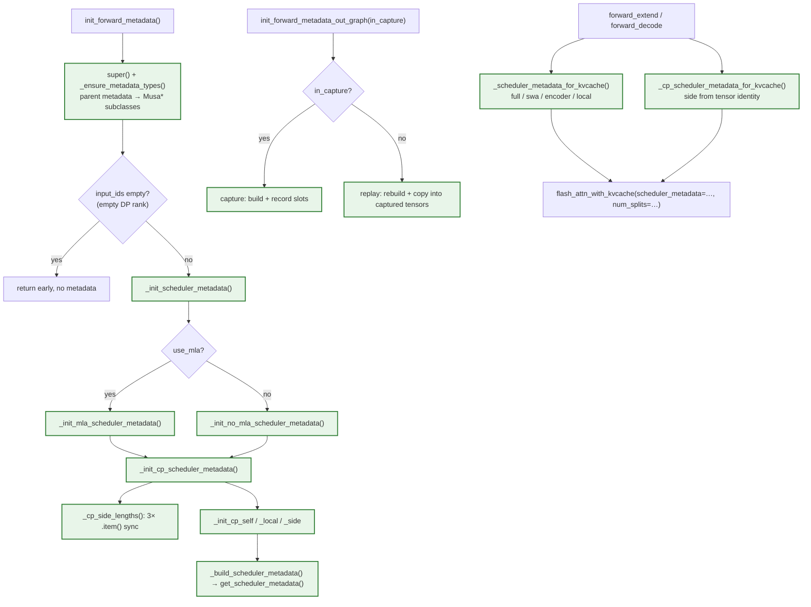

# [MUSA] fa3: Add the full backend implementation

[Upstream PR](https://github.com/sgl-project/sglang/pull/46834) · state: open · merged: False

## Original PR description

## Motivation

FlashAttention 3 is the common attention implementation used by several SGLang model families. The MUSA backend needs the same metadata lifecycle and forward coverage as the parent backend so that models using GQA, MLA, sliding-window attention, encoder/cross attention, embedding, speculative decoding, and context-parallel full attention can share one attention implementation on Moore Threads devices. This change ports the backend behavior while keeping the common attention stack unchanged.

## Supported attention paths

| Attention path | Coverage | Notes |
| --- | --- | --- |
| Causal full attention | Supported | GQA/MQA layouts and paged KV cache |
| MLA | Supported | Wrapper-generated scheduler metadata and absorbed MLA layout |
| Sliding-window attention | Supported | Separate window metadata and SWA KV write locations |
| Cross/encoder attention | Supported in backend/tests | Encoder scheduler metadata and translated KV locations |
| Bidirectional / encoder-only | Supported | Non-causal and symmetric window handling |
| Embedding / skip-KV | Supported | No KV-pool writes; eager path validated |
| Speculative decoding | Supported | Multi-step metadata and graph paths |
| Context-parallel full attention | Supported | Reuses the parent CP strategy for KV materialization and attention dispatch |
| Context-parallel MLA | Implemented and runtime-validated on DeepSeek-V2-Lite | MLA uses per-side wrapper metadata; 128K TP8/CP2 passed with radix cache on/off |
| Context-parallel SWA/local | Implemented and runtime-validated on MiMo-V2.5 | TP8/CP2, 128000-token requests passed with Radix cache enabled and disabled |

## Modifications

- Add the MUSA FA3 metadata and forward paths for the supported attention paths above, including eager execution and graph capture/replay.
- Reuse the parent CP strategy for dense full-attention KV materialization and the two-side CP attention dispatch instead of the deprecated platform shim.
- Keep public backend signatures, annotations, and parent-compatible naming aligned with the upstream FA3 backend.
- Generate scheduler metadata through the installed `flash_attn_interface` wrapper; no direct package-level MATE dependency is added to the backend.
- Preserve parent behavior for physical KV-location translation, cross-attention metadata, SWA writes, skip-KV, bidirectional attention, scales, and multi-step speculative state.
- Keep the existing platform prefill-CP validation unchanged; attention CP is selected separately through `attn_cp_size` and the parent strategy.
- Add registered CPU metadata tests covering interface parity, metadata conversion, MLA, cross attention, SWA locations, skip-KV/bidirectional behavior, multi-step state, split policy, and metadata forwarding.

## Validation

| Test | Configuration | Result |
| --- | --- | --- |
| Registered unit tests | CPU mock metadata suite, 15 tests | 15/15 passed in the target 5.2 image |
| Static checks | isort, Ruff, format, compileall, diff check | Changed-file checks passed; upstream fix #47078 has landed and the branch is rebased on it |
| GQA backend lifecycle | 131072-token paged KV, eager + graph | Passed; finite output and changing replay |
| MLA backend lifecycle | 131072-token paged KV, wrapper metadata, eager + graph | Passed; output shape 1x16x512 |
| SWA backend lifecycle | 131072-token paged KV, window 1024, eager + graph | Passed |
| Qwen2.5-7B GQA | 128K input, graph and eager | HTTP 200 with four output tokens |
| Radix cache | Same 128K request, cache on/off | 127936 cached tokens with cache on; zero with cache off |
| DeepSeek-V2-Lite MLA | 128K eager request | HTTP 200 with four output tokens |
| MiMo-V2.5 SWA | TP8/CP2, window 128, 128000-token eager request | PASS: HTTP 200 with one-token completion, Radix off and on; repeated cache-on request reported 127936 cached tokens |
| Qwen3-VL + Eagle3 | 128K speculative request | Target/draft graph paths passed |
| Embedding / skip-KV | Qwen2.5-7B, 128K encode request | Finite 3584-dimensional embedding |
| GSM8K multi-round | 20 questions, 3 rounds, Radix on/off | 71.67% vs 70.00%; no systematic cache regression |
| Context-parallel GQA | TP2, CP2, Qwen3-4B, 128000-token input | Passed in the 5.2 runtime on the BF16 path; HTTP 200, four-token completion, 48.0s end-to-end latency; 127936 cached tokens on the repeated request |
| Context-parallel MLA | Parent-aligned implementation and metadata paths | PASS: DeepSeek-V2-Lite TP8/CP2, 128002 prompt tokens; cache on/off both returned HTTP 200, and cache-on repeat reported cached-token 128000 (5.2.0 image) |
| Context-parallel SWA/local | MiMo-V2.5 FP8, TP8/CP2, window 128, 128000-token eager request | PASS: cache-off and cache-on requests returned HTTP 200; repeated cache-on request reported 127936 cached tokens |

No performance claim is made. The CP implementation follows the parent strategy for full, MLA, SWA, and local attention metadata paths. Runtime evidence covers dense GQA, MLA, and SWA/local attention.

## Checklist

- [x] Common attention components unchanged.
- [x] Changed-file community formatting and lint checks.
- [x] Rebased after upstream fix #47078 resolved the unrelated full-repository lint failure.
- [x] Registered CPU tests.
- [x] Real long-context MUSA validation for GQA, MLA, SWA, eager, graph, embedding, speculative decoding, and cache on/off.
- [x] CP implementation follows the parent strategy for full attention and the corresponding MLA/SWA/local metadata paths.
- [x] Dense CP implementation removes the deprecated shim call.
- [x] Full 2-rank CP acceptance on the 5.2 runtime (Qwen3 GQA, TP2/CP2, 128K input).
- [x] Model-level 128K CP MLA request with radix cache enabled and disabled (DeepSeek-V2-Lite, TP8/CP2).
- [x] Model-specific 128K CP request for SWA/local attention (MiMo-V2.5 FP8, TP8/CP2, Radix cache enabled and disabled).

<!-- pr-states:start -->
---
### CI States

Latest PR Test (Base): <!-- slot:pr-test:start -->:x: [Run #40871271611](https://github.com/sgl-project/sglang/actions/runs/40871271611)<!-- slot:pr-test:end -->
Latest PR Test (Extra): <!-- slot:pr-test-extra:start -->:x: [Run #40871271538](https://github.com/sgl-project/sglang/actions/runs/40871271538)<!-- slot:pr-test-extra:end -->
Latest PR Test (AMD ROCm 10): <!-- slot:pr-test-amd:start -->:x: [Run #40871271578](https://github.com/sgl-project/sglang/actions/runs/40871271578)<!-- slot:pr-test-amd:end -->
<!-- pr-states:end -->

## Review and discussion

### reviews

- yeahdongcn · CHANGES_REQUESTED · 2026-11-02T09:20:55Z · [source](https://github.com/sgl-project/sglang/pull/46834#pullrequestreview-5734346130)

Thanks for the detailed validation matrix — the engineering here is real and in the right place: it inherits `FlashAttentionBackend`, reuses the parent CP strategy, keeps the code under `hardware_backend/musa/`, and the long comment block at `:468-498` is the most useful thing I read in this diff.

I reviewed against the parent (`layers/attention/flashattention_backend.py`) and against the review history for this subsystem. The blocking items are all about **silent staleness** and **silent wrong-side selection** in the graph-replay and CP paths, plus one unvalidated MLA prefill argument mismatch — which is also where this file has already shipped a CP correctness fix (#23270).

### How the change runs

Green = added by this PR.

### Prior art for this subsystem

Corpus sweep: **32,639 threads scanned, 405 matched across 142 PRs, 681 human comments** (`hardware_backend/`, `layers/attention/`; terms: cuda graph, scheduler metadata, num_splits, split-kv, context parallel, cross attention, musa). Four opinions bear on this diff:

1. When the MUSA backend moved to inheritance, the ask was to **drop the platform shim** ("I don't know if `FlashAttentionContext` … are still necessary here. Because this time, we choose to inherit from `FlashAttentionBackend`" — #22051). This PR inherits, but then disables a parent hook and rebuilds the lifecycle beside it.
2. **No `seq_lens.max().item()` in the hot path** ("We should avoid CPU-GPU synchronization … Can you derive this value from `seq_lens_cpu`?" — #4514).
3. MUSA-specific code belongs under `hardware_backend/musa/` and aligned with the existing call site (#23270) — honored here.
4. This file already shipped one CP correctness fix ("Resolve output garbage in Context Parallel on MusaFlashAttentionBackend", #23270), so CP paths need correctness evidence, not smoke.

### Additional findings (beyond the inline comments)

**P1**

- **CP decode synchronizes the device 3× per side, per step.** `_cp_side_lengths()` does `int(q_lens.sum().item())`, `int(k_lens.max().item())`, `int(q_lens.max().item())` (`:820-823`) inside `init_forward_metadata`, i.e. right before every graph replay. Derive `max_seqlen_q`/`max_seqlen_k` from the CP metadata's CPU-side lengths; this is the pattern maintainers have pushed back on before (see corpus item 2).

**P2**

- **The parent hook is disabled rather than generalized.** `self._get_scheduler_metadata = None` (`:262`) exists because the parent callback uses the FA3 signature (`num_heads`) while MATE needs `num_heads_q` / `num_heads_kv`. A small signature widening in the parent would let both backends share the hook.
- **Non-uniform attention layouts become a startup crash.** `_get_no_mla_layer_attention_layouts()` raises `ValueError` when full-attention layers disagree on layout (`:360-374`). A model that the CUDA backend serves becomes unusable on MUSA. Falling back to per-call metadata keeps coverage; if you keep the raise, name the model and the divergent layers in the message.
- **The empty-DP-rank early return rests on an unverified claim** (`:1364-1373`). If the attention forward is not actually a shape-preserving no-op, the wrapper's `assert scheduler_metadata is not None` (`:154`) fires. A pointer to the code that guarantees the no-op would make this reviewable.
- **`_gather_paged_kv_for_varlen()` materializes the entire prefix KV** (Python loop + `torch.cat`, `:1479-1509`). It is only reachable from the `deterministic_cached_prefix` branch (`:1815`), so it is acceptable — but it is O(prefix) device memory and its `assert seq_lens is not None` (`:1486`) would fire under capture, because `_seq_lens_cpu_list()` returns `None` in capture mode (`:299-300`). A comment stating "eager-only, deterministic path only" would prevent a future caller from wiring it into a graph.

**P3**

- `assert` used for user-facing preconditions in the wrapper (`:154`) and in the hot path (`:1456`). Prefer `ValueError` / `RuntimeError`.
- `seq_lens_sum` and `seq_lens_cpu` are accepted and never used by `_prepare_graph_replay_scheduler_metadata()` (`:1346-1359`).
- `_max_seqlen_from_metadata()` still reaches `cache_seqlens.max().item()` on the eager path (`:748`) whenever `max_seq_len_k` is unset.

### CI

All three "PR Test" checks are red on the **`run-ci` label gate**, not on code — run 40871271611, step *Require run-ci label (optional)*: `Missing required label 'run-ci'`. That means the new registered CPU suite has **never executed in CI**; please add the label so the 15 tests actually run before this is considered.

### Test gaps

The 15 tests are mock-level metadata tests. Nothing covers the graph copy-back path, the CP side selection, `num_splits` agreement between `get_scheduler_metadata()` and the call site, or MLA prefill. Three tests assert the *absence* of methods (`test_removed_legacy_cuda_graph_metadata_hooks`, `test_musa_scheduler_helper_does_not_override_parent_hook`) rather than behavior, so they keep passing even if the replacement logic is wrong. A harness that fakes two captures and one replay and asserts the captured tensors actually changed would cover the riskiest ~60 lines in the PR in ~30 lines of test.

### Verdict

Blocking: the inline items (graph-metadata refresh is silent on failure and guarded only by `assert`; the MLA `causal` mismatch; CP side inferred from tensor identity; the hand-maintained slot list; the Gemma4 split policy contradicting itself with no measurement) plus the CP per-step syncs. Requesting changes.

### issue_comments

- github-actions[bot] · comment · 2026-10-28T12:42:44Z · [source](https://github.com/sgl-project/sglang/pull/46834#issuecomment-6469272430)

<!-- pr-check-comment runs=40689555932 -->
Required checks failed on ad639e8; this PR cannot be merged until they pass.

**Lint** ([run](https://github.com/sgl-project/sglang/actions/runs/40689555932))
Run `pre-commit run --all-files` locally and push the result. The run log shows any other failing step.

- github-actions[bot] · comment · 2026-10-28T13:49:23Z · [source](https://github.com/sgl-project/sglang/pull/46834#issuecomment-6470763355)

<!-- pr-check-comment runs=40699482612 -->
Required checks failed on 4af9683; this PR cannot be merged until they pass.

**Lint** ([run](https://github.com/sgl-project/sglang/actions/runs/40699482612))
Run `pre-commit run --all-files` locally and push the result. The run log shows any other failing step.

- github-actions[bot] · comment · 2026-10-28T14:17:41Z · [source](https://github.com/sgl-project/sglang/pull/46834#issuecomment-6471425612)

<!-- pr-check-comment runs=40703891184 -->
Required checks failed on 452c58f; this PR cannot be merged until they pass.

**Lint** ([run](https://github.com/sgl-project/sglang/actions/runs/40703891184))
Run `pre-commit run --all-files` locally and push the result. The run log shows any other failing step.

- froststeam · comment · 2026-10-28T15:22:24Z · [source](https://github.com/sgl-project/sglang/pull/46834#issuecomment-6473023390)

The required full-repository lint now passes after rebasing on #47078. The remaining CI gate requires the maintainer-only `run-ci` label; could a maintainer please add it to run the registered test suites?

- froststeam · comment · 2026-10-28T15:23:38Z · [source](https://github.com/sgl-project/sglang/pull/46834#issuecomment-6473053230)

/tag-and-rerun-ci

- github-actions[bot] · comment · 2026-10-29T01:41:06Z · [source](https://github.com/sgl-project/sglang/pull/46834#issuecomment-6485524233)

<!-- pr-check-comment runs=40801859952 -->
Required checks failed on 410bdee; this PR cannot be merged until they pass.

**PR title** ([run](https://github.com/sgl-project/sglang/actions/runs/40801859952))
> PR title must use "[Type] scope: title" or "[Type] [Hardware] scope: title". Type must be one of: Feat, Fix, Refactor, Perf, Doc, Test, CI, Chore. Scope is required and may be any module or model name, with unrestricted letter case (letters, numbers, dots, underscores, slashes, or hyphens). Hardware is optional; use a single tag without spaces. Use uppercase hardware tags (AMD, NVIDIA, NPU, MI300X), except for exactly these four spellings: Intel, Apple, Huawei, Ascend. Reverts must use GitHub's default format: Revert "original title". Use one space between fields and after the colon, with a non-empty title and no leading or trailing whitespace. Examples: "[Fix] attention: Fix KV cache indexing", "[Feat] qwen3: Add model support", "[Perf] [AMD] flash-attn: Optimize decode performance".
Edit the title; the check reruns on its own.

- github-actions[bot] · comment · 2026-10-29T05:02:27Z · [source](https://github.com/sgl-project/sglang/pull/46834#issuecomment-6488417376)

<!-- pr-check-comment runs=40820662836 -->
Required checks failed on 61d448b; this PR cannot be merged until they pass.

**PR title** ([run](https://github.com/sgl-project/sglang/actions/runs/40820662836))
> PR title must use "[Type] scope: title" or "[Type] [Hardware] scope: title". Type must be one of: Feat, Fix, Refactor, Perf, Doc, Test, CI, Chore. Scope is required and may be any module or model name, with unrestricted letter case (letters, numbers, dots, underscores, slashes, or hyphens). Hardware is optional; use a single tag without spaces. Use uppercase hardware tags (AMD, NVIDIA, NPU, MI300X), except for exactly these four spellings: Intel, Apple, Huawei, Ascend. Reverts must use GitHub's default format: Revert "original title". Use one space between fields and after the colon, with a non-empty title and no leading or trailing whitespace. Examples: "[Fix] attention: Fix KV cache indexing", "[Feat] qwen3: Add model support", "[Perf] [AMD] flash-attn: Optimize decode performance".
Edit the title; the check reruns on its own.

- github-actions[bot] · comment · 2026-10-29T05:14:23Z · [source](https://github.com/sgl-project/sglang/pull/46834#issuecomment-6488588903)

<!-- pr-check-comment runs=40821777987 -->
Required checks failed on 38c4588; this PR cannot be merged until they pass.

**PR title** ([run](https://github.com/sgl-project/sglang/actions/runs/40821777987))
> PR title must use "[Type] scope: title" or "[Type] [Hardware] scope: title". Type must be one of: Feat, Fix, Refactor, Perf, Doc, Test, CI, Chore. Scope is required and may be any module or model name, with unrestricted letter case (letters, numbers, dots, underscores, slashes, or hyphens). Hardware is optional; use a single tag without spaces. Use uppercase hardware tags (AMD, NVIDIA, NPU, MI300X), except for exactly these four spellings: Intel, Apple, Huawei, Ascend. Reverts must use GitHub's default format: Revert "original title". Use one space between fields and after the colon, with a non-empty title and no leading or trailing whitespace. Examples: "[Fix] attention: Fix KV cache indexing", "[Feat] qwen3: Add model support", "[Perf] [AMD] flash-attn: Optimize decode performance".
Edit the title; the check reruns on its own.

- github-actions[bot] · comment · 2026-10-29T05:33:29Z · [source](https://github.com/sgl-project/sglang/pull/46834#issuecomment-6488871591)

<!-- pr-check-comment runs=40824046003 -->
Required checks failed on 38c4588; this PR cannot be merged until they pass.

**PR title** ([run](https://github.com/sgl-project/sglang/actions/runs/40824046003))
> PR title must use "[Type] scope: title" or "[Type] [Hardware] scope: title". Type must be one of: Feat, Fix, Refactor, Perf, Doc, Test, CI, Chore. Scope is required and may be any module or model name, with unrestricted letter case (letters, numbers, dots, underscores, slashes, or hyphens). Hardware is optional; use a single tag without spaces. Use uppercase hardware tags (AMD, NVIDIA, NPU, MI300X), except for exactly these four spellings: Intel, Apple, Huawei, Ascend. Reverts must use GitHub's default format: Revert "original title". Use one space between fields and after the colon, with a non-empty title and no leading or trailing whitespace. Examples: "[Fix] attention: Fix KV cache indexing", "[Feat] qwen3: Add model support", "[Perf] [AMD] flash-attn: Optimize decode performance".
Edit the title; the check reruns on its own.

- github-actions[bot] · comment · 2026-10-29T07:05:15Z · [source](https://github.com/sgl-project/sglang/pull/46834#issuecomment-6490278381)

<!-- pr-check-comment runs=40833137554 -->
Required checks failed on 38c4588; this PR cannot be merged until they pass.

**PR title** ([run](https://github.com/sgl-project/sglang/actions/runs/40833137554))
> PR title must use "[Type] scope: title" or "[Type] [Hardware] scope: title". Type must be one of: Feat, Fix, Refactor, Perf, Doc, Test, CI, Chore. Scope is required and may be any module or model name, with unrestricted letter case (letters, numbers, dots, underscores, slashes, or hyphens). Hardware is optional; use a single tag without spaces. Use uppercase hardware tags (AMD, NVIDIA, NPU, MI300X), except for exactly these four spellings: Intel, Apple, Huawei, Ascend. Reverts must use GitHub's default format: Revert "original title". Use one space between fields and after the colon, with a non-empty title and no leading or trailing whitespace. Examples: "[Fix] attention: Fix KV cache indexing", "[Feat] qwen3: Add model support", "[Perf] [AMD] flash-attn: Optimize decode performance".
Edit the title; the check reruns on its own.

- github-actions[bot] · comment · 2026-10-29T07:05:58Z · [source](https://github.com/sgl-project/sglang/pull/46834#issuecomment-6490291305)

<!-- pr-check-comment runs=40833216213 -->
Required checks failed on 38c4588; this PR cannot be merged until they pass.

**PR title** ([run](https://github.com/sgl-project/sglang/actions/runs/40833216213))
> PR title must use "[Type] scope: title" or "[Type] [Hardware] scope: title". Type must be one of: Feat, Fix, Refactor, Perf, Doc, Test, CI, Chore. Scope is required and may be any module or model name, with unrestricted letter case (letters, numbers, dots, underscores, slashes, or hyphens). Hardware is optional; use a single tag without spaces. Use uppercase hardware tags (AMD, NVIDIA, NPU, MI300X), except for exactly these four spellings: Intel, Apple, Huawei, Ascend. Reverts must use GitHub's default format: Revert "original title". Use one space between fields and after the colon, with a non-empty title and no leading or trailing whitespace. Examples: "[Fix] attention: Fix KV cache indexing", "[Feat] qwen3: Add model support", "[Perf] [AMD] flash-attn: Optimize decode performance".
Edit the title; the check reruns on its own.

- github-actions[bot] · comment · 2026-10-29T10:21:39Z · [source](https://github.com/sgl-project/sglang/pull/46834#issuecomment-6494080471)

<!-- pr-check-comment runs=40856888966 -->
Required checks failed on 38c4588; this PR cannot be merged until they pass.

**PR title** ([run](https://github.com/sgl-project/sglang/actions/runs/40856888966))
> PR title must use "[Type] scope: title" or "[Type] [Hardware] scope: title". Type must be one of: Feat, Fix, Refactor, Perf, Doc, Test, CI, Chore. Scope is required and may be any module or model name, with unrestricted letter case (letters, numbers, dots, underscores, slashes, or hyphens). Hardware is optional; use a single tag without spaces. Use uppercase hardware tags (AMD, NVIDIA, NPU, MI300X), except for exactly these four spellings: Intel, Apple, Huawei, Ascend. Reverts must use GitHub's default format: Revert "original title". Use one space between fields and after the colon, with a non-empty title and no leading or trailing whitespace. Examples: "[Fix] attention: Fix KV cache indexing", "[Feat] qwen3: Add model support", "[Perf] [AMD] flash-attn: Optimize decode performance".
Edit the title; the check reruns on its own.

- github-actions[bot] · comment · 2026-10-29T10:22:40Z · [source](https://github.com/sgl-project/sglang/pull/46834#issuecomment-6494100739)

<!-- pr-check-comment runs=40857022491 -->
Required checks failed on 38c4588; this PR cannot be merged until they pass.

**PR title** ([run](https://github.com/sgl-project/sglang/actions/runs/40857022491))
> PR title must use "[Type] scope: title" or "[Type] [Hardware] scope: title". Type must be one of: Feat, Fix, Refactor, Perf, Doc, Test, CI, Chore. Scope is required and may be any module or model name, with unrestricted letter case (letters, numbers, dots, underscores, slashes, or hyphens). Hardware is optional; use a single tag without spaces. Use uppercase hardware tags (AMD, NVIDIA, NPU, MI300X), except for exactly these four spellings: Intel, Apple, Huawei, Ascend. Reverts must use GitHub's default format: Revert "original title". Use one space between fields and after the colon, with a non-empty title and no leading or trailing whitespace. Examples: "[Fix] attention: Fix KV cache indexing", "[Feat] qwen3: Add model support", "[Perf] [AMD] flash-attn: Optimize decode performance".
Edit the title; the check reruns on its own.

- github-actions[bot] · comment · 2026-10-29T12:11:11Z · [source](https://github.com/sgl-project/sglang/pull/46834#issuecomment-6496295145)

<!-- pr-check-comment runs=40870662586 -->
Required checks failed on 65408d6; this PR cannot be merged until they pass.

**PR title** ([run](https://github.com/sgl-project/sglang/actions/runs/40870662586))
> PR title must use "[Type] scope: title" or "[Type] [Hardware] scope: title". Type must be one of: Feat, Fix, Refactor, Perf, Doc, Test, CI, Chore. Scope is required and may be any module or model name, with unrestricted letter case (letters, numbers, dots, underscores, slashes, or hyphens). Hardware is optional; use a single tag without spaces. Use uppercase hardware tags (AMD, NVIDIA, NPU, MI300X), except for exactly these four spellings: Intel, Apple, Huawei, Ascend. Reverts must use GitHub's default format: Revert "original title". Use one space between fields and after the colon, with a non-empty title and no leading or trailing whitespace. Examples: "[Fix] attention: Fix KV cache indexing", "[Feat] qwen3: Add model support", "[Perf] [AMD] flash-attn: Optimize decode performance".
Edit the title; the check reruns on its own.

- github-actions[bot] · comment · 2026-10-29T12:16:17Z · [source](https://github.com/sgl-project/sglang/pull/46834#issuecomment-6496411036)

<!-- pr-check-comment runs=40871298868 -->
Required checks failed on 4bc5218; this PR cannot be merged until they pass.

**PR title** ([run](https://github.com/sgl-project/sglang/actions/runs/40871298868))
> PR title must use "[Type] scope: title" or "[Type] [Hardware] scope: title". Type must be one of: Feat, Fix, Refactor, Perf, Doc, Test, CI, Chore. Scope is required and may be any module or model name, with unrestricted letter case (letters, numbers, dots, underscores, slashes, or hyphens). Hardware is optional; use a single tag without spaces. Use uppercase hardware tags (AMD, NVIDIA, NPU, MI300X), except for exactly these four spellings: Intel, Apple, Huawei, Ascend. Reverts must use GitHub's default format: Revert "original title". Use one space between fields and after the colon, with a non-empty title and no leading or trailing whitespace. Examples: "[Fix] attention: Fix KV cache indexing", "[Feat] qwen3: Add model support", "[Perf] [AMD] flash-attn: Optimize decode performance".
Edit the title; the check reruns on its own.

### inline_comments

- yeahdongcn · comment · 2026-11-02T09:20:55Z · [source](https://github.com/sgl-project/sglang/pull/46834#discussion_r4440660277)

File: `python/sglang/srt/hardware_backend/musa/attention/flashattention_backend.py` · line 1359

The boolean return of `_copy_fresh_metadata_to_graph_tensors()` is dropped here. When the key is absent — a `bs`/`spec_info` combination that was never captured — the helper returns `False` and this call becomes a no-op, so the graph replays with the metadata that was baked in at capture time. That is exactly the staleness this function exists to prevent, and it is completely silent.

Please raise (or at least log and skip the replay) when it returns `False`. Same applies to the three `assert`s inside the helper (`:711`, `:719`, `:724`): slot-set equality, shape equality and the self-copy guard are production invariants, but `python -O` deletes them and then `copy_` runs against a mismatched tensor.

- yeahdongcn · comment · 2026-11-02T09:20:55Z · [source](https://github.com/sgl-project/sglang/pull/46834#discussion_r4440660285)

File: `python/sglang/srt/hardware_backend/musa/attention/flashattention_backend.py` · line 547

`causal=False` is hardcoded into the MLA metadata here and at `:561` and `:583`, but the MLA calls pass `causal=causal` (`:2039` CP, `:2075` non-CP). `causal` is an argument to `get_scheduler_metadata` (`:531`), so the metadata is specialized on it.

- If MATE uses the metadata's causal flag, MLA **prefill** builds a non-causal plan and runs it causally.
- If MATE ignores it when `scheduler_metadata` is supplied, the call-site argument is misleading and should be dropped or documented.

This is invisible to the current evidence: DeepSeek-V2-Lite 128K with four output tokens is decode-shaped, where `q_len == 1` makes causal and non-causal identical. Can you confirm the contract, and add a prefill accuracy check?

- yeahdongcn · comment · 2026-11-02T09:20:55Z · [source](https://github.com/sgl-project/sglang/pull/46834#discussion_r4440660290)

File: `python/sglang/srt/hardware_backend/musa/attention/flashattention_backend.py` · line 1445

The CP side is inferred from tensor identity. A caller that passes an equal-but-not-identical tensor silently gets the `next`-side metadata — a wrong-side scheduler plan with no error anywhere. Please pass `side: str` explicitly from the two call sites (`:1776`, `:2043`); it is one parameter and the failure mode disappears.

- yeahdongcn · comment · 2026-11-02T09:20:55Z · [source](https://github.com/sgl-project/sglang/pull/46834#discussion_r4440660304)

File: `python/sglang/srt/hardware_backend/musa/attention/flashattention_backend.py` · line 621

This attribute list is hand-maintained, so any metadata field added later (another CP variant, another local-attention tensor) silently escapes replay refresh. The only thing that catches the drift is the slot-set `assert` in `_copy_fresh_metadata_to_graph_tensors()` — which `-O` strips.

Suggest deriving the slot set from `dataclasses.fields()` on the metadata classes, or defining one canonical name list that both `_clear_cp_scheduler_metadata()` (`:792`) and this function consume, so add/clear/refresh cannot drift apart.

- yeahdongcn · comment · 2026-11-02T09:20:55Z · [source](https://github.com/sgl-project/sglang/pull/46834#discussion_r4440660310)

File: `python/sglang/srt/hardware_backend/musa/attention/flashattention_backend.py` · line 439

Two problems with the Gemma4 split policy:

1. The comments contradict each other. `:219-222` says Gemma4 SWA is faster *without* split-KV; this comment says auto (`num_splits=0`) is faster at `bs < 8` and that split=1 wins above it. One of them is stale.
2. `self.num_splits = 1` (`:223`) silently overrides `--flash-attention-num-splits` for this model, and the numbers quoted here ("7-17 us", "the AIME tail") have no measurement attached, while the PR body states "No performance claim is made".

Either attach the benchmark — per-layer and end-to-end, both `bs` regimes — or drop the tuning and keep the user's flag. The MiniMax-M2 special case (`:415-433`) has the same issue: two model identities hardcoded inside a device backend belongs in a tuning table.

## Changed files and fixed code

- `python/sglang/srt/hardware_backend/musa/attention/flashattention_backend.py` · modified · additions 1841 / deletions 291
  - [head](https://github.com/froststeam/sglang/blob/4bc5218d945a3de3594160d4b2e9ae669299a10f/python/sglang/srt/hardware_backend/musa/attention/flashattention_backend.py)
  - [base](https://github.com/sgl-project/sglang/blob/05c59bb323c131a4e91623fc914ee6afad21288e/python/sglang/srt/hardware_backend/musa/attention/flashattention_backend.py)
- `test/registered/unit/hardware_backend/musa/attention/test_flashattention_metadata.py` · added · additions 440 / deletions 0
  - [head](https://github.com/froststeam/sglang/blob/4bc5218d945a3de3594160d4b2e9ae669299a10f/test/registered/unit/hardware_backend/musa/attention/test_flashattention_metadata.py)
  - [base](https://github.com/sgl-project/sglang/blob/05c59bb323c131a4e91623fc914ee6afad21288e/test/registered/unit/hardware_backend/musa/attention/test_flashattention_metadata.py)

## Evidence and interpretation boundary

[Original JSON, discussions and patches](../../../../../../evidence/prs/sgl-project--sglang/46834-6f5e6e6f1170a04ff0813992ba008f2533174c9a034d2865523ab9574a78b136.json) · SHA-256 `6f5e6e6f1170a04ff0813992ba008f2533174c9a034d2865523ab9574a78b136`.

Diff complete: False. Missing/binary/truncated patches require pinned source inspection. This is a source page, not an independently verified optimization case. Open, merged and released are different states; recheck the deployed dependency.
