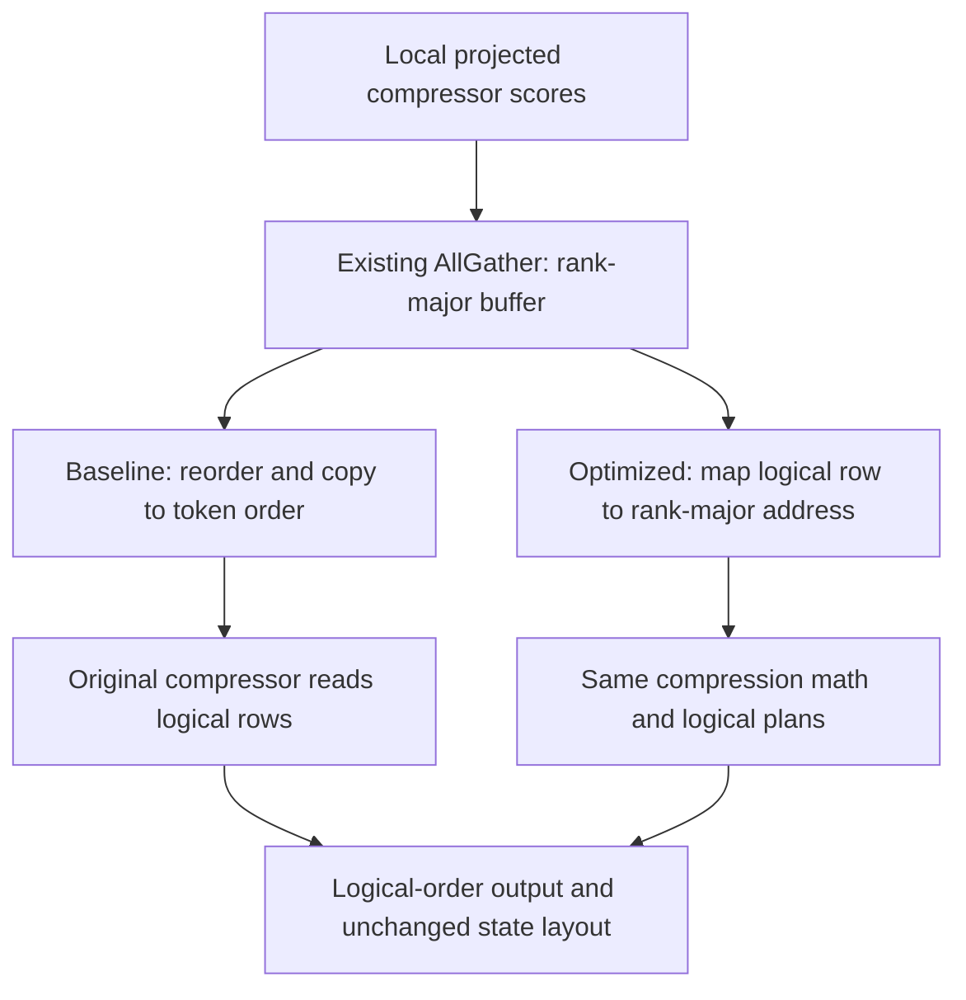

# [Perf] [NVIDIA] dsv4: avoid CP compressor input reorder with rank-major reads

[Upstream PR](https://github.com/sgl-project/sglang/pull/47672) · state: open · merged: False

## Original PR description

## Motivation

DeepSeek-V4 prefill CP materializes global token order after gathering projected compressor scores. Reading the rank-major AllGather layout directly eliminates that reorder allocation/copy without changing compression math, logical plans, compressed output order, or state layout.

## Modifications

- Default-off `SGLANG_OPT_COMPRESSOR_RANK_MAJOR`, with configurable minimum global input length `SGLANG_OPT_COMPRESSOR_RANK_MAJOR_MIN_TOKENS` (default 128).
- Native C4 D128/D512 and offline/online C128 D512 prefill input addressing: physical_row = (logical_row % cp_size) * rows_per_rank + logical_row / cp_size. The CP size is a JIT specialization parameter; CP2, CP4 and CP8 are enabled. Relative reads and state writeback follow the same mapping; decode is unchanged.
- Framework dispatch is limited to SM90, equal-length CP2/CP4/CP8 token-interleave, BS1, zero-prefix eager EXTEND without speculation/logprobs/hidden-state requests. Other cases retain the existing path, including graph capture and uniform-FP8 attention dispatch.
- Preserve the existing collective and symmetric-memory allocation context. Discard GEMM-only padding before gathering, as the baseline does (50K: 6250 logical versus 6256 physical rows per rank).
- Add standalone GPU output/state tests and CPU dispatch-guard tests.

This does not modify V4.1 C1/C2 or implement local-projection deduplication.

## Accuracy Tests

Native CP8/single-GPU sweeps passed exact output/state comparisons against logical-order input. Global lengths from 8 through 65536 were tested. Complete-window online C128 also passed an independent PyTorch FP32 oracle (maximum absolute error below 1e-6).

The standalone GPU regression test passed on H200 (reported by the driver as H20D): C4/C128, online/offline, FP32/BF16 state, and padded input. CPU guard tests passed, including unsupported-case fallback and physical/logical padding.

Model smoke: DeepSeek-V4-Flash-0731-FP8, CP8, online compressor, upstream auto FP8 KV, CUDA Graph disabled. All 322 requests including warmup returned the same first token on fixed natural-language inputs; cache hits were zero. All 168 real-model input shadows (7 lengths x 3 compressor kinds x 8 ranks) had zero compressor-output difference and exact written-state equality. This is not a task-accuracy benchmark or proof of equality of all model logits.

Commands:

    PYTHONPATH=python python test/registered/kernels/ops/attention/dsv4/test_cp_rank_major_compress.py
    python test/registered/unit/layers/test_cp_rank_major_guards.py

## Speed Tests and Profiling

8x NVIDIA H200, SM90, approximately 141 GB HBM per GPU, NV18 links, PyTorch 2.14.1+cu130. These are H200 GPUs, not the older 96 GB H20. Measurements against upstream 5eb70183472d56326920e70a4dde5cfbabe6f376.

50K global tokens: real NCCL AllGather + reorder (baseline only) + compression + state write, max-rank CUDA-event span, 80 samples/arm in two reversed-order rounds:

| Native pipeline | Baseline ms | Rank-major ms | Reduction |
|---|---:|---:|---:|
| C4 Indexer D128 | 0.4285 | 0.3519 | 17.89% |
| C4 Attention D512 | 1.5338 | 1.2348 | 19.50% |
| Online C128 D512 | 0.7928 | 0.6483 | 18.23% |
| Offline C128 D512 | 0.7921 | 0.6400 | 19.20% |

Same-loaded-model E2E: ordinary HTTP serving to one generated token, no PD/RDMA, CP8, online compressor, chunk/context 65536, CUDA Graph disabled. Three warmups/arm/length then 20 samples/arm, alternating order; cache flushed outside timing. Medians:

| Global input tokens | OFF ms | ON ms | Reduction |
|---|---:|---:|---:|
| 128 | 217.948 | 217.448 | 0.23% |
| 512 | 221.375 | 220.440 | 0.42% |
| 4096 | 224.313 | 223.352 | 0.43% |
| 8192 | 225.756 | 226.003 | -0.11% |
| 16384 | 231.894 | 231.869 | 0.01% |
| 50000 | 616.214 | 605.174 | 1.79% |
| 64000 | 780.133 | 766.217 | 1.78% |

Short-input E2E differences are within observed noise; no universal break-even is established. Native eager timing did not reverse from 8 to 65536, but small-N event spans include submission/launch gaps, so their savings must not all be attributed to HBM traffic. The minimum 128 guard is conservative, not a measured threshold. DeepGemm full-shape precompile was disabled equally in both arms; actual shapes compiled during excluded warmup.

## CP2 / CP4 extension (2026-11-01)

Commit 090b276 parameterizes the row mapping and JIT cache by CP size rather than hard-coding 8. Framework dispatch now accepts CP2, CP4 and CP8; other configurations keep the original fallback. Attention TP=1 / attention DP=1 and the other safety guards above remain unchanged. RankMajorScores(values) still defaults to CP8 for compatibility; callers can pass cp_size explicitly.

A fresh comparison used the same parameterized source for CP2/4/8 on H200, with real NCCL AllGather, max-rank CUDA-event spans and 80 samples/arm in two reversed-order rounds. Native timing uses FP32 state; offline correctness additionally checks BF16 state. This table is global N=50,000 and measures AllGather + reorder (baseline only) + compression + state write, NOT model TTFT:

| CP | Pipeline | Baseline ms | Rank-major ms | Reduction |
|---|---|---:|---:|---:|
| 2 | C4 Indexer D128 | 0.360128 | 0.282880 | 21.45% |
| 2 | C4 Attention D512 | 1.243056 | 0.948224 | 23.72% |
| 2 | Online C128 D512 | 0.659968 | 0.516192 | 21.79% |
| 2 | Offline C128 D512 | 0.657296 | 0.506400 | 22.96% |
| 4 | C4 Indexer D128 | 0.398640 | 0.322192 | 19.18% |
| 4 | C4 Attention D512 | 1.419824 | 1.125072 | 20.76% |
| 4 | Online C128 D512 | 0.753216 | 0.609248 | 19.11% |
| 4 | Offline C128 D512 | 0.752608 | 0.601216 | 20.12% |
| 8 | C4 Indexer D128 | 0.427440 | 0.350896 | 17.91% |
| 8 | C4 Attention D512 | 1.532496 | 1.236896 | 19.29% |
| 8 | Online C128 D512 | 0.792416 | 0.648064 | 18.22% |
| 8 | Offline C128 D512 | 0.792672 | 0.640672 | 19.18% |

All participating ranks passed exact output AND written-state comparisons. Online cases:4096,25001 padded to25008,32769 padded to32776,50000,64000. Offline C4/C128 cases:4096,25001 padded to25008,50000,64000, both FP32/BF16 states. Unequal logical framework buckets still fall back; padded native tests are not claims that unequal-bucket framework dispatch is enabled.

Standalone one-GPU regression tests additionally passed for each CP layout, covering C4 D128/D512 and offline/online C128 D512 with both state dtypes. CPU guard tests pass CP2/4/8 logical versus physical padding and unsupported-case fallback.

    for cp in 2 4 8; do
      CP_SIZE=$cp PYTHONPATH=python python test/registered/kernels/ops/attention/dsv4/test_cp_rank_major_compress.py
    done
    python test/registered/unit/layers/test_cp_rank_major_guards.py

No CP2/CP4 E2E speedup is claimed; the earlier CP8 model table is a separate experiment. No update to the model math or reduction order is intended.

## Cleanup (91ea915)

Reuse the existing `attn_cp_interleave_gather` helper instead of duplicating allocation/collective code. Move tests into registered base-a CPU and H100 kernel suites; the GPU test now covers CP2/4/8 by default. Runtime code is 11 lines shorter; kernel addressing and fallback guards are unchanged.

Cleanup validation on H200: registered CPU guard tests and GPU output/state regression passed. A separate real-NCCL CP2/4/8 check of the reused gather helper passed at 128, 4096, 50000 and 64000 global rows, including exclusion of GEMM padding. That helper check isolates SGLang group/allocator adapters; it is not full-model validation. E2E/performance numbers above predate this cleanup and were not regenerated.



## Limitations

Default-off experimental path. CUDA Graph, CP sizes other than 2/4/8, multi-request dispatch and prefix hits are not enabled. CP2/CP4 have native-pipeline and dispatch-guard validation; model E2E validation remains CP8 only. Only DSV4-Flash-0731-FP8 has model E2E validation here. Full task-accuracy evaluation and upstream CI remain pending; no Blackwell or V4.1 speedup is claimed.

## Checklist

- [x] Native output/state and framework fallback tests
- [x] Same-loaded-model E2E A/B
- [x] Python formatting/lint and C++ clang-format
- [ ] Full upstream CI
- [ ] Task-level model accuracy evaluation


<!-- pr-states:start -->
---
### CI States

Latest PR Test (Base): <!-- slot:pr-test:start -->:x: **Missing `run-ci` label** -- add it to run CI tests.<!-- slot:pr-test:end -->
Latest PR Test (Extra): <!-- slot:pr-test-extra:start -->:x: **Blocked** -- `run-ci` is required first.<!-- slot:pr-test-extra:end -->
Latest PR Test (AMD ROCm 10): <!-- slot:pr-test-amd:start -->:heavy_minus_sign: **No AMD PR run found for this commit**.<!-- slot:pr-test-amd:end -->

> [!TIP]
> Base CI only covers the core cases, and its workload may not exercise your change. Use `/rerun-test` to run the tests your change touches, or copy this prompt for an agent:
>
> ```text
> Find the registered tests this PR affects and run them with /rerun-test, following https://github.com/sgl-project/sglang/blob/main/.agents/skills/rerun-test/SKILL.md
> ```
<!-- pr-states:end -->

## Review and discussion

### reviews

- claude[bot] · COMMENTED · 2026-10-31T17:17:17Z · [source](https://github.com/sgl-project/sglang/pull/47672#pullrequestreview-5724021239)

## Claude Code Review

This pull request is from a fork — automated review is disabled. A repository maintainer can comment `@claude review` to run a one-time review.

### issue_comments

- github-actions[bot] · comment · 2026-10-31T17:22:47Z · [source](https://github.com/sgl-project/sglang/pull/47672#issuecomment-6546690659)

<!-- pr-check-comment runs=41223920298 -->
Required checks failed on 8b15ba0; this PR cannot be merged until they pass.

**Lint** ([run](https://github.com/sgl-project/sglang/actions/runs/41223920298))
Run `pre-commit run --all-files` locally and push the result. The run log shows any other failing step.

- YingHREN · comment · 2026-11-04T06:28:15Z · [source](https://github.com/sgl-project/sglang/pull/47672#issuecomment-6624255865)

Hi @BBuf, could you take a look at this opt-in DSV4 CP compressor optimization when you have time, or suggest the appropriate reviewer? It removes the post-AllGather reorder while preserving logical plans, output order and state layout.

Previous H200 tests passed exact compressor output/state checks for CP2/4/8; CP8 same-model E2E medians improved by ~1.8% at 50K/64K input tokens (short inputs showed no meaningful gain). The PR description contains commands and scope limitations.

I have reused the existing gather helper, registered the CPU/GPU regression tests, and updated both to CustomTestCase in 6888f0f. This last test-harness-only change passed local lint/import-order checks; GPU tests were not rerun for that commit because the test host is currently inaccessible.

If the approach looks reasonable, could you help enable NVIDIA CI (e.g. /run-ci nv) and the relevant registered tests? Happy to adjust the scope or implementation. Thanks!

### inline_comments

## Changed files and fixed code

- `python/sglang/kernels/jit/csrc/deepseek_v4/c128_online_v2.cuh` · modified · additions 19 / deletions 5
  - [head](https://github.com/YingHREN/sglang/blob/6888f0f206b0d146b7d4180f8a868588fc5faaec/python/sglang/kernels/jit/csrc/deepseek_v4/c128_online_v2.cuh)
  - [base](https://github.com/sgl-project/sglang/blob/a65c9c5969055788fce6b99ba78e3eb133e7e6d0/python/sglang/kernels/jit/csrc/deepseek_v4/c128_online_v2.cuh)
- `python/sglang/kernels/jit/csrc/deepseek_v4/c128_v2.cuh` · modified · additions 63 / deletions 13
  - [head](https://github.com/YingHREN/sglang/blob/6888f0f206b0d146b7d4180f8a868588fc5faaec/python/sglang/kernels/jit/csrc/deepseek_v4/c128_v2.cuh)
  - [base](https://github.com/sgl-project/sglang/blob/a65c9c5969055788fce6b99ba78e3eb133e7e6d0/python/sglang/kernels/jit/csrc/deepseek_v4/c128_v2.cuh)
- `python/sglang/kernels/jit/csrc/deepseek_v4/c4_v2.cuh` · modified · additions 70 / deletions 19
  - [head](https://github.com/YingHREN/sglang/blob/6888f0f206b0d146b7d4180f8a868588fc5faaec/python/sglang/kernels/jit/csrc/deepseek_v4/c4_v2.cuh)
  - [base](https://github.com/sgl-project/sglang/blob/a65c9c5969055788fce6b99ba78e3eb133e7e6d0/python/sglang/kernels/jit/csrc/deepseek_v4/c4_v2.cuh)
- `python/sglang/kernels/jit/include/sgl_kernel/deepseek_v4/compress_v2.cuh` · modified · additions 19 / deletions 0
  - [head](https://github.com/YingHREN/sglang/blob/6888f0f206b0d146b7d4180f8a868588fc5faaec/python/sglang/kernels/jit/include/sgl_kernel/deepseek_v4/compress_v2.cuh)
  - [base](https://github.com/sgl-project/sglang/blob/a65c9c5969055788fce6b99ba78e3eb133e7e6d0/python/sglang/kernels/jit/include/sgl_kernel/deepseek_v4/compress_v2.cuh)
- `python/sglang/kernels/ops/attention/dsv4/compress.py` · modified · additions 57 / deletions 6
  - [head](https://github.com/YingHREN/sglang/blob/6888f0f206b0d146b7d4180f8a868588fc5faaec/python/sglang/kernels/ops/attention/dsv4/compress.py)
  - [base](https://github.com/sgl-project/sglang/blob/a65c9c5969055788fce6b99ba78e3eb133e7e6d0/python/sglang/kernels/ops/attention/dsv4/compress.py)
- `python/sglang/srt/environ.py` · modified · additions 3 / deletions 0
  - [head](https://github.com/YingHREN/sglang/blob/6888f0f206b0d146b7d4180f8a868588fc5faaec/python/sglang/srt/environ.py)
  - [base](https://github.com/sgl-project/sglang/blob/a65c9c5969055788fce6b99ba78e3eb133e7e6d0/python/sglang/srt/environ.py)
- `python/sglang/srt/layers/attention/dsv4/compressor.py` · modified · additions 77 / deletions 1
  - [head](https://github.com/YingHREN/sglang/blob/6888f0f206b0d146b7d4180f8a868588fc5faaec/python/sglang/srt/layers/attention/dsv4/compressor.py)
  - [base](https://github.com/sgl-project/sglang/blob/a65c9c5969055788fce6b99ba78e3eb133e7e6d0/python/sglang/srt/layers/attention/dsv4/compressor.py)
- `test/registered/kernels/ops/attention/dsv4/test_cp_rank_major_compress.py` · added · additions 108 / deletions 0
  - [head](https://github.com/YingHREN/sglang/blob/6888f0f206b0d146b7d4180f8a868588fc5faaec/test/registered/kernels/ops/attention/dsv4/test_cp_rank_major_compress.py)
  - [base](https://github.com/sgl-project/sglang/blob/a65c9c5969055788fce6b99ba78e3eb133e7e6d0/test/registered/kernels/ops/attention/dsv4/test_cp_rank_major_compress.py)
- `test/registered/unit/layers/test_cp_rank_major_guards.py` · added · additions 189 / deletions 0
  - [head](https://github.com/YingHREN/sglang/blob/6888f0f206b0d146b7d4180f8a868588fc5faaec/test/registered/unit/layers/test_cp_rank_major_guards.py)
  - [base](https://github.com/sgl-project/sglang/blob/a65c9c5969055788fce6b99ba78e3eb133e7e6d0/test/registered/unit/layers/test_cp_rank_major_guards.py)

## Evidence and interpretation boundary

[Original JSON, discussions and patches](../../../../../../evidence/prs/sgl-project--sglang/47672-0c99e9fe970fa77582dedafd4da4ba7c206d9c99f1bf3497773777420dd50a36.json) · SHA-256 `0c99e9fe970fa77582dedafd4da4ba7c206d9c99f1bf3497773777420dd50a36`.

Diff complete: True. Missing/binary/truncated patches require pinned source inspection. This is a source page, not an independently verified optimization case. Open, merged and released are different states; recheck the deployed dependency.
