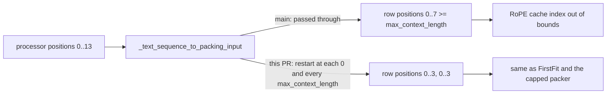

# [data] ConcatThenSplit: wrap processor positions longer than the context

[Upstream PR](https://github.com/pytorch/torchtitan/pull/5664) · state: closed · merged: True

## Original PR description

In `torchtitan/components/data/packing.py`, `ConcatThenSplitPackingConfig` without `max_num_documents` (the default) passes processor-supplied `TextSequence.positions` through unchanged. `_text_sequence_to_packing_input` only fills in positions when they are `None` (`arange % max_context_length`), and `_packing_output_to_text_sequence` rebases them per document without wrapping. So a positioned document longer than `max_context_length` comes out with row positions up to `num_tokens_per_microbatch - 1`. Those index past the RoPE cache, which has `max_context_length` rows. FirstFit and the document-capped concat-then-split path already split such documents (since #4156), and `test_packing_splits_positioned_long_documents` checks `positions.max() < max_context_length` for them, but only with `max_num_documents=2`.

With one 14-token positioned document, `max_context_length=4` and 8-token rows, the uncapped packer on main gives:

```
ConcatThenSplit, max_num_documents=None: positions=[0, 1, 2, 3, 4, 5, 6, 7]
   -> rope_cache[positions] IndexError: index 4 is out of bounds for dimension 0 with size 4
ConcatThenSplit, max_num_documents=2   : positions=[0, 1, 2, 3, 0, 1, 2, 3]
FirstFit,        max_num_documents=None: positions=[0, 1, 2, 3, 0, 1, 2, 3]
```

With this change the first row is `positions=[0, 1, 2, 3, 0, 1, 2, 3]`, the same as the other two paths, and the other lines do not change.



The fix restarts provided positions at each document start (a zero position) and every `max_context_length` tokens after it. Missing positions already get exactly this wrapping. FirstFit and nested packers feed this function segments that already fit the context, so nothing changes for them. In-tree `TextProcessor` and `ChatProcessor` leave positions `None`, so the c4 recipes are not affected. This only matters for custom processors that return positions.

Test, in `tests/unit_tests/cpu/components/data/test_grain_data.py`: `test_packing_splits_positioned_long_documents` now also runs with `max_num_documents=None` (17 tokens, 16 positions, so every combination packs two full rows) and checks that positions stay below `max_context_length` for both packers; the doc-count assert applies only to the capped case. The uncapped concat-then-split case fails on main and passes with this change; the other three cases pass on both. In all of `tests/unit_tests/cpu/components/data`, 201 pass. The 3 failures there also fail on main on Windows: two need the inductor C++ compiler (`cl`) and one runs `generate.py --check`. That was on Windows with Python 3.11 and torch 2.16.0.dev20261024+cpu. `pre-commit run` on the two changed files passes flake8, ufmt, pydoclint, codespell and pyrefly. The lychee hook needs `/bin/bash`, so it did not run on Windows. These ran on Windows 11, CPU only. Nothing was run on Linux or GPU, so Linux CI will confirm.


## Review and discussion

### reviews

- claude[bot] · COMMENTED · 2026-10-29T05:33:03Z · [source](https://github.com/pytorch/torchtitan/pull/5664#pullrequestreview-5693296770)

(No body; status only.)

- claude[bot] · COMMENTED · 2026-10-29T05:33:07Z · [source](https://github.com/pytorch/torchtitan/pull/5664#pullrequestreview-5693297267)

(No body; status only.)

- claude[bot] · APPROVED · 2026-10-29T05:33:41Z · [source](https://github.com/pytorch/torchtitan/pull/5664#pullrequestreview-5693301033)

**Verdict: Approve** -- the bug is real on `main`, and the fix is at the right layer: the shared packing-input conversion. It makes the uncapped concat-then-split path do what FirstFit and the capped path already do. A maintainer still needs to review, since this touches `torchtitan/components/data/`.

**What this PR does.** In `ConcatThenSplitPackingConfig` with `max_num_documents=None`, positions that a processor supplies were passed straight into Grain's concat-then-split. `_packing_output_to_text_sequence` only rebases at zeros, so a positioned document longer than `max_context_length` produced row positions up to `num_tokens_per_microbatch - 1`. The PR restarts positions at each zero and every `max_context_length` tokens after it, which is the same wrapping that missing positions already got.

**Example.** One document, positions `0..15`, `max_context_length=4`, 8-token rows:
```
main:     row0 positions [0..7]            -> rope_cache[4] out of bounds
this PR:  row0 positions [0,1,2,3,0,1,2,3] (same as FirstFit / max_num_documents=2)
```

**Should consider**
- `torchtitan/components/data/packing.py:374` -- the two branches can share one formula (`document_starts = 0` when positions are `None`). Suggestion inline.
- `tests/unit_tests/cpu/components/data/test_grain_data.py:1174` -- fold the new test into `test_packing_splits_positioned_long_documents` by parametrizing `max_num_documents` over `(2, None)` with 16 tokens. That covers the fixed path through both packers without a new test function. Details inline.

<details><summary>Details</summary>

- Callers: `_text_sequence_to_packing_input` is used only by the uncapped concat-then-split path and FirstFit (`packing.py:48`, `packing.py:263`). FirstFit inputs are already split by `_SplitTextSequenceDocuments` into chunks no longer than `max_context_length` that start at 0, so the change is a no-op there. Output from an inner packer that feeds an outer packer is already canonical and bounded, so nesting is unaffected too.
- Positions without a leading zero (e.g. a processor's continuation chunk `[100..199]`): on `main` these were already rebased to the row start by `_packing_output_to_text_sequence`. Now they are also wrapped from the sample start. The bound holds either way.
- Bound: within a row, every token's position is its distance to the most recent zero, and zeros now occur at least every `max_context_length` tokens within a document, so `positions < max_context_length`.
- Numerics: in-tree `TextProcessor` / `ChatProcessor` return `positions=None`, so the c4 recipes and their golden losses are unchanged. Only custom processors that return positions see a difference, and on `main` those would have indexed past the RoPE cache.
- No overlapping open PR found.
</details>

Not verified: I could not run the unit tests in this environment. Correctness was checked by reading the code.

- tianyu-l · APPROVED · 2026-10-29T05:47:00Z · [source](https://github.com/pytorch/torchtitan/pull/5664#pullrequestreview-5693394803)

(No body; status only.)

### issue_comments

- pytorch-bot[bot] · comment · 2026-10-29T02:29:10Z · [source](https://github.com/pytorch/torchtitan/pull/5664#issuecomment-6486226529)

<!-- ciflow-pending -->
~~Workflows were awaiting approval.~~ CI has now been triggered for the ciflow labels on this PR.

- pytorch-bot[bot] · comment · 2026-10-29T02:29:10Z · [source](https://github.com/pytorch/torchtitan/pull/5664#issuecomment-6486226660)

<!-- ciflow-pending -->
The following ciflow label(s) have been added but CI has not been triggered yet because the workflows are awaiting approval:

- `ciflow/rl`
- `ciflow/fake-pg`

Once a maintainer approves the workflows (scroll to the bottom of the PR page), the corresponding CI jobs will be triggered automatically. Please ping one of the reviewers if you do not have access to approve and run workflows.

- tianyu-l · comment · 2026-10-29T05:31:06Z · [source](https://github.com/pytorch/torchtitan/pull/5664#issuecomment-6488838794)

@claude review

- claude[bot] · comment · 2026-10-29T05:31:29Z · [source](https://github.com/pytorch/torchtitan/pull/5664#issuecomment-6488844214)

**Claude finished @tianyu-l's task in 2m 12s** —— [View job](https://github.com/pytorch/torchtitan/actions/runs/40823858721)

---
**Approve:** the fix is correct and in the right place, so the uncapped concat-then-split path now wraps processor positions the same way FirstFit and the `max_num_documents` path already do. A maintainer still needs to review, since this touches `torchtitan/components/data/`.

<details><summary>Summary</summary>

- **Bug:** on `main`, when `max_num_documents=None`, a custom processor's positions pass through unchanged. A positioned document longer than `max_context_length` then produces row positions up to `num_tokens_per_microbatch - 1`, which index past the RoPE cache.
- **Fix:** positions now restart at each zero and every `max_context_length` tokens after it. That bounds row positions below `max_context_length`.
- **Unaffected:** FirstFit, nested packers, and the in-tree processors that leave positions as `None`. So the c4 recipes and their golden losses don't change.
- **Two optional suggestions (posted inline):**
  - Merge the two branches in `_text_sequence_to_packing_input` into one formula.
  - Fold the new test into `test_packing_splits_positioned_long_documents` by parametrizing `max_num_documents` over `(2, None)` with 16 tokens.
- **Not run:** I couldn't run the unit tests here; I checked the code by reading it.

</details>

The full review is posted as a formal PR review with inline comments.

- tianyu-l · comment · 2026-10-29T05:48:22Z · [source](https://github.com/pytorch/torchtitan/pull/5664#issuecomment-6489078142)

@Sonica-B could you fix the claude suggestion

- Sonica-B · comment · 2026-10-29T22:08:22Z · [source](https://github.com/pytorch/torchtitan/pull/5664#issuecomment-6509449387)

Both suggestions are applied in 30698e8, and the tests pass.

- tianyu-l · comment · 2026-10-29T23:00:29Z · [source](https://github.com/pytorch/torchtitan/pull/5664#issuecomment-6510518132)

~~@Sonica-B seems we need a rebase~~

not introduced in this PR; fixed in another PR

### inline_comments

- claude[bot] · comment · 2026-10-29T05:33:04Z · [source](https://github.com/pytorch/torchtitan/pull/5664#discussion_r4409026643)

File: `torchtitan/components/data/packing.py` · line None

Optional: the `None` branch is the same formula with every document start at 0, so a single expression covers both cases and makes it clear that missing positions mean one document:

```suggestion
    token_indices = np.arange(len(text_sequence.input_ids), dtype=np.int64)
    document_starts = 0
    if text_sequence.positions is not None:
        document_starts = np.maximum.accumulate(
            np.where(np.asarray(text_sequence.positions) == 0, token_indices, 0)
        )
    positions = (token_indices - document_starts) % max_context_length
```

- claude[bot] · comment · 2026-10-29T05:33:07Z · [source](https://github.com/pytorch/torchtitan/pull/5664#discussion_r4409026994)

File: `tests/unit_tests/cpu/components/data/test_grain_data.py` · line None

Consider folding this into `test_packing_splits_positioned_long_documents` (line 1127) instead of adding a 29-line near-copy. That test already checks the real invariant (`positions.max() < max_context_length`) for both packers. It just never runs with `max_num_documents=None`, which is exactly the path this PR fixes. Suggested change:

- add `@pytest.mark.parametrize("max_num_documents", [2, None])` and pass it into `replace(CONTEXT, ...)`
- use `tokens=list(range(17))`, `positions=list(range(16))`, so all four combinations produce 2 full rows (the uncapped concat-then-split path drops the partial last row, which is why 14 tokens doesn't work there)
- only check the doc-count assert `if context.max_num_documents is not None`, and change the final check to `list(range(16))`

This runs the fixed path through both packers at no extra cost and adds no new test function. Comparing against the unpositioned run is redundant once the bound check passes.

## Changed files and fixed code

- `tests/unit_tests/cpu/components/data/test_grain_data.py` · modified · additions 11 / deletions 9
  - [head](https://github.com/Sonica-B/torchtitan/blob/30698e803dffd015728af9b5c5a1914d0e4e322c/tests/unit_tests/cpu/components/data/test_grain_data.py)
  - [base](https://github.com/pytorch/torchtitan/blob/df55c84ad29456df752f015bc2304cb7b5b024f8/tests/unit_tests/cpu/components/data/test_grain_data.py)
- `torchtitan/components/data/packing.py` · modified · additions 9 / deletions 5
  - [head](https://github.com/Sonica-B/torchtitan/blob/30698e803dffd015728af9b5c5a1914d0e4e322c/torchtitan/components/data/packing.py)
  - [base](https://github.com/pytorch/torchtitan/blob/df55c84ad29456df752f015bc2304cb7b5b024f8/torchtitan/components/data/packing.py)

## Evidence and interpretation boundary

[Original JSON, discussions and patches](../../../../../../evidence/prs/pytorch--torchtitan/5664-a4fb1f1d72f7ead03fac843811f13157a0ddb60ba4d288842595f9d7964a6159.json) · SHA-256 `a4fb1f1d72f7ead03fac843811f13157a0ddb60ba4d288842595f9d7964a6159`.

Diff complete: True. Missing/binary/truncated patches require pinned source inspection. This is a source page, not an independently verified optimization case. Open, merged and released are different states; recheck the deployed dependency.
