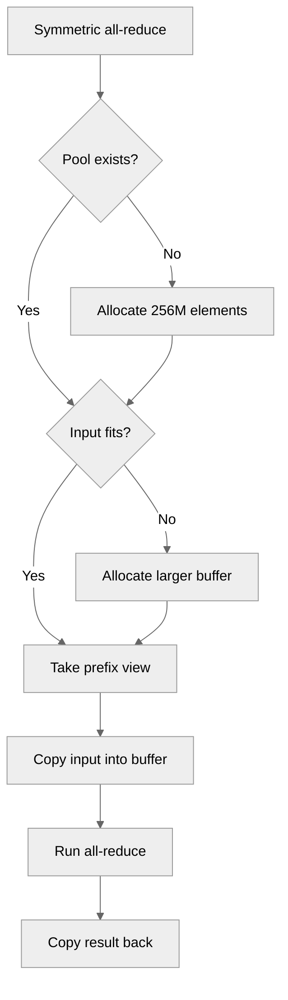

# Symmetric Memory Pool

[Upstream PR](https://github.com/NVIDIA/TransformerEngine/pull/2037) · state: closed · merged: False

## Original PR description

# Description

This is a more memory efficient version for using symmetric memory all reduces. We use a pool of symmetric memory that we grow if we need it to be larger and slice into the pool.

## Type of change

- [ ] Documentation change (change only to the documentation, either a fix or a new content)
- [ ] Bug fix (non-breaking change which fixes an issue)
- [ ] New feature (non-breaking change which adds functionality)
- [ ] Breaking change (fix or feature that would cause existing functionality to not work as expected)
- [ ] Infra/Build change
- [ ] Code refactoring

## Changes

Please list the changes introduced in this PR:

- Change A
- Change B

# Checklist:

- [ ] I have read and followed the [contributing guidelines](https://github.com/NVIDIA/TransformerEngine/blob/main/CONTRIBUTING.rst)
- [ ] The functionality is complete
- [ ] I have commented my code, particularly in hard-to-understand areas
- [ ] I have made corresponding changes to the documentation
- [ ] My changes generate no new warnings
- [ ] I have added tests that prove my fix is effective or that my feature works
- [ ] New and existing unit tests pass locally with my changes


## Review and discussion

### reviews

- greptile-apps[bot] · COMMENTED · 2026-03-11T22:24:34Z · [source](https://github.com/NVIDIA/TransformerEngine/pull/2037#pullrequestreview-3932898835)

(No body; status only.)

- greptile-apps[bot] · COMMENTED · 2026-10-19T16:25:27Z · [source](https://github.com/NVIDIA/TransformerEngine/pull/2037#pullrequestreview-5574555027)

(No body; status only.)

### issue_comments

- ksivaman · comment · 2025-08-11T04:32:35Z · [source](https://github.com/NVIDIA/TransformerEngine/pull/2037#issuecomment-3173244390)

/te-ci pytorch

- ksivaman · comment · 2025-08-16T05:12:06Z · [source](https://github.com/NVIDIA/TransformerEngine/pull/2037#issuecomment-3193397252)

/te-ci pytorch

- greptile-apps[bot] · comment · 2026-03-11T22:24:28Z · [source](https://github.com/NVIDIA/TransformerEngine/pull/2037#issuecomment-4042629435)

<!-- greptile_summary -->

<h2><a href="https://app.greptile.com/api/retrigger?id=13958335"><picture><source media="(prefers-color-scheme: dark)" srcset="https://greptile-static-assets.s3.amazonaws.com/badges/RetriggerDark.svg?v=2"><source media="(prefers-color-scheme: light)" srcset="https://greptile-static-assets.s3.amazonaws.com/badges/Retrigger.svg?v=2"></picture></a><a href="https://app.greptile.com/nvidia-public-github/github/NVIDIA/transformerengine/-/pull/2037"><picture><source media="(prefers-color-scheme: dark)" srcset="https://greptile-static-assets.s3.amazonaws.com/badges/ViewInGreptileDark.svg?v=2"><source media="(prefers-color-scheme: light)" srcset="https://greptile-static-assets.s3.amazonaws.com/badges/ViewInGreptile.svg?v=2"></picture></a>Confidence Score: 3/5</h2>

**[High impact]** Replaces symmetric memory cache with a pooling system\.

The PR needs changes before merging because small reductions can now exhaust GPU memory, and repeated singleton access still clears cached buffers.

<h2>Findings</h2>

1. &nbsp;**Small reductions reserve large buffers** <a href="https://github.com/NVIDIA/TransformerEngine/pull/2037#discussion_r4316228120">▶</a>
2. &nbsp;**initialized  flag never set to  True** <a href="https://github.com/NVIDIA/TransformerEngine/pull/2037#discussion_r2921310595">▶</a>
3. &nbsp;**Pool operations not protected by   lock** <a href="https://github.com/NVIDIA/TransformerEngine/pull/2037#discussion_r2921310691">▶</a>

<h3>Summary</h3>

Replaces the size-keyed symmetric-memory cache with reusable buffers grouped by data type, device, and process group.
- Symmetric all-reduces share a growable buffer for each tensor type, device, and group.

<h3>Diagram</h3>



<!-- greptile_confidence_score:3 -->

<sub>Reviews (2) · Last reviewed commit: ["Merge branch &#39;main&#39; into symmetric-mem-p..."](https://github.com/nvidia/transformerengine/commit/614b17666795554e7dfb13aaedae8850dbc5ba8e) · [Reviewed by Greptile](https://www.greptile.com/?utm_source=greptile_review&utm_medium=github&utm_campaign=review_public&utm_content=nvidia/transformerengine)</sub>

- Sunt-ing · comment · 2026-10-18T15:09:33Z · [source](https://github.com/NVIDIA/TransformerEngine/pull/2037#issuecomment-6251492380)

Hi @wdykas, I hit the same cache growth while fixing Megatron's batch-invariant TP inference and opened #3709 with a small scratch-buffer fix. Would you prefer folding this work into #2037 or proceeding with #3709?


- wdykas · comment · 2026-10-19T14:25:52Z · [source](https://github.com/NVIDIA/TransformerEngine/pull/2037#issuecomment-6269584094)

@Sunt-ing oh wow that PR got list in the fold at some point. Lets just go with yours mine is like over a year old

- ksivaman · comment · 2026-10-19T17:10:11Z · [source](https://github.com/NVIDIA/TransformerEngine/pull/2037#issuecomment-6272824651)

Closing in favor of #3709.

Claude also spots a use-after-free bug in [this line](https://github.com/NVIDIA/TransformerEngine/pull/2037/changes#diff-a5b36ec3602f12e3ca9f1922034ca28b2c9b29441c84d8073e79e1a0fda2d5daR2157), which makes sense as it is possible for that buffer to still have the old address.


### inline_comments

- greptile-apps[bot] · comment · 2026-03-11T22:24:31Z · [source](https://github.com/NVIDIA/TransformerEngine/pull/2037#discussion_r2921310595)

File: `transformer_engine/pytorch/distributed.py` · line 1897

**`_initialized` flag never set to `True`**

The `__init__` guard checks `self._initialized` but never sets it to `True` after initialization. Since `__new__` sets `_initialized = False` on the instance and `__init__` never flips it to `True`, every subsequent call to `SymmetricMemoryBufferPool()` or `get_instance()` will fall through the guard and reinitialize the singleton — resetting `self.pools` and `self.pool_sizes` to empty dicts and discarding all cached symmetric memory buffers.

This directly defeats the purpose of the singleton pool. Any code path that calls `SymmetricMemoryBufferPool.get_instance()` (which calls `cls()`) will silently blow away the pool.

```suggestion
    def __init__(self):
        # Ensure __init__ is only called once
        if self._initialized:
            return

        self.pools: Dict[Tuple, torch.Tensor] = {}  # (dtype, device, group_name) -> buffer
        self.pool_sizes: Dict[Tuple, int] = {}  # Track allocated sizes
        self.initial_pool_size = 1024 * 1024 * 256  # 256M elements initially
        self.growth_factor = 2.0
        self._initialized = True
```

- greptile-apps[bot] · comment · 2026-03-11T22:24:32Z · [source](https://github.com/NVIDIA/TransformerEngine/pull/2037#discussion_r2921310642)

File: `transformer_engine/pytorch/distributed.py` · line 1932

**Pool growth requires coordinated rendezvous across all ranks**

`_grow_pool` calls `symm_mem.rendezvous(new_buffer, group=tp_group)`, which is a collective operation — every rank in `tp_group` must call it at the same time. Growth is triggered when `tensor_numel > current_size`, which is determined independently on each rank.

If ranks consistently process all-reduce tensors of the same shape (the typical case for tensor parallelism), all ranks will grow together and the rendezvous will succeed. However, if shapes ever differ across ranks — for example during the very first `_create_pool` call if initialization order is skewed, or if variable-sequence-length workloads produce differently-shaped tensors — some ranks will enter rendezvous while others do not, causing a hang.

It would be worth adding a comment explicitly documenting the requirement that all ranks must hit growth (and creation) conditions simultaneously, and considering whether an assertion or logging could help detect mismatches during debugging.

- greptile-apps[bot] · comment · 2026-03-11T22:24:33Z · [source](https://github.com/NVIDIA/TransformerEngine/pull/2037#discussion_r2921310691)

File: `transformer_engine/pytorch/distributed.py` · line 1928

**Pool operations not protected by `_lock`**

`_lock` is used in `__new__` to guard singleton creation, but `get_buffer_slice`, `_create_pool`, and `_grow_pool` are all unprotected. A race between two threads calling `get_buffer_slice` with the same `pool_key` for the first time could cause `_create_pool` to be called twice, triggering a double rendezvous and corrupting the pool state.

While PyTorch training is typically driven from a single thread, adding a per-instance lock (separate from the class-level `_lock`) around the check-then-act sections would make the implementation safe by construction and easier to reason about.

```suggestion
        with self._instance_lock:
            # Initialize pool if it doesn't exist
            if pool_key not in self.pools:
                self._create_pool(
                    pool_key, self.initial_pool_size, tensor_dtype, tensor_device, tp_group
                )

            # Check if we need to grow the pool
            current_size = self.pool_sizes[pool_key]
            if tensor_numel > current_size:
                # Grow to at least accommodate the requested size
                new_size = max(int(current_size * self.growth_factor), tensor_numel)
                self._grow_pool(pool_key, new_size, tensor_dtype, tensor_device, tp_group)

            # Return a view/slice of the buffer
            buffer = self.pools[pool_key]
            return buffer[:tensor_numel]
```
(You would also need to add `self._instance_lock = threading.Lock()` in `__init__`.)

- greptile-apps[bot] · comment · 2026-10-19T16:25:26Z · [source](https://github.com/NVIDIA/TransformerEngine/pull/2037#discussion_r4316228120)

File: `transformer_engine/pytorch/distributed.py` · line 1921

<a href="#"></a> **Small reductions reserve large buffers**

Every new pool allocates 256M elements before checking the requested size. Even a small all-reduce now reserves 512 MiB for BF16 or 1 GiB for FP32 per device and process group. If a training run has less spare GPU memory, its first symmetric all-reduce can fail even though the old cache allocated only the requested size.

Size the first buffer from `tensor_numel`. This also avoids allocating an undersized buffer immediately before growing it.

## Changed files and fixed code

- `transformer_engine/pytorch/distributed.py` · modified · additions 133 / deletions 67
  - [head](https://github.com/wdykas/TransformerEngine/blob/614b17666795554e7dfb13aaedae8850dbc5ba8e/transformer_engine/pytorch/distributed.py)
  - [base](https://github.com/NVIDIA/TransformerEngine/blob/eb3c860a4d3394b7eb5e21dba3021fa10782a52e/transformer_engine/pytorch/distributed.py)

## Evidence and interpretation boundary

[Original JSON, discussions and patches](../../../../../../evidence/prs/NVIDIA--TransformerEngine/2037-62e7ce2e4850f82d20a6b79f69cf24b67fc257d50405ce79967ee45457aec516.json) · SHA-256 `62e7ce2e4850f82d20a6b79f69cf24b67fc257d50405ce79967ee45457aec516`.

Diff complete: True. Missing/binary/truncated patches require pinned source inspection. This is a source page, not an independently verified optimization case. Open, merged and released are different states; recheck the deployed dependency.
