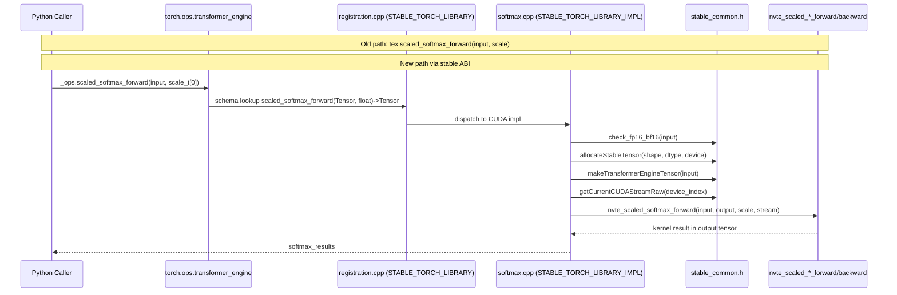

# Port softmax ops to libtorch stable ABI

[Upstream PR](https://github.com/NVIDIA/TransformerEngine/pull/2830) · state: closed · merged: False

## Original PR description

Proof of concept for migrating pybind11 functions to the PyTorch stable ABI. Ports all 8 scaled softmax functions:

- Add stable_common.h with stable ABI helpers (tensor allocation, TensorWrapper construction, CUDA stream, dtype converters)
- Add registration.cpp with STABLE_TORCH_LIBRARY schema definitions
- Rewrite softmax.cpp: at::Tensor -> torch::stable::Tensor, use stable allocation and stream APIs, TORCH_BOX() for impl registration
- Remove softmax registrations from pybind.cpp
- Update Python callers to use torch.ops.transformer_engine_stable

The pattern is mechanical (API translation, no logic changes) and establishes the template for porting the remaining ~70 Category A functions that have no py::handle/py::object dependencies.

Breakdown of currently registered functions by category: https://docs.google.com/spreadsheets/d/1p9bgmas65M03-yak3zmPImMLXfb7mp2fG_VVcJPNFqo/edit?gid=1617092873#gid=1617092873

## Review and discussion

### reviews

- greptile-apps[bot] · COMMENTED · 2026-04-03T14:22:17Z · [source](https://github.com/NVIDIA/TransformerEngine/pull/2830#pullrequestreview-4055925038)

(No body; status only.)

- pstjohn · COMMENTED · 2026-04-03T14:34:11Z · [source](https://github.com/NVIDIA/TransformerEngine/pull/2830#pullrequestreview-4055969928)

(No body; status only.)

- pstjohn · COMMENTED · 2026-04-03T14:34:19Z · [source](https://github.com/NVIDIA/TransformerEngine/pull/2830#pullrequestreview-4055970316)

(No body; status only.)

- pstjohn · COMMENTED · 2026-04-03T14:34:28Z · [source](https://github.com/NVIDIA/TransformerEngine/pull/2830#pullrequestreview-4055970961)

(No body; status only.)

- pstjohn · COMMENTED · 2026-04-03T14:34:39Z · [source](https://github.com/NVIDIA/TransformerEngine/pull/2830#pullrequestreview-4055971628)

(No body; status only.)

- timmoon10 · COMMENTED · 2026-04-03T21:13:17Z · [source](https://github.com/NVIDIA/TransformerEngine/pull/2830#pullrequestreview-4056856367)

This is quite nice and straightforward. The only real issue is that this requires bumping the minimum PyTorch version.

- pstjohn · COMMENTED · 2026-04-03T21:31:19Z · [source](https://github.com/NVIDIA/TransformerEngine/pull/2830#pullrequestreview-4057363640)

(No body; status only.)

- pstjohn · COMMENTED · 2026-04-03T21:32:26Z · [source](https://github.com/NVIDIA/TransformerEngine/pull/2830#pullrequestreview-4057369467)

(No body; status only.)

- pstjohn · COMMENTED · 2026-04-03T21:39:15Z · [source](https://github.com/NVIDIA/TransformerEngine/pull/2830#pullrequestreview-4057406919)

(No body; status only.)

- ptrendx · COMMENTED · 2026-04-03T21:46:25Z · [source](https://github.com/NVIDIA/TransformerEngine/pull/2830#pullrequestreview-4057423316)

(No body; status only.)

- pstjohn · COMMENTED · 2026-04-03T21:48:26Z · [source](https://github.com/NVIDIA/TransformerEngine/pull/2830#pullrequestreview-4057428008)

(No body; status only.)

- timmoon10 · COMMENTED · 2026-04-03T23:58:39Z · [source](https://github.com/NVIDIA/TransformerEngine/pull/2830#pullrequestreview-4057704539)

(No body; status only.)

- pstjohn · COMMENTED · 2026-04-04T00:02:57Z · [source](https://github.com/NVIDIA/TransformerEngine/pull/2830#pullrequestreview-4057713023)

(No body; status only.)

### issue_comments

- greptile-apps[bot] · comment · 2026-04-03T14:22:09Z · [source](https://github.com/NVIDIA/TransformerEngine/pull/2830#issuecomment-4183685272)

<h3>Greptile Summary</h3>

This PR ports all 8 scaled softmax CUDA operations from pybind11 (`transformer_engine_torch`) to PyTorch's stable ABI (`torch.ops.transformer_engine`), establishing the pattern for migrating the remaining ~70 Category A functions. The minimum PyTorch version is bumped from 2.1 to 2.10 (required for the stable ABI headers) consistently across all four manifest files.

All concerns raised in prior review rounds have been resolved: dtype validation is restored via `check_fp16_bf16()` in `stable_common.h`, mask shape guards are present in `scaled_masked_softmax_forward`, and the square-matrix check is back in `scaled_upper_triang_masked_softmax_backward`. The translation is otherwise mechanical with no logic changes.

<h3>Confidence Score: 5/5</h3>

Safe to merge — all previously raised P0/P1 issues are resolved and no new defects were found.

Every critical validation guard (dtype, mask shape, square-matrix check) that was flagged in earlier review rounds is present in the current code. The API translation is faithful to the original logic, the new stable ABI registration pattern is self-consistent (single STABLE_TORCH_LIBRARY owner in registration.cpp, STABLE_TORCH_LIBRARY_IMPL dispatch in softmax.cpp), and the version bump is applied uniformly across all four manifests. No remaining P1 or P0 findings.

No files require special attention.

<h3>Important Files Changed</h3>


| Filename | Overview |
|----------|----------|
| transformer_engine/pytorch/csrc/stable_common.h | New header providing stable ABI helpers: dtype conversion, stream acquisition, TensorWrapper construction, tensor allocation, and the check_fp16_bf16 validator restored after prior review. |
| transformer_engine/pytorch/csrc/extensions/softmax.cpp | Core migration of all 8 softmax ops from at::Tensor/pybind11 to torch::stable::Tensor; all previously flagged validations (dtype, mask shape, square-matrix check) are present in the current file. |
| transformer_engine/pytorch/csrc/extensions/registration.cpp | New file that owns the "transformer_engine" STABLE_TORCH_LIBRARY namespace and registers schemas for all 8 softmax ops; sets the convention for future fragment registrations. |
| transformer_engine/pytorch/attention/dot_product_attention/softmax.py | Switches all 8 op call sites from tex.* (pybind11) to torch.ops.transformer_engine.*; module-level _ops binding is intentionally lazy and safe. |
| transformer_engine/pytorch/__init__.py | Version gate bumped from (2, 1) to (2, 10); packaging.version.Version.release returns a full tuple so the tuple comparison is correct. |
| transformer_engine/pytorch/csrc/extensions/pybind.cpp | Removes all 8 softmax pybind11 bindings; no remaining references to the removed functions. |
| transformer_engine/pytorch/csrc/extensions.h | Removes the 8 softmax C++ function declarations from the pybind header; clean removal. |
| build_tools/pytorch.py | Bumps torch install requirement from >=2.1 to >=2.10, consistent with the stable ABI dependency. |
| pyproject.toml | Bumps torch build requirement from >=2.1 to >=2.10 in the root build-system spec. |
| transformer_engine/pytorch/pyproject.toml | Bumps the pytorch sub-package build requirement to torch>=2.10, completing the version bump across all manifests. |

</details>


<h3>Sequence Diagram</h3>



<!-- greptile_other_comments_section -->

<sub>Reviews (3): Last reviewed commit: ["Port softmax ops to libtorch stable ABI"](https://github.com/nvidia/transformerengine/commit/e0bae007c5eaa37faf45bcb50f04bb27ba9f3f7f) | [Re-trigger Greptile](https://app.greptile.com/api/retrigger?id=27279555)</sub>

- pstjohn · comment · 2026-04-03T14:27:52Z · [source](https://github.com/NVIDIA/TransformerEngine/pull/2830#issuecomment-4183707644)

/te-ci pytorch

- pstjohn · comment · 2026-04-03T21:43:42Z · [source](https://github.com/NVIDIA/TransformerEngine/pull/2830#issuecomment-4185335057)

Here's a demo PR for the next set of easy modules:
https://github.com/pstjohn/TransformerEngine/pull/2

- pggPL · comment · 2026-10-28T17:08:15Z · [source](https://github.com/NVIDIA/TransformerEngine/pull/2830#issuecomment-6475516631)

there is other ongoing approach of incorporating stable ABI

### inline_comments

- greptile-apps[bot] · comment · 2026-04-03T14:22:13Z · [source](https://github.com/NVIDIA/TransformerEngine/pull/2830#discussion_r3033061524)

File: `transformer_engine/pytorch/csrc/extensions/softmax.cpp` · line 99

<a href="#"></a> **Missing mask shape validation dropped**

The original `scaled_masked_softmax_forward` contained four `TORCH_CHECK` guards that validated the mask tensor's shape against the input before launching the CUDA kernel:

```cpp
TORCH_CHECK(pad_batches == 1 || pad_batches == batches);
TORCH_CHECK(mask.size(1) == 1);
TORCH_CHECK(mask.size(2) == query_seq_len);
TORCH_CHECK(mask.size(3) == key_seq_len);
```

These are absent in the new implementation. When `torch.ops.transformer_engine.scaled_masked_softmax_forward` is called directly (e.g., from tests or custom code bypassing `FusedScaleMaskSoftmax`), a mask with incompatible dimensions would pass silently into `nvte_scaled_masked_softmax_forward` and cause illegal memory access or silent numerical corruption in the CUDA kernel. The Python caller's pre-flight check in `is_kernel_available` does not cover all code paths.

- greptile-apps[bot] · comment · 2026-04-03T14:22:14Z · [source](https://github.com/NVIDIA/TransformerEngine/pull/2830#discussion_r3033061601)

File: `transformer_engine/pytorch/csrc/extensions/softmax.cpp` · line 163

<a href="#"></a> **Square-tensor check removed from `scaled_upper_triang_masked_softmax_backward`**

The original implementation included:
```cpp
TORCH_CHECK(output_grads.size(1) == output_grads.size(2));
```

The upper-triangular masked softmax backward requires the attention matrix to be square. This guard is gone. If `output_grads` is passed with a non-square shape (e.g. a rectangular cross-attention gradient), the CUDA kernel will operate on incorrect dimensions, producing wrong gradients or an out-of-bounds access.

- greptile-apps[bot] · comment · 2026-04-03T14:22:15Z · [source](https://github.com/NVIDIA/TransformerEngine/pull/2830#discussion_r3033061702)

File: `transformer_engine/pytorch/csrc/extensions/softmax.cpp` · line 40

<a href="#"></a> **Dtype validation removed for all softmax ops**

The original implementation rejected unsupported dtypes with a clear error message:
```cpp
AT_ASSERTM((input.scalar_type() == at::ScalarType::Half) ||
               (input.scalar_type() == at::ScalarType::BFloat16),
           "Only fp16 and bf16 are supported");
```

This guard is removed from all 8 functions. `GetTransformerEngineDType` in `stable_common.h` will happily map `Float` → `kFloat32`, `Int` → `kInt32`, etc., allowing unsupported dtypes to reach the CUDA kernels. The Python caller's `is_kernel_available` filters to `self.input_in_float16`, but direct op invocations bypass this check.

- greptile-apps[bot] · comment · 2026-04-03T14:22:16Z · [source](https://github.com/NVIDIA/TransformerEngine/pull/2830#discussion_r3033061800)

File: `transformer_engine/pytorch/attention/dot_product_attention/softmax.py` · line 12

<a href="#"></a> **Module-level op namespace binding may hide load-time errors**

`_ops = torch.ops.transformer_engine` is evaluated at import time. `torch.ops` provides a lazy namespace so this line itself doesn't fail, but any subsequent attribute access (e.g. `_ops.scaled_softmax_forward`) will raise `AttributeError` if the native library hasn't been loaded yet. Accessing the namespace at call time or guarding with `try/except` would give a clearer error message if the shared library fails to load.

- pstjohn · comment · 2026-04-03T14:34:11Z · [source](https://github.com/NVIDIA/TransformerEngine/pull/2830#discussion_r3033103521)

File: `transformer_engine/pytorch/csrc/extensions/softmax.cpp` · line 99

Fixed in 56111505 — restored all four mask shape guards (`pad_batches`, `mask.size(1) == 1`, query/key dim checks).

- pstjohn · comment · 2026-04-03T14:34:19Z · [source](https://github.com/NVIDIA/TransformerEngine/pull/2830#discussion_r3033103941)

File: `transformer_engine/pytorch/csrc/extensions/softmax.cpp` · line 163

Fixed in 56111505 — restored the square-shape check (`output_grads.sizes()[1] == output_grads.sizes()[2]`).

- pstjohn · comment · 2026-04-03T14:34:28Z · [source](https://github.com/NVIDIA/TransformerEngine/pull/2830#discussion_r3033104368)

File: `transformer_engine/pytorch/csrc/extensions/softmax.cpp` · line 40

Fixed in 56111505 — added `check_fp16_bf16()` helper in `stable_common.h` and restored dtype validation on all 8 functions.

- pstjohn · comment · 2026-04-03T14:34:39Z · [source](https://github.com/NVIDIA/TransformerEngine/pull/2830#discussion_r3033105060)

File: `transformer_engine/pytorch/attention/dot_product_attention/softmax.py` · line 12

`torch.ops` is a lazy namespace — `torch.ops.transformer_engine` succeeds even if the library is not loaded. The actual resolution happens at call time (e.g. `_ops.scaled_softmax_forward(...)`), which will raise a clear `AttributeError` if the op is not registered. Wrapping every call in try/except would add overhead without improving the error message, and failing at import time would be worse since it would prevent importing the module entirely even for code paths that don't use these ops.

- timmoon10 · comment · 2026-04-03T19:03:24Z · [source](https://github.com/NVIDIA/TransformerEngine/pull/2830#discussion_r3034010551)

File: `transformer_engine/pytorch/csrc/stable_common.h` · line 20

What is the minimum PyTorch version that will be required? I see that these files were first added in PyTorch 2.9.0. At the moment, I believe we only enforce 2.1+:
https://github.com/NVIDIA/TransformerEngine/blob/a88fdc1b8139c86e9e03507a4feba652cee0aa5f/transformer_engine/pytorch/__init__.py#L16

- timmoon10 · comment · 2026-04-03T20:59:39Z · [source](https://github.com/NVIDIA/TransformerEngine/pull/2830#discussion_r3034369476)

File: `transformer_engine/pytorch/csrc/extensions/pybind.cpp` · line None

Dead comment.

- timmoon10 · comment · 2026-04-03T21:04:27Z · [source](https://github.com/NVIDIA/TransformerEngine/pull/2830#discussion_r3034384048)

File: `transformer_engine/pytorch/csrc/extensions.h` · line None

It's helpful how coding assistants will add notes so you can follow along with what it did, but keeping them in the code results in useless comments. We don't need the code to keep a historical log of how it's changed, that's what Git is for.
```suggestion
```

- pstjohn · comment · 2026-04-03T21:31:19Z · [source](https://github.com/NVIDIA/TransformerEngine/pull/2830#discussion_r3034458593)

File: `transformer_engine/pytorch/csrc/stable_common.h` · line 20

Ah, yes. Probably 2.10 to be honest, [torch::stable::empty](https://docs.pytorch.org/cppdocs/api/function_namespacetorch_1_1stable_1a4630f53cacac471d5a37d0e110640835.html) was added there

- pstjohn · comment · 2026-04-03T21:32:26Z · [source](https://github.com/NVIDIA/TransformerEngine/pull/2830#discussion_r3034463516)

File: `transformer_engine/pytorch/csrc/extensions.h` · line None

I think the idea is that, 🤞, we'll eventually remove this file entirely 😄

But i can definitely remove

- pstjohn · comment · 2026-04-03T21:39:15Z · [source](https://github.com/NVIDIA/TransformerEngine/pull/2830#discussion_r3034497792)

File: `transformer_engine/pytorch/csrc/extensions/pybind.cpp` · line None

removed!

- ptrendx · comment · 2026-04-03T21:46:25Z · [source](https://github.com/NVIDIA/TransformerEngine/pull/2830#discussion_r3034514739)

File: `build_tools/pytorch.py` · line 18

Requiring the (close to) latest Pytorch is a problem which I don't think we will be able to do before TE 3.0 to be honest.

- pstjohn · comment · 2026-04-03T21:48:26Z · [source](https://github.com/NVIDIA/TransformerEngine/pull/2830#discussion_r3034519510)

File: `build_tools/pytorch.py` · line 18

😢  fair enough -- is there a timeline for TE 3.0?

The alternative, that might let us get away with a lower pytorch version at the cost of a more extensive refactor, is to make sure any work matrices get allocated on the python side and passed in as arguments

- timmoon10 · comment · 2026-04-03T23:58:39Z · [source](https://github.com/NVIDIA/TransformerEngine/pull/2830#discussion_r3034787621)

File: `build_tools/pytorch.py` · line 18

Unfortunately, we've found that allocating in Python has non-trivial CPU overhead compared to allocating in C++.

- pstjohn · comment · 2026-04-04T00:02:57Z · [source](https://github.com/NVIDIA/TransformerEngine/pull/2830#discussion_r3034793328)

File: `build_tools/pytorch.py` · line 18

If we could validate this and get through all the ops, it would be cool if we could completely remove the pybind11 library in TE 3.0 🤷

## Changed files and fixed code

- `build_tools/pytorch.py` · modified · additions 9 / deletions 1
  - [head](https://github.com/pstjohn/TransformerEngine/blob/e0bae007c5eaa37faf45bcb50f04bb27ba9f3f7f/build_tools/pytorch.py)
  - [base](https://github.com/NVIDIA/TransformerEngine/blob/a88fdc1b8139c86e9e03507a4feba652cee0aa5f/build_tools/pytorch.py)
- `pyproject.toml` · modified · additions 1 / deletions 1
  - [head](https://github.com/pstjohn/TransformerEngine/blob/e0bae007c5eaa37faf45bcb50f04bb27ba9f3f7f/pyproject.toml)
  - [base](https://github.com/NVIDIA/TransformerEngine/blob/a88fdc1b8139c86e9e03507a4feba652cee0aa5f/pyproject.toml)
- `transformer_engine/pytorch/__init__.py` · modified · additions 1 / deletions 1
  - [head](https://github.com/pstjohn/TransformerEngine/blob/e0bae007c5eaa37faf45bcb50f04bb27ba9f3f7f/transformer_engine/pytorch/__init__.py)
  - [base](https://github.com/NVIDIA/TransformerEngine/blob/a88fdc1b8139c86e9e03507a4feba652cee0aa5f/transformer_engine/pytorch/__init__.py)
- `transformer_engine/pytorch/attention/dot_product_attention/softmax.py` · modified · additions 10 / deletions 9
  - [head](https://github.com/pstjohn/TransformerEngine/blob/e0bae007c5eaa37faf45bcb50f04bb27ba9f3f7f/transformer_engine/pytorch/attention/dot_product_attention/softmax.py)
  - [base](https://github.com/NVIDIA/TransformerEngine/blob/a88fdc1b8139c86e9e03507a4feba652cee0aa5f/transformer_engine/pytorch/attention/dot_product_attention/softmax.py)
- `transformer_engine/pytorch/csrc/extensions.h` · modified · additions 0 / deletions 26
  - [head](https://github.com/pstjohn/TransformerEngine/blob/e0bae007c5eaa37faf45bcb50f04bb27ba9f3f7f/transformer_engine/pytorch/csrc/extensions.h)
  - [base](https://github.com/NVIDIA/TransformerEngine/blob/a88fdc1b8139c86e9e03507a4feba652cee0aa5f/transformer_engine/pytorch/csrc/extensions.h)
- `transformer_engine/pytorch/csrc/extensions/pybind.cpp` · modified · additions 0 / deletions 26
  - [head](https://github.com/pstjohn/TransformerEngine/blob/e0bae007c5eaa37faf45bcb50f04bb27ba9f3f7f/transformer_engine/pytorch/csrc/extensions/pybind.cpp)
  - [base](https://github.com/NVIDIA/TransformerEngine/blob/a88fdc1b8139c86e9e03507a4feba652cee0aa5f/transformer_engine/pytorch/csrc/extensions/pybind.cpp)
- `transformer_engine/pytorch/csrc/extensions/registration.cpp` · added · additions 30 / deletions 0
  - [head](https://github.com/pstjohn/TransformerEngine/blob/e0bae007c5eaa37faf45bcb50f04bb27ba9f3f7f/transformer_engine/pytorch/csrc/extensions/registration.cpp)
  - [base](https://github.com/NVIDIA/TransformerEngine/blob/a88fdc1b8139c86e9e03507a4feba652cee0aa5f/transformer_engine/pytorch/csrc/extensions/registration.cpp)
- `transformer_engine/pytorch/csrc/extensions/softmax.cpp` · modified · additions 144 / deletions 146
  - [head](https://github.com/pstjohn/TransformerEngine/blob/e0bae007c5eaa37faf45bcb50f04bb27ba9f3f7f/transformer_engine/pytorch/csrc/extensions/softmax.cpp)
  - [base](https://github.com/NVIDIA/TransformerEngine/blob/a88fdc1b8139c86e9e03507a4feba652cee0aa5f/transformer_engine/pytorch/csrc/extensions/softmax.cpp)
- `transformer_engine/pytorch/csrc/stable_common.h` · added · additions 135 / deletions 0
  - [head](https://github.com/pstjohn/TransformerEngine/blob/e0bae007c5eaa37faf45bcb50f04bb27ba9f3f7f/transformer_engine/pytorch/csrc/stable_common.h)
  - [base](https://github.com/NVIDIA/TransformerEngine/blob/a88fdc1b8139c86e9e03507a4feba652cee0aa5f/transformer_engine/pytorch/csrc/stable_common.h)
- `transformer_engine/pytorch/pyproject.toml` · modified · additions 1 / deletions 1
  - [head](https://github.com/pstjohn/TransformerEngine/blob/e0bae007c5eaa37faf45bcb50f04bb27ba9f3f7f/transformer_engine/pytorch/pyproject.toml)
  - [base](https://github.com/NVIDIA/TransformerEngine/blob/a88fdc1b8139c86e9e03507a4feba652cee0aa5f/transformer_engine/pytorch/pyproject.toml)

## Evidence and interpretation boundary

[Original JSON, discussions and patches](../../../../../../evidence/prs/NVIDIA--TransformerEngine/2830-9429fed9ab2581221e129989b9525da0cfcd52ee76604327b7e150993447fd9c.json) · SHA-256 `9429fed9ab2581221e129989b9525da0cfcd52ee76604327b7e150993447fd9c`.

Diff complete: True. Missing/binary/truncated patches require pinned source inspection. This is a source page, not an independently verified optimization case. Open, merged and released are different states; recheck the deployed dependency.
