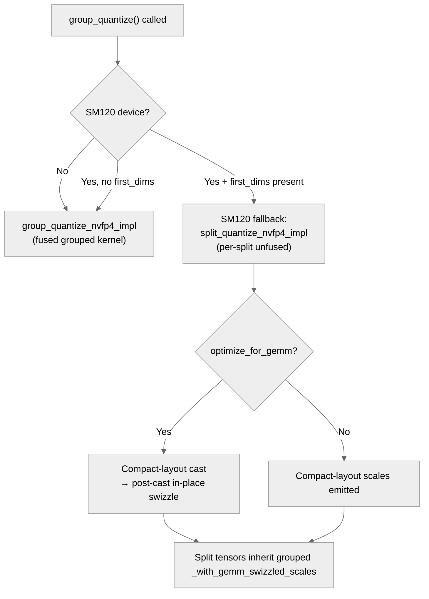

# [Pyt][Common] Enabling/Guarding sm120 support (non - attention)

[Upstream PR](https://github.com/NVIDIA/TransformerEngine/pull/2833) · state: open · merged: False

## Original PR description

# Description

This PR is a follow up to : https://github.com/NVIDIA/TransformerEngine/pull/2693.

PR https://github.com/NVIDIA/TransformerEngine/pull/2693 aimed to enable/guard PyT attention for sm120 
This PR aims to enable/guard non-attention for sm120 (and a small attn related regression fix)

Fixes # (issue)


## Type of change

- [ ] Documentation change (change only to the documentation, either a fix or a new content)
- [ ] Bug fix (non-breaking change which fixes an issue)
- [X] New feature (non-breaking change which adds functionality)
- [ ] Breaking change (fix or feature that would cause existing functionality to not work as expected)
- [ ] Infra/Build change
- [ ] Code refactoring

## Changes

**Runtime/backend guards for SM120 correctness**
- Disabled gated TMA backward kernels to avoid kernel launch failures tied to shared-memory constraints.
- Forced unfused NVFP4 RHT path to avoid fused RHT shared-memory/resource overreach.
- Disabled NVFP4 stochastic rounding on backend paths in `csrc/quantizer.cpp` due to unsupported `.rs ` PTX.
- Added grouped NVFP4 fallback in cast extension (`csrc/extensions/cast.cpp`) to use safer per-split processing.
- Added grouped GEMM runtime guard in `gemm/cublaslt_grouped_gemm.cu` because cuBLASLt grouped GEMM heuristic returns unsupported (for affected BF16/FP8 cases).

**General Bug fix (not SM120 specific)**
I stumbled upon this bug specifically when I was testing on SM120, but it is an arch agnostic fix.
- Fixed MXFP8 CAST_DBIAS shared-memory handoff race
    - Ensured async shared->global source consumption is complete and all warps reach safe reuse point 

**NVFP4 grouped quantization layout consistency for SM120**
- Aligned grouped NVFP4 metadata with actual SM120 fallback output layout in `csrc/quantizer.cpp`:
    - default: metadata follows optimize_for_gemm,
    - SM120 grouped fallback (first_dims present): force unswizzled metadata.
- Propagated grouped layout metadata into split tensor views in `grouped_tensor_storage.py` so split tensors inherit true grouped layout state.
- Updated grouped NVFP4 tests in `test_nvfp4_group_quantize_graph_safe.py` to compare against metadata-selected reference layout and use scoped SM120 tolerance behavior.

**Test changes (SM120 specific)**
- NVFP4 SR tests: in `test_nvfp4_sr_quantize.py`, changed SM120 expectation from SR < RN to numerical equivalence (assert_close) because SR is disabled on SM120 backend.
- FP8 CS numerics: in `run_layer_with_overlap.py`, added SM120-only looser tolerance for fp8_current_scaling (rtol=0.4, atol=0.25) in deterministic fallback backend scenarios (I borrowed these tolerances from the corresponding distributed test file `run_numerics.py`)
- BF16 multi-layer overlap numerics: added narrowly-scoped SM120 tolerance relaxation (rtol=0.05, atol=0.01) for TransformerLayer, multi-layer, overlap_rs_dgrad when deterministic mode routes away from fused attention.
- THD-vs-dense tolerance and grouped GEMM skips in `test_numerics.py`, C++ grouped GEMM operator tests, and PyTorch grouped GEMM numerics to match explicit SM120 unsupported/runtime-guarded paths.
- Skipped SM120 NVFP4 paged-stashing grouped-quantize case due to observed IMA in current kernel assumptions for paged layouts.

**SM120 coverage/test harness updates**
- Made custom-recipe grouped-linear shapes 16-aligned on SM120 because the SM120 FP8 GEMM path enforces leading-dimension alignment (`lda % 16 == 0`) in backward.
- Narrow distributed debug/tolerance helper updates in `run_distributed.py` and related tests for observed SM120 outlier behavior.
- Relaxed one NVFP4 bias-grad check (single element outlier in `ffn1.bias.grad` exceeded prior absolute tolerances) for SM120 only

**Fused attention SM120 regression fix**
Reinstated lost SM120 conditionals in `fused_attn_f16_arbitrary_seqlen.cu` (This was likely lost during conflict resolution when merging of PR 2677):
- restored SM120-specific behavior for stats stride selection (use_ragged_stats path),
- restored SM120-aware output_S shape handling for THD + cuDNN >= 9.6.


# Checklist:

- [x] I have read and followed the [contributing guidelines](https://github.com/NVIDIA/TransformerEngine/blob/main/CONTRIBUTING.rst)
- [x] The functionality is complete
- [x] I have commented my code, particularly in hard-to-understand areas
- [ ] I have made corresponding changes to the documentation
- [x] My changes generate no new warnings
- [ ] I have added tests that prove my fix is effective or that my feature works
- [x] New and existing unit tests pass locally with my changes


## Review and discussion

### reviews

- greptile-apps[bot] · COMMENTED · 2026-04-22T22:37:03Z · [source](https://github.com/NVIDIA/TransformerEngine/pull/2833#pullrequestreview-4158292338)

(No body; status only.)

- greptile-apps[bot] · COMMENTED · 2026-04-23T18:51:30Z · [source](https://github.com/NVIDIA/TransformerEngine/pull/2833#pullrequestreview-4165037426)

(No body; status only.)

- greptile-apps[bot] · COMMENTED · 2026-04-24T17:26:15Z · [source](https://github.com/NVIDIA/TransformerEngine/pull/2833#pullrequestreview-4172303913)

(No body; status only.)

- timmoon10 · CHANGES_REQUESTED · 2026-04-28T20:00:17Z · [source](https://github.com/NVIDIA/TransformerEngine/pull/2833#pullrequestreview-4191389344)

(No body; status only.)

- timmoon10 · COMMENTED · 2026-04-28T20:07:33Z · [source](https://github.com/NVIDIA/TransformerEngine/pull/2833#pullrequestreview-4192024974)

(No body; status only.)

- greptile-apps[bot] · COMMENTED · 2026-04-28T20:08:08Z · [source](https://github.com/NVIDIA/TransformerEngine/pull/2833#pullrequestreview-4192028426)

(No body; status only.)

- greptile-apps[bot] · COMMENTED · 2026-05-29T18:50:36Z · [source](https://github.com/NVIDIA/TransformerEngine/pull/2833#pullrequestreview-4392067488)

(No body; status only.)

### issue_comments

- greptile-apps[bot] · comment · 2026-04-22T22:36:51Z · [source](https://github.com/NVIDIA/TransformerEngine/pull/2833#issuecomment-4300379879)

<h3>Greptile Summary</h3>

This PR guards and enables SM120 (Blackwell B200) support across non-attention PyTorch TE paths, following up on the attention-specific PR #2693. It also carries an arch-agnostic MXFP8 CAST_DBIAS shared-memory race fix and restores SM120 conditionals in fused attention that were lost during a prior merge conflict.

- **Runtime guards**: disables gated TMA backward kernels, stochastic-rounding PTX paths, and fused grouped-NVFP4/RHT kernels on SM120; blocks cuBLASLt grouped GEMM on SM120 and SM121; disables FlashAttention 4 on SM120.
- **NVFP4 grouped-quantize fallback**: on SM120, replaces the fused grouped kernel with a per-split unfused path and post-cast in-place swizzle to honor `optimize_for_gemm`; propagates the actual grouped layout into split tensor views.
- **Test / tolerance updates**: adds SM120-scoped tolerance relaxations, grouped-GEMM skips, and SR-equivalence assertions across multiple test files.

<h3>Confidence Score: 4/5</h3>

Safe to merge for SM120 hardware, but has a concrete gap for SM121 devices where several backend guards are incomplete.

The C++ runtime (cublaslt_grouped_gemm.cu) and C++ test skip (test_grouped_gemm.cu) both explicitly block SM121 alongside SM120, but is_sm120_device() and every Python-level capability check (== (12, 0)) only detect SM120. On SM121 hardware, the grouped NVFP4 fallback and stochastic-rounding disable won't activate, and the Python grouped-GEMM test skips won't fire — causing the C++ NVTE_CHECK to throw rather than producing a clean pytest skip. The rest of the changes (MXFP8 race fix, TMA kernel disable, FlashAttention 4 guard, fused-attention regression restore) look correct and well-scoped.

transformer_engine/pytorch/csrc/util.h (is_sm120_device), transformer_engine/pytorch/csrc/extensions/cast.cpp (SM120 fallback condition), tests/pytorch/test_fusible_ops.py (SM120 capability checks)

<h3>Important Files Changed</h3>


| Filename | Overview |
|----------|----------|
| transformer_engine/pytorch/csrc/util.h | Adds is_sm120_device() helper checking sm_arch == 120 exactly; misses SM121, which is already blocked at C++ runtime in grouped GEMM and C++ test skips. |
| transformer_engine/pytorch/csrc/extensions/cast.cpp | Large addition of SM120 grouped NVFP4 fallback (per-split path), post-cast in-place swizzle, and SR disable; fallback only activates when first_dims is present — unclear if graph-safe (no first_dims) path is safe on SM120. |
| transformer_engine/common/gemm/cublaslt_grouped_gemm.cu | Adds NVTE_CHECK blocking SM120 and SM121 for grouped GEMM; straightforward runtime guard consistent with C++ test skip. |
| transformer_engine/common/cast/mxfp8/quantize_mxfp8.cuh | Adds cp_async_bulk_wait_group_read + __syncthreads() before parity flip to fix MXFP8 CAST_DBIAS shared-memory handoff race; arch-agnostic fix that looks correct. |
| transformer_engine/common/fused_attn/fused_attn_f16_arbitrary_seqlen.cu | Restores two SM120-specific conditionals (stats stride and output_S shape) lost during prior merge conflict resolution. |
| tests/pytorch/test_fusible_ops.py | Skips grouped cuBLASLt GEMM tests on SM120 via (12, 0) capability check; gap: won't skip on SM121 which is also blocked at C++ runtime, causing a throw rather than clean skip. |

</details>


<h3>Flowchart</h3>



<!-- greptile_other_comments_section -->

<sub>Reviews (15): Last reviewed commit: ["Relax sanity atol for SM120 + NVFP4 quan..."](https://github.com/nvidia/transformerengine/commit/b5ddaaa063b9d7ef21ce33add5c383ea1ba112b7) | [Re-trigger Greptile](https://app.greptile.com/api/retrigger?id=29349890)</sub>

### inline_comments

- greptile-apps[bot] · comment · 2026-04-22T22:36:54Z · [source](https://github.com/NVIDIA/TransformerEngine/pull/2833#discussion_r3127260570)

File: `transformer_engine/common/common.cu` · line None

<a href="#"></a> **Debug/WIP comment and misleading function name**

The `// KL: test function for CC 120` comment should be removed before merging — it reads as a personal debug note rather than production documentation.

More importantly, the name `is_supported_by_CC_120()` is semantically inconsistent with `is_supported_by_CC_100()`. `is_supported_by_CC_100` returns `>= 100` (meaning "supported by CC 100 or newer"), so by analogy `is_supported_by_CC_120` would imply `>= 120`. However the implementation returns `== 120` (exclusively SM120). Every call site uses this to *disable* a feature on SM120, not to enable something on SM120+. A name like `is_exactly_CC_120()` or `is_CC_120_arch()` would prevent future readers from misinterpreting the range semantics.

- greptile-apps[bot] · comment · 2026-04-22T22:36:55Z · [source](https://github.com/NVIDIA/TransformerEngine/pull/2833#discussion_r3127260625)

File: `transformer_engine/common/cast/dispatch/gated.cuh` · line None

<a href="#"></a> **Leftover commented-out code and unresolved TODO**

The original line `//const bool use_tma_kernels = (cols % 32 == 0) && is_supported_by_CC_100();` is commented out rather than deleted, and the accompanying comment leaves an open investigation note ("KL: It is possible that for fwd, the limits are not exceeded for sm120. To be investigated …"). Production code shouldn't carry stale commented-out expressions or unresolved TODO author notes. The same pattern appears in the backward helper at line ~535. Please remove the commented-out line and convert the open question to a tracked issue.

- greptile-apps[bot] · comment · 2026-04-23T18:51:29Z · [source](https://github.com/NVIDIA/TransformerEngine/pull/2833#discussion_r3133072180)

File: `tests/pytorch/test_grouped_quantize_fp8_current_scaling.py` · line None

<a href="#"></a> **`@staticmethod` on `setup_class` will break pytest collection**

`@staticmethod` strips the implicit first-argument binding, so when pytest calls `TestGroupedQuantizeFP8CurrentScaling.setup_class()` it passes no arguments — but the function signature expects `cls`. This raises `TypeError: setup_class() missing 1 required positional argument: 'cls'`, causing the entire test class to fail collection. The correct decoration is `@classmethod`.

```suggestion
    @classmethod
    def setup_class(cls) -> None:
```

- greptile-apps[bot] · comment · 2026-04-24T17:26:13Z · [source](https://github.com/NVIDIA/TransformerEngine/pull/2833#discussion_r3139312334)

File: `transformer_engine/common/cast/grouped_fp8_current_scaling.cu` · line None

<a href="#"></a> **PTX x2 instruction writes 16 bits to a 1-byte variable — stack UB**

`cvt.rn.satfinite.e4m3x2.f32` converts **two** float32 values into a packed pair of FP8 E4M3 values and writes the result as a 16-bit quantity. The target, however, is `*reinterpret_cast<uint16_t*>(&result)` where `result` is a single `__nv_fp8_e4m3` (1 byte). This is a 2-byte write past a 1-byte allocation — undefined behaviour that silently corrupts an adjacent stack byte.

The same issue exists in `cast_to_fp8_e5m2_saturate` below.

Both functions appear unused today (kernels use `static_cast<OutputType>` via `pack_4xfp8`), but the UB should be fixed before these helpers are ever called. The minimal fix is to use a 2-element array as backing storage:

```cpp
// fix: use a 2-element array so the 16-bit write is in-bounds
__nv_fp8_e4m3 cast_to_fp8_e4m3_saturate(float val) {
#if __CUDA_ARCH__ >= 890
  __nv_fp8_e4m3 result[2];
  asm("cvt.rn.satfinite.e4m3x2.f32 %0, %1, %2;"
      : "=r"(*reinterpret_cast<uint16_t *>(result))
      : "f"(val), "f"(0.0f));
  return result[0];
#else
  ...
```

- greptile-apps[bot] · comment · 2026-04-24T17:26:14Z · [source](https://github.com/NVIDIA/TransformerEngine/pull/2833#discussion_r3139312412)

File: `transformer_engine/pytorch/csrc/extensions/grouped_fp8_bindings.cpp` · line None

<a href="#"></a> **`register_grouped_fp8_quantization_bindings` is never called — bindings are silently absent**

`register_grouped_fp8_quantization_bindings` is defined here and declared in `pybind_grouped_fp8.h`, but a search of all module-initialization files shows it is never invoked. As a result, `tex.group_fp8_quantize_rowwise`, `tex.group_fp8_quantize_columnwise`, and `tex.group_fp8_quantize_both` do not exist at runtime.

The tests that use these symbols are correctly marked `@pytest.mark.xfail(reason="Grouped kernels not yet implemented")`, so nothing breaks today. But a caller of `grouped_quantize.py`'s `grouped_quantize_current_scaling` outside the test harness would receive an `AttributeError` with no clear explanation.

Please either:
1. Add the call to the module init (once kernels are ready), or
2. Add an explicit `NotImplementedError` guard in `_grouped_compute_amax` / `_grouped_fp8_quantize_rowwise` so callers get a clear error instead of an `AttributeError`.

- timmoon10 · comment · 2026-04-28T18:23:18Z · [source](https://github.com/NVIDIA/TransformerEngine/pull/2833#discussion_r3156337399)

File: `transformer_engine/pytorch/csrc/util.h` · line 72

Shouldn't we be checking for any SM 12.X arch?
```suggestion
/*! \brief Check whether the current CUDA device is SM12X. */
inline bool is_sm12x_device() {
  return transformer_engine::cuda::sm_arch(transformer_engine::cuda::current_device()) / 10 == 12;
}
```
This pattern shows up throughout this PR.

- timmoon10 · comment · 2026-04-28T18:30:07Z · [source](https://github.com/NVIDIA/TransformerEngine/pull/2833#discussion_r3156370949)

File: `transformer_engine/pytorch/tensor/storage/grouped_tensor_storage.py` · line 1098

This comment (and the other one below) seems wrong to me. The contract is that I give `tex.group_quantize` a quantizer, and it gives me a matching grouped tensor. `tex.group_quantize` might internally have a fused or unfused implementation based on the SM arch, but externally I don't care since the results are the same.

- timmoon10 · comment · 2026-04-28T18:38:51Z · [source](https://github.com/NVIDIA/TransformerEngine/pull/2833#discussion_r3156413750)

File: `transformer_engine/pytorch/csrc/quantizer.cpp` · line None

The purpose of quantizers is to hide details of the recipes and supported kernel fusions. The contract is if the quantizer has `optimize_for_gemm=True`, then the quantized tensor has swizzled scales. The caller does not need to care or do any extra work depending on their system (or at least, they should get an error message). We should remove this logic and instead perform an unfused cast + swizzle in the quantize functions.

- timmoon10 · comment · 2026-04-28T18:46:43Z · [source](https://github.com/NVIDIA/TransformerEngine/pull/2833#discussion_r3156451032)

File: `transformer_engine/pytorch/csrc/quantizer.cpp` · line 2327

We should error out rather than silently ignoring user instructions:
```suggestion
  const bool use_stochastic_rounding = this->stochastic_rounding;
  if (use_stochastic_rounding && is_sm120_device()) {
    NVTE_ERROR("NVFP4 does not support stochastic rounding on SM 12X");
  }
  quant_config.set_stochastic_rounding(use_stochastic_rounding);
```

- timmoon10 · comment · 2026-04-28T18:55:03Z · [source](https://github.com/NVIDIA/TransformerEngine/pull/2833#discussion_r3156491165)

File: `transformer_engine/pytorch/csrc/extensions/cast.cpp` · line 90

Nit: I guess it's not that important since this is an internal helper function, but comments like this become wrong very quickly.

- timmoon10 · comment · 2026-04-28T19:11:21Z · [source](https://github.com/NVIDIA/TransformerEngine/pull/2833#discussion_r3156575684)

File: `transformer_engine/pytorch/csrc/extensions/cast.cpp` · line 1263

We need to handle the case where the quantizer has `optimize_for_gemm=True`. The right approach for SM 12.0 is to call the core lib with `with_gemm_swizzled_scales=false` and afterwards to call `swizzle_scales_for_gemm` if needed. That function exits early if the scales are already swizzled, so if we implement this right then we don't actually need a separate code path for SM 12.0.

- timmoon10 · comment · 2026-04-28T19:13:53Z · [source](https://github.com/NVIDIA/TransformerEngine/pull/2833#discussion_r3156587871)

File: `transformer_engine/pytorch/csrc/extensions/cast.cpp` · line None

We should respect `swizzle_scales_for_gemm`. The right approach is to swizzle the scales after the cast if needed.

- timmoon10 · comment · 2026-04-28T19:19:15Z · [source](https://github.com/NVIDIA/TransformerEngine/pull/2833#discussion_r3156615056)

File: `transformer_engine/common/common.cu` · line 284

Nit: This function name is wrong. It's not checking if anything is supported, but is just checking the current SM arch (aka "compute capability"). Something like `is_CC_100_or_newer` is more accurate.

- timmoon10 · comment · 2026-04-28T19:23:23Z · [source](https://github.com/NVIDIA/TransformerEngine/pull/2833#discussion_r3156636599)

File: `transformer_engine/common/gemm/cublaslt_grouped_gemm.cu` · line None

Nit: This error message is kind of missing the point in a very Claude-y way. The user cares if something isn't supported, but not exactly how an error would have manifested if we didn't have a check.
```suggestion
             " is currently unsupported on SM120. Heuristic selection "
             "will fail, even with relaxed hints.");
```
I'm not sure that mentioning the failure in heuristics is even that helpful.

- timmoon10 · comment · 2026-04-28T19:32:39Z · [source](https://github.com/NVIDIA/TransformerEngine/pull/2833#discussion_r3156684884)

File: `transformer_engine/common/cast/mxfp8/quantize_mxfp8.cuh` · line 498

This is the same fix as in #2921.
```suggestion
```

- timmoon10 · comment · 2026-04-28T19:36:35Z · [source](https://github.com/NVIDIA/TransformerEngine/pull/2833#discussion_r3156703016)

File: `tests/pytorch/test_fusible_ops.py` · line None

This bug seems like something we should fix, not hackily work around. Do we have any more info?
```suggestion
            torch.testing.assert_close(to_cpu(ffn1.bias.grad), b1_ref.grad, **tols)
```

- timmoon10 · comment · 2026-04-28T19:43:04Z · [source](https://github.com/NVIDIA/TransformerEngine/pull/2833#discussion_r3156741408)

File: `tests/pytorch/test_custom_recipe.py` · line None

I don't like how SM 120 logic is spilling out into unrelated tests. I'd prefer just increasing the batch size so it supports all cases. Similar for the other change in this file.

- timmoon10 · comment · 2026-04-28T19:44:44Z · [source](https://github.com/NVIDIA/TransformerEngine/pull/2833#discussion_r3156753362)

File: `tests/pytorch/nvfp4/test_nvfp4_sr_quantize.py` · line 32

Nit: I'd expect a function called `_assert_sr_vs_rn_behavior` to assert correct behavior in stochastic rounding vs round-to-nearest. A more accurate name would be something cumbersome like `_assert_sr_setting_vs_true_rn_behavior`, which is a sign of a design mistake (silently suppressing stochastic rounding rather than erroring out). One reason to put effort into choosing accurate names is that good names impose a tax on bad design.

- timmoon10 · comment · 2026-04-28T19:54:16Z · [source](https://github.com/NVIDIA/TransformerEngine/pull/2833#discussion_r3156801258)

File: `tests/pytorch/distributed/run_layer_with_overlap.py` · line 569

If the discrepancy is due to changes in the attention backend, we should only relax the tols with `MultiheadAttention` and `TransformerLayer`.

- timmoon10 · comment · 2026-04-28T19:58:20Z · [source](https://github.com/NVIDIA/TransformerEngine/pull/2833#discussion_r3156822040)

File: `tests/pytorch/debug/run_distributed.py` · line 54

This seems like a proper bug. If we run on SM 12.0, we _want_ the test to fail rather than giving us a false pass.

- timmoon10 · comment · 2026-04-28T20:07:33Z · [source](https://github.com/NVIDIA/TransformerEngine/pull/2833#discussion_r3156869944)

File: `transformer_engine/common/common.cu` · line 284

@greptile-apps had the same thought: https://github.com/NVIDIA/TransformerEngine/pull/2833#discussion_r3127260570

- greptile-apps[bot] · comment · 2026-04-28T20:08:08Z · [source](https://github.com/NVIDIA/TransformerEngine/pull/2833#discussion_r3156873068)

File: `transformer_engine/common/common.cu` · line 284

Agreed — both comments are pointing at the same underlying issue: these functions check the current device's compute capability, they don't determine whether a feature is "supported." The `is_supported_by_*` prefix implies a feature-support check and is misleading.

`is_CC_100_or_newer` (as you suggested) is the right direction. For consistency, `is_supported_by_CC_120()` should also be renamed — something like `is_CC_120()` or `is_exactly_CC_120()` — since its semantics are `== 120`, not `>= 120`.

Tip: You can customize Greptile's behavior for this repo with [`.greptile/rules` and `.greptile/config`](https://www.greptile.com/docs/code-review/custom-standards).

- greptile-apps[bot] · comment · 2026-05-29T18:50:35Z · [source](https://github.com/NVIDIA/TransformerEngine/pull/2833#discussion_r3326313880)

File: `transformer_engine/pytorch/csrc/util.h` · line 72

<a href="#"></a> **SM121 detection gap leaves several guards incomplete**

`is_sm120_device()` only returns `true` for `sm_arch == 120`, but the C++ runtime guard in `cublaslt_grouped_gemm.cu` explicitly blocks both SM120 and SM121 (`sm != 120 && sm != 121`), and the C++ test skip in `test_grouped_gemm.cu` also covers `cc == 121`. On an SM121 device, this helper returns `false`, so:

- The NVFP4 grouped-quantize SM120 fallback in `cast.cpp` won't trigger → the fused grouped kernel is invoked on a device the guard above already characterised as unsupported.
- Stochastic-rounding is not disabled in `quantizer.cpp`, risking unsupported PTX execution.
- Python-level grouped-GEMM skips in `test_fusible_ops.py` check `(12, 0)` and will not fire on SM121, but the C++ NVTE_CHECK will throw → test failure instead of clean skip.

If SM121 has the same shared-memory / PTX constraints as SM120, the helper and every Python capability check should also cover `== 121` (or use a range, e.g. `sm_arch >= 120 && sm_arch < 130`).

## Changed files and fixed code

- `tests/cpp/operator/test_grouped_gemm.cu` · modified · additions 3 / deletions 0
  - [head](https://github.com/KshitijLakhani/TransformerEngine/blob/b5ddaaa063b9d7ef21ce33add5c383ea1ba112b7/tests/cpp/operator/test_grouped_gemm.cu)
  - [base](https://github.com/NVIDIA/TransformerEngine/blob/d1920cf524f224fa9e70642588659eaba87949b9/tests/cpp/operator/test_grouped_gemm.cu)
- `tests/pytorch/debug/run_distributed.py` · modified · additions 17 / deletions 4
  - [head](https://github.com/KshitijLakhani/TransformerEngine/blob/b5ddaaa063b9d7ef21ce33add5c383ea1ba112b7/tests/pytorch/debug/run_distributed.py)
  - [base](https://github.com/NVIDIA/TransformerEngine/blob/d1920cf524f224fa9e70642588659eaba87949b9/tests/pytorch/debug/run_distributed.py)
- `tests/pytorch/distributed/run_layer_with_overlap.py` · modified · additions 31 / deletions 2
  - [head](https://github.com/KshitijLakhani/TransformerEngine/blob/b5ddaaa063b9d7ef21ce33add5c383ea1ba112b7/tests/pytorch/distributed/run_layer_with_overlap.py)
  - [base](https://github.com/NVIDIA/TransformerEngine/blob/d1920cf524f224fa9e70642588659eaba87949b9/tests/pytorch/distributed/run_layer_with_overlap.py)
- `tests/pytorch/nvfp4/test_nvfp4_group_quantize_graph_safe.py` · modified · additions 68 / deletions 22
  - [head](https://github.com/KshitijLakhani/TransformerEngine/blob/b5ddaaa063b9d7ef21ce33add5c383ea1ba112b7/tests/pytorch/nvfp4/test_nvfp4_group_quantize_graph_safe.py)
  - [base](https://github.com/NVIDIA/TransformerEngine/blob/d1920cf524f224fa9e70642588659eaba87949b9/tests/pytorch/nvfp4/test_nvfp4_group_quantize_graph_safe.py)
- `tests/pytorch/nvfp4/test_nvfp4_sr_quantize.py` · modified · additions 23 / deletions 7
  - [head](https://github.com/KshitijLakhani/TransformerEngine/blob/b5ddaaa063b9d7ef21ce33add5c383ea1ba112b7/tests/pytorch/nvfp4/test_nvfp4_sr_quantize.py)
  - [base](https://github.com/NVIDIA/TransformerEngine/blob/d1920cf524f224fa9e70642588659eaba87949b9/tests/pytorch/nvfp4/test_nvfp4_sr_quantize.py)
- `tests/pytorch/test_custom_recipe.py` · modified · additions 2 / deletions 2
  - [head](https://github.com/KshitijLakhani/TransformerEngine/blob/b5ddaaa063b9d7ef21ce33add5c383ea1ba112b7/tests/pytorch/test_custom_recipe.py)
  - [base](https://github.com/NVIDIA/TransformerEngine/blob/d1920cf524f224fa9e70642588659eaba87949b9/tests/pytorch/test_custom_recipe.py)
- `tests/pytorch/test_fusible_ops.py` · modified · additions 29 / deletions 0
  - [head](https://github.com/KshitijLakhani/TransformerEngine/blob/b5ddaaa063b9d7ef21ce33add5c383ea1ba112b7/tests/pytorch/test_fusible_ops.py)
  - [base](https://github.com/NVIDIA/TransformerEngine/blob/d1920cf524f224fa9e70642588659eaba87949b9/tests/pytorch/test_fusible_ops.py)
- `tests/pytorch/test_numerics.py` · modified · additions 7 / deletions 0
  - [head](https://github.com/KshitijLakhani/TransformerEngine/blob/b5ddaaa063b9d7ef21ce33add5c383ea1ba112b7/tests/pytorch/test_numerics.py)
  - [base](https://github.com/NVIDIA/TransformerEngine/blob/d1920cf524f224fa9e70642588659eaba87949b9/tests/pytorch/test_numerics.py)
- `transformer_engine/common/cast/dispatch/dequantize.cuh` · modified · additions 2 / deletions 2
  - [head](https://github.com/KshitijLakhani/TransformerEngine/blob/b5ddaaa063b9d7ef21ce33add5c383ea1ba112b7/transformer_engine/common/cast/dispatch/dequantize.cuh)
  - [base](https://github.com/NVIDIA/TransformerEngine/blob/d1920cf524f224fa9e70642588659eaba87949b9/transformer_engine/common/cast/dispatch/dequantize.cuh)
- `transformer_engine/common/cast/dispatch/gated.cuh` · modified · additions 10 / deletions 4
  - [head](https://github.com/KshitijLakhani/TransformerEngine/blob/b5ddaaa063b9d7ef21ce33add5c383ea1ba112b7/transformer_engine/common/cast/dispatch/gated.cuh)
  - [base](https://github.com/NVIDIA/TransformerEngine/blob/d1920cf524f224fa9e70642588659eaba87949b9/transformer_engine/common/cast/dispatch/gated.cuh)
- `transformer_engine/common/cast/fp8/quantize_fp8.cuh` · modified · additions 1 / deletions 1
  - [head](https://github.com/KshitijLakhani/TransformerEngine/blob/b5ddaaa063b9d7ef21ce33add5c383ea1ba112b7/transformer_engine/common/cast/fp8/quantize_fp8.cuh)
  - [base](https://github.com/NVIDIA/TransformerEngine/blob/d1920cf524f224fa9e70642588659eaba87949b9/transformer_engine/common/cast/fp8/quantize_fp8.cuh)
- `transformer_engine/common/cast/mxfp8/quantize_mxfp8.cuh` · modified · additions 5 / deletions 0
  - [head](https://github.com/KshitijLakhani/TransformerEngine/blob/b5ddaaa063b9d7ef21ce33add5c383ea1ba112b7/transformer_engine/common/cast/mxfp8/quantize_mxfp8.cuh)
  - [base](https://github.com/NVIDIA/TransformerEngine/blob/d1920cf524f224fa9e70642588659eaba87949b9/transformer_engine/common/cast/mxfp8/quantize_mxfp8.cuh)
- `transformer_engine/common/common.cu` · modified · additions 7 / deletions 1
  - [head](https://github.com/KshitijLakhani/TransformerEngine/blob/b5ddaaa063b9d7ef21ce33add5c383ea1ba112b7/transformer_engine/common/common.cu)
  - [base](https://github.com/NVIDIA/TransformerEngine/blob/d1920cf524f224fa9e70642588659eaba87949b9/transformer_engine/common/common.cu)
- `transformer_engine/common/common.h` · modified · additions 3 / deletions 1
  - [head](https://github.com/KshitijLakhani/TransformerEngine/blob/b5ddaaa063b9d7ef21ce33add5c383ea1ba112b7/transformer_engine/common/common.h)
  - [base](https://github.com/NVIDIA/TransformerEngine/blob/d1920cf524f224fa9e70642588659eaba87949b9/transformer_engine/common/common.h)
- `transformer_engine/common/fused_attn/fused_attn_f16_arbitrary_seqlen.cu` · modified · additions 3 / deletions 2
  - [head](https://github.com/KshitijLakhani/TransformerEngine/blob/b5ddaaa063b9d7ef21ce33add5c383ea1ba112b7/transformer_engine/common/fused_attn/fused_attn_f16_arbitrary_seqlen.cu)
  - [base](https://github.com/NVIDIA/TransformerEngine/blob/d1920cf524f224fa9e70642588659eaba87949b9/transformer_engine/common/fused_attn/fused_attn_f16_arbitrary_seqlen.cu)
- `transformer_engine/common/gemm/cublaslt_grouped_gemm.cu` · modified · additions 1 / deletions 0
  - [head](https://github.com/KshitijLakhani/TransformerEngine/blob/b5ddaaa063b9d7ef21ce33add5c383ea1ba112b7/transformer_engine/common/gemm/cublaslt_grouped_gemm.cu)
  - [base](https://github.com/NVIDIA/TransformerEngine/blob/d1920cf524f224fa9e70642588659eaba87949b9/transformer_engine/common/gemm/cublaslt_grouped_gemm.cu)
- `transformer_engine/pytorch/attention/dot_product_attention/utils.py` · modified · additions 10 / deletions 1
  - [head](https://github.com/KshitijLakhani/TransformerEngine/blob/b5ddaaa063b9d7ef21ce33add5c383ea1ba112b7/transformer_engine/pytorch/attention/dot_product_attention/utils.py)
  - [base](https://github.com/NVIDIA/TransformerEngine/blob/d1920cf524f224fa9e70642588659eaba87949b9/transformer_engine/pytorch/attention/dot_product_attention/utils.py)
- `transformer_engine/pytorch/csrc/extensions/cast.cpp` · modified · additions 208 / deletions 12
  - [head](https://github.com/KshitijLakhani/TransformerEngine/blob/b5ddaaa063b9d7ef21ce33add5c383ea1ba112b7/transformer_engine/pytorch/csrc/extensions/cast.cpp)
  - [base](https://github.com/NVIDIA/TransformerEngine/blob/d1920cf524f224fa9e70642588659eaba87949b9/transformer_engine/pytorch/csrc/extensions/cast.cpp)
- `transformer_engine/pytorch/csrc/quantizer.cpp` · modified · additions 15 / deletions 5
  - [head](https://github.com/KshitijLakhani/TransformerEngine/blob/b5ddaaa063b9d7ef21ce33add5c383ea1ba112b7/transformer_engine/pytorch/csrc/quantizer.cpp)
  - [base](https://github.com/NVIDIA/TransformerEngine/blob/d1920cf524f224fa9e70642588659eaba87949b9/transformer_engine/pytorch/csrc/quantizer.cpp)
- `transformer_engine/pytorch/csrc/util.h` · modified · additions 6 / deletions 0
  - [head](https://github.com/KshitijLakhani/TransformerEngine/blob/b5ddaaa063b9d7ef21ce33add5c383ea1ba112b7/transformer_engine/pytorch/csrc/util.h)
  - [base](https://github.com/NVIDIA/TransformerEngine/blob/d1920cf524f224fa9e70642588659eaba87949b9/transformer_engine/pytorch/csrc/util.h)
- `transformer_engine/pytorch/tensor/storage/grouped_tensor_storage.py` · modified · additions 6 / deletions 2
  - [head](https://github.com/KshitijLakhani/TransformerEngine/blob/b5ddaaa063b9d7ef21ce33add5c383ea1ba112b7/transformer_engine/pytorch/tensor/storage/grouped_tensor_storage.py)
  - [base](https://github.com/NVIDIA/TransformerEngine/blob/d1920cf524f224fa9e70642588659eaba87949b9/transformer_engine/pytorch/tensor/storage/grouped_tensor_storage.py)

## Evidence and interpretation boundary

[Original JSON, discussions and patches](../../../../../../evidence/prs/NVIDIA--TransformerEngine/2833-7e2edbfc34786a85cb7b995e5239141fc4b2b6a7808e29a4a48ea372a85258b3.json) · SHA-256 `7e2edbfc34786a85cb7b995e5239141fc4b2b6a7808e29a4a48ea372a85258b3`.

Diff complete: True. Missing/binary/truncated patches require pinned source inspection. This is a source page, not an independently verified optimization case. Open, merged and released are different states; recheck the deployed dependency.
