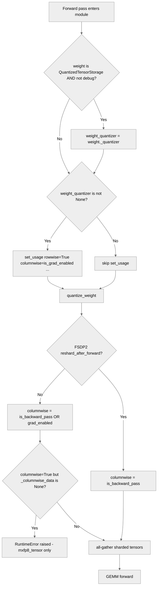

# [PyTorch] Fix stale columnwise data usage

[Upstream PR](https://github.com/NVIDIA/TransformerEngine/pull/2925) · state: closed · merged: False

## Original PR description

# Description

This PR sets columnwise usage correctly for all quantizers instead of retaining the value in the quantizer, which may be incorrect after resuming training post validation steps as the columnwise usage is set to `False` for eval mode.

## Type of change

- [ ] Documentation change (change only to the documentation, either a fix or a new content)
- [x] Bug fix (non-breaking change which fixes an issue)
- [ ] New feature (non-breaking change which adds functionality)
- [ ] Breaking change (fix or feature that would cause existing functionality to not work as expected)
- [ ] Infra/Build change
- [ ] Code refactoring

## Changes

- Set columnwise usage explicitly instead of retaining the value in the quantizer.

# Checklist:

- [x] I have read and followed the [contributing guidelines](https://github.com/NVIDIA/TransformerEngine/blob/main/CONTRIBUTING.rst)
- [x] The functionality is complete
- [x] I have commented my code, particularly in hard-to-understand areas
- [ ] I have made corresponding changes to the documentation
- [x] My changes generate no new warnings
- [x] I have added tests that prove my fix is effective or that my feature works
- [x] New and existing unit tests pass locally with my changes


## Review and discussion

### reviews

- greptile-apps[bot] · COMMENTED · 2026-04-25T01:30:02Z · [source](https://github.com/NVIDIA/TransformerEngine/pull/2925#pullrequestreview-4174409158)

(No body; status only.)

- vthumbe1503 · COMMENTED · 2026-04-27T02:36:03Z · [source](https://github.com/NVIDIA/TransformerEngine/pull/2925#pullrequestreview-4177872338)

(No body; status only.)

### issue_comments

- greptile-apps[bot] · comment · 2026-04-25T01:29:52Z · [source](https://github.com/NVIDIA/TransformerEngine/pull/2925#issuecomment-4317379065)

<h3>Greptile Summary</h3>

This PR fixes stale `columnwise_usage` state on weight quantizers by changing `elif` conditions to `if` across `linear.py`, `layernorm_linear.py`, `layernorm_mlp.py`, and `grouped_linear.py`, so `set_usage` is always called with the correct value rather than relying on whatever was last written to the quantizer (which could be `False` after an eval pass). The FSDP2 tensor-level fix replaces the stale `self._quantizer.columnwise_usage` read in all three tensor types with `is_backward_pass or torch.is_grad_enabled()`.

- **P1 — `linear.py`**: The old `elif isinstance(weight, QuantizedTensor): weight_quantizer = weight._quantizer` defensive path is gone. If `weight_quantizer` arrives as `None` while the weight is already a `QuantizedTensor`, `quantize_weight` immediately dereferences `quantizer.rowwise_usage` and raises `AttributeError`. Restoring the `elif` assignment (without calling `set_usage` on it, since it is `None`) preserves the original safety net.

<h3>Confidence Score: 3/5</h3>

Mostly safe bug fix, but one module-level regression in linear.py drops a defensive assignment that guards against an AttributeError in quantize_weight.

The core fix (elif→if and FSDP2 tensor changes) is correct and well-tested for the primary code paths. A P1 regression in linear.py removes a guard for the weight_quantizer=None + QuantizedTensor scenario, turning a silent fallback into a potential crash. While this path may be rarely hit in practice, the asymmetry with how layernorm_mlp.py and layernorm_linear.py handle the same pattern makes linear.py's divergence worth addressing.

transformer_engine/pytorch/module/linear.py — dropped defensive quantizer assignment before quantize_weight call

<h3>Important Files Changed</h3>


| Filename | Overview |
|----------|----------|
| transformer_engine/pytorch/module/linear.py | Correctly fixes stale `columnwise_usage` by always calling `set_usage` when `weight_quantizer` is non-None, but the old `elif isinstance(weight, QuantizedTensor)` fallback that prevents a crash in `quantize_weight` when `weight_quantizer` is `None` was dropped. |
| transformer_engine/pytorch/module/layernorm_linear.py | Clean fix: `elif` → `if` ensures `set_usage` is called unconditionally when `weight_quantizer is not None`, including after the weight-quantizer re-assignment for pre-quantized weights; FSDP2 guard (`is_fsdp2` flag) preserved. |
| transformer_engine/pytorch/module/layernorm_mlp.py | Same correct `elif` → `if` pattern applied to both fc1 and fc2 weight quantizers, ensuring `set_usage` propagates after the weight-quantizer re-assignment step. |
| transformer_engine/pytorch/module/grouped_linear.py | Correctly restructures condition so `set_usage` is always called on the true per-weight quantizers (extracted from the pre-quantized weights) rather than skipping when weights are already quantized. |
| transformer_engine/pytorch/ops/fused/forward_grouped_mlp.py | Adds `set_usage` propagation to pre-quantized weight tensors inside `GroupedTensor.quantized_tensors` and in the discrete-weight path; FC2 non-grouped path has a pre-existing redundant `set_usage` call now made more visible. |
| transformer_engine/pytorch/tensor/float8_tensor.py | Replaces stale `self._quantizer.columnwise_usage` with `is_backward_pass or torch.is_grad_enabled()` for the FSDP2 `reshard_after_forward=False` path; also extracts `training_state`/`is_backward_pass` before the `if reshard_after_forward` branch. |
| transformer_engine/pytorch/tensor/float8_blockwise_tensor.py | Same FSDP2 `reshard_after_forward=False` fix as `float8_tensor.py`; clean and symmetric change. |
| transformer_engine/pytorch/tensor/mxfp8_tensor.py | Replaces stale quantizer state with `is_backward_pass or torch.is_grad_enabled()`; adds a `RuntimeError` when columnwise data is absent but needed — the error message could hint at wrapping eval loops with `torch.no_grad()` for clarity. |
| tests/pytorch/test_sanity.py | Adds a focused regression test (`test_quantizer_columnwise_usage_after_eval`) covering the train→eval→train columnwise state scenario for all four module types across all three quantization recipes. |

</details>


<h3>Flowchart</h3>



<!-- greptile_failed_comments -->
<details><summary><h3>Comments Outside Diff (1)</h3></summary>

1. `transformer_engine/pytorch/ops/fused/forward_grouped_mlp.py`, line 274-278 ([link](https://github.com/nvidia/transformerengine/blob/8432dbe13d8b85e5f07747ada251411a655215af/transformer_engine/pytorch/ops/fused/forward_grouped_mlp.py#L274-L278)) 

   <a href="#"></a> **Redundant `set_usage` call in the FC2 non-grouped path**

   `quantizer.set_usage(rowwise=True, columnwise=input_requires_grad)` appears unconditionally at the start of the loop iteration (line 275) and then again inside the `if not is_quantized_tensor(weight)` branch (line 277), so for non-quantized weights the call is made twice with the same arguments. The outer call is unnecessary and can be removed.

</details>

<!-- /greptile_failed_comments -->

<sub>Reviews (1): Last reviewed commit: ["Fix columnwise\_usage after eval mode"](https://github.com/nvidia/transformerengine/commit/8432dbe13d8b85e5f07747ada251411a655215af) | [Re-trigger Greptile](https://app.greptile.com/api/retrigger?id=29685125)</sub>

### inline_comments

- greptile-apps[bot] · comment · 2026-04-25T01:29:56Z · [source](https://github.com/NVIDIA/TransformerEngine/pull/2925#discussion_r3141049039)

File: `transformer_engine/pytorch/module/linear.py` · line 266

<a href="#"></a> **Dropped defensive `weight_quantizer` assignment loses the `quantize_weight` call**

The original `elif isinstance(weight, QuantizedTensor): weight_quantizer = weight._quantizer` handled the case where `weight_quantizer` arrives as `None` while `weight` is already a `QuantizedTensor`. In that path, `quantize_weight` immediately dereferences `quantizer.rowwise_usage` (line 710 of `base.py`) and will raise `AttributeError: 'NoneType' object has no attribute 'rowwise_usage'`.

The new code only re-assigns `weight_quantizer` when it is **already non-`None`**, so the previously guarded scenario now crashes instead of falling back to the weight's own quantizer. The missing assignment should be:

```python
if weight_quantizer is not None:
    if isinstance(weight, QuantizedTensor) and not debug:
        weight_quantizer = weight._quantizer
    columnwise_usage = ...
    weight_quantizer.set_usage(rowwise=True, columnwise=columnwise_usage)
elif isinstance(weight, QuantizedTensor):
    # weight_quantizer is None but weight is pre-quantized — pick up its quantizer
    weight_quantizer = weight._quantizer
```

- greptile-apps[bot] · comment · 2026-04-25T01:30:01Z · [source](https://github.com/NVIDIA/TransformerEngine/pull/2925#discussion_r3141049257)

File: `transformer_engine/pytorch/tensor/mxfp8_tensor.py` · line 693

<a href="#"></a> **`torch.is_grad_enabled()` can be `True` during eval without `torch.no_grad()`**

`model.eval()` alone does not disable the gradient tape — `torch.is_grad_enabled()` stays `True` unless the caller wraps the eval loop with `torch.no_grad()`. In that situation `columnwise_usage` becomes `True`, but the local shard may not have `_columnwise_data` (it was never quantized with columnwise support during eval), so the new `RuntimeError` fires.

Users who ran eval with grads enabled previously got silently incorrect (stale) data; they now get a hard crash. While the crash is more correct, the error message could guide them:

```suggestion
                if self._columnwise_data is None or columnwise_scale_inv is None:
                    raise RuntimeError(
                        "FSDP2 (reshard_after_forward=False) needs columnwise MXFP8 data "
                        "for the upcoming backward pass, but the local shard has none. "
                        "Ensure the weight is quantized with columnwise_usage=True before "
                        "this all-gather. If you are running evaluation without requiring "
                        "gradients, wrap the eval loop with torch.no_grad()."
                    )
```

- vthumbe1503 · comment · 2026-04-27T02:10:18Z · [source](https://github.com/NVIDIA/TransformerEngine/pull/2925#discussion_r3144597484)

File: `tests/pytorch/test_sanity.py` · line 1313

The test doesnt make sense to me. I dont think we should be toggling the quantizer usages in case of quantized_model_init at all. 

This breaks the very principle that quantized tensor and its internal quantizer shouldnt be in conflict with each other.  And in here, the columnwise_data is present for the quantized_tensor even though the columnwise_usage is set to False.

- vthumbe1503 · comment · 2026-04-27T02:15:52Z · [source](https://github.com/NVIDIA/TransformerEngine/pull/2925#discussion_r3144607842)

File: `transformer_engine/pytorch/module/grouped_linear.py` · line 141

I dont think these changes are needed for this file and any of the other files in the PR. If weight is already quantized, it doesnt make sense to change its internal quantizer and have the quantized weight and its internal quantizer in a state of conflict with each other.

In general in case of quantized_model_init, if we are changing quantized_tensor's internal quantizer, quantized_tensor should also be updated to have that appropriate usages. 

- vthumbe1503 · comment · 2026-04-27T02:28:24Z · [source](https://github.com/NVIDIA/TransformerEngine/pull/2925#discussion_r3144630514)

File: `transformer_engine/pytorch/tensor/float8_blockwise_tensor.py` · line 663

I think it still makes sense to use self._quantize.columwise_usage as the real truth of what data is 
"really avaliable" in the sharded quantized tensor and throw an error if that usage doesnt match
` is_backward_pass or torch.is_grad_enabled `(Similar to mxfp8 tensor)

What we are doing here is that we are silently creating columnwise data after allgather for allgathered tensor, even though original sharded data tensor didnt have that data.

In my opinion, I am against any change here since even doing such a validation and throwing error is going to incur CPU overheads when using 
`torch.is_grad_enabled `


- vthumbe1503 · comment · 2026-04-27T02:28:43Z · [source](https://github.com/NVIDIA/TransformerEngine/pull/2925#discussion_r3144631074)

File: `transformer_engine/pytorch/tensor/float8_blockwise_tensor.py` · line 663

Same comment in every other FSDP2 related changes

## Changed files and fixed code

- `tests/pytorch/test_sanity.py` · modified · additions 89 / deletions 0
  - [head](https://github.com/ksivaman/TransformerEngine-1/blob/8432dbe13d8b85e5f07747ada251411a655215af/tests/pytorch/test_sanity.py)
  - [base](https://github.com/NVIDIA/TransformerEngine/blob/9ad2e7bc9dde40cc4546eb6879475754f142bc59/tests/pytorch/test_sanity.py)
- `transformer_engine/pytorch/module/grouped_linear.py` · modified · additions 3 / deletions 8
  - [head](https://github.com/ksivaman/TransformerEngine-1/blob/8432dbe13d8b85e5f07747ada251411a655215af/transformer_engine/pytorch/module/grouped_linear.py)
  - [base](https://github.com/NVIDIA/TransformerEngine/blob/9ad2e7bc9dde40cc4546eb6879475754f142bc59/transformer_engine/pytorch/module/grouped_linear.py)
- `transformer_engine/pytorch/module/layernorm_linear.py` · modified · additions 1 / deletions 4
  - [head](https://github.com/ksivaman/TransformerEngine-1/blob/8432dbe13d8b85e5f07747ada251411a655215af/transformer_engine/pytorch/module/layernorm_linear.py)
  - [base](https://github.com/NVIDIA/TransformerEngine/blob/9ad2e7bc9dde40cc4546eb6879475754f142bc59/transformer_engine/pytorch/module/layernorm_linear.py)
- `transformer_engine/pytorch/module/layernorm_mlp.py` · modified · additions 2 / deletions 2
  - [head](https://github.com/ksivaman/TransformerEngine-1/blob/8432dbe13d8b85e5f07747ada251411a655215af/transformer_engine/pytorch/module/layernorm_mlp.py)
  - [base](https://github.com/NVIDIA/TransformerEngine/blob/9ad2e7bc9dde40cc4546eb6879475754f142bc59/transformer_engine/pytorch/module/layernorm_mlp.py)
- `transformer_engine/pytorch/module/linear.py` · modified · additions 3 / deletions 5
  - [head](https://github.com/ksivaman/TransformerEngine-1/blob/8432dbe13d8b85e5f07747ada251411a655215af/transformer_engine/pytorch/module/linear.py)
  - [base](https://github.com/NVIDIA/TransformerEngine/blob/9ad2e7bc9dde40cc4546eb6879475754f142bc59/transformer_engine/pytorch/module/linear.py)
- `transformer_engine/pytorch/ops/fused/forward_grouped_mlp.py` · modified · additions 12 / deletions 0
  - [head](https://github.com/ksivaman/TransformerEngine-1/blob/8432dbe13d8b85e5f07747ada251411a655215af/transformer_engine/pytorch/ops/fused/forward_grouped_mlp.py)
  - [base](https://github.com/NVIDIA/TransformerEngine/blob/9ad2e7bc9dde40cc4546eb6879475754f142bc59/transformer_engine/pytorch/ops/fused/forward_grouped_mlp.py)
- `transformer_engine/pytorch/tensor/float8_blockwise_tensor.py` · modified · additions 3 / deletions 3
  - [head](https://github.com/ksivaman/TransformerEngine-1/blob/8432dbe13d8b85e5f07747ada251411a655215af/transformer_engine/pytorch/tensor/float8_blockwise_tensor.py)
  - [base](https://github.com/NVIDIA/TransformerEngine/blob/9ad2e7bc9dde40cc4546eb6879475754f142bc59/transformer_engine/pytorch/tensor/float8_blockwise_tensor.py)
- `transformer_engine/pytorch/tensor/float8_tensor.py` · modified · additions 3 / deletions 3
  - [head](https://github.com/ksivaman/TransformerEngine-1/blob/8432dbe13d8b85e5f07747ada251411a655215af/transformer_engine/pytorch/tensor/float8_tensor.py)
  - [base](https://github.com/NVIDIA/TransformerEngine/blob/9ad2e7bc9dde40cc4546eb6879475754f142bc59/transformer_engine/pytorch/tensor/float8_tensor.py)
- `transformer_engine/pytorch/tensor/mxfp8_tensor.py` · modified · additions 10 / deletions 3
  - [head](https://github.com/ksivaman/TransformerEngine-1/blob/8432dbe13d8b85e5f07747ada251411a655215af/transformer_engine/pytorch/tensor/mxfp8_tensor.py)
  - [base](https://github.com/NVIDIA/TransformerEngine/blob/9ad2e7bc9dde40cc4546eb6879475754f142bc59/transformer_engine/pytorch/tensor/mxfp8_tensor.py)

## Evidence and interpretation boundary

[Original JSON, discussions and patches](../../../../../../evidence/prs/NVIDIA--TransformerEngine/2925-6b2c4fce5928adc43132819356b1256dde31dc010b4c2a71e6d4623918d9edf3.json) · SHA-256 `6b2c4fce5928adc43132819356b1256dde31dc010b4c2a71e6d4623918d9edf3`.

Diff complete: True. Missing/binary/truncated patches require pinned source inspection. This is a source page, not an independently verified optimization case. Open, merged and released are different states; recheck the deployed dependency.
