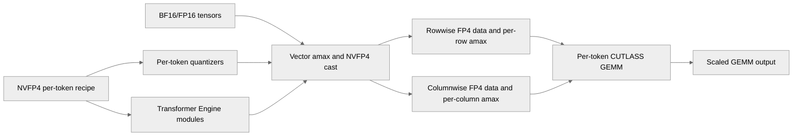

# Add NVFP4 per-token quantization recipe

[Upstream PR](https://github.com/NVIDIA/TransformerEngine/pull/3045) · state: open · merged: False

## Original PR description

> **Status — not for merge.** This PR is not intended to be merged as-is (~14.8k lines / 42 files); its functionality is being upstreamed incrementally via smaller PRs — #3206, #3324, #3454, #3467 (merged) and #3649, #3661 (in review) —
> building on the row-scaled NVFP4 path from #2931. As it stands, this PR is fully functional and runs per-token (row-scaled) NVFP4 forward/backward training end to end;  The split PRs land the same functionality in reviewable pieces.

# Description

This PR adds an NVFP4 per-token quantization recipe. The default NVFP4BlockScaling recipe computes a single per-tensor outer amax (s_global) per tensor. The per-token variant instead computes a per-row outer amax (length M) for rowwise data and a per-col outer amax (length K) for columnwise data, giving each token/row its own global scale. 

# Changes

- Per-token cast kernels: vector-amax + encode/swizzle producing NVFP4 tensors whose _amax_rowwise / _amax_columnwise are per-row/per-col vectors.
- CUTLASS GEMM (nvfp4_cutlass_per_token_gemm) that rescales with the per-row/per-col outer-amax vectors inside the epilogue;
- Forward + backward coverage (dgrad NN / wgrad NT layouts).
- NVFP4PerTokenBlockScaling recipe (re-exported from transformer_engine.pytorch.fp8), plus an equivalent NVTE_NVFP4_PER_TOKEN=1 env-var switch on a plain NVFP4BlockScaling so frameworks that only build a default recipe (e.g. Megatron-Core) can opt in with no code change.
- Opt-in RHT / SR (per_token_rht / per_token_sr) — off by default on the per-token path.
- Opt-in 2D weight quantization (per_token_weight_2d): transposition-invariant 16×16 cast emitted in per-token layout.
- Docs: API reference entry, NVTE_NVFP4_* env-var docs, and a "Per-token NVFP4" feature section with Megatron-Core launch instructions.
- Example: examples/pytorch/nvfp4_per_token_megatron — single-GPU MoE example comparing per-token vs per-tensor vs BF16 with identical model/data/seed.

## Type of change

- [ ] Documentation change (change only to the documentation, either a fix or a new content)
- [ ] Bug fix (non-breaking change which fixes an issue)
- [x] New feature (non-breaking change which adds functionality)
- [ ] Breaking change (fix or feature that would cause existing functionality to not work as expected)
- [ ] Infra/Build change
- [ ] Code refactoring

# Checklist:

- [ ] I have read and followed the [contributing guidelines](https://github.com/NVIDIA/TransformerEngine/blob/main/CONTRIBUTING.rst)
- [ ] The functionality is complete
- [ ] I have commented my code, particularly in hard-to-understand areas
- [ ] I have made corresponding changes to the documentation
- [ ] My changes generate no new warnings
- [ ] I have added tests that prove my fix is effective or that my feature works
- [ ] New and existing unit tests pass locally with my changes


## Review and discussion

### reviews

- qijiaxing · COMMENTED · 2026-06-01T06:38:15Z · [source](https://github.com/NVIDIA/TransformerEngine/pull/3045#pullrequestreview-4398915727)

(No body; status only.)

- qijiaxing · COMMENTED · 2026-06-01T06:49:43Z · [source](https://github.com/NVIDIA/TransformerEngine/pull/3045#pullrequestreview-4398970043)

(No body; status only.)

- qijiaxing · COMMENTED · 2026-06-01T07:18:58Z · [source](https://github.com/NVIDIA/TransformerEngine/pull/3045#pullrequestreview-4399122717)

(No body; status only.)

- cael-ling · COMMENTED · 2026-06-04T09:06:14Z · [source](https://github.com/NVIDIA/TransformerEngine/pull/3045#pullrequestreview-4426403021)

(No body; status only.)

- cael-ling · COMMENTED · 2026-06-04T09:20:11Z · [source](https://github.com/NVIDIA/TransformerEngine/pull/3045#pullrequestreview-4426497416)

(No body; status only.)

- cael-ling · COMMENTED · 2026-06-04T09:26:10Z · [source](https://github.com/NVIDIA/TransformerEngine/pull/3045#pullrequestreview-4426534629)

(No body; status only.)

- greptile-apps[bot] · COMMENTED · 2026-06-11T08:11:15Z · [source](https://github.com/NVIDIA/TransformerEngine/pull/3045#pullrequestreview-4474909008)

(No body; status only.)

- ptrendx · COMMENTED · 2026-07-06T13:41:32Z · [source](https://github.com/NVIDIA/TransformerEngine/pull/3045#pullrequestreview-4635829539)

Additional comments from Codex review:
```
  - [high] /tmp/te-pr3045/transformer_engine/common/gemm/nvfp4_cutlass_grouped_gemm.cu:232 uses process-global scratch, workspace, and host staging buffers with no device, stream, or thread isolation. Two grouped
    GEMMs on different streams can overwrite metadata/workspace while the first kernel is still consuming it. A call on another CUDA device can reuse a pointer allocated on the first device; the SM count and
    device_id are also hard-coded to device 0. This can cause corrupted results, use-after-free during growth, or invalid-device-pointer failures.

  - [high] /tmp/te-pr3045/transformer_engine/pytorch/csrc/quantizer.cpp:1952 rejects every per-token tensor whose flattened row count is not divisible by 128. GroupedLinear passes dynamic expert token counts
    directly into split_quantize, so ordinary unbalanced MoE routing commonly fails before reaching the grouped kernel. The tests only use aligned splits, and the example does not document or explicitly enable
    expert padding. The direct grouped wrapper also rejects zero-token experts.

  - [medium] /tmp/te-pr3045/transformer_engine/pytorch/cpp_extensions/gemm.py:596 validates alpha and beta, but the per-token branch at line 684 does not forward either value. Therefore alpha != 1 is silently
    ignored, and accumulate=True, beta != 1 always behaves as beta=1. Current module calls use the defaults, but this violates general_gemm’s public contract and produces silently wrong output for other callers.

  - [medium] /tmp/te-pr3045/transformer_engine/pytorch/csrc/quantizer.cpp:2576 restores out.amax using rowwise_amax_ptr before the weight-2D cast. A valid columnwise-only NVFP4Quantizer(per_token_weight_2d=True) has
    a null rowwise pointer, so nvte_quantize_v2 receives a null scalar-amax descriptor. Recipe-created weight quantizers currently request both directions, but the newly exposed constructor permits this crashing
    configuration.

  - [low] /tmp/te-pr3045/transformer_engine/common/recipe/__init__.py:766 and /tmp/te-pr3045/docs/features/low_precision_training/nvfp4/nvfp4.rst:287 still say that the cuDNN norm workaround and fused wgrad
    accumulation restrictions apply. This PR now automatically selects unfused normalization and implements FP32 accumulation, so the new API documentation contradicts the implementation.```

- timmoon10 · COMMENTED · 2026-07-06T19:44:42Z · [source](https://github.com/NVIDIA/TransformerEngine/pull/3045#pullrequestreview-4639022820)

(No body; status only.)

- timmoon10 · CHANGES_REQUESTED · 2026-07-06T19:47:42Z · [source](https://github.com/NVIDIA/TransformerEngine/pull/3045#pullrequestreview-4639229771)

(No body; status only.)

- zhongbozhu · COMMENTED · 2026-07-06T22:30:14Z · [source](https://github.com/NVIDIA/TransformerEngine/pull/3045#pullrequestreview-4640214212)

(No body; status only.)

- zhongbozhu · COMMENTED · 2026-07-06T22:30:36Z · [source](https://github.com/NVIDIA/TransformerEngine/pull/3045#pullrequestreview-4640215700)

(No body; status only.)

- zianglih · COMMENTED · 2026-07-07T07:43:11Z · [source](https://github.com/NVIDIA/TransformerEngine/pull/3045#pullrequestreview-4642815565)

(No body; status only.)

- cael-ling · COMMENTED · 2026-07-07T07:46:37Z · [source](https://github.com/NVIDIA/TransformerEngine/pull/3045#pullrequestreview-4642835972)

(No body; status only.)

### issue_comments

- greptile-apps[bot] · comment · 2026-06-11T08:11:08Z · [source](https://github.com/NVIDIA/TransformerEngine/pull/3045#issuecomment-4678522521)

<h3>Greptile Summary</h3>

This PR adds end-to-end NVFP4 per-token quantization support for PyTorch.

- Introduces per-row and per-column quantization kernels and metadata handling.
- Adds dedicated CUTLASS GEMM and grouped-GEMM paths that consume per-token outer scales.
- Exposes the `NVFP4PerTokenBlockScaling` recipe and environment-variable configuration.
- Adds forward, backward, grouped-GEMM, and module-level tests.
- Documents the feature and provides a single-GPU Megatron-Core MoE example.
- No code has changed since the previous review.

<h3>Confidence Score: 5/5</h3>

The PR appears safe to merge, with two non-blocking API edge cases remaining in existing review threads.

No new changes were made after the previous review, so there are no new findings. The manually resolved null-amax thread is not outstanding. Two prior non-blocking findings remain unresolved: the per-token `general_gemm` path silently ignores a non-default `alpha`, and the public grouped-quantization wrapper rejects zero-token expert splits.

**Files Needing Attention:** transformer_engine/pytorch/cpp_extensions/gemm.py; transformer_engine/pytorch/custom_recipes/quantization_nvfp4_per_token_group.py

<h3>Important Files Changed</h3>


| Filename | Overview |
|----------|----------|
| transformer_engine/common/cast/nvfp4/quantize_nvfp4_per_token.cu | Implements per-token vector-amax quantization and NVFP4 encoding. |
| transformer_engine/common/gemm/nvfp4_cutlass_gemm.cu | Adds CUTLASS GEMM dispatch capable of consuming per-token outer-scale vectors. |
| transformer_engine/common/gemm/nvfp4_cutlass_grouped_gemm.cu | Extends grouped GEMM execution for per-token NVFP4 operands. |
| transformer_engine/pytorch/csrc/quantizer.cpp | Integrates per-token quantizer configuration and weight-2D handling into the native PyTorch path. |
| transformer_engine/pytorch/cpp_extensions/gemm.py | Dispatches eligible per-token tensors to the dedicated GEMM path; the existing unresolved thread notes that non-default `alpha` is not represented. |
| transformer_engine/pytorch/custom_recipes/quantization_nvfp4_per_token_group.py | Provides grouped per-token quantization; the existing unresolved thread notes that zero-token expert splits are rejected. |
| transformer_engine/common/recipe/__init__.py | Defines and configures the public per-token NVFP4 recipe. |
| transformer_engine/pytorch/tensor/nvfp4_tensor.py | Extends NVFP4 tensor behavior to retain per-row and per-column outer-scale metadata. |
| tests/pytorch/nvfp4/test_nvfp4_per_token.py | Adds numerical and configuration coverage for per-token quantization. |
| tests/pytorch/nvfp4/test_nvfp4_cutlass_per_token_gemm.py | Exercises dedicated per-token CUTLASS GEMM behavior and layouts. |


<h3>Flowchart</h3>



<!-- greptile_other_comments_section -->

<sub>Reviews (8): Last reviewed commit: ["Apply pre-commit formatting for NVFP4 pe..."](https://github.com/nvidia/transformerengine/commit/690ffea4d9cc11fe29e7b0e7d1fd250509fd64a3) | [Re-trigger Greptile](https://app.greptile.com/api/retrigger?id=36919833)</sub>

- zianglih · comment · 2026-07-07T07:37:51Z · [source](https://github.com/NVIDIA/TransformerEngine/pull/3045#issuecomment-4901319351)

row scaled grouped gemm is already supported in cudnn fe:
- https://github.com/NVIDIA/cudnn-frontend/pull/251

### inline_comments

- qijiaxing · comment · 2026-06-01T06:38:15Z · [source](https://github.com/NVIDIA/TransformerEngine/pull/3045#discussion_r3332094690)

File: `transformer_engine/common/cast/nvfp4/quantize_nvfp4_per_token.cu` · line 936

maybe use `DIVUP` here to handle the remainder case?

- qijiaxing · comment · 2026-06-01T06:49:43Z · [source](https://github.com/NVIDIA/TransformerEngine/pull/3045#discussion_r3332144419)

File: `transformer_engine/common/cast/nvfp4/quantize_nvfp4_per_token.cu` · line None

typo: `Row direction never sees RHT` -> `Row direction never uses RHT`

- qijiaxing · comment · 2026-06-01T07:18:59Z · [source](https://github.com/NVIDIA/TransformerEngine/pull/3045#discussion_r3332281223)

File: `transformer_engine/common/cast/nvfp4/quantize_nvfp4_per_token.cu` · line 889

For these quantization kernel, TMA only require SM 9.0+ only. Is there any other constraints that limit to sm 10.0+? 

- cael-ling · comment · 2026-06-04T09:06:14Z · [source](https://github.com/NVIDIA/TransformerEngine/pull/3045#discussion_r3354795708)

File: `transformer_engine/common/cast/nvfp4/quantize_nvfp4_per_token.cu` · line None

Good catch

- cael-ling · comment · 2026-06-04T09:20:11Z · [source](https://github.com/NVIDIA/TransformerEngine/pull/3045#discussion_r3354875391)

File: `transformer_engine/common/cast/nvfp4/quantize_nvfp4_per_token.cu` · line 889

The __CUDA_ARCH__ >= 1000 guard is intentional but not because of a hardware op in this kernel. Two reasons:

1. The shared TE PTX wrappers it calls — cp_async_bulk_tensor_2d_global_to_shared and mbarrier_wait_parity_acquire_cta_shared_cta in util/ptx.cuh — are themselves guarded to >= 1000 and emit NVTE_DEVICE_ERROR below that. They were authored/validated only for the Blackwell path.
2. The whole NVFP4 quantize path is host-gated to SM100 anyway (NVTE_ERROR("NVFP4 requires SM100 ...")), since NVFP4 is a Blackwell datatype and the downstream FP4 GEMM that consumes these scales only exists on SM100. So the amax kernel is never launched off <SM100; the per-arch guard just yields a clean error instead of an undefined symbol.

- cael-ling · comment · 2026-06-04T09:26:10Z · [source](https://github.com/NVIDIA/TransformerEngine/pull/3045#discussion_r3354908240)

File: `transformer_engine/common/cast/nvfp4/quantize_nvfp4_per_token.cu` · line 936

This fast path has a hard precondition that M and K are exact multiples of CHUNK_DIM (128): validate() does NVTE_CHECK(M % CHUNK_DIM_Y == 0) / NVTE_CHECK(K % CHUNK_DIM_X == 0), and is_supported() returns false unless both hold — so any non-multiple shape is rejected / routed to the generic per-token fallback before it ever reaches this launcher.

- greptile-apps[bot] · comment · 2026-06-11T08:11:12Z · [source](https://github.com/NVIDIA/TransformerEngine/pull/3045#discussion_r3394313155)

File: `transformer_engine/pytorch/csrc/quantizer.cpp` · line 2582

<a href="#"></a> **Latent null-pointer dereference in per-token weight-2D amax restore**

After `nvte_compute_amax_with_config` writes the global amax into `amax_ptr[0]`, the code restores the output tensor's amax field with `out.set_amax(rowwise_amax_ptr, ...)`. If `rowwise_amax_ptr` is `nullptr` (i.e., the quantizer was constructed with `rowwise=False`), this sets the output's amax descriptor to a null pointer. The immediately following `nvte_quantize_v2` then tries to read `amax[0]` to derive `S_enc` and will crash.

Currently this path is unreachable because `per_token_weight_2d` is only set for weight quantizers, and all weight quantizers in the recipe are constructed with `rowwise=True, columnwise=True`. However, the guard in step 3 (`if (rowwise_amax_ptr != nullptr && w2d_rows > 1)`) shows the author anticipated both pointers could be null, while the critical `out.set_amax` call on this line does not. Using `amax_ptr` (the non-null pointer already validated by the `NVTE_CHECK` above) would be safe in all configurations: `out.set_amax(amax_ptr, DType::kFloat32, std::vector<size_t>{1})`.

- greptile-apps[bot] · comment · 2026-06-11T08:11:13Z · [source](https://github.com/NVIDIA/TransformerEngine/pull/3045#discussion_r3394313260)

File: `transformer_engine/pytorch/cpp_extensions/gemm.py` · line 698

<a href="#"></a> **`alpha` scalar silently ignored for per-token GEMM**

`general_gemm` validates and stores `alpha` in `kwargs["alpha"]`, but the per-token short-circuit path dispatches to `_nvfp4_per_token_gemm` which has no `alpha` parameter and never forwards the value. The C++ binding `nvfp4_cutlass_per_token_gemm` also lacks a global scalar `alpha` argument — only the per-row/per-col `alpha_a`/`alpha_b` vectors are supported. For all current TE module call sites `alpha=1.0` is the invariant, so numerical output is unaffected today. If a caller ever passes `alpha != 1.0` through `general_gemm` with per-token tensors, the result will be silently wrong instead of raising an error.

- greptile-apps[bot] · comment · 2026-06-11T08:11:14Z · [source](https://github.com/NVIDIA/TransformerEngine/pull/3045#discussion_r3394313381)

File: `transformer_engine/pytorch/custom_recipes/quantization_nvfp4_per_token_group.py` · line 51

<a href="#"></a> **Public grouped-quantize API unconditionally rejects 0-token splits**

`split_sections[i] <= 0` raises `ValueError`, but in MoE training with dynamic token routing, experts commonly receive zero tokens in a given micro-batch. The `general_grouped_gemm` per-token loop already handles this by skipping the launch when `m_splits[i] == 0`, so the GEMM side is fine. If users call this Python wrapper directly (e.g., from bench scripts or custom MoE quantization pipelines), they must pre-filter empty experts. A comment or guard skipping allocation for empty splits would make the API usable in unbalanced-routing scenarios.

Note: If this suggestion doesn't match your team's coding style, reply to this and let me know. I'll remember it for next time!

- ptrendx · comment · 2026-07-06T12:34:16Z · [source](https://github.com/NVIDIA/TransformerEngine/pull/3045#discussion_r3528893663)

File: `docs/envvars.rst` · line 330

While those environment variables are great for debugging and development purposes, we should strive
to not have them (or at least limit them) in the actual production software and instead rely on the
regular options in Python to limit the surprising behavior situations where a left-over env variable
affects the execution negatively.

- ptrendx · comment · 2026-07-06T12:37:31Z · [source](https://github.com/NVIDIA/TransformerEngine/pull/3045#discussion_r3528914783)

File: `docs/features/low_precision_training/nvfp4/nvfp4.rst` · line 217

We should not give such statements ("can improve accuracy") without many more experiments. I would
make this statement weaker saying that "it may improve accuracy in some situations".

- ptrendx · comment · 2026-07-06T12:39:17Z · [source](https://github.com/NVIDIA/TransformerEngine/pull/3045#discussion_r3528925465)

File: `docs/features/low_precision_training/nvfp4/nvfp4.rst` · line 216

While M and K are kind of standard GEMM terminology, they are not part of this document earlier so
we should not just randomly use them here. I believe just omitting those is OK here.

- ptrendx · comment · 2026-07-06T12:40:23Z · [source](https://github.com/NVIDIA/TransformerEngine/pull/3045#discussion_r3528931979)

File: `docs/features/low_precision_training/nvfp4/nvfp4.rst` · line 219

This is user-facing guide and so I don't think we should provide here the details about which kernel
we are using for that, since it is not really relevant for that audience.

- ptrendx · comment · 2026-07-06T12:44:30Z · [source](https://github.com/NVIDIA/TransformerEngine/pull/3045#discussion_r3528959746)

File: `docs/features/low_precision_training/nvfp4/nvfp4.rst` · line 228

The fact that you can do it suggests that you probably don't actually need it to be its own class and
it probably could just be the option to NVFP4BlockScaling recipe. Not sure yet how you handle the
tensor though so maybe the class is needed. Anyway, having both of these is confusing and should be
avoided - please choose one and also make a PR to MCore to adopt the new recipe.

- ptrendx · comment · 2026-07-06T12:44:47Z · [source](https://github.com/NVIDIA/TransformerEngine/pull/3045#discussion_r3528961408)

File: `docs/features/low_precision_training/nvfp4/nvfp4.rst` · line 237

fp8_autocast is deprecated, use te.autocast instead. 

- ptrendx · comment · 2026-07-06T12:50:58Z · [source](https://github.com/NVIDIA/TransformerEngine/pull/3045#discussion_r3529005415)

File: `docs/features/low_precision_training/nvfp4/nvfp4.rst` · line 243

This remark is not true - the outer scale granularity and RHT are nearly completely orthogonal,
since RHT effect applies to the values inside the block of 16 and that has its own scale. So RHT
should still be able to help the accuracy in this recipe. Adding @negvet - we could try running some
experiments with this recipe to see what the effect of RHT would be here.

- ptrendx · comment · 2026-07-06T12:52:21Z · [source](https://github.com/NVIDIA/TransformerEngine/pull/3045#discussion_r3529013528)

File: `docs/features/low_precision_training/nvfp4/nvfp4.rst` · line 249

I don't quite understand this sentence - what does "2D cast emitted in per-token layout" mean here? 

- ptrendx · comment · 2026-07-06T12:53:40Z · [source](https://github.com/NVIDIA/TransformerEngine/pull/3045#discussion_r3529023768)

File: `docs/features/low_precision_training/nvfp4/nvfp4.rst` · line 258

I believe this paragraph is not necessary in the user guide. 

- ptrendx · comment · 2026-07-06T12:54:48Z · [source](https://github.com/NVIDIA/TransformerEngine/pull/3045#discussion_r3529030371)

File: `docs/features/low_precision_training/nvfp4/nvfp4.rst` · line 292

Could we have that example in MCore PR instead?

- ptrendx · comment · 2026-07-06T12:56:36Z · [source](https://github.com/NVIDIA/TransformerEngine/pull/3045#discussion_r3529042388)

File: `examples/pytorch/nvfp4_per_token_megatron/README.md` · line 16

Considering those caveats, could we actually not include this example in this PR and instead make a
followup PR with the example once MCore support becomes available?

- ptrendx · comment · 2026-07-06T12:58:06Z · [source](https://github.com/NVIDIA/TransformerEngine/pull/3045#discussion_r3529052009)

File: `tests/pytorch/nvfp4/bench_nvfp4_per_token.py` · line 1

We have benchmarks/ directory in the repository where such files should land, rather than in tests/. 

- ptrendx · comment · 2026-07-06T12:58:42Z · [source](https://github.com/NVIDIA/TransformerEngine/pull/3045#discussion_r3529055514)

File: `tests/pytorch/nvfp4/bench_nvfp4_per_token_group.py` · line 1

Same comment about the wrong directory. Also, this file lacks the Copyright and license information. 

- ptrendx · comment · 2026-07-06T13:00:54Z · [source](https://github.com/NVIDIA/TransformerEngine/pull/3045#discussion_r3529070062)

File: `transformer_engine/pytorch/tensor/nvfp4_tensor.py` · line 143

What are 1A/2A paths? 

- ptrendx · comment · 2026-07-06T13:03:00Z · [source](https://github.com/NVIDIA/TransformerEngine/pull/3045#discussion_r3529082814)

File: `transformer_engine/pytorch/tensor/nvfp4_tensor.py` · line 149

How is this different from the other 2D quantization option? Why can't we reuse that one instead of
creating a new one? 

- ptrendx · comment · 2026-07-06T13:14:38Z · [source](https://github.com/NVIDIA/TransformerEngine/pull/3045#discussion_r3529155852)

File: `transformer_engine/pytorch/quantization.py` · line 1715

Comments like this very easily become stale - please avoid them. 

- ptrendx · comment · 2026-07-06T13:20:19Z · [source](https://github.com/NVIDIA/TransformerEngine/pull/3045#discussion_r3529190260)

File: `transformer_engine/pytorch/custom_recipes/quantization_nvfp4_per_token.py` · line 232

I don't believe such file exists anywhere.

- ptrendx · comment · 2026-07-06T13:23:11Z · [source](https://github.com/NVIDIA/TransformerEngine/pull/3045#discussion_r3529207122)

File: `transformer_engine/pytorch/custom_recipes/quantization_nvfp4_per_token.py` · line 219

There is a big misunderstanding here - custom recipes are meant to show how a user can extend TE with
their own completely custom implementations of quantization and GEMM and, for this purpose, store
only basic pyTorch-only reference implementations of some recipes as examples. Actual production-grade
quantization logic should be in a completely different place (tex.quantize).

- ptrendx · comment · 2026-07-06T13:24:45Z · [source](https://github.com/NVIDIA/TransformerEngine/pull/3045#discussion_r3529216789)

File: `transformer_engine/pytorch/custom_recipes/__init__.py` · line 6

This file should not expose anything - please remove this code. 

- ptrendx · comment · 2026-07-06T13:25:43Z · [source](https://github.com/NVIDIA/TransformerEngine/pull/3045#discussion_r3529222637)

File: `transformer_engine/pytorch/custom_recipes/quantization_nvfp4_per_token_group.py` · line 10

If so it should not be in custom recipes. 

- ptrendx · comment · 2026-07-06T13:27:32Z · [source](https://github.com/NVIDIA/TransformerEngine/pull/3045#discussion_r3529234684)

File: `transformer_engine/pytorch/csrc/quantizer.cpp` · line 1877

What are "K1+K2" kernels? 

- ptrendx · comment · 2026-07-06T13:30:10Z · [source](https://github.com/NVIDIA/TransformerEngine/pull/3045#discussion_r3529251947)

File: `transformer_engine/pytorch/csrc/quantizer.cpp` · line 1979

Considering this - what is then the difference between this per_token functionality and the existing
row_scaled_nvfp4 functionality? What I suspect is that this new one is an extension of the other one
 - shouldn't those 2 be combined then?

- ptrendx · comment · 2026-07-06T13:33:34Z · [source](https://github.com/NVIDIA/TransformerEngine/pull/3045#discussion_r3529272638)

File: `transformer_engine/pytorch/csrc/quantizer.cpp` · line 2639

Why do we need to have a special function here? This sounds like it should be either an option in
the quantization params or it should correspond to its own NVTEScalingMode (and still be routed via
nvte_quantize_v2.

- ptrendx · comment · 2026-07-06T13:36:24Z · [source](https://github.com/NVIDIA/TransformerEngine/pull/3045#discussion_r3529291401)

File: `transformer_engine/pytorch/csrc/extensions/activation.cpp` · line 50

With this I got the information on what K1 and K2 are, but I believe that terminology is not useful
here and should be omitted. In fact, this whole comment does not really say anything useful - it
just describes what the unfused implementation option will do.

- ptrendx · comment · 2026-07-06T13:36:30Z · [source](https://github.com/NVIDIA/TransformerEngine/pull/3045#discussion_r3529292309)

File: `transformer_engine/pytorch/csrc/extensions/activation.cpp` · line 166

Same. 

- ptrendx · comment · 2026-07-06T13:36:55Z · [source](https://github.com/NVIDIA/TransformerEngine/pull/3045#discussion_r3529295132)

File: `transformer_engine/pytorch/csrc/extensions/bias.cpp` · line 160

Same comment as in activation.cpp. 

- ptrendx · comment · 2026-07-06T13:38:37Z · [source](https://github.com/NVIDIA/TransformerEngine/pull/3045#discussion_r3529307955)

File: `transformer_engine/pytorch/csrc/extensions/pybind.cpp` · line 410

Don't we already have something very similar in the regular nvFP4 path? 

- ptrendx · comment · 2026-07-06T13:39:21Z · [source](https://github.com/NVIDIA/TransformerEngine/pull/3045#discussion_r3529313114)

File: `transformer_engine/pytorch/csrc/extensions/pybind.cpp` · line 463

We should just use regular tex.quantize rather than introduce a new function here. 

- ptrendx · comment · 2026-07-06T13:40:43Z · [source](https://github.com/NVIDIA/TransformerEngine/pull/3045#discussion_r3529321881)

File: `transformer_engine/pytorch/csrc/extensions/pybind.cpp` · line 491

This description is not good - what does "Stage-1 forked" mean? Also, this whole function should be
folded to the gemm function instead.

- timmoon10 · comment · 2026-07-06T19:16:51Z · [source](https://github.com/NVIDIA/TransformerEngine/pull/3045#discussion_r3531479302)

File: `transformer_engine/common/include/transformer_engine/nvfp4_cutlass_gemm.h` · line 25

My instinct is that this should be included within `nvte_cublas_gemm_v2` instead of creating a new API, but I have mixed opinions:
- Arguments for `nvte_cublas_gemm_v2`
  - cuBLAS and CUTLASS are computing the same thing, so it should be considered an internal implementation detail. Exposing it to the user is just cluttering the API.
  - Creating separate APIs for each CUTLASS kernel is not scalable if we add more CUTLASS kernels for other data formats.
- Arguments for `nvte_nvfp4_cutlass_gemm`
  - It is misleading for a function called `nvte_cublas_*` to not call cuBLAS. Perhaps it would be better to create a new API called something like `nvte_gemm` or `nvte_matmul`.
  - This PR doesn't expose a good way to distinguish between per-tensor and per-token NVFP4, so the only way to avoid incorrect behavior is to make extremely explicit API calls. However, this is more an argument for including this information properly within `NVTETensor`.

- timmoon10 · comment · 2026-07-06T19:36:20Z · [source](https://github.com/NVIDIA/TransformerEngine/pull/3045#discussion_r3531587384)

File: `transformer_engine/common/include/transformer_engine/nvfp4_per_token.h` · line 37

We should use `nvte_quantize_v2` instead of creating a separate API that's specific to per-token NVFP4.

The root design flaw is that this PR uses `NVTETensor` in a non-standard way, with no way to distinguish between per-tensor and per-token NVFP4. This PR expects the user to call different APIs for per-token NVFP4, and if they call the general APIs then they'll have silent incorrect behavior. It would be better to expand our existing APIs instead of creating something custom from scratch.

Please take a look at https://github.com/NVIDIA/TransformerEngine/pull/2931 and how it incorporates row-scaled NVFP4 options. In particular, notice how we put quantizaiton options in two places:
- Options that are needed for both quantization and GEMM belong within `NVTETensor` (see [list of options](https://github.com/NVIDIA/TransformerEngine/blob/e201f228e69d9ef0e8780be32fc69e6b55cec5e7/transformer_engine/common/include/transformer_engine/transformer_engine.h#L66))
  - Examples: tensor-scale/row-scale, whether scales are swizzled
  - Without these options, you are unable to interpret the data bits. They are part of the tensor, just like the tensor dims, dtype, etc.
- Options that are only needed for quantization belong in `NVTEQuantizationConfig` (see [list of options](https://github.com/NVIDIA/TransformerEngine/blob/e201f228e69d9ef0e8780be32fc69e6b55cec5e7/transformer_engine/common/include/transformer_engine/transformer_engine.h#L400))
  - Examples: stochastic rounding, noop tensor
  - After quantization is finished, no one cares how the bits were generated. Stochastic rounding, no stochastic rounding, neither has an effect on the GEMM.

- timmoon10 · comment · 2026-07-06T19:47:36Z · [source](https://github.com/NVIDIA/TransformerEngine/pull/3045#discussion_r3531645008)

File: `docs/features/low_precision_training/nvfp4/nvfp4.rst` · line 216

How is this different from the row-scaled NVFP4 recipe from https://github.com/NVIDIA/TransformerEngine/pull/2931? I'd prefer to reuse and expand the existing APIs instead of creating redundant ones from scratch.

- zhongbozhu · comment · 2026-07-06T22:30:14Z · [source](https://github.com/NVIDIA/TransformerEngine/pull/3045#discussion_r3532429689)

File: `docs/features/low_precision_training/nvfp4/nvfp4.rst` · line 228

I agree, given the complexity of features like `--fp4-param-gather`, introducing new recipe class & quantized tensors would make it impossible to be integrated into Mcore in a performant way, till the point the users can just use mxfp8. 

- zhongbozhu · comment · 2026-07-06T22:30:36Z · [source](https://github.com/NVIDIA/TransformerEngine/pull/3045#discussion_r3532430897)

File: `docs/features/low_precision_training/nvfp4/nvfp4.rst` · line 216

Agreed

- zianglih · comment · 2026-07-07T07:43:12Z · [source](https://github.com/NVIDIA/TransformerEngine/pull/3045#discussion_r3534547122)

File: `transformer_engine/pytorch/tensor/storage/nvfp4_tensor_storage.py` · line 132

`row_scaled_nvfp4` above is the exact same thing

- cael-ling · comment · 2026-07-07T07:46:36Z · [source](https://github.com/NVIDIA/TransformerEngine/pull/3045#discussion_r3534565476)

File: `transformer_engine/pytorch/tensor/storage/nvfp4_tensor_storage.py` · line 132

Thanks, we are exploring a way to integrate the logic from this PR into existing strategies, rather than merging the PR in its entirety. 

## Changed files and fixed code

- `docs/api/common.rst` · modified · additions 2 / deletions 0
  - [head](https://github.com/cael-ling/TransformerEngine/blob/690ffea4d9cc11fe29e7b0e7d1fd250509fd64a3/docs/api/common.rst)
  - [base](https://github.com/NVIDIA/TransformerEngine/blob/5f6105b900778068144f1b24e25a2e84066983cb/docs/api/common.rst)
- `docs/envvars.rst` · modified · additions 42 / deletions 0
  - [head](https://github.com/cael-ling/TransformerEngine/blob/690ffea4d9cc11fe29e7b0e7d1fd250509fd64a3/docs/envvars.rst)
  - [base](https://github.com/NVIDIA/TransformerEngine/blob/5f6105b900778068144f1b24e25a2e84066983cb/docs/envvars.rst)
- `docs/features/low_precision_training/nvfp4/nvfp4.rst` · modified · additions 84 / deletions 0
  - [head](https://github.com/cael-ling/TransformerEngine/blob/690ffea4d9cc11fe29e7b0e7d1fd250509fd64a3/docs/features/low_precision_training/nvfp4/nvfp4.rst)
  - [base](https://github.com/NVIDIA/TransformerEngine/blob/5f6105b900778068144f1b24e25a2e84066983cb/docs/features/low_precision_training/nvfp4/nvfp4.rst)
- `examples/pytorch/nvfp4_per_token_megatron/README.md` · added · additions 135 / deletions 0
  - [head](https://github.com/cael-ling/TransformerEngine/blob/690ffea4d9cc11fe29e7b0e7d1fd250509fd64a3/examples/pytorch/nvfp4_per_token_megatron/README.md)
  - [base](https://github.com/NVIDIA/TransformerEngine/blob/5f6105b900778068144f1b24e25a2e84066983cb/examples/pytorch/nvfp4_per_token_megatron/README.md)
- `examples/pytorch/nvfp4_per_token_megatron/run_moe_nvfp4_singlegpu.sh` · added · additions 323 / deletions 0
  - [head](https://github.com/cael-ling/TransformerEngine/blob/690ffea4d9cc11fe29e7b0e7d1fd250509fd64a3/examples/pytorch/nvfp4_per_token_megatron/run_moe_nvfp4_singlegpu.sh)
  - [base](https://github.com/NVIDIA/TransformerEngine/blob/5f6105b900778068144f1b24e25a2e84066983cb/examples/pytorch/nvfp4_per_token_megatron/run_moe_nvfp4_singlegpu.sh)
- `examples/pytorch/nvfp4_per_token_megatron/sbatch_moe_nvfp4_singlegpu.sh` · added · additions 301 / deletions 0
  - [head](https://github.com/cael-ling/TransformerEngine/blob/690ffea4d9cc11fe29e7b0e7d1fd250509fd64a3/examples/pytorch/nvfp4_per_token_megatron/sbatch_moe_nvfp4_singlegpu.sh)
  - [base](https://github.com/NVIDIA/TransformerEngine/blob/5f6105b900778068144f1b24e25a2e84066983cb/examples/pytorch/nvfp4_per_token_megatron/sbatch_moe_nvfp4_singlegpu.sh)
- `examples/pytorch/nvfp4_per_token_megatron/submit_chain.sh` · added · additions 48 / deletions 0
  - [head](https://github.com/cael-ling/TransformerEngine/blob/690ffea4d9cc11fe29e7b0e7d1fd250509fd64a3/examples/pytorch/nvfp4_per_token_megatron/submit_chain.sh)
  - [base](https://github.com/NVIDIA/TransformerEngine/blob/5f6105b900778068144f1b24e25a2e84066983cb/examples/pytorch/nvfp4_per_token_megatron/submit_chain.sh)
- `tests/pytorch/nvfp4/bench_nvfp4_per_token.py` · added · additions 2173 / deletions 0
  - [head](https://github.com/cael-ling/TransformerEngine/blob/690ffea4d9cc11fe29e7b0e7d1fd250509fd64a3/tests/pytorch/nvfp4/bench_nvfp4_per_token.py)
  - [base](https://github.com/NVIDIA/TransformerEngine/blob/5f6105b900778068144f1b24e25a2e84066983cb/tests/pytorch/nvfp4/bench_nvfp4_per_token.py)
- `tests/pytorch/nvfp4/bench_nvfp4_per_token_group.py` · added · additions 460 / deletions 0
  - [head](https://github.com/cael-ling/TransformerEngine/blob/690ffea4d9cc11fe29e7b0e7d1fd250509fd64a3/tests/pytorch/nvfp4/bench_nvfp4_per_token_group.py)
  - [base](https://github.com/NVIDIA/TransformerEngine/blob/5f6105b900778068144f1b24e25a2e84066983cb/tests/pytorch/nvfp4/bench_nvfp4_per_token_group.py)
- `tests/pytorch/nvfp4/test_nvfp4_cutlass_per_token_gemm.py` · added · additions 1265 / deletions 0
  - [head](https://github.com/cael-ling/TransformerEngine/blob/690ffea4d9cc11fe29e7b0e7d1fd250509fd64a3/tests/pytorch/nvfp4/test_nvfp4_cutlass_per_token_gemm.py)
  - [base](https://github.com/NVIDIA/TransformerEngine/blob/5f6105b900778068144f1b24e25a2e84066983cb/tests/pytorch/nvfp4/test_nvfp4_cutlass_per_token_gemm.py)
- `tests/pytorch/nvfp4/test_nvfp4_per_token.py` · added · additions 1219 / deletions 0
  - [head](https://github.com/cael-ling/TransformerEngine/blob/690ffea4d9cc11fe29e7b0e7d1fd250509fd64a3/tests/pytorch/nvfp4/test_nvfp4_per_token.py)
  - [base](https://github.com/NVIDIA/TransformerEngine/blob/5f6105b900778068144f1b24e25a2e84066983cb/tests/pytorch/nvfp4/test_nvfp4_per_token.py)
- `tests/pytorch/nvfp4/test_nvfp4_per_token_group.py` · added · additions 591 / deletions 0
  - [head](https://github.com/cael-ling/TransformerEngine/blob/690ffea4d9cc11fe29e7b0e7d1fd250509fd64a3/tests/pytorch/nvfp4/test_nvfp4_per_token_group.py)
  - [base](https://github.com/NVIDIA/TransformerEngine/blob/5f6105b900778068144f1b24e25a2e84066983cb/tests/pytorch/nvfp4/test_nvfp4_per_token_group.py)
- `tests/pytorch/nvfp4/test_nvfp4_per_token_module_smoke.py` · added · additions 556 / deletions 0
  - [head](https://github.com/cael-ling/TransformerEngine/blob/690ffea4d9cc11fe29e7b0e7d1fd250509fd64a3/tests/pytorch/nvfp4/test_nvfp4_per_token_module_smoke.py)
  - [base](https://github.com/NVIDIA/TransformerEngine/blob/5f6105b900778068144f1b24e25a2e84066983cb/tests/pytorch/nvfp4/test_nvfp4_per_token_module_smoke.py)
- `transformer_engine/common/CMakeLists.txt` · modified · additions 7 / deletions 2
  - [head](https://github.com/cael-ling/TransformerEngine/blob/690ffea4d9cc11fe29e7b0e7d1fd250509fd64a3/transformer_engine/common/CMakeLists.txt)
  - [base](https://github.com/NVIDIA/TransformerEngine/blob/5f6105b900778068144f1b24e25a2e84066983cb/transformer_engine/common/CMakeLists.txt)
- `transformer_engine/common/cast/nvfp4/quantize_nvfp4_per_token.cu` · added · additions 1287 / deletions 0
  - [head](https://github.com/cael-ling/TransformerEngine/blob/690ffea4d9cc11fe29e7b0e7d1fd250509fd64a3/transformer_engine/common/cast/nvfp4/quantize_nvfp4_per_token.cu)
  - [base](https://github.com/NVIDIA/TransformerEngine/blob/5f6105b900778068144f1b24e25a2e84066983cb/transformer_engine/common/cast/nvfp4/quantize_nvfp4_per_token.cu)
- `transformer_engine/common/cast/nvfp4/quantize_nvfp4_per_token_group.cu` · added · additions 1221 / deletions 0
  - [head](https://github.com/cael-ling/TransformerEngine/blob/690ffea4d9cc11fe29e7b0e7d1fd250509fd64a3/transformer_engine/common/cast/nvfp4/quantize_nvfp4_per_token_group.cu)
  - [base](https://github.com/NVIDIA/TransformerEngine/blob/5f6105b900778068144f1b24e25a2e84066983cb/transformer_engine/common/cast/nvfp4/quantize_nvfp4_per_token_group.cu)
- `transformer_engine/common/gemm/nvfp4_cutlass_gemm.cu` · added · additions 579 / deletions 0
  - [head](https://github.com/cael-ling/TransformerEngine/blob/690ffea4d9cc11fe29e7b0e7d1fd250509fd64a3/transformer_engine/common/gemm/nvfp4_cutlass_gemm.cu)
  - [base](https://github.com/NVIDIA/TransformerEngine/blob/5f6105b900778068144f1b24e25a2e84066983cb/transformer_engine/common/gemm/nvfp4_cutlass_gemm.cu)
- `transformer_engine/common/gemm/nvfp4_cutlass_grouped_gemm.cu` · added · additions 614 / deletions 0
  - [head](https://github.com/cael-ling/TransformerEngine/blob/690ffea4d9cc11fe29e7b0e7d1fd250509fd64a3/transformer_engine/common/gemm/nvfp4_cutlass_grouped_gemm.cu)
  - [base](https://github.com/NVIDIA/TransformerEngine/blob/5f6105b900778068144f1b24e25a2e84066983cb/transformer_engine/common/gemm/nvfp4_cutlass_grouped_gemm.cu)
- `transformer_engine/common/gemm/nvfp4_per_token_post_scale.cu` · added · additions 140 / deletions 0
  - [head](https://github.com/cael-ling/TransformerEngine/blob/690ffea4d9cc11fe29e7b0e7d1fd250509fd64a3/transformer_engine/common/gemm/nvfp4_per_token_post_scale.cu)
  - [base](https://github.com/NVIDIA/TransformerEngine/blob/5f6105b900778068144f1b24e25a2e84066983cb/transformer_engine/common/gemm/nvfp4_per_token_post_scale.cu)
- `transformer_engine/common/include/transformer_engine/nvfp4_cutlass_gemm.h` · added · additions 79 / deletions 0
  - [head](https://github.com/cael-ling/TransformerEngine/blob/690ffea4d9cc11fe29e7b0e7d1fd250509fd64a3/transformer_engine/common/include/transformer_engine/nvfp4_cutlass_gemm.h)
  - [base](https://github.com/NVIDIA/TransformerEngine/blob/5f6105b900778068144f1b24e25a2e84066983cb/transformer_engine/common/include/transformer_engine/nvfp4_cutlass_gemm.h)
- `transformer_engine/common/include/transformer_engine/nvfp4_per_token.h` · added · additions 193 / deletions 0
  - [head](https://github.com/cael-ling/TransformerEngine/blob/690ffea4d9cc11fe29e7b0e7d1fd250509fd64a3/transformer_engine/common/include/transformer_engine/nvfp4_per_token.h)
  - [base](https://github.com/NVIDIA/TransformerEngine/blob/5f6105b900778068144f1b24e25a2e84066983cb/transformer_engine/common/include/transformer_engine/nvfp4_per_token.h)
- `transformer_engine/common/recipe/__init__.py` · modified · additions 192 / deletions 0
  - [head](https://github.com/cael-ling/TransformerEngine/blob/690ffea4d9cc11fe29e7b0e7d1fd250509fd64a3/transformer_engine/common/recipe/__init__.py)
  - [base](https://github.com/NVIDIA/TransformerEngine/blob/5f6105b900778068144f1b24e25a2e84066983cb/transformer_engine/common/recipe/__init__.py)
- `transformer_engine/pytorch/cpp_extensions/gemm.py` · modified · additions 592 / deletions 1
  - [head](https://github.com/cael-ling/TransformerEngine/blob/690ffea4d9cc11fe29e7b0e7d1fd250509fd64a3/transformer_engine/pytorch/cpp_extensions/gemm.py)
  - [base](https://github.com/NVIDIA/TransformerEngine/blob/5f6105b900778068144f1b24e25a2e84066983cb/transformer_engine/pytorch/cpp_extensions/gemm.py)
- `transformer_engine/pytorch/csrc/common.h` · modified · additions 11 / deletions 0
  - [head](https://github.com/cael-ling/TransformerEngine/blob/690ffea4d9cc11fe29e7b0e7d1fd250509fd64a3/transformer_engine/pytorch/csrc/common.h)
  - [base](https://github.com/NVIDIA/TransformerEngine/blob/5f6105b900778068144f1b24e25a2e84066983cb/transformer_engine/pytorch/csrc/common.h)
- `transformer_engine/pytorch/csrc/extensions.h` · modified · additions 104 / deletions 0
  - [head](https://github.com/cael-ling/TransformerEngine/blob/690ffea4d9cc11fe29e7b0e7d1fd250509fd64a3/transformer_engine/pytorch/csrc/extensions.h)
  - [base](https://github.com/NVIDIA/TransformerEngine/blob/5f6105b900778068144f1b24e25a2e84066983cb/transformer_engine/pytorch/csrc/extensions.h)
- `transformer_engine/pytorch/csrc/extensions/activation.cpp` · modified · additions 10 / deletions 4
  - [head](https://github.com/cael-ling/TransformerEngine/blob/690ffea4d9cc11fe29e7b0e7d1fd250509fd64a3/transformer_engine/pytorch/csrc/extensions/activation.cpp)
  - [base](https://github.com/NVIDIA/TransformerEngine/blob/5f6105b900778068144f1b24e25a2e84066983cb/transformer_engine/pytorch/csrc/extensions/activation.cpp)
- `transformer_engine/pytorch/csrc/extensions/bias.cpp` · modified · additions 5 / deletions 2
  - [head](https://github.com/cael-ling/TransformerEngine/blob/690ffea4d9cc11fe29e7b0e7d1fd250509fd64a3/transformer_engine/pytorch/csrc/extensions/bias.cpp)
  - [base](https://github.com/NVIDIA/TransformerEngine/blob/5f6105b900778068144f1b24e25a2e84066983cb/transformer_engine/pytorch/csrc/extensions/bias.cpp)
- `transformer_engine/pytorch/csrc/extensions/cast.cpp` · modified · additions 78 / deletions 7
  - [head](https://github.com/cael-ling/TransformerEngine/blob/690ffea4d9cc11fe29e7b0e7d1fd250509fd64a3/transformer_engine/pytorch/csrc/extensions/cast.cpp)
  - [base](https://github.com/NVIDIA/TransformerEngine/blob/5f6105b900778068144f1b24e25a2e84066983cb/transformer_engine/pytorch/csrc/extensions/cast.cpp)
- `transformer_engine/pytorch/csrc/extensions/normalization.cpp` · modified · additions 20 / deletions 4
  - [head](https://github.com/cael-ling/TransformerEngine/blob/690ffea4d9cc11fe29e7b0e7d1fd250509fd64a3/transformer_engine/pytorch/csrc/extensions/normalization.cpp)
  - [base](https://github.com/NVIDIA/TransformerEngine/blob/5f6105b900778068144f1b24e25a2e84066983cb/transformer_engine/pytorch/csrc/extensions/normalization.cpp)
- `transformer_engine/pytorch/csrc/extensions/nvfp4_cutlass_gemm.cpp` · added · additions 388 / deletions 0
  - [head](https://github.com/cael-ling/TransformerEngine/blob/690ffea4d9cc11fe29e7b0e7d1fd250509fd64a3/transformer_engine/pytorch/csrc/extensions/nvfp4_cutlass_gemm.cpp)
  - [base](https://github.com/NVIDIA/TransformerEngine/blob/5f6105b900778068144f1b24e25a2e84066983cb/transformer_engine/pytorch/csrc/extensions/nvfp4_cutlass_gemm.cpp)
- `transformer_engine/pytorch/csrc/extensions/nvfp4_per_token.cpp` · added · additions 854 / deletions 0
  - [head](https://github.com/cael-ling/TransformerEngine/blob/690ffea4d9cc11fe29e7b0e7d1fd250509fd64a3/transformer_engine/pytorch/csrc/extensions/nvfp4_per_token.cpp)
  - [base](https://github.com/NVIDIA/TransformerEngine/blob/5f6105b900778068144f1b24e25a2e84066983cb/transformer_engine/pytorch/csrc/extensions/nvfp4_per_token.cpp)
- `transformer_engine/pytorch/csrc/extensions/pybind.cpp` · modified · additions 112 / deletions 0
  - [head](https://github.com/cael-ling/TransformerEngine/blob/690ffea4d9cc11fe29e7b0e7d1fd250509fd64a3/transformer_engine/pytorch/csrc/extensions/pybind.cpp)
  - [base](https://github.com/NVIDIA/TransformerEngine/blob/5f6105b900778068144f1b24e25a2e84066983cb/transformer_engine/pytorch/csrc/extensions/pybind.cpp)
- `transformer_engine/pytorch/csrc/extensions/recipe.cpp` · modified · additions 26 / deletions 0
  - [head](https://github.com/cael-ling/TransformerEngine/blob/690ffea4d9cc11fe29e7b0e7d1fd250509fd64a3/transformer_engine/pytorch/csrc/extensions/recipe.cpp)
  - [base](https://github.com/NVIDIA/TransformerEngine/blob/5f6105b900778068144f1b24e25a2e84066983cb/transformer_engine/pytorch/csrc/extensions/recipe.cpp)
- `transformer_engine/pytorch/csrc/quantizer.cpp` · modified · additions 177 / deletions 11
  - [head](https://github.com/cael-ling/TransformerEngine/blob/690ffea4d9cc11fe29e7b0e7d1fd250509fd64a3/transformer_engine/pytorch/csrc/quantizer.cpp)
  - [base](https://github.com/NVIDIA/TransformerEngine/blob/5f6105b900778068144f1b24e25a2e84066983cb/transformer_engine/pytorch/csrc/quantizer.cpp)
- `transformer_engine/pytorch/custom_recipes/__init__.py` · modified · additions 32 / deletions 0
  - [head](https://github.com/cael-ling/TransformerEngine/blob/690ffea4d9cc11fe29e7b0e7d1fd250509fd64a3/transformer_engine/pytorch/custom_recipes/__init__.py)
  - [base](https://github.com/NVIDIA/TransformerEngine/blob/5f6105b900778068144f1b24e25a2e84066983cb/transformer_engine/pytorch/custom_recipes/__init__.py)
- `transformer_engine/pytorch/custom_recipes/gemm_nvfp4_per_token.py` · added · additions 217 / deletions 0
  - [head](https://github.com/cael-ling/TransformerEngine/blob/690ffea4d9cc11fe29e7b0e7d1fd250509fd64a3/transformer_engine/pytorch/custom_recipes/gemm_nvfp4_per_token.py)
  - [base](https://github.com/NVIDIA/TransformerEngine/blob/5f6105b900778068144f1b24e25a2e84066983cb/transformer_engine/pytorch/custom_recipes/gemm_nvfp4_per_token.py)
- `transformer_engine/pytorch/custom_recipes/quantization_nvfp4_per_token.py` · added · additions 422 / deletions 0
  - [head](https://github.com/cael-ling/TransformerEngine/blob/690ffea4d9cc11fe29e7b0e7d1fd250509fd64a3/transformer_engine/pytorch/custom_recipes/quantization_nvfp4_per_token.py)
  - [base](https://github.com/NVIDIA/TransformerEngine/blob/5f6105b900778068144f1b24e25a2e84066983cb/transformer_engine/pytorch/custom_recipes/quantization_nvfp4_per_token.py)
- `transformer_engine/pytorch/custom_recipes/quantization_nvfp4_per_token_group.py` · added · additions 122 / deletions 0
  - [head](https://github.com/cael-ling/TransformerEngine/blob/690ffea4d9cc11fe29e7b0e7d1fd250509fd64a3/transformer_engine/pytorch/custom_recipes/quantization_nvfp4_per_token_group.py)
  - [base](https://github.com/NVIDIA/TransformerEngine/blob/5f6105b900778068144f1b24e25a2e84066983cb/transformer_engine/pytorch/custom_recipes/quantization_nvfp4_per_token_group.py)
- `transformer_engine/pytorch/fp8.py` · modified · additions 1 / deletions 0
  - [head](https://github.com/cael-ling/TransformerEngine/blob/690ffea4d9cc11fe29e7b0e7d1fd250509fd64a3/transformer_engine/pytorch/fp8.py)
  - [base](https://github.com/NVIDIA/TransformerEngine/blob/5f6105b900778068144f1b24e25a2e84066983cb/transformer_engine/pytorch/fp8.py)
- `transformer_engine/pytorch/quantization.py` · modified · additions 48 / deletions 6
  - [head](https://github.com/cael-ling/TransformerEngine/blob/690ffea4d9cc11fe29e7b0e7d1fd250509fd64a3/transformer_engine/pytorch/quantization.py)
  - [base](https://github.com/NVIDIA/TransformerEngine/blob/5f6105b900778068144f1b24e25a2e84066983cb/transformer_engine/pytorch/quantization.py)
- `transformer_engine/pytorch/tensor/nvfp4_tensor.py` · modified · additions 63 / deletions 0
  - [head](https://github.com/cael-ling/TransformerEngine/blob/690ffea4d9cc11fe29e7b0e7d1fd250509fd64a3/transformer_engine/pytorch/tensor/nvfp4_tensor.py)
  - [base](https://github.com/NVIDIA/TransformerEngine/blob/5f6105b900778068144f1b24e25a2e84066983cb/transformer_engine/pytorch/tensor/nvfp4_tensor.py)
- `transformer_engine/pytorch/tensor/storage/nvfp4_tensor_storage.py` · modified · additions 11 / deletions 0
  - [head](https://github.com/cael-ling/TransformerEngine/blob/690ffea4d9cc11fe29e7b0e7d1fd250509fd64a3/transformer_engine/pytorch/tensor/storage/nvfp4_tensor_storage.py)
  - [base](https://github.com/NVIDIA/TransformerEngine/blob/5f6105b900778068144f1b24e25a2e84066983cb/transformer_engine/pytorch/tensor/storage/nvfp4_tensor_storage.py)

## Evidence and interpretation boundary

[Original JSON, discussions and patches](../../../../../../evidence/prs/NVIDIA--TransformerEngine/3045-a902a0004ed7f28e3bb0eee20b195382b2fc433dd5f4b44aab2ce1b918cb3832.json) · SHA-256 `a902a0004ed7f28e3bb0eee20b195382b2fc433dd5f4b44aab2ce1b918cb3832`.

Diff complete: True. Missing/binary/truncated patches require pinned source inspection. This is a source page, not an independently verified optimization case. Open, merged and released are different states; recheck the deployed dependency.
