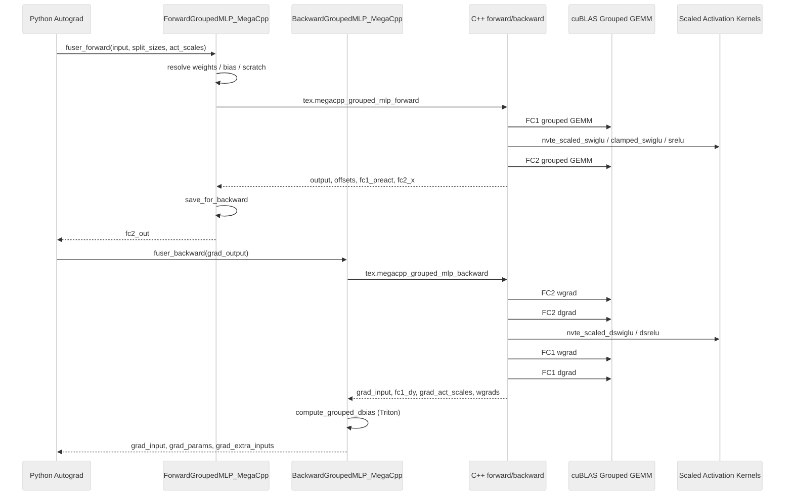
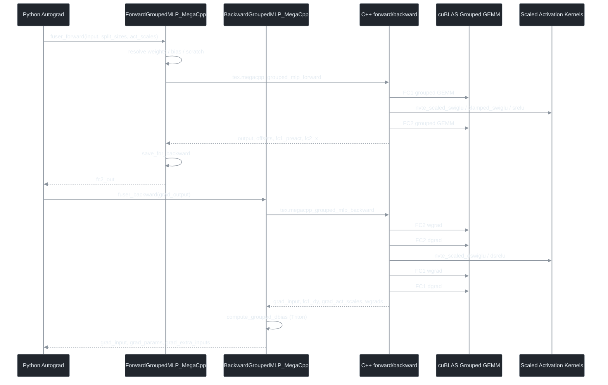

# Introduce Mega-C++ to reduce CPU overhead

[Upstream PR](https://github.com/NVIDIA/TransformerEngine/pull/3099) · state: closed · merged: False

## Original PR description

# Description

UPDATES: We might prefer having a Mega-Kernel in favor of this approach. We can also refactor this PR once we have C++ interface of cudnn fusion kernels for FC1 + ACT + FC2 quant for mxfp8 recipe otherwise users have to choose between unfused GPU kernels or better host-side implementation.  

Assistant: GPT5.5 codex 

Issue: https://github.com/NVIDIA/TransformerEngine/issues/2897 

Get rid of CPU overhead whenever CUDA Graph is not applicable. Guarded by NVTE_MEGACPP_GROUPED_LINEAR. 

Drop-in replace grouped MLP, ie. FC1 - act - FC2. Target BF16 grouped gemm with cublas grouped gemm backend. 

In the future, we can extend to mxfp8 / nvfp4 with cublas backend or even cuteDSL grouped gemm and call `cute.jit` in C++: https://github.com/NVIDIA/cutlass/pull/3289 

Recommend CUDA >= 13.2.1

Dependency of merge: https://github.com/NVIDIA/TransformerEngine/pull/3132  => this PR is rebased on top of this branch.

TODO: 

- [x] E2E training with some multimodal THD packing workloads 
- [x] Develop a better fused scaled swiglu kernel to replace torch ops
- [x] Attach before & after screenshots 
- [ ] Merge the dependency PR first to main and rebase 

Fixes # (issue)

## Type of change

- [ ] Documentation change (change only to the documentation, either a fix or a new content)
- [ ] Bug fix (non-breaking change which fixes an issue)
- [ ] New feature (non-breaking change which adds functionality)
- [ ] Breaking change (fix or feature that would cause existing functionality to not work as expected)
- [ ] Infra/Build change
- [ ] Code refactoring

## Changes

Please list the changes introduced in this PR:

- Change A
- Change B

# Checklist:

- [ ] I have read and followed the [contributing guidelines](https://github.com/NVIDIA/TransformerEngine/blob/main/CONTRIBUTING.rst)
- [ ] The functionality is complete
- [ ] I have commented my code, particularly in hard-to-understand areas
- [ ] I have made corresponding changes to the documentation
- [ ] My changes generate no new warnings
- [ ] I have added tests that prove my fix is effective or that my feature works
- [ ] New and existing unit tests pass locally with my changes


## Review and discussion

### reviews

- timmoon10 · COMMENTED · 2026-06-08T18:57:03Z · [source](https://github.com/NVIDIA/TransformerEngine/pull/3099#pullrequestreview-4452303235)

(No body; status only.)

- zhongbozhu · COMMENTED · 2026-06-08T19:11:58Z · [source](https://github.com/NVIDIA/TransformerEngine/pull/3099#pullrequestreview-4452645274)

(No body; status only.)

- zhongbozhu · COMMENTED · 2026-06-08T19:17:24Z · [source](https://github.com/NVIDIA/TransformerEngine/pull/3099#pullrequestreview-4452684921)

(No body; status only.)

- timmoon10 · COMMENTED · 2026-06-10T00:49:53Z · [source](https://github.com/NVIDIA/TransformerEngine/pull/3099#pullrequestreview-4463593185)

(No body; status only.)

- zhongbozhu · COMMENTED · 2026-06-10T18:13:21Z · [source](https://github.com/NVIDIA/TransformerEngine/pull/3099#pullrequestreview-4470440363)

(No body; status only.)

- greptile-apps[bot] · COMMENTED · 2026-06-16T07:41:32Z · [source](https://github.com/NVIDIA/TransformerEngine/pull/3099#pullrequestreview-4504226784)

(No body; status only.)

- timmoon10 · COMMENTED · 2026-07-01T00:18:16Z · [source](https://github.com/NVIDIA/TransformerEngine/pull/3099#pullrequestreview-4604905938)

(No body; status only.)

### issue_comments

- zhongbozhu · comment · 2026-06-06T07:42:34Z · [source](https://github.com/NVIDIA/TransformerEngine/pull/3099#issuecomment-4637854123)

/te-ci pytorch L1

- zhongbozhu · comment · 2026-06-16T07:10:25Z · [source](https://github.com/NVIDIA/TransformerEngine/pull/3099#issuecomment-4715902944)

E2E test - Qwen3.5 VL 35B-A3B, BSHD layout - about 6% E2E


- greptile-apps[bot] · comment · 2026-06-16T07:41:24Z · [source](https://github.com/NVIDIA/TransformerEngine/pull/3099#issuecomment-4716126524)

<h3>Greptile Summary</h3>

This PR introduces \"Mega-C++\" (`NVTE_MEGACPP_GROUPED_LINEAR` env-gate), a new C++ path for grouped MLP (FC1 → activation → FC2) that replaces the existing Python/PyTorch op-loop to reduce CPU overhead on non-CUDA-graph paths. The implementation targets BF16/FP16 grouped GEMM via cuBLAS grouped-GEMM backend, with support for SwiGLU, ClampedSwiGLU, and SReLU activations.

- New `ForwardGroupedMLP_MegaCpp` / `BackwardGroupedMLP_MegaCpp` Python fused-op classes plus the C++ binding `megacpp_grouped_mlp_forward/backward` handle the full FC1-activation-FC2 pipeline in a single dispatch, with Megatron `main_grad` and paged-stashing support.
- New `nvte_scaled_swiglu`, `nvte_scaled_clamped_swiglu`, `nvte_scaled_srelu` and their backward counterparts add vectorized, interleave-aware CUDA kernels with optional per-row scale-gradient reduction (one block per row, warp-reduce).
- A per-stream scratch-buffer cache (`_cached_grouped_gemm_scratch`) is introduced for cuBLAS workspace reuse, gated by the CUDA stream handle.

<h3>Confidence Score: 4/5</h3>

The functional path — forward GEMM → scaled activation → backward GEMM → wgrad — is well-implemented and covered by integration tests. All findings are quality/efficiency concerns rather than correctness failures in the happy path.

The core BF16 grouped MLP pipeline is logically correct and backed by both C++ unit tests and Python integration tests. Issues found: dead-code branch that can confuse future recipe additions; unbounded per-stream scratch cache that can accumulate GPU allocations; overly broad input_requires_grad causing unnecessary dx computation in frozen-input scenarios; and a delay_wgrad incompatibility caught only at backward time. None affect correctness for the supported BF16/FP16, no-delay_wgrad configuration.

forward_grouped_mlp_megacpp.py warrants a second look for the recipe predicate, LRU cache bound, and input_requires_grad assignment. backward_grouped_mlp_megacpp.py should move the delay_wgrad guard earlier in the fusion lifecycle.

<h3>Important Files Changed</h3>


| Filename | Overview |
|----------|----------|
| transformer_engine/pytorch/ops/fused/forward_grouped_mlp_megacpp.py | Core Python forward fuser: dead-code in `_megacpp_supports_recipe`, unbounded LRU cache keyed on CUDA stream handles, and overly-broad `input_requires_grad` assignment. |
| transformer_engine/pytorch/ops/fused/backward_grouped_mlp_megacpp.py | Backward fuser with correct wgrad ownership policies and bias-grad assembly; delay_wgrad error is only raised during backward, not at fusion time. |
| transformer_engine/pytorch/csrc/megacpp/grouped_mlp.cpp | C++ binding layer for forward/backward; `base_offsets` is intentionally voided in backward; wgrad ownership cases are well-documented and correct. |
| transformer_engine/common/activation/scaled_activation.cu | New CUDA kernels for scaled SwiGLU/ClampedSwiGLU/SReLU; vectorized with GLU-interleave support; warp-reduce for scale-gradient path is numerically correct. |
| transformer_engine/common/include/transformer_engine/activation.h | Public C API additions for nvte_scaled_swiglu, nvte_scaled_clamped_swiglu, nvte_scaled_srelu and their backward variants; documentation is clear and consistent. |
| tests/pytorch/megacpp/test_grouped_mlp.py | Comprehensive integration tests covering wgrad storage, split dtype/device, activation variants, bias, zero-expert edge cases, and delay_wgrad error path. |
| tests/cpp/operator/test_scaled_activation.cu | C++ unit tests with CPU reference implementations for SwiGLU, ClampedSwiGLU, and SReLU forward/backward; covers interleave=0 and interleave=32 across multiple shapes. |
| transformer_engine/pytorch/ops/fused/__init__.py | Correctly imports and exposes ForwardGroupedMLP_MegaCpp and BackwardGroupedMLP_MegaCpp; registration handled inside submodules via prepend=True. |

</details>


<h3>Sequence Diagram</h3>

<a href="#gh-light-mode-only">



</a>
<a href="#gh-dark-mode-only">



</a>

<!-- greptile_other_comments_section -->

<sub>Reviews (1): Last reviewed commit: ["integrate fused scaled swiglu and srelu"](https://github.com/nvidia/transformerengine/commit/07b28363d19ada73c4476967bc502c17ad409bfe) | [Re-trigger Greptile](https://app.greptile.com/api/retrigger?id=37831128)</sub>

- zhongbozhu · comment · 2026-06-16T08:12:24Z · [source](https://github.com/NVIDIA/TransformerEngine/pull/3099#issuecomment-4716356598)

/te-ci pytorch L1

### inline_comments

- timmoon10 · comment · 2026-06-08T18:25:25Z · [source](https://github.com/NVIDIA/TransformerEngine/pull/3099#discussion_r3375461327)

File: `transformer_engine/pytorch/csrc/extensions/pybind.cpp` · line 360

We should expose these functions within the `tex.grouped_mlp_experimental` submodule:
https://github.com/NVIDIA/TransformerEngine/blob/3fffa55da9e68ee814086cb3c7f4571ea5532574/transformer_engine/pytorch/csrc/extensions/pybind.cpp#L647-L650

- timmoon10 · comment · 2026-06-08T18:33:59Z · [source](https://github.com/NVIDIA/TransformerEngine/pull/3099#discussion_r3375510400)

File: `transformer_engine/pytorch/csrc/megacpp/grouped_mlp.cpp` · line None

It would make more sense to organize:
```
csrc/
├── extensions/
│   ├── grouped_mlp_experimental/
│   │   ├── megacpp.cpp
│   │   └── grouped_mlp_experimental.cpp
│   ├── pybind.cpp
│   └── ...
```

If we implement more mega-C++ impls in the future, I don't see a reason why they would be more similar to each other than to the block they are fusing.

- timmoon10 · comment · 2026-06-08T18:49:08Z · [source](https://github.com/NVIDIA/TransformerEngine/pull/3099#discussion_r3375593357)

File: `transformer_engine/pytorch/ops/fused/forward_grouped_mlp_megacpp.py` · line 89

Is it worth supporting GLU interleaving in the mega-C++ path? The only benefit is to support the fused GEMM+GLU kernel, and otherwise the unnecessary memory-bound kernel means perf is a lost cause. If we can simplify our optimized code paths, then it's worth it.

- timmoon10 · comment · 2026-06-08T18:55:16Z · [source](https://github.com/NVIDIA/TransformerEngine/pull/3099#discussion_r3375628572)

File: `transformer_engine/pytorch/ops/fused/forward_grouped_mlp_megacpp.py` · line 421

The GEMM+act fusions provide better GPU perf, so I think they should take higher priority than mega-C++. Basically, I see mega-C++ as "we can't do any better on GPU than the unfused impl, but at least we can make the CPU overhead very small".

- zhongbozhu · comment · 2026-06-08T19:11:58Z · [source](https://github.com/NVIDIA/TransformerEngine/pull/3099#discussion_r3375727607)

File: `transformer_engine/pytorch/ops/fused/forward_grouped_mlp_megacpp.py` · line 89

> The only benefit is to support the fused GEMM+GLU kernel

I do hope in the future we can launch CuteDSL fused kernels in C++ with some TVM-FFI tricks, otherwise we are forced to choose either better kernel fusions or less CPU overhead. Currently the CuteDSL fusion path is very CPU bounded for small models and we rely on CUDA graph and paged stashing for it to work well

- zhongbozhu · comment · 2026-06-08T19:17:23Z · [source](https://github.com/NVIDIA/TransformerEngine/pull/3099#discussion_r3375757772)

File: `transformer_engine/pytorch/ops/fused/forward_grouped_mlp_megacpp.py` · line 421

Current order is follows: 
1. check env var
2. env var = 1, then check supported recipe for mega-C++, so bf16 is supported, not mxfp8 / nvfp4
3. then for mxfp8, nvfp4, mega-C++ does fallback and check for the next fusion. 

The reasoning is that, I do not want the compromise of either better fusion or less host bound, so for future mxfp8 support, we can do the following two things:
1. directly do cuteDSL integration directly with tvm-ffi and do cublas as a backup plan
2. maybe add a new value to NVTE_MEGACPP_GROUPED_LINEAR=forced, so for users who cannot enable cuda graph for some reason, they can enforce C++ when they know that their training is more host bound

- timmoon10 · comment · 2026-06-10T00:49:53Z · [source](https://github.com/NVIDIA/TransformerEngine/pull/3099#discussion_r3384750075)

File: `transformer_engine/pytorch/ops/fused/forward_grouped_mlp_megacpp.py` · line 89

Why not make a separate fused op for mega-C++ CuTe DSL? It'll make the implementations less entangled, so there are fewer edge cases or complications that an agent might misunderstand.

- zhongbozhu · comment · 2026-06-10T18:13:20Z · [source](https://github.com/NVIDIA/TransformerEngine/pull/3099#discussion_r3390517340)

File: `transformer_engine/pytorch/ops/fused/forward_grouped_mlp_megacpp.py` · line 89

yes, if there is a cutedsl version with mega C++, it's gonna take its own code path with zero code reuse since it's gonna be agent-assisted coding anyway

- greptile-apps[bot] · comment · 2026-06-16T07:41:28Z · [source](https://github.com/NVIDIA/TransformerEngine/pull/3099#discussion_r3418934718)

File: `transformer_engine/pytorch/ops/fused/forward_grouped_mlp_megacpp.py` · line 46

<a href="#"></a> The `if recipe.mxfp8() or recipe.nvfp4(): return False` branch is dead code — any non-`None` recipe that is not mxfp8/nvfp4 falls through to the identical final `return False`. The function is equivalent to `return recipe is None`; the current form misleads readers about which cases are being explicitly handled and can confuse future engineers adding support for a new recipe type.

```suggestion
def _megacpp_supports_recipe(recipe: Optional[Recipe]) -> bool:
    """Whether megacpp is a valid candidate for the active quantization recipe.

    Today the C++ implementation is BF16/FP16-only, so only the no-recipe path
    is supported. Any quantized recipe (MXFP8, NVFP4, or future types) returns
    False, leaving the op list unchanged so recipe-specific fusers can match.
    Future quantized-compute support should be enabled by adding an explicit
    `return True` here for the new recipe type, not by reordering fusions.
    """
    return recipe is None
```

- greptile-apps[bot] · comment · 2026-06-16T07:41:29Z · [source](https://github.com/NVIDIA/TransformerEngine/pull/3099#discussion_r3418934804)

File: `transformer_engine/pytorch/ops/fused/forward_grouped_mlp_megacpp.py` · line 54

<a href="#"></a> The `@functools.lru_cache(maxsize=None)` with a CUDA stream handle as part of the key creates an unbounded cache. Each unique `(num_groups, device_index, stream_handle)` triplet permanently holds three CUDA tensors. In pipeline-parallel configurations or test suites that construct many `torch.cuda.Stream()` objects over time, destroyed streams' allocations are never freed because `lru_cache` holds the only live reference. Bounding the cache (e.g., `maxsize=64`) caps the worst-case retained GPU memory.

```suggestion
@functools.lru_cache(maxsize=64)
def _cached_grouped_gemm_scratch(
    num_groups: int,
    device_index: int,
    _stream_handle: int,
) -> tuple[torch.Tensor, torch.Tensor, torch.Tensor, torch.Tensor]:
```

- greptile-apps[bot] · comment · 2026-06-16T07:41:30Z · [source](https://github.com/NVIDIA/TransformerEngine/pull/3099#discussion_r3418934903)

File: `transformer_engine/pytorch/ops/fused/forward_grouped_mlp_megacpp.py` · line 279

<a href="#"></a> `input_requires_grad` is set to the generic `requires_grad` flag, which is `True` whenever any of the three op contexts requires a gradient — including the weight-only case. When the input tensor is frozen, the C++ backward still computes the full FC1 dgrad GEMM and discards the result. Using `fc1_ctx.input_requires_grad` as an additional gate matches the existing fuser convention and avoids the wasted computation.

```suggestion
        requires_grad = any(ctx.requires_grad for ctx in basic_op_ctxs)
        input_requires_grad = requires_grad and fc1_ctx.input_requires_grad
        fc1_weight_requires_grad = requires_grad and fc1_weight_param.requires_grad
        fc2_weight_requires_grad = requires_grad and fc2_weight_param.requires_grad
```

Note: If this suggestion doesn't match your team's coding style, reply to this and let me know. I'll remember it for next time!

- greptile-apps[bot] · comment · 2026-06-16T07:41:31Z · [source](https://github.com/NVIDIA/TransformerEngine/pull/3099#discussion_r3418934973)

File: `transformer_engine/pytorch/ops/fused/backward_grouped_mlp_megacpp.py` · line 92

<a href="#"></a> `delay_wgrad_compute=True` incompatibility is detected inside `fuser_backward`, which runs during `.backward()` — after the forward pass has already executed. A user who constructs a megacpp-fused model with `delay_wgrad_compute=True` will get through an entire forward step before hitting the `ValueError`. Moving this check to `ForwardGroupedMLP_MegaCpp.__init__` or `fuse_forward_megacpp_ops` would surface the error at model-construction or fusion time instead.

- timmoon10 · comment · 2026-07-01T00:18:16Z · [source](https://github.com/NVIDIA/TransformerEngine/pull/3099#discussion_r3502533775)

File: `transformer_engine/pytorch/ops/fused/forward_grouped_mlp_megacpp.py` · line 208

Instead of having separate fused ops for forward and backward, we should implement a single forward-backward fused op (see https://github.com/NVIDIA/TransformerEngine/pull/3117). If the forward and backward fusions are different, then things are going to explode horribly. Also, if we know the forward and backward are together, then we can simplify and reduce unnecessary checks (e.g. we can eliminate things like `fc1_ctx.use_megacpp_grouped_mlp`).

## Changed files and fixed code

- `tests/cpp/operator/CMakeLists.txt` · modified · additions 1 / deletions 0
  - [head](https://github.com/zhongbozhu/TransformerEngine/blob/07b28363d19ada73c4476967bc502c17ad409bfe/tests/cpp/operator/CMakeLists.txt)
  - [base](https://github.com/NVIDIA/TransformerEngine/blob/4130d73ef47a30a2fada58bae6faec7271ce4d9d/tests/cpp/operator/CMakeLists.txt)
- `tests/cpp/operator/test_scaled_activation.cu` · added · additions 321 / deletions 0
  - [head](https://github.com/zhongbozhu/TransformerEngine/blob/07b28363d19ada73c4476967bc502c17ad409bfe/tests/cpp/operator/test_scaled_activation.cu)
  - [base](https://github.com/NVIDIA/TransformerEngine/blob/4130d73ef47a30a2fada58bae6faec7271ce4d9d/tests/cpp/operator/test_scaled_activation.cu)
- `tests/pytorch/megacpp/test_grouped_mlp.py` · added · additions 554 / deletions 0
  - [head](https://github.com/zhongbozhu/TransformerEngine/blob/07b28363d19ada73c4476967bc502c17ad409bfe/tests/pytorch/megacpp/test_grouped_mlp.py)
  - [base](https://github.com/NVIDIA/TransformerEngine/blob/4130d73ef47a30a2fada58bae6faec7271ce4d9d/tests/pytorch/megacpp/test_grouped_mlp.py)
- `transformer_engine/common/CMakeLists.txt` · modified · additions 2 / deletions 0
  - [head](https://github.com/zhongbozhu/TransformerEngine/blob/07b28363d19ada73c4476967bc502c17ad409bfe/transformer_engine/common/CMakeLists.txt)
  - [base](https://github.com/NVIDIA/TransformerEngine/blob/4130d73ef47a30a2fada58bae6faec7271ce4d9d/transformer_engine/common/CMakeLists.txt)
- `transformer_engine/common/activation/scaled_activation.cu` · added · additions 781 / deletions 0
  - [head](https://github.com/zhongbozhu/TransformerEngine/blob/07b28363d19ada73c4476967bc502c17ad409bfe/transformer_engine/common/activation/scaled_activation.cu)
  - [base](https://github.com/NVIDIA/TransformerEngine/blob/4130d73ef47a30a2fada58bae6faec7271ce4d9d/transformer_engine/common/activation/scaled_activation.cu)
- `transformer_engine/common/include/transformer_engine/activation.h` · modified · additions 101 / deletions 0
  - [head](https://github.com/zhongbozhu/TransformerEngine/blob/07b28363d19ada73c4476967bc502c17ad409bfe/transformer_engine/common/include/transformer_engine/activation.h)
  - [base](https://github.com/NVIDIA/TransformerEngine/blob/4130d73ef47a30a2fada58bae6faec7271ce4d9d/transformer_engine/common/include/transformer_engine/activation.h)
- `transformer_engine/pytorch/csrc/extensions.h` · modified · additions 23 / deletions 0
  - [head](https://github.com/zhongbozhu/TransformerEngine/blob/07b28363d19ada73c4476967bc502c17ad409bfe/transformer_engine/pytorch/csrc/extensions.h)
  - [base](https://github.com/NVIDIA/TransformerEngine/blob/4130d73ef47a30a2fada58bae6faec7271ce4d9d/transformer_engine/pytorch/csrc/extensions.h)
- `transformer_engine/pytorch/csrc/extensions/pybind.cpp` · modified · additions 19 / deletions 0
  - [head](https://github.com/zhongbozhu/TransformerEngine/blob/07b28363d19ada73c4476967bc502c17ad409bfe/transformer_engine/pytorch/csrc/extensions/pybind.cpp)
  - [base](https://github.com/NVIDIA/TransformerEngine/blob/4130d73ef47a30a2fada58bae6faec7271ce4d9d/transformer_engine/pytorch/csrc/extensions/pybind.cpp)
- `transformer_engine/pytorch/csrc/megacpp/grouped_mlp.cpp` · added · additions 769 / deletions 0
  - [head](https://github.com/zhongbozhu/TransformerEngine/blob/07b28363d19ada73c4476967bc502c17ad409bfe/transformer_engine/pytorch/csrc/megacpp/grouped_mlp.cpp)
  - [base](https://github.com/NVIDIA/TransformerEngine/blob/4130d73ef47a30a2fada58bae6faec7271ce4d9d/transformer_engine/pytorch/csrc/megacpp/grouped_mlp.cpp)
- `transformer_engine/pytorch/ops/fused/__init__.py` · modified · additions 6 / deletions 0
  - [head](https://github.com/zhongbozhu/TransformerEngine/blob/07b28363d19ada73c4476967bc502c17ad409bfe/transformer_engine/pytorch/ops/fused/__init__.py)
  - [base](https://github.com/NVIDIA/TransformerEngine/blob/4130d73ef47a30a2fada58bae6faec7271ce4d9d/transformer_engine/pytorch/ops/fused/__init__.py)
- `transformer_engine/pytorch/ops/fused/backward_grouped_mlp_megacpp.py` · added · additions 394 / deletions 0
  - [head](https://github.com/zhongbozhu/TransformerEngine/blob/07b28363d19ada73c4476967bc502c17ad409bfe/transformer_engine/pytorch/ops/fused/backward_grouped_mlp_megacpp.py)
  - [base](https://github.com/NVIDIA/TransformerEngine/blob/4130d73ef47a30a2fada58bae6faec7271ce4d9d/transformer_engine/pytorch/ops/fused/backward_grouped_mlp_megacpp.py)
- `transformer_engine/pytorch/ops/fused/forward_grouped_mlp_megacpp.py` · added · additions 421 / deletions 0
  - [head](https://github.com/zhongbozhu/TransformerEngine/blob/07b28363d19ada73c4476967bc502c17ad409bfe/transformer_engine/pytorch/ops/fused/forward_grouped_mlp_megacpp.py)
  - [base](https://github.com/NVIDIA/TransformerEngine/blob/4130d73ef47a30a2fada58bae6faec7271ce4d9d/transformer_engine/pytorch/ops/fused/forward_grouped_mlp_megacpp.py)

## Evidence and interpretation boundary

[Original JSON, discussions and patches](../../../../../../evidence/prs/NVIDIA--TransformerEngine/3099-e756b6047655b9ecc7c8836debd9bd39cce0cb9640f9443f4f66455ab4f053c6.json) · SHA-256 `e756b6047655b9ecc7c8836debd9bd39cce0cb9640f9443f4f66455ab4f053c6`.

Diff complete: True. Missing/binary/truncated patches require pinned source inspection. This is a source page, not an independently verified optimization case. Open, merged and released are different states; recheck the deployed dependency.
