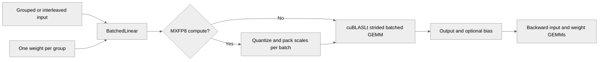

# [Common][PyTorch] Add strided batched GEMM in BF16/MXFP8

[Upstream PR](https://github.com/NVIDIA/TransformerEngine/pull/3160) · state: open · merged: False

## Original PR description

# Description

This PR adds experimental cuBLASLt-backed strided batched GEMM support and a new fusible PyTorch operation exported as `transformer_engine.pytorch.ops.BatchedLinear`.

The main use case is applying one weight matrix per group without rearranging interleaved activations:

```
[S, B, G, D] @ [G, R, D] -> [S, B, G, R]
```

Both contiguous `[G, ..., D]` and `[..., G, D]` input layouts are supported through explicit leading dimensions and batch strides. MXFP8 scales are packed into the cuBLASLt per-batch layout internally before each GEMM.

## Dependency

This PR depends on #3327 for meta-device deferred initialization in the operation fuser and should be merged after it.

## Type of change

- [ ] Documentation change (change only to the documentation, either a fix or a new content)
- [ ] Bug fix (non-breaking change which fixes an issue)
- [x] New feature (non-breaking change which adds functionality)
- [ ] Breaking change (fix or feature that would cause existing functionality to not work as expected)
- [ ] Infra/Build change
- [ ] Code refactoring

## Changes

- Add an experimental common API for cuBLASLt strided batched GEMM with independent matrix strides.
- Support high-precision and MXFP8 input pairs with high-precision output.
- Add `transformer_engine.pytorch.ops.BatchedLinear` with high-precision and MXFP8 forward and backward computation.
- Support primary MXFP8 weights, bias and `return_bias`, `save_original_input`, custom initialization and RNG tracking, and main-gradient accumulation.
- Add API documentation and PyTorch L0 tests.

### Current limitations

- A and B must both be high precision or both be MXFP8.
- MXFP8 operands must use contiguous `[G, ..., D]` or `[..., G, D]` layouts.
- Output quantization, fused GEMM epilogues, non-MXFP8 recipes, and tensor parallelism are not supported.

# Checklist

- [x] I have read and followed the [contributing guidelines](https://github.com/NVIDIA/TransformerEngine/blob/main/CONTRIBUTING.rst)
- [x] The functionality is complete
- [x] I have commented my code, particularly in hard-to-understand areas
- [x] I have made corresponding changes to the documentation
- [x] My changes generate no new warnings
- [x] I have added tests that prove my fix is effective or that my feature works
- [x] New and existing unit tests pass locally with my changes


## Review and discussion

### reviews

- greptile-apps[bot] · COMMENTED · 2026-07-01T08:30:16Z · [source](https://github.com/NVIDIA/TransformerEngine/pull/3160#pullrequestreview-4607120426)

(No body; status only.)

- timmoon10 · COMMENTED · 2026-08-05T17:54:59Z · [source](https://github.com/NVIDIA/TransformerEngine/pull/3160#pullrequestreview-4867241138)

Mathematically, is this equivalent to `GroupedLinear` with uniform split sizes (`m_splits=[S*B] * G`)?

If so, are there perf reasons to support a dedicated kernel? I could imagine that batched GEMM is easier to optimize than grouped GEMM, but grouped GEMM should already be getting a good fraction of the peak compute throughput. I would like to make sure we have a compelling benefit before accepting a major maintenance burden (on the order of `Linear` and `GroupedLinear`, especially if we need to support all the weird Mcore-specific integrations).

- yaox12 · COMMENTED · 2026-08-06T02:03:15Z · [source](https://github.com/NVIDIA/TransformerEngine/pull/3160#pullrequestreview-4870357068)

(No body; status only.)

- yaox12 · COMMENTED · 2026-08-06T02:20:55Z · [source](https://github.com/NVIDIA/TransformerEngine/pull/3160#pullrequestreview-4870434505)

(No body; status only.)

- yaox12 · COMMENTED · 2026-08-06T03:35:17Z · [source](https://github.com/NVIDIA/TransformerEngine/pull/3160#pullrequestreview-4870740551)

(No body; status only.)

- yaox12 · COMMENTED · 2026-09-02T09:57:39Z · [source](https://github.com/NVIDIA/TransformerEngine/pull/3160#pullrequestreview-5088187272)

(No body; status only.)

- greptile-apps[bot] · COMMENTED · 2026-10-13T10:14:39Z · [source](https://github.com/NVIDIA/TransformerEngine/pull/3160#pullrequestreview-5502010834)

(No body; status only.)

### issue_comments

- greptile-apps[bot] · comment · 2026-07-01T08:30:06Z · [source](https://github.com/NVIDIA/TransformerEngine/pull/3160#issuecomment-4852138795)

<!-- greptile_summary -->

<h2><a href="https://app.greptile.com/api/retrigger?id=41039514"><picture><source media="(prefers-color-scheme: dark)" srcset="https://greptile-static-assets.s3.amazonaws.com/badges/RetriggerDark.svg?v=2"><source media="(prefers-color-scheme: light)" srcset="https://greptile-static-assets.s3.amazonaws.com/badges/Retrigger.svg?v=2"></picture></a>Confidence Score: 5/5</h2>

**[Medium impact]** The reviewed changes appear safe to merge after the declared deferred-initialization dependency.

<h3>Summary</h3>

Adds experimental strided batched GEMM and the fusible PyTorch operation `BatchedLinear`.
- Strided batched GEMM runs one matrix multiplication for each group.
- BatchedLinear applies a separate weight matrix to each input group.

<h3>Diagram</h3>



<!-- greptile_confidence_score:5 -->

<sub>Reviews (9) · Last reviewed commit: ["\[pre-commit.ci\] auto fixes from pre-comm..."](https://github.com/nvidia/transformerengine/commit/68e3edbd0de94c4dd2d396aefd670cfd782eba3d) · [Reviewed by Greptile](https://www.greptile.com/?utm_source=greptile_expert&utm_medium=github&utm_campaign=code_reviews&utm_content=nvidia/transformerengine)</sub>

- yaox12 · comment · 2026-07-06T05:10:14Z · [source](https://github.com/NVIDIA/TransformerEngine/pull/3160#issuecomment-4889304312)

/te-ci

- greptile-apps[bot] · comment · 2026-10-13T10:14:48Z · [source](https://github.com/NVIDIA/TransformerEngine/pull/3160#issuecomment-6143309468)

<!-- greptile_outside_diff -->

<h3>Comments Outside Diff</h3>

These findings could not be posted inline.

- &nbsp;**cuBLASLt handle leak on any API failure after partial descriptor creation** `transformer_engine/common/gemm/cublaslt_gemm.cu:1148` <a href="https://github.com/nvidia/transformerengine/blob/7ba6f2a99dc105e121f0becb35769207ba11f6c7/transformer_engine/common/gemm/cublaslt_gemm.cu#L1040-L1148">▶</a>

  `Adesc`, `Bdesc`, `Cdesc`, `Ddesc`, `operationDesc`, and `preference` are created incrementally. If any `NVTE_CHECK_CUBLAS` call after the first `cublasLtMatrixLayoutCreate` throws - for example in `set_strided_batch`, in the MXFP8 `cublasLtMatmulDescSetAttribute` block, in `cublasLtMatmulAlgoGetHeuristic`, or in `cublasLtMatmul` - the already-allocated handles are never passed to their corresponding `Destroy` functions. The cleanup block at the bottom of the function is only reached on the happy path.

  The MXFP8 version checks at the top of the function were correctly moved before descriptor creation, so those specific paths are safe. The leak window is every `NVTE_CHECK_CUBLAS` call from the first descriptor creation onward. Adding RAII wrappers (or a try/catch with a cleanup lambda) to the new function would prevent the problem here.

- &nbsp;**C\-matrix always aliased to D \- undocumented design restriction** `transformer_engine/pytorch/cpp_extensions/gemm.py:1491` <a href="https://github.com/nvidia/transformerengine/blob/bab9621091e78a4349d0712390654dc24299963d/transformer_engine/pytorch/cpp_extensions/gemm.py#L1412-L1491">▶</a>

  The public C-level API `nvte_cublas_gemm_strided_batched` accepts independent `C`, `ldc`, and `stridec` parameters (useful for a fused `D = A*B + beta*C` with distinct accumulation buffers). This Python wrapper always passes `out` for both C and D, permanently losing that flexibility. A comment in the docstring noting that accumulation is always done in-place (`beta` is applied to `out` itself) would prevent surprises for future callers who discover the separate C parameter in the C++ header.

  Note: If this suggestion doesn't match your team's coding style, reply to this and let me know. I'll remember it for next time!

### inline_comments

- greptile-apps[bot] · comment · 2026-07-01T08:30:10Z · [source](https://github.com/NVIDIA/TransformerEngine/pull/3160#discussion_r3504377236)

File: `transformer_engine/common/gemm/cublaslt_gemm.cu` · line 1161

<a href="#"></a> **cuBLASLt descriptor leak on every failed MXFP8 call**

`Adesc`, `Bdesc`, `Cdesc`, `Ddesc` (lines 1010–1023) and `operationDesc` (line 1029) are all successfully created before this block. If `use_mxfp8` is true and the binary was compiled with `CUBLAS_VERSION < 120800`, the `NVTE_ERROR` on line 1081 throws an exception. Equally, even when compiled against a new-enough cuBLAS, the runtime `NVTE_CHECK` at line 1048 (comparing `cublas_version() >= 120800`) will throw if the runtime library is older. In both cases the five already-created descriptors are never destroyed, leaking one handle per call attempt. The cleanup block at the end of the function is only reached on the happy path.

- greptile-apps[bot] · comment · 2026-07-01T08:30:11Z · [source](https://github.com/NVIDIA/TransformerEngine/pull/3160#discussion_r3504377316)

File: `transformer_engine/pytorch/ops/basic/batched_gemm.py` · line None

<a href="#"></a> `is_quantized_tensor(input_)` is evaluated before `isinstance(input_, torch.Tensor)`. For a completely non-tensor input (e.g., a plain Python list), `is_quantized_tensor` may raise an unexpected error before the more informative `TypeError` is reached. Checking `isinstance` first ensures the type guard fires before any attribute access.

```suggestion
    def _validate_input(self, input_: torch.Tensor) -> int:
        if not isinstance(input_, torch.Tensor):
            raise TypeError(
                f"BatchedGEMM expects a torch.Tensor input (got {type(input_).__name__})"
            )
        if is_quantized_tensor(input_):
            raise ValueError("BatchedGEMM expects a high-precision input tensor")
```

- timmoon10 · comment · 2026-08-05T17:52:04Z · [source](https://github.com/NVIDIA/TransformerEngine/pull/3160#discussion_r3722815455)

File: `transformer_engine/pytorch/module/batched_linear.py` · line 1

We should prefer implementing new modules in `te.ops` so that they work with the op fuser API (see [docs](https://docs.nvidia.com/deeplearning/transformer-engine/user-guide/examples/op_fuser/op_fuser.html)). `te.module` is somewhat a legacy API.

- yaox12 · comment · 2026-08-06T02:03:15Z · [source](https://github.com/NVIDIA/TransformerEngine/pull/3160#discussion_r3725383641)

File: `transformer_engine/pytorch/module/batched_linear.py` · line 1

In fact I implemented it in `te.ops` at first, but later I found `te.ops` lacks `rng_state_tracker_function`, `init_method`, and especially `preserve_high_precision_init_val`, which requires a cross-module change to all ops that hold weights.  The current usage of `ops.GroupedLinear` doesn't encounter these problems because we first initialize the weights tensors in `modules.GroupedLinear`, then assign them to `ops.GroupedLinear` and then do the computation. That's to say `ops.GroupedLinear` doesn't really hold the weight tensors. But for `ops.BatchLinear`, we don't have a counter-part `modules.*`.

- yaox12 · comment · 2026-08-06T02:20:55Z · [source](https://github.com/NVIDIA/TransformerEngine/pull/3160#discussion_r3725453171)

File: `transformer_engine/pytorch/module/batched_linear.py` · line 1

> Why not using grouped GEMM instead?

The main reason is that we need a **strided** batched GEMM kernel because the A tensor (input activation) is contiguous in `[S, B, G, D]` where `G` is the batch/group dim.

- yaox12 · comment · 2026-08-06T03:35:17Z · [source](https://github.com/NVIDIA/TransformerEngine/pull/3160#discussion_r3725711031)

File: `transformer_engine/pytorch/module/batched_linear.py` · line 1

Also, codex found a potential deferred initialization bug of `te.ops`. https://github.com/NVIDIA/TransformerEngine/issues/3322

- yaox12 · comment · 2026-09-02T09:57:38Z · [source](https://github.com/NVIDIA/TransformerEngine/pull/3160#discussion_r3912908951)

File: `transformer_engine/pytorch/module/batched_linear.py` · line 1

Migrated it to `te.ops`.

- greptile-apps[bot] · comment · 2026-10-13T10:14:37Z · [source](https://github.com/NVIDIA/TransformerEngine/pull/3160#discussion_r4257382123)

File: `transformer_engine/common/gemm/cublaslt_gemm.cu` · line 1188

<a href="#"></a> **Partial sums lose accuracy**

The new GEMM path leaves the reduction scheme unrestricted. If cuBLASLt chooses a split-K algorithm that rounds partial sums to BF16 before adding them, cancellation-heavy products can lose accuracy. This API accepts `batch_count=1`, so the ordinary GEMM case is reachable here too.

Set `CUBLASLT_MATMUL_PREF_REDUCTION_SCHEME_MASK` to `CUBLASLT_REDUCTION_SCHEME_COMPUTE_TYPE`, as the existing GEMM path does.

**Knowledge Base Used:** [Native GEMM and quantization kernels](https://app.greptile.com/nvidia-public-github/-/custom-context/knowledge-base/nvidia/transformerengine/-/docs/native-gemm-and-quantization.md)

- greptile-apps[bot] · comment · 2026-10-13T10:14:37Z · [source](https://github.com/NVIDIA/TransformerEngine/pull/3160#discussion_r4257382135)

File: `transformer_engine/pytorch/csrc/extensions/gemm.cpp` · line 595

<a href="#"></a> **Workspace size exceeds allocation**

The binding trusts `workspaceSize` without checking the bytes available in `workspace`. A direct `tex.strided_batched_gemm` call can pass a smaller tensor and advertise a larger scratch buffer, allowing cuBLASLt to write beyond it.

Check the available contiguous bytes before creating `te_workspace`. This would turn a wrong size into a clear error rather than possible GPU memory corruption.

- greptile-apps[bot] · comment · 2026-10-13T10:14:37Z · [source](https://github.com/NVIDIA/TransformerEngine/pull/3160#discussion_r4257382144)

File: `transformer_engine/pytorch/csrc/extensions/gemm.cpp` · line 581

<a href="#"></a> **Wrong-device pointers reach GEMM**

The binding checks that `D` and `workspace` are on CUDA, but does not require all operands and scratch buffers to share `D.device()`. High-precision `A` and `B` can even be CPU tensors. Their pointers are passed unchanged to cuBLASLt under `D`'s device guard.

Reject CPU inputs and mixed-device buffers before packing scales or launching GEMM. This would catch misplaced tensors before they cause CUDA pointer errors or unintended cross-device reads.

## Changed files and fixed code

- `docs/api/pytorch.rst` · modified · additions 2 / deletions 0
  - [head](https://github.com/yaox12/TransformerEngine/blob/68e3edbd0de94c4dd2d396aefd670cfd782eba3d/docs/api/pytorch.rst)
  - [base](https://github.com/NVIDIA/TransformerEngine/blob/39a8b879dfbfea0d23bc3862dc83ec1d6f970b49/docs/api/pytorch.rst)
- `qa/L0_pytorch_unittest/test.sh` · modified · additions 2 / deletions 0
  - [head](https://github.com/yaox12/TransformerEngine/blob/68e3edbd0de94c4dd2d396aefd670cfd782eba3d/qa/L0_pytorch_unittest/test.sh)
  - [base](https://github.com/NVIDIA/TransformerEngine/blob/39a8b879dfbfea0d23bc3862dc83ec1d6f970b49/qa/L0_pytorch_unittest/test.sh)
- `tests/pytorch/test_batched_linear.py` · added · additions 531 / deletions 0
  - [head](https://github.com/yaox12/TransformerEngine/blob/68e3edbd0de94c4dd2d396aefd670cfd782eba3d/tests/pytorch/test_batched_linear.py)
  - [base](https://github.com/NVIDIA/TransformerEngine/blob/39a8b879dfbfea0d23bc3862dc83ec1d6f970b49/tests/pytorch/test_batched_linear.py)
- `tests/pytorch/test_strided_batched_gemm.py` · added · additions 439 / deletions 0
  - [head](https://github.com/yaox12/TransformerEngine/blob/68e3edbd0de94c4dd2d396aefd670cfd782eba3d/tests/pytorch/test_strided_batched_gemm.py)
  - [base](https://github.com/NVIDIA/TransformerEngine/blob/39a8b879dfbfea0d23bc3862dc83ec1d6f970b49/tests/pytorch/test_strided_batched_gemm.py)
- `transformer_engine/common/gemm/cublaslt_gemm.cu` · modified · additions 431 / deletions 0
  - [head](https://github.com/yaox12/TransformerEngine/blob/68e3edbd0de94c4dd2d396aefd670cfd782eba3d/transformer_engine/common/gemm/cublaslt_gemm.cu)
  - [base](https://github.com/NVIDIA/TransformerEngine/blob/39a8b879dfbfea0d23bc3862dc83ec1d6f970b49/transformer_engine/common/gemm/cublaslt_gemm.cu)
- `transformer_engine/common/include/transformer_engine/gemm.h` · modified · additions 51 / deletions 0
  - [head](https://github.com/yaox12/TransformerEngine/blob/68e3edbd0de94c4dd2d396aefd670cfd782eba3d/transformer_engine/common/include/transformer_engine/gemm.h)
  - [base](https://github.com/NVIDIA/TransformerEngine/blob/39a8b879dfbfea0d23bc3862dc83ec1d6f970b49/transformer_engine/common/include/transformer_engine/gemm.h)
- `transformer_engine/common/include/transformer_engine/swizzle.h` · modified · additions 35 / deletions 0
  - [head](https://github.com/yaox12/TransformerEngine/blob/68e3edbd0de94c4dd2d396aefd670cfd782eba3d/transformer_engine/common/include/transformer_engine/swizzle.h)
  - [base](https://github.com/NVIDIA/TransformerEngine/blob/39a8b879dfbfea0d23bc3862dc83ec1d6f970b49/transformer_engine/common/include/transformer_engine/swizzle.h)
- `transformer_engine/common/swizzle/swizzle.cu` · modified · additions 220 / deletions 0
  - [head](https://github.com/yaox12/TransformerEngine/blob/68e3edbd0de94c4dd2d396aefd670cfd782eba3d/transformer_engine/common/swizzle/swizzle.cu)
  - [base](https://github.com/NVIDIA/TransformerEngine/blob/39a8b879dfbfea0d23bc3862dc83ec1d6f970b49/transformer_engine/common/swizzle/swizzle.cu)
- `transformer_engine/pytorch/cpp_extensions/gemm.py` · modified · additions 84 / deletions 0
  - [head](https://github.com/yaox12/TransformerEngine/blob/68e3edbd0de94c4dd2d396aefd670cfd782eba3d/transformer_engine/pytorch/cpp_extensions/gemm.py)
  - [base](https://github.com/NVIDIA/TransformerEngine/blob/39a8b879dfbfea0d23bc3862dc83ec1d6f970b49/transformer_engine/pytorch/cpp_extensions/gemm.py)
- `transformer_engine/pytorch/csrc/extensions.h` · modified · additions 7 / deletions 0
  - [head](https://github.com/yaox12/TransformerEngine/blob/68e3edbd0de94c4dd2d396aefd670cfd782eba3d/transformer_engine/pytorch/csrc/extensions.h)
  - [base](https://github.com/NVIDIA/TransformerEngine/blob/39a8b879dfbfea0d23bc3862dc83ec1d6f970b49/transformer_engine/pytorch/csrc/extensions.h)
- `transformer_engine/pytorch/csrc/extensions/gemm.cpp` · modified · additions 224 / deletions 0
  - [head](https://github.com/yaox12/TransformerEngine/blob/68e3edbd0de94c4dd2d396aefd670cfd782eba3d/transformer_engine/pytorch/csrc/extensions/gemm.cpp)
  - [base](https://github.com/NVIDIA/TransformerEngine/blob/39a8b879dfbfea0d23bc3862dc83ec1d6f970b49/transformer_engine/pytorch/csrc/extensions/gemm.cpp)
- `transformer_engine/pytorch/csrc/extensions/pybind.cpp` · modified · additions 7 / deletions 0
  - [head](https://github.com/yaox12/TransformerEngine/blob/68e3edbd0de94c4dd2d396aefd670cfd782eba3d/transformer_engine/pytorch/csrc/extensions/pybind.cpp)
  - [base](https://github.com/NVIDIA/TransformerEngine/blob/39a8b879dfbfea0d23bc3862dc83ec1d6f970b49/transformer_engine/pytorch/csrc/extensions/pybind.cpp)
- `transformer_engine/pytorch/ops/basic/__init__.py` · modified · additions 1 / deletions 0
  - [head](https://github.com/yaox12/TransformerEngine/blob/68e3edbd0de94c4dd2d396aefd670cfd782eba3d/transformer_engine/pytorch/ops/basic/__init__.py)
  - [base](https://github.com/NVIDIA/TransformerEngine/blob/39a8b879dfbfea0d23bc3862dc83ec1d6f970b49/transformer_engine/pytorch/ops/basic/__init__.py)
- `transformer_engine/pytorch/ops/basic/batched_linear.py` · added · additions 782 / deletions 0
  - [head](https://github.com/yaox12/TransformerEngine/blob/68e3edbd0de94c4dd2d396aefd670cfd782eba3d/transformer_engine/pytorch/ops/basic/batched_linear.py)
  - [base](https://github.com/NVIDIA/TransformerEngine/blob/39a8b879dfbfea0d23bc3862dc83ec1d6f970b49/transformer_engine/pytorch/ops/basic/batched_linear.py)

## Evidence and interpretation boundary

[Original JSON, discussions and patches](../../../../../../evidence/prs/NVIDIA--TransformerEngine/3160-2839d66a027b8be5f7881fa7ad567f280c7d29685a138bdc63b9374002609291.json) · SHA-256 `2839d66a027b8be5f7881fa7ad567f280c7d29685a138bdc63b9374002609291`.

Diff complete: True. Missing/binary/truncated patches require pinned source inspection. This is a source page, not an independently verified optimization case. Open, merged and released are different states; recheck the deployed dependency.
