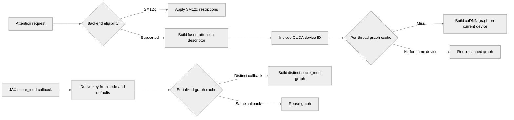

# Fix cuDNN SDPA score_mod cache collision, sm_12x arch gates, per-device plan cache

[Upstream PR](https://github.com/NVIDIA/TransformerEngine/pull/3289) · state: open · merged: False

## Original PR description

# Fix cuDNN SDPA integration bugs: score_mod graph-cache collision, sm_12x arch gates, per-device plan cache

## Summary

Three defects found while auditing TransformerEngine's use of the cuDNN SDPA API. The most
serious one is silent: every module-level `lambda` score_mod in a JAX module collapses onto a
single cuDNN graph-cache key, so the second one silently replays the first one's compiled graph
and produces wrong attention outputs with no error. The other two are hardware/topology bugs:
the SM120 workarounds use exact compute-capability equality and therefore orphan sm_121 (GB10 /
DGX Spark), where every THD/varlen attention layer aborts with `GRAPH_NOT_SUPPORTED`; and the
fused-attention plan caches are keyed without a device id, so in a single-threaded multi-GPU
loop a plan built on device 0 is executed on device 1's cuDNN handle.

### 1. Every module-level lambda `score_mod` shares one cuDNN graph cache key

`transformer_engine/jax/cpp_extensions/flex_attention.py:200` keyed a plain function score_mod by
`("function", __module__, __qualname__)`.

A module-level `lambda` has `__qualname__ == "<lambda>"` exactly, has no closure
(`__closure__ is None`), and contains no `"<locals>"` — so it satisfies all three conditions of
that branch, and *every* module-level lambda in a module produces the identical key. The key
flows into `_FusedAttnScoreModConfig.__hash__`/`__eq__` and then into `_graph_cache_key()`
(`flex_attention.py:591`), which is what selects the serialized, already-built cuDNN frontend
graph. Two different score_mods therefore hit the same cache entry.

Failure scenario: a module defines a soft-cap score_mod and a relative-bias score_mod as
module-level lambdas — which is exactly how the cuDNN frontend's score_mod API is idiomatically
used. The first attention layer compiles and caches its graph. The second layer looks up the
cache, finds the first layer's key, and executes the first score_mod's fused kernel against the
second layer's tensors. There is no exception, no warning, and no shape mismatch (the tensor
signature is part of the key, but the score_mod body is not) — just wrong numerics, in fprop and
in bprop.

Fix: keep the key cacheable but derive it from the code object
(`co_code`, `co_consts`, `co_names`) in addition to module + qualname. This was preferred over
returning `_UncacheableScoreModKey()` for lambdas because it keeps the cache useful for the
common case (a lambda score_mod reused across many layers still hits) while giving distinct
bodies distinct keys. If the assembled key is ever unhashable, it degrades to the safe
uncacheable path rather than guessing.

Caveat, unchanged by this PR: the key still does not capture the *values* of globals a score_mod
closes over via `co_names`. That was already true for named module-level functions, and mutating
a global between two attention calls with the same score_mod remains outside the key's scope.

### 2. SM12x guards use exact equality and orphan sm_121 (GB10 / DGX Spark)

cuDNN classifies support by compute-capability *family*, not exact compute capability, so
sm_121 behaves like sm_120 for every one of these workarounds. TE tested `sm_arch_ == 120` /
`device_compute_capability == (12, 0)`, which is false on sm_121.

Concrete failure on sm_121, THD/varlen attention:
`fused_attn_f16_arbitrary_seqlen.cu:92` computes
`use_ragged_stats = is_ragged_q && cudnn >= 9.6 && sm_arch_ != 120` → `true`, so the Stats tensor
gets a ragged offset; and the guard at `fused_attn_f16_arbitrary_seqlen.cu:121` fails to switch
to BHSD-like dims/strides with `max_seqlen`. cuDNN then sees the layout the in-tree comment at
`fused_attn_f16_arbitrary_seqlen.cu:118-120` already describes as rejected (`stride[0] >
dim[1]*dim[2]*dim[3]` treated as interleaved) and the graph fails validation with
`GRAPH_NOT_SUPPORTED`. There is no fallback path at that point — the layer aborts. The
aux-tensor shapes at `fused_attn_f16_arbitrary_seqlen.cu:1243,1253` disagree with the built graph
for the same reason.

Fix: a single `is_sm12x = (sm_arch_ >= 120 && sm_arch_ < 130)` per function, used at all seven
sites in `fused_attn_f16_arbitrary_seqlen.cu` (lines 92, 121, 686/699, 902, 1243, 1253), and the
same family test in the backend-selection gate at `fused_attn.cpp:507` (cuDNN version floor,
deterministic-training rejection, T3HD/TH3D rejection).

Mirrored on the PyTorch side, where the same limitations are encoded as an eligibility matrix:
`pytorch/attention/dot_product_attention/utils.py` now computes `is_sm12x` once next to
`device_compute_capability` (line 464) and uses it at the FP8 gate (line 714), the KV-cache gates
(lines 834-838), the MLA-backward gate (line 901) and the THD gate (line 1059); and
`context_parallel.py:1621` uses the family test to decide `softmax_lse_in_packed_format`, which
must agree with `use_ragged_stats` in the C++ layer or the CP softmax-LSE unpacking reads the
wrong layout.

Only the SM120-family *workarounds* were converted. The FlashAttention-2 head-dim support list
at `utils.py:920` also mentions `(12, 0)`, but it is a support allowlist rather than a cuDNN
workaround and excluding sm_121 there is the conservative behaviour, so it is left alone.

### 3. Fused-attention plan cache is not keyed by device

`fused_attn_f16_arbitrary_seqlen.cu:212` (and the three sibling caches) are
`static thread_local std::map<FADescriptor_v1, graph_and_tensors>`, but `FADescriptor_v1`
(`common/fused_attn/utils.h:252`) carries no device id and no SM arch, while the cuDNN handle is
per-device.

Failure scenario: a single-threaded process loops over GPUs — `torch.cuda.set_device(0)`, run
attention; `torch.cuda.set_device(1)`, run the same shape/dtype/layout attention. `thread_local`
does not help because it is the same thread. The descriptor is identical, so the cache returns
the execution plan built against device 0's handle, and it is executed on device 1's handle.
This is undefined behaviour even on a homogeneous node; on a heterogeneous node (e.g. an SM90 and
an SM100 in the same box) the cached plan is for the wrong architecture entirely.

Fix: add `int device_id` to `FADescriptor_v1`, include it in `operator<`/`std::tie`, and populate
it from `cuda::current_device()` at all four construction sites
(`fused_attn_f16_arbitrary_seqlen.cu:185` and `:751`, `fused_attn_fp8.cu:121` and `:590`).
`fused_attn_fp8.cu` gains the `../util/cuda_runtime.h` include it needs for that. Keying on the
device id rather than the SM arch is the stricter choice: two devices of the same architecture
still get separate plans, which is what the per-device handle requires.

## Evidence

Standalone reproduction of the key function for fix 1, no GPU required:

| score_mod | `__qualname__` | closure? | cache key |
|---|---|---|---|
| module-level lambda A | `<lambda>` | no | `('function', '__main__', '<lambda>')` |
| module-level lambda B | `<lambda>` | no | `('function', '__main__', '<lambda>')` |
| named fn `relu_score` | `relu_score` | no | `('function', '__main__', 'relu_score')` |
| closure `make_closure(30)` | `make_closure.<locals>.<lambda>` | yes | UNCACHEABLE |

The two lambdas compute different functions (A(10)=20.0, B(10)=50.0) yet share one key. Named
functions key correctly and closures correctly fall through to uncacheable — the hole is exactly
the module-level lambda, which is how soft-cap / relative-bias score_mods are idiomatically
written.

No GPU measurements are claimed for fixes 2 and 3.

## Testing

Added `tests/jax/test_fused_attn_score_mod.py::test_fused_attn_score_mod_config_separates_module_level_lambdas`
— a pure-Python test (no GPU, no cuDNN) that asserts two module-level lambdas with identical
`__qualname__` get distinct cache keys and distinct `_graph_cache_key()` results, that the key is
stable across repeated calls, and that named module-level functions stay cacheable. It fails on
`main` (both keys are `('function', <module>, '<lambda>')`) and passes with this change.

Could not run in the audit sandbox: TransformerEngine is not built/installed there, so
`import transformer_engine.jax` fails and pytest cannot collect the file. The key-derivation
logic was verified standalone against the extracted function (table above). Fixes 2 and 3 are
compile-only changes reviewed by inspection; they were not built or run — no sm_121 hardware and
no multi-GPU build were available. `clang-format -style=file` and `black --line-length=100` are
clean on the changed files.

Found by an integration audit of cuDNN SDPA consumers by the NVIDIA cuDNN team.

## Review and discussion

### reviews

### issue_comments

- greptile-apps[bot] · comment · 2026-07-30T18:57:10Z · [source](https://github.com/NVIDIA/TransformerEngine/pull/3289#issuecomment-5135041351)

<h3>Greptile Summary</h3>

This PR corrects three fused-attention cache and architecture issues.
- Distinguishes JAX module-level score-modification callbacks by code and default arguments.
- Applies SM12x-specific backend and tensor-layout workarounds consistently to SM121 and other SM12x devices.
- Partitions FP16/BF16 and FP8 cuDNN attention graph caches by CUDA device.
- Adds regression coverage for lambda cache-key collisions and default-argument differences.

<h3>Confidence Score: 5/5</h3>

The PR appears safe to merge, with the cache partitioning and SM12x producer-consumer layout changes applied consistently.

All four FADescriptor construction sites populate the new device field, the descriptor ordering partitions every associated plan cache, score_mod key generation safely distinguishes changed callback topology, and the Python and C++ SM12x stats-layout decisions agree.

<h3>Important Files Changed</h3>

| Filename | Overview |
|----------|----------|
| transformer_engine/jax/cpp_extensions/flex_attention.py | Strengthens module-level score_mod keys with bytecode, constants, referenced names, and defaults while safely disabling caching for unhashable keys. |
| tests/jax/test_fused_attn_score_mod.py | Adds focused regression tests for distinct module-level lambda bodies and default-argument values. |
| transformer_engine/common/fused_attn/utils.h | Adds the current CUDA device to FADescriptor_v1 ordering so graph-cache entries are device-specific. |
| transformer_engine/common/fused_attn/fused_attn_f16_arbitrary_seqlen.cu | Applies SM12x ragged-layout workarounds consistently in forward, backward, and auxiliary tensor sizing while populating device-specific cache keys. |
| transformer_engine/common/fused_attn/fused_attn_fp8.cu | Populates the new device identifier in both FP8 forward and backward graph descriptors. |
| transformer_engine/common/fused_attn/fused_attn.cpp | Extends cuDNN version, determinism, and unsupported-layout gates from SM120 to the complete SM12x family. |
| transformer_engine/pytorch/attention/dot_product_attention/utils.py | Extends applicable backend eligibility restrictions from exact SM120 matching to the SM12x family while retaining the separate FlashAttention support allowlist. |
| transformer_engine/pytorch/attention/dot_product_attention/context_parallel.py | Keeps context-parallel softmax-LSE layout selection aligned with the dense stats layout used by the C++ SM12x path. |

<h3>Flowchart</h3>

<!-- greptile_other_comments_section -->

Reviews (1): Last reviewed commit: ["Fix cuDNN SDPA score\_mod cache collision..."](https://github.com/nvidia/transformerengine/commit/6e75715d90ab154ebe73b627d0a6877ba9982494) | [Re-trigger Greptile](https://app.greptile.com/api/retrigger?id=48795204)

- cyanguwa · comment · 2026-10-12T22:46:16Z · [source](https://github.com/NVIDIA/TransformerEngine/pull/3289#issuecomment-6134074750)

Moving this out to 2.22. @vcherepanov-nv may incorporate this into his Python API integration PR.

### inline_comments

## Changed files and fixed code

- `tests/jax/test_fused_attn_score_mod.py` · modified · additions 55 / deletions 0
  - [head](https://github.com/YangXu1990uiuc/TransformerEngine/blob/6e75715d90ab154ebe73b627d0a6877ba9982494/tests/jax/test_fused_attn_score_mod.py)
  - [base](https://github.com/NVIDIA/TransformerEngine/blob/a6c70f4dc84ae9d4a7d0a057c990ac1dc925d480/tests/jax/test_fused_attn_score_mod.py)
- `transformer_engine/common/fused_attn/fused_attn.cpp` · modified · additions 7 / deletions 5
  - [head](https://github.com/YangXu1990uiuc/TransformerEngine/blob/6e75715d90ab154ebe73b627d0a6877ba9982494/transformer_engine/common/fused_attn/fused_attn.cpp)
  - [base](https://github.com/NVIDIA/TransformerEngine/blob/a6c70f4dc84ae9d4a7d0a057c990ac1dc925d480/transformer_engine/common/fused_attn/fused_attn.cpp)
- `transformer_engine/common/fused_attn/fused_attn_f16_arbitrary_seqlen.cu` · modified · additions 17 / deletions 12
  - [head](https://github.com/YangXu1990uiuc/TransformerEngine/blob/6e75715d90ab154ebe73b627d0a6877ba9982494/transformer_engine/common/fused_attn/fused_attn_f16_arbitrary_seqlen.cu)
  - [base](https://github.com/NVIDIA/TransformerEngine/blob/a6c70f4dc84ae9d4a7d0a057c990ac1dc925d480/transformer_engine/common/fused_attn/fused_attn_f16_arbitrary_seqlen.cu)
- `transformer_engine/common/fused_attn/fused_attn_fp8.cu` · modified · additions 5 / deletions 2
  - [head](https://github.com/YangXu1990uiuc/TransformerEngine/blob/6e75715d90ab154ebe73b627d0a6877ba9982494/transformer_engine/common/fused_attn/fused_attn_fp8.cu)
  - [base](https://github.com/NVIDIA/TransformerEngine/blob/a6c70f4dc84ae9d4a7d0a057c990ac1dc925d480/transformer_engine/common/fused_attn/fused_attn_fp8.cu)
- `transformer_engine/common/fused_attn/utils.h` · modified · additions 5 / deletions 2
  - [head](https://github.com/YangXu1990uiuc/TransformerEngine/blob/6e75715d90ab154ebe73b627d0a6877ba9982494/transformer_engine/common/fused_attn/utils.h)
  - [base](https://github.com/NVIDIA/TransformerEngine/blob/a6c70f4dc84ae9d4a7d0a057c990ac1dc925d480/transformer_engine/common/fused_attn/utils.h)
- `transformer_engine/jax/cpp_extensions/flex_attention.py` · modified · additions 21 / deletions 1
  - [head](https://github.com/YangXu1990uiuc/TransformerEngine/blob/6e75715d90ab154ebe73b627d0a6877ba9982494/transformer_engine/jax/cpp_extensions/flex_attention.py)
  - [base](https://github.com/NVIDIA/TransformerEngine/blob/a6c70f4dc84ae9d4a7d0a057c990ac1dc925d480/transformer_engine/jax/cpp_extensions/flex_attention.py)
- `transformer_engine/pytorch/attention/dot_product_attention/context_parallel.py` · modified · additions 5 / deletions 5
  - [head](https://github.com/YangXu1990uiuc/TransformerEngine/blob/6e75715d90ab154ebe73b627d0a6877ba9982494/transformer_engine/pytorch/attention/dot_product_attention/context_parallel.py)
  - [base](https://github.com/NVIDIA/TransformerEngine/blob/a6c70f4dc84ae9d4a7d0a057c990ac1dc925d480/transformer_engine/pytorch/attention/dot_product_attention/context_parallel.py)
- `transformer_engine/pytorch/attention/dot_product_attention/utils.py` · modified · additions 17 / deletions 18
  - [head](https://github.com/YangXu1990uiuc/TransformerEngine/blob/6e75715d90ab154ebe73b627d0a6877ba9982494/transformer_engine/pytorch/attention/dot_product_attention/utils.py)
  - [base](https://github.com/NVIDIA/TransformerEngine/blob/a6c70f4dc84ae9d4a7d0a057c990ac1dc925d480/transformer_engine/pytorch/attention/dot_product_attention/utils.py)

## Evidence and interpretation boundary

[Original JSON, discussions and patches](../../../../../../evidence/prs/NVIDIA--TransformerEngine/3289-66420b4c8e5d23bd010611df7b15063c0e6ab059e9abd502c76918cd282a387a.json) · SHA-256 `66420b4c8e5d23bd010611df7b15063c0e6ab059e9abd502c76918cd282a387a`.

Diff complete: True. Missing/binary/truncated patches require pinned source inspection. This is a source page, not an independently verified optimization case. Open, merged and released are different states; recheck the deployed dependency.
