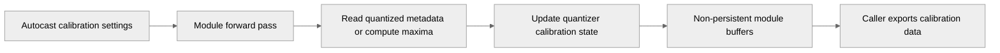

# [PTQ] Store FP32 global scaling factors (absmax or scale_inv) for all quantized activations and weights.

[Upstream PR](https://github.com/NVIDIA/TransformerEngine/pull/3296) · state: open · merged: False

## Original PR description

# Description

<table>
  <tr>
    <td align="center" width="25%"><b>agieval</b><br/></td>
    <td align="center" width="25%"><b>arc_challenge</b><br/></td>
    <td align="center" width="25%"><b>arc_easy</b><br/></td>
    <td align="center" width="25%"><b>gsm8k</b><br/></td>
  </tr>
  <tr>
    <td align="center" width="25%"><b>humaneval</b><br/></td>
    <td align="center" width="25%"><b>lambada_standard</b><br/></td>
    <td align="center" width="25%"><b>mmlu</b><br/></td>
    <td align="center" width="25%"><b>winogrande</b><br/></td>
  </tr>
</table>

Source: https://github.com/NVIDIA/Megatron-LM/issues/5660#issuecomment-5581231117

See issue for context: https://github.com/NVIDIA/Megatron-LM/issues/5660
Related to: https://github.com/NVIDIA/Megatron-LM/pull/6183

- Extended the `Quantizer.calibrate()` API to support decayed calibration and model buffering.
  - The public API `autocast(calibrating: bool, calibration_config: QuantizationCalibrationConfig)` (both arguments, kept the older one for legacy / backwards compatibility with decay defaulting to 0) turns on the feature, and by default it is deactivated.
  - `calibrate` will first look for calibration metadata according to the quantization recipe, but if that doesn't exist yet it will just take the non-quantized `Tensor` argument and compute its quantization metadata, _**since this is the original behavior of `calibrate`**_.
    - It is super un-performant to recompute the quantization metadata, usually it is fused into a TE kernel. So during training and inference, this path where we cannot find the quantization metadata should never be run.
  - `calibrate` now has implementations for all of the recipes that use FP32 global scaling factors, and the decayed calibration update is implemented in the base class `Quantizer._update_calibration_value`. It'll also buffer them automatically, which is a change in behavior but the extra buffering feature isn't a big deal for performance/memory (and frankly what's the point of storing calibration data natively in TE if we never export it), refer to my results below!
- To enable users to mine PTQ calibration data from their pre-training datasets, buffer scaling factors for quantized activations and weights for checkpointing in Megatron and inference in vLLM, Tensor-RT, ModelOpt, etc.
  - This is an exported common state artifact, it can be saved but (should) not (be) loaded, and will not appear in the model state dict. No risk of surprise overwriting of weight scaling factors, for instance.
  - Buffer names are linked to TE modules and are named pretty comprehensively: `f"{tensor_name}_{metadata_name}_{recipe_name}_te_ptq_calibrated"`
- `QuantizationCalibrationConfig` only has a single argument at the moment but in the future could hypothetically have way more, it's just that now we only buffer FP32 global scaling factors so it's simply just `activation_scale_decay`.
  - `activation_scale_decay` controls the decay of past max-accumulated activation scaling factors when your model or dataset is in-flight during training. Intends to capture steady-state maxima.
    - `New AbsMax = Max(Old AbsMax * Decay, Observed AbsMax)`
    - Setting it to 0 implies only taking the most recent scaling factor, while setting it to 1 implies taking an absmax over the entire history of your model and/or dataset.
    - You can do quite a lot of hacky customization on the MCore side, i.e. setting LR=0 means you're basically just calibrating on your calibration dataset with a frozen model.
  - Tiny performance loss to compute the accumulated max, but almost unnoticeable for both dense and MoE (GroupedLinear).
  - Tiny memory overhead to store the accumulated activation scaling factors. Since it's just 4 bytes per activation (FP32 global scale), it's not a lot at all.
    - Weights do not need to be accumulated, so the weight buffer points to the literal row-wise scaling factor in the quantized tensor storage and doesn't take any memory. (Set row-wise usage to True, on the user to do it.)
  - We do not save blockwise scaling factors (or `CustomRecipe` and `HybridQuantizer`, which will error out), those are usually computed during inference or using more advanced calibration techniques.
    - ~~We do store the row-wise NVFP4 scaling factors, but in MCore I just max-reduce it to a scalar as well.~~
- `TEAutocastState` is another new data-class that may concern you since it changes the API of `get_autocast_state` and `set_autocast_state` which are public interfaces for the global quant state.
  - That being said, currently Megatron-LM and other NeMo repositories are not directly using this, and it gets really messy with checkpointing if I have to reset `QuantizationCalibrationConfig` so I think now's a good time to stop returning `tuple`s...

## Testing

- Really basic unit tests, tell me if you want to see more.
- Performance is only affected when decay is activated, and memory is only increased when buffering activations.
```
# Main / No scaling factor checkpointing.

[2026-07-27 13:24:57.339692] iteration       16/15258789 | consumed samples:         2048 | elapsed time per iteration (ms): 6282.9 | throughput per GPU (TFLOP/s/GPU): 2147.5 | learning rate: 7.864316E-08 | global batch size:   128 | lm loss: 1.207198E+01 | loss scale: 1.0 | grad norm: 20.134 | number of skipped iterations:   0 |number of nan iterations:   0 |

[Rank 0] (after 2 iterations) memory (MB) | allocated: 69607.20 | max allocated: 99633.89 | reserved: 72394.00| max reserved: 100310.00

# Scaling factor & absmax checkpointing. (--buffer-transformer-engine-calibration-metadata)

[2026-07-27 13:45:56.610449] iteration       16/15258789 | consumed samples:         2048 | elapsed time per iteration (ms): 6282.0 | throughput per GPU (TFLOP/s/GPU): 2147.8 | learning rate: 7.864316E-08 | global batch size:   128 | lm loss: 1.207239E+01 | loss scale: 1.0 | grad norm: 20.133 | number of skipped iterations:   0 | number of nan iterations:   0 |

[Rank 0] (after 2 iterations) memory (MB) | allocated: 69607.26 | max allocated: 99633.94 | reserved: 72394.00 | max reserved: 100310.00

# Decaying Activation Scaling Factors & Absmax (--transformer-engine-calibration-decay 0.99)

[2026-07-27 13:51:03.183943] iteration       16/15258789 | consumed samples:         2048 | elapsed time per iteration (ms): 6486.2 | throughput per GPU (TFLOP/s/GPU): 2080.2 | learning rate: 7.864316E-08 | global batch size:   128 | lm loss: 1.207229E+01 | loss scale: 1.0 | grad norm: 20.133 | number of skipped iterations:   0 |number of nan iterations:   0 |

[Rank 0] (after 2 iterations) memory (MB) | allocated: 69607.32 | max allocated: 99634.00 | reserved: 72396.00| max reserved: 100310.00
```
For future reference, I also considered buffering MXFP8 / NVFP4 / FP8-Blockwise factors, but there is a memory and massive performance hit, and generally inference computes these dynamically:
```
# Decaying Activation Scaling Factors + Blockwise Activation Scales (i.e. `_rowwise_scale_inv`)
# (Just FYI why we don't want to export blockwise scales, they significantly affect perf and memory, and aren't really necessary for calibration.)

[2026-07-27 13:57:09.949572] iteration       16/15258789 | consumed samples:         2048 | elapsed time per iteration (ms): 6857.8 | throughput per GPU (TFLOP/s/GPU): 1967.5 | learning rate: 7.864316E-08 | global batch size:   128 | lm loss: 1.207223E+01 | loss scale: 1.0 | grad norm: 20.134 | number of skipped iterations:   0 |number of nan iterations:   0 |

[Rank 0] (after 2 iterations) memory (MB) | allocated: 71158.36 | max allocated: 101184.57 | reserved: 74394.00 | max reserved: 101934.00 
```

## Type of change

- [ ] Documentation change (change only to the documentation, either a fix or a new content)
- [ ] Bug fix (non-breaking change which fixes an issue)
- [x] New feature (non-breaking change which adds functionality)
- [ ] Breaking change (fix or feature that would cause existing functionality to not work as expected)
- [ ] Infra/Build change
- [x] Code refactoring

# Checklist:

- [x] I have read and followed the [contributing guidelines](https://github.com/NVIDIA/TransformerEngine/blob/main/CONTRIBUTING.rst)
- [x] The functionality is complete
- [x] I have commented my code, particularly in hard-to-understand areas
- [x] I have made corresponding changes to the documentation
- [x] My changes generate no new warnings
- [x] I have added tests that prove my fix is effective or that my feature works
- [x] New and existing unit tests pass locally with my changes


## Review and discussion

### reviews

- greptile-apps[bot] · COMMENTED · 2026-07-31T19:13:44Z · [source](https://github.com/NVIDIA/TransformerEngine/pull/3296#pullrequestreview-4831505539)

(No body; status only.)

- ptrendx · COMMENTED · 2026-08-11T23:11:46Z · [source](https://github.com/NVIDIA/TransformerEngine/pull/3296#pullrequestreview-4911427116)

(No body; status only.)

- shangxiaokang · COMMENTED · 2026-09-08T07:39:15Z · [source](https://github.com/NVIDIA/TransformerEngine/pull/3296#pullrequestreview-5138735401)

(No body; status only.)

- cspades · COMMENTED · 2026-09-10T19:44:43Z · [source](https://github.com/NVIDIA/TransformerEngine/pull/3296#pullrequestreview-5171549820)

(No body; status only.)

- greptile-apps[bot] · COMMENTED · 2026-09-11T23:53:06Z · [source](https://github.com/NVIDIA/TransformerEngine/pull/3296#pullrequestreview-5184312993)

(No body; status only.)

- cspades · COMMENTED · 2026-09-11T23:54:04Z · [source](https://github.com/NVIDIA/TransformerEngine/pull/3296#pullrequestreview-5184316459)

(No body; status only.)

- greptile-apps[bot] · COMMENTED · 2026-09-12T00:15:28Z · [source](https://github.com/NVIDIA/TransformerEngine/pull/3296#pullrequestreview-5184387573)

(No body; status only.)

- cspades · COMMENTED · 2026-09-12T00:31:31Z · [source](https://github.com/NVIDIA/TransformerEngine/pull/3296#pullrequestreview-5184442030)

(No body; status only.)

- greptile-apps[bot] · COMMENTED · 2026-09-12T00:32:07Z · [source](https://github.com/NVIDIA/TransformerEngine/pull/3296#pullrequestreview-5184443922)

(No body; status only.)

- greptile-apps[bot] · COMMENTED · 2026-09-12T00:32:27Z · [source](https://github.com/NVIDIA/TransformerEngine/pull/3296#pullrequestreview-5184444882)

(No body; status only.)

- ptrendx · COMMENTED · 2026-09-21T22:29:22Z · [source](https://github.com/NVIDIA/TransformerEngine/pull/3296#pullrequestreview-5272452741)

(No body; status only.)

- ptrendx · COMMENTED · 2026-09-22T22:25:15Z · [source](https://github.com/NVIDIA/TransformerEngine/pull/3296#pullrequestreview-5284559628)

(No body; status only.)

- ptrendx · COMMENTED · 2026-09-22T23:07:34Z · [source](https://github.com/NVIDIA/TransformerEngine/pull/3296#pullrequestreview-5284935817)

(No body; status only.)

- ptrendx · COMMENTED · 2026-09-22T23:12:58Z · [source](https://github.com/NVIDIA/TransformerEngine/pull/3296#pullrequestreview-5284984481)

(No body; status only.)

- ptrendx · COMMENTED · 2026-09-22T23:17:15Z · [source](https://github.com/NVIDIA/TransformerEngine/pull/3296#pullrequestreview-5285022712)

(No body; status only.)

- ptrendx · COMMENTED · 2026-09-22T23:18:11Z · [source](https://github.com/NVIDIA/TransformerEngine/pull/3296#pullrequestreview-5285031339)

(No body; status only.)

- ptrendx · COMMENTED · 2026-09-22T23:20:30Z · [source](https://github.com/NVIDIA/TransformerEngine/pull/3296#pullrequestreview-5285051693)

(No body; status only.)

- ptrendx · COMMENTED · 2026-09-22T23:23:42Z · [source](https://github.com/NVIDIA/TransformerEngine/pull/3296#pullrequestreview-5285078067)

(No body; status only.)

- ptrendx · COMMENTED · 2026-09-22T23:24:49Z · [source](https://github.com/NVIDIA/TransformerEngine/pull/3296#pullrequestreview-5285087360)

(No body; status only.)

- ptrendx · COMMENTED · 2026-09-22T23:28:26Z · [source](https://github.com/NVIDIA/TransformerEngine/pull/3296#pullrequestreview-5285118283)

(No body; status only.)

- ptrendx · COMMENTED · 2026-09-22T23:29:11Z · [source](https://github.com/NVIDIA/TransformerEngine/pull/3296#pullrequestreview-5285124538)

(No body; status only.)

- ptrendx · COMMENTED · 2026-09-22T23:29:59Z · [source](https://github.com/NVIDIA/TransformerEngine/pull/3296#pullrequestreview-5285131305)

(No body; status only.)

- ptrendx · COMMENTED · 2026-09-22T23:32:04Z · [source](https://github.com/NVIDIA/TransformerEngine/pull/3296#pullrequestreview-5285149678)

(No body; status only.)

- ptrendx · COMMENTED · 2026-09-22T23:33:45Z · [source](https://github.com/NVIDIA/TransformerEngine/pull/3296#pullrequestreview-5285164249)

(No body; status only.)

- cspades · COMMENTED · 2026-09-22T23:50:14Z · [source](https://github.com/NVIDIA/TransformerEngine/pull/3296#pullrequestreview-5285277366)

(No body; status only.)

- cspades · COMMENTED · 2026-09-22T23:58:20Z · [source](https://github.com/NVIDIA/TransformerEngine/pull/3296#pullrequestreview-5285326581)

(No body; status only.)

- cspades · COMMENTED · 2026-09-23T00:02:15Z · [source](https://github.com/NVIDIA/TransformerEngine/pull/3296#pullrequestreview-5285352330)

(No body; status only.)

- ptrendx · COMMENTED · 2026-09-23T20:31:19Z · [source](https://github.com/NVIDIA/TransformerEngine/pull/3296#pullrequestreview-5296442970)

(No body; status only.)

- cspades · COMMENTED · 2026-09-29T22:05:15Z · [source](https://github.com/NVIDIA/TransformerEngine/pull/3296#pullrequestreview-5359110541)

(No body; status only.)

- greptile-apps[bot] · COMMENTED · 2026-09-29T23:45:46Z · [source](https://github.com/NVIDIA/TransformerEngine/pull/3296#pullrequestreview-5359841885)

(No body; status only.)

- cspades · COMMENTED · 2026-09-30T00:03:15Z · [source](https://github.com/NVIDIA/TransformerEngine/pull/3296#pullrequestreview-5359946834)

(No body; status only.)

- greptile-apps[bot] · COMMENTED · 2026-09-30T00:04:10Z · [source](https://github.com/NVIDIA/TransformerEngine/pull/3296#pullrequestreview-5359952330)

(No body; status only.)

- greptile-apps[bot] · COMMENTED · 2026-09-30T00:04:14Z · [source](https://github.com/NVIDIA/TransformerEngine/pull/3296#pullrequestreview-5359952685)

(No body; status only.)

- cspades · COMMENTED · 2026-09-30T00:05:51Z · [source](https://github.com/NVIDIA/TransformerEngine/pull/3296#pullrequestreview-5359961541)

(No body; status only.)

- greptile-apps[bot] · COMMENTED · 2026-09-30T00:06:33Z · [source](https://github.com/NVIDIA/TransformerEngine/pull/3296#pullrequestreview-5359965368)

(No body; status only.)

- cspades · COMMENTED · 2026-09-30T00:15:15Z · [source](https://github.com/NVIDIA/TransformerEngine/pull/3296#pullrequestreview-5360014286)

(No body; status only.)

- greptile-apps[bot] · COMMENTED · 2026-09-30T00:15:47Z · [source](https://github.com/NVIDIA/TransformerEngine/pull/3296#pullrequestreview-5360018174)

(No body; status only.)

- greptile-apps[bot] · COMMENTED · 2026-10-15T01:10:36Z · [source](https://github.com/NVIDIA/TransformerEngine/pull/3296#pullrequestreview-5526794320)

(No body; status only.)

- cspades · COMMENTED · 2026-10-15T02:24:25Z · [source](https://github.com/NVIDIA/TransformerEngine/pull/3296#pullrequestreview-5527303771)

(No body; status only.)

- greptile-apps[bot] · COMMENTED · 2026-10-15T18:29:17Z · [source](https://github.com/NVIDIA/TransformerEngine/pull/3296#pullrequestreview-5538037386)

(No body; status only.)

- cspades · COMMENTED · 2026-10-15T18:55:36Z · [source](https://github.com/NVIDIA/TransformerEngine/pull/3296#pullrequestreview-5538359081)

(No body; status only.)

- greptile-apps[bot] · COMMENTED · 2026-10-15T18:56:20Z · [source](https://github.com/NVIDIA/TransformerEngine/pull/3296#pullrequestreview-5538370376)

(No body; status only.)

- cspades · COMMENTED · 2026-10-16T18:22:47Z · [source](https://github.com/NVIDIA/TransformerEngine/pull/3296#pullrequestreview-5552015264)

(No body; status only.)

- greptile-apps[bot] · COMMENTED · 2026-10-16T18:23:12Z · [source](https://github.com/NVIDIA/TransformerEngine/pull/3296#pullrequestreview-5552019750)

(No body; status only.)

- greptile-apps[bot] · COMMENTED · 2026-10-16T18:23:25Z · [source](https://github.com/NVIDIA/TransformerEngine/pull/3296#pullrequestreview-5552022070)

(No body; status only.)

- greptile-apps[bot] · COMMENTED · 2026-10-16T18:26:29Z · [source](https://github.com/NVIDIA/TransformerEngine/pull/3296#pullrequestreview-5552057447)

(No body; status only.)

- greptile-apps[bot] · COMMENTED · 2026-10-16T19:04:21Z · [source](https://github.com/NVIDIA/TransformerEngine/pull/3296#pullrequestreview-5552455713)

(No body; status only.)

- greptile-apps[bot] · COMMENTED · 2026-10-16T19:04:58Z · [source](https://github.com/NVIDIA/TransformerEngine/pull/3296#pullrequestreview-5552461326)

(No body; status only.)

- greptile-apps[bot] · COMMENTED · 2026-10-16T19:42:06Z · [source](https://github.com/NVIDIA/TransformerEngine/pull/3296#pullrequestreview-5552817638)

(No body; status only.)

- cspades · COMMENTED · 2026-10-16T20:19:06Z · [source](https://github.com/NVIDIA/TransformerEngine/pull/3296#pullrequestreview-5553233010)

(No body; status only.)

- greptile-apps[bot] · COMMENTED · 2026-10-16T20:19:32Z · [source](https://github.com/NVIDIA/TransformerEngine/pull/3296#pullrequestreview-5553237387)

(No body; status only.)

- greptile-apps[bot] · COMMENTED · 2026-10-16T20:20:02Z · [source](https://github.com/NVIDIA/TransformerEngine/pull/3296#pullrequestreview-5553242137)

(No body; status only.)

- greptile-apps[bot] · COMMENTED · 2026-10-16T20:21:06Z · [source](https://github.com/NVIDIA/TransformerEngine/pull/3296#pullrequestreview-5553253552)

(No body; status only.)

- greptile-apps[bot] · COMMENTED · 2026-10-16T20:24:39Z · [source](https://github.com/NVIDIA/TransformerEngine/pull/3296#pullrequestreview-5553289071)

(No body; status only.)

- greptile-apps[bot] · COMMENTED · 2026-10-16T20:24:55Z · [source](https://github.com/NVIDIA/TransformerEngine/pull/3296#pullrequestreview-5553292203)

(No body; status only.)

- cspades · COMMENTED · 2026-10-16T20:38:50Z · [source](https://github.com/NVIDIA/TransformerEngine/pull/3296#pullrequestreview-5553423313)

(No body; status only.)

- cspades · COMMENTED · 2026-10-16T20:39:05Z · [source](https://github.com/NVIDIA/TransformerEngine/pull/3296#pullrequestreview-5553425373)

(No body; status only.)

- greptile-apps[bot] · COMMENTED · 2026-10-16T20:39:20Z · [source](https://github.com/NVIDIA/TransformerEngine/pull/3296#pullrequestreview-5553427497)

(No body; status only.)

- greptile-apps[bot] · COMMENTED · 2026-10-16T20:39:27Z · [source](https://github.com/NVIDIA/TransformerEngine/pull/3296#pullrequestreview-5553428539)

(No body; status only.)

- greptile-apps[bot] · COMMENTED · 2026-10-16T20:41:09Z · [source](https://github.com/NVIDIA/TransformerEngine/pull/3296#pullrequestreview-5553445110)

(No body; status only.)

- greptile-apps[bot] · COMMENTED · 2026-10-16T21:10:56Z · [source](https://github.com/NVIDIA/TransformerEngine/pull/3296#pullrequestreview-5553739950)

(No body; status only.)

- cspades · COMMENTED · 2026-10-16T21:21:06Z · [source](https://github.com/NVIDIA/TransformerEngine/pull/3296#pullrequestreview-5553824682)

(No body; status only.)

- greptile-apps[bot] · COMMENTED · 2026-10-16T21:21:29Z · [source](https://github.com/NVIDIA/TransformerEngine/pull/3296#pullrequestreview-5553829116)

(No body; status only.)

- cspades · COMMENTED · 2026-10-16T21:58:49Z · [source](https://github.com/NVIDIA/TransformerEngine/pull/3296#pullrequestreview-5554158511)

(No body; status only.)

- greptile-apps[bot] · COMMENTED · 2026-10-16T22:04:57Z · [source](https://github.com/NVIDIA/TransformerEngine/pull/3296#pullrequestreview-5554204013)

(No body; status only.)

### issue_comments

- greptile-apps[bot] · comment · 2026-07-31T19:13:39Z · [source](https://github.com/NVIDIA/TransformerEngine/pull/3296#issuecomment-5146583885)

<!-- greptile_summary -->

<h2><a href="https://app.greptile.com/api/retrigger?id=49165342"><picture><source media="(prefers-color-scheme: dark)" srcset="https://greptile-static-assets.s3.amazonaws.com/badges/RetriggerDark.svg?v=2"><source media="(prefers-color-scheme: light)" srcset="https://greptile-static-assets.s3.amazonaws.com/badges/Retrigger.svg?v=2"></picture></a><a href="https://app.greptile.com/nvidia-public-github/github/NVIDIA/transformerengine/-/pull/3296"><picture><source media="(prefers-color-scheme: dark)" srcset="https://greptile-static-assets.s3.amazonaws.com/badges/ViewInGreptileDark.svg?v=2"><source media="(prefers-color-scheme: light)" srcset="https://greptile-static-assets.s3.amazonaws.com/badges/ViewInGreptile.svg?v=2"></picture></a>Confidence Score: 5/5</h2>

**[High impact]** The PR appears safe to merge; no new actionable issue was established.

<h3>Summary</h3>

This PR adds configurable PTQ calibration and exposes collected global factors as non-persistent module buffers.
- Calibration records the global factor used by supported quantization recipes.
- Transformer Engine modules expose named buffers for PTQ factors.

Previous-thread decisions retained:
- `cspades` confirmed that excluding backward calls is intentional because calibration is forward-only.
- `cspades` accepted zero as the default for uninitialized NaN observations.
- `cspades` accepted the small allocation for sanitized metadata rather than mutating live scales.
- `cspades` made legacy grouped calibration unsupported during CUDA graph capture; eager empty observations are masked.
- `cspades` deferred collecting cached-weight metadata until the next weight quantization.
- `cspades` accepted the existing behavior when model dtype casts also cast calibration buffers.

No new actionable issue was established. No tests were run.

<h3>Diagram</h3>



<!-- greptile_confidence_score:5 -->

<sub>Reviews (25) · Last reviewed commit: ["Add guard against CG + non-fused grouped..."](https://github.com/nvidia/transformerengine/commit/eca97ae6b04c0db07d869035379502ca37ad722d) · [Reviewed by Greptile](https://www.greptile.com/?utm_source=greptile_review&utm_medium=github&utm_campaign=review_public&utm_content=nvidia/transformerengine)</sub>

- cspades · comment · 2026-07-31T19:14:01Z · [source](https://github.com/NVIDIA/TransformerEngine/pull/3296#issuecomment-5146586724)

/te-ci pytorch

- cspades · comment · 2026-07-31T20:10:46Z · [source](https://github.com/NVIDIA/TransformerEngine/pull/3296#issuecomment-5147033685)

/te-ci pytorch

- ptrendx · comment · 2026-08-11T23:03:23Z · [source](https://github.com/NVIDIA/TransformerEngine/pull/3296#issuecomment-5259862615)

@cspades, there is already a `calibrate` API available in the quantizers (and invoked by modules), even though it only really works for the delayed scaling. Why couldn't that API be reused and extended in this PR instead of introducing calling new APIs in the modules? 

- cspades · comment · 2026-08-17T18:30:17Z · [source](https://github.com/NVIDIA/TransformerEngine/pull/3296#issuecomment-5318640815)

> already a calibrate API available in the quantizers (and invoked by modules)

@ptrendx It can! I didn't know that was there. Apologies for the late reply have been working on other tasks.

That being said, wanted to share that this max-reduce kind of works (vs. ModelOpt checkpoints, and I think Xiaokang did this with NVFP4 since that was the main topic of the issue):


but can definitely merge/fold this into the calibrate API. Will report back.

- cspades · comment · 2026-09-11T23:50:17Z · [source](https://github.com/NVIDIA/TransformerEngine/pull/3296#issuecomment-5641938427)

/te-ci pytorch

- cspades · comment · 2026-09-12T01:04:45Z · [source](https://github.com/NVIDIA/TransformerEngine/pull/3296#issuecomment-5642402177)

/te-ci L1 pytorch

- cspades · comment · 2026-09-13T01:51:25Z · [source](https://github.com/NVIDIA/TransformerEngine/pull/3296#issuecomment-5650057753)

/te-ci L1 pytorch

- cspades · comment · 2026-09-13T02:23:24Z · [source](https://github.com/NVIDIA/TransformerEngine/pull/3296#issuecomment-5650201058)

/te-ci L1 pytorch

- cspades · comment · 2026-10-10T23:47:33Z · [source](https://github.com/NVIDIA/TransformerEngine/pull/3296#issuecomment-6103454549)

/te-ci L1 pytorch

- cspades · comment · 2026-10-11T05:01:53Z · [source](https://github.com/NVIDIA/TransformerEngine/pull/3296#issuecomment-6105656025)

/te-ci L1 pytorch

- cspades · comment · 2026-10-11T05:29:28Z · [source](https://github.com/NVIDIA/TransformerEngine/pull/3296#issuecomment-6105841489)

/te-ci L1 pytorch

- cspades · comment · 2026-10-12T06:44:49Z · [source](https://github.com/NVIDIA/TransformerEngine/pull/3296#issuecomment-6119180826)

All 3 test failures are not related to my PR. I think https://gitlab-master.nvidia.com/dl/transformerengine/transformerengine/-/jobs/480831518 timed out, and https://gitlab-master.nvidia.com/dl/transformerengine/transformerengine/-/jobs/480831528/viewer and https://gitlab-master.nvidia.com/dl/transformerengine/transformerengine/-/jobs/480831527/viewer are NCCL crashes that I'm pretty sure is not related to this PR.

- cspades · comment · 2026-10-15T01:05:53Z · [source](https://github.com/NVIDIA/TransformerEngine/pull/3296#issuecomment-6181997765)

/te-ci L1 pytorch

- cspades · comment · 2026-10-15T02:25:14Z · [source](https://github.com/NVIDIA/TransformerEngine/pull/3296#issuecomment-6182983901)

/te-ci L1 pytorch

- cspades · comment · 2026-10-15T02:29:39Z · [source](https://github.com/NVIDIA/TransformerEngine/pull/3296#issuecomment-6183034786)

/te-ci L1 pytorch

- cspades · comment · 2026-10-15T18:24:26Z · [source](https://github.com/NVIDIA/TransformerEngine/pull/3296#issuecomment-6199269555)

/te-ci L1 pytorch

- cspades · comment · 2026-10-15T20:12:04Z · [source](https://github.com/NVIDIA/TransformerEngine/pull/3296#issuecomment-6201317550)

/te-ci L1 pytorch

- cspades · comment · 2026-10-16T18:23:23Z · [source](https://github.com/NVIDIA/TransformerEngine/pull/3296#issuecomment-6222015748)

/te-ci L1 pytorch

- cspades · comment · 2026-10-16T21:21:26Z · [source](https://github.com/NVIDIA/TransformerEngine/pull/3296#issuecomment-6224936081)

/te-ci L1 pytorch

- cspades · comment · 2026-10-17T09:23:16Z · [source](https://github.com/NVIDIA/TransformerEngine/pull/3296#issuecomment-6232247137)

/te-ci L1 pytorch

### inline_comments

- greptile-apps[bot] · comment · 2026-07-31T19:13:43Z · [source](https://github.com/NVIDIA/TransformerEngine/pull/3296#discussion_r3692810589)

File: `transformer_engine/pytorch/module/_common.py` · line None

<a href="#"></a> **LayerNormMLP activations bypass accumulation**

When `LayerNormMLP` buffers `fc1_input` or `fc2_input`, this prefix check classifies the activation as a weight, bypassing the configured decaying maximum and retaining mutable metadata instead. The exported activation calibration factors therefore do not represent the requested accumulated values.

**Knowledge Base Used:**
- [PyTorch Fused Modules (transformer_engine/pytorch/module)](https://app.greptile.com/nvidia-public-github/-/custom-context/knowledge-base/nvidia/transformerengine/-/docs/pytorch-modules.md)
- [PyTorch Quantization: Tensor Types and Recipe Machinery](https://app.greptile.com/nvidia-public-github/-/custom-context/knowledge-base/nvidia/transformerengine/-/docs/pytorch-quantization.md)

Note: If this suggestion doesn't match your team's coding style, reply to this and let me know. I'll remember it for next time!

- greptile-apps[bot] · comment · 2026-07-31T19:13:43Z · [source](https://github.com/NVIDIA/TransformerEngine/pull/3296#discussion_r3692810597)

File: `transformer_engine/pytorch/tensor/utils.py` · line None

<a href="#"></a> **Custom quantizers crash buffering**

When an enabled `CustomRecipe` returns a user-defined `Quantizer` subclass, none of these built-in type checks match and this exception propagates from `_get_scale_buffer_info`, causing the module forward pass to fail whenever calibration buffering is enabled.

**Knowledge Base Used:** [PyTorch Quantization: Tensor Types and Recipe Machinery](https://app.greptile.com/nvidia-public-github/-/custom-context/knowledge-base/nvidia/transformerengine/-/docs/pytorch-quantization.md)

- ptrendx · comment · 2026-08-11T22:53:30Z · [source](https://github.com/NVIDIA/TransformerEngine/pull/3296#discussion_r3762310929)

File: `transformer_engine/pytorch/module/_common.py` · line None

Those should probably be merged into one. 

- shangxiaokang · comment · 2026-09-08T07:39:15Z · [source](https://github.com/NVIDIA/TransformerEngine/pull/3296#discussion_r3955459775)

File: `transformer_engine/pytorch/module/_common.py` · line None

'scale_buffer' might be Nan in some step when amax = 0, then, 
```
S_enc = 448 * 6 / global_amax   # 2688 / 0 = Inf
S_dec = block_amax * S_enc / 6  # 0 * Inf = NaN
```

There will be an error rat https://github.com/NVIDIA/Megatron-LM/pull/6183/changes#diff-debd55cccb8837189e626c048e61fa3ef0b63f15883fd299427f0de0e0a25bc6R387-R390.

- cspades · comment · 2026-09-10T19:44:43Z · [source](https://github.com/NVIDIA/TransformerEngine/pull/3296#discussion_r3982861989)

File: `transformer_engine/pytorch/module/_common.py` · line None

Yup, I'll filter these out.

- greptile-apps[bot] · comment · 2026-09-11T23:53:05Z · [source](https://github.com/NVIDIA/TransformerEngine/pull/3296#discussion_r3994280676)

File: `transformer_engine/pytorch/module/layernorm_mlp.py` · line None

<a href="#"></a> **Checkpoint recompute double-decays calibration**

When checkpointed `LayerNormMLP` runs with `transformer_engine_calibration_decay > 0`, backward recomputation re-enters the FC1 and FC2 activation calibration calls with the same shared state, applying decay twice per logical step and causing the exported PTQ buffers to understate historical maxima.

**Knowledge Base Used:**
- [PyTorch Transformer layers](https://app.greptile.com/nvidia-public-github/-/custom-context/knowledge-base/nvidia/transformerengine/-/docs/pytorch-transformer-layers.md)
- [PyTorch FP8 and low-precision quantization](https://app.greptile.com/nvidia-public-github/-/custom-context/knowledge-base/nvidia/transformerengine/-/docs/pytorch-quantization.md)

- cspades · comment · 2026-09-11T23:54:04Z · [source](https://github.com/NVIDIA/TransformerEngine/pull/3296#discussion_r3994284295)

File: `transformer_engine/pytorch/module/layernorm_mlp.py` · line None

Yup yup fixing...

- greptile-apps[bot] · comment · 2026-09-12T00:15:27Z · [source](https://github.com/NVIDIA/TransformerEngine/pull/3296#discussion_r3994359295)

File: `transformer_engine/pytorch/module/_common.py` · line None

<a href="#"></a> **Backward calls skip calibration**

When a TE module is invoked from a backward hook or custom autograd backward, `_current_graph_task_id()` identifies the active backward GraphTask as activation recomputation, causing the module to skip calibration and leave its exported PTQ metadata stale or absent.

**Knowledge Base Used:**
- [PyTorch FP8 and low-precision quantization](https://app.greptile.com/nvidia-public-github/-/custom-context/knowledge-base/nvidia/transformerengine/-/docs/pytorch-quantization.md)
- [PyTorch Transformer layers](https://app.greptile.com/nvidia-public-github/-/custom-context/knowledge-base/nvidia/transformerengine/-/docs/pytorch-transformer-layers.md)

- cspades · comment · 2026-09-12T00:31:31Z · [source](https://github.com/NVIDIA/TransformerEngine/pull/3296#discussion_r3994416650)

File: `transformer_engine/pytorch/module/_common.py` · line None

Huh, you just told me to fix it. https://github.com/NVIDIA/TransformerEngine/pull/3296#discussion_r3994280676

This is completely intended. While double-decay is meaningless at `0.0` and barely noticeable at `0.99`, we should indeed only calibrate on the forward pass (and we are, there is no backward calibration) assuming recomputed activations are going to be the same in the backward pass. Furthermore, inference (which uses this PTQ calibration) has a source-of-truth being the forward / row-wise activations and forward / row-wise weights. (And even then, we only calibrate FP32 globals, which have no orientation or difference in FWD/BWD.)

- greptile-apps[bot] · comment · 2026-09-12T00:32:07Z · [source](https://github.com/NVIDIA/TransformerEngine/pull/3296#discussion_r3994418821)

File: `transformer_engine/pytorch/module/_common.py` · line None

You're right — I misread the intended calibration boundary. Calibration should be forward-only, and `_current_graph_task_id()` identifying a backward GraphTask is precisely why backward/custom-autograd calls must be excluded. Since PTQ metadata is sourced from forward activations and weights, and the stored FP32 globals have no FWD/BWD orientation, avoiding backward updates also prevents unintended double decay. I withdraw the finding; no code change is needed here.

Tip: You can customize Greptile's behavior for this repo with [`.greptile/rules.md` and `.greptile/config.json`](https://www.greptile.com/docs/code-review/custom-standards).

- greptile-apps[bot] · comment · 2026-09-12T00:32:27Z · [source](https://github.com/NVIDIA/TransformerEngine/pull/3296#discussion_r3994419919)

File: `transformer_engine/pytorch/module/_common.py` · line None

You're right — I conflated “running under a backward GraphTask” with an unintended calibration path. In this design, calibration is intentionally forward-only, and recomputed forward activations are expected to match the original forward values. Since the exported metadata is limited to FP32 global factors with no forward/backward orientation, skipping backward calls does not make the PTQ state stale or incomplete. Retracting this finding; no change is needed.

- ptrendx · comment · 2026-09-21T22:29:22Z · [source](https://github.com/NVIDIA/TransformerEngine/pull/3296#discussion_r4066953821)

File: `transformer_engine/pytorch/quantized_tensor.py` · line None

This makes the calibration not graph-safe, which is fine I think, but this should be included in the documentation (also, the PR suggests that it is graph-safe by modifying the graph infrastructure).

- ptrendx · comment · 2026-09-22T22:25:15Z · [source](https://github.com/NVIDIA/TransformerEngine/pull/3296#discussion_r4077156917)

File: `transformer_engine/pytorch/module/_common.py` · line None

Why do we need to use this hidden attribute here?

- ptrendx · comment · 2026-09-22T23:07:34Z · [source](https://github.com/NVIDIA/TransformerEngine/pull/3296#discussion_r4077439792)

File: `transformer_engine/pytorch/quantized_tensor.py` · line None

We do have recipes like the nvfp4 rowwise scaling where the shape will change throughout the calibration in the case of variable shaped inputs. Not sure how to handle such cases with calibration to be honest - we should probably just disallow calibration for those recipes.

- ptrendx · comment · 2026-09-22T23:12:58Z · [source](https://github.com/NVIDIA/TransformerEngine/pull/3296#discussion_r4077473466)

File: `transformer_engine/pytorch/tensor/hybrid_tensor.py` · line 174

Should this error out instead?

- ptrendx · comment · 2026-09-22T23:17:15Z · [source](https://github.com/NVIDIA/TransformerEngine/pull/3296#discussion_r4077501503)

File: `transformer_engine/pytorch/tensor/mxfp8_tensor.py` · line None

Hmmm. Shouldn't it be added to the recipe instead? It seems that this is a parallel way of figuring out what the recipe is to what we already have. Maybe that is a better way, but I would still prefer to see a single one rather than two.

- ptrendx · comment · 2026-09-22T23:18:11Z · [source](https://github.com/NVIDIA/TransformerEngine/pull/3296#discussion_r4077507689)

File: `transformer_engine/pytorch/quantization.py` · line None

Probably 0 < decay < 1?

- ptrendx · comment · 2026-09-22T23:20:30Z · [source](https://github.com/NVIDIA/TransformerEngine/pull/3296#discussion_r4077522864)

File: `examples/pytorch/mnist/main.py` · line 85

If the intended practice is to get rid of calibrating in the future and instead use only the config as the way to enable calibration then that should be added to the docs somehow. Personally, I'm not necessarily sure we would want to do that and then this example should still have calibrating=True in this call as well.

- ptrendx · comment · 2026-09-22T23:23:42Z · [source](https://github.com/NVIDIA/TransformerEngine/pull/3296#discussion_r4077542665)

File: `transformer_engine/pytorch/module/_common.py` · line None

I don't think this function is needed - I don't believe custom calibration was a thing before this PR anyway, so we don't need to worry about breaking it.

- ptrendx · comment · 2026-09-22T23:24:48Z · [source](https://github.com/NVIDIA/TransformerEngine/pull/3296#discussion_r4077549966)

File: `transformer_engine/pytorch/module/_common.py` · line None

Also, if we really do use it then why don't we put it in the in_fp8_activation_recompute_phase in the first place?

- ptrendx · comment · 2026-09-22T23:28:26Z · [source](https://github.com/NVIDIA/TransformerEngine/pull/3296#discussion_r4077573608)

File: `transformer_engine/pytorch/module/_common.py` · line None

Why couldn't we have the recipe name also in the calibration state? And why wouldn't this function be a function of the quantizer instead? This string that is being built here basically becomes our API (since it lands in the checkpoint if I understand correctly), so it should not be hidden in a random underscore function inside an underscore module. 

- ptrendx · comment · 2026-09-22T23:29:11Z · [source](https://github.com/NVIDIA/TransformerEngine/pull/3296#discussion_r4077578683)

File: `transformer_engine/pytorch/module/_common.py` · line None

Also, this string should be documented somewhere for people trying to get those calibrated values and putting them in the inference engines.

- ptrendx · comment · 2026-09-22T23:29:58Z · [source](https://github.com/NVIDIA/TransformerEngine/pull/3296#discussion_r4077584089)

File: `transformer_engine/pytorch/module/_common.py` · line None

And one more thing - based on the usage, this function and the one above could be merged.

- ptrendx · comment · 2026-09-22T23:32:04Z · [source](https://github.com/NVIDIA/TransformerEngine/pull/3296#discussion_r4077597701)

File: `transformer_engine/pytorch/quantized_tensor.py` · line None

Why don't we just pass the full calibration config here instead of just the decay? If we add more fields there it will be awkward to change this API again.

- ptrendx · comment · 2026-09-22T23:33:45Z · [source](https://github.com/NVIDIA/TransformerEngine/pull/3296#discussion_r4077609080)

File: `transformer_engine/pytorch/tensor/float8_blockwise_tensor.py` · line 260

So if somebody specifically asked for a calibration in this case we should probably issue a warning or at least info saying that this does not actually make sense.

- cspades · comment · 2026-09-22T23:50:13Z · [source](https://github.com/NVIDIA/TransformerEngine/pull/3296#discussion_r4077708573)

File: `transformer_engine/pytorch/quantized_tensor.py` · line None

Oh, I do want everything to be graph-safe, I added this lazily in response to the NaN bug.

I think we can just torch.isnan mask into zeros, run through this function, and trivialize the update, assuming that we have a calibration buffer initialized already (since let's say, previous values were not NaN, just this new observation was).

Good catch!

- cspades · comment · 2026-09-22T23:58:20Z · [source](https://github.com/NVIDIA/TransformerEngine/pull/3296#discussion_r4077750755)

File: `transformer_engine/pytorch/quantized_tensor.py` · line None

Makes sense, I think I did at least informally support the rowwise absmax (which I end up just [max-reducing into a scalar prior to checkpointing as a way to normalize NVFP4 calibration](https://github.com/NVIDIA/Megatron-LM/pull/6183/changes#diff-debd55cccb8837189e626c048e61fa3ef0b63f15883fd299427f0de0e0a25bc6R301)), but I didn't really consider changing shape during runtime.

I think the Megatron side was when I decided to walk back on even the fanciness of globally-checkpointing an FP32 vector that doesn't take too much memory in the checkpoint. We can just make this calibration function only work on scalars and reduce the amax vector into a scalar here probably.

- cspades · comment · 2026-09-23T00:02:14Z · [source](https://github.com/NVIDIA/TransformerEngine/pull/3296#discussion_r4077769839)

File: `transformer_engine/pytorch/module/_common.py` · line None

Does `in_fp8_activation_recompute_phase` also cover non-FP8 / general activation recomputation?

I am biased to use Torch native detection mechanisms and increase the recall of this function, because if we screw it up, we'll be double-decaying and colwise-writing our calibration values.

- ptrendx · comment · 2026-09-23T20:31:19Z · [source](https://github.com/NVIDIA/TransformerEngine/pull/3296#discussion_r4087005326)

File: `transformer_engine/pytorch/module/_common.py` · line None

But is this hidden thing a native detection mechanism that we would like to use here? It being internal and hidden means that it could change at any point.

- cspades · comment · 2026-09-29T22:05:14Z · [source](https://github.com/NVIDIA/TransformerEngine/pull/3296#discussion_r4138819585)

File: `transformer_engine/pytorch/module/_common.py` · line None

It could change at any time. Use of this thing is only within PyTorch, like FSDP2 uses it I believe.

Actually, what we could do is to just try/except this and add a warning message if upstream PyTorch deprecates it.

Or, I could drop it and fully depend on TE activation recompute, but it won't work for people using TE kernels but not using TE activation recompute. But I kinda like the try/except idea.

- greptile-apps[bot] · comment · 2026-09-29T23:45:44Z · [source](https://github.com/NVIDIA/TransformerEngine/pull/3296#discussion_r4139443512)

File: `transformer_engine/pytorch/quantized_tensor.py` · line 670

<a href="#"></a> **NaNs overwrite calibration scales**

When a current-scaling observation contains NaN, this code turns it into zero instead of ignoring it. With the default zero decay, that zero replaces a valid saved scale; an initial NaN also creates a buffer where none should exist. The exported PTQ metadata is therefore wrong, and the existing NaN test fails.

- greptile-apps[bot] · comment · 2026-09-29T23:45:44Z · [source](https://github.com/NVIDIA/TransformerEngine/pull/3296#discussion_r4139443517)

File: `transformer_engine/pytorch/quantized_tensor.py` · line 670

<a href="#"></a> **Calibration loses metadata reference**

Even when the observation is finite, `torch.nan_to_num` creates a new tensor. With zero decay, the saved calibration buffer is no longer a reference to the observed scale, so later changes to that scale are not reflected through the reference. The existing pointer-identity test fails.

**Knowledge Base Used:** [PyTorch FP8 and low-precision quantization](https://app.greptile.com/nvidia-public-github/-/custom-context/knowledge-base/nvidia/transformerengine/-/docs/pytorch-quantization.md)

- greptile-apps[bot] · comment · 2026-09-29T23:45:44Z · [source](https://github.com/NVIDIA/TransformerEngine/pull/3296#discussion_r4139443521)

File: `transformer_engine/pytorch/tensor/float8_blockwise_tensor.py` · line 264

<a href="#"></a> **Unsupported recipe tests fail**

`Float8BlockQuantizer.calibrate` now raises, but the PTQ test still calls it expecting calibration to return normally. `HybridQuantizer.calibrate` also raises while its test expects a no-op. Because QA runs this test file, these unchanged expectations cause the new PTQ test job to fail.

- cspades · comment · 2026-09-30T00:03:15Z · [source](https://github.com/NVIDIA/TransformerEngine/pull/3296#discussion_r4139538480)

File: `transformer_engine/pytorch/quantized_tensor.py` · line 670

Expected, NaN's appear when uninitialized, and setting it to zero IS ignoring it. (We also use the NaN mask for the decay!) The calibration buffer is also initialized to zero by default. Good question though.

- greptile-apps[bot] · comment · 2026-09-30T00:04:10Z · [source](https://github.com/NVIDIA/TransformerEngine/pull/3296#discussion_r4139543034)

File: `transformer_engine/pytorch/quantized_tensor.py` · line 670

I agree that NaN→0 can represent an uninitialized scale, but it is not equivalent to “ignore” in both paths:

- With `transformer_engine_calibration_decay == 0`, `observed_value` is assigned directly to `_calibration_state`, so a NaN observation overwrites an existing valid scale with zero.
- With decay enabled, the mask prevents updating an existing value, but an absent state is still allocated and stored as a zero tensor.
- `_get_calibration_metadata_buffers()` exports only entries present in `_calibration_state`; this class has no separate default-zero buffer.

So either NaNs should be ignored, as the current test and comments specify, or the intended contract should be to create/overwrite a zero scale—and the test/comments should be updated accordingly.

- greptile-apps[bot] · comment · 2026-09-30T00:04:14Z · [source](https://github.com/NVIDIA/TransformerEngine/pull/3296#discussion_r4139543335)

File: `transformer_engine/pytorch/quantized_tensor.py` · line 670

Thanks, that clarifies the intended state machine. I was treating NaN as a missing observation that should preserve the previous value, but here NaN denotes an uninitialized scale and zero is the defined default calibration value. In the decayed path, the mask correctly uses a decay factor of `1.0` for NaN entries, so existing values are preserved; with zero decay, replacing the observation with zero is intentional. No change needed.

- cspades · comment · 2026-09-30T00:05:51Z · [source](https://github.com/NVIDIA/TransformerEngine/pull/3296#discussion_r4139551250)

File: `transformer_engine/pytorch/quantized_tensor.py` · line 670

Okay fine you got me, this is CG-safe but we need an in-place nan_to_num or eat the the extra memory.
```
            # Without scale history, keep a reference to the current metadata
            # without allocating or copying a separate buffer.
            # Requires CUDA graph warmup step, and only access this value
            # at an appropriate time (e.g. checkpointing) if captured by CG.
            calibration_state[metadata_name] = observed_value
```
Eh... it doesn't seem that expensive. The decay path already uses this memory for the rolling maximum anyway...

- greptile-apps[bot] · comment · 2026-09-30T00:06:33Z · [source](https://github.com/NVIDIA/TransformerEngine/pull/3296#discussion_r4139554517)

File: `transformer_engine/pytorch/quantized_tensor.py` · line 670

That’s a fair tradeoff. Since the decay path already allocates and owns a rolling buffer, the zero-decay path can preserve the metadata reference by sanitizing in place:

```suggestion
        # Convert NaN to zero, which is the default calibration value.
        # Track NaN indices so we can also skip calibration decay.
        observed_mask = ~torch.isnan(observed_value).detach()
        torch.nan_to_num(observed_value, nan=0.0, out=observed_value)
```

This keeps `calibration_state[metadata_name]` backed by the original metadata tensor while avoiding the extra allocation. It does mutate the quantizer’s live metadata, but that is consistent with treating NaN as the default calibration value and these scale tensors are not expected to require gradients.

- cspades · comment · 2026-09-30T00:15:14Z · [source](https://github.com/NVIDIA/TransformerEngine/pull/3296#discussion_r4139597813)

File: `transformer_engine/pytorch/quantized_tensor.py` · line 670

Yeah I don't want to do this, this looks dangerous:
```
observed_value.nan_to_num_()
```
Memory overhead even without decay it is.

- greptile-apps[bot] · comment · 2026-09-30T00:15:47Z · [source](https://github.com/NVIDIA/TransformerEngine/pull/3296#discussion_r4139600722)

File: `transformer_engine/pytorch/quantized_tensor.py` · line 670

Agreed — don’t mutate the live metadata tensor in place. `observed_value.nan_to_num_()` could alter quantizer-owned/shared metadata and introduce subtle autograd or CUDA-graph hazards. Keep the out-of-place `torch.nan_to_num` and accept the small FP32 allocation even with zero decay; the calibration state should own the sanitized copy. The pointer-identity expectation is incompatible with this safer non-mutating behavior, so that test/contract should be updated rather than forcing an alias.

- greptile-apps[bot] · comment · 2026-10-15T01:10:34Z · [source](https://github.com/NVIDIA/TransformerEngine/pull/3296#discussion_r4277953909)

File: `transformer_engine/debug/pytorch/debug_quantization.py` · line 441

<a href="#"></a> **Debug calibration crashes**

`DebugQuantizer.calibrate` does not accept `skip_calibration`, but module weight-calibration calls always pass it, even when it is `None`. Collecting calibration data while a debug feature is active therefore raises `TypeError` during forward. Add the argument and forward it to the parent quantizer.

- greptile-apps[bot] · comment · 2026-10-15T01:10:35Z · [source](https://github.com/NVIDIA/TransformerEngine/pull/3296#discussion_r4277953912)

File: `transformer_engine/pytorch/quantized_tensor.py` · line 454

<a href="#"></a> **Calibration history gets reset**

Collected values live only in each quantizer's new `_calibration_state`. Changing `DelayedScaling.amax_history_len` recreates the quantizers through `adjust_amax_history_length`, without carrying this state over. The next forward starts from zero and replaces the module buffer, losing earlier maxima even with decay set to `1.0`. Preserve calibration state when quantizers are rebuilt.

**Knowledge Base Used:** [PyTorch FP8 and low-precision quantization](https://app.greptile.com/nvidia-public-github/-/custom-context/knowledge-base/nvidia/transformerengine/-/docs/pytorch-quantization.md)

- greptile-apps[bot] · comment · 2026-10-15T01:10:35Z · [source](https://github.com/NVIDIA/TransformerEngine/pull/3296#discussion_r4277953917)

File: `transformer_engine/pytorch/tensor/storage/grouped_tensor_storage.py` · line None

<a href="#"></a> **Empty experts overwrite scales**

The native grouped path treats an empty expert's FP8 `scale_inv` as a real observation. The grouped kernel clears its `amax` to zero and derives `scale_inv = 1`, which this code saves without checking whether the expert received tokens.

With zero decay, an empty step overwrites the expert's previous calibration value with `1`. With decay enabled, it also applies decay for a missing observation. Mask empty experts before updating calibration, as the non-grouped path already does.

- greptile-apps[bot] · comment · 2026-10-15T01:10:35Z · [source](https://github.com/NVIDIA/TransformerEngine/pull/3296#discussion_r4277953921)

File: `transformer_engine/pytorch/tensor/float8_tensor.py` · line None

<a href="#"></a> **Tiny values get different scales**

For tiny nonzero BF16 inputs whose FP8 scale overflows FP32, calibration caps the scale at `torch.finfo(tensor.dtype).max`. Actual current-scaling quantization uses the FP32 maximum regardless of input dtype.

BF16's maximum is smaller, so calibration exports a different `scale_inv`. The difference is larger when `force_pow_2_scales` rounds the two limits to different powers of two. Use the FP32 limit here.

```suggestion
            finite_scale = torch.finfo(torch.float32).max
            scale.nan_to_num_(nan=float("nan"), posinf=finite_scale, neginf=finite_scale)
```

- cspades · comment · 2026-10-15T02:24:25Z · [source](https://github.com/NVIDIA/TransformerEngine/pull/3296#discussion_r4278376597)

File: `transformer_engine/pytorch/tensor/storage/grouped_tensor_storage.py` · line None

Right, GroupedTensorStorage has its own calibration method and I didn't handle empty Tensors there. Added empty checks to the skip tensor / NaN mask.

- greptile-apps[bot] · comment · 2026-10-15T18:29:16Z · [source](https://github.com/NVIDIA/TransformerEngine/pull/3296#discussion_r4286789188)

File: `transformer_engine/debug/pytorch/debug_quantization.py` · line 454

<a href="#"></a> **Debug calibration crashes**

`DebugQuantizer.calibrate` passes a `DebugQuantizedTensor` straight to its parent. With current scaling, the parent reads `tensor._scale_inv`, but the debug wrapper stores the real tensor in `rowwise_gemm_tensor` and has no `_scale_inv`. Collecting calibration data with debug features enabled therefore crashes the forward pass. Unwrap the rowwise tensor before calling the parent.

- greptile-apps[bot] · comment · 2026-10-15T18:29:16Z · [source](https://github.com/NVIDIA/TransformerEngine/pull/3296#discussion_r4286789191)

File: `transformer_engine/pytorch/tensor/float8_tensor.py` · line 144

<a href="#"></a> **Quantized inputs export wrong maxima**

`Float8Quantizer.calibrate` reads `self.amax` for every already-quantized input, even when this quantizer did not produce that input. `Linear` accepts an existing `QuantizedTensorStorage` without running its input quantizer, so that quantizer's `amax` can still be zero. Calibration then exports zero instead of the input's observed maximum. Read the producing quantizer's available metadata, or compute the value when this quantizer has no matching observation.

**Knowledge Base Used:** [PyTorch FP8 and low-precision quantization](https://app.greptile.com/nvidia-public-github/-/custom-context/knowledge-base/nvidia/transformerengine/-/docs/pytorch-quantization.md)

- greptile-apps[bot] · comment · 2026-10-15T18:29:16Z · [source](https://github.com/NVIDIA/TransformerEngine/pull/3296#discussion_r4286789200)

File: `transformer_engine/pytorch/tensor/storage/grouped_tensor_storage.py` · line 1029

<a href="#"></a> **Grouped calibration loses member shapes**

`GroupedTensorStorage.calibrate` drops `self.last_dims` when it quantizes unquantized grouped storage. For supported groups whose column counts differ, `group_quantize` therefore treats the members as equal-shaped even though their offsets describe different sizes. Calibration can fail or save maxima from the wrong member ranges. Pass `last_dims=self.last_dims` alongside `first_dims` and the offsets.

```suggestion
            quantized_grouped_tensor = tex.group_quantize(
                self.rowwise_data.view(self.logical_shape),
                quantizers[0],
                self.num_tensors,
                self.first_dims,
                last_dims=self.last_dims,
                tensor_offsets=self.tensor_offsets,
            )
```

**Knowledge Base Used:** [PyTorch FP8 and low-precision quantization](https://app.greptile.com/nvidia-public-github/-/custom-context/knowledge-base/nvidia/transformerengine/-/docs/pytorch-quantization.md)

- cspades · comment · 2026-10-15T18:55:35Z · [source](https://github.com/NVIDIA/TransformerEngine/pull/3296#discussion_r4287055295)

File: `transformer_engine/pytorch/tensor/float8_tensor.py` · line 144

Hmm... in what case would this actually happen where the user calls this `calibrate` on a quantized tensor with a cold quantizer?

- greptile-apps[bot] · comment · 2026-10-15T18:56:20Z · [source](https://github.com/NVIDIA/TransformerEngine/pull/3296#discussion_r4287064444)

File: `transformer_engine/pytorch/tensor/float8_tensor.py` · line 144

That would be an **already-quantized input being passed through a module whose input quantizer did not produce it**—for example, feeding a saved `QuantizedTensorStorage` into a `Linear` while calibration is enabled. The module can accept the storage directly and bypass its input quantizer, but the calibration traversal may still call that quantizer’s `calibrate()`; in that case `self.amax` remains its initial zero value.

That said, if the calibration path guarantees that `calibrate()` is called only on the producing quantizer, then this cannot happen in normal operation and my comment is not actionable. I was specifically relying on the pre-quantized-input/bypassed-quantizer path; without a reproducible caller for that path, I’m happy to withdraw the finding.

- cspades · comment · 2026-10-16T18:22:46Z · [source](https://github.com/NVIDIA/TransformerEngine/pull/3296#discussion_r4297946223)

File: `transformer_engine/pytorch/tensor/float8_tensor.py` · line 144

Calibration should only run during FWD passes, is there an actual case where the quantizer for a storage is cold? Users should generally not call `calibrate` outside of FWD, and if they do, they should be responsible for making sure the quantizer is not cold.

If not, withdraw.

- greptile-apps[bot] · comment · 2026-10-16T18:23:12Z · [source](https://github.com/NVIDIA/TransformerEngine/pull/3296#discussion_r4297949914)

File: `transformer_engine/pytorch/tensor/float8_tensor.py` · line 144

You're right. Under the stated contract, calibration is invoked by the quantizer that produces the tensor during the forward pass, so that quantizer's `self.amax` is already populated. A cold quantizer handling an existing `QuantizedTensorStorage` would require an out-of-contract manual call or unrelated traversal.

I don't have a valid in-contract execution path for the reported zero maximum, so this finding is not actionable and can be withdrawn.

- greptile-apps[bot] · comment · 2026-10-16T18:23:25Z · [source](https://github.com/NVIDIA/TransformerEngine/pull/3296#discussion_r4297951977)

File: `transformer_engine/pytorch/tensor/float8_tensor.py` · line 144

That’s fair. Given that calibration is only expected during forward passes, and callers who provide pre-quantized storage are responsible for ensuring the relevant quantizer state is initialized, I don’t have a supported in-forward path demonstrating a cold quantizer here. I’m withdrawing this finding.

- greptile-apps[bot] · comment · 2026-10-16T18:26:27Z · [source](https://github.com/NVIDIA/TransformerEngine/pull/3296#discussion_r4297976793)

File: `transformer_engine/pytorch/tensor/float8_tensor.py` · line 357

<a href="#"></a> **Empty experts corrupt saved scales**

With `GroupedLinear(use_grouped_tensor=False)` and quantization enabled, an expert can receive no tokens. Its native quantizer allocates `_scale_inv` with `at::empty` and returns without writing it. This branch still reads that unwritten value, so calibration can replace a valid saved scale with arbitrary memory contents or include them in the decaying maximum.

Mask empty quantized observations before updating calibration, as the high-precision path already does.

**Knowledge Base Used:** [PyTorch FP8 and low-precision quantization](https://app.greptile.com/nvidia-public-github/-/custom-context/knowledge-base/nvidia/transformerengine/-/docs/pytorch-quantization.md)

- greptile-apps[bot] · comment · 2026-10-16T18:26:28Z · [source](https://github.com/NVIDIA/TransformerEngine/pull/3296#discussion_r4297976806)

File: `transformer_engine/pytorch/module/linear.py` · line 620

<a href="#"></a> **Cached weights miss calibration**

Run the first microbatch without calibration, then enable `calibration_config` on a later microbatch with `is_first_microbatch=False`. This condition skips `weight_quantizer.calibrate` because the weight is cached, even though no weight calibration value has been collected. `_get_calibration_metadata_buffers` then returns nothing, leaving the exported checkpoint with activation metadata but no weight metadata.

Only skip cached weights once their calibration value has been collected. The same check appears in `LayerNormLinear` and `GroupedLinear`.

- greptile-apps[bot] · comment · 2026-10-16T19:04:21Z · [source](https://github.com/NVIDIA/TransformerEngine/pull/3296#discussion_r4298304194)

File: `transformer_engine/pytorch/tensor/float8_tensor.py` · line 357

A fixed `[1]` buffer is the CG-safe choice here, not an arbitrary workaround: every supported FP32 *global* calibration value is scalar, regardless of activation/weight shape or whether an expert receives zero tokens.

Allocate that buffer and any `initialized`/valid state before graph capture—during quantizer/module setup, or via an explicit eager initialization step—instead of lazily allocating it from the first `calibrate()` call during capture.

The captured update should then be allocation-free and branch-free: initialize with the reduction identity (for example, zero for an absmax maximum), update using the valid-observation mask, and preserve the existing value when the quantized tensor is empty. An empty expert must not initialize the buffer from its unwritten `_scale_inv`; the first valid observation can replace the identity. This avoids requiring a warmup iteration while keeping the buffer shape, address, and control flow stable for CUDA Graph capture.

- greptile-apps[bot] · comment · 2026-10-16T19:04:58Z · [source](https://github.com/NVIDIA/TransformerEngine/pull/3296#discussion_r4298308980)

File: `transformer_engine/pytorch/tensor/float8_tensor.py` · line 357

Use shape-only preinitialization rather than letting the first observation allocate the state. The shape is not data-dependent: for these recipes the exported factor is a global scalar, and the quantized metadata tensor already has the correct device, dtype, and shape even when the activation has zero elements.

A robust pattern is:

```suggestion
        # Allocate calibration state before CUDA graph capture, using metadata
        # only for shape/device/dtype; never use an empty observation's value.
        calibration_state = self._calibration_state.get(metadata_name)
        if calibration_state is None:
            if torch.cuda.is_current_stream_capturing():
                raise RuntimeError(
                    "Calibration state must be initialized before CUDA graph capture"
                )
            calibration_state = torch.zeros_like(observed_value)
            self._calibration_state[metadata_name] = calibration_state
```

Move that initialization into an explicit quantizer/model setup step—or invoke it from the first quantization metadata tensor while still outside capture—and make `_update_calibration_value` only update an existing buffer during capture.

For an empty expert, pass a NaN-masked observation so it neither initializes nor updates the value; the setup step should initialize every expert’s buffer from its metadata shape. This requires one deterministic setup pass, not multiple data-dependent warmup iterations.

If a setup API is undesirable, initializing with `[1]` is also correct for this feature because the persisted values are explicitly FP32 global factors. Deriving the shape from `self.amax` or `tensor._scale_inv` is cleaner, however, because it makes the invariant explicit and avoids hard-coding the shape.

- greptile-apps[bot] · comment · 2026-10-16T19:42:06Z · [source](https://github.com/NVIDIA/TransformerEngine/pull/3296#discussion_r4298611447)

File: `transformer_engine/pytorch/tensor/float8_tensor.py` · line 357

That’s correct—CUDA Graph replay cannot change the captured tensor’s shape, so an expert captured with zero tokens cannot later replay with a non-empty tensor (or vice versa). The calibration state only needs to be allocated as a non-empty, fixed-shape scalar before capture.

The remaining requirement is to ensure an empty expert does not update that state from the unwritten `_scale_inv`; mask or skip the observation while preserving the already-initialized calibration value.

- cspades · comment · 2026-10-16T20:19:06Z · [source](https://github.com/NVIDIA/TransformerEngine/pull/3296#discussion_r4298956641)

File: `transformer_engine/pytorch/tensor/float8_tensor.py` · line 357

Okay, so after some thinking it really is specifically the non-fused grouped tensor path that can pass empty activations to the calibration tools. The fused path has `m_splits` and we can use this Tensor to compute emptiness and fold it into the `skip_calibration` mask. (This was already implemented.)

Let's just not support this case:
```
            if (
                calibration_config is not None
                and FP8GlobalStateManager.fp8_graph_capturing()
                and not use_grouped_tensor_path
            ):
                raise RuntimeError(
                    "CUDA-graphed GroupedLinear calibration requires the native grouped-tensor "
                    "path. Set use_grouped_tensor=True and use a supported configuration."
                )
```
I can't think of a CG-safe way to skip calibration during replay if an empty Tensor ever reaches `calibrate` without any graphed metadata to lean on.

- greptile-apps[bot] · comment · 2026-10-16T20:19:31Z · [source](https://github.com/NVIDIA/TransformerEngine/pull/3296#discussion_r4298960275)

File: `transformer_engine/pytorch/tensor/float8_tensor.py` · line 357

That’s reasonable. If the non-fused `GroupedLinear` path is explicitly outside the supported calibration contract, the empty-expert corruption concern does not need to be handled in this PR. Please document the restriction so callers do not assume all grouped-tensor modes are supported; the fused path and ordinary non-empty tensors remain unaffected.

- greptile-apps[bot] · comment · 2026-10-16T20:20:02Z · [source](https://github.com/NVIDIA/TransformerEngine/pull/3296#discussion_r4298964187)

File: `transformer_engine/pytorch/tensor/float8_tensor.py` · line 357

That is a reasonable constraint for CUDA Graph capture. Rejecting the legacy per-GEMM path before it calls `_calibrate_grouped_tensors` avoids both the unwritten `_scale_inv` read and any attempt to make the captured update data-dependent.

Place the check immediately after `use_grouped_tensor_path` is finalized and before entering either execution path, so the first capture fails deterministically:

```python
            if (
                calibration_config is not None
                and FP8GlobalStateManager.fp8_graph_capturing()
                and not use_grouped_tensor_path
            ):
                raise RuntimeError(
                    "CUDA-graphed GroupedLinear calibration requires the native grouped-tensor "
                    "path. Set use_grouped_tensor=True and use a supported configuration."
                )
```

This rejects only the unsupported CUDA-graph configuration. If eager execution with `use_grouped_tensor=False` remains supported, empty-observation masking is still needed there; an empty quantized activation could otherwise expose the unwritten `_scale_inv` outside graph capture. I’d also add a regression test for the rejection and retain a test confirming that the native grouped-tensor path captures successfully.

- greptile-apps[bot] · comment · 2026-10-16T20:21:06Z · [source](https://github.com/NVIDIA/TransformerEngine/pull/3296#discussion_r4298973312)

File: `transformer_engine/pytorch/tensor/float8_tensor.py` · line 357

That is a reasonable boundary for CUDA Graph capture. If the non-fused grouped-tensor path is the only path that can produce an empty expert during capture, failing before the grouped-linear/calibration code avoids both the unwritten `_scale_inv` read and any data-dependent skip or branch in the captured calibration update.

The guard should run before invoking that path and only when calibration is enabled, as in your snippet.

I would still retain `skip_calibration`/valid-observation handling for non-captured execution: empty experts can occur there too, and they must not update an existing calibration value from unwritten metadata. With that distinction, rejecting this unsupported CUDA-graph configuration is preferable to requiring a graph-safe lazy skip.

- greptile-apps[bot] · comment · 2026-10-16T20:24:39Z · [source](https://github.com/NVIDIA/TransformerEngine/pull/3296#discussion_r4299000570)

File: `transformer_engine/pytorch/tensor/float8_tensor.py` · line 357

That restriction is reasonable. Since the non-fused path is the only path that can produce an empty per-expert activation, rejecting it while the FP8 graph is being captured prevents an unsupported graph from ever being created; replay then cannot newly enter that path.

The check should run immediately after `use_grouped_tensor_path` is finalized and before dispatching either forward implementation. The existing `m_splits`-derived `skip_calibration` handling remains sufficient for the fused/native grouped-tensor path.

With this guard, I’m withdrawing the empty-expert finding rather than requiring a CG-safe dynamic skip for the unsupported path.

- greptile-apps[bot] · comment · 2026-10-16T20:24:55Z · [source](https://github.com/NVIDIA/TransformerEngine/pull/3296#discussion_r4299002784)

File: `transformer_engine/pytorch/tensor/float8_tensor.py` · line 357

That restriction is sufficient for the CUDA Graph case: the non-fused path cannot provide a replay-safe validity mask, while the native grouped-tensor path can derive one from `m_splits`. The guard should run before entering the forward path, once `use_grouped_tensor_path` is known, so capture fails deterministically rather than reading an unwritten `_scale_inv`.

It does not address the same empty-expert corruption outside CUDA Graph capture. In the non-fused list path, `_calibrate_grouped_tensors` still calls `quantizer.calibrate(tensor, ...)` without a `skip_calibration` mask, so an empty expert can update the saved factor from unwritten metadata during ordinary eager execution. Please either mask/skip empty list entries there as well, or document that non-fused grouped calibration is unsupported whenever empty experts are possible—not only while `fp8_graph_capturing()` is true.

- cspades · comment · 2026-10-16T20:38:49Z · [source](https://github.com/NVIDIA/TransformerEngine/pull/3296#discussion_r4299108181)

File: `transformer_engine/pytorch/module/linear.py` · line 620

I don't think we can support this either. If a user changes the config on-the-fly, the next update we can accept is the next weight quantization. It keeps the logic clean for FP8-delayed if it deletes the absmax leaving the `autocast`.

- cspades · comment · 2026-10-16T20:39:05Z · [source](https://github.com/NVIDIA/TransformerEngine/pull/3296#discussion_r4299109988)

File: `transformer_engine/pytorch/module/linear.py` · line 620

We can probably revisit this when FP8-delayed is deprecated. I'll add a note.

- greptile-apps[bot] · comment · 2026-10-16T20:39:20Z · [source](https://github.com/NVIDIA/TransformerEngine/pull/3296#discussion_r4299111796)

File: `transformer_engine/pytorch/module/linear.py` · line 620

That makes sense. My comment assumed calibration could be enabled mid-cache and still had to backfill the cached weight, but that configuration change is not supported: the new calibration state is applied on the next weight quantization. The cache-skip logic is therefore intentional, and deleting the FP8-delayed absmax on a config transition is consistent with that lifecycle. I’m withdrawing this finding.

- greptile-apps[bot] · comment · 2026-10-16T20:39:27Z · [source](https://github.com/NVIDIA/TransformerEngine/pull/3296#discussion_r4299112648)

File: `transformer_engine/pytorch/module/linear.py` · line 620

Understood. Given the current FP8-delayed behavior, accepting the cached-weight limitation until the next weight quantization is a reasonable tradeoff. I’ll consider this comment deferred rather than an actionable issue for this PR.

- greptile-apps[bot] · comment · 2026-10-16T20:41:09Z · [source](https://github.com/NVIDIA/TransformerEngine/pull/3296#discussion_r4299127939)

File: `transformer_engine/pytorch/module/linear.py` · line 620

That makes sense. My finding assumes that enabling calibration mid-cache must immediately produce weight metadata, but if configuration changes are only honored on the next weight quantization, the cached-weight path is behaving as intended. Forcing calibration on a cache hit would also complicate the delayed-FP8 case where the absmax is removed while autocast remains active.

I’ll withdraw this comment; no change is needed.

- greptile-apps[bot] · comment · 2026-10-16T21:10:55Z · [source](https://github.com/NVIDIA/TransformerEngine/pull/3296#discussion_r4299380117)

File: `transformer_engine/pytorch/module/linear.py` · line 2621

<a href="#"></a> **Model casts round saved scales**

These calibration factors are registered as ordinary floating-point buffers. Calling `model.half()` or `model.bfloat16()` after calibration casts them too. Export then loses FP32 precision, and small FP8 `scale_inv` values can become zero in FP16.

Keep calibration buffers in FP32 when the model dtype changes, and keep them linked to `_calibration_state`. The same registration pattern appears in the other linear modules.

Note: If this suggestion doesn't match your team's coding style, reply to this and let me know. I'll remember it for next time!

- cspades · comment · 2026-10-16T21:21:06Z · [source](https://github.com/NVIDIA/TransformerEngine/pull/3296#discussion_r4299452561)

File: `transformer_engine/pytorch/module/linear.py` · line 2621

Thanks for the suggestion, but this is fine.

- greptile-apps[bot] · comment · 2026-10-16T21:21:29Z · [source](https://github.com/NVIDIA/TransformerEngine/pull/3296#discussion_r4299455493)

File: `transformer_engine/pytorch/module/linear.py` · line 2621

Understood — I’ll treat the current calibration-buffer dtype behavior as intentional for this PR and won’t pursue this finding further.

- cspades · comment · 2026-10-16T21:58:49Z · [source](https://github.com/NVIDIA/TransformerEngine/pull/3296#discussion_r4299739598)

File: `transformer_engine/pytorch/tensor/float8_tensor.py` · line 357

Added the CG-unsafe empty mask.

- greptile-apps[bot] · comment · 2026-10-16T22:04:56Z · [source](https://github.com/NVIDIA/TransformerEngine/pull/3296#discussion_r4299776173)

File: `tests/pytorch/test_ptq_calibration_metadata_buffering.py` · line None

<a href="#"></a> **Grouped calibration tests lack shapes**

Two new grouped-calibration tests pass bare `QuantizedTensorStorage` objects from this helper. These objects have no `size()` method. `_calibrate_grouped_tensors` reads `tensor.shape`, which calls `self.size()` and raises `AttributeError` before either test reaches its assertions.

Give these fixtures a valid logical shape or use concrete storage objects. QA runs this file, so these failures block the test job.

## Changed files and fixed code

- `docs/api/pytorch.rst` · modified · additions 3 / deletions 1
  - [head](https://github.com/cspades/TransformerEngine/blob/eca97ae6b04c0db07d869035379502ca37ad722d/docs/api/pytorch.rst)
  - [base](https://github.com/NVIDIA/TransformerEngine/blob/eb3c860a4d3394b7eb5e21dba3021fa10782a52e/docs/api/pytorch.rst)
- `docs/features/low_precision_training/index.rst` · modified · additions 1 / deletions 0
  - [head](https://github.com/cspades/TransformerEngine/blob/eca97ae6b04c0db07d869035379502ca37ad722d/docs/features/low_precision_training/index.rst)
  - [base](https://github.com/NVIDIA/TransformerEngine/blob/eb3c860a4d3394b7eb5e21dba3021fa10782a52e/docs/features/low_precision_training/index.rst)
- `docs/features/low_precision_training/post_training_quantization/post_training_quantization.rst` · added · additions 92 / deletions 0
  - [head](https://github.com/cspades/TransformerEngine/blob/eca97ae6b04c0db07d869035379502ca37ad722d/docs/features/low_precision_training/post_training_quantization/post_training_quantization.rst)
  - [base](https://github.com/NVIDIA/TransformerEngine/blob/eb3c860a4d3394b7eb5e21dba3021fa10782a52e/docs/features/low_precision_training/post_training_quantization/post_training_quantization.rst)
- `examples/pytorch/mnist/main.py` · modified · additions 8 / deletions 1
  - [head](https://github.com/cspades/TransformerEngine/blob/eca97ae6b04c0db07d869035379502ca37ad722d/examples/pytorch/mnist/main.py)
  - [base](https://github.com/NVIDIA/TransformerEngine/blob/eb3c860a4d3394b7eb5e21dba3021fa10782a52e/examples/pytorch/mnist/main.py)
- `qa/L0_pytorch_unittest/test.sh` · modified · additions 1 / deletions 0
  - [head](https://github.com/cspades/TransformerEngine/blob/eca97ae6b04c0db07d869035379502ca37ad722d/qa/L0_pytorch_unittest/test.sh)
  - [base](https://github.com/NVIDIA/TransformerEngine/blob/eb3c860a4d3394b7eb5e21dba3021fa10782a52e/qa/L0_pytorch_unittest/test.sh)
- `tests/pytorch/test_ptq_calibration_metadata_buffering.py` · added · additions 1445 / deletions 0
  - [head](https://github.com/cspades/TransformerEngine/blob/eca97ae6b04c0db07d869035379502ca37ad722d/tests/pytorch/test_ptq_calibration_metadata_buffering.py)
  - [base](https://github.com/NVIDIA/TransformerEngine/blob/eb3c860a4d3394b7eb5e21dba3021fa10782a52e/tests/pytorch/test_ptq_calibration_metadata_buffering.py)
- `tests/pytorch/test_torch_compile.py` · modified · additions 28 / deletions 0
  - [head](https://github.com/cspades/TransformerEngine/blob/eca97ae6b04c0db07d869035379502ca37ad722d/tests/pytorch/test_torch_compile.py)
  - [base](https://github.com/NVIDIA/TransformerEngine/blob/eb3c860a4d3394b7eb5e21dba3021fa10782a52e/tests/pytorch/test_torch_compile.py)
- `transformer_engine/common/recipe/__init__.py` · modified · additions 20 / deletions 1
  - [head](https://github.com/cspades/TransformerEngine/blob/eca97ae6b04c0db07d869035379502ca37ad722d/transformer_engine/common/recipe/__init__.py)
  - [base](https://github.com/NVIDIA/TransformerEngine/blob/eb3c860a4d3394b7eb5e21dba3021fa10782a52e/transformer_engine/common/recipe/__init__.py)
- `transformer_engine/debug/features/log_fp8_tensor_stats.py` · modified · additions 3 / deletions 20
  - [head](https://github.com/cspades/TransformerEngine/blob/eca97ae6b04c0db07d869035379502ca37ad722d/transformer_engine/debug/features/log_fp8_tensor_stats.py)
  - [base](https://github.com/NVIDIA/TransformerEngine/blob/eb3c860a4d3394b7eb5e21dba3021fa10782a52e/transformer_engine/debug/features/log_fp8_tensor_stats.py)
- `transformer_engine/debug/pytorch/debug_quantization.py` · modified · additions 31 / deletions 4
  - [head](https://github.com/cspades/TransformerEngine/blob/eca97ae6b04c0db07d869035379502ca37ad722d/transformer_engine/debug/pytorch/debug_quantization.py)
  - [base](https://github.com/NVIDIA/TransformerEngine/blob/eb3c860a4d3394b7eb5e21dba3021fa10782a52e/transformer_engine/debug/pytorch/debug_quantization.py)
- `transformer_engine/pytorch/__init__.py` · modified · additions 2 / deletions 0
  - [head](https://github.com/cspades/TransformerEngine/blob/eca97ae6b04c0db07d869035379502ca37ad722d/transformer_engine/pytorch/__init__.py)
  - [base](https://github.com/NVIDIA/TransformerEngine/blob/eb3c860a4d3394b7eb5e21dba3021fa10782a52e/transformer_engine/pytorch/__init__.py)
- `transformer_engine/pytorch/attention/dot_product_attention/dot_product_attention.py` · modified · additions 4 / deletions 1
  - [head](https://github.com/cspades/TransformerEngine/blob/eca97ae6b04c0db07d869035379502ca37ad722d/transformer_engine/pytorch/attention/dot_product_attention/dot_product_attention.py)
  - [base](https://github.com/NVIDIA/TransformerEngine/blob/eb3c860a4d3394b7eb5e21dba3021fa10782a52e/transformer_engine/pytorch/attention/dot_product_attention/dot_product_attention.py)
- `transformer_engine/pytorch/attention/fused_mla_q_uproj.py` · modified · additions 1 / deletions 0
  - [head](https://github.com/cspades/TransformerEngine/blob/eca97ae6b04c0db07d869035379502ca37ad722d/transformer_engine/pytorch/attention/fused_mla_q_uproj.py)
  - [base](https://github.com/NVIDIA/TransformerEngine/blob/eb3c860a4d3394b7eb5e21dba3021fa10782a52e/transformer_engine/pytorch/attention/fused_mla_q_uproj.py)
- `transformer_engine/pytorch/dynamo/quantizer_opaque.py` · modified · additions 3 / deletions 0
  - [head](https://github.com/cspades/TransformerEngine/blob/eca97ae6b04c0db07d869035379502ca37ad722d/transformer_engine/pytorch/dynamo/quantizer_opaque.py)
  - [base](https://github.com/NVIDIA/TransformerEngine/blob/eb3c860a4d3394b7eb5e21dba3021fa10782a52e/transformer_engine/pytorch/dynamo/quantizer_opaque.py)
- `transformer_engine/pytorch/graph.py` · modified · additions 12 / deletions 6
  - [head](https://github.com/cspades/TransformerEngine/blob/eca97ae6b04c0db07d869035379502ca37ad722d/transformer_engine/pytorch/graph.py)
  - [base](https://github.com/NVIDIA/TransformerEngine/blob/eb3c860a4d3394b7eb5e21dba3021fa10782a52e/transformer_engine/pytorch/graph.py)
- `transformer_engine/pytorch/module/_common.py` · modified · additions 28 / deletions 2
  - [head](https://github.com/cspades/TransformerEngine/blob/eca97ae6b04c0db07d869035379502ca37ad722d/transformer_engine/pytorch/module/_common.py)
  - [base](https://github.com/NVIDIA/TransformerEngine/blob/eb3c860a4d3394b7eb5e21dba3021fa10782a52e/transformer_engine/pytorch/module/_common.py)
- `transformer_engine/pytorch/module/base.py` · modified · additions 6 / deletions 1
  - [head](https://github.com/cspades/TransformerEngine/blob/eca97ae6b04c0db07d869035379502ca37ad722d/transformer_engine/pytorch/module/base.py)
  - [base](https://github.com/NVIDIA/TransformerEngine/blob/eb3c860a4d3394b7eb5e21dba3021fa10782a52e/transformer_engine/pytorch/module/base.py)
- `transformer_engine/pytorch/module/grouped_linear.py` · modified · additions 204 / deletions 20
  - [head](https://github.com/cspades/TransformerEngine/blob/eca97ae6b04c0db07d869035379502ca37ad722d/transformer_engine/pytorch/module/grouped_linear.py)
  - [base](https://github.com/NVIDIA/TransformerEngine/blob/eb3c860a4d3394b7eb5e21dba3021fa10782a52e/transformer_engine/pytorch/module/grouped_linear.py)
- `transformer_engine/pytorch/module/layernorm_linear.py` · modified · additions 69 / deletions 9
  - [head](https://github.com/cspades/TransformerEngine/blob/eca97ae6b04c0db07d869035379502ca37ad722d/transformer_engine/pytorch/module/layernorm_linear.py)
  - [base](https://github.com/NVIDIA/TransformerEngine/blob/eb3c860a4d3394b7eb5e21dba3021fa10782a52e/transformer_engine/pytorch/module/layernorm_linear.py)
- `transformer_engine/pytorch/module/layernorm_mlp.py` · modified · additions 106 / deletions 12
  - [head](https://github.com/cspades/TransformerEngine/blob/eca97ae6b04c0db07d869035379502ca37ad722d/transformer_engine/pytorch/module/layernorm_mlp.py)
  - [base](https://github.com/NVIDIA/TransformerEngine/blob/eb3c860a4d3394b7eb5e21dba3021fa10782a52e/transformer_engine/pytorch/module/layernorm_mlp.py)
- `transformer_engine/pytorch/module/linear.py` · modified · additions 78 / deletions 11
  - [head](https://github.com/cspades/TransformerEngine/blob/eca97ae6b04c0db07d869035379502ca37ad722d/transformer_engine/pytorch/module/linear.py)
  - [base](https://github.com/NVIDIA/TransformerEngine/blob/eb3c860a4d3394b7eb5e21dba3021fa10782a52e/transformer_engine/pytorch/module/linear.py)
- `transformer_engine/pytorch/quantization.py` · modified · additions 94 / deletions 23
  - [head](https://github.com/cspades/TransformerEngine/blob/eca97ae6b04c0db07d869035379502ca37ad722d/transformer_engine/pytorch/quantization.py)
  - [base](https://github.com/NVIDIA/TransformerEngine/blob/eb3c860a4d3394b7eb5e21dba3021fa10782a52e/transformer_engine/pytorch/quantization.py)
- `transformer_engine/pytorch/quantized_tensor.py` · modified · additions 142 / deletions 6
  - [head](https://github.com/cspades/TransformerEngine/blob/eca97ae6b04c0db07d869035379502ca37ad722d/transformer_engine/pytorch/quantized_tensor.py)
  - [base](https://github.com/NVIDIA/TransformerEngine/blob/eb3c860a4d3394b7eb5e21dba3021fa10782a52e/transformer_engine/pytorch/quantized_tensor.py)
- `transformer_engine/pytorch/tensor/float8_blockwise_tensor.py` · modified · additions 21 / deletions 5
  - [head](https://github.com/cspades/TransformerEngine/blob/eca97ae6b04c0db07d869035379502ca37ad722d/transformer_engine/pytorch/tensor/float8_blockwise_tensor.py)
  - [base](https://github.com/NVIDIA/TransformerEngine/blob/eb3c860a4d3394b7eb5e21dba3021fa10782a52e/transformer_engine/pytorch/tensor/float8_blockwise_tensor.py)
- `transformer_engine/pytorch/tensor/float8_tensor.py` · modified · additions 74 / deletions 9
  - [head](https://github.com/cspades/TransformerEngine/blob/eca97ae6b04c0db07d869035379502ca37ad722d/transformer_engine/pytorch/tensor/float8_tensor.py)
  - [base](https://github.com/NVIDIA/TransformerEngine/blob/eb3c860a4d3394b7eb5e21dba3021fa10782a52e/transformer_engine/pytorch/tensor/float8_tensor.py)
- `transformer_engine/pytorch/tensor/hybrid_tensor.py` · modified · additions 20 / deletions 2
  - [head](https://github.com/cspades/TransformerEngine/blob/eca97ae6b04c0db07d869035379502ca37ad722d/transformer_engine/pytorch/tensor/hybrid_tensor.py)
  - [base](https://github.com/NVIDIA/TransformerEngine/blob/eb3c860a4d3394b7eb5e21dba3021fa10782a52e/transformer_engine/pytorch/tensor/hybrid_tensor.py)
- `transformer_engine/pytorch/tensor/identity_tensor.py` · modified · additions 18 / deletions 5
  - [head](https://github.com/cspades/TransformerEngine/blob/eca97ae6b04c0db07d869035379502ca37ad722d/transformer_engine/pytorch/tensor/identity_tensor.py)
  - [base](https://github.com/NVIDIA/TransformerEngine/blob/eb3c860a4d3394b7eb5e21dba3021fa10782a52e/transformer_engine/pytorch/tensor/identity_tensor.py)
- `transformer_engine/pytorch/tensor/mxfp8_tensor.py` · modified · additions 21 / deletions 4
  - [head](https://github.com/cspades/TransformerEngine/blob/eca97ae6b04c0db07d869035379502ca37ad722d/transformer_engine/pytorch/tensor/mxfp8_tensor.py)
  - [base](https://github.com/NVIDIA/TransformerEngine/blob/eb3c860a4d3394b7eb5e21dba3021fa10782a52e/transformer_engine/pytorch/tensor/mxfp8_tensor.py)
- `transformer_engine/pytorch/tensor/nvfp4_tensor.py` · modified · additions 51 / deletions 4
  - [head](https://github.com/cspades/TransformerEngine/blob/eca97ae6b04c0db07d869035379502ca37ad722d/transformer_engine/pytorch/tensor/nvfp4_tensor.py)
  - [base](https://github.com/NVIDIA/TransformerEngine/blob/eb3c860a4d3394b7eb5e21dba3021fa10782a52e/transformer_engine/pytorch/tensor/nvfp4_tensor.py)
- `transformer_engine/pytorch/tensor/storage/grouped_tensor_storage.py` · modified · additions 82 / deletions 1
  - [head](https://github.com/cspades/TransformerEngine/blob/eca97ae6b04c0db07d869035379502ca37ad722d/transformer_engine/pytorch/tensor/storage/grouped_tensor_storage.py)
  - [base](https://github.com/NVIDIA/TransformerEngine/blob/eb3c860a4d3394b7eb5e21dba3021fa10782a52e/transformer_engine/pytorch/tensor/storage/grouped_tensor_storage.py)

## Evidence and interpretation boundary

[Original JSON, discussions and patches](../../../../../../evidence/prs/NVIDIA--TransformerEngine/3296-f2c0977a98b4b4653cddc3d299bb0a20f3b2d483d30957653a3bb6bc8ba17bf7.json) · SHA-256 `f2c0977a98b4b4653cddc3d299bb0a20f3b2d483d30957653a3bb6bc8ba17bf7`.

Diff complete: True. Missing/binary/truncated patches require pinned source inspection. This is a source page, not an independently verified optimization case. Open, merged and released are different states; recheck the deployed dependency.
