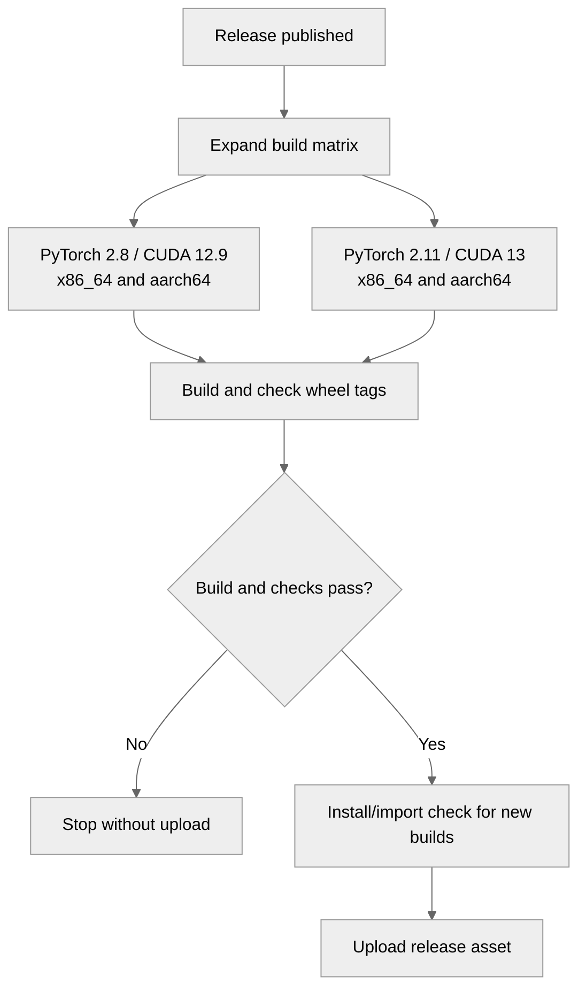

# [CI] Publish PyTorch 2.11 CUDA 13 release wheels

[Upstream PR](https://github.com/NVIDIA/TransformerEngine/pull/3311) · state: open · merged: False

## Original PR description

# Description

Publish PyTorch 2.11/CUDA 13 release wheels for Linux x86_64 and aarch64 so matching installs can download the extension instead of compiling it locally. Keep the existing PyTorch 2.8/CUDA 12.9 builds.

Skip disk pooling when `/mnt` shares the root filesystem to fix the [ARM release checkout failure](https://github.com/NVIDIA/TransformerEngine/actions/runs/37374633284/job/111989480609).

Fixes #3310

## Type of change

- [ ] Documentation change (change only to the documentation, either a fix or a new content)
- [x] Bug fix (non-breaking change which fixes an issue)
- [ ] New feature (non-breaking change which adds functionality)
- [ ] Breaking change (fix or feature that would cause existing functionality to not work as expected)
- [x] Infra/Build change
- [ ] Code refactoring

## Changes

- Add Python 3.12, PyTorch 2.11/CUDA 13 builds for both architectures.
- Include SM100 and install the CUDA development packages needed for the build.
- Preserve checkout space when `/mnt` shares the root filesystem.
- Keep compiler output visible and fail the job when the build fails or times out.
- Check wheel tags before upload and run install/import smoke checks for the new builds.

## Validation

Repository hooks and shell checks passed; actionlint reported only existing workflow diagnostics. Rerun the hooks with `pre-commit run --all-files`.

Wheel builds and driverless imports passed on x86_64 (PyTorch 2.11/CUDA 13, v2.18) and [native aarch64](https://github.com/bvolpato/TransformerEngine/actions/runs/38966139162) (CUDA 12.9 and CUDA 13, v2.20.2), using this PR's build scripts. GPU execution has not been tested. The release workflow does not run on PRs.

# Checklist:

- [x] I have read and followed the [contributing guidelines](https://github.com/NVIDIA/TransformerEngine/blob/main/CONTRIBUTING.rst)
- [x] The functionality is complete
- [ ] I have commented my code, particularly in hard-to-understand areas
- [ ] I have made corresponding changes to the documentation
- [x] My changes generate no new warnings
- [x] I have added tests that prove my fix is effective or that my feature works
- [ ] New and existing unit tests pass locally with my changes

## Review and discussion

### reviews

- greptile-apps[bot] · COMMENTED · 2026-08-04T04:39:39Z · [source](https://github.com/NVIDIA/TransformerEngine/pull/3311#pullrequestreview-4850685858)

(No body; status only.)

- bvolpato · COMMENTED · 2026-08-04T04:49:55Z · [source](https://github.com/NVIDIA/TransformerEngine/pull/3311#pullrequestreview-4850738407)

(No body; status only.)

### issue_comments

- greptile-apps[bot] · comment · 2026-08-04T04:39:35Z · [source](https://github.com/NVIDIA/TransformerEngine/pull/3311#issuecomment-5174680446)

<!-- greptile_summary -->

<h2><a href="https://app.greptile.com/api/retrigger?id=49937006"><picture><source media="(prefers-color-scheme: dark)" srcset="https://greptile-static-assets.s3.amazonaws.com/badges/RetriggerDark.svg?v=2"><source media="(prefers-color-scheme: light)" srcset="https://greptile-static-assets.s3.amazonaws.com/badges/Retrigger.svg?v=2"></picture></a><a href="https://app.greptile.com/nvidia-public-github/github/NVIDIA/transformerengine/-/pull/3311"><picture><source media="(prefers-color-scheme: dark)" srcset="https://greptile-static-assets.s3.amazonaws.com/badges/ViewInGreptileDark.svg?v=2"><source media="(prefers-color-scheme: light)" srcset="https://greptile-static-assets.s3.amazonaws.com/badges/ViewInGreptile.svg?v=2"></picture></a>Confidence Score: 5/5</h2>

**[High impact]** The PR appears safe to merge; no new actionable issues were found.

<h3>Summary</h3>

Adds Python 3.12 wheels for PyTorch 2.11/CUDA 13 on Linux x86_64 and aarch64 while retaining the PyTorch 2.8/CUDA 12.9 builds.

- Release publishing adds PyTorch 2.11 CUDA 13 wheels for both Linux architectures.
- Build runners keep checkout space when `/mnt` shares the root filesystem.
- Wheel builds show full logs and return failed build status.

No new actionable issues were found.

<h3>Diagram</h3>

<!-- greptile_confidence_score:5 -->

Reviews (5) · Last reviewed commit: ["\[CI\] Preserve checkout space on single-d..."](https://github.com/nvidia/transformerengine/commit/6ab002a58a85d8e5dd5a6e44626258f507fa9ce7) · [Reviewed by Greptile](https://www.greptile.com/?utm_source=greptile_review&utm_medium=github&utm_campaign=review_public&utm_content=nvidia/transformerengine)

- bvolpato · comment · 2026-08-29T19:32:46Z · [source](https://github.com/NVIDIA/TransformerEngine/pull/3311#issuecomment-5464419016)

@fheinecke, would you mind taking a look at this when you get a chance? The PR is green and mergeable, and the previous review concern is resolved. It adds PyTorch 2.11/CUDA 13 release wheels for x86_64 and aarch64, with wheel/tag validation and a driverless import check. If someone else owns this release path now, happy to redirect.

- bvolpato · comment · 2026-08-29T19:35:53Z · [source](https://github.com/NVIDIA/TransformerEngine/pull/3311#issuecomment-5464434110)

@ksivaman, could you take a look at this, or point me to current owner for PyTorch release-wheel workflow? It extends #2138 to PyTorch 2.11/CUDA 13 on x86_64 and aarch64. Checks are green and only review thread is resolved.

- bvolpato · comment · 2026-10-13T01:52:00Z · [source](https://github.com/NVIDIA/TransformerEngine/pull/3311#issuecomment-6136338163)

I rechecked this against [v2.20.2](https://github.com/NVIDIA/TransformerEngine/releases/tag/v2.20.2): the PyTorch 2.11/CUDA 13 aarch64 asset is still missing. The [ARM release job](https://github.com/NVIDIA/TransformerEngine/actions/runs/37374633284/job/111989480609) fails with `fatal: write error: No space left on device` during checkout because disk pooling leaves only 32 MiB on the shared root filesystem. I pushed `592be137` to skip pooling when `/mnt` shares that filesystem. Local layout and build/matrix validation pass, and the PR checks are green. Could someone review the updated release-wheel changes? Native aarch64 compilation and import still need validation on an ARM runner.

- bvolpato · comment · 2026-10-13T05:05:44Z · [source](https://github.com/NVIDIA/TransformerEngine/pull/3311#issuecomment-6138662253)

@fheinecke, would you mind taking a look at this when you get a chance? It adds PyTorch 2.11/CUDA 13 release wheels for x86_64 and aarch64 and fixes the ARM checkout space issue. Checks are green, with native ARM build/import validation still outstanding. If someone else owns the release workflow, happy to redirect.

- 0z5a · comment · 2026-10-16T15:12:46Z · [source](https://github.com/NVIDIA/TransformerEngine/pull/3311#issuecomment-6218528837)

Some data from the release runs that may help review. Since v2.15, which was the last release with an aarch64 PyTorch wheel attached, the `ubuntu-22.04-arm` job has failed on every release, and not always for the same reason:

| release | arm job failure |
|---|---|
| v2.16, v2.16.1 | logs no longer available (#3309 quotes `No space left on device` for v2.16.1) |
| v2.17 | checkout: `No space left on device` while cloning `3rdparty/cutlass` |
| v2.17.1 | build: `RuntimeError: Error compiling objects for extension`; the compiler error itself is not in the log |
| v2.18 | build: same as v2.17.1 |
| v2.19 | checkout: same as v2.17 |
| v2.20.2 | checkout: same as v2.17 |

So the checkout fix here covers v2.17, v2.19 and v2.20.2. The two compile failures in v2.17.1 and v2.18 cannot be diagnosed from the logs, because the build output went through `| tail -n 1`. With this PR's logging change, a native ARM run should show whether that failure still happens after the disk fix. It might be worth checking before the next release.

🤖 Generated with [Claude Code](https://claude.com/claude-code)

- bvolpato · comment · 2026-10-16T21:42:43Z · [source](https://github.com/NVIDIA/TransformerEngine/pull/3311#issuecomment-6225252542)

Thanks for checking the release history. I ran this branch's build scripts on native ARM against v2.20.2, and the existing CUDA 12 and new CUDA 13 wheels built and imported successfully ([run](https://github.com/bvolpato/TransformerEngine/actions/runs/38966139162)). The first CUDA 12 attempt hit a temporary PPA 503, then passed unchanged on retry. I still can't identify the older compiler errors from the truncated logs.

### inline_comments

- greptile-apps[bot] · comment · 2026-08-04T04:39:39Z · [source](https://github.com/NVIDIA/TransformerEngine/pull/3311#discussion_r3709499008)

File: `.github/workflows/attach-wheels-to-release.yml` · line None

  **Mutable release action references**

The new ARM release job invokes `actions/checkout@v4` and `actions/upload-release-asset@v1` through mutable tags. If either upstream tag is repointed or compromised, changed action code runs against the build workspace and release-writing token, exposing the wheel artifact and release to tampering; pin both new references to full commit SHAs. **How this was verified:** The new checkout and upload steps use mutable tags, and the upload action receives `GITHUB_TOKEN` plus the release upload URL.

- bvolpato · comment · 2026-08-04T04:49:55Z · [source](https://github.com/NVIDIA/TransformerEngine/pull/3311#discussion_r3709541253)

File: `.github/workflows/attach-wheels-to-release.yml` · line None

Pinned both new release-job action references to immutable SHAs for checkout v4.4.0 and upload-release-asset v1.0.2.

## Changed files and fixed code

- `.github/actions/build-pytorch-wheel/Dockerfile` · modified · additions 11 / deletions 3
  - [head](https://github.com/bvolpato/TransformerEngine/blob/6ab002a58a85d8e5dd5a6e44626258f507fa9ce7/.github/actions/build-pytorch-wheel/Dockerfile)
  - [base](https://github.com/NVIDIA/TransformerEngine/blob/eb3c860a4d3394b7eb5e21dba3021fa10782a52e/.github/actions/build-pytorch-wheel/Dockerfile)
- `.github/actions/build-pytorch-wheel/action.yml` · modified · additions 37 / deletions 9
  - [head](https://github.com/bvolpato/TransformerEngine/blob/6ab002a58a85d8e5dd5a6e44626258f507fa9ce7/.github/actions/build-pytorch-wheel/action.yml)
  - [base](https://github.com/NVIDIA/TransformerEngine/blob/eb3c860a4d3394b7eb5e21dba3021fa10782a52e/.github/actions/build-pytorch-wheel/action.yml)
- `.github/actions/build-pytorch-wheel/build.sh` · modified · additions 61 / deletions 6
  - [head](https://github.com/bvolpato/TransformerEngine/blob/6ab002a58a85d8e5dd5a6e44626258f507fa9ce7/.github/actions/build-pytorch-wheel/build.sh)
  - [base](https://github.com/NVIDIA/TransformerEngine/blob/eb3c860a4d3394b7eb5e21dba3021fa10782a52e/.github/actions/build-pytorch-wheel/build.sh)
- `.github/workflows/attach-wheels-to-release.yml` · modified · additions 25 / deletions 1
  - [head](https://github.com/bvolpato/TransformerEngine/blob/6ab002a58a85d8e5dd5a6e44626258f507fa9ce7/.github/workflows/attach-wheels-to-release.yml)
  - [base](https://github.com/NVIDIA/TransformerEngine/blob/eb3c860a4d3394b7eb5e21dba3021fa10782a52e/.github/workflows/attach-wheels-to-release.yml)

## Evidence and interpretation boundary

[Original JSON, discussions and patches](../../../../../../evidence/prs/NVIDIA--TransformerEngine/3311-16a80885bd2a7932655dd6672d5e65dec44195127720ff95492ac4f34973edcb.json) · SHA-256 `16a80885bd2a7932655dd6672d5e65dec44195127720ff95492ac4f34973edcb`.

Diff complete: True. Missing/binary/truncated patches require pinned source inspection. This is a source page, not an independently verified optimization case. Open, merged and released are different states; recheck the deployed dependency.
