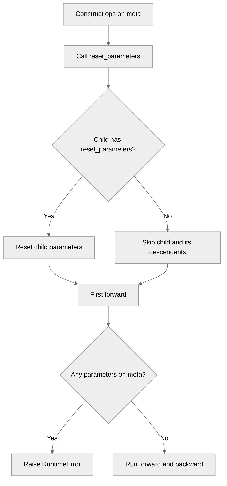

# [PyTorch] Fix deferred initialization in fusible ops

[Upstream PR](https://github.com/NVIDIA/TransformerEngine/pull/3327) · state: closed · merged: True

## Original PR description

# Description

Ops replace their params when materializing them on the first fuser forward pass, which invalidated the fuser's cached params and ops.Linear's parameter aliases. Backward then failed with a meta-vs-cuda device mismatch. **This is an incorrect use of deferred initialization.**

Deferred initialization requires invoking `.reset_parameters()` before the first fuser forward pass to materialize the parameters in fusible operations. This PR adds the missing `.reset_parameters()` implementations for `te.ops.Linear()`, `te.ops.Bias()` and `te.ops.Sequential()` in order to enable this workflow the same way deferred parameters are materialized on device for standard `torch.nn.Modules` and TE custom modules.

New tests added for deferred initialization with the affected ops. First-forward now raises error if it's invoked with unmaterialized meta-device params in any of the fusible ops.

Fixes #3322

## Type of change

- [ ] Documentation change (change only to the documentation, either a fix or a new content)
- [ ] Bug fix (non-breaking change which fixes an issue)
- [ ] New feature (non-breaking change which adds functionality)
- [x] Breaking change (fix or feature that would cause existing functionality to not work as expected)
- [ ] Infra/Build change
- [ ] Code refactoring

# Checklist:

- [x] I have read and followed the [contributing guidelines](https://github.com/NVIDIA/TransformerEngine/blob/main/CONTRIBUTING.rst)
- [x] The functionality is complete
- [x] I have commented my code, particularly in hard-to-understand areas
- [x] I have made corresponding changes to the documentation
- [x] My changes generate no new warnings
- [x] I have added tests that prove my fix is effective or that my feature works
- [x] New and existing unit tests pass locally with my changes


## Review and discussion

### reviews

- vthumbe1503 · COMMENTED · 2026-08-07T22:33:26Z · [source](https://github.com/NVIDIA/TransformerEngine/pull/3327#pullrequestreview-4886973034)

LGTM, have some question and a minor suggestion for adding grouped_linear test case as well for quantized_model_int case

- ptrendx · COMMENTED · 2026-08-08T00:17:52Z · [source](https://github.com/NVIDIA/TransformerEngine/pull/3327#pullrequestreview-4887461723)

(No body; status only.)

- ptrendx · COMMENTED · 2026-08-08T00:19:41Z · [source](https://github.com/NVIDIA/TransformerEngine/pull/3327#pullrequestreview-4887472079)

(No body; status only.)

- timmoon10 · DISMISSED · 2026-08-10T17:10:46Z · [source](https://github.com/NVIDIA/TransformerEngine/pull/3327#pullrequestreview-4899237376)

Are we sure there is actually a bug? I see this PR adds logic to defer some `OperationFuser` setup to the first forward pass. However, `OperationFuser` is an internal class that is only instantiated by `Sequential` in the first forward pass:
https://github.com/NVIDIA/TransformerEngine/blob/32f7096a355ca803e7151da0d0f4aa65ac4ba46b/transformer_engine/pytorch/ops/sequential.py#L184

It's perfectly possible that different fusions are available with quantized/unquantized params, so trying to "fix" the `OperationFuser` is dangerous. If a change is detected, better to destroy and create a new one.

- vthumbe1503 · COMMENTED · 2026-08-10T18:38:51Z · [source](https://github.com/NVIDIA/TransformerEngine/pull/3327#pullrequestreview-4899893992)

(No body; status only.)

- denera · COMMENTED · 2026-08-13T15:28:28Z · [source](https://github.com/NVIDIA/TransformerEngine/pull/3327#pullrequestreview-4928731925)

(No body; status only.)

- vthumbe1503 · COMMENTED · 2026-08-25T21:09:45Z · [source](https://github.com/NVIDIA/TransformerEngine/pull/3327#pullrequestreview-5024208545)

(No body; status only.)

- greptile-apps[bot] · COMMENTED · 2026-10-01T19:28:17Z · [source](https://github.com/NVIDIA/TransformerEngine/pull/3327#pullrequestreview-5384453380)

(No body; status only.)

- denera · COMMENTED · 2026-10-01T19:40:20Z · [source](https://github.com/NVIDIA/TransformerEngine/pull/3327#pullrequestreview-5384579839)

(No body; status only.)

- denera · COMMENTED · 2026-10-01T19:40:40Z · [source](https://github.com/NVIDIA/TransformerEngine/pull/3327#pullrequestreview-5384583219)

(No body; status only.)

- denera · COMMENTED · 2026-10-01T19:41:56Z · [source](https://github.com/NVIDIA/TransformerEngine/pull/3327#pullrequestreview-5384596953)

(No body; status only.)

- denera · COMMENTED · 2026-10-01T19:42:45Z · [source](https://github.com/NVIDIA/TransformerEngine/pull/3327#pullrequestreview-5384605321)

(No body; status only.)

- timmoon10 · COMMENTED · 2026-10-05T22:18:44Z · [source](https://github.com/NVIDIA/TransformerEngine/pull/3327#pullrequestreview-5419799890)

Overall LGTM, although I have some nits.

I'll note that our `device='meta'` behavior is different from `torch.nn.Linear`. For that, calling `reset_parameters` does not initialize weights and the only way to initialize is to manually overwrite the params. TE is treating `reset_parameters` in a non-standard way to make this workflow more convenient than plain PyTorch.

- timmoon10 · DISMISSED · 2026-10-08T19:00:01Z · [source](https://github.com/NVIDIA/TransformerEngine/pull/3327#pullrequestreview-5461508986)

LGTM

- ptrendx · APPROVED · 2026-10-13T20:02:56Z · [source](https://github.com/NVIDIA/TransformerEngine/pull/3327#pullrequestreview-5509258145)

(No body; status only.)

- greptile-apps[bot] · COMMENTED · 2026-10-13T20:03:04Z · [source](https://github.com/NVIDIA/TransformerEngine/pull/3327#pullrequestreview-5509259341)

(No body; status only.)

### issue_comments

- greptile-apps[bot] · comment · 2026-08-07T15:07:21Z · [source](https://github.com/NVIDIA/TransformerEngine/pull/3327#issuecomment-5218720590)

<!-- greptile_summary -->

<h2><a href="https://app.greptile.com/api/retrigger?id=51199971"><picture><source media="(prefers-color-scheme: dark)" srcset="https://greptile-static-assets.s3.amazonaws.com/badges/RetriggerDark.svg?v=2"><source media="(prefers-color-scheme: light)" srcset="https://greptile-static-assets.s3.amazonaws.com/badges/Retrigger.svg?v=2"></picture></a>Confidence Score: 4/5</h2>

**[Medium impact]** Refactors deferred parameter initialization in PyTorch ops\.

Fix resetting children inside plain nested containers before merging.

<h2>Findings</h2>

1. &nbsp;**Nested parameters stay on meta** <a href="https://github.com/NVIDIA/TransformerEngine/pull/3327#discussion_r4263414240">▶</a>

<h3>Summary</h3>

The PR makes deferred initialization explicit: fusible ops must be reset before their first forward.
- Fusible ops need their parameters reset before the first forward pass.
- Quantized deferred weights keep their existing parameter references.

<h3>Diagram</h3>



<!-- greptile_confidence_score:4 -->

<sub>Reviews (6) · Last reviewed commit: ["\[PyTorch\] Fix deferred initialization in..."](https://github.com/nvidia/transformerengine/commit/660a9d609cfda0f583e76412ad02661c9d643aab) · [Reviewed by Greptile](https://www.greptile.com/?utm_source=greptile_expert&utm_medium=github&utm_campaign=code_reviews&utm_content=nvidia/transformerengine)</sub>

- denera · comment · 2026-08-07T18:03:52Z · [source](https://github.com/NVIDIA/TransformerEngine/pull/3327#issuecomment-5220449449)

/te-ci pytorch

- denera · comment · 2026-10-01T19:48:52Z · [source](https://github.com/NVIDIA/TransformerEngine/pull/3327#issuecomment-5939287864)

> Are we sure there is actually a bug? I see this PR adds logic to defer some `OperationFuser` setup to the first forward pass. However, `OperationFuser` is an internal class that is only instantiated by `Sequential` in the first forward pass:
> 
> https://github.com/NVIDIA/TransformerEngine/blob/32f7096a355ca803e7151da0d0f4aa65ac4ba46b/transformer_engine/pytorch/ops/sequential.py#L184
> 
> It's perfectly possible that different fusions are available with quantized/unquantized params, so trying to "fix" the `OperationFuser` is dangerous. If a change is detected, better to destroy and create a new one.

@timmoon10 I dropped all the `OperationFuser` changes in the PR. `te.Sequential.reset_parameters()` rebuilds its fusers instead, and the first-forward on the fuser explicitly requires `.reset_parameters()` to be called to materialize meta tensors on device first.

- denera · comment · 2026-10-01T19:54:18Z · [source](https://github.com/NVIDIA/TransformerEngine/pull/3327#issuecomment-5939373553)

/te-ci pytorch

- denera · comment · 2026-10-08T12:10:31Z · [source](https://github.com/NVIDIA/TransformerEngine/pull/3327#issuecomment-6059548904)

> I'll note that our `device='meta'` behavior is different from `torch.nn.Linear`. For that, calling `reset_parameters` does not initialize weights and the only way to initialize is to manually overwrite the params. TE is treating `reset_parameters` in a non-standard way to make this workflow more convenient than plain PyTorch.

@timmoon10 The documented PyTorch workflow for deferred initialization of meta-modules is:
```python
with torch.device('meta'):
    model = torch.nn.Linear(...)
model.to_empty(device='cuda')
model.reset_parameters()
```
So I don't believe it is required to manually overwrite params for native PyTorch modules.

I don't believe we've ever reliably supported `.to_empty(device=...)` or `.to(dtype=..., device=...)` style of operations on TE custom modules, and we only support CUDA devices anyway, so `.to_empty(device='cuda')` ends up mandatory and implied for any invocation of `.reset_parameters()`. Therefore, pinning our own deferred initialization in TE to `.reset_parameters()` is a pretty close reproduction of deferred initialization for native PyT modules. That was the original logic behind the implementation anyway.

I've updated the PR to support `.reset_parameters()` for every fusible op that could end up in `te.Sequential` as a submodule, and so it is now fully equivalent to either call `te.Sequential.reset_parameters()` OR loop over the submodules and call `.reset_parameters()` on each of them separately. Docstrings are updated accordingly.


- timmoon10 · comment · 2026-10-08T19:00:10Z · [source](https://github.com/NVIDIA/TransformerEngine/pull/3327#issuecomment-6066973240)

/te-ci pytorch

- ptrendx · comment · 2026-10-13T20:03:33Z · [source](https://github.com/NVIDIA/TransformerEngine/pull/3327#issuecomment-6154103819)

/te-ci pytorch

### inline_comments

- vthumbe1503 · comment · 2026-08-07T22:16:28Z · [source](https://github.com/NVIDIA/TransformerEngine/pull/3327#discussion_r3739098198)

File: `tests/pytorch/test_fusible_ops.py` · line None

Should we extend this test for GroupedLinear as well?

- vthumbe1503 · comment · 2026-08-07T22:32:17Z · [source](https://github.com/NVIDIA/TransformerEngine/pull/3327#discussion_r3739159631)

File: `transformer_engine/pytorch/ops/fuser.py` · line None

If  somebody calls register_parameter on the ops in a later iteration, this means it would not get cached in fuser's parameter list

I know it is a weird use-case, and maybe nobody does this. But was this always intended, @timmoon10 ?

- ptrendx · comment · 2026-08-08T00:17:53Z · [source](https://github.com/NVIDIA/TransformerEngine/pull/3327#discussion_r3739485336)

File: `tests/pytorch/test_fusible_ops.py` · line 1433

We should test both requires_grad = True and False

- ptrendx · comment · 2026-08-08T00:19:41Z · [source](https://github.com/NVIDIA/TransformerEngine/pull/3327#discussion_r3739491081)

File: `tests/pytorch/test_fusible_ops.py` · line None

In addition to that there should be some testing that the resulting output/gradients actually match the op that did not go through this materialization step.

- vthumbe1503 · comment · 2026-08-10T18:38:51Z · [source](https://github.com/NVIDIA/TransformerEngine/pull/3327#discussion_r3752346822)

File: `tests/pytorch/test_fusible_ops.py` · line 1429

Isnt the normal flow for deferred initialization to call reset_parameters before doing the first forward pass?

- denera · comment · 2026-08-13T15:28:28Z · [source](https://github.com/NVIDIA/TransformerEngine/pull/3327#discussion_r3776701089)

File: `transformer_engine/pytorch/ops/fuser.py` · line None

This gap actually gets resolved neatly with the new parameter versioning. Registering a new param bumps the version, which automatically invalidates the pre-existing cache and forces the fuser to re-cache and re-fuse.

- vthumbe1503 · comment · 2026-08-25T21:09:45Z · [source](https://github.com/NVIDIA/TransformerEngine/pull/3327#discussion_r3857433254)

File: `tests/pytorch/test_fusible_ops.py` · line None

I dont think this is a use-case @denera 

The way this test     `def test_deferred_param_init_explicit(`
calls reset_parameters before calling the first forward is the realistic use-case. Can we make all the tests follow this use-case. 

And I think the fix in fuser is not needed as @timmoon10 pointed out. Since the cache_parameters that is going to be called will be after the parameters are materialized using reset_parameters() and so it will be right.


I think we should modify this PR to have an example in pytorch's example folder, showing how deferred initialization works and some test cases in this file for that.

- greptile-apps[bot] · comment · 2026-10-01T19:28:15Z · [source](https://github.com/NVIDIA/TransformerEngine/pull/3327#discussion_r4159590160)

File: `transformer_engine/pytorch/ops/linear.py` · line 175

<a href="#"></a> **Linear parameters remain on meta** When `Linear(device="meta")` runs its first forward without an explicit reset, its basic operations materialize their weight and bias, but `Linear.weight` and `Linear.bias` still refer to the original meta parameters. Callers using those public attributes after forward therefore access stale parameters rather than the ones used for computation.

- denera · comment · 2026-10-01T19:40:20Z · [source](https://github.com/NVIDIA/TransformerEngine/pull/3327#discussion_r4159694845)

File: `tests/pytorch/test_fusible_ops.py` · line None

Updated. Tests call `.reset_parameters()` before the first forward, and the fuser changes are removed. The supported usage is documented in the `te.ops.Sequential` docstring.

- denera · comment · 2026-10-01T19:40:40Z · [source](https://github.com/NVIDIA/TransformerEngine/pull/3327#discussion_r4159697877)

File: `tests/pytorch/test_fusible_ops.py` · line 1429

Yes, the tests now follow this supported workflow.

- denera · comment · 2026-10-01T19:41:56Z · [source](https://github.com/NVIDIA/TransformerEngine/pull/3327#discussion_r4159709360)

File: `tests/pytorch/test_fusible_ops.py` · line 1433

Materialization no longer happens in the forward pass. It requires an explicit `.reset_parameters()` call in line with how we support it in TE custom modules. So I dropped this parameterization entirely in the tests.

- denera · comment · 2026-10-01T19:42:45Z · [source](https://github.com/NVIDIA/TransformerEngine/pull/3327#discussion_r4159716557)

File: `transformer_engine/pytorch/ops/fuser.py` · line None

UPDATE: This mechanism is entirely removed now in favor of requiring explicit `.reset_parameters()` call before the first forward.

- timmoon10 · comment · 2026-10-05T19:55:28Z · [source](https://github.com/NVIDIA/TransformerEngine/pull/3327#discussion_r4188140032)

File: `transformer_engine/pytorch/ops/sequential.py` · line None

`device='meta'` is an advanced workflow that is really handled by the ops, not `Sequential`. Giving it such prime real estate in this docstring seems disproportionate.
```suggestion
```
Also, it's perfectly valid to call `reset_parameters` in the individual modules. It's just redundant if you call `Sequential.reset_parameters` as well.

- timmoon10 · comment · 2026-10-05T21:55:34Z · [source](https://github.com/NVIDIA/TransformerEngine/pull/3327#discussion_r4189252441)

File: `transformer_engine/pytorch/ops/op.py` · line None

I'm wary of this hint since the base class does not actually establish the `reset_parameters` API. At the moment, some subclasses implement a function that happens to have the same name.
```suggestion
```

- timmoon10 · comment · 2026-10-05T22:06:19Z · [source](https://github.com/NVIDIA/TransformerEngine/pull/3327#discussion_r4189336865)

File: `tests/pytorch/test_fusible_ops.py` · line None

This reference implementation seems trivial. Instead of creating the same deferred-init op twice, it seems more meaningful if the baseline had eager initialization.
```suggestion
        op_kwargs["device"] = device
        ref_op = self._make_deferred_init_op(op_type, device=device, **op_kwargs)
```

- greptile-apps[bot] · comment · 2026-10-13T20:03:02Z · [source](https://github.com/NVIDIA/TransformerEngine/pull/3327#discussion_r4263414240)

File: `transformer_engine/pytorch/ops/sequential.py` · line 151

<a href="#"></a> **Nested parameters stay on meta**

`Sequential.reset_parameters()` skips children inside a nested `torch.nn.Sequential`, which has no `reset_parameters()` method. For example, `te.ops.Sequential(torch.nn.Sequential(te.ops.Linear(32, 32, device="meta")))` still has meta parameters after resetting the outer container. Its first forward then raises instead of running.

Reset children of containers that lack their own reset method.

## Changed files and fixed code

- `tests/pytorch/test_fusible_ops.py` · modified · additions 150 / deletions 0
  - [head](https://github.com/denera/TransformerEngine/blob/660a9d609cfda0f583e76412ad02661c9d643aab/tests/pytorch/test_fusible_ops.py)
  - [base](https://github.com/NVIDIA/TransformerEngine/blob/e6afa9ddfa813e39295572385b2fc9fdc77c067b/tests/pytorch/test_fusible_ops.py)
- `transformer_engine/pytorch/ops/basic/basic_linear.py` · modified · additions 4 / deletions 5
  - [head](https://github.com/denera/TransformerEngine/blob/660a9d609cfda0f583e76412ad02661c9d643aab/transformer_engine/pytorch/ops/basic/basic_linear.py)
  - [base](https://github.com/NVIDIA/TransformerEngine/blob/e6afa9ddfa813e39295572385b2fc9fdc77c067b/transformer_engine/pytorch/ops/basic/basic_linear.py)
- `transformer_engine/pytorch/ops/basic/bias.py` · modified · additions 1 / deletions 6
  - [head](https://github.com/denera/TransformerEngine/blob/660a9d609cfda0f583e76412ad02661c9d643aab/transformer_engine/pytorch/ops/basic/bias.py)
  - [base](https://github.com/NVIDIA/TransformerEngine/blob/e6afa9ddfa813e39295572385b2fc9fdc77c067b/transformer_engine/pytorch/ops/basic/bias.py)
- `transformer_engine/pytorch/ops/basic/grouped_linear.py` · modified · additions 0 / deletions 4
  - [head](https://github.com/denera/TransformerEngine/blob/660a9d609cfda0f583e76412ad02661c9d643aab/transformer_engine/pytorch/ops/basic/grouped_linear.py)
  - [base](https://github.com/NVIDIA/TransformerEngine/blob/e6afa9ddfa813e39295572385b2fc9fdc77c067b/transformer_engine/pytorch/ops/basic/grouped_linear.py)
- `transformer_engine/pytorch/ops/basic/layer_norm.py` · modified · additions 0 / deletions 5
  - [head](https://github.com/denera/TransformerEngine/blob/660a9d609cfda0f583e76412ad02661c9d643aab/transformer_engine/pytorch/ops/basic/layer_norm.py)
  - [base](https://github.com/NVIDIA/TransformerEngine/blob/e6afa9ddfa813e39295572385b2fc9fdc77c067b/transformer_engine/pytorch/ops/basic/layer_norm.py)
- `transformer_engine/pytorch/ops/basic/rmsnorm.py` · modified · additions 0 / deletions 5
  - [head](https://github.com/denera/TransformerEngine/blob/660a9d609cfda0f583e76412ad02661c9d643aab/transformer_engine/pytorch/ops/basic/rmsnorm.py)
  - [base](https://github.com/NVIDIA/TransformerEngine/blob/e6afa9ddfa813e39295572385b2fc9fdc77c067b/transformer_engine/pytorch/ops/basic/rmsnorm.py)
- `transformer_engine/pytorch/ops/linear.py` · modified · additions 8 / deletions 0
  - [head](https://github.com/denera/TransformerEngine/blob/660a9d609cfda0f583e76412ad02661c9d643aab/transformer_engine/pytorch/ops/linear.py)
  - [base](https://github.com/NVIDIA/TransformerEngine/blob/e6afa9ddfa813e39295572385b2fc9fdc77c067b/transformer_engine/pytorch/ops/linear.py)
- `transformer_engine/pytorch/ops/op.py` · modified · additions 13 / deletions 0
  - [head](https://github.com/denera/TransformerEngine/blob/660a9d609cfda0f583e76412ad02661c9d643aab/transformer_engine/pytorch/ops/op.py)
  - [base](https://github.com/NVIDIA/TransformerEngine/blob/e6afa9ddfa813e39295572385b2fc9fdc77c067b/transformer_engine/pytorch/ops/op.py)
- `transformer_engine/pytorch/ops/sequential.py` · modified · additions 8 / deletions 0
  - [head](https://github.com/denera/TransformerEngine/blob/660a9d609cfda0f583e76412ad02661c9d643aab/transformer_engine/pytorch/ops/sequential.py)
  - [base](https://github.com/NVIDIA/TransformerEngine/blob/e6afa9ddfa813e39295572385b2fc9fdc77c067b/transformer_engine/pytorch/ops/sequential.py)

## Evidence and interpretation boundary

[Original JSON, discussions and patches](../../../../../../evidence/prs/NVIDIA--TransformerEngine/3327-bf20c0f2940fe34c73b5c08b00c09645ea25555beb42c57c2d800d48b485e20d.json) · SHA-256 `bf20c0f2940fe34c73b5c08b00c09645ea25555beb42c57c2d800d48b485e20d`.

Diff complete: True. Missing/binary/truncated patches require pinned source inspection. This is a source page, not an independently verified optimization case. Open, merged and released are different states; recheck the deployed dependency.
