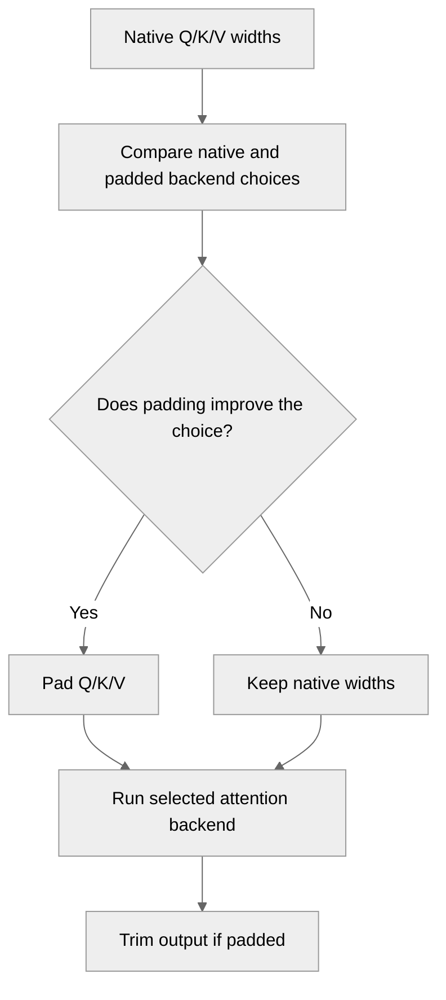

# Optionally pad QK/V for better kernel selection

[Upstream PR](https://github.com/NVIDIA/TransformerEngine/pull/3339) · state: open · merged: False

## Original PR description

# Description

While support for native QKV shapes has been added, some MLA kernels
still benefit from having QKV padded to the same head dimension. Since
it's not easy to automate this decision, we probe
`get_attention_backend` twice with and without padding to figure out
which version selects the better kernel.

If padding results in a better kernel than not padding, we pad;
otherwise, Q, K, and V stay native.

Ref https://github.com/NVIDIA/Megatron-LM/issues/6240, ref https://github.com/NVIDIA/Megatron-LM/pull/6241.

## Type of change

- [ ] Documentation change (change only to the documentation, either a fix or a new content)
- [ ] Bug fix (non-breaking change which fixes an issue)
- [X] New feature (non-breaking change which adds functionality)
- [ ] Breaking change (fix or feature that would cause existing functionality to not work as expected)
- [ ] Infra/Build change
- [ ] Code refactoring

## Changes

Please list the changes introduced in this PR:

- Automate MLA padding-related kernel selection
- Add corresponding tests

# Checklist:

- [X] I have read and followed the [contributing guidelines](https://github.com/NVIDIA/TransformerEngine/blob/main/CONTRIBUTING.rst)
- [X] The functionality is complete
- [X] I have commented my code, particularly in hard-to-understand areas
- [ ] I have made corresponding changes to the documentation
- [X] My changes generate no new warnings
- [ ] I have added tests that prove my fix is effective or that my feature works
- [ ] New and existing unit tests pass locally with my changes


## Review and discussion

### reviews

- greptile-apps[bot] · COMMENTED · 2026-08-10T22:52:13Z · [source](https://github.com/NVIDIA/TransformerEngine/pull/3339#pullrequestreview-4901555007)

(No body; status only.)

- greptile-apps[bot] · COMMENTED · 2026-08-10T23:34:36Z · [source](https://github.com/NVIDIA/TransformerEngine/pull/3339#pullrequestreview-4901760111)

(No body; status only.)

- janEbert · COMMENTED · 2026-08-11T00:36:16Z · [source](https://github.com/NVIDIA/TransformerEngine/pull/3339#pullrequestreview-4902087704)

(No body; status only.)

- greptile-apps[bot] · COMMENTED · 2026-08-11T00:36:47Z · [source](https://github.com/NVIDIA/TransformerEngine/pull/3339#pullrequestreview-4902091602)

(No body; status only.)

- cyanguwa · COMMENTED · 2026-08-11T14:13:58Z · [source](https://github.com/NVIDIA/TransformerEngine/pull/3339#pullrequestreview-4907164609)

(No body; status only.)

- cyanguwa · COMMENTED · 2026-08-11T15:33:08Z · [source](https://github.com/NVIDIA/TransformerEngine/pull/3339#pullrequestreview-4907187864)

(No body; status only.)

- janEbert · COMMENTED · 2026-08-12T11:53:49Z · [source](https://github.com/NVIDIA/TransformerEngine/pull/3339#pullrequestreview-4916165887)

(No body; status only.)

- cyanguwa · COMMENTED · 2026-08-13T17:16:19Z · [source](https://github.com/NVIDIA/TransformerEngine/pull/3339#pullrequestreview-4929719339)

(No body; status only.)

- janEbert · COMMENTED · 2026-08-13T17:37:30Z · [source](https://github.com/NVIDIA/TransformerEngine/pull/3339#pullrequestreview-4929890912)

(No body; status only.)

- janEbert · COMMENTED · 2026-08-13T23:44:54Z · [source](https://github.com/NVIDIA/TransformerEngine/pull/3339#pullrequestreview-4932520868)

(No body; status only.)

- janEbert · COMMENTED · 2026-08-13T23:45:08Z · [source](https://github.com/NVIDIA/TransformerEngine/pull/3339#pullrequestreview-4932521750)

(No body; status only.)

- janEbert · COMMENTED · 2026-08-13T23:45:37Z · [source](https://github.com/NVIDIA/TransformerEngine/pull/3339#pullrequestreview-4932524094)

(No body; status only.)

- janEbert · COMMENTED · 2026-08-13T23:46:18Z · [source](https://github.com/NVIDIA/TransformerEngine/pull/3339#pullrequestreview-4932526666)

(No body; status only.)

- cyanguwa · COMMENTED · 2026-09-04T16:13:32Z · [source](https://github.com/NVIDIA/TransformerEngine/pull/3339#pullrequestreview-5115202394)

Please address the remaining couple of comments, and I'll start the CI. Thanks!

- cyanguwa · COMMENTED · 2026-09-04T18:27:06Z · [source](https://github.com/NVIDIA/TransformerEngine/pull/3339#pullrequestreview-5116595785)

(No body; status only.)

- janEbert · COMMENTED · 2026-10-12T20:05:10Z · [source](https://github.com/NVIDIA/TransformerEngine/pull/3339#pullrequestreview-5495455854)

(No body; status only.)

- janEbert · COMMENTED · 2026-10-12T22:14:54Z · [source](https://github.com/NVIDIA/TransformerEngine/pull/3339#pullrequestreview-5496503803)

(No body; status only.)

- janEbert · COMMENTED · 2026-10-12T23:26:14Z · [source](https://github.com/NVIDIA/TransformerEngine/pull/3339#pullrequestreview-5497021066)

(No body; status only.)

- janEbert · COMMENTED · 2026-10-12T23:26:19Z · [source](https://github.com/NVIDIA/TransformerEngine/pull/3339#pullrequestreview-5497021483)

(No body; status only.)

- janEbert · COMMENTED · 2026-10-12T23:26:40Z · [source](https://github.com/NVIDIA/TransformerEngine/pull/3339#pullrequestreview-5497023467)

(No body; status only.)

- greptile-apps[bot] · COMMENTED · 2026-10-12T23:34:46Z · [source](https://github.com/NVIDIA/TransformerEngine/pull/3339#pullrequestreview-5497070355)

(No body; status only.)

- greptile-apps[bot] · COMMENTED · 2026-10-13T15:52:42Z · [source](https://github.com/NVIDIA/TransformerEngine/pull/3339#pullrequestreview-5506333241)

(No body; status only.)

- janEbert · COMMENTED · 2026-10-13T15:57:26Z · [source](https://github.com/NVIDIA/TransformerEngine/pull/3339#pullrequestreview-5506392961)

(No body; status only.)

- greptile-apps[bot] · COMMENTED · 2026-10-13T15:58:28Z · [source](https://github.com/NVIDIA/TransformerEngine/pull/3339#pullrequestreview-5506405942)

(No body; status only.)

- cyanguwa · COMMENTED · 2026-10-13T23:52:55Z · [source](https://github.com/NVIDIA/TransformerEngine/pull/3339#pullrequestreview-5511196317)

(No body; status only.)

- janEbert · COMMENTED · 2026-10-14T08:45:12Z · [source](https://github.com/NVIDIA/TransformerEngine/pull/3339#pullrequestreview-5515296987)

(No body; status only.)

- janEbert · COMMENTED · 2026-10-14T11:44:20Z · [source](https://github.com/NVIDIA/TransformerEngine/pull/3339#pullrequestreview-5517335867)

(No body; status only.)

- janEbert · COMMENTED · 2026-10-14T11:46:35Z · [source](https://github.com/NVIDIA/TransformerEngine/pull/3339#pullrequestreview-5517365668)

(No body; status only.)

- janEbert · COMMENTED · 2026-10-14T12:04:09Z · [source](https://github.com/NVIDIA/TransformerEngine/pull/3339#pullrequestreview-5517564272)

(No body; status only.)

- janEbert · COMMENTED · 2026-10-14T12:35:02Z · [source](https://github.com/NVIDIA/TransformerEngine/pull/3339#pullrequestreview-5517946385)

(No body; status only.)

- greptile-apps[bot] · COMMENTED · 2026-10-14T12:35:51Z · [source](https://github.com/NVIDIA/TransformerEngine/pull/3339#pullrequestreview-5517958022)

(No body; status only.)

- cyanguwa · COMMENTED · 2026-10-14T16:22:55Z · [source](https://github.com/NVIDIA/TransformerEngine/pull/3339#pullrequestreview-5521135751)

(No body; status only.)

- greptile-apps[bot] · COMMENTED · 2026-10-14T16:47:37Z · [source](https://github.com/NVIDIA/TransformerEngine/pull/3339#pullrequestreview-5521443160)

(No body; status only.)

- cyanguwa · COMMENTED · 2026-10-14T16:52:42Z · [source](https://github.com/NVIDIA/TransformerEngine/pull/3339#pullrequestreview-5521507962)

(No body; status only.)

- cyanguwa · COMMENTED · 2026-10-14T16:52:45Z · [source](https://github.com/NVIDIA/TransformerEngine/pull/3339#pullrequestreview-5521508508)

(No body; status only.)

- greptile-apps[bot] · COMMENTED · 2026-10-14T16:53:14Z · [source](https://github.com/NVIDIA/TransformerEngine/pull/3339#pullrequestreview-5521514319)

(No body; status only.)

- greptile-apps[bot] · COMMENTED · 2026-10-14T16:53:38Z · [source](https://github.com/NVIDIA/TransformerEngine/pull/3339#pullrequestreview-5521519161)

(No body; status only.)

- greptile-apps[bot] · COMMENTED · 2026-10-14T16:54:29Z · [source](https://github.com/NVIDIA/TransformerEngine/pull/3339#pullrequestreview-5521529855)

(No body; status only.)

- cyanguwa · COMMENTED · 2026-10-14T17:03:08Z · [source](https://github.com/NVIDIA/TransformerEngine/pull/3339#pullrequestreview-5521644230)

(No body; status only.)

- cyanguwa · COMMENTED · 2026-10-14T17:07:12Z · [source](https://github.com/NVIDIA/TransformerEngine/pull/3339#pullrequestreview-5521692486)

(No body; status only.)

- janEbert · COMMENTED · 2026-10-14T17:14:39Z · [source](https://github.com/NVIDIA/TransformerEngine/pull/3339#pullrequestreview-5521784726)

(No body; status only.)

- greptile-apps[bot] · COMMENTED · 2026-10-14T18:53:35Z · [source](https://github.com/NVIDIA/TransformerEngine/pull/3339#pullrequestreview-5523055223)

(No body; status only.)

### issue_comments

- greptile-apps[bot] · comment · 2026-08-10T22:52:09Z · [source](https://github.com/NVIDIA/TransformerEngine/pull/3339#issuecomment-5246923669)

<!-- greptile_summary -->

<h2><a href="https://app.greptile.com/api/retrigger?id=52008045"><picture><source media="(prefers-color-scheme: dark)" srcset="https://greptile-static-assets.s3.amazonaws.com/badges/RetriggerDark.svg?v=2"><source media="(prefers-color-scheme: light)" srcset="https://greptile-static-assets.s3.amazonaws.com/badges/Retrigger.svg?v=2"></picture></a><a href="https://app.greptile.com/nvidia-public-github/github/NVIDIA/transformerengine/-/pull/3339"><picture><source media="(prefers-color-scheme: dark)" srcset="https://greptile-static-assets.s3.amazonaws.com/badges/ViewInGreptileDark.svg?v=2"><source media="(prefers-color-scheme: light)" srcset="https://greptile-static-assets.s3.amazonaws.com/badges/ViewInGreptile.svg?v=2"></picture></a>Confidence Score: 5/5</h2>

**[Medium impact]** The PR appears safe to merge; the latest assertion change fixes the reported test failure.

<h3>Summary</h3>

The PR compares native and padded Q/K/V widths, pads when that improves backend selection, and trims the output back to its original width.

- MLA attention pads Q, K, and V when matching widths improve backend choice.

<h3>Diagram</h3>



<!-- greptile_confidence_score:5 -->

<sub>Reviews (11) · Last reviewed commit: ["Update tests/pytorch/attention/test\_atte..."](https://github.com/nvidia/transformerengine/commit/d69ff67e82422de964256415a9c02e256d3a71bb) · [Reviewed by Greptile](https://www.greptile.com/?utm_source=greptile_expert&utm_medium=github&utm_campaign=code_reviews&utm_content=nvidia/transformerengine)</sub>

- janEbert · comment · 2026-08-13T23:46:33Z · [source](https://github.com/NVIDIA/TransformerEngine/pull/3339#issuecomment-5287669529)

PTAL.

- janEbert · comment · 2026-08-27T08:19:43Z · [source](https://github.com/NVIDIA/TransformerEngine/pull/3339#issuecomment-5436341744)

Hey, friendly ping.

- janEbert · comment · 2026-10-12T23:28:04Z · [source](https://github.com/NVIDIA/TransformerEngine/pull/3339#issuecomment-6134581161)

I'm sorry for the late reply; doesn't make it easier to keep this in your head, for sure.

- janEbert · comment · 2026-10-14T16:51:53Z · [source](https://github.com/NVIDIA/TransformerEngine/pull/3339#issuecomment-6173592612)

I've also been fighting with the caching. It's extremely difficult due to the various interactions. Since you seemed to have started working on it, would you like to take it over?

The problem I've found is that, on the one hand, the `_attention_backends` variable is modified in `forward` _after_ and possibly _due to_ the results of `should_pad_qkv_head_dim`. However, we also want to force a cache refresh in case the backend data changes. Importantly, `_attention_backends` can be modified from the outside (e.g., other places in this repo also do that) and I think we also need to observe the different `_THD_POLICY_BACKEND_ENV_VARS` envvars as well in terms of cache invalidation.

- greptile-apps[bot] · comment · 2026-10-14T17:01:54Z · [source](https://github.com/NVIDIA/TransformerEngine/pull/3339#issuecomment-6173790394)

Want your agent to iterate on Greptile's feedback? Try [*greploops*](https://github.com/greptileai/skills/blob/main/greploop/SKILL.md).

- cyanguwa · comment · 2026-10-14T18:47:36Z · [source](https://github.com/NVIDIA/TransformerEngine/pull/3339#issuecomment-6175785210)

@janEbert can you take a look at my recent changes and see if they follow your original logic? Thanks.

- cyanguwa · comment · 2026-10-14T18:48:52Z · [source](https://github.com/NVIDIA/TransformerEngine/pull/3339#issuecomment-6175808793)

/te-ci pytorch L0 L1 L3

- janEbert · comment · 2026-10-19T13:57:28Z · [source](https://github.com/NVIDIA/TransformerEngine/pull/3339#issuecomment-6268970081)

I believe there is one case in which padding is activated even though it shouldn't be, but it may never be possible in the current state:

With native FlashAttention available and selected, padded FlashAttention **not** selected, but padded FusedAttention selected. In that case, we do pad, even though native FlashAttention would already be the best choice.

### inline_comments

- greptile-apps[bot] · comment · 2026-08-10T22:52:12Z · [source](https://github.com/NVIDIA/TransformerEngine/pull/3339#discussion_r3754015268)

File: `transformer_engine/pytorch/attention/dot_product_attention/dot_product_attention.py` · line 2856

<a href="#"></a> **Packed FP8 bypasses padding**

When FP8 fused attention receives packed QKV or KV with unequal head dimensions, this block pads only the unpacked views while the unchanged packed buffers are later consumed by `combine_and_quantize`. The backend is therefore selected for equal padded dimensions but receives an unpadded packed buffer, causing incompatible kernel shapes or incorrect attention output.

**Knowledge Base Used:** [PyTorch Attention Stack](https://app.greptile.com/nvidia-public-github/-/custom-context/knowledge-base/nvidia/transformerengine/-/docs/pytorch-attention.md)

- greptile-apps[bot] · comment · 2026-08-10T22:52:12Z · [source](https://github.com/NVIDIA/TransformerEngine/pull/3339#discussion_r3754015276)

File: `tests/pytorch/attention/test_dpa_mla_qkv_head_dim_pad.py` · line None

<a href="#"></a> **Identity test uses unrelated inputs**

The reference tensors and `_thd_inputs` tensors come from separate random draws, so the final assertion compares attention results for different Q/K/V values rather than equivalent native and padded inputs. This makes the test fail for reasons unrelated to padding instead of validating the intended identity.

**Knowledge Base Used:** [Tests and QA](https://app.greptile.com/nvidia-public-github/-/custom-context/knowledge-base/nvidia/transformerengine/-/docs/tests-and-qa.md)

- greptile-apps[bot] · comment · 2026-08-10T22:52:12Z · [source](https://github.com/NVIDIA/TransformerEngine/pull/3339#discussion_r3754015282)

File: `tests/pytorch/attention/test_dpa_mla_qkv_head_dim_pad.py` · line None

<a href="#"></a> **New tests are absent from CI**

The QA scripts enumerate attention test files explicitly, but none includes this new file. Consequently, CI silently skips the new backend-selection and padding coverage, allowing regressions in this feature to go undetected.

**Knowledge Base Used:** [Tests and QA](https://app.greptile.com/nvidia-public-github/-/custom-context/knowledge-base/nvidia/transformerengine/-/docs/tests-and-qa.md)

- greptile-apps[bot] · comment · 2026-08-10T23:34:34Z · [source](https://github.com/NVIDIA/TransformerEngine/pull/3339#discussion_r3754211347)

File: `transformer_engine/pytorch/attention/dot_product_attention/dot_product_attention.py` · line 2856

<a href="#"></a> **Packed buffers remain unpadded**

When a packed plain-tensor QKV or KV input has unequal head dimensions and padding upgrades backend selection, this block pads only the unpacked views while the original packed buffer is still passed to fused attention. `combine_and_quantize` therefore produces unpadded inputs for a backend configured with padded dimensions, causing incompatible kernel shapes or incorrect attention output.

**Knowledge Base Used:** [PyTorch Attention Stack](https://app.greptile.com/nvidia-public-github/-/custom-context/knowledge-base/nvidia/transformerengine/-/docs/pytorch-attention.md)

- janEbert · comment · 2026-08-11T00:36:15Z · [source](https://github.com/NVIDIA/TransformerEngine/pull/3339#discussion_r3754474506)

File: `transformer_engine/pytorch/attention/dot_product_attention/dot_product_attention.py` · line 2856

Packed tensors have `head_dim_qk == head_dim_v`, so the if-guard for padding, which also checks for `head_dim_qk != head_dim_v`, is never passed.

- greptile-apps[bot] · comment · 2026-08-11T00:36:47Z · [source](https://github.com/NVIDIA/TransformerEngine/pull/3339#discussion_r3754476813)

File: `transformer_engine/pytorch/attention/dot_product_attention/dot_product_attention.py` · line 2856

That's a valid and correct point. Since packed QKV/KV tensors have a single contiguous buffer where Q, K, and V share the same head dimension by construction, `head_dim_qk == head_dim_v` is always true for them, so the `head_dim_qk != head_dim_v` guard naturally excludes that path. My original concern was unfounded — happy to withdraw it.

Tip: You can customize Greptile's behavior for this repo with [`.greptile/rules.md` and `.greptile/config.json`](https://www.greptile.com/docs/code-review/custom-standards).

- cyanguwa · comment · 2026-08-11T14:13:58Z · [source](https://github.com/NVIDIA/TransformerEngine/pull/3339#discussion_r3758726563)

File: `transformer_engine/pytorch/attention/dot_product_attention/dot_product_attention.py` · line 2856

Could we make this `_pad_qkv_head_dim` work for all three executions below: `if use_flash/fused/unfused_attention:`, so we only have one pair of `_pad_qkv_head_dim/_trim_output` for all three backends instead of duplicating the code multiple times.

- cyanguwa · comment · 2026-08-11T14:16:12Z · [source](https://github.com/NVIDIA/TransformerEngine/pull/3339#discussion_r3758744733)

File: `transformer_engine/pytorch/attention/dot_product_attention/dot_product_attention.py` · line None

Can we make the comments throughout the PR a bit more concise, with possibly just one or two sentences? Thanks.

Also, please make it clear that we're extending the head dims to the `max(head_dim_qk, head_dim_v)` and not to the next supportable head_dim, because the max could still be unsupported by Flash/FusedAttention possibly.

- cyanguwa · comment · 2026-08-11T14:17:47Z · [source](https://github.com/NVIDIA/TransformerEngine/pull/3339#discussion_r3758757091)

File: `transformer_engine/pytorch/attention/dot_product_attention/dot_product_attention.py` · line None

Apart from your use case, we're also trying to enable FA2 which does not support `head_dim_qk != head_dim_v`, so please include that logic when deciding if padding or not.

- cyanguwa · comment · 2026-08-11T14:28:02Z · [source](https://github.com/NVIDIA/TransformerEngine/pull/3339#discussion_r3758841103)

File: `tests/pytorch/attention/test_dpa_mla_qkv_head_dim_pad.py` · line None

I feel the test file is a little overly verbose - some of the functionalities are pretty obvious, for example, with the caching mechanism. Do you think we can fold/reduce the testing into one test that calls `test_dot_product_attention`, like with the other tests, and add it to `test_attention.py`? Essentially, what we want to see is that for a given `ModelConfig` such as `head_dim_qk=96` and `head_dim_v=128`, it can cleverly pad and take advantage of one of the faster backends? Thanks!

- janEbert · comment · 2026-08-12T11:53:48Z · [source](https://github.com/NVIDIA/TransformerEngine/pull/3339#discussion_r3766137828)

File: `transformer_engine/pytorch/attention/dot_product_attention/dot_product_attention.py` · line None

> Also, please make it clear that we're extending the head dims to the `max(head_dim_qk, head_dim_v)` and not to the next supportable head_dim, because the max could still be unsupported by Flash/FusedAttention possibly.

I added a note on this, but is that enough? Would it make sense to try and find the next supported value for padding, if that's possible in advance?

- cyanguwa · comment · 2026-08-13T17:16:19Z · [source](https://github.com/NVIDIA/TransformerEngine/pull/3339#discussion_r3777536887)

File: `transformer_engine/pytorch/attention/dot_product_attention/dot_product_attention.py` · line None

It probably depends on your use case - does it often go out of the supported range? If not, I think padding to `max(d_qk, d_v)` is probably good enough; otherwise, you'd need to check what FA2/3/4, cuDNN supports (and tracking their support matrix over time could be a pain). For the latter option, I feel generally padding `head_dim` to the next `%8` should be a good rule before it gets to 256.

- janEbert · comment · 2026-08-13T17:37:30Z · [source](https://github.com/NVIDIA/TransformerEngine/pull/3339#discussion_r3777677923)

File: `transformer_engine/pytorch/attention/dot_product_attention/dot_product_attention.py` · line None

I'd say I'd keep that out of this PR, then. The way it's currently working, the user also needs to pass the correctly sized head, so it's not like I'd break anything by not adding the logic for automatic padding to a supported size. :)

- janEbert · comment · 2026-08-13T23:44:54Z · [source](https://github.com/NVIDIA/TransformerEngine/pull/3339#discussion_r3779931882)

File: `tests/pytorch/attention/test_dpa_mla_qkv_head_dim_pad.py` · line None

Did it slightly differently: added a new test that reuses the `test_dpa_mla` `ModelConfig`s and parametrizations and then checks whether the `should_pad` logic works as expected. Let me know if that's fine.

- janEbert · comment · 2026-08-13T23:45:08Z · [source](https://github.com/NVIDIA/TransformerEngine/pull/3339#discussion_r3779932799)

File: `transformer_engine/pytorch/attention/dot_product_attention/dot_product_attention.py` · line None

Merged this into the existing pad path.

- janEbert · comment · 2026-08-13T23:45:37Z · [source](https://github.com/NVIDIA/TransformerEngine/pull/3339#discussion_r3779934850)

File: `transformer_engine/pytorch/attention/dot_product_attention/dot_product_attention.py` · line 2856

All pads and trims are now merged.

- janEbert · comment · 2026-08-13T23:46:17Z · [source](https://github.com/NVIDIA/TransformerEngine/pull/3339#discussion_r3779937263)

File: `transformer_engine/pytorch/attention/dot_product_attention/dot_product_attention.py` · line None

Reduced verbosity. Note on padding limitations was also added as mentioned previously.

- cyanguwa · comment · 2026-09-04T15:57:40Z · [source](https://github.com/NVIDIA/TransformerEngine/pull/3339#discussion_r3935710638)

File: `transformer_engine/pytorch/attention/dot_product_attention/utils.py` · line None

It's possible that FlashAttention and FusedAttention return negative as well, so it might be better to use `if not native_use_flash_attention:` here, and `elif native_use_unfused_attention:` in the `else` section?

- cyanguwa · comment · 2026-09-04T16:02:30Z · [source](https://github.com/NVIDIA/TransformerEngine/pull/3339#discussion_r3935752669)

File: `transformer_engine/pytorch/attention/dot_product_attention/utils.py` · line None

Could we fold `fp8_packed_skips_qkv_head_dim_pad` into `should_pad_qkv_head_dim`? IIUC, this also contributes to whether we should pad qkv or not? Thanks.

- cyanguwa · comment · 2026-09-04T16:09:15Z · [source](https://github.com/NVIDIA/TransformerEngine/pull/3339#discussion_r3935811019)

File: `transformer_engine/pytorch/attention/dot_product_attention/dot_product_attention.py` · line None

Would `_trim_output(attn_out, num_attention_heads, head_dim_v, orig_head_dim_v)` read a bit better, even though `head_dim_qk = head_dim_v` at the point?

- cyanguwa · comment · 2026-09-04T16:10:20Z · [source](https://github.com/NVIDIA/TransformerEngine/pull/3339#discussion_r3935821291)

File: `transformer_engine/pytorch/attention/dot_product_attention/dot_product_attention.py` · line None

Maybe "Pad Q/K/V to the same head dimension for better backend selection result."?

- cyanguwa · comment · 2026-09-04T18:27:06Z · [source](https://github.com/NVIDIA/TransformerEngine/pull/3339#discussion_r3936865687)

File: `transformer_engine/pytorch/attention/dot_product_attention/dot_product_attention.py` · line None

You might also need to be careful when `attn_out` is a Tuple for example with `return_max_logit=True`. There might be some logic needed to hitting that path. Thanks.

- janEbert · comment · 2026-10-12T20:05:10Z · [source](https://github.com/NVIDIA/TransformerEngine/pull/3339#discussion_r4251884792)

File: `transformer_engine/pytorch/attention/dot_product_attention/dot_product_attention.py` · line None

For the former, I actually deliberately used `qk` to highlight that fact, but I'm fine with changing it to `head_dim_v`.

For the latter; thanks a lot! I didn't catch that because I was only looking at the type hints, which appear to be outdated. I'll update it as well if you don't mind. :)

- janEbert · comment · 2026-10-12T22:14:54Z · [source](https://github.com/NVIDIA/TransformerEngine/pull/3339#discussion_r4252792351)

File: `transformer_engine/pytorch/attention/dot_product_attention/utils.py` · line None

I changed it to:
```python
    if native_use_flash_attention:
        # Native already lands on FlashAttention, so no need to pad. However, FlashAttention-2
        # cannot take mismatched QK/V head dims, so we still pad in that case.
        result = native_flash_attention_backend == FlashAttentionUtils.version
    elif native_use_fused_attention:
        # Native already lands on FusedAttention, so no need to pad.
        result = False
    elif native_use_unfused_attention:
        # probe with padding
    else:
        result = False
```

That should be what you implied, right?

- janEbert · comment · 2026-10-12T23:26:14Z · [source](https://github.com/NVIDIA/TransformerEngine/pull/3339#discussion_r4253215205)

File: `transformer_engine/pytorch/attention/dot_product_attention/utils.py` · line None

Done; I hope this is readable enough. I went against returning early so that I wouldn't have to repeat the caching logic in another place.

- janEbert · comment · 2026-10-12T23:26:18Z · [source](https://github.com/NVIDIA/TransformerEngine/pull/3339#discussion_r4253215596)

File: `transformer_engine/pytorch/attention/dot_product_attention/dot_product_attention.py` · line None

Done, great recommendation.

- janEbert · comment · 2026-10-12T23:26:40Z · [source](https://github.com/NVIDIA/TransformerEngine/pull/3339#discussion_r4253217509)

File: `transformer_engine/pytorch/attention/dot_product_attention/dot_product_attention.py` · line None

Would you like tests to be added for the `return_max_logit=True` case as well?

- greptile-apps[bot] · comment · 2026-10-12T23:34:45Z · [source](https://github.com/NVIDIA/TransformerEngine/pull/3339#discussion_r4253260621)

File: `transformer_engine/pytorch/attention/dot_product_attention/utils.py` · line 2056

<a href="#"></a> **Backend switches skip required padding**

`should_pad_qkv_head_dim` reuses its cached answer after the enabled backends change. On Hopper, an unequal-width request supported by native fused attention caches `False`. If the caller then selects FlashAttention 2 for the same request and sets `backend_selection_requires_update`, this cache still returns `False`. FlashAttention 2 receives unequal-width tensors without its required padding, so the call can fail.

Include the backend controls in the cache key, or clear this cache when selection is reset.

**Knowledge Base Used:** [PyTorch attention execution](https://app.greptile.com/nvidia-public-github/-/custom-context/knowledge-base/nvidia/transformerengine/-/docs/pytorch-attention.md)

- greptile-apps[bot] · comment · 2026-10-12T23:34:45Z · [source](https://github.com/NVIDIA/TransformerEngine/pull/3339#discussion_r4253260626)

File: `tests/pytorch/attention/test_attention.py` · line None

<a href="#"></a> **Tests miss fused padding**

`test_dpa_mla_should_pad` declares `thd_thd_thd`, keeps the models' non-padding masks, and leaves both token counts at zero. The native selector rejects every fused probe for those inputs, including the padded probe. CI can therefore pass this test without checking the new unfused-to-fused padding behavior.

Use a dense layout, or supply a padding mask and valid token counts.

**Knowledge Base Used:** [Verification and CI matrix](https://app.greptile.com/nvidia-public-github/-/custom-context/knowledge-base/nvidia/transformerengine/-/docs/verification-and-ci.md)

- greptile-apps[bot] · comment · 2026-10-13T15:52:40Z · [source](https://github.com/NVIDIA/TransformerEngine/pull/3339#discussion_r4260898811)

File: `transformer_engine/pytorch/attention/dot_product_attention/utils.py` · line None

<a href="#"></a> **Padding tests now fail**

`should_pad_qkv_head_dim` now requires `backend_selection_params`, but all four calls in `test_dpa_mla_should_pad` still pass two arguments. On supported cuDNN versions, the test raises `TypeError` instead of checking padding. Update the test calls to pass the third argument, or give it a safe default.

- janEbert · comment · 2026-10-13T15:57:26Z · [source](https://github.com/NVIDIA/TransformerEngine/pull/3339#discussion_r4260951428)

File: `transformer_engine/pytorch/attention/dot_product_attention/utils.py` · line 2056

Implemented without the extra cache key, but may be considered less readable. I can also implement the solution that adds an extra cache key.

- greptile-apps[bot] · comment · 2026-10-13T15:58:28Z · [source](https://github.com/NVIDIA/TransformerEngine/pull/3339#discussion_r4260962576)

File: `transformer_engine/pytorch/attention/dot_product_attention/utils.py` · line 2056

Please use the extra cache key (or clear this cache whenever backend selection is invalidated). The `backend_selection_params` check does not address the original case: changing the enabled/disabled backend configuration can leave the same `AttentionParams` value, so a cached `False` may still be reused even though the request now selects FA2 and requires padding.

The cache key needs to include the effective backend-selection state—or the selected backend identity—not just the shape parameters.

Also, `backend_selection_params` currently has no default, while the added test calls `should_pad_qkv_head_dim(native_attn_params, has_packed_qkv)` with only two arguments. That test will raise `TypeError`; update the call sites or make the parameter optional.

- cyanguwa · comment · 2026-10-13T23:17:35Z · [source](https://github.com/NVIDIA/TransformerEngine/pull/3339#discussion_r4265081511)

File: `transformer_engine/pytorch/attention/dot_product_attention/dot_product_attention.py` · line None

Would `is_qkv_head_dim_padded` be a better name?

- cyanguwa · comment · 2026-10-13T23:18:41Z · [source](https://github.com/NVIDIA/TransformerEngine/pull/3339#discussion_r4265092017)

File: `transformer_engine/pytorch/attention/dot_product_attention/dot_product_attention.py` · line None

The logic is a bit convoluted here. Would this look more straightforward:
```
if is_qkv_head_dim_padded:
    if self.return_max_logit:
        attn_out = (
            _trim_output(attn_out[0], num_attention_heads, head_dim_v, orig_head_dim_v),
            *attn_out[1:],
        )
    else:
        attn_out = _trim_output(
            attn_out, num_attention_heads, head_dim_v, orig_head_dim_v
        )
```

- cyanguwa · comment · 2026-10-13T23:19:38Z · [source](https://github.com/NVIDIA/TransformerEngine/pull/3339#discussion_r4265099492)

File: `transformer_engine/pytorch/attention/dot_product_attention/backends.py` · line 528

How about this to prevent it from going stale - we may have more output tensors as more features are getting added.
```
Union[torch.Tensor, Tuple[torch.Tensor, ...]]
```

- cyanguwa · comment · 2026-10-13T23:23:51Z · [source](https://github.com/NVIDIA/TransformerEngine/pull/3339#discussion_r4265127279)

File: `transformer_engine/pytorch/attention/dot_product_attention/dot_product_attention.py` · line 2853

We can probably inline `_should_pad_qkv_head_dim` here and trim it a bit:
```
can_pad_qkv_head_dim = (
    value_layer is not None
    and not isinstance(value_layer, Float8TensorStorage)
    and not is_in_onnx_export_mode()
)
has_packed_qkv = qkv_layer is not None or kv_layer is not None
if can_pad_qkv_head_dim and dpa_utils.should_pad_qkv_head_dim(
    attention_params, has_packed_qkv
):
```

- janEbert · comment · 2026-10-14T08:45:12Z · [source](https://github.com/NVIDIA/TransformerEngine/pull/3339#discussion_r4268618605)

File: `transformer_engine/pytorch/attention/dot_product_attention/dot_product_attention.py` · line None

I wanted to avoid repeating the `_trim_output` call; I'll change it to your suggestion.

- janEbert · comment · 2026-10-14T11:44:20Z · [source](https://github.com/NVIDIA/TransformerEngine/pull/3339#discussion_r4270306377)

File: `transformer_engine/pytorch/attention/dot_product_attention/backends.py` · line 528

I would argue it's good if it can go stale – in theory, a type checker should complain for all locations where a new n-tuple isn't correctly handled.
WDYT? Still change?

- janEbert · comment · 2026-10-14T11:46:34Z · [source](https://github.com/NVIDIA/TransformerEngine/pull/3339#discussion_r4270328679)

File: `transformer_engine/pytorch/attention/dot_product_attention/dot_product_attention.py` · line None

Agree, changed.

- janEbert · comment · 2026-10-14T12:04:09Z · [source](https://github.com/NVIDIA/TransformerEngine/pull/3339#discussion_r4270492203)

File: `transformer_engine/pytorch/attention/dot_product_attention/dot_product_attention.py` · line 2853

Done.

- janEbert · comment · 2026-10-14T12:35:01Z · [source](https://github.com/NVIDIA/TransformerEngine/pull/3339#discussion_r4270810391)

File: `transformer_engine/pytorch/attention/dot_product_attention/utils.py` · line 2056

What's the exact suggested change regarding extra cache keys?

- greptile-apps[bot] · comment · 2026-10-14T12:35:51Z · [source](https://github.com/NVIDIA/TransformerEngine/pull/3339#discussion_r4270819600)

File: `transformer_engine/pytorch/attention/dot_product_attention/utils.py` · line 2056

The exact change is to include the effective backend selection result in the memoization key, not just `AttentionParams`. Add cached `backend_selection_params` and `backend_selection` fields, make both corresponding arguments optional (so existing two-argument calls remain valid), require both to match before returning the cached result, and store them whenever the result is recomputed. Pass the current `get_attention_backend(backend_selection_params)` result—or the selected-backend identity already produced by selection—to the function. This prevents a cached `False` from being reused after the enabled backend configuration changes from native fused attention to FlashAttention 2.

- cyanguwa · comment · 2026-10-14T16:22:55Z · [source](https://github.com/NVIDIA/TransformerEngine/pull/3339#discussion_r4273416242)

File: `transformer_engine/pytorch/attention/dot_product_attention/utils.py` · line None

Yes, that works!

- greptile-apps[bot] · comment · 2026-10-14T16:47:36Z · [source](https://github.com/NVIDIA/TransformerEngine/pull/3339#discussion_r4273671115)

File: `tests/pytorch/attention/test_attention.py` · line None

<a href="#"></a> **Equal widths fail FA2 test**

`test_dpa_mla_should_pad` now checks this expectation even when the native head widths are equal. For `mla_3_4`, both widths are 160. When FA2 is selected, `pad_is_required` becomes `True`, but `should_pad_qkv_head_dim` correctly returns `False` for equal widths. This fails the FA2 test run despite correct helper behavior.

Require unequal widths when computing `pad_is_required`, or keep the equal-width case separate.

```suggestion
    pad_is_required = (
        config.head_dim_qk != config.head_dim_v
        and native_flash
        and native_flash_backend == FlashAttentionUtils.version
    )
```

- cyanguwa · comment · 2026-10-14T16:52:42Z · [source](https://github.com/NVIDIA/TransformerEngine/pull/3339#discussion_r4273723928)

File: `tests/pytorch/attention/test_attention.py` · line None

I think it's asking to use either `bshd_bshd_bshd` kind of layout, or to add `num_tokens_q=xx, num_tokens_kv=xx` for the THD layout to work.

- cyanguwa · comment · 2026-10-14T16:52:45Z · [source](https://github.com/NVIDIA/TransformerEngine/pull/3339#discussion_r4273724400)

File: `transformer_engine/pytorch/attention/dot_product_attention/utils.py` · line 2056

I pushed a change for the caching: [220c37](https://github.com/NVIDIA/TransformerEngine/pull/3339/commits/220c370779bc9f6b656e4cb4660e91359219a142). Can you take a look and see if it makes sense? @greptile-apps and @janEbert 

- greptile-apps[bot] · comment · 2026-10-14T16:53:14Z · [source](https://github.com/NVIDIA/TransformerEngine/pull/3339#discussion_r4273729184)

File: `tests/pytorch/attention/test_attention.py` · line None

Yes, that’s the intent. A dense `bshd_bshd_bshd` layout exercises the fused path directly. If keeping `thd_thd_thd`, provide realistic nonzero `num_tokens_q` and `num_tokens_kv` values, along with a compatible padding mask when required by the configured mask type. Leaving both token counts at zero makes the THD probes invalid, so both native and padded cases may fall back to the unfused or rejected path.

- greptile-apps[bot] · comment · 2026-10-14T16:53:38Z · [source](https://github.com/NVIDIA/TransformerEngine/pull/3339#discussion_r4273733363)

File: `transformer_engine/pytorch/attention/dot_product_attention/utils.py` · line 2056

Yes, this caching change makes sense and addresses the stale-decision case.

- The cache key now includes all backend-selection environment variables, so changing `NVTE_*_ATTN` settings forces recomputation even when `AttentionParams` is unchanged.
- `clear_should_pad_qkv_head_dim_cache()` covers backend-selection changes not represented by environment variables, and it is called when `backend_selection_requires_update` is set.
- Storing `replace(attention_params)` prevents later in-place head-dimension updates from changing the cached key.
- The new regression test compares the cached result with a cleared-cache result after changing backend availability.

I don’t see a remaining correctness issue in this caching approach. Future paths that mutate backend selection without changing the listed environment variables must also call `clear_should_pad_qkv_head_dim_cache()`, as documented.

- greptile-apps[bot] · comment · 2026-10-14T16:54:29Z · [source](https://github.com/NVIDIA/TransformerEngine/pull/3339#discussion_r4273741739)

File: `transformer_engine/pytorch/attention/dot_product_attention/utils.py` · line 2056

Yes, this addresses the caching concern. Including `BACKEND_SELECTION_ENV_VARS` in the cache key handles changes to the `NVTE_*` backend controls, and clearing the cache when `backend_selection_requires_update` is set covers selection invalidation that is not represented by the environment. Using `replace(attention_params)` for the stored key is also important because `forward` later mutates the same `AttentionParams` instance after padding.

The cache regression test is appropriate: it changes backend availability, checks the cached result, clears the cache, and verifies that the fresh result matches. I do not see a remaining issue with this caching approach.

- cyanguwa · comment · 2026-10-14T17:03:08Z · [source](https://github.com/NVIDIA/TransformerEngine/pull/3339#discussion_r4273835207)

File: `transformer_engine/pytorch/attention/dot_product_attention/dot_product_attention.py` · line None

I think we can leave the type hints alone in `backends.py`. Currently TE doesn't have any mypy, pyright, or pytype checks anywhere - maybe something we should do in the future, and there's a lot more places to change when we do. :)

I think it's ok without the specific tests for `return_max_logit=True`. That's just "one of" the peripheral features that could or could not be affected when combined with the padding/backend reselection. If you like, you can add this flag to one of the mla tests you added (just by adding a kwarg to one of the configs in `model_configs_mla`).

- cyanguwa · comment · 2026-10-14T17:07:12Z · [source](https://github.com/NVIDIA/TransformerEngine/pull/3339#discussion_r4273874896)

File: `transformer_engine/pytorch/attention/dot_product_attention/backends.py` · line 528

See comment [above](https://github.com/NVIDIA/TransformerEngine/pull/3339#discussion_r4273835207). I think we can remove the changes you made, for now.

- janEbert · comment · 2026-10-14T17:14:39Z · [source](https://github.com/NVIDIA/TransformerEngine/pull/3339#discussion_r4273951917)

File: `transformer_engine/pytorch/attention/dot_product_attention/backends.py` · line 528

I reverted the varlength tuple change, if that is what you meant. If it's not, then I'd still argue to keep the type hint updates in some form (even if in a new PR). Even if it's not used by any static analysis tooling, it's extremely helpful just for human code reading.

- greptile-apps[bot] · comment · 2026-10-14T18:53:34Z · [source](https://github.com/NVIDIA/TransformerEngine/pull/3339#discussion_r4274946065)

File: `tests/pytorch/attention/test_attention.py` · line None

<a href="#"></a> **Correct padding fails the test**

`test_dpa_mla_should_pad` rejects a valid unfused-to-fused upgrade. On SM120, the native `(160, 128)` widths in `mla_3_3` disable both FA2 and fused attention. If cuDNN supports the padded `(160, 160)` widths, the helper correctly returns `True` and the selector prefers fused attention. Both `native_flash` and `padded_flash` are then `False`, so this assertion fails despite correct behavior.

Compare both selected backend flags, or apply this assertion only when a native optimized backend was selected.

```suggestion
        assert (padded_flash, padded_fused) != (
            native_flash,
            native_fused,
        ), "suggested padding onto the same backend"
```

Note: If this suggestion doesn't match your team's coding style, reply to this and let me know. I'll remember it for next time!

## Changed files and fixed code

- `tests/pytorch/attention/test_attention.py` · modified · additions 89 / deletions 0
  - [head](https://github.com/janEbert/TransformerEngine/blob/d69ff67e82422de964256415a9c02e256d3a71bb/tests/pytorch/attention/test_attention.py)
  - [base](https://github.com/NVIDIA/TransformerEngine/blob/cfdd228e2dd96b102e3ae592b0a913c93a2e9498/tests/pytorch/attention/test_attention.py)
- `transformer_engine/pytorch/attention/dot_product_attention/backends.py` · modified · additions 3 / deletions 3
  - [head](https://github.com/janEbert/TransformerEngine/blob/d69ff67e82422de964256415a9c02e256d3a71bb/transformer_engine/pytorch/attention/dot_product_attention/backends.py)
  - [base](https://github.com/NVIDIA/TransformerEngine/blob/cfdd228e2dd96b102e3ae592b0a913c93a2e9498/transformer_engine/pytorch/attention/dot_product_attention/backends.py)
- `transformer_engine/pytorch/attention/dot_product_attention/dot_product_attention.py` · modified · additions 110 / deletions 98
  - [head](https://github.com/janEbert/TransformerEngine/blob/d69ff67e82422de964256415a9c02e256d3a71bb/transformer_engine/pytorch/attention/dot_product_attention/dot_product_attention.py)
  - [base](https://github.com/NVIDIA/TransformerEngine/blob/cfdd228e2dd96b102e3ae592b0a913c93a2e9498/transformer_engine/pytorch/attention/dot_product_attention/dot_product_attention.py)
- `transformer_engine/pytorch/attention/dot_product_attention/utils.py` · modified · additions 128 / deletions 9
  - [head](https://github.com/janEbert/TransformerEngine/blob/d69ff67e82422de964256415a9c02e256d3a71bb/transformer_engine/pytorch/attention/dot_product_attention/utils.py)
  - [base](https://github.com/NVIDIA/TransformerEngine/blob/cfdd228e2dd96b102e3ae592b0a913c93a2e9498/transformer_engine/pytorch/attention/dot_product_attention/utils.py)

## Evidence and interpretation boundary

[Original JSON, discussions and patches](../../../../../../evidence/prs/NVIDIA--TransformerEngine/3339-a91684def8bd1d84a5db7066d5a720fc1bd5d3d6c2e28715f82709c3f3e07f87.json) · SHA-256 `a91684def8bd1d84a5db7066d5a720fc1bd5d3d6c2e28715f82709c3f3e07f87`.

Diff complete: True. Missing/binary/truncated patches require pinned source inspection. This is a source page, not an independently verified optimization case. Open, merged and released are different states; recheck the deployed dependency.
