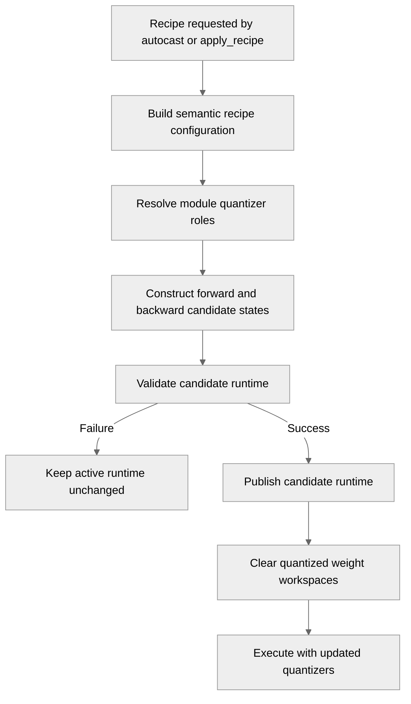

# [PyTorch] Support dynamic recipe updates during training

[Upstream PR](https://github.com/NVIDIA/TransformerEngine/pull/3343) · state: open · merged: False

## Original PR description

# Description

Enables recipe updates during training, either lazily through `te.autocast()` or atomically across a model with `te.apply_recipe()`.

Diff:
- Library: +2,016 / −794 / net +1,222
- Tests: +5,829 / −274 / net +5,555

TODO - callable compatibility: 
Callable factories and algorithms now require explicit semantic metadata, supplied through a decorator or recipe key argument. Consider whether unkeyed callables should remain supported and, if so, what safe fallback identity should be used.

## Type of change

- [ ] Documentation change (change only to the documentation, either a fix or a new content)
- [ ] Bug fix (non-breaking change which fixes an issue)
- [X] New feature (non-breaking change which adds functionality)
- [ ] Breaking change (fix or feature that would cause existing functionality to not work as expected)
- [ ] Infra/Build change
- [ ] Code refactoring

## Changes

- Identifies recipe changes through semantic configuration keys.
- Builds and validates complete forward/backward runtimes before publishing them.
- Invalidates cached quantized weights when their recipe changes.
- Supports role-aware CustomRecipe factories and composed MHA/DPA boundaries.
- Rejects unsupported transitions before modifying active state.
- Preserves existing numerics for unchanged supported configurations.

# Checklist:

- [ ] I have read and followed the [contributing guidelines](https://github.com/NVIDIA/TransformerEngine/blob/main/CONTRIBUTING.rst)
- [ ] The functionality is complete
- [ ] I have commented my code, particularly in hard-to-understand areas
- [ ] I have made corresponding changes to the documentation
- [ ] My changes generate no new warnings
- [ ] I have added tests that prove my fix is effective or that my feature works
- [ ] New and existing unit tests pass locally with my changes

## Review and discussion

### reviews

- greptile-apps[bot] · COMMENTED · 2026-09-15T13:14:06Z · [source](https://github.com/NVIDIA/TransformerEngine/pull/3343#pullrequestreview-5210416172)

(No body; status only.)

- zhongbozhu · COMMENTED · 2026-10-20T06:58:19Z · [source](https://github.com/NVIDIA/TransformerEngine/pull/3343#pullrequestreview-5581715621)

Why do we even need to dynamically change recipe during training? 

- timmoon10 · COMMENTED · 2026-10-20T21:00:18Z · [source](https://github.com/NVIDIA/TransformerEngine/pull/3343#pullrequestreview-5591662271)

(No body; status only.)

- timmoon10 · COMMENTED · 2026-10-20T21:03:56Z · [source](https://github.com/NVIDIA/TransformerEngine/pull/3343#pullrequestreview-5591688030)

(No body; status only.)

- timmoon10 · COMMENTED · 2026-10-27T17:49:33Z · [source](https://github.com/NVIDIA/TransformerEngine/pull/3343#pullrequestreview-5591938367)

(No body; status only.)

### issue_comments

- negvet · comment · 2026-08-19T17:49:43Z · [source](https://github.com/NVIDIA/TransformerEngine/pull/3343#issuecomment-5345924297)

/te-ci pytorch L1

- negvet · comment · 2026-08-20T13:11:07Z · [source](https://github.com/NVIDIA/TransformerEngine/pull/3343#issuecomment-5356346483)

/te-ci pytorch L1

- negvet · comment · 2026-09-14T16:12:51Z · [source](https://github.com/NVIDIA/TransformerEngine/pull/3343#issuecomment-5667030125)

/te-ci pytorch L1

- negvet · comment · 2026-09-15T13:05:42Z · [source](https://github.com/NVIDIA/TransformerEngine/pull/3343#issuecomment-5680654846)

/te-ci pytorch L1

- greptile-apps[bot] · comment · 2026-09-15T13:13:59Z · [source](https://github.com/NVIDIA/TransformerEngine/pull/3343#issuecomment-5680768723)

<!-- greptile_summary -->

<h2><a href="https://app.greptile.com/api/retrigger?id=64443309"><picture><source media="(prefers-color-scheme: dark)" srcset="https://greptile-static-assets.s3.amazonaws.com/badges/RetriggerDark.svg?v=2"><source media="(prefers-color-scheme: light)" srcset="https://greptile-static-assets.s3.amazonaws.com/badges/Retrigger.svg?v=2"></picture></a>Confidence Score: 3/5</h2>

The PR is not safe to merge until legacy unkeyed CustomRecipe factories remain activatable and custom policies are checked against the hardware capabilities their actual quantizers require.

<h2>Findings</h2>

1. &nbsp;**Unkeyed factories no longer activate** <a href="https://github.com/NVIDIA/TransformerEngine/pull/3343#discussion_r4015971573">▶</a>
2. &nbsp;**Identity recipes require FP8** <a href="https://github.com/NVIDIA/TransformerEngine/pull/3343#discussion_r4015971579">▶</a>

<h3>Summary</h3>

This PR introduces semantic recipe configurations and transactional forward/backward runtime construction so PyTorch quantization recipes can be updated lazily or model-wide. It also propagates role-aware recipe state through linear, grouped-linear, attention, CUDA-graph, and fusible-operation paths.

- Adds `te.apply_recipe()` and per-module runtime planning/activation.
- Rebuilds quantizers and invalidates cached quantized weights when semantic recipe configuration changes.
- Adds stable keys for callable algorithms and custom quantizer factories.
- Extends MHA/DPA boundary roles and grouped-quantization validation.
- Adds extensive recipe-update, attention, graph, distributed, and numerics coverage.
- The new callable-key and blanket CustomRecipe hardware checks introduce two compatibility failures.

<h3>Diagram</h3>

Reviews (1) · Last reviewed commit: ["Merge branch &#39;main&#39; into mid\_train\_recip..."](https://github.com/nvidia/transformerengine/commit/b9cc40550f1c706546d454202471f75b14992f60)

### inline_comments

- greptile-apps[bot] · comment · 2026-09-15T13:14:02Z · [source](https://github.com/NVIDIA/TransformerEngine/pull/3343#discussion_r4015971573)

File: `transformer_engine/common/recipe/__init__.py` · line 180

 **Unkeyed factories no longer activate**

Existing callers can construct `CustomRecipe(qfactory=callable)` without a semantic key, but the first enabled `autocast`, calibration, or model initialization now calls `quantizer_config()` and raises here before invoking the factory. This breaks the previously supported callable-factory contract and prevents existing unkeyed recipes from running unless callers add new metadata.

**Knowledge Base Used:** [PyTorch FP8 and low-precision quantization](https://app.greptile.com/nvidia-public-github/-/custom-context/knowledge-base/nvidia/transformerengine/-/docs/pytorch-quantization.md)

- greptile-apps[bot] · comment · 2026-09-15T13:14:02Z · [source](https://github.com/NVIDIA/TransformerEngine/pull/3343#discussion_r4015971579)

File: `transformer_engine/pytorch/quantization.py` · line 290

 **Identity recipes require FP8**

If a CUDA environment can run Transformer Engine but fails the generic FP8 availability check, an identity-only `CustomRecipe` is rejected here before its factory is inspected. The documented `high_precision_factory` returns only `IdentityQuantizer`s and performs no FP8 work, so this blanket gate prevents a supported high-precision policy from running even though it does not need FP8 kernels.

**Knowledge Base Used:** [PyTorch FP8 and low-precision quantization](https://app.greptile.com/nvidia-public-github/-/custom-context/knowledge-base/nvidia/transformerengine/-/docs/pytorch-quantization.md)

- timmoon10 · comment · 2026-10-20T20:59:43Z · [source](https://github.com/NVIDIA/TransformerEngine/pull/3343#discussion_r4330251905)

File: `transformer_engine/common/recipe/__init__.py` · line None

This might conflict with https://github.com/NVIDIA/TransformerEngine/pull/3717.

- timmoon10 · comment · 2026-10-20T21:01:45Z · [source](https://github.com/NVIDIA/TransformerEngine/pull/3343#discussion_r4330276371)

File: `transformer_engine/pytorch/ops/fuser.py` · line 664

Why doesn't this work? Can't we just let the fuser re-fuse the ops if the recipe changes?

- timmoon10 · comment · 2026-10-20T21:25:49Z · [source](https://github.com/NVIDIA/TransformerEngine/pull/3343#discussion_r4330493082)

File: `transformer_engine/pytorch/quantization.py` · line 1028

This attr is set when entering `te.autocast`, so we don't expect this to be read if the function is called outside `te.autocast`. Consider replacing the default recipe instead, or keep the current API where the user has to pass the recipe into `te.autocast`.

- timmoon10 · comment · 2026-10-20T21:30:39Z · [source](https://github.com/NVIDIA/TransformerEngine/pull/3343#discussion_r4330535536)

File: `transformer_engine/pytorch/quantization.py` · line 1004

I see we have this scheme so that we can process all the modules before actually applying the recipe change, which means we only apply the recipe change after all the modules have had some kind of validation. It adds a lot of complexity though, so skeptical if it is worth it.

- timmoon10 · comment · 2026-10-20T21:45:14Z · [source](https://github.com/NVIDIA/TransformerEngine/pull/3343#discussion_r4330674143)

File: `transformer_engine/pytorch/module/base.py` · line 969

I think these are redundant with the existing logic for `_output_quantizer_role` and `_grad_input_quantizer_role`. If I understand, this is intended to allow MHA to change the output/grad input quantizer and detect recipe changes. However, I don't think there's value in having separate paths for users to set output quantizers and MHA to set output quantizers, they should use the same infrastructure.

- timmoon10 · comment · 2026-10-27T17:48:35Z · [source](https://github.com/NVIDIA/TransformerEngine/pull/3343#discussion_r4392201693)

File: `transformer_engine/common/recipe/__init__.py` · line 248

The quantizer config infrastructure seems overengineered and redundant. #3717 uses the string representation to detect recipe changes in the op fuser.

## Changed files and fixed code

- `docs/api/common.rst` · modified · additions 4 / deletions 2
  - [head](https://github.com/negvet/TransformerEngine/blob/b9cc40550f1c706546d454202471f75b14992f60/docs/api/common.rst)
  - [base](https://github.com/NVIDIA/TransformerEngine/blob/51317b440be0378f570ca6cc7dec2962f6e3f8df/docs/api/common.rst)
- `docs/api/pytorch.rst` · modified · additions 2 / deletions 0
  - [head](https://github.com/negvet/TransformerEngine/blob/b9cc40550f1c706546d454202471f75b14992f60/docs/api/pytorch.rst)
  - [base](https://github.com/NVIDIA/TransformerEngine/blob/51317b440be0378f570ca6cc7dec2962f6e3f8df/docs/api/pytorch.rst)
- `docs/examples/fine_grained_quantization/pytorch_fine_grained_quantization_example.py` · modified · additions 7 / deletions 3
  - [head](https://github.com/negvet/TransformerEngine/blob/b9cc40550f1c706546d454202471f75b14992f60/docs/examples/fine_grained_quantization/pytorch_fine_grained_quantization_example.py)
  - [base](https://github.com/NVIDIA/TransformerEngine/blob/51317b440be0378f570ca6cc7dec2962f6e3f8df/docs/examples/fine_grained_quantization/pytorch_fine_grained_quantization_example.py)
- `docs/features/low_precision_training/fine_grained_quantization/fine_grained_quantization.rst` · modified · additions 7 / deletions 5
  - [head](https://github.com/negvet/TransformerEngine/blob/b9cc40550f1c706546d454202471f75b14992f60/docs/features/low_precision_training/fine_grained_quantization/fine_grained_quantization.rst)
  - [base](https://github.com/NVIDIA/TransformerEngine/blob/51317b440be0378f570ca6cc7dec2962f6e3f8df/docs/features/low_precision_training/fine_grained_quantization/fine_grained_quantization.rst)
- `qa/L0_pytorch_unittest/test.sh` · modified · additions 2 / deletions 0
  - [head](https://github.com/negvet/TransformerEngine/blob/b9cc40550f1c706546d454202471f75b14992f60/qa/L0_pytorch_unittest/test.sh)
  - [base](https://github.com/NVIDIA/TransformerEngine/blob/51317b440be0378f570ca6cc7dec2962f6e3f8df/qa/L0_pytorch_unittest/test.sh)
- `tests/pytorch/distributed/run_numerics_exact.py` · modified · additions 2 / deletions 0
  - [head](https://github.com/negvet/TransformerEngine/blob/b9cc40550f1c706546d454202471f75b14992f60/tests/pytorch/distributed/run_numerics_exact.py)
  - [base](https://github.com/NVIDIA/TransformerEngine/blob/51317b440be0378f570ca6cc7dec2962f6e3f8df/tests/pytorch/distributed/run_numerics_exact.py)
- `tests/pytorch/hybrid_quantization_utils.py` · modified · additions 16 / deletions 2
  - [head](https://github.com/negvet/TransformerEngine/blob/b9cc40550f1c706546d454202471f75b14992f60/tests/pytorch/hybrid_quantization_utils.py)
  - [base](https://github.com/NVIDIA/TransformerEngine/blob/51317b440be0378f570ca6cc7dec2962f6e3f8df/tests/pytorch/hybrid_quantization_utils.py)
- `tests/pytorch/nvfp4/test_nvfp4_module_exact.py` · modified · additions 32 / deletions 0
  - [head](https://github.com/negvet/TransformerEngine/blob/b9cc40550f1c706546d454202471f75b14992f60/tests/pytorch/nvfp4/test_nvfp4_module_exact.py)
  - [base](https://github.com/NVIDIA/TransformerEngine/blob/51317b440be0378f570ca6cc7dec2962f6e3f8df/tests/pytorch/nvfp4/test_nvfp4_module_exact.py)
- `tests/pytorch/test_backward_override.py` · modified · additions 9 / deletions 0
  - [head](https://github.com/negvet/TransformerEngine/blob/b9cc40550f1c706546d454202471f75b14992f60/tests/pytorch/test_backward_override.py)
  - [base](https://github.com/NVIDIA/TransformerEngine/blob/51317b440be0378f570ca6cc7dec2962f6e3f8df/tests/pytorch/test_backward_override.py)
- `tests/pytorch/test_cuda_graphs.py` · modified · additions 50 / deletions 0
  - [head](https://github.com/negvet/TransformerEngine/blob/b9cc40550f1c706546d454202471f75b14992f60/tests/pytorch/test_cuda_graphs.py)
  - [base](https://github.com/NVIDIA/TransformerEngine/blob/51317b440be0378f570ca6cc7dec2962f6e3f8df/tests/pytorch/test_cuda_graphs.py)
- `tests/pytorch/test_custom_recipe.py` · modified · additions 230 / deletions 54
  - [head](https://github.com/negvet/TransformerEngine/blob/b9cc40550f1c706546d454202471f75b14992f60/tests/pytorch/test_custom_recipe.py)
  - [base](https://github.com/NVIDIA/TransformerEngine/blob/51317b440be0378f570ca6cc7dec2962f6e3f8df/tests/pytorch/test_custom_recipe.py)
- `tests/pytorch/test_fusible_ops.py` · modified · additions 164 / deletions 0
  - [head](https://github.com/negvet/TransformerEngine/blob/b9cc40550f1c706546d454202471f75b14992f60/tests/pytorch/test_fusible_ops.py)
  - [base](https://github.com/NVIDIA/TransformerEngine/blob/51317b440be0378f570ca6cc7dec2962f6e3f8df/tests/pytorch/test_fusible_ops.py)
- `tests/pytorch/test_hybrid_quantization.py` · modified · additions 1020 / deletions 193
  - [head](https://github.com/negvet/TransformerEngine/blob/b9cc40550f1c706546d454202471f75b14992f60/tests/pytorch/test_hybrid_quantization.py)
  - [base](https://github.com/NVIDIA/TransformerEngine/blob/51317b440be0378f570ca6cc7dec2962f6e3f8df/tests/pytorch/test_hybrid_quantization.py)
- `tests/pytorch/test_hybrid_quantization_fsdp2.py` · modified · additions 31 / deletions 4
  - [head](https://github.com/negvet/TransformerEngine/blob/b9cc40550f1c706546d454202471f75b14992f60/tests/pytorch/test_hybrid_quantization_fsdp2.py)
  - [base](https://github.com/NVIDIA/TransformerEngine/blob/51317b440be0378f570ca6cc7dec2962f6e3f8df/tests/pytorch/test_hybrid_quantization_fsdp2.py)
- `tests/pytorch/test_identity_quantizer.py` · modified · additions 53 / deletions 9
  - [head](https://github.com/negvet/TransformerEngine/blob/b9cc40550f1c706546d454202471f75b14992f60/tests/pytorch/test_identity_quantizer.py)
  - [base](https://github.com/NVIDIA/TransformerEngine/blob/51317b440be0378f570ca6cc7dec2962f6e3f8df/tests/pytorch/test_identity_quantizer.py)
- `tests/pytorch/test_onnx_export.py` · modified · additions 1 / deletions 1
  - [head](https://github.com/negvet/TransformerEngine/blob/b9cc40550f1c706546d454202471f75b14992f60/tests/pytorch/test_onnx_export.py)
  - [base](https://github.com/NVIDIA/TransformerEngine/blob/51317b440be0378f570ca6cc7dec2962f6e3f8df/tests/pytorch/test_onnx_export.py)
- `tests/pytorch/test_recipe.py` · modified · additions 1323 / deletions 10
  - [head](https://github.com/negvet/TransformerEngine/blob/b9cc40550f1c706546d454202471f75b14992f60/tests/pytorch/test_recipe.py)
  - [base](https://github.com/NVIDIA/TransformerEngine/blob/51317b440be0378f570ca6cc7dec2962f6e3f8df/tests/pytorch/test_recipe.py)
- `tests/pytorch/test_recipe_update.py` · added · additions 2926 / deletions 0
  - [head](https://github.com/negvet/TransformerEngine/blob/b9cc40550f1c706546d454202471f75b14992f60/tests/pytorch/test_recipe_update.py)
  - [base](https://github.com/NVIDIA/TransformerEngine/blob/51317b440be0378f570ca6cc7dec2962f6e3f8df/tests/pytorch/test_recipe_update.py)
- `tests/pytorch/test_torch_compile.py` · modified · additions 3 / deletions 2
  - [head](https://github.com/negvet/TransformerEngine/blob/b9cc40550f1c706546d454202471f75b14992f60/tests/pytorch/test_torch_compile.py)
  - [base](https://github.com/NVIDIA/TransformerEngine/blob/51317b440be0378f570ca6cc7dec2962f6e3f8df/tests/pytorch/test_torch_compile.py)
- `transformer_engine/common/recipe/__init__.py` · modified · additions 433 / deletions 17
  - [head](https://github.com/negvet/TransformerEngine/blob/b9cc40550f1c706546d454202471f75b14992f60/transformer_engine/common/recipe/__init__.py)
  - [base](https://github.com/NVIDIA/TransformerEngine/blob/51317b440be0378f570ca6cc7dec2962f6e3f8df/transformer_engine/common/recipe/__init__.py)
- `transformer_engine/pytorch/__init__.py` · modified · additions 2 / deletions 0
  - [head](https://github.com/negvet/TransformerEngine/blob/b9cc40550f1c706546d454202471f75b14992f60/transformer_engine/pytorch/__init__.py)
  - [base](https://github.com/NVIDIA/TransformerEngine/blob/51317b440be0378f570ca6cc7dec2962f6e3f8df/transformer_engine/pytorch/__init__.py)
- `transformer_engine/pytorch/attention/dot_product_attention/dot_product_attention.py` · modified · additions 259 / deletions 98
  - [head](https://github.com/negvet/TransformerEngine/blob/b9cc40550f1c706546d454202471f75b14992f60/transformer_engine/pytorch/attention/dot_product_attention/dot_product_attention.py)
  - [base](https://github.com/NVIDIA/TransformerEngine/blob/51317b440be0378f570ca6cc7dec2962f6e3f8df/transformer_engine/pytorch/attention/dot_product_attention/dot_product_attention.py)
- `transformer_engine/pytorch/attention/dot_product_attention/utils.py` · modified · additions 51 / deletions 33
  - [head](https://github.com/negvet/TransformerEngine/blob/b9cc40550f1c706546d454202471f75b14992f60/transformer_engine/pytorch/attention/dot_product_attention/utils.py)
  - [base](https://github.com/NVIDIA/TransformerEngine/blob/51317b440be0378f570ca6cc7dec2962f6e3f8df/transformer_engine/pytorch/attention/dot_product_attention/utils.py)
- `transformer_engine/pytorch/attention/multi_head_attention.py` · modified · additions 49 / deletions 102
  - [head](https://github.com/negvet/TransformerEngine/blob/b9cc40550f1c706546d454202471f75b14992f60/transformer_engine/pytorch/attention/multi_head_attention.py)
  - [base](https://github.com/NVIDIA/TransformerEngine/blob/51317b440be0378f570ca6cc7dec2962f6e3f8df/transformer_engine/pytorch/attention/multi_head_attention.py)
- `transformer_engine/pytorch/custom_recipes/quantizer_factories.py` · modified · additions 7 / deletions 0
  - [head](https://github.com/negvet/TransformerEngine/blob/b9cc40550f1c706546d454202471f75b14992f60/transformer_engine/pytorch/custom_recipes/quantizer_factories.py)
  - [base](https://github.com/NVIDIA/TransformerEngine/blob/51317b440be0378f570ca6cc7dec2962f6e3f8df/transformer_engine/pytorch/custom_recipes/quantizer_factories.py)
- `transformer_engine/pytorch/custom_recipes/quantizer_factory_zoo.py` · modified · additions 8 / deletions 0
  - [head](https://github.com/negvet/TransformerEngine/blob/b9cc40550f1c706546d454202471f75b14992f60/transformer_engine/pytorch/custom_recipes/quantizer_factory_zoo.py)
  - [base](https://github.com/NVIDIA/TransformerEngine/blob/51317b440be0378f570ca6cc7dec2962f6e3f8df/transformer_engine/pytorch/custom_recipes/quantizer_factory_zoo.py)
- `transformer_engine/pytorch/custom_recipes/reference_current_scaling.py` · modified · additions 2 / deletions 0
  - [head](https://github.com/negvet/TransformerEngine/blob/b9cc40550f1c706546d454202471f75b14992f60/transformer_engine/pytorch/custom_recipes/reference_current_scaling.py)
  - [base](https://github.com/NVIDIA/TransformerEngine/blob/51317b440be0378f570ca6cc7dec2962f6e3f8df/transformer_engine/pytorch/custom_recipes/reference_current_scaling.py)
- `transformer_engine/pytorch/custom_recipes/reference_nvfp4.py` · modified · additions 2 / deletions 0
  - [head](https://github.com/negvet/TransformerEngine/blob/b9cc40550f1c706546d454202471f75b14992f60/transformer_engine/pytorch/custom_recipes/reference_nvfp4.py)
  - [base](https://github.com/NVIDIA/TransformerEngine/blob/51317b440be0378f570ca6cc7dec2962f6e3f8df/transformer_engine/pytorch/custom_recipes/reference_nvfp4.py)
- `transformer_engine/pytorch/graph.py` · modified · additions 29 / deletions 0
  - [head](https://github.com/negvet/TransformerEngine/blob/b9cc40550f1c706546d454202471f75b14992f60/transformer_engine/pytorch/graph.py)
  - [base](https://github.com/NVIDIA/TransformerEngine/blob/51317b440be0378f570ca6cc7dec2962f6e3f8df/transformer_engine/pytorch/graph.py)
- `transformer_engine/pytorch/module/base.py` · modified · additions 505 / deletions 128
  - [head](https://github.com/negvet/TransformerEngine/blob/b9cc40550f1c706546d454202471f75b14992f60/transformer_engine/pytorch/module/base.py)
  - [base](https://github.com/NVIDIA/TransformerEngine/blob/51317b440be0378f570ca6cc7dec2962f6e3f8df/transformer_engine/pytorch/module/base.py)
- `transformer_engine/pytorch/module/grouped_linear.py` · modified · additions 134 / deletions 136
  - [head](https://github.com/negvet/TransformerEngine/blob/b9cc40550f1c706546d454202471f75b14992f60/transformer_engine/pytorch/module/grouped_linear.py)
  - [base](https://github.com/NVIDIA/TransformerEngine/blob/51317b440be0378f570ca6cc7dec2962f6e3f8df/transformer_engine/pytorch/module/grouped_linear.py)
- `transformer_engine/pytorch/module/layernorm_linear.py` · modified · additions 13 / deletions 45
  - [head](https://github.com/negvet/TransformerEngine/blob/b9cc40550f1c706546d454202471f75b14992f60/transformer_engine/pytorch/module/layernorm_linear.py)
  - [base](https://github.com/NVIDIA/TransformerEngine/blob/51317b440be0378f570ca6cc7dec2962f6e3f8df/transformer_engine/pytorch/module/layernorm_linear.py)
- `transformer_engine/pytorch/module/layernorm_mlp.py` · modified · additions 11 / deletions 67
  - [head](https://github.com/negvet/TransformerEngine/blob/b9cc40550f1c706546d454202471f75b14992f60/transformer_engine/pytorch/module/layernorm_mlp.py)
  - [base](https://github.com/NVIDIA/TransformerEngine/blob/51317b440be0378f570ca6cc7dec2962f6e3f8df/transformer_engine/pytorch/module/layernorm_mlp.py)
- `transformer_engine/pytorch/module/linear.py` · modified · additions 13 / deletions 45
  - [head](https://github.com/negvet/TransformerEngine/blob/b9cc40550f1c706546d454202471f75b14992f60/transformer_engine/pytorch/module/linear.py)
  - [base](https://github.com/NVIDIA/TransformerEngine/blob/51317b440be0378f570ca6cc7dec2962f6e3f8df/transformer_engine/pytorch/module/linear.py)
- `transformer_engine/pytorch/ops/basic/basic_linear.py` · modified · additions 0 / deletions 12
  - [head](https://github.com/negvet/TransformerEngine/blob/b9cc40550f1c706546d454202471f75b14992f60/transformer_engine/pytorch/ops/basic/basic_linear.py)
  - [base](https://github.com/NVIDIA/TransformerEngine/blob/51317b440be0378f570ca6cc7dec2962f6e3f8df/transformer_engine/pytorch/ops/basic/basic_linear.py)
- `transformer_engine/pytorch/ops/basic/grouped_linear.py` · modified · additions 0 / deletions 14
  - [head](https://github.com/negvet/TransformerEngine/blob/b9cc40550f1c706546d454202471f75b14992f60/transformer_engine/pytorch/ops/basic/grouped_linear.py)
  - [base](https://github.com/NVIDIA/TransformerEngine/blob/51317b440be0378f570ca6cc7dec2962f6e3f8df/transformer_engine/pytorch/ops/basic/grouped_linear.py)
- `transformer_engine/pytorch/ops/fuser.py` · modified · additions 21 / deletions 0
  - [head](https://github.com/negvet/TransformerEngine/blob/b9cc40550f1c706546d454202471f75b14992f60/transformer_engine/pytorch/ops/fuser.py)
  - [base](https://github.com/NVIDIA/TransformerEngine/blob/51317b440be0378f570ca6cc7dec2962f6e3f8df/transformer_engine/pytorch/ops/fuser.py)
- `transformer_engine/pytorch/ops/op.py` · modified · additions 114 / deletions 1
  - [head](https://github.com/negvet/TransformerEngine/blob/b9cc40550f1c706546d454202471f75b14992f60/transformer_engine/pytorch/ops/op.py)
  - [base](https://github.com/NVIDIA/TransformerEngine/blob/51317b440be0378f570ca6cc7dec2962f6e3f8df/transformer_engine/pytorch/ops/op.py)
- `transformer_engine/pytorch/quantization.py` · modified · additions 329 / deletions 78
  - [head](https://github.com/negvet/TransformerEngine/blob/b9cc40550f1c706546d454202471f75b14992f60/transformer_engine/pytorch/quantization.py)
  - [base](https://github.com/NVIDIA/TransformerEngine/blob/51317b440be0378f570ca6cc7dec2962f6e3f8df/transformer_engine/pytorch/quantization.py)
- `transformer_engine/pytorch/tensor/storage/grouped_tensor_storage.py` · modified · additions 21 / deletions 8
  - [head](https://github.com/negvet/TransformerEngine/blob/b9cc40550f1c706546d454202471f75b14992f60/transformer_engine/pytorch/tensor/storage/grouped_tensor_storage.py)
  - [base](https://github.com/NVIDIA/TransformerEngine/blob/51317b440be0378f570ca6cc7dec2962f6e3f8df/transformer_engine/pytorch/tensor/storage/grouped_tensor_storage.py)

## Evidence and interpretation boundary

[Original JSON, discussions and patches](../../../../../../evidence/prs/NVIDIA--TransformerEngine/3343-79fbb2843585c45863f69dd7ac14f58a54c952f6dda32c178b42e5a93bea156b.json) · SHA-256 `79fbb2843585c45863f69dd7ac14f58a54c952f6dda32c178b42e5a93bea156b`.

Diff complete: False. Missing/binary/truncated patches require pinned source inspection. This is a source page, not an independently verified optimization case. Open, merged and released are different states; recheck the deployed dependency.
