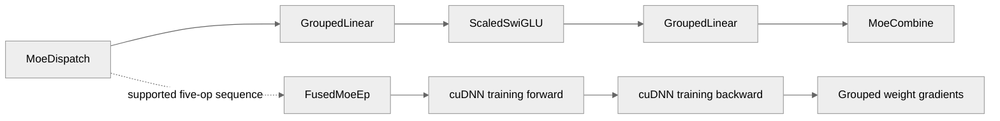

# [Pytorch] MegaMOE Fused Op Integration

[Upstream PR](https://github.com/NVIDIA/TransformerEngine/pull/3350) · state: open · merged: False

## Original PR description

# Description

Please include a brief summary of the changes, relevant motivation and context.

Fixes # (issue)

## Type of change

- [ ] Documentation change (change only to the documentation, either a fix or a new content)
- [ ] Bug fix (non-breaking change which fixes an issue)
- [ ] New feature (non-breaking change which adds functionality)
- [ ] Breaking change (fix or feature that would cause existing functionality to not work as expected)
- [ ] Infra/Build change
- [ ] Code refactoring

## Changes

Please list the changes introduced in this PR:

- Change A
- Change B

# Checklist:

- [ ] I have read and followed the [contributing guidelines](https://github.com/NVIDIA/TransformerEngine/blob/main/CONTRIBUTING.rst)
- [ ] The functionality is complete
- [ ] I have commented my code, particularly in hard-to-understand areas
- [ ] I have made corresponding changes to the documentation
- [ ] My changes generate no new warnings
- [ ] I have added tests that prove my fix is effective or that my feature works
- [ ] New and existing unit tests pass locally with my changes


## Review and discussion

### reviews

- phu0ngng · COMMENTED · 2026-08-20T17:28:01Z · [source](https://github.com/NVIDIA/TransformerEngine/pull/3350#pullrequestreview-4985408892)

(No body; status only.)

- vthumbe1503 · COMMENTED · 2026-08-24T18:44:17Z · [source](https://github.com/NVIDIA/TransformerEngine/pull/3350#pullrequestreview-5011378188)

(No body; status only.)

- vthumbe1503 · COMMENTED · 2026-08-24T18:48:18Z · [source](https://github.com/NVIDIA/TransformerEngine/pull/3350#pullrequestreview-5011409378)

(No body; status only.)

- vthumbe1503 · COMMENTED · 2026-08-24T19:22:55Z · [source](https://github.com/NVIDIA/TransformerEngine/pull/3350#pullrequestreview-5011705358)

(No body; status only.)

- vthumbe1503 · COMMENTED · 2026-08-24T19:27:25Z · [source](https://github.com/NVIDIA/TransformerEngine/pull/3350#pullrequestreview-5011740318)

(No body; status only.)

- timmoon10 · COMMENTED · 2026-08-26T18:48:32Z · [source](https://github.com/NVIDIA/TransformerEngine/pull/3350#pullrequestreview-5033654932)

(No body; status only.)

- vthumbe1503 · COMMENTED · 2026-08-28T18:41:39Z · [source](https://github.com/NVIDIA/TransformerEngine/pull/3350#pullrequestreview-5054043280)

(No body; status only.)

- vthumbe1503 · COMMENTED · 2026-08-28T18:41:52Z · [source](https://github.com/NVIDIA/TransformerEngine/pull/3350#pullrequestreview-5054044773)

(No body; status only.)

- vthumbe1503 · COMMENTED · 2026-08-28T19:31:48Z · [source](https://github.com/NVIDIA/TransformerEngine/pull/3350#pullrequestreview-5054442062)

(No body; status only.)

- vthumbe1503 · COMMENTED · 2026-08-28T19:33:03Z · [source](https://github.com/NVIDIA/TransformerEngine/pull/3350#pullrequestreview-5054450663)

(No body; status only.)

- vthumbe1503 · COMMENTED · 2026-08-28T19:33:26Z · [source](https://github.com/NVIDIA/TransformerEngine/pull/3350#pullrequestreview-5054453244)

(No body; status only.)

- vthumbe1503 · COMMENTED · 2026-08-28T19:35:15Z · [source](https://github.com/NVIDIA/TransformerEngine/pull/3350#pullrequestreview-5054467090)

(No body; status only.)

- vthumbe1503 · COMMENTED · 2026-08-28T19:36:27Z · [source](https://github.com/NVIDIA/TransformerEngine/pull/3350#pullrequestreview-5054476269)

(No body; status only.)

- vthumbe1503 · COMMENTED · 2026-08-28T19:36:35Z · [source](https://github.com/NVIDIA/TransformerEngine/pull/3350#pullrequestreview-5054477217)

(No body; status only.)

- vthumbe1503 · COMMENTED · 2026-08-28T19:37:11Z · [source](https://github.com/NVIDIA/TransformerEngine/pull/3350#pullrequestreview-5054481559)

(No body; status only.)

- phu0ngng · COMMENTED · 2026-08-28T21:23:17Z · [source](https://github.com/NVIDIA/TransformerEngine/pull/3350#pullrequestreview-5054824869)

(No body; status only.)

- vthumbe1503 · COMMENTED · 2026-08-31T06:46:23Z · [source](https://github.com/NVIDIA/TransformerEngine/pull/3350#pullrequestreview-5063779371)

(No body; status only.)

- vthumbe1503 · COMMENTED · 2026-08-31T06:47:25Z · [source](https://github.com/NVIDIA/TransformerEngine/pull/3350#pullrequestreview-5063785208)

(No body; status only.)

- vthumbe1503 · COMMENTED · 2026-08-31T06:47:45Z · [source](https://github.com/NVIDIA/TransformerEngine/pull/3350#pullrequestreview-5063787082)

(No body; status only.)

- vthumbe1503 · COMMENTED · 2026-08-31T06:48:03Z · [source](https://github.com/NVIDIA/TransformerEngine/pull/3350#pullrequestreview-5063788678)

(No body; status only.)

- vthumbe1503 · COMMENTED · 2026-08-31T07:03:46Z · [source](https://github.com/NVIDIA/TransformerEngine/pull/3350#pullrequestreview-5063884232)

(No body; status only.)

- greptile-apps[bot] · COMMENTED · 2026-09-07T09:01:27Z · [source](https://github.com/NVIDIA/TransformerEngine/pull/3350#pullrequestreview-5130034336)

(No body; status only.)

- greptile-apps[bot] · COMMENTED · 2026-09-10T19:43:02Z · [source](https://github.com/NVIDIA/TransformerEngine/pull/3350#pullrequestreview-5171534143)

(No body; status only.)

- greptile-apps[bot] · COMMENTED · 2026-09-11T03:56:26Z · [source](https://github.com/NVIDIA/TransformerEngine/pull/3350#pullrequestreview-5174818635)

(No body; status only.)

### issue_comments

- greptile-apps[bot] · comment · 2026-08-24T19:23:10Z · [source](https://github.com/NVIDIA/TransformerEngine/pull/3350#issuecomment-5400186913)

<!-- greptile_summary -->

<h2><a href="https://app.greptile.com/api/retrigger?id=56371531"><picture><source media="(prefers-color-scheme: dark)" srcset="https://greptile-static-assets.s3.amazonaws.com/badges/RetriggerDark.svg?v=2"><source media="(prefers-color-scheme: light)" srcset="https://greptile-static-assets.s3.amazonaws.com/badges/Retrigger.svg?v=2"></picture></a>Confidence Score: 5/5</h2>

**[High impact]** The PR appears safe to merge; no new actionable issues or outstanding numbered findings remain.

<h3>Summary</h3>

Adds cuDNN-backed fusion for the five-op expert-parallel MoE sequence.
- Supported MoE sequences run as one cuDNN-backed training operation.
- Grouped parameters keep their type when modules move them.
- MXFP8 grouped tensors convert to floating-point grouped values.

<h3>Diagram</h3>



<!-- greptile_confidence_score:5 -->

<sub>Reviews (48) · Last reviewed commit: ["dgrad flag for backward"](https://github.com/nvidia/transformerengine/commit/517b36f859a7c440aa93c380b8f95d47a234c7c4) · [Reviewed by Greptile](https://www.greptile.com/?utm_source=greptile_expert&utm_medium=github&utm_campaign=code_reviews&utm_content=nvidia/transformerengine)</sub>

- vthumbe1503 · comment · 2026-08-28T19:18:52Z · [source](https://github.com/NVIDIA/TransformerEngine/pull/3350#issuecomment-5456786715)

/te-ci L1 pytorch

- vthumbe1503 · comment · 2026-08-29T08:03:26Z · [source](https://github.com/NVIDIA/TransformerEngine/pull/3350#issuecomment-5461199334)

/te-ci L1 pytorch

- vthumbe1503 · comment · 2026-08-31T07:16:15Z · [source](https://github.com/NVIDIA/TransformerEngine/pull/3350#issuecomment-5475052702)

/te-ci L1 pytorch

- greptile-apps[bot] · comment · 2026-10-01T03:17:17Z · [source](https://github.com/NVIDIA/TransformerEngine/pull/3350#issuecomment-5924022507)

<!-- greptile_outside_diff -->

<h3>Comments Outside Diff</h3>

These findings could not be posted inline.

- &nbsp;**Payload Errors Can Pass** `tests/pytorch/distributed/run_ep.py:548` <a href="https://github.com/nvidia/transformerengine/blob/fda9285909c66827ad05e87aa438e399925de2f6/tests/pytorch/distributed/run_ep.py#L548">▶</a>

  This comparison sums each received token’s features before sorting the rows. Swapped or compensating feature errors can leave those sums unchanged, so the MXFP8 dispatch test can pass with an incorrect token payload. Comparing complete rows in an order-independent way would preserve the test’s ability to detect those errors.

  Note: If this suggestion doesn't match your team's coding style, reply to this and let me know. I'll remember it for next time!

### inline_comments

- phu0ngng · comment · 2026-08-20T17:06:50Z · [source](https://github.com/NVIDIA/TransformerEngine/pull/3350#discussion_r3823700826)

File: `transformer_engine/pytorch/ops/basic/dispatch.py` · line None

Tokens can be in FP8 or other precision as well, right?

- phu0ngng · comment · 2026-08-20T17:08:36Z · [source](https://github.com/NVIDIA/TransformerEngine/pull/3350#discussion_r3823712872)

File: `transformer_engine/pytorch/ops/basic/dispatch.py` · line 102

What do we plan to do with `prev_op_grad_output_quantizer`?

- phu0ngng · comment · 2026-08-20T17:10:35Z · [source](https://github.com/NVIDIA/TransformerEngine/pull/3350#discussion_r3823728514)

File: `transformer_engine/pytorch/ops/basic/dispatch.py` · line None

I think the input of TE Dispatch op should be BF16, and we do internal quantization if requested, but NCCL EP Dispatch does not require BF16 input.

- phu0ngng · comment · 2026-08-20T17:21:29Z · [source](https://github.com/NVIDIA/TransformerEngine/pull/3350#discussion_r3823805801)

File: `transformer_engine/pytorch/ops/basic/dispatch.py` · line None

I think this validation may not work when callers provide the `recv_tokens` which packs quantized data and scale for MXFP8.

- phu0ngng · comment · 2026-08-20T17:24:43Z · [source](https://github.com/NVIDIA/TransformerEngine/pull/3350#discussion_r3823827752)

File: `transformer_engine/pytorch/ops/basic/dispatch.py` · line None

why do we need `to(dtype=torch.float32).contiguous()` here?

- vthumbe1503 · comment · 2026-08-24T18:44:17Z · [source](https://github.com/NVIDIA/TransformerEngine/pull/3350#discussion_r3846436236)

File: `transformer_engine/pytorch/ops/basic/dispatch.py` · line None

If you mean .to(float32), unfortunately yes. It might not always be fp32, this is because in the grouped_mlp.py we actually compute the grad_scales in bf16.

If each individual op was an autograd function, then autograd would automatically have done the cast for us(It makes sure that the output dtype is same as grad_output dtype)

- vthumbe1503 · comment · 2026-08-24T18:48:18Z · [source](https://github.com/NVIDIA/TransformerEngine/pull/3350#discussion_r3846464520)

File: `transformer_engine/pytorch/ops/basic/dispatch.py` · line None

But operation fuser in sequential groups together ops into a single autograd (for the right reason --> to reduce CPU overheads)

- vthumbe1503 · comment · 2026-08-24T19:22:55Z · [source](https://github.com/NVIDIA/TransformerEngine/pull/3350#discussion_r3846730512)

File: `transformer_engine/pytorch/ops/basic/dispatch.py` · line None

I started this when mxfp8 integration support was missing. Now since it is merged by you in main. I have added the quantization support in the ops. Could you please re-review?

- vthumbe1503 · comment · 2026-08-24T19:27:25Z · [source](https://github.com/NVIDIA/TransformerEngine/pull/3350#discussion_r3846762097)

File: `tests/pytorch/distributed/ep_reference.py` · line 5

This file is a copy of MOE reference code from cudnn

- timmoon10 · comment · 2026-08-26T18:08:45Z · [source](https://github.com/NVIDIA/TransformerEngine/pull/3350#discussion_r3865469316)

File: `transformer_engine/pytorch/ops/basic/swiglu.py` · line None

This looks suspicious to me, but I think it's fine.

I see that the TE scaled activation kernel can handle different dtypes for input, scales, and output: https://github.com/NVIDIA/TransformerEngine/blob/d7340a43c9f928f96884c3d842d2738406d6703f/transformer_engine/common/activation/scaled_activation.cu#L403-L405

I suppose there is some weirdness since we could be ignoring the dtype from `torch.autocast`. However, this is treated as an auxilliary tensor that behaves more like the MoE splits than like a real data tensor.

- timmoon10 · comment · 2026-08-26T18:13:17Z · [source](https://github.com/NVIDIA/TransformerEngine/pull/3350#discussion_r3865507414)

File: `transformer_engine/pytorch/ops/basic/dispatch.py` · line 102

It's part of the function signature in the base class.

- timmoon10 · comment · 2026-08-26T18:17:30Z · [source](https://github.com/NVIDIA/TransformerEngine/pull/3350#discussion_r3865538896)

File: `transformer_engine/pytorch/ops/basic/dispatch.py` · line None

We want basic ops to be a safe fallback, so they should handle any quantizer. If we get a non-MXFP8 quantizer, then the correct behavior is to dequantize and perform the communication in high precision.

- timmoon10 · comment · 2026-08-26T18:23:22Z · [source](https://github.com/NVIDIA/TransformerEngine/pull/3350#discussion_r3865580311)

File: `transformer_engine/pytorch/ops/basic/dispatch.py` · line None

This is fine for now, but the design is not quite coherent:
- If we expect the quantized tensor to be consumed by a `GroupedLinear`, then we should be using the quantizer from `GroupedLinear`. It doesn't belong in `Dispatch`.
- If we treat the quantized tensor as a communication optimization, there's no reason it needs to be GEMM-compatible. We should specify a tensor type like "ep_comm" rather than something GEMM-specific like "input".

- timmoon10 · comment · 2026-08-26T18:26:07Z · [source](https://github.com/NVIDIA/TransformerEngine/pull/3350#discussion_r3865599941)

File: `transformer_engine/pytorch/ops/basic/dispatch.py` · line None

For safety:
```suggestion
        # Only BF16 Dispatch_bwd is supported for now.
        grad_output = maybe_dequantize(grad_output, torch.bfloat16)
```

- timmoon10 · comment · 2026-08-26T18:27:57Z · [source](https://github.com/NVIDIA/TransformerEngine/pull/3350#discussion_r3865613590)

File: `transformer_engine/pytorch/ops/basic/combine.py` · line None

Fine for now, but consider whether Combine should own the quantizer (https://github.com/NVIDIA/TransformerEngine/pull/3350/changes#r3865580311).

- timmoon10 · comment · 2026-08-26T18:31:52Z · [source](https://github.com/NVIDIA/TransformerEngine/pull/3350#discussion_r3865642232)

File: `transformer_engine/pytorch/ops/basic/combine.py` · line None

Does combine forward require BF16 like dispatch backward? If so:
```suggestion
        expert_out = input_
        if zero_copy:
            expert_out = _alloc_io(tuple(input_.shape), input_.dtype, input_.device, True)
            expert_out.copy_(input_)
        else:
            expert_out = maybe_dequantize(expert_out, torch.bfloat16)
```

- timmoon10 · comment · 2026-08-26T18:33:28Z · [source](https://github.com/NVIDIA/TransformerEngine/pull/3350#discussion_r3865653662)

File: `transformer_engine/pytorch/ops/basic/combine.py` · line None

Combine should be able to handle any quantization recipe. It should fallback to an unquantized implementation.

- timmoon10 · comment · 2026-08-26T18:39:00Z · [source](https://github.com/NVIDIA/TransformerEngine/pull/3350#discussion_r3865693255)

File: `transformer_engine/pytorch/ops/basic/dispatch.py` · line None

Do Dispatch and Combine handle the case where EP=1? Also, NCCL EP requires special initialization, so ideally the basic ops would have a fallback implementation that doesn't require NCCL EP.

- timmoon10 · comment · 2026-08-26T18:40:10Z · [source](https://github.com/NVIDIA/TransformerEngine/pull/3350#discussion_r3865701981)

File: `transformer_engine/pytorch/ops/basic/combine.py` · line None

I think it would be worth reflecting that these aren't fully general operations, but are specific to MoE (especially with EP):
```suggestion
class MoeCombine(BasicOperation):
```

- timmoon10 · comment · 2026-08-26T18:40:40Z · [source](https://github.com/NVIDIA/TransformerEngine/pull/3350#discussion_r3865705634)

File: `transformer_engine/pytorch/ops/basic/dispatch.py` · line None

It would be worth reflecting that this is MoE-specific:
```suggestion
class MoeDispatch(BasicOperation):
```

- timmoon10 · comment · 2026-08-26T18:45:15Z · [source](https://github.com/NVIDIA/TransformerEngine/pull/3350#discussion_r3865739224)

File: `transformer_engine/pytorch/ops/basic/combine.py` · line None

`next_op_input_quantizer` is a hint, not a contract. If this op can't do anything special, better to just return an unquantized tensor and let the next op handle it.
```suggestion
```

- timmoon10 · comment · 2026-08-26T18:46:36Z · [source](https://github.com/NVIDIA/TransformerEngine/pull/3350#discussion_r3865749251)

File: `transformer_engine/pytorch/ops/basic/dispatch.py` · line None

No benefit for quantizing early:
```suggestion
```

- timmoon10 · comment · 2026-08-26T18:47:33Z · [source](https://github.com/NVIDIA/TransformerEngine/pull/3350#discussion_r3865756041)

File: `transformer_engine/pytorch/ops/fused/moe_ep.py` · line None

No benefit for quantizing early:
```suggestion
```

- timmoon10 · comment · 2026-08-26T18:47:55Z · [source](https://github.com/NVIDIA/TransformerEngine/pull/3350#discussion_r3865758713)

File: `transformer_engine/pytorch/ops/fused/moe_ep.py` · line None

No benefit for quantizing early:
```suggestion
```

- vthumbe1503 · comment · 2026-08-28T18:41:39Z · [source](https://github.com/NVIDIA/TransformerEngine/pull/3350#discussion_r3883141318)

File: `transformer_engine/pytorch/ops/basic/dispatch.py` · line None

We are treating it as a communication optimization and so changing the tensor_type makes sense. Done it in the pr now.

- vthumbe1503 · comment · 2026-08-28T18:41:52Z · [source](https://github.com/NVIDIA/TransformerEngine/pull/3350#discussion_r3883142689)

File: `transformer_engine/pytorch/ops/basic/dispatch.py` · line None

Done

- vthumbe1503 · comment · 2026-08-28T19:31:47Z · [source](https://github.com/NVIDIA/TransformerEngine/pull/3350#discussion_r3883471927)

File: `transformer_engine/pytorch/ops/basic/dispatch.py` · line 102

If prev op is a TE Sequential basic op, TE sequential infra can provide that op's grad output quantizer. And we can potentially fuse the quantization.

But now we dont know what the previous op wants and also backward dispatch .. since it only supports bf16, we cant fuse this quantization and so it is unused.

- vthumbe1503 · comment · 2026-08-28T19:33:03Z · [source](https://github.com/NVIDIA/TransformerEngine/pull/3350#discussion_r3883479681)

File: `transformer_engine/pytorch/ops/basic/dispatch.py` · line None

In future if quantization is fused in the previous op. We would be wanting to support MXFP8 input as well

- vthumbe1503 · comment · 2026-08-28T19:33:25Z · [source](https://github.com/NVIDIA/TransformerEngine/pull/3350#discussion_r3883481803)

File: `transformer_engine/pytorch/ops/basic/dispatch.py` · line None

Handling fallback via BF16 comms

- vthumbe1503 · comment · 2026-08-28T19:35:15Z · [source](https://github.com/NVIDIA/TransformerEngine/pull/3350#discussion_r3883493134)

File: `transformer_engine/pytorch/ops/basic/dispatch.py` · line None

You are right. Removed the validation and using the helpers you defined in ep.py

- vthumbe1503 · comment · 2026-08-28T19:36:26Z · [source](https://github.com/NVIDIA/TransformerEngine/pull/3350#discussion_r3883500866)

File: `transformer_engine/pytorch/ops/fused/moe_ep.py` · line None

removed

- vthumbe1503 · comment · 2026-08-28T19:36:34Z · [source](https://github.com/NVIDIA/TransformerEngine/pull/3350#discussion_r3883501624)

File: `transformer_engine/pytorch/ops/fused/moe_ep.py` · line None

removed

- vthumbe1503 · comment · 2026-08-28T19:37:11Z · [source](https://github.com/NVIDIA/TransformerEngine/pull/3350#discussion_r3883505298)

File: `transformer_engine/pytorch/ops/basic/dispatch.py` · line None

Agreed. renamed

- phu0ngng · comment · 2026-08-28T20:25:44Z · [source](https://github.com/NVIDIA/TransformerEngine/pull/3350#discussion_r3883813087)

File: `tests/pytorch/distributed/ep_reference.py` · line 8

Why do we need this ref impl btw?

- phu0ngng · comment · 2026-08-28T20:29:13Z · [source](https://github.com/NVIDIA/TransformerEngine/pull/3350#discussion_r3883833545)

File: `transformer_engine/pytorch/ops/basic/dispatch.py` · line None

Can we error out instead of falling back to dequantize?

- phu0ngng · comment · 2026-08-28T20:44:39Z · [source](https://github.com/NVIDIA/TransformerEngine/pull/3350#discussion_r3883921796)

File: `transformer_engine/pytorch/ops/basic/combine.py` · line None

Why don't we need the grad_out to be contiguous when not MXFP8?

- phu0ngng · comment · 2026-08-28T21:14:04Z · [source](https://github.com/NVIDIA/TransformerEngine/pull/3350#discussion_r3884080570)

File: `transformer_engine/pytorch/ops/basic/combine.py` · line None

Why do we need this `.copy_(input_)`? Is it a deep or shallow copy?

- phu0ngng · comment · 2026-08-28T21:23:10Z · [source](https://github.com/NVIDIA/TransformerEngine/pull/3350#discussion_r3884138567)

File: `transformer_engine/pytorch/ops/basic/combine.py` · line None

We should only allocate this when callers do not provide `grad_expert_out`.
Besides, it seems not to handle allocation for `grad_expert_out_scales` when using MXFP8 right now.

- vthumbe1503 · comment · 2026-08-31T06:46:22Z · [source](https://github.com/NVIDIA/TransformerEngine/pull/3350#discussion_r3892274568)

File: `transformer_engine/pytorch/ops/basic/combine.py` · line None

Had discussion with Phuong offline. We are not supporting zero copy for Dispatch/Combine ops since we want to reduce the scope and restrict PR more towards fused op. So the validation is removed now

- vthumbe1503 · comment · 2026-08-31T06:47:24Z · [source](https://github.com/NVIDIA/TransformerEngine/pull/3350#discussion_r3892279656)

File: `transformer_engine/pytorch/ops/basic/dispatch.py` · line None

I had that as the behavior originally. @timmoon10 made the point that we want to preserve functionality, since quantization is merely a communication optimization

- vthumbe1503 · comment · 2026-08-31T06:47:44Z · [source](https://github.com/NVIDIA/TransformerEngine/pull/3350#discussion_r3892281163)

File: `transformer_engine/pytorch/ops/basic/combine.py` · line None

zero copy is not supported. So remove this now.

- vthumbe1503 · comment · 2026-08-31T06:48:03Z · [source](https://github.com/NVIDIA/TransformerEngine/pull/3350#discussion_r3892282622)

File: `transformer_engine/pytorch/ops/basic/combine.py` · line None

removed the zero copy allocation now.

- vthumbe1503 · comment · 2026-08-31T07:03:46Z · [source](https://github.com/NVIDIA/TransformerEngine/pull/3350#discussion_r3892362202)

File: `tests/pytorch/distributed/ep_reference.py` · line 8

It didnt belong in transformer engine pytorch module. Have moved it to tests now.
CUDNN has the exact same reference. This was a way for us to coordinate for the integration effort


- greptile-apps[bot] · comment · 2026-09-07T09:01:27Z · [source](https://github.com/NVIDIA/TransformerEngine/pull/3350#discussion_r3948140055)

File: `transformer_engine/common/cast/mxfp8/group_dequantize_mxfp8.cuh` · line 443

<a href="#"></a> **Dual-Orientation Path Untested**

This newly supported path selects the rowwise data and scales when both grouped MXFP8 orientations are present, but the dequantization tests cover only each orientation separately and still state that `both` is invalid. Without a `both` case that verifies the intended rowwise selection, this behavior can regress without detection.

Note: If this suggestion doesn't match your team's coding style, reply to this and let me know. I'll remember it for next time!

- greptile-apps[bot] · comment · 2026-09-10T19:43:01Z · [source](https://github.com/NVIDIA/TransformerEngine/pull/3350#discussion_r3982848299)

File: `transformer_engine/pytorch/ops/fused/moe_ep.py` · line None

<a href="#"></a> **Scratch Notes Break Parsing**

The tensor-shape notes in `_compute_grouped_weight_grad` were inserted as plain text rather than comments. Python attempts to parse statements such as `in --> (B, in)`, which raises a `SyntaxError` and prevents the fused MoE module from being imported.

```suggestion

```

- greptile-apps[bot] · comment · 2026-09-11T03:56:25Z · [source](https://github.com/NVIDIA/TransformerEngine/pull/3350#discussion_r3985786576)

File: `transformer_engine/pytorch/ops/fused/moe_ep.py` · line None

<a href="#"></a> **Benchmark Import Breaks Initialization**

If the optional cuDNN frontend benchmark hierarchy is unavailable, eagerly importing the fused package executes this unused benchmark-specific import before the MegaMoE capability checks, causing Transformer Engine initialization to fail with an import error.

```suggestion

```

## Changed files and fixed code

- `tests/pytorch/distributed/run_ep.py` · modified · additions 98 / deletions 8
  - [head](https://github.com/vthumbe1503/TransformerEngine/blob/517b36f859a7c440aa93c380b8f95d47a234c7c4/tests/pytorch/distributed/run_ep.py)
  - [base](https://github.com/NVIDIA/TransformerEngine/blob/a16bce3a647e4277b78c6426e70b9c6d4a1135dd/tests/pytorch/distributed/run_ep.py)
- `tests/pytorch/test_grouped_tensor.py` · modified · additions 65 / deletions 0
  - [head](https://github.com/vthumbe1503/TransformerEngine/blob/517b36f859a7c440aa93c380b8f95d47a234c7c4/tests/pytorch/test_grouped_tensor.py)
  - [base](https://github.com/NVIDIA/TransformerEngine/blob/a16bce3a647e4277b78c6426e70b9c6d4a1135dd/tests/pytorch/test_grouped_tensor.py)
- `transformer_engine/common/cast/mxfp8/group_dequantize_mxfp8.cuh` · modified · additions 1 / deletions 2
  - [head](https://github.com/vthumbe1503/TransformerEngine/blob/517b36f859a7c440aa93c380b8f95d47a234c7c4/transformer_engine/common/cast/mxfp8/group_dequantize_mxfp8.cuh)
  - [base](https://github.com/NVIDIA/TransformerEngine/blob/a16bce3a647e4277b78c6426e70b9c6d4a1135dd/transformer_engine/common/cast/mxfp8/group_dequantize_mxfp8.cuh)
- `transformer_engine/pytorch/ops/fused/__init__.py` · modified · additions 1 / deletions 0
  - [head](https://github.com/vthumbe1503/TransformerEngine/blob/517b36f859a7c440aa93c380b8f95d47a234c7c4/transformer_engine/pytorch/ops/fused/__init__.py)
  - [base](https://github.com/NVIDIA/TransformerEngine/blob/a16bce3a647e4277b78c6426e70b9c6d4a1135dd/transformer_engine/pytorch/ops/fused/__init__.py)
- `transformer_engine/pytorch/ops/fused/moe_ep.py` · added · additions 943 / deletions 0
  - [head](https://github.com/vthumbe1503/TransformerEngine/blob/517b36f859a7c440aa93c380b8f95d47a234c7c4/transformer_engine/pytorch/ops/fused/moe_ep.py)
  - [base](https://github.com/NVIDIA/TransformerEngine/blob/a16bce3a647e4277b78c6426e70b9c6d4a1135dd/transformer_engine/pytorch/ops/fused/moe_ep.py)
- `transformer_engine/pytorch/tensor/grouped_tensor.py` · modified · additions 183 / deletions 0
  - [head](https://github.com/vthumbe1503/TransformerEngine/blob/517b36f859a7c440aa93c380b8f95d47a234c7c4/transformer_engine/pytorch/tensor/grouped_tensor.py)
  - [base](https://github.com/NVIDIA/TransformerEngine/blob/a16bce3a647e4277b78c6426e70b9c6d4a1135dd/transformer_engine/pytorch/tensor/grouped_tensor.py)

## Evidence and interpretation boundary

[Original JSON, discussions and patches](../../../../../../evidence/prs/NVIDIA--TransformerEngine/3350-83985ea88750620a286ec565506fb8764b655c83da7095abe67aa008510a4440.json) · SHA-256 `83985ea88750620a286ec565506fb8764b655c83da7095abe67aa008510a4440`.

Diff complete: True. Missing/binary/truncated patches require pinned source inspection. This is a source page, not an independently verified optimization case. Open, merged and released are different states; recheck the deployed dependency.
