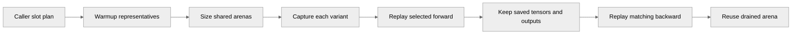

# [PyTorch] Share CUDA graph memory across dynamic CP variants

[Upstream PR](https://github.com/NVIDIA/TransformerEngine/pull/3353) · state: open · merged: False

## Original PR description

# Description

Megatron's dynamic context parallelism (NVIDIA/Megatron-LM#6479) captures one CUDA graph bank per context-parallel (CP) size, because CP communicators are capture-time constants. Giving each bank its own memory pool multiplies graph memory by the number of banks.

This PR adds a private `_graph_memory_slots` argument to `make_graphed_callables`, which lets mutually exclusive graph variants share one `torch.cuda.MemPool`. Without the argument, graph capture behaves as before, apart from the error-path cleanup (change 3) and the `make_weak_ref` fix (change 5).

The PR now targets `main` (it previously targeted `release_v2.14`) and is a single commit.

## Type of change

- [ ] Documentation change (change only to the documentation, either a fix or a new content)
- [x] Bug fix (non-breaking change which fixes an issue): `make_weak_ref` strides (change 5)
- [x] New feature (non-breaking change which adds functionality)
- [ ] Breaking change (fix or feature that would cause existing functionality to not work as expected)
- [ ] Infra/Build change
- [ ] Code refactoring

## Changes

### 1. Slot memory (`graph.py`)

Each graph input carries `(saved_arena, io_slot, branch, chunk, layer, warmup_group, grad_arena)`:

- `saved_arena` holds the tensors the forward saves for backward, plus its public outputs. `grad_arena` holds the gradients returned for user inputs. The caller (Megatron) assigns arenas so that inputs share one only if their forward-to-backward lifetimes never overlap in any schedule it replays.
- Inputs with equal `(io_slot, chunk, layer)` are branches of one slot. They must expose identical output and gradient layouts, and they share output and gradient storage, so each arena is sized by the largest branch rather than the sum.
- Warmup runs once per `warmup_group`.

Forward replays snapshot saved tensors into the arenas, so a replay of another variant cannot overwrite them before the matching backward. Native saved tensors are grouped by storage identity, and aliases and versions are preserved.

**Contract:** only tensors saved for backward (`ctx.save_for_backward` or saved-tensor hooks) are protected. For that reason, delayed weight-gradient `_order` entries are rejected when slots are used. Fused-wgrad parameters remain autograd inputs on replay; when a parameter lacks `grad_added_to_main_grad`, its placeholder gradient is zeroed, because autograd accumulates it into `.grad`.

### 2. Quantized tensors (`quantized_tensor.py`)

During slot capture, `prepare_for_saving` decomposes quantized wrappers into their physical storages, so the arena path can place them; backward then rebuilds the wrappers.

### 3. Capture error paths (`graph.py`)

If capture fails, GC state, temporary hooks, allocator settings and `.grad` state are restored. This also applies without slots.

### 4. Debug guard

With `NVTE_CUDA_GRAPH_SLOT_DEBUG=1`, each replay checks on the host that no other live graph owns the arena or output family it is about to reuse. The variable is documented in `docs/envvars.rst`.

### 5. `make_weak_ref` (`utils.py`)

`make_weak_ref` now keeps the strides of non-contiguous views. Previously, transposed or expanded static outputs were reinterpreted as row-major after the reuse block dropped their strong references.

### Possible split

If reviewers prefer, changes 3 (error-path cleanup), 2 (quantized decomposition) and 4 (debug guard) can each become a separate PR ahead of change 1.

## Testing

`tests/pytorch/test_cuda_graphs.py` adds slot tests. They cover:

- variants sharing one backing pool;
- liveness across PP/VPP schedules and slot wrap;
- aliasing and staging contracts;
- quantized (MXFP8, grouped) saved tensors;
- returned and fused-wgrad parameter gradients;
- capture-error cleanup;
- strided outputs;
- the rejection of delayed wgrad.

This commit (on `main` 53e241c5) was built from source in the torch 2.11 NGC container and tested with `tests/pytorch/test_cuda_graphs.py`. The DPA and FP8-weight-caching graph tests run in separate processes (see the note below the table).

| Selection | H100 (sm_90) | GB200 (sm_100) |
| --- | --- | --- |
| `-k slot_memory` | 59 passed, 6 skipped | 62 passed |
| `test_make_graphed_callables_with_dot_product_attention` | 3 passed | 3 passed |
| `test_make_graphed_callables_with_fp8_weight_caching` | 180 passed | 290 passed |
| all other tests | 260 passed | 388 passed |

With upstream `main`'s `graph.py` and `quantized_tensor.py`, the "all other tests" selection on H100 gives 255 passed and 5 failed. The 5 failures are this PR's new capture-error-path tests.

In this container, a process that has run these graph tests segfaults at interpreter exit, after pytest has written its report. This happens with upstream `main`'s Python files too: the DPA and FP8 graph tests leave the Python heap corrupted, and a later allocation crashes.

Megatron validation (unit tests on this TE build, and the Qwen3.5 benchmark) is in NVIDIA/Megatron-LM#6479.

# Checklist:

- [x] I have read and followed the [contributing guidelines](https://github.com/NVIDIA/TransformerEngine/blob/main/CONTRIBUTING.rst)
- [x] The functionality is complete
- [x] I have commented my code, particularly in hard-to-understand areas
- [x] I have made corresponding changes to the documentation
- [x] My changes generate no new warnings
- [x] I have added tests that prove my fix is effective or that my feature works
- [x] New and existing unit tests pass locally with my changes

🤖 Generated with [Claude Code](https://claude.com/claude-code)

## Review and discussion

### reviews

- greptile-apps[bot] · COMMENTED · 2026-10-25T11:56:45Z · [source](https://github.com/NVIDIA/TransformerEngine/pull/3353#pullrequestreview-5643107004)

(No body; status only.)

### issue_comments

- greptile-apps[bot] · comment · 2026-10-25T11:56:40Z · [source](https://github.com/NVIDIA/TransformerEngine/pull/3353#issuecomment-6397325657)

<!-- greptile_summary -->

<h2><a href="https://app.greptile.com/api/retrigger?id=87631642"><picture><source media="(prefers-color-scheme: dark)" srcset="https://greptile-static-assets.s3.amazonaws.com/badges/RetriggerDark.svg?v=2"><source media="(prefers-color-scheme: light)" srcset="https://greptile-static-assets.s3.amazonaws.com/badges/Retrigger.svg?v=2"></picture></a><a href="https://app.greptile.com/nvidia-public-github/github/NVIDIA/transformerengine/-/pull/3353"><picture><source media="(prefers-color-scheme: dark)" srcset="https://greptile-static-assets.s3.amazonaws.com/badges/ViewInGreptileDark.svg?v=2"><source media="(prefers-color-scheme: light)" srcset="https://greptile-static-assets.s3.amazonaws.com/badges/ViewInGreptile.svg?v=2"></picture></a>Confidence Score: 4/5</h2>

**[Medium impact]** The changes affect PyTorch CUDA graph capture and replay workflows\.

Fix expanded-output capture before merging; also tighten the branch layout checks.

<h2>Findings</h2>

1. &nbsp;**Expanded outputs fail capture** <a href="https://github.com/NVIDIA/TransformerEngine/pull/3353#discussion_r4370755121">▶</a>
2. &nbsp;**Different branch layouts pass** <a href="https://github.com/NVIDIA/TransformerEngine/pull/3353#discussion_r4370755124">▶</a>

<h3>Summary</h3>

Adds private `_graph_memory_slots` support so mutually exclusive CUDA graph variants can share a memory pool.
- Mutually exclusive graph variants can reuse caller-planned memory.
- Failed graph captures restore temporary process state.
- Weak references keep non-contiguous CUDA views' strides.

<h3>Diagram</h3>

<!-- greptile_confidence_score:4 -->

Reviews (1) · Last reviewed commit: ["\[PyTorch\] Share CUDA graph memory across..."](https://github.com/nvidia/transformerengine/commit/8980cd09074bfe4e96ec2c29bde1652c342dc1dd) · [Reviewed by Greptile](https://www.greptile.com/?utm_source=greptile_review&utm_medium=github&utm_campaign=review_public&utm_content=nvidia/transformerengine)

### inline_comments

- greptile-apps[bot] · comment · 2026-10-25T11:56:43Z · [source](https://github.com/NVIDIA/TransformerEngine/pull/3353#discussion_r4370755121)

File: `transformer_engine/pytorch/graph.py` · line 1823

 **Expanded outputs fail capture**

`copy_outputs_to_slot_arena` fails for outputs such as `(inp * 2)[:1].expand(8)`. The arena target keeps the output's zero stride, but `target.copy_(output)` writes into that overlapping view. PyTorch rejects the write, so `make_graphed_callables` fails during capture even though the output is a plain strided CUDA tensor.

Copy the addressed storage span, as the saved-tensor path already does, and add an expanded-output test.

- greptile-apps[bot] · comment · 2026-10-25T11:56:44Z · [source](https://github.com/NVIDIA/TransformerEngine/pull/3353#discussion_r4370755124)

File: `transformer_engine/pytorch/graph.py` · line 1763

 **Different branch layouts pass**

`prepare_slot_io_targets` checks dtype, device, and whether gradients are required, but not shapes or strides. This lets branches pass despite `_graph_memory_slots` requiring identical output and gradient layouts. Different output sizes can also place later outputs at different arena offsets, leaving callers without the shared addresses the contract promises.

Include shapes and strides in the comparison and add a test that rejects mismatched branch layouts.

## Changed files and fixed code

- `docs/envvars.rst` · modified · additions 6 / deletions 0
  - [head](https://github.com/xiaoyao0115/TransformerEngine/blob/8980cd09074bfe4e96ec2c29bde1652c342dc1dd/docs/envvars.rst)
  - [base](https://github.com/NVIDIA/TransformerEngine/blob/33f3b3561943fcd9dd2f544f67dc2dfd62efdc9e/docs/envvars.rst)
- `tests/pytorch/test_cuda_graphs.py` · modified · additions 2097 / deletions 0
  - [head](https://github.com/xiaoyao0115/TransformerEngine/blob/8980cd09074bfe4e96ec2c29bde1652c342dc1dd/tests/pytorch/test_cuda_graphs.py)
  - [base](https://github.com/NVIDIA/TransformerEngine/blob/33f3b3561943fcd9dd2f544f67dc2dfd62efdc9e/tests/pytorch/test_cuda_graphs.py)
- `transformer_engine/pytorch/graph.py` · modified · additions 1895 / deletions 157
  - [head](https://github.com/xiaoyao0115/TransformerEngine/blob/8980cd09074bfe4e96ec2c29bde1652c342dc1dd/transformer_engine/pytorch/graph.py)
  - [base](https://github.com/NVIDIA/TransformerEngine/blob/33f3b3561943fcd9dd2f544f67dc2dfd62efdc9e/transformer_engine/pytorch/graph.py)
- `transformer_engine/pytorch/quantized_tensor.py` · modified · additions 25 / deletions 2
  - [head](https://github.com/xiaoyao0115/TransformerEngine/blob/8980cd09074bfe4e96ec2c29bde1652c342dc1dd/transformer_engine/pytorch/quantized_tensor.py)
  - [base](https://github.com/NVIDIA/TransformerEngine/blob/33f3b3561943fcd9dd2f544f67dc2dfd62efdc9e/transformer_engine/pytorch/quantized_tensor.py)
- `transformer_engine/pytorch/utils.py` · modified · additions 12 / deletions 6
  - [head](https://github.com/xiaoyao0115/TransformerEngine/blob/8980cd09074bfe4e96ec2c29bde1652c342dc1dd/transformer_engine/pytorch/utils.py)
  - [base](https://github.com/NVIDIA/TransformerEngine/blob/33f3b3561943fcd9dd2f544f67dc2dfd62efdc9e/transformer_engine/pytorch/utils.py)

## Evidence and interpretation boundary

[Original JSON, discussions and patches](../../../../../../evidence/prs/NVIDIA--TransformerEngine/3353-3d925162b75a92b4661c434307d9cfe18a1c5a782b967892b707ff9072aea406.json) · SHA-256 `3d925162b75a92b4661c434307d9cfe18a1c5a782b967892b707ff9072aea406`.

Diff complete: False. Missing/binary/truncated patches require pinned source inspection. This is a source page, not an independently verified optimization case. Open, merged and released are different states; recheck the deployed dependency.
