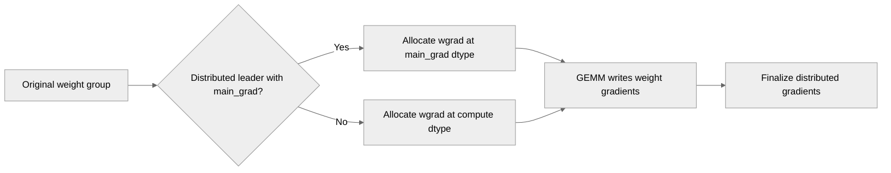

# [PyTorch] Type the grouped wgrad from main_grad for distributed weights

[Upstream PR](https://github.com/NVIDIA/TransformerEngine/pull/3397) · state: open · merged: False

## Original PR description


# Description

c9a1f5a9 routed distributed weights into the no-fusion branch, which allocates at the compute dtype -- so under fp32 grad accumulation the reduce-scatter rounded to BF16 on every rank:
```
  wgrad alloc fp32 ---> reduce fp32 ---> accum fp32     <- this fix
  (was compute dtype ---> compute dtype ---> fp32)     <- before fix
```

Two dispatchers beside finalize_weight_grads:

  `weight_grad_buffers()`  GEMM writes into the implementer's buffer (no per-backward wgrad allocation)
  `weight_grad_dtype()`    fallback for the single-grouped branchesc9a1f5a9 routed distributed weights into the no-fusion branch, which allocates at the compute dtype -- so under fp32 grad accumulation the reduce-scatter rounded to BF16 on every rank:
```
  wgrad alloc fp32 ---> reduce fp32 ---> accum fp32     <- this fix
  (was compute dtype ---> compute dtype ---> fp32)     <- before fix
```

Two dispatchers beside finalize_weight_grads:

  `weight_grad_buffers()`  GEMM writes into the implementer's buffer (no per-backward wgrad allocation)
  `weight_grad_dtype()`    fallback for the single-grouped branches

## Type of change

- [ ] Documentation change (change only to the documentation, either a fix or a new content)
- [x] Bug fix (non-breaking change which fixes an issue)
- [ ] New feature (non-breaking change which adds functionality)
- [ ] Breaking change (fix or feature that would cause existing functionality to not work as expected)
- [ ] Infra/Build change
- [ ] Code refactoring

## Changes

Please list the changes introduced in this PR:

- distributed_weight.py — new weight_grad_buffers() + weight_grad_dtype() dispatchers
- ops/basic/grouped_linear.py — both backwards use them
- ops/fused/grouped_mlp.py — same
- module/grouped_linear.py — dtype fix for the no-fusion branch
- test_distributed_weight.py — unit tests for the two dispatchers
- test_ops_grouped_linear_distributed_weight.py — wgrad-dtype test, ops + module

# Checklist:

- [x] I have read and followed the [contributing guidelines](https://github.com/NVIDIA/TransformerEngine/blob/main/CONTRIBUTING.rst)
- [x] The functionality is complete
- [x] I have commented my code, particularly in hard-to-understand areas
- [x] I have made corresponding changes to the documentation
- [x] My changes generate no new warnings
- [x] I have added tests that prove my fix is effective or that my feature works
- [x] New and existing unit tests pass locally with my changes


## Review and discussion

### reviews

- greptile-apps[bot] · COMMENTED · 2026-08-18T16:13:01Z · [source](https://github.com/NVIDIA/TransformerEngine/pull/3397#pullrequestreview-4963254096)

(No body; status only.)

- vthumbe1503 · COMMENTED · 2026-08-21T01:32:38Z · [source](https://github.com/NVIDIA/TransformerEngine/pull/3397#pullrequestreview-4988972332)

(No body; status only.)

- vthumbe1503 · COMMENTED · 2026-08-21T01:55:19Z · [source](https://github.com/NVIDIA/TransformerEngine/pull/3397#pullrequestreview-4989066078)

(No body; status only.)

- vthumbe1503 · COMMENTED · 2026-08-21T01:56:34Z · [source](https://github.com/NVIDIA/TransformerEngine/pull/3397#pullrequestreview-4989070557)

(No body; status only.)

- fanshiqing · COMMENTED · 2026-08-24T00:45:29Z · [source](https://github.com/NVIDIA/TransformerEngine/pull/3397#pullrequestreview-5003831936)

(No body; status only.)

- fanshiqing · COMMENTED · 2026-08-24T00:48:07Z · [source](https://github.com/NVIDIA/TransformerEngine/pull/3397#pullrequestreview-5003838179)

(No body; status only.)

- zhongbozhu · COMMENTED · 2026-08-26T05:21:51Z · [source](https://github.com/NVIDIA/TransformerEngine/pull/3397#pullrequestreview-5027018637)

(No body; status only.)

- zhongbozhu · COMMENTED · 2026-08-26T05:22:45Z · [source](https://github.com/NVIDIA/TransformerEngine/pull/3397#pullrequestreview-5027022623)

(No body; status only.)

- zhongbozhu · COMMENTED · 2026-08-26T05:23:28Z · [source](https://github.com/NVIDIA/TransformerEngine/pull/3397#pullrequestreview-5027025783)

(No body; status only.)

- vthumbe1503 · COMMENTED · 2026-09-16T06:09:51Z · [source](https://github.com/NVIDIA/TransformerEngine/pull/3397#pullrequestreview-5219078852)

(No body; status only.)

- vthumbe1503 · CHANGES_REQUESTED · 2026-09-30T17:59:17Z · [source](https://github.com/NVIDIA/TransformerEngine/pull/3397#pullrequestreview-5370055492)

(No body; status only.)

- fanshiqing · COMMENTED · 2026-10-16T06:02:16Z · [source](https://github.com/NVIDIA/TransformerEngine/pull/3397#pullrequestreview-5543662551)

(No body; status only.)

- fanshiqing · COMMENTED · 2026-10-16T06:06:15Z · [source](https://github.com/NVIDIA/TransformerEngine/pull/3397#pullrequestreview-5543690348)

(No body; status only.)

- fanshiqing · COMMENTED · 2026-10-16T06:08:19Z · [source](https://github.com/NVIDIA/TransformerEngine/pull/3397#pullrequestreview-5543704156)

(No body; status only.)

### issue_comments

- greptile-apps[bot] · comment · 2026-08-18T16:12:57Z · [source](https://github.com/NVIDIA/TransformerEngine/pull/3397#issuecomment-5330939831)

<!-- greptile_summary -->

<h2><a href="https://app.greptile.com/api/retrigger?id=54419321"><picture><source media="(prefers-color-scheme: dark)" srcset="https://greptile-static-assets.s3.amazonaws.com/badges/RetriggerDark.svg?v=2"><source media="(prefers-color-scheme: light)" srcset="https://greptile-static-assets.s3.amazonaws.com/badges/Retrigger.svg?v=2"></picture></a><a href="https://app.greptile.com/nvidia-public-github/github/NVIDIA/transformerengine/-/pull/3397"><picture><source media="(prefers-color-scheme: dark)" srcset="https://greptile-static-assets.s3.amazonaws.com/badges/ViewInGreptileDark.svg?v=2"><source media="(prefers-color-scheme: light)" srcset="https://greptile-static-assets.s3.amazonaws.com/badges/ViewInGreptile.svg?v=2"></picture></a>Confidence Score: 5/5</h2>

**[Medium impact]** The PR appears safe to merge; no new actionable issue remains.

<h3>Summary</h3>

This PR makes grouped weight gradients use `main_grad.dtype` for distributed weights, avoiding BF16 rounding before reduction.

- Distributed grouped gradients use the accumulation dtype before reduction.

<h3>Diagram</h3>



<!-- greptile_confidence_score:5 -->

<sub>Reviews (3) · Last reviewed commit: ["\[PyTorch\] Drop weight\_grad\_buffers; type..."](https://github.com/nvidia/transformerengine/commit/1b2a404a4da39593a3b71147b7dea53636801741) · [Reviewed by Greptile](https://www.greptile.com/?utm_source=greptile_review&utm_medium=github&utm_campaign=review_public&utm_content=nvidia/transformerengine)</sub>

- zhongbozhu · comment · 2026-08-19T04:38:28Z · [source](https://github.com/NVIDIA/TransformerEngine/pull/3397#issuecomment-5337599803)

/te-ci pytorch L1

### inline_comments

- greptile-apps[bot] · comment · 2026-08-18T16:13:00Z · [source](https://github.com/NVIDIA/TransformerEngine/pull/3397#discussion_r3805882890)

File: `transformer_engine/pytorch/distributed_weight.py` · line None

<a href="#"></a> **Leader-only groups break backward**

When a distributed weight group uses a protocol-bearing leader with ordinary tensor followers, `weight_grad_buffers` checks only the leader but calls `grad_buffer()` on every member, causing backward to fail with `AttributeError`.

**Knowledge Base Used:** [PyTorch Distributed/Parallel Training Support](https://app.greptile.com/nvidia-public-github/-/custom-context/knowledge-base/nvidia/transformerengine/-/docs/pytorch-distributed.md)

- vthumbe1503 · comment · 2026-08-21T01:32:38Z · [source](https://github.com/NVIDIA/TransformerEngine/pull/3397#discussion_r3826619912)

File: `transformer_engine/pytorch/ops/basic/grouped_linear.py` · line None

Could we move the wgrad_dtype directly in the place where this is used similar to the grouped_mlp file?

Given that wgrad_dtype is only used only for the single_grouped_weight case, it would increase code readability if we directly move it inside that branch 

- vthumbe1503 · comment · 2026-08-21T01:55:19Z · [source](https://github.com/NVIDIA/TransformerEngine/pull/3397#discussion_r3826705457)

File: `transformer_engine/pytorch/ops/fused/grouped_mlp.py` · line 877

I dont understand how this will help, since we will never enter this else condition of allocating using torch.empty, if main_grad is attached to the parameter.

- vthumbe1503 · comment · 2026-08-21T01:56:33Z · [source](https://github.com/NVIDIA/TransformerEngine/pull/3397#discussion_r3826709679)

File: `transformer_engine/pytorch/ops/fused/grouped_mlp.py` · line 877

Actually we will, if accumulate_into_main_grad is False, but why are we attaching main_grad to parameter in that case in Megatron?

- fanshiqing · comment · 2026-08-24T00:45:28Z · [source](https://github.com/NVIDIA/TransformerEngine/pull/3397#discussion_r3840058721)

File: `transformer_engine/pytorch/ops/fused/grouped_mlp.py` · line 877

Hi @vthumbe1503 , for you first question why this line's change is required: **we need to follow `main_grad`'s dtype instead of the compute_dtype for this scratch_buffer allocation**.

Details:
- **The bug**: for a GTP-sharded (distributed) weight whose scratch wgrad buffer isn't fused into main_grad, the buffer was allocated in the forward/backward compute dtype (e.g. bf16) — **not in main_grad's dtype**. That buffer is what gets reduced across the weight's GTP group before being accumulated into main_grad.
- **Result**: whenever main_grad was fp32 (fp32 grad accumulation enabled by set `--grad-reduce-in-fp32` from MLM for a best accuracy loss baseline), **_the reduce-scatter still ran in bf16_** — every rank's contribution got rounded to bf16 before it ever reached the fp32 accumulator. fp32 grad accumulation was silently defeated for GTP-sharded weights, with no error or warning.
- **The fix**: weight_grad_dtype(weights, dtype) returns main_grad.dtype instead of the plain compute dtype whenever the weight is distributed and main_grad is already attached, so the scratch buffer — and therefore the reduction — happens at the same precision main_grad actually uses. Falls back to compute_dtype for plain weights or when main_grad isn't attached yet.

- fanshiqing · comment · 2026-08-24T00:48:07Z · [source](https://github.com/NVIDIA/TransformerEngine/pull/3397#discussion_r3840064920)

File: `transformer_engine/pytorch/ops/fused/grouped_mlp.py` · line 877

> if accumulate_into_main_grad is False, but why are we attaching main_grad to parameter in that case in Megatron

for MLM:
- `.main_grad` attachment is unconditional.
- `accumulate_into_main_grad` is a separate, opt-in performance flag.


- zhongbozhu · comment · 2026-08-26T05:21:51Z · [source](https://github.com/NVIDIA/TransformerEngine/pull/3397#discussion_r3859864198)

File: `transformer_engine/pytorch/distributed_weight.py` · line None

can we get rid of this helper function? doesn't feel necessary 

- zhongbozhu · comment · 2026-08-26T05:22:45Z · [source](https://github.com/NVIDIA/TransformerEngine/pull/3397#discussion_r3859868033)

File: `transformer_engine/pytorch/distributed_weight.py` · line None

this doesn't seem to support single weight? TE as a computing library supports single weight for all, so it's orthogonal to if a certain feature in Mcore doesn't consider single weight yet 

- zhongbozhu · comment · 2026-08-26T05:23:28Z · [source](https://github.com/NVIDIA/TransformerEngine/pull/3397#discussion_r3859870828)

File: `transformer_engine/pytorch/distributed_weight.py` · line 105

we can also get rid of this helper? 

- vthumbe1503 · comment · 2026-09-16T06:09:51Z · [source](https://github.com/NVIDIA/TransformerEngine/pull/3397#discussion_r4022992106)

File: `transformer_engine/pytorch/ops/fused/grouped_mlp.py` · line 877

Thanks for the explaination @fanshiqing! Why is this problem not present for  discrete weights? Is it because in case discrete weights, we always write directly into the main_grad buffer?

- fanshiqing · comment · 2026-10-16T06:02:16Z · [source](https://github.com/NVIDIA/TransformerEngine/pull/3397#discussion_r4291406955)

File: `transformer_engine/pytorch/ops/fused/grouped_mlp.py` · line 877

Hi @vthumbe1503 , Mostly yes — what matters is whether the reduction runs **before** or **after** the wgrad lands in main_grad:
 - **Regular weights**: the GEMM writes into the fp32 main_grad (or DDP adds .grad into it), and DDP reduces **later**, from main_grad, so the sum is in fp32.
 - Distributed weights: main_grad is only the local shard, but the GEMM produces the full unsharded wgrad. It must be reduce-scattered **first**, from a scratch buffer.
- The bug: that scratch buffer used the compute dtype, so the RS summed in BF16 even under fp32 grad accumulation.
- The fix: the scratch buffer now takes main_grad's dtype, so the RS runs in fp32.

- fanshiqing · comment · 2026-10-16T06:06:15Z · [source](https://github.com/NVIDIA/TransformerEngine/pull/3397#discussion_r4291428766)

File: `transformer_engine/pytorch/distributed_weight.py` · line 105

No, I'd keep this one. It's the actual fix, and without it the same condition gets copied into 8 places

- It's the whole fix now that weight_grad_buffers is gone.
- Inlining it would copy the same condition into 8 call sites.
- It keeps Megatron's main_grad convention in distributed_weight.py, not spread across TE's ops code.
- It handles a missing main_grad by falling back to the compute dtype. Inlined, each site would need that guard or could raise AttributeError.

- fanshiqing · comment · 2026-10-16T06:08:18Z · [source](https://github.com/NVIDIA/TransformerEngine/pull/3397#discussion_r4291440009)

File: `transformer_engine/pytorch/distributed_weight.py` · line None

 It **does handle a single weight:** a bare tensor is wrapped, and `single_grouped_weight` passes [self.weight], whose main_grad dtype is used.

## Changed files and fixed code

- `tests/pytorch/test_distributed_weight.py` · modified · additions 27 / deletions 0
  - [head](https://github.com/fanshiqing/TransformerEngine/blob/1b2a404a4da39593a3b71147b7dea53636801741/tests/pytorch/test_distributed_weight.py)
  - [base](https://github.com/NVIDIA/TransformerEngine/blob/33f3b3561943fcd9dd2f544f67dc2dfd62efdc9e/tests/pytorch/test_distributed_weight.py)
- `tests/pytorch/test_ops_grouped_linear_distributed_weight.py` · modified · additions 74 / deletions 2
  - [head](https://github.com/fanshiqing/TransformerEngine/blob/1b2a404a4da39593a3b71147b7dea53636801741/tests/pytorch/test_ops_grouped_linear_distributed_weight.py)
  - [base](https://github.com/NVIDIA/TransformerEngine/blob/33f3b3561943fcd9dd2f544f67dc2dfd62efdc9e/tests/pytorch/test_ops_grouped_linear_distributed_weight.py)
- `transformer_engine/pytorch/distributed_weight.py` · modified · additions 19 / deletions 0
  - [head](https://github.com/fanshiqing/TransformerEngine/blob/1b2a404a4da39593a3b71147b7dea53636801741/transformer_engine/pytorch/distributed_weight.py)
  - [base](https://github.com/NVIDIA/TransformerEngine/blob/33f3b3561943fcd9dd2f544f67dc2dfd62efdc9e/transformer_engine/pytorch/distributed_weight.py)
- `transformer_engine/pytorch/module/grouped_linear.py` · modified · additions 5 / deletions 3
  - [head](https://github.com/fanshiqing/TransformerEngine/blob/1b2a404a4da39593a3b71147b7dea53636801741/transformer_engine/pytorch/module/grouped_linear.py)
  - [base](https://github.com/NVIDIA/TransformerEngine/blob/33f3b3561943fcd9dd2f544f67dc2dfd62efdc9e/transformer_engine/pytorch/module/grouped_linear.py)
- `transformer_engine/pytorch/ops/basic/grouped_linear.py` · modified · additions 7 / deletions 4
  - [head](https://github.com/fanshiqing/TransformerEngine/blob/1b2a404a4da39593a3b71147b7dea53636801741/transformer_engine/pytorch/ops/basic/grouped_linear.py)
  - [base](https://github.com/NVIDIA/TransformerEngine/blob/33f3b3561943fcd9dd2f544f67dc2dfd62efdc9e/transformer_engine/pytorch/ops/basic/grouped_linear.py)
- `transformer_engine/pytorch/ops/fused/grouped_mlp.py` · modified · additions 3 / deletions 2
  - [head](https://github.com/fanshiqing/TransformerEngine/blob/1b2a404a4da39593a3b71147b7dea53636801741/transformer_engine/pytorch/ops/fused/grouped_mlp.py)
  - [base](https://github.com/NVIDIA/TransformerEngine/blob/33f3b3561943fcd9dd2f544f67dc2dfd62efdc9e/transformer_engine/pytorch/ops/fused/grouped_mlp.py)

## Evidence and interpretation boundary

[Original JSON, discussions and patches](../../../../../../evidence/prs/NVIDIA--TransformerEngine/3397-41ea1842f0823c6a6d18bd3e0fa137529889e725637878367d84415bddbb7d8d.json) · SHA-256 `41ea1842f0823c6a6d18bd3e0fa137529889e725637878367d84415bddbb7d8d`.

Diff complete: True. Missing/binary/truncated patches require pinned source inspection. This is a source page, not an independently verified optimization case. Open, merged and released are different states; recheck the deployed dependency.
