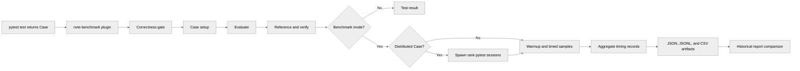

# [Common] Benchmarkable Unit Tests

[Upstream PR](https://github.com/NVIDIA/TransformerEngine/pull/3408) · state: open · merged: False

## Original PR description

# Description

This PR introduces a new `transformer_engine.common.testing` submodule that defines a new unified standard for implementing Transformer Engine unit tests that are also benchmarkable to avoid duplicate implementations between separate test and benchmark implementations.

`tests/jax/test_softmax.py` and `tests/pytorch/test_fused_rose.py` have been ported as demonstrative examples, but a complete porting of all existing unit tests as well as a re-write of existing benchmarking scripts are deferred to follow-up PRs. `tests/pytorch/distributed/test_benchmarkable_linear.py` added as a distributed test example.

## Discussion Items
- NOT IMPLEMENTED: `@benchmark.cpu` and `@benchmark.gpu` decorators for designating different parameter values for benchmarking CPU overhead (small tenors) vs. GPU perf (large tensors).
- PARTIALLY IMPLEMENTED: Leveraging `cupti-python` and/or `cuda-python` for programmatic profiling/device statistics.

## Type of change

- [ ] Documentation change (change only to the documentation, either a fix or a new content)
- [ ] Bug fix (non-breaking change which fixes an issue)
- [x] New feature (non-breaking change which adds functionality)
- [ ] Breaking change (fix or feature that would cause existing functionality to not work as expected)
- [ ] Infra/Build change
- [ ] Code refactoring

# Checklist:

- [x] I have read and followed the [contributing guidelines](https://github.com/NVIDIA/TransformerEngine/blob/main/CONTRIBUTING.rst)
- [x] The functionality is complete
- [x] I have commented my code, particularly in hard-to-understand areas
- [x] I have made corresponding changes to the documentation
- [x] My changes generate no new warnings
- [x] I have added tests that prove my fix is effective or that my feature works
- [x] New and existing unit tests pass locally with my changes

## Review and discussion

### reviews

- greptile-apps[bot] · COMMENTED · 2026-09-18T21:55:34Z · [source](https://github.com/NVIDIA/TransformerEngine/pull/3408#pullrequestreview-5252982917)

(No body; status only.)

- pggPL · COMMENTED · 2026-10-28T16:29:45Z · [source](https://github.com/NVIDIA/TransformerEngine/pull/3408#pullrequestreview-5686145844)

Some thoughts:

1. Note that we may want to test something with older TE versions. Maybe there are some kernels which were fast in 2.10, but are slow now. We could possibly run such experiments if we define benchmarks on the other branch, instead mixing them with tests. I see that there are drawbacks of such approach too.

2. This is not something customer-facing so we can iterate very fast on that and experiment what makes the most impact for us and what does not. So I would recommend merging this PR without big changes, setting up something working on CI and adjusting it later. Related to (1), if we could run benchmarks older version, we could test if our approach catches anything meaningful.

3. I see new test for distributed is added. Not sure why? Can't we just harness current test?

4. It would be nice to see if cuda memory usage increased, but it may need to be framework-aware.

### issue_comments

- denera · comment · 2026-08-21T18:29:00Z · [source](https://github.com/NVIDIA/TransformerEngine/pull/3408#issuecomment-5373735344)

@ksivaman @sudhakarsingh27 Hi all — I'm out of office for the next two weeks (8/22 - 9/7) but hoping to get your feedback on this draft PR in the meantime. @przemek mentioned you may have ideas that we would want to consolidate/incorporate into the final PR.

- greptile-apps[bot] · comment · 2026-09-18T21:55:29Z · [source](https://github.com/NVIDIA/TransformerEngine/pull/3408#issuecomment-5736660527)

<!-- greptile_summary -->

<h2><a href="https://app.greptile.com/api/retrigger?id=66253498"><picture><source media="(prefers-color-scheme: dark)" srcset="https://greptile-static-assets.s3.amazonaws.com/badges/RetriggerDark.svg?v=2"><source media="(prefers-color-scheme: light)" srcset="https://greptile-static-assets.s3.amazonaws.com/badges/Retrigger.svg?v=2"></picture></a>Confidence Score: 4/5</h2>

The PR appears safe to merge after addressing the non-blocking reproducibility issue in the converted fused RoPE benchmark.

<h2>Findings</h2>

1. &nbsp;**Benchmark inputs are nondeterministic** <a href="https://github.com/NVIDIA/TransformerEngine/pull/3408#discussion_r4050999185">▶</a>

<h3>Summary</h3>

This PR introduces a pytest-integrated framework for defining correctness tests that can also produce benchmark reports, including distributed execution, CUDA synchronization, artifact generation, and report comparison. It also ports representative JAX softmax and PyTorch RoPE tests and adds a distributed linear example.

- Adds the `Case` lifecycle, benchmark decorators, pytest plugin, timing runner, and distributed rank launcher.
- Records JSON, JSONL, and CSV benchmark artifacts with environment and device metadata.
- Adds historical report comparison with configurable regression thresholds.
- Registers the plugin through package metadata and documents the public workflow.
- One converted benchmark does not follow the newly documented deterministic-setup contract.

<h3>Diagram</h3>

Reviews (1) · Last reviewed commit: ["\[Common\] Close the vacuous-pass paths fo..."](https://github.com/nvidia/transformerengine/commit/b8ca84d70202ac57a223cfe0fab27f79cb1a60a2)

### inline_comments

- greptile-apps[bot] · comment · 2026-09-18T21:55:32Z · [source](https://github.com/NVIDIA/TransformerEngine/pull/3408#discussion_r4050999185)

File: `tests/pytorch/test_fused_rope.py` · line 84

 **Benchmark inputs are nondeterministic**

`setup` uses the process-wide unseeded RNG for `t` and `start_positions`, although the new `Case` contract requires deterministic setup. Because the benchmark runner invokes setup separately for the correctness gate, reference timing, and evaluation timing, these stages use different inputs and repeated reports gain uncontrolled variance. Use a locally seeded generator or otherwise recreate identical inputs for each setup call.

## Changed files and fixed code

- `docs/examples/benchmarkable_tests.rst` · added · additions 189 / deletions 0
  - [head](https://github.com/denera/TransformerEngine/blob/b8ca84d70202ac57a223cfe0fab27f79cb1a60a2/docs/examples/benchmarkable_tests.rst)
  - [base](https://github.com/NVIDIA/TransformerEngine/blob/9233c73a1b6ed97058ff9043b072ebcceff7ffa3/docs/examples/benchmarkable_tests.rst)
- `docs/index.rst` · modified · additions 1 / deletions 0
  - [head](https://github.com/denera/TransformerEngine/blob/b8ca84d70202ac57a223cfe0fab27f79cb1a60a2/docs/index.rst)
  - [base](https://github.com/NVIDIA/TransformerEngine/blob/9233c73a1b6ed97058ff9043b072ebcceff7ffa3/docs/index.rst)
- `qa/L1_pytorch_distributed_unittest/test.sh` · modified · additions 1 / deletions 0
  - [head](https://github.com/denera/TransformerEngine/blob/b8ca84d70202ac57a223cfe0fab27f79cb1a60a2/qa/L1_pytorch_distributed_unittest/test.sh)
  - [base](https://github.com/NVIDIA/TransformerEngine/blob/9233c73a1b6ed97058ff9043b072ebcceff7ffa3/qa/L1_pytorch_distributed_unittest/test.sh)
- `setup.py` · modified · additions 6 / deletions 1
  - [head](https://github.com/denera/TransformerEngine/blob/b8ca84d70202ac57a223cfe0fab27f79cb1a60a2/setup.py)
  - [base](https://github.com/NVIDIA/TransformerEngine/blob/9233c73a1b6ed97058ff9043b072ebcceff7ffa3/setup.py)
- `tests/jax/test_softmax.py` · modified · additions 31 / deletions 15
  - [head](https://github.com/denera/TransformerEngine/blob/b8ca84d70202ac57a223cfe0fab27f79cb1a60a2/tests/jax/test_softmax.py)
  - [base](https://github.com/NVIDIA/TransformerEngine/blob/9233c73a1b6ed97058ff9043b072ebcceff7ffa3/tests/jax/test_softmax.py)
- `tests/pytorch/distributed/test_benchmarkable_linear.py` · added · additions 120 / deletions 0
  - [head](https://github.com/denera/TransformerEngine/blob/b8ca84d70202ac57a223cfe0fab27f79cb1a60a2/tests/pytorch/distributed/test_benchmarkable_linear.py)
  - [base](https://github.com/NVIDIA/TransformerEngine/blob/9233c73a1b6ed97058ff9043b072ebcceff7ffa3/tests/pytorch/distributed/test_benchmarkable_linear.py)
- `tests/pytorch/test_fused_rope.py` · modified · additions 93 / deletions 56
  - [head](https://github.com/denera/TransformerEngine/blob/b8ca84d70202ac57a223cfe0fab27f79cb1a60a2/tests/pytorch/test_fused_rope.py)
  - [base](https://github.com/NVIDIA/TransformerEngine/blob/9233c73a1b6ed97058ff9043b072ebcceff7ffa3/tests/pytorch/test_fused_rope.py)
- `transformer_engine/common/testing/__init__.py` · added · additions 17 / deletions 0
  - [head](https://github.com/denera/TransformerEngine/blob/b8ca84d70202ac57a223cfe0fab27f79cb1a60a2/transformer_engine/common/testing/__init__.py)
  - [base](https://github.com/NVIDIA/TransformerEngine/blob/9233c73a1b6ed97058ff9043b072ebcceff7ffa3/transformer_engine/common/testing/__init__.py)
- `transformer_engine/common/testing/artifacts.py` · added · additions 246 / deletions 0
  - [head](https://github.com/denera/TransformerEngine/blob/b8ca84d70202ac57a223cfe0fab27f79cb1a60a2/transformer_engine/common/testing/artifacts.py)
  - [base](https://github.com/NVIDIA/TransformerEngine/blob/9233c73a1b6ed97058ff9043b072ebcceff7ffa3/transformer_engine/common/testing/artifacts.py)
- `transformer_engine/common/testing/case.py` · added · additions 124 / deletions 0
  - [head](https://github.com/denera/TransformerEngine/blob/b8ca84d70202ac57a223cfe0fab27f79cb1a60a2/transformer_engine/common/testing/case.py)
  - [base](https://github.com/NVIDIA/TransformerEngine/blob/9233c73a1b6ed97058ff9043b072ebcceff7ffa3/transformer_engine/common/testing/case.py)
- `transformer_engine/common/testing/compare.py` · added · additions 260 / deletions 0
  - [head](https://github.com/denera/TransformerEngine/blob/b8ca84d70202ac57a223cfe0fab27f79cb1a60a2/transformer_engine/common/testing/compare.py)
  - [base](https://github.com/NVIDIA/TransformerEngine/blob/9233c73a1b6ed97058ff9043b072ebcceff7ffa3/transformer_engine/common/testing/compare.py)
- `transformer_engine/common/testing/declaration.py` · added · additions 47 / deletions 0
  - [head](https://github.com/denera/TransformerEngine/blob/b8ca84d70202ac57a223cfe0fab27f79cb1a60a2/transformer_engine/common/testing/declaration.py)
  - [base](https://github.com/NVIDIA/TransformerEngine/blob/9233c73a1b6ed97058ff9043b072ebcceff7ffa3/transformer_engine/common/testing/declaration.py)
- `transformer_engine/common/testing/decorator.py` · added · additions 76 / deletions 0
  - [head](https://github.com/denera/TransformerEngine/blob/b8ca84d70202ac57a223cfe0fab27f79cb1a60a2/transformer_engine/common/testing/decorator.py)
  - [base](https://github.com/NVIDIA/TransformerEngine/blob/9233c73a1b6ed97058ff9043b072ebcceff7ffa3/transformer_engine/common/testing/decorator.py)
- `transformer_engine/common/testing/device.py` · added · additions 158 / deletions 0
  - [head](https://github.com/denera/TransformerEngine/blob/b8ca84d70202ac57a223cfe0fab27f79cb1a60a2/transformer_engine/common/testing/device.py)
  - [base](https://github.com/NVIDIA/TransformerEngine/blob/9233c73a1b6ed97058ff9043b072ebcceff7ffa3/transformer_engine/common/testing/device.py)
- `transformer_engine/common/testing/distributed.py` · added · additions 291 / deletions 0
  - [head](https://github.com/denera/TransformerEngine/blob/b8ca84d70202ac57a223cfe0fab27f79cb1a60a2/transformer_engine/common/testing/distributed.py)
  - [base](https://github.com/NVIDIA/TransformerEngine/blob/9233c73a1b6ed97058ff9043b072ebcceff7ffa3/transformer_engine/common/testing/distributed.py)
- `transformer_engine/common/testing/plugin.py` · added · additions 430 / deletions 0
  - [head](https://github.com/denera/TransformerEngine/blob/b8ca84d70202ac57a223cfe0fab27f79cb1a60a2/transformer_engine/common/testing/plugin.py)
  - [base](https://github.com/NVIDIA/TransformerEngine/blob/9233c73a1b6ed97058ff9043b072ebcceff7ffa3/transformer_engine/common/testing/plugin.py)
- `transformer_engine/common/testing/runner.py` · added · additions 226 / deletions 0
  - [head](https://github.com/denera/TransformerEngine/blob/b8ca84d70202ac57a223cfe0fab27f79cb1a60a2/transformer_engine/common/testing/runner.py)
  - [base](https://github.com/NVIDIA/TransformerEngine/blob/9233c73a1b6ed97058ff9043b072ebcceff7ffa3/transformer_engine/common/testing/runner.py)
- `transformer_engine/common/testing/timing.py` · added · additions 50 / deletions 0
  - [head](https://github.com/denera/TransformerEngine/blob/b8ca84d70202ac57a223cfe0fab27f79cb1a60a2/transformer_engine/common/testing/timing.py)
  - [base](https://github.com/NVIDIA/TransformerEngine/blob/9233c73a1b6ed97058ff9043b072ebcceff7ffa3/transformer_engine/common/testing/timing.py)

## Evidence and interpretation boundary

[Original JSON, discussions and patches](../../../../../../evidence/prs/NVIDIA--TransformerEngine/3408-078969ecc2a3f979975a347628f40352dc9101e5abd3cc3428f05b943ce4fdd0.json) · SHA-256 `078969ecc2a3f979975a347628f40352dc9101e5abd3cc3428f05b943ce4fdd0`.

Diff complete: True. Missing/binary/truncated patches require pinned source inspection. This is a source page, not an independently verified optimization case. Open, merged and released are different states; recheck the deployed dependency.
