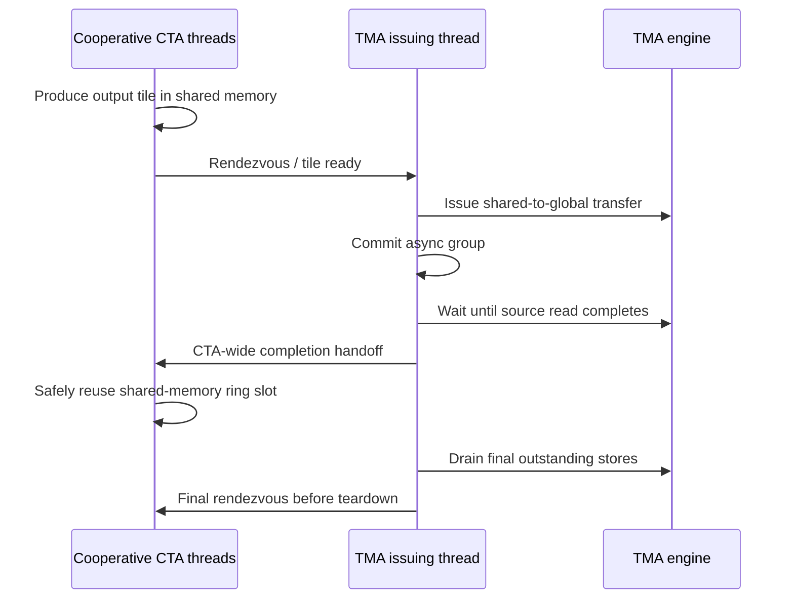

# [Common] Fix TMA synchronization in quantization kernels

[Upstream PR](https://github.com/NVIDIA/TransformerEngine/pull/3417) · state: closed · merged: True

## Original PR description

# Description

This PR fixes shared-memory reuse races, incomplete TMA store completion handling, and missing synchronization around TMA barrier initialization and invalidation across FP8, MXFP8, NVFP4, and Hadamard-fusion kernels.

## Motivation and root cause

The affected kernels use shared-memory ring buffers as the source of asynchronous TMA shared-to-global transfers. All threads cooperatively write an output tile, while a designated leader issues the TMA transfer and commits it into a bulk async-group.

Bulk async-groups are maintained per issuing thread. Only the issuing thread can wait for its outstanding groups. Calling `cp_async_bulk_wait_group_read<N>()` from other threads does not wait for the leader's transfers.

Some kernels lacked a CTA-wide synchronization point between the leader's completion wait and cooperative buffer reuse. Other threads could therefore overwrite shared memory while the TMA engine was still reading it, potentially causing timing-dependent output corruption.

The existing `fence.proxy.async.shared::cta` instructions remain necessary to make shared-memory writes visible to the TMA engine. However, they do not communicate the leader's subsequent completion wait to the rest of the CTA.

Additional synchronization gaps included:

- Output-buffer waits coupled to conditional input prefetch, allowing waits to be skipped on the final stage.
- Missing kernel-tail drains or source-read-only waits where full store completion was required.
- A hard-coded transposed-output ring size in tuned NVFP4 that could become incompatible with the configured prefetch depth.
- Barrier invalidation before all threads had finished waiting in grouped FP8 blockwise kernels.
- Missing publication fences after standalone TMA barrier initialization in Hadamard-fusion kernels.
- Missing compiler memory clobbers in several inline PTX synchronization wrappers.

## Type of change

- [ ] Documentation change
- [x] Bug fix (non-breaking change which fixes an issue)
- [ ] New feature
- [ ] Breaking change
- [ ] Infra/Build change
- [ ] Code refactoring

## Changes

- Added an explicit issuer-to-CTA completion handoff before shared-memory output buffers are reused. The issuing thread waits for the relevant TMA reads, and a subsequent `__syncthreads()` prevents cooperative writers from overwriting the buffer prematurely.

- Moved output-ring synchronization out of input-prefetch conditionals, so buffer lifetime is handled independently of whether another input stage will be prefetched.

- Corrected wait depths to follow the actual output-ring capacity.

- Added full issuer-only `cp_async_bulk_wait_group()` drains at kernel tails, including grouped scaled SwiGLU MXFP8. Added CTA rendezvous where needed before shared-memory state is released.

- Replaced final source-read-only waits with full completion waits in one-shot TMA store paths, including fused grouped requantization and square-blockwise quantize-transpose.

- Changed the tuned NVFP4 transposed-output ring to use `PREFETCH_STAGES + 1` buffers and added static assertions enforcing compatibility between ring capacity and store wait depth.

- Added compile-time MXFP8 pipeline invariants for persistent ring resets and configurations that rely on having no output-ring wrap.

- Moved CTA synchronization before `mbarrier.inval` in the grouped FP8 blockwise 1D and 2D TMA kernels, ensuring that every thread has finished waiting before the leader invalidates the barrier.

- Added `fence.mbarrier_init.release.cluster` after standalone TMA barrier initialization in five Hadamard-fusion kernels, before the CTA rendezvous and subsequent TMA loads.

- Added compiler `"memory"` clobbers to inline PTX wrappers for bulk async-group commit and waits, async proxy fences, tensormap acquire fences, barrier-initialization fences, and numbered `bar.sync`. These expose the synchronization instructions' memory effects to the compiler.

- Audited Transformer Engine's TMA load and store paths, including descriptor publication, barrier initialization and lifetime, shared-memory reuse, and final store completion. Existing mbarrier-based producer/consumer handoffs were preserved. Intermediate source-read waits protecting shared-memory reuse for `dbias` reduction remain intentional.

# Checklist:

- [x] I have read and followed the [contributing guidelines](https://github.com/NVIDIA/TransformerEngine/blob/main/CONTRIBUTING.rst)
- [x] The functionality is complete
- [x] I have commented my code, particularly in hard-to-understand areas
- [ ] I have made corresponding changes to the documentation
- [x] My changes generate no new warnings
- [ ] I have added tests that prove my fix is effective or that my feature works
- [x] New and existing unit tests pass locally with my changes

## Review and discussion

### reviews

- ptrendx · APPROVED · 2026-10-08T16:15:04Z · [source](https://github.com/NVIDIA/TransformerEngine/pull/3417#pullrequestreview-5459653072)

(No body; status only.)

### issue_comments

- Oleg-Goncharov · comment · 2026-08-22T16:03:46Z · [source](https://github.com/NVIDIA/TransformerEngine/pull/3417#issuecomment-5381315214)

/te-ci

- greptile-apps[bot] · comment · 2026-08-22T16:04:18Z · [source](https://github.com/NVIDIA/TransformerEngine/pull/3417#issuecomment-5381317622)

<!-- greptile_summary -->

<h2><a href="https://app.greptile.com/api/retrigger?id=55868128"><picture><source media="(prefers-color-scheme: dark)" srcset="https://greptile-static-assets.s3.amazonaws.com/badges/RetriggerDark.svg?v=2"><source media="(prefers-color-scheme: light)" srcset="https://greptile-static-assets.s3.amazonaws.com/badges/Retrigger.svg?v=2"></picture></a>Confidence Score: 5/5</h2>

**[High risk]** Fixes synchronization in GPU quantization kernels\.

The PR appears safe to merge.

<h3>Summary</h3>

The PR strengthens synchronization and lifetime handling for asynchronous TMA operations across FP8, MXFP8, NVFP4, blockwise transpose, and Hadamard-fusion kernels.
- Adds issuer-to-CTA rendezvous points before shared-memory output-ring reuse and drains outstanding stores at kernel tails.
- Corrects TMA barrier initialization and invalidation ordering.
- Adds compiler memory clobbers to inline PTX synchronization wrappers.
- Aligns output-ring capacities and wait depths with pipeline configurations.

<h3>Diagram</h3>

<!-- greptile_confidence_score:5 -->

Reviews (7) · Last reviewed commit: ["Merge branch &#39;main&#39; into pr\_fix\_TMA\_sync..."](https://github.com/nvidia/transformerengine/commit/f5bd2ad7bb8611c7f49e204478353126fdb1600e) · [Reviewed by Greptile](https://www.greptile.com/?utm_source=greptile_expert&utm_medium=github&utm_campaign=code_reviews&utm_content=nvidia/transformerengine)

- Oleg-Goncharov · comment · 2026-08-24T15:18:26Z · [source](https://github.com/NVIDIA/TransformerEngine/pull/3417#issuecomment-5397337918)

/te-ci

- Oleg-Goncharov · comment · 2026-09-11T17:31:11Z · [source](https://github.com/NVIDIA/TransformerEngine/pull/3417#issuecomment-5638246032)

/te-ci

- ptrendx · comment · 2026-10-08T16:14:31Z · [source](https://github.com/NVIDIA/TransformerEngine/pull/3417#issuecomment-6064151104)

/te-ci

### inline_comments

## Changed files and fixed code

- `transformer_engine/common/cast/core/grouped_tma.cuh` · modified · additions 2 / deletions 1
  - [head](https://github.com/Oleg-Goncharov/TransformerEngine/blob/f5bd2ad7bb8611c7f49e204478353126fdb1600e/transformer_engine/common/cast/core/grouped_tma.cuh)
  - [base](https://github.com/NVIDIA/TransformerEngine/blob/14be43fb924af0431d99e3fcc9043574b3afbefd/transformer_engine/common/cast/core/grouped_tma.cuh)
- `transformer_engine/common/cast/fp8/gated_fp8.cuh` · modified · additions 8 / deletions 1
  - [head](https://github.com/Oleg-Goncharov/TransformerEngine/blob/f5bd2ad7bb8611c7f49e204478353126fdb1600e/transformer_engine/common/cast/fp8/gated_fp8.cuh)
  - [base](https://github.com/NVIDIA/TransformerEngine/blob/14be43fb924af0431d99e3fcc9043574b3afbefd/transformer_engine/common/cast/fp8/gated_fp8.cuh)
- `transformer_engine/common/cast/fp8/quantize_fp8.cuh` · modified · additions 18 / deletions 4
  - [head](https://github.com/Oleg-Goncharov/TransformerEngine/blob/f5bd2ad7bb8611c7f49e204478353126fdb1600e/transformer_engine/common/cast/fp8/quantize_fp8.cuh)
  - [base](https://github.com/NVIDIA/TransformerEngine/blob/14be43fb924af0431d99e3fcc9043574b3afbefd/transformer_engine/common/cast/fp8/quantize_fp8.cuh)
- `transformer_engine/common/cast/fp8_blockwise/group_quantize_fp8_blockwise.cuh` · modified · additions 4 / deletions 2
  - [head](https://github.com/Oleg-Goncharov/TransformerEngine/blob/f5bd2ad7bb8611c7f49e204478353126fdb1600e/transformer_engine/common/cast/fp8_blockwise/group_quantize_fp8_blockwise.cuh)
  - [base](https://github.com/NVIDIA/TransformerEngine/blob/14be43fb924af0431d99e3fcc9043574b3afbefd/transformer_engine/common/cast/fp8_blockwise/group_quantize_fp8_blockwise.cuh)
- `transformer_engine/common/cast/fused_group_requantize.cu` · modified · additions 1 / deletions 1
  - [head](https://github.com/Oleg-Goncharov/TransformerEngine/blob/f5bd2ad7bb8611c7f49e204478353126fdb1600e/transformer_engine/common/cast/fused_group_requantize.cu)
  - [base](https://github.com/NVIDIA/TransformerEngine/blob/14be43fb924af0431d99e3fcc9043574b3afbefd/transformer_engine/common/cast/fused_group_requantize.cu)
- `transformer_engine/common/cast/mxfp8/dequantize_mxfp8.cuh` · modified · additions 9 / deletions 2
  - [head](https://github.com/Oleg-Goncharov/TransformerEngine/blob/f5bd2ad7bb8611c7f49e204478353126fdb1600e/transformer_engine/common/cast/mxfp8/dequantize_mxfp8.cuh)
  - [base](https://github.com/NVIDIA/TransformerEngine/blob/14be43fb924af0431d99e3fcc9043574b3afbefd/transformer_engine/common/cast/mxfp8/dequantize_mxfp8.cuh)
- `transformer_engine/common/cast/mxfp8/gated_mxfp8.cuh` · modified · additions 9 / deletions 4
  - [head](https://github.com/Oleg-Goncharov/TransformerEngine/blob/f5bd2ad7bb8611c7f49e204478353126fdb1600e/transformer_engine/common/cast/mxfp8/gated_mxfp8.cuh)
  - [base](https://github.com/NVIDIA/TransformerEngine/blob/14be43fb924af0431d99e3fcc9043574b3afbefd/transformer_engine/common/cast/mxfp8/gated_mxfp8.cuh)
- `transformer_engine/common/cast/mxfp8/group_dequantize_mxfp8.cuh` · modified · additions 9 / deletions 2
  - [head](https://github.com/Oleg-Goncharov/TransformerEngine/blob/f5bd2ad7bb8611c7f49e204478353126fdb1600e/transformer_engine/common/cast/mxfp8/group_dequantize_mxfp8.cuh)
  - [base](https://github.com/NVIDIA/TransformerEngine/blob/14be43fb924af0431d99e3fcc9043574b3afbefd/transformer_engine/common/cast/mxfp8/group_dequantize_mxfp8.cuh)
- `transformer_engine/common/cast/mxfp8/group_scaled_swiglu_mxfp8.cuh` · modified · additions 11 / deletions 5
  - [head](https://github.com/Oleg-Goncharov/TransformerEngine/blob/f5bd2ad7bb8611c7f49e204478353126fdb1600e/transformer_engine/common/cast/mxfp8/group_scaled_swiglu_mxfp8.cuh)
  - [base](https://github.com/NVIDIA/TransformerEngine/blob/14be43fb924af0431d99e3fcc9043574b3afbefd/transformer_engine/common/cast/mxfp8/group_scaled_swiglu_mxfp8.cuh)
- `transformer_engine/common/cast/mxfp8/quantize_mxfp8.cuh` · modified · additions 16 / deletions 4
  - [head](https://github.com/Oleg-Goncharov/TransformerEngine/blob/f5bd2ad7bb8611c7f49e204478353126fdb1600e/transformer_engine/common/cast/mxfp8/quantize_mxfp8.cuh)
  - [base](https://github.com/NVIDIA/TransformerEngine/blob/14be43fb924af0431d99e3fcc9043574b3afbefd/transformer_engine/common/cast/mxfp8/quantize_mxfp8.cuh)
- `transformer_engine/common/cast/mxfp8/specialized/quantize_mxfp8.cuh` · modified · additions 16 / deletions 6
  - [head](https://github.com/Oleg-Goncharov/TransformerEngine/blob/f5bd2ad7bb8611c7f49e204478353126fdb1600e/transformer_engine/common/cast/mxfp8/specialized/quantize_mxfp8.cuh)
  - [base](https://github.com/NVIDIA/TransformerEngine/blob/14be43fb924af0431d99e3fcc9043574b3afbefd/transformer_engine/common/cast/mxfp8/specialized/quantize_mxfp8.cuh)
- `transformer_engine/common/cast/nvfp4/group_quantize_transpose_nvfp4.cuh` · modified · additions 14 / deletions 4
  - [head](https://github.com/Oleg-Goncharov/TransformerEngine/blob/f5bd2ad7bb8611c7f49e204478353126fdb1600e/transformer_engine/common/cast/nvfp4/group_quantize_transpose_nvfp4.cuh)
  - [base](https://github.com/NVIDIA/TransformerEngine/blob/14be43fb924af0431d99e3fcc9043574b3afbefd/transformer_engine/common/cast/nvfp4/group_quantize_transpose_nvfp4.cuh)
- `transformer_engine/common/cast/nvfp4/quantize_transpose_nvfp4.cuh` · modified · additions 28 / deletions 8
  - [head](https://github.com/Oleg-Goncharov/TransformerEngine/blob/f5bd2ad7bb8611c7f49e204478353126fdb1600e/transformer_engine/common/cast/nvfp4/quantize_transpose_nvfp4.cuh)
  - [base](https://github.com/NVIDIA/TransformerEngine/blob/14be43fb924af0431d99e3fcc9043574b3afbefd/transformer_engine/common/cast/nvfp4/quantize_transpose_nvfp4.cuh)
- `transformer_engine/common/cast/nvfp4/specialized/quantize_transpose_nvfp4_tuned_1D.cuh` · modified · additions 16 / deletions 2
  - [head](https://github.com/Oleg-Goncharov/TransformerEngine/blob/f5bd2ad7bb8611c7f49e204478353126fdb1600e/transformer_engine/common/cast/nvfp4/specialized/quantize_transpose_nvfp4_tuned_1D.cuh)
  - [base](https://github.com/NVIDIA/TransformerEngine/blob/14be43fb924af0431d99e3fcc9043574b3afbefd/transformer_engine/common/cast/nvfp4/specialized/quantize_transpose_nvfp4_tuned_1D.cuh)
- `transformer_engine/common/hadamard_transform/graph_safe_group_row_cast_col_hadamard_transform_cast_fusion.cu` · modified · additions 2 / deletions 0
  - [head](https://github.com/Oleg-Goncharov/TransformerEngine/blob/f5bd2ad7bb8611c7f49e204478353126fdb1600e/transformer_engine/common/hadamard_transform/graph_safe_group_row_cast_col_hadamard_transform_cast_fusion.cu)
  - [base](https://github.com/NVIDIA/TransformerEngine/blob/14be43fb924af0431d99e3fcc9043574b3afbefd/transformer_engine/common/hadamard_transform/graph_safe_group_row_cast_col_hadamard_transform_cast_fusion.cu)
- `transformer_engine/common/hadamard_transform/group_hadamard_transform_cast_fusion.cu` · modified · additions 2 / deletions 0
  - [head](https://github.com/Oleg-Goncharov/TransformerEngine/blob/f5bd2ad7bb8611c7f49e204478353126fdb1600e/transformer_engine/common/hadamard_transform/group_hadamard_transform_cast_fusion.cu)
  - [base](https://github.com/NVIDIA/TransformerEngine/blob/14be43fb924af0431d99e3fcc9043574b3afbefd/transformer_engine/common/hadamard_transform/group_hadamard_transform_cast_fusion.cu)
- `transformer_engine/common/hadamard_transform/group_row_cast_col_hadamard_transform_cast_fusion.cu` · modified · additions 2 / deletions 0
  - [head](https://github.com/Oleg-Goncharov/TransformerEngine/blob/f5bd2ad7bb8611c7f49e204478353126fdb1600e/transformer_engine/common/hadamard_transform/group_row_cast_col_hadamard_transform_cast_fusion.cu)
  - [base](https://github.com/NVIDIA/TransformerEngine/blob/14be43fb924af0431d99e3fcc9043574b3afbefd/transformer_engine/common/hadamard_transform/group_row_cast_col_hadamard_transform_cast_fusion.cu)
- `transformer_engine/common/hadamard_transform/hadamard_transform_cast_fusion.cu` · modified · additions 2 / deletions 0
  - [head](https://github.com/Oleg-Goncharov/TransformerEngine/blob/f5bd2ad7bb8611c7f49e204478353126fdb1600e/transformer_engine/common/hadamard_transform/hadamard_transform_cast_fusion.cu)
  - [base](https://github.com/NVIDIA/TransformerEngine/blob/14be43fb924af0431d99e3fcc9043574b3afbefd/transformer_engine/common/hadamard_transform/hadamard_transform_cast_fusion.cu)
- `transformer_engine/common/hadamard_transform/row_cast_col_hadamard_transform_cast_fusion.cu` · modified · additions 2 / deletions 0
  - [head](https://github.com/Oleg-Goncharov/TransformerEngine/blob/f5bd2ad7bb8611c7f49e204478353126fdb1600e/transformer_engine/common/hadamard_transform/row_cast_col_hadamard_transform_cast_fusion.cu)
  - [base](https://github.com/NVIDIA/TransformerEngine/blob/14be43fb924af0431d99e3fcc9043574b3afbefd/transformer_engine/common/hadamard_transform/row_cast_col_hadamard_transform_cast_fusion.cu)
- `transformer_engine/common/transpose/quantize_transpose_square_blockwise.cu` · modified · additions 2 / deletions 2
  - [head](https://github.com/Oleg-Goncharov/TransformerEngine/blob/f5bd2ad7bb8611c7f49e204478353126fdb1600e/transformer_engine/common/transpose/quantize_transpose_square_blockwise.cu)
  - [base](https://github.com/NVIDIA/TransformerEngine/blob/14be43fb924af0431d99e3fcc9043574b3afbefd/transformer_engine/common/transpose/quantize_transpose_square_blockwise.cu)
- `transformer_engine/common/util/ptx.cuh` · modified · additions 11 / deletions 11
  - [head](https://github.com/Oleg-Goncharov/TransformerEngine/blob/f5bd2ad7bb8611c7f49e204478353126fdb1600e/transformer_engine/common/util/ptx.cuh)
  - [base](https://github.com/NVIDIA/TransformerEngine/blob/14be43fb924af0431d99e3fcc9043574b3afbefd/transformer_engine/common/util/ptx.cuh)

## Evidence and interpretation boundary

[Original JSON, discussions and patches](../../../../../../evidence/prs/NVIDIA--TransformerEngine/3417-e8e29c66005423201f2ec54cfd35273e6688988883c904b8393d0187bb5802a5.json) · SHA-256 `e8e29c66005423201f2ec54cfd35273e6688988883c904b8393d0187bb5802a5`.

Diff complete: True. Missing/binary/truncated patches require pinned source inspection. This is a source page, not an independently verified optimization case. Open, merged and released are different states; recheck the deployed dependency.
