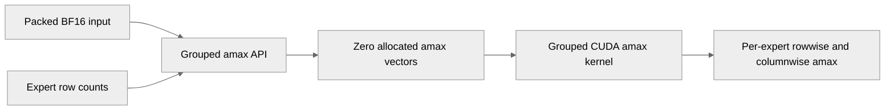

# [Common] row-scaled nvfp4 path: add single-launch group fused amax 

[Upstream PR](https://github.com/NVIDIA/TransformerEngine/pull/3467) · state: closed · merged: True

## Original PR description

# Description

Adds a single-kernel row/col amax pass for grouped (MoE) row-scaled NVFP4. It replaces the per-expert loop of `compute_rowwise_amax` + `compute_columnwise_amax` with one launch over a packed `(sum_M, K)` input, exposed as `nvte_group_nvfp4_compute_amax`. The kernel is the grouped generalization of #3454 - the single-tensor `compute_fused_amax_kernel` (same tiling / SMEM pipeline / acquire-barrier reduction). A single input TMA map covers all experts; per-expert amax vectors are selected via a prefix sum of row counts, so a 128-row chunk always lands in one expert.

## Type of change

- [ ] Documentation change (change only to the documentation, either a fix or a new content)
- [ ] Bug fix (non-breaking change which fixes an issue)
- [ ] New feature (non-breaking change which adds functionality)
- [ ] Breaking change (fix or feature that would cause existing functionality to not work as expected)
- [ ] Infra/Build change
- [x] Code refactoring

## Changes
New gtest `tests/cpp/operator/test_row_scaled_nvfp4_grouped_amax.cu`:
- `NVFP4GroupedRowScaledAmaxTestSuite.MatchesPerExpertOracle` — grouped amax vs a CPU per-row/per-col `max(|x|)` reference over the same BF16 bytes, plus cross-launch determinism, across 6 expert/shape configs.
- `DISABLED_LoopVsGrouped` — microbench comparing the same kernel called per-expert (loop)
  vs once (grouped).
  
```bash
cmake -Btests/cpp/build tests/cpp && cmake --build tests/cpp/build -j
./tests/cpp/build/operator/test_operator --gtest_filter='*NVFP4GroupedRowScaledAmax*'
./tests/cpp/build/operator/test_operator --gtest_also_run_disabled_tests --gtest_filter='*GroupedRowScaledAmaxBench*'
```    
    
### Performance
Same kernel called per-expert (loop) vs a single grouped launch, GB200, K=4096. Speedup is loop / grouped.

| experts | M=128 loop→grouped (ms) | speedup | M=512 loop→grouped (ms) | speedup |
|---|---|---|---|---|
| 2  | 0.0179 → 0.0117 | 1.52x | 0.0180 → 0.0124 | 1.45x |
| 4  | 0.0288 → 0.0120 | 2.39x | 0.0271 → 0.0138 | 1.97x |
| 8  | 0.0513 → 0.0124 | 4.15x | 0.0514 → 0.0165 | 3.11x |
| 16 | 0.0950 → 0.0140 | 6.81x | 0.0960 → 0.0238 | 4.04x |
| 32 | 0.1852 → 0.0173 | 10.70x | 0.2009 → 0.0370 | 5.43x |
| 64 | 0.3631 → 0.0232 | 15.65x | 0.3960 → 0.0607 | 6.53x |  


# Checklist:

- [ ] I have read and followed the [contributing guidelines](https://github.com/NVIDIA/TransformerEngine/blob/main/CONTRIBUTING.rst)
- [ ] The functionality is complete
- [ ] I have commented my code, particularly in hard-to-understand areas
- [ ] I have made corresponding changes to the documentation
- [ ] My changes generate no new warnings
- [ ] I have added tests that prove my fix is effective or that my feature works
- [x] New and existing unit tests pass locally with my changes


## Review and discussion

### reviews

- greptile-apps[bot] · COMMENTED · 2026-09-03T00:32:19Z · [source](https://github.com/NVIDIA/TransformerEngine/pull/3467#pullrequestreview-5096597007)

(No body; status only.)

- timmoon10 · APPROVED · 2026-09-15T01:13:30Z · [source](https://github.com/NVIDIA/TransformerEngine/pull/3467#pullrequestreview-5204509030)

LGTM, pending CI.

- timmoon10 · COMMENTED · 2026-10-26T18:20:13Z · [source](https://github.com/NVIDIA/TransformerEngine/pull/3467#pullrequestreview-5656946233)

(No body; status only.)

- timmoon10 · COMMENTED · 2026-10-26T19:05:50Z · [source](https://github.com/NVIDIA/TransformerEngine/pull/3467#pullrequestreview-5657531712)

(No body; status only.)

- timmoon10 · COMMENTED · 2026-10-26T22:24:59Z · [source](https://github.com/NVIDIA/TransformerEngine/pull/3467#pullrequestreview-5659931648)

(No body; status only.)

### issue_comments

- greptile-apps[bot] · comment · 2026-09-03T00:32:15Z · [source](https://github.com/NVIDIA/TransformerEngine/pull/3467#issuecomment-5518474371)

<!-- greptile_summary -->

<h2><a href="https://app.greptile.com/api/retrigger?id=59766066"><picture><source media="(prefers-color-scheme: dark)" srcset="https://greptile-static-assets.s3.amazonaws.com/badges/RetriggerDark.svg?v=2"><source media="(prefers-color-scheme: light)" srcset="https://greptile-static-assets.s3.amazonaws.com/badges/Retrigger.svg?v=2"></picture></a>Confidence Score: 5/5</h2>

**[Medium risk]** Adds grouped amax computation for row\-scaled quantization\.

The PR appears safe to merge based on the reviewed changes and the fixes for both previous findings.

<h3>Summary</h3>

The PR adds a grouped NVFP4 amax API and CUDA path that computes per-expert rowwise and columnwise maxima from packed BF16 input, with C++ correctness tests and a disabled benchmark. The current code checks column alignment and skips null per-expert amax buffers, addressing both previous findings.

<h3>Diagram</h3>



<!-- greptile_confidence_score:5 -->

<sub>Reviews (7) · Last reviewed commit: ["Merge branch &#39;main&#39; into pr/nvfp4-row-sc..."](https://github.com/nvidia/transformerengine/commit/dc6685398c8ca16d6469cc8a2b7da0a77c9f4245)</sub>

- timmoon10 · comment · 2026-09-15T01:13:55Z · [source](https://github.com/NVIDIA/TransformerEngine/pull/3467#issuecomment-5673164875)

/te-ci core

- timmoon10 · comment · 2026-09-23T17:40:02Z · [source](https://github.com/NVIDIA/TransformerEngine/pull/3467#issuecomment-5799836568)

/te-ci core

- timmoon10 · comment · 2026-09-28T17:39:53Z · [source](https://github.com/NVIDIA/TransformerEngine/pull/3467#issuecomment-5875338470)

/te-ci core

### inline_comments

- greptile-apps[bot] · comment · 2026-09-03T00:32:18Z · [source](https://github.com/NVIDIA/TransformerEngine/pull/3467#discussion_r3919949770)

File: `transformer_engine/common/cast/nvfp4/group_quantize_transpose_nvfp4.cuh` · line 337

<a href="#"></a> **Grid truncates trailing columns**

When `cols` is not divisible by 128, `cols / FA_CHUNK_DIM_X` silently omits the trailing columns, causing their columnwise amax values to remain zero or stale. The public entry point calls this launcher directly, so the alignment check in `group_fused_amax_supported` does not enforce this kernel requirement.

```suggestion
  NVTE_CHECK(cols % FA_CHUNK_DIM_X == 0,
             "Number of input columns must be a multiple of ", FA_CHUNK_DIM_X);
  const dim3 grid(static_cast<unsigned>(cols / FA_CHUNK_DIM_X),
                  static_cast<unsigned>(rows / FA_CHUNK_DIM_Y), 1);
```

**Knowledge Base Used:** [Native CUDA kernel platform](https://app.greptile.com/nvidia-public-github/-/custom-context/knowledge-base/nvidia/transformerengine/-/docs/native-kernels.md)

- greptile-apps[bot] · comment · 2026-09-03T00:32:18Z · [source](https://github.com/NVIDIA/TransformerEngine/pull/3467#discussion_r3919949781)

File: `transformer_engine/common/cast/nvfp4/group_quantize_transpose_nvfp4.cuh` · line None

<a href="#"></a> **Shared flags permit null atomics**

When the first non-empty expert allocates an amax direction but a later expert omits that optional buffer, the global `do_row` or `do_col` flag remains enabled while the later pointer is null. The specialized kernel then unconditionally performs `atomicMaxFloat` through that null pointer, causing a CUDA illegal-memory-access failure.

**Knowledge Base Used:** [Native CUDA kernel platform](https://app.greptile.com/nvidia-public-github/-/custom-context/knowledge-base/nvidia/transformerengine/-/docs/native-kernels.md)

- timmoon10 · comment · 2026-10-26T18:20:13Z · [source](https://github.com/NVIDIA/TransformerEngine/pull/3467#discussion_r4380895755)

File: `transformer_engine/common/include/transformer_engine/cast.h` · line 515

This function name does not mention row-scaled NVFP4 and the API is natural for both 
tensor-scaled NVFP4 and row-scaled NVFP4. We only support row-scaled NVFP4 currently, so we should add an internal check to error out if tensor-scaled NVFP4 tensors are provided. The docs mention that this is specific to row-scaled NVFP4, but that's very flimsy.

- timmoon10 · comment · 2026-10-26T19:05:49Z · [source](https://github.com/NVIDIA/TransformerEngine/pull/3467#discussion_r4381339798)

File: `transformer_engine/common/include/transformer_engine/cast.h` · line 515

Also, this API is redundant with `nvte_group_amax`: https://github.com/NVIDIA/TransformerEngine/blob/5d7bbd851d8e6a64e5ea2460c37ff8be823a29c4/transformer_engine/common/include/transformer_engine/multi_tensor.h#L313

- timmoon10 · comment · 2026-10-26T22:24:59Z · [source](https://github.com/NVIDIA/TransformerEngine/pull/3467#discussion_r4383183124)

File: `transformer_engine/common/include/transformer_engine/cast.h` · line 515

https://github.com/NVIDIA/TransformerEngine/pull/3649 deprecates this function in favor of `nvte_group_amax`.

## Changed files and fixed code

- `tests/cpp/operator/CMakeLists.txt` · modified · additions 1 / deletions 0
  - [head](https://github.com/cael-ling/TransformerEngine/blob/dc6685398c8ca16d6469cc8a2b7da0a77c9f4245/tests/cpp/operator/CMakeLists.txt)
  - [base](https://github.com/NVIDIA/TransformerEngine/blob/b86c660bbb9201b6abd12e781bbbc255a2f84ce8/tests/cpp/operator/CMakeLists.txt)
- `tests/cpp/operator/test_row_scaled_nvfp4_grouped_amax.cu` · added · additions 299 / deletions 0
  - [head](https://github.com/cael-ling/TransformerEngine/blob/dc6685398c8ca16d6469cc8a2b7da0a77c9f4245/tests/cpp/operator/test_row_scaled_nvfp4_grouped_amax.cu)
  - [base](https://github.com/NVIDIA/TransformerEngine/blob/b86c660bbb9201b6abd12e781bbbc255a2f84ce8/tests/cpp/operator/test_row_scaled_nvfp4_grouped_amax.cu)
- `transformer_engine/common/cast/cast_grouped.cu` · modified · additions 19 / deletions 0
  - [head](https://github.com/cael-ling/TransformerEngine/blob/dc6685398c8ca16d6469cc8a2b7da0a77c9f4245/transformer_engine/common/cast/cast_grouped.cu)
  - [base](https://github.com/NVIDIA/TransformerEngine/blob/b86c660bbb9201b6abd12e781bbbc255a2f84ce8/transformer_engine/common/cast/cast_grouped.cu)
- `transformer_engine/common/cast/nvfp4/group_quantize_transpose_nvfp4.cuh` · modified · additions 323 / deletions 0
  - [head](https://github.com/cael-ling/TransformerEngine/blob/dc6685398c8ca16d6469cc8a2b7da0a77c9f4245/transformer_engine/common/cast/nvfp4/group_quantize_transpose_nvfp4.cuh)
  - [base](https://github.com/NVIDIA/TransformerEngine/blob/b86c660bbb9201b6abd12e781bbbc255a2f84ce8/transformer_engine/common/cast/nvfp4/group_quantize_transpose_nvfp4.cuh)
- `transformer_engine/common/include/transformer_engine/cast.h` · modified · additions 20 / deletions 0
  - [head](https://github.com/cael-ling/TransformerEngine/blob/dc6685398c8ca16d6469cc8a2b7da0a77c9f4245/transformer_engine/common/include/transformer_engine/cast.h)
  - [base](https://github.com/NVIDIA/TransformerEngine/blob/b86c660bbb9201b6abd12e781bbbc255a2f84ce8/transformer_engine/common/include/transformer_engine/cast.h)

## Evidence and interpretation boundary

[Original JSON, discussions and patches](../../../../../../evidence/prs/NVIDIA--TransformerEngine/3467-38ec68b2bb6aa47d8a8481bdda67ee760f3c3548ae706dd123fb17ddaae2d2df.json) · SHA-256 `38ec68b2bb6aa47d8a8481bdda67ee760f3c3548ae706dd123fb17ddaae2d2df`.

Diff complete: True. Missing/binary/truncated patches require pinned source inspection. This is a source page, not an independently verified optimization case. Open, merged and released are different states; recheck the deployed dependency.
