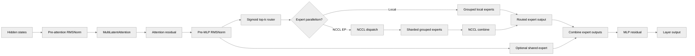

# [PyTorch] DeepSeekV3Layer: full MoE transformer layer (MLA + DeepSeek MoE)

[Upstream PR](https://github.com/NVIDIA/TransformerEngine/pull/3471) · state: open · merged: False

## Original PR description

# Description

Adds `transformer_engine.pytorch.models`, a namespace for model-specific layers built from TE modules, with a DeepSeek-V3 transformer layer analogous to `TransformerLayer`.

- **`MultiLatentAttention`**: low-rank q/kv latents with RMSNorm fused into the up-projections, decoupled RoPE/NoPE heads, `DotProductAttention` with asymmetric head dims (cuDNN fused attention), fused Triton MLA RoPE kernels, optional YaRN scaling, TP.
- **`DeepSeekV3MoE`**: fused sigmoid router with aux-loss-free bias and grouped top-k, experts as `te.ops.Sequential(GroupedLinear, ScaledSwiGLU, GroupedLinear)` (auto-fuses into the CuTe grouped MLP where available), local routing or expert parallelism over NCCL EP, optional shared expert.
- **`DeepSeekV3Layer`**: pre-RMSNorm + MLA, then dense `LayerNormMLP` or `DeepSeekV3MoE`, residual connections.

## Type of change

- [ ] Documentation change (change only to the documentation, either a fix or a new content)
- [ ] Bug fix (non-breaking change which fixes an issue)
- [x] New feature (non-breaking change which adds functionality)
- [ ] Breaking change (fix or feature that would cause existing functionality to not work as expected)
- [ ] Infra/Build change
- [ ] Code refactoring

## Changes

- `transformer_engine/pytorch/models/deepseek_v3/`: `MultiLatentAttention`, `DeepSeekV3MoE`, `DeepSeekV3Layer`, MLA RoPE kernels; exported via `transformer_engine.pytorch.models`
- Docs: `Model-specific layers` section in `docs/api/pytorch.rst`
- Tests: `tests/pytorch/test_models.py` (RoPE, YaRN, MoE vs dense reference), `test_sanity.py::test_sanity_deepseek_v3_layer` (all recipes), `tests/pytorch/distributed/test_models.py` (EP vs all-experts-local, L1)
- `examples/pytorch/deepseek_v3/`: runnable EP example with a plain-PyTorch MoE baseline and a README with measurements
- Follow-up: optional seq-wise aux loss

## Performance

`DeepSeekV3Layer` with DeepSeek-V3 dims, 8 experts per rank, top-k 8, 4096 tokens per rank, fwd+bwd, bf16 unless noted. GB300, 4 GPUs per node, one NVLink domain. `naive` = torch `all_to_all_single` + Python loop of per-expert MLPs, `naive_grouped` = same all_to_all with a TE grouped GEMM, `te` = `DeepSeekV3MoE`. Attention and norms identical in all three.

| ms / iteration (median of 3 runs) | 4 GPUs | 8 GPUs |
|---|---|---|
| `naive` | 27.0 | 27.4 |
| `naive_grouped` | 16.5 | 16.9 |
| `te` | 12.4 | 14.0 |
| `te`, MXFP8 | 10.3 | 12.1 |
| `te`, MXFP8 fused grouped MLP | 9.5 | 10.5 |

Where the time goes in the optimized variant (`te`, MXFP8 fused, 8 GPUs), per GPU and iteration, from `nsys stats --report cuda_gpu_kern_sum` (kernel time 10.8 ms, iteration 10.5 ms without the profiler; no memsets or copies left):

| Group | ms | Kernels |
|---|---:|---|
| NCCL EP all-to-all | 2.3 | `nccl_ep_jit_ht_dispatch_kernel` (1.05), `nccl_ep_jit_ht_combine_kernel` (1.29), each twice per iteration (fwd + bwd) |
| NCCL EP local permute | 0.6 | `local_permute_dup/reduce`: staging buffer to expert-major layout, zero-filled padding |
| rank skew wait | 0.5 | `ncclDevKernel_AllGather_RING_LL` (routing-map all-gather in prepare, ~0.06 ms of transfer); the first collective of the layer absorbs load imbalance between ranks |
| fused grouped MLP (cuDNN, MXFP8) | 2.4 | fc1+SwiGLU fwd (0.53), fc2 fwd (0.82), dGLU bwd (0.31), wgrad (0.78) |
| MXFP8 quantization | 1.1 | `group_quantize_mxfp8` on the recv buffer (0.4), `quantize_mxfp8_kernel_cast_only` for dense GEMM inputs (0.7) |
| dense MXFP8 GEMMs (MLA projections, shared expert) | 1.4 | `nvjet_sm103_qqtst_*` |
| attention (cuDNN SDPA) | 0.9 | flash fprop (0.18) + bprop (0.51) + dq / dO helpers |
| RMSNorm, RoPE, adds | 0.8 | `rmsnorm_fwd/bwd` (0.39), `rotary_*_kv` (0.18), residual adds (0.2) |

For comparison the `naive` variant spends 3.4 ms in all_to_all, 6.5 ms in 8 separate GEMM pairs, and ~12 ms in indexing, zero-fills, copies and adds; `naive_grouped` removes the loop (about 10.5 ms) and NCCL EP the remaining all_to_all plus sort / gather / scatter overhead (2.9 ms on 8 GPUs). Full breakdowns in `examples/pytorch/deepseek_v3/README.md`.

# Checklist:

- [x] I have read and followed the [contributing guidelines](https://github.com/NVIDIA/TransformerEngine/blob/main/CONTRIBUTING.rst)
- [ ] The functionality is complete
- [x] I have commented my code, particularly in hard-to-understand areas
- [x] I have made corresponding changes to the documentation
- [x] My changes generate no new warnings
- [x] I have added tests that prove my fix is effective or that my feature works
- [x] New and existing unit tests pass locally with my changes

🤖 Generated with [Claude Code](https://claude.com/claude-code)


## Review and discussion

### reviews

- greptile-apps[bot] · COMMENTED · 2026-09-09T18:52:11Z · [source](https://github.com/NVIDIA/TransformerEngine/pull/3471#pullrequestreview-5158529261)

(No body; status only.)

- pggPL · COMMENTED · 2026-09-10T10:27:19Z · [source](https://github.com/NVIDIA/TransformerEngine/pull/3471#pullrequestreview-5165911167)

(No body; status only.)

- pggPL · COMMENTED · 2026-09-10T10:27:23Z · [source](https://github.com/NVIDIA/TransformerEngine/pull/3471#pullrequestreview-5165911719)

(No body; status only.)

- cyanguwa · COMMENTED · 2026-09-16T13:18:20Z · [source](https://github.com/NVIDIA/TransformerEngine/pull/3471#pullrequestreview-5223199898)

(No body; status only.)

- greptile-apps[bot] · COMMENTED · 2026-09-30T16:11:18Z · [source](https://github.com/NVIDIA/TransformerEngine/pull/3471#pullrequestreview-5368902590)

(No body; status only.)

- vthumbe1503 · COMMENTED · 2026-09-30T21:33:45Z · [source](https://github.com/NVIDIA/TransformerEngine/pull/3471#pullrequestreview-5372240702)

(No body; status only.)

- greptile-apps[bot] · COMMENTED · 2026-10-01T09:12:33Z · [source](https://github.com/NVIDIA/TransformerEngine/pull/3471#pullrequestreview-5377285006)

(No body; status only.)

- greptile-apps[bot] · COMMENTED · 2026-10-01T10:09:36Z · [source](https://github.com/NVIDIA/TransformerEngine/pull/3471#pullrequestreview-5377875376)

(No body; status only.)

- vthumbe1503 · COMMENTED · 2026-10-05T07:30:32Z · [source](https://github.com/NVIDIA/TransformerEngine/pull/3471#pullrequestreview-5411253740)

(No body; status only.)

- ksivaman · COMMENTED · 2026-10-20T21:31:43Z · [source](https://github.com/NVIDIA/TransformerEngine/pull/3471#pullrequestreview-5592002359)

(No body; status only.)

### issue_comments

- greptile-apps[bot] · comment · 2026-09-09T18:52:06Z · [source](https://github.com/NVIDIA/TransformerEngine/pull/3471#issuecomment-5607070335)

<!-- greptile_summary -->

<h2><a href="https://app.greptile.com/api/retrigger?id=62253380"><picture><source media="(prefers-color-scheme: dark)" srcset="https://greptile-static-assets.s3.amazonaws.com/badges/RetriggerDark.svg?v=2"><source media="(prefers-color-scheme: light)" srcset="https://greptile-static-assets.s3.amazonaws.com/badges/Retrigger.svg?v=2"></picture></a>Confidence Score: 4/5</h2>

**[Medium risk]** Adds new model layers for DeepSeek\-V3 architecture\.

The PR is not yet safe to merge because DeepSeekV3MoE construction with expert parallelism still requires bootstrap to have already occurred.

<h2>Findings</h2>

1. &nbsp;**Model construction requires bootstrap** <a href="https://github.com/NVIDIA/TransformerEngine/pull/3471#discussion_r4154232692">▶</a>
2. &nbsp;**Benchmark provenance removed** <a href="https://github.com/NVIDIA/TransformerEngine/pull/3471#discussion_r4153747364">▶</a>

<h3>Summary</h3>

Adds model-specific PyTorch layers implementing a complete DeepSeek-V3 transformer block.
- Introduces multi-latent attention with fused MLA RoPE, YaRN scaling, tensor parallelism, and asymmetric attention dimensions.
- Adds local and NCCL expert-parallel DeepSeek MoE implementations with grouped routing and an optional shared expert.
- Exposes `DeepSeekV3Layer` through the public PyTorch models namespace.
- Adds unit, numerical, distributed, and sanity coverage plus an expert-parallel benchmark example and API documentation.

<h3>Diagram</h3>



<!-- greptile_confidence_score:4 -->

<sub>Reviews (11) · Last reviewed commit: ["Remove kernel error handling changes fro..."](https://github.com/nvidia/transformerengine/commit/21781c31db7e7311068292a07fc9558446fd5463) · [Reviewed by Greptile](https://www.greptile.com/?utm_source=greptile_expert&utm_medium=github&utm_campaign=code_reviews&utm_content=nvidia/transformerengine)</sub>

- pggPL · comment · 2026-09-10T11:36:32Z · [source](https://github.com/NVIDIA/TransformerEngine/pull/3471#issuecomment-5618032966)

Hi @vthumbe1503 @phu0ngng this is PR with DeepSeek layer which uses fused MLP and EP, can you have a look?

### inline_comments

- greptile-apps[bot] · comment · 2026-09-09T18:52:10Z · [source](https://github.com/NVIDIA/TransformerEngine/pull/3471#discussion_r3971935580)

File: `transformer_engine/pytorch/models/deepseek_v3/moe.py` · line 140

<a href="#"></a> **Incomplete grouping configuration**

`num_groups` and `group_topk` are accepted independently and forwarded without validation. If only `num_groups` is supplied, grouped routing is silently disabled; if only `group_topk` is supplied, the fused backend raises a runtime error. Require both options together and validate their ranges during construction so partially configured MoE layers cannot route differently from the requested policy.

- greptile-apps[bot] · comment · 2026-09-09T18:52:10Z · [source](https://github.com/NVIDIA/TransformerEngine/pull/3471#discussion_r3971935589)

File: `tests/pytorch/distributed/run_models.py` · line 142

<a href="#"></a> **Reduced counts are discarded**

The test all-reduces a clone of `_last_tokens_per_expert`, but never writes the reduced counts back before calling `update_expert_bias()`. The update therefore still uses each rank's local counts, while the test only checks that the resulting bias is finite. This lets the test pass even if replicated expert biases diverge across ranks; use the reduced counts for the update or compare the resulting biases across ranks.

- pggPL · comment · 2026-09-10T10:27:19Z · [source](https://github.com/NVIDIA/TransformerEngine/pull/3471#discussion_r3978089091)

File: `transformer_engine/pytorch/models/deepseek_v3/moe.py` · line 140

Fixed in 2f7859ae. The constructor now requires num_groups and group_topk together and validates positive ranges, expert/group divisibility, topk/group_topk divisibility, and per-group capacity before allocating parameters. Added 13 invalid-configuration regression cases; the model suite passes (28 tests).

- pggPL · comment · 2026-09-10T10:27:23Z · [source](https://github.com/NVIDIA/TransformerEngine/pull/3471#discussion_r3978089576)

File: `tests/pytorch/distributed/run_models.py` · line 142

Fixed in 2f7859ae. The test now stores the counts reduced over ep_group back on the MoE before update_expert_bias(), checks the exact expected bias, and gathers biases to verify equality across ranks. A separate two-process CPU/Gloo check with deliberately different local counts passed. The full EP test remains unrun here because the workstation has only one GPU.

- cyanguwa · comment · 2026-09-16T13:18:20Z · [source](https://github.com/NVIDIA/TransformerEngine/pull/3471#discussion_r4026473291)

File: `transformer_engine/pytorch/attention/mla_rope.py` · line None

I wonder if this file should sit together with our other RoPE implementations, i.e. in transformer_engine/pytorch/attention? I feel this models/ directory should contain only the model-level/higher-level implementations.

- greptile-apps[bot] · comment · 2026-09-30T16:11:16Z · [source](https://github.com/NVIDIA/TransformerEngine/pull/3471#discussion_r4146749242)

File: `transformer_engine/pytorch/models/deepseek_v3/multi_latent_attention.py` · line 232

<a href="#"></a> **Attention checkpointing is unavailable**

For long-context DeepSeekV3 training, removing `checkpoint_core_attention` from this method and `DeepSeekV3Layer.forward` leaves no way to request core-attention activation checkpointing. `DotProductAttention` supports it, but this layer always uses the non-checkpointed path, so workloads that rely on checkpointing to fit in GPU memory can run out of memory.

- greptile-apps[bot] · comment · 2026-09-30T16:11:16Z · [source](https://github.com/NVIDIA/TransformerEngine/pull/3471#discussion_r4146749253)

File: `examples/pytorch/deepseek_v3/deepseek_v3_layer_ep.py` · line 279

<a href="#"></a> **Invalid runs appear successful**

The benchmark no longer checks whether its final output or gradients are finite. If a run produces NaN or infinite values, it still prints throughput and exits successfully, so an invalid run can be mistaken for a valid performance result.

- vthumbe1503 · comment · 2026-09-30T21:33:45Z · [source](https://github.com/NVIDIA/TransformerEngine/pull/3471#discussion_r4149559775)

File: `transformer_engine/pytorch/models/deepseek_v3/moe.py` · line 277

I think it might make sense to use the te.Sequential to define the entire MOE block after this PR gets merged.
https://github.com/NVIDIA/TransformerEngine/pull/3503/
 Would be more cleaner from API usage standpoint


- greptile-apps[bot] · comment · 2026-10-01T09:12:32Z · [source](https://github.com/NVIDIA/TransformerEngine/pull/3471#discussion_r4153747364)

File: `examples/pytorch/deepseek_v3/README.md` · line 10

<a href="#"></a> **Benchmark provenance removed**

The benchmark results no longer identify when they were measured or which commit was used. That makes the reported timings harder to reproduce or compare with later changes. Please keep the measurement date and commit alongside the results.

```suggestion
Every number is the median of three independent runs (spread within 0.3 ms).
Measured on September 30, 2026, at commit
[`939c9db3`](https://github.com/NVIDIA/TransformerEngine/commit/939c9db36afcdb2617392bab57b4249c7cd4bcb0),
before the subsequent merge of `main`.
```

Note: If this suggestion doesn't match your team's coding style, reply to this and let me know. I'll remember it for next time!

- greptile-apps[bot] · comment · 2026-10-01T10:09:34Z · [source](https://github.com/NVIDIA/TransformerEngine/pull/3471#discussion_r4154232692)

File: `transformer_engine/pytorch/models/deepseek_v3/moe.py` · line 168

<a href="#"></a> **Model construction requires bootstrap**

If a caller builds a `DeepSeekV3MoE` with `ep_group` before calling `ep_bootstrap()`, this new check raises during construction. Previously, bootstrap was required when creating the EP buffer for forward, so callers could build the model first and bootstrap before execution. That workflow can no longer instantiate the layer.

- vthumbe1503 · comment · 2026-10-05T07:30:33Z · [source](https://github.com/NVIDIA/TransformerEngine/pull/3471#discussion_r4181622933)

File: `transformer_engine/pytorch/ops/basic/combine.py` · line 108

I intentionally left out supporting zero copy from the ops since my understanding the new nccl ep implementation beats the zero copy implementation. Also zero copy is quite error prone.

This change essentially enabes to do that. I dont think we need this and for the changes in dispatch.py as well.

cc: @phu0ngng 

- ksivaman · comment · 2026-10-20T21:31:43Z · [source](https://github.com/NVIDIA/TransformerEngine/pull/3471#discussion_r4330546615)

File: `transformer_engine/pytorch/models/deepseek_v3/multi_latent_attention.py` · line 1

Should be under te/attention

## Changed files and fixed code

- `docs/api/pytorch.rst` · modified · additions 38 / deletions 4
  - [head](https://github.com/pggPL/TransformerEngine/blob/21781c31db7e7311068292a07fc9558446fd5463/docs/api/pytorch.rst)
  - [base](https://github.com/NVIDIA/TransformerEngine/blob/a16bce3a647e4277b78c6426e70b9c6d4a1135dd/docs/api/pytorch.rst)
- `examples/pytorch/deepseek_v3/README.md` · added · additions 223 / deletions 0
  - [head](https://github.com/pggPL/TransformerEngine/blob/21781c31db7e7311068292a07fc9558446fd5463/examples/pytorch/deepseek_v3/README.md)
  - [base](https://github.com/NVIDIA/TransformerEngine/blob/a16bce3a647e4277b78c6426e70b9c6d4a1135dd/examples/pytorch/deepseek_v3/README.md)
- `examples/pytorch/deepseek_v3/deepseek_v3_layer_ep.py` · added · additions 283 / deletions 0
  - [head](https://github.com/pggPL/TransformerEngine/blob/21781c31db7e7311068292a07fc9558446fd5463/examples/pytorch/deepseek_v3/deepseek_v3_layer_ep.py)
  - [base](https://github.com/NVIDIA/TransformerEngine/blob/a16bce3a647e4277b78c6426e70b9c6d4a1135dd/examples/pytorch/deepseek_v3/deepseek_v3_layer_ep.py)
- `examples/pytorch/deepseek_v3/run_deepseek_v3_layer_ep.sh` · added · additions 35 / deletions 0
  - [head](https://github.com/pggPL/TransformerEngine/blob/21781c31db7e7311068292a07fc9558446fd5463/examples/pytorch/deepseek_v3/run_deepseek_v3_layer_ep.sh)
  - [base](https://github.com/NVIDIA/TransformerEngine/blob/a16bce3a647e4277b78c6426e70b9c6d4a1135dd/examples/pytorch/deepseek_v3/run_deepseek_v3_layer_ep.sh)
- `qa/L0_pytorch_unittest/test.sh` · modified · additions 2 / deletions 0
  - [head](https://github.com/pggPL/TransformerEngine/blob/21781c31db7e7311068292a07fc9558446fd5463/qa/L0_pytorch_unittest/test.sh)
  - [base](https://github.com/NVIDIA/TransformerEngine/blob/a16bce3a647e4277b78c6426e70b9c6d4a1135dd/qa/L0_pytorch_unittest/test.sh)
- `qa/L1_pytorch_distributed_unittest/test.sh` · modified · additions 1 / deletions 0
  - [head](https://github.com/pggPL/TransformerEngine/blob/21781c31db7e7311068292a07fc9558446fd5463/qa/L1_pytorch_distributed_unittest/test.sh)
  - [base](https://github.com/NVIDIA/TransformerEngine/blob/a16bce3a647e4277b78c6426e70b9c6d4a1135dd/qa/L1_pytorch_distributed_unittest/test.sh)
- `tests/pytorch/attention/test_linear_mxfp8_attention.py` · modified · additions 17 / deletions 12
  - [head](https://github.com/pggPL/TransformerEngine/blob/21781c31db7e7311068292a07fc9558446fd5463/tests/pytorch/attention/test_linear_mxfp8_attention.py)
  - [base](https://github.com/NVIDIA/TransformerEngine/blob/a16bce3a647e4277b78c6426e70b9c6d4a1135dd/tests/pytorch/attention/test_linear_mxfp8_attention.py)
- `tests/pytorch/attention/test_mla_rope.py` · added · additions 184 / deletions 0
  - [head](https://github.com/pggPL/TransformerEngine/blob/21781c31db7e7311068292a07fc9558446fd5463/tests/pytorch/attention/test_mla_rope.py)
  - [base](https://github.com/NVIDIA/TransformerEngine/blob/a16bce3a647e4277b78c6426e70b9c6d4a1135dd/tests/pytorch/attention/test_mla_rope.py)
- `tests/pytorch/distributed/run_models.py` · added · additions 241 / deletions 0
  - [head](https://github.com/pggPL/TransformerEngine/blob/21781c31db7e7311068292a07fc9558446fd5463/tests/pytorch/distributed/run_models.py)
  - [base](https://github.com/NVIDIA/TransformerEngine/blob/a16bce3a647e4277b78c6426e70b9c6d4a1135dd/tests/pytorch/distributed/run_models.py)
- `tests/pytorch/distributed/test_models.py` · added · additions 46 / deletions 0
  - [head](https://github.com/pggPL/TransformerEngine/blob/21781c31db7e7311068292a07fc9558446fd5463/tests/pytorch/distributed/test_models.py)
  - [base](https://github.com/NVIDIA/TransformerEngine/blob/a16bce3a647e4277b78c6426e70b9c6d4a1135dd/tests/pytorch/distributed/test_models.py)
- `tests/pytorch/test_float8_blockwise_gemm_exact.py` · modified · additions 50 / deletions 0
  - [head](https://github.com/pggPL/TransformerEngine/blob/21781c31db7e7311068292a07fc9558446fd5463/tests/pytorch/test_float8_blockwise_gemm_exact.py)
  - [base](https://github.com/NVIDIA/TransformerEngine/blob/a16bce3a647e4277b78c6426e70b9c6d4a1135dd/tests/pytorch/test_float8_blockwise_gemm_exact.py)
- `tests/pytorch/test_models.py` · added · additions 194 / deletions 0
  - [head](https://github.com/pggPL/TransformerEngine/blob/21781c31db7e7311068292a07fc9558446fd5463/tests/pytorch/test_models.py)
  - [base](https://github.com/NVIDIA/TransformerEngine/blob/a16bce3a647e4277b78c6426e70b9c6d4a1135dd/tests/pytorch/test_models.py)
- `tests/pytorch/test_sanity.py` · modified · additions 45 / deletions 1
  - [head](https://github.com/pggPL/TransformerEngine/blob/21781c31db7e7311068292a07fc9558446fd5463/tests/pytorch/test_sanity.py)
  - [base](https://github.com/NVIDIA/TransformerEngine/blob/a16bce3a647e4277b78c6426e70b9c6d4a1135dd/tests/pytorch/test_sanity.py)
- `transformer_engine/pytorch/__init__.py` · modified · additions 1 / deletions 0
  - [head](https://github.com/pggPL/TransformerEngine/blob/21781c31db7e7311068292a07fc9558446fd5463/transformer_engine/pytorch/__init__.py)
  - [base](https://github.com/NVIDIA/TransformerEngine/blob/a16bce3a647e4277b78c6426e70b9c6d4a1135dd/transformer_engine/pytorch/__init__.py)
- `transformer_engine/pytorch/attention/mla_rope.py` · renamed · additions 287 / deletions 275
  - [head](https://github.com/pggPL/TransformerEngine/blob/21781c31db7e7311068292a07fc9558446fd5463/transformer_engine/pytorch/attention/mla_rope.py)
  - [base](https://github.com/NVIDIA/TransformerEngine/blob/a16bce3a647e4277b78c6426e70b9c6d4a1135dd/tests/pytorch/attention/mla_rope_utils.py)
- `transformer_engine/pytorch/cpp_extensions/gemm.py` · modified · additions 3 / deletions 0
  - [head](https://github.com/pggPL/TransformerEngine/blob/21781c31db7e7311068292a07fc9558446fd5463/transformer_engine/pytorch/cpp_extensions/gemm.py)
  - [base](https://github.com/NVIDIA/TransformerEngine/blob/a16bce3a647e4277b78c6426e70b9c6d4a1135dd/transformer_engine/pytorch/cpp_extensions/gemm.py)
- `transformer_engine/pytorch/models/__init__.py` · added · additions 13 / deletions 0
  - [head](https://github.com/pggPL/TransformerEngine/blob/21781c31db7e7311068292a07fc9558446fd5463/transformer_engine/pytorch/models/__init__.py)
  - [base](https://github.com/NVIDIA/TransformerEngine/blob/a16bce3a647e4277b78c6426e70b9c6d4a1135dd/transformer_engine/pytorch/models/__init__.py)
- `transformer_engine/pytorch/models/deepseek_v3/__init__.py` · added · additions 13 / deletions 0
  - [head](https://github.com/pggPL/TransformerEngine/blob/21781c31db7e7311068292a07fc9558446fd5463/transformer_engine/pytorch/models/deepseek_v3/__init__.py)
  - [base](https://github.com/NVIDIA/TransformerEngine/blob/a16bce3a647e4277b78c6426e70b9c6d4a1135dd/transformer_engine/pytorch/models/deepseek_v3/__init__.py)
- `transformer_engine/pytorch/models/deepseek_v3/moe.py` · added · additions 328 / deletions 0
  - [head](https://github.com/pggPL/TransformerEngine/blob/21781c31db7e7311068292a07fc9558446fd5463/transformer_engine/pytorch/models/deepseek_v3/moe.py)
  - [base](https://github.com/NVIDIA/TransformerEngine/blob/a16bce3a647e4277b78c6426e70b9c6d4a1135dd/transformer_engine/pytorch/models/deepseek_v3/moe.py)
- `transformer_engine/pytorch/models/deepseek_v3/multi_latent_attention.py` · added · additions 281 / deletions 0
  - [head](https://github.com/pggPL/TransformerEngine/blob/21781c31db7e7311068292a07fc9558446fd5463/transformer_engine/pytorch/models/deepseek_v3/multi_latent_attention.py)
  - [base](https://github.com/NVIDIA/TransformerEngine/blob/a16bce3a647e4277b78c6426e70b9c6d4a1135dd/transformer_engine/pytorch/models/deepseek_v3/multi_latent_attention.py)
- `transformer_engine/pytorch/models/deepseek_v3/transformer_layer.py` · added · additions 180 / deletions 0
  - [head](https://github.com/pggPL/TransformerEngine/blob/21781c31db7e7311068292a07fc9558446fd5463/transformer_engine/pytorch/models/deepseek_v3/transformer_layer.py)
  - [base](https://github.com/NVIDIA/TransformerEngine/blob/a16bce3a647e4277b78c6426e70b9c6d4a1135dd/transformer_engine/pytorch/models/deepseek_v3/transformer_layer.py)
- `transformer_engine/pytorch/ops/basic/combine.py` · modified · additions 3 / deletions 7
  - [head](https://github.com/pggPL/TransformerEngine/blob/21781c31db7e7311068292a07fc9558446fd5463/transformer_engine/pytorch/ops/basic/combine.py)
  - [base](https://github.com/NVIDIA/TransformerEngine/blob/a16bce3a647e4277b78c6426e70b9c6d4a1135dd/transformer_engine/pytorch/ops/basic/combine.py)
- `transformer_engine/pytorch/ops/basic/dispatch.py` · modified · additions 3 / deletions 2
  - [head](https://github.com/pggPL/TransformerEngine/blob/21781c31db7e7311068292a07fc9558446fd5463/transformer_engine/pytorch/ops/basic/dispatch.py)
  - [base](https://github.com/NVIDIA/TransformerEngine/blob/a16bce3a647e4277b78c6426e70b9c6d4a1135dd/transformer_engine/pytorch/ops/basic/dispatch.py)

## Evidence and interpretation boundary

[Original JSON, discussions and patches](../../../../../../evidence/prs/NVIDIA--TransformerEngine/3471-851eb3080fe1cb6688fc84a1d6ee7bf7b5f0d12648ab41cbc575ad832d6256e4.json) · SHA-256 `851eb3080fe1cb6688fc84a1d6ee7bf7b5f0d12648ab41cbc575ad832d6256e4`.

Diff complete: True. Missing/binary/truncated patches require pinned source inspection. This is a source page, not an independently verified optimization case. Open, merged and released are different states; recheck the deployed dependency.
