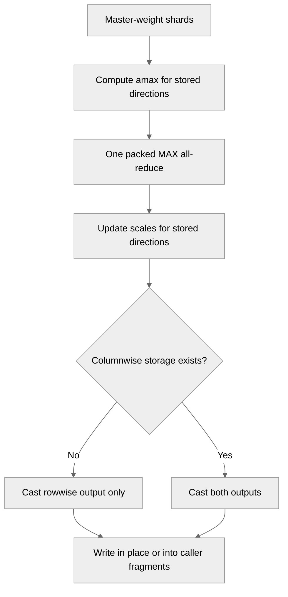

# Support row-only MXFP8 distributed master-weight casts

[Upstream PR](https://github.com/NVIDIA/TransformerEngine/pull/3488) · state: open · merged: False

## Original PR description

# Description

Support distributed master-weight writeback into MXFP8 primary weights whose columnwise data and scales are absent, while preserving the bidirectional path.

Memory motivation: https://github.com/radixark/miles/issues/615
Related initialization change: https://github.com/NVIDIA/TransformerEngine/pull/3468
Related Megatron integration: https://github.com/NVIDIA/Megatron-LM/pull/7095

## Changes

- Pack/reduce amax only for directions that exist, including mixed row-only/bidirectional batches. Retain one packed-amax MAX all-reduce; no high-precision reconstruction collective.
- Skip absent columnwise scale updates and output writes. Preserve rowwise storage and rounding through the model dtype. Support in-place writes and the helper's FSDP fragment-output interface.
- Keep public signatures unchanged. Native omission uses empty `NVTETensor` handles (`has_data() == false`). The PyTorch extension normalizes zero-element tensors, including views with backing storage, into that native representation. Common code no longer depends on a magic empty 2D shape.
- Specialize the two existing kernels on a boolean columnwise template parameter, using the existing dispatch macro. There is no duplicated kernel implementation or new user-facing configuration.
- Move the standalone regression tests into existing suites: partial kernels in `test_partial_cast.py` (L0), distributed updates in `distributed/test_cast_master_weights_to_fp8.py` (L1). The existing two-rank launch now covers mixed layouts, fragment outputs, a boundary inside a 32-value block, and an empty master shard on a participating rank.

## Scope

MXFP8 distributed cast only. No initialization policy, TMS/backup, NVFP4, or Megatron fallback changes. This is not complete FSDP or full-training integration coverage. Megatron's separate gather copy-back layout handling remains relevant.

## Validation of the revised implementation

Source-built TE on NVIDIA GB200: CUDA compiler 13.3, Torch 2.14.0+cu130, Python 3.14.6. Python/native import paths point to the isolated new build. The benchmark library and installed test library have the same ELF build ID.

- `test_partial_cast.py` plus `mxfp8/test_mxfp8_master_weight_empty_shard.py`: **5 passed**.
- Entire `distributed/test_cast_master_weights_to_fp8.py`, including its real two-rank subprocess: **4 passed**.
- Additional one-rank and four-rank runs of the same distributed worker: all four row-only/mixed/fragment combinations and the existing empty-shard regression passed on every rank.
- Both public update entry points, consecutive updates, exact native data/active scales, storage-pointer stability, and a single packed reduction are checked.
- Black, clang-format and `git diff --check`: pass.

The environment emits Python 3.14 TorchScript/opaque-type deprecation warnings. Full Megatron training, checkpoint/resharding and end-to-end FSDP are not covered here.

## Bidirectional kernel performance

The initial runtime-pointer-guard implementation did regress amax by **21–35%** in this matrix. Following the review suggestion, both kernels now use compile-time boolean specialization.

Baseline: unmodified kernel source at merge base `5f6105b9`; revised source: `704b1707`. Both are built with the same CUDA 13.3 compiler, `-O3`, and GB200 `sm_100a` target. Both columnwise and rowwise outputs are enabled in every measurement. Outputs are checked bitwise before timing.

Method: CUDA-event timing of CUDA-graph replays, seven alternating old/new rounds; median time per kernel call, excluding Python dispatch and allocation. Each graph captures 50 calls for input sizes up to 4M elements, otherwise 10 calls, with 20 replays per measured round. Four shapes × BF16/FP32 × full/partial input × two kernels = 32 comparisons. Partial inputs start at offset 17 and contain one quarter of the full matrix.

Full-input results, microseconds per call:

| Shape | Input | Amax old → revised | Cast old → revised |
| --- | --- | --- | --- |
| 160 × 96 | BF16 | 3.278 → 3.278 | 7.577 → 7.578 |
| 1024 × 1024 | BF16 | 3.693 → 3.690 | 7.884 → 7.894 |
| 4096 × 4096 | BF16 | 20.109 → 20.099 | 24.656 → 24.784 |
| 16384 × 6144 | BF16 | 113.365 → 113.376 | 202.489 → 202.658 |
| 160 × 96 | FP32 | 2.953 → 2.953 | 7.413 → 7.378 |
| 1024 × 1024 | FP32 | 3.359 → 3.362 | 7.890 → 7.870 |
| 4096 × 4096 | FP32 | 19.516 → 19.556 | 34.558 → 35.254 |
| 16384 × 6144 | FP32 | 110.396 → 110.395 | 210.092 → 210.154 |

Across all 32 full/partial comparisons, revised/baseline time is **0.994–1.020×**. The large amax regression is eliminated; these microbenchmarks do not establish an end-to-end training speedup. The standalone benchmark harness is not added to repository runtime or CI code.

## Size and checklist

This review-fix commit changes six files, **+150 / -169 lines (net -19)**, including removing the separate test file and reusing the existing suites.

- [x] Bug fix; contributing guidelines followed
- [x] Native omission contract documented
- [x] Regression coverage wired into existing CI
- [x] Relevant existing and new GPU tests pass
- [x] Bidirectional old/new kernel benchmark included

## Review and discussion

### reviews

- greptile-apps[bot] · COMMENTED · 2026-09-06T06:38:22Z · [source](https://github.com/NVIDIA/TransformerEngine/pull/3488#pullrequestreview-5124467885)

(No body; status only.)

- ptrendx · COMMENTED · 2026-09-29T23:29:25Z · [source](https://github.com/NVIDIA/TransformerEngine/pull/3488#pullrequestreview-5359741156)

(No body; status only.)

- ptrendx · COMMENTED · 2026-09-29T23:29:43Z · [source](https://github.com/NVIDIA/TransformerEngine/pull/3488#pullrequestreview-5359743103)

(No body; status only.)

- ptrendx · COMMENTED · 2026-09-29T23:35:41Z · [source](https://github.com/NVIDIA/TransformerEngine/pull/3488#pullrequestreview-5359780262)

(No body; status only.)

- ptrendx · COMMENTED · 2026-09-29T23:38:00Z · [source](https://github.com/NVIDIA/TransformerEngine/pull/3488#pullrequestreview-5359795372)

(No body; status only.)

- ptrendx · COMMENTED · 2026-09-29T23:39:28Z · [source](https://github.com/NVIDIA/TransformerEngine/pull/3488#pullrequestreview-5359803988)

(No body; status only.)

- xiuhu17 · COMMENTED · 2026-10-08T06:00:37Z · [source](https://github.com/NVIDIA/TransformerEngine/pull/3488#pullrequestreview-5452216028)

(No body; status only.)

- xiuhu17 · COMMENTED · 2026-10-08T06:00:38Z · [source](https://github.com/NVIDIA/TransformerEngine/pull/3488#pullrequestreview-5452216201)

(No body; status only.)

- xiuhu17 · COMMENTED · 2026-10-08T06:00:39Z · [source](https://github.com/NVIDIA/TransformerEngine/pull/3488#pullrequestreview-5452216338)

(No body; status only.)

### issue_comments

- greptile-apps[bot] · comment · 2026-09-06T06:38:19Z · [source](https://github.com/NVIDIA/TransformerEngine/pull/3488#issuecomment-5557503985)

<!-- greptile_summary -->

<h2><a href="https://app.greptile.com/api/retrigger?id=60902979"><picture><source media="(prefers-color-scheme: dark)" srcset="https://greptile-static-assets.s3.amazonaws.com/badges/RetriggerDark.svg?v=2"><source media="(prefers-color-scheme: light)" srcset="https://greptile-static-assets.s3.amazonaws.com/badges/Retrigger.svg?v=2"></picture></a><a href="https://app.greptile.com/nvidia-public-github/github/NVIDIA/transformerengine/-/pull/3488"><picture><source media="(prefers-color-scheme: dark)" srcset="https://greptile-static-assets.s3.amazonaws.com/badges/ViewInGreptileDark.svg?v=2"><source media="(prefers-color-scheme: light)" srcset="https://greptile-static-assets.s3.amazonaws.com/badges/ViewInGreptile.svg?v=2"></picture></a>Confidence Score: 5/5</h2>

**[High impact]** The PR appears safe to merge; no actionable new issues were found.

<h3>Summary</h3>

Adds distributed master-weight updates for row-only MXFP8 weights while preserving the bidirectional path.

- MXFP8 master-weight casts now support row-only primary weights.

<h3>Diagram</h3>

<!-- greptile_confidence_score:5 -->

Reviews (4) · Last reviewed commit: ["Merge branch &#39;main&#39; into fix-mxfp8-rowwi..."](https://github.com/nvidia/transformerengine/commit/dc3a5e2439b26cc0647675ad633a9cc34ab78b49) · [Reviewed by Greptile](https://www.greptile.com/?utm_source=greptile_review&utm_medium=github&utm_campaign=review_public&utm_content=nvidia/transformerengine)

- xiuhu17 · comment · 2026-10-14T19:50:35Z · [source](https://github.com/NVIDIA/TransformerEngine/pull/3488#issuecomment-6176986203)

@ptrendx would you like to review on this again? Thanks a lot!

Also would you like to take a look at the initial memory optimization pr: https://github.com/NVIDIA/TransformerEngine/pull/3468? Thanks!

### inline_comments

- greptile-apps[bot] · comment · 2026-09-06T06:38:22Z · [source](https://github.com/NVIDIA/TransformerEngine/pull/3488#discussion_r3943204965)

File: `tests/pytorch/mxfp8/test_rowwise_master_cast.py` · line None

 **Distributed Paths Lack CI**

The L0 MXFP8 suite collects this test using single-process pytest, while the L1 distributed suite does not select or launch it. As a result, the rank-partitioned branches—including the unaligned shard boundary, empty tail ranks, and mixed row-only/bidirectional layout—are not exercised in repository CI. This is non-blocking, but future regressions in the distributed behavior changed here could go undetected. Please register this test with the distributed suite or add equivalent self-launched multi-rank coverage.

**Knowledge Base Used:** [Verification and CI matrix](https://app.greptile.com/nvidia-public-github/-/custom-context/knowledge-base/nvidia/transformerengine/-/docs/verification-and-ci.md)

Note: If this suggestion doesn't match your team's coding style, reply to this and let me know. I'll remember it for next time!

- ptrendx · comment · 2026-09-29T23:29:25Z · [source](https://github.com/NVIDIA/TransformerEngine/pull/3488#discussion_r4139355950)

File: `transformer_engine/common/include/transformer_engine/recipe.h` · line None

Checking for empty 2D shape is not great. Just check for `has_data` being `false` (empty NVTETensor).

- ptrendx · comment · 2026-09-29T23:29:43Z · [source](https://github.com/NVIDIA/TransformerEngine/pull/3488#discussion_r4139357550)

File: `transformer_engine/common/include/transformer_engine/recipe.h` · line None

Same comment as above.

- ptrendx · comment · 2026-09-29T23:35:41Z · [source](https://github.com/NVIDIA/TransformerEngine/pull/3488#discussion_r4139390084)

File: `transformer_engine/common/recipe/mxfp8_scaling.cu` · line None

If there is an issue of the pointer passed from the PyTorch side, then that should be handled in the PyTorch extension rather than WARing it here.

- ptrendx · comment · 2026-09-29T23:38:00Z · [source](https://github.com/NVIDIA/TransformerEngine/pull/3488#discussion_r4139402338)

File: `transformer_engine/common/recipe/mxfp8_scaling.cu` · line None

Please include some benchmark results on the old vs new time for the case still using columnwise output to see whether those additional conditions didn't introduce overhead. If they did then they would need to be handled via templated kernels.

- ptrendx · comment · 2026-09-29T23:39:28Z · [source](https://github.com/NVIDIA/TransformerEngine/pull/3488#discussion_r4139409990)

File: `tests/pytorch/mxfp8/test_rowwise_master_cast.py` · line None

Why do we need a separate test file for that? It should be part of one of the larger suites like test_sanity or test_numerics. Also, for the separate test files, they would not actually be run unless they are part of the test.sh in one of the directories in qa/.

- xiuhu17 · comment · 2026-10-08T06:00:37Z · [source](https://github.com/NVIDIA/TransformerEngine/pull/3488#discussion_r4215404521)

File: `transformer_engine/common/recipe/mxfp8_scaling.cu` · line None

Addressed in 704b1707. 

- xiuhu17 · comment · 2026-10-08T06:00:38Z · [source](https://github.com/NVIDIA/TransformerEngine/pull/3488#discussion_r4215404663)

File: `tests/pytorch/mxfp8/test_rowwise_master_cast.py` · line None

Moved the tests into the existing L0 and L1 suites in 704b1707.

- xiuhu17 · comment · 2026-10-08T06:00:39Z · [source](https://github.com/NVIDIA/TransformerEngine/pull/3488#discussion_r4215404794)

File: `transformer_engine/common/recipe/mxfp8_scaling.cu` · line None

Fixed the amax regression with boolean templates in 704b1707; benchmark results are in the PR description.

## Changed files and fixed code

- `tests/pytorch/distributed/test_cast_master_weights_to_fp8.py` · modified · additions 84 / deletions 0
  - [head](https://github.com/xiuhu17/TransformerEngine/blob/dc3a5e2439b26cc0647675ad633a9cc34ab78b49/tests/pytorch/distributed/test_cast_master_weights_to_fp8.py)
  - [base](https://github.com/NVIDIA/TransformerEngine/blob/eb3c860a4d3394b7eb5e21dba3021fa10782a52e/tests/pytorch/distributed/test_cast_master_weights_to_fp8.py)
- `tests/pytorch/test_partial_cast.py` · modified · additions 21 / deletions 0
  - [head](https://github.com/xiuhu17/TransformerEngine/blob/dc3a5e2439b26cc0647675ad633a9cc34ab78b49/tests/pytorch/test_partial_cast.py)
  - [base](https://github.com/NVIDIA/TransformerEngine/blob/eb3c860a4d3394b7eb5e21dba3021fa10782a52e/tests/pytorch/test_partial_cast.py)
- `transformer_engine/common/include/transformer_engine/recipe.h` · modified · additions 3 / deletions 1
  - [head](https://github.com/xiuhu17/TransformerEngine/blob/dc3a5e2439b26cc0647675ad633a9cc34ab78b49/transformer_engine/common/include/transformer_engine/recipe.h)
  - [base](https://github.com/NVIDIA/TransformerEngine/blob/eb3c860a4d3394b7eb5e21dba3021fa10782a52e/transformer_engine/common/include/transformer_engine/recipe.h)
- `transformer_engine/common/recipe/mxfp8_scaling.cu` · modified · additions 68 / deletions 42
  - [head](https://github.com/xiuhu17/TransformerEngine/blob/dc3a5e2439b26cc0647675ad633a9cc34ab78b49/transformer_engine/common/recipe/mxfp8_scaling.cu)
  - [base](https://github.com/NVIDIA/TransformerEngine/blob/eb3c860a4d3394b7eb5e21dba3021fa10782a52e/transformer_engine/common/recipe/mxfp8_scaling.cu)
- `transformer_engine/pytorch/csrc/extensions/fp8_partial_cast.cpp` · modified · additions 10 / deletions 3
  - [head](https://github.com/xiuhu17/TransformerEngine/blob/dc3a5e2439b26cc0647675ad633a9cc34ab78b49/transformer_engine/pytorch/csrc/extensions/fp8_partial_cast.cpp)
  - [base](https://github.com/NVIDIA/TransformerEngine/blob/eb3c860a4d3394b7eb5e21dba3021fa10782a52e/transformer_engine/pytorch/csrc/extensions/fp8_partial_cast.cpp)
- `transformer_engine/pytorch/tensor/utils.py` · modified · additions 32 / deletions 7
  - [head](https://github.com/xiuhu17/TransformerEngine/blob/dc3a5e2439b26cc0647675ad633a9cc34ab78b49/transformer_engine/pytorch/tensor/utils.py)
  - [base](https://github.com/NVIDIA/TransformerEngine/blob/eb3c860a4d3394b7eb5e21dba3021fa10782a52e/transformer_engine/pytorch/tensor/utils.py)

## Evidence and interpretation boundary

[Original JSON, discussions and patches](../../../../../../evidence/prs/NVIDIA--TransformerEngine/3488-2716ac5305d78a2f74613b8ead7c4315c41fc4acc4c1b3a713fabd57e52d1125.json) · SHA-256 `2716ac5305d78a2f74613b8ead7c4315c41fc4acc4c1b3a713fabd57e52d1125`.

Diff complete: True. Missing/binary/truncated patches require pinned source inspection. This is a source page, not an independently verified optimization case. Open, merged and released are different states; recheck the deployed dependency.
