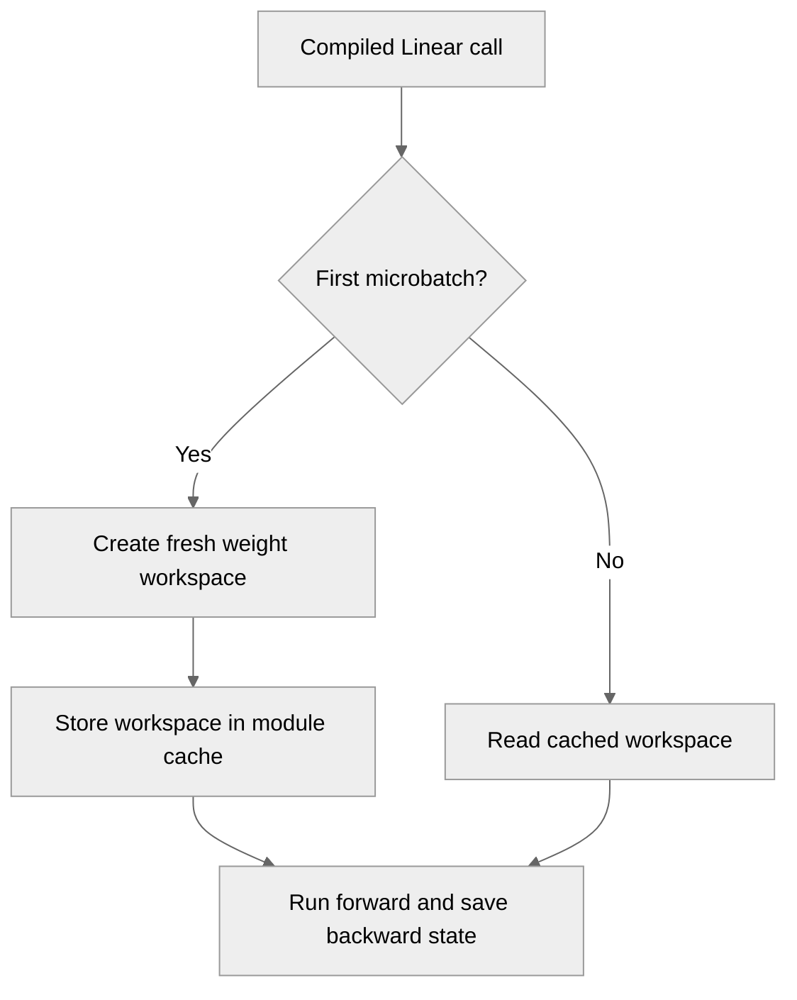

# [PyTorch] Support FP8 weight caching in compiled Linear

[Upstream PR](https://github.com/NVIDIA/TransformerEngine/pull/3505) · state: closed · merged: True

## Original PR description

# Description

Enable FP8 weight caching in compiled `te.Linear` calls using `is_first_microbatch`. The first microbatch creates a fresh workspace and subsequent microbatches reuse it, preserving one weight quantization per minibatch without mutating an input of the functional custom op.

`fuse_wgrad_accumulation=True` remains unsupported. GPU-controlled in-place cache updates retain an explicit fallback.

## Type of change

- [x] New feature (non-breaking change which adds functionality)

## Changes

- Omit the old workspace from the compiled first-microbatch call and retain the existing workspace output/save-for-backward handling.
- Replace the blanket FP8 cache fallback with a guard for GPU-controlled cache updates.
- Add multi-step eager/compiled comparisons for interleaved and deferred backward schedules across supported recipes, including actual CUDA Graph replay checks.
- Document compiled cache behavior and the once-per-minibatch CUDA Graph step marker.

## Validation

- `pytest -q tests/pytorch/test_torch_compile.py -k 'te_linear' --tb=short`: **18 passed, 12 skipped, 1 XPASS** (existing train/eval xfail).
- RTX 5880 Ada; PyTorch 2.14.0a0+b2c75dd062.nvinternal.main. The PR's Python sources were tested with the same prebuilt TE core/extensions for all runs; C++ was not rebuilt for this branch.
- CUDA Graph cases require `torch.compiler.cudagraph_mark_step_begin()` once per complete minibatch.
- Black 24.4.2, Python syntax checks and `git diff --check` pass.
- Python-only lint reports only the existing CUstream/introspection and import-order diagnostics in unchanged `attention/fused_mla_q_uproj.py` (exit 16).
- Other GPU architectures/recipes and timing benchmarks remain unvalidated.

# Checklist

- [x] I have read and followed the contributing guidelines
- [ ] The functionality is complete
- [x] I have commented my code, particularly in hard-to-understand areas
- [x] I have made corresponding changes to the documentation
- [ ] My changes generate no new warnings
- [x] I have added tests that prove my fix is effective or that my feature works
- [x] Targeted new and existing Linear tests pass on the workstation

## Review and discussion

### reviews

- shino16 · APPROVED · 2026-10-21T20:51:11Z · [source](https://github.com/NVIDIA/TransformerEngine/pull/3505#pullrequestreview-5606062617)

(No body; status only.)

- ksivaman · APPROVED · 2026-10-22T17:03:40Z · [source](https://github.com/NVIDIA/TransformerEngine/pull/3505#pullrequestreview-5617938751)

Looks good!

### issue_comments

- greptile-apps[bot] · comment · 2026-09-10T12:50:02Z · [source](https://github.com/NVIDIA/TransformerEngine/pull/3505#issuecomment-5618946294)

<!-- greptile_summary -->

<h2><a href="https://app.greptile.com/api/retrigger?id=62581139"><picture><source media="(prefers-color-scheme: dark)" srcset="https://greptile-static-assets.s3.amazonaws.com/badges/RetriggerDark.svg?v=2"><source media="(prefers-color-scheme: light)" srcset="https://greptile-static-assets.s3.amazonaws.com/badges/Retrigger.svg?v=2"></picture></a><a href="https://app.greptile.com/nvidia-public-github/github/NVIDIA/transformerengine/-/pull/3505"><picture><source media="(prefers-color-scheme: dark)" srcset="https://greptile-static-assets.s3.amazonaws.com/badges/ViewInGreptileDark.svg?v=2"><source media="(prefers-color-scheme: light)" srcset="https://greptile-static-assets.s3.amazonaws.com/badges/ViewInGreptile.svg?v=2"></picture></a>Confidence Score: 5/5</h2>

**[Medium impact]** The PR appears safe to merge; no actionable issues were found.

<h3>Summary</h3>

Enables FP8 weight caching in compiled `Linear` calls.
- Compiled Linear calls now refresh and reuse FP8 weights across microbatches.

<h3>Diagram</h3>

<!-- greptile_confidence_score:5 -->

Reviews (3) · Last reviewed commit: ["Merge branch &#39;main&#39; into linear\_compile\_..."](https://github.com/nvidia/transformerengine/commit/430fe292d6a0ee56c4ef46dc6da44c3bdf23a455) · [Reviewed by Greptile](https://www.greptile.com/?utm_source=greptile_review&utm_medium=github&utm_campaign=review_public&utm_content=nvidia/transformerengine)

- ksivaman · comment · 2026-10-21T20:04:48Z · [source](https://github.com/NVIDIA/TransformerEngine/pull/3505#issuecomment-6325374556)

/te-ci pytorch L0

### inline_comments

## Changed files and fixed code

- `tests/pytorch/test_torch_compile.py` · modified · additions 97 / deletions 61
  - [head](https://github.com/pggPL/TransformerEngine/blob/430fe292d6a0ee56c4ef46dc6da44c3bdf23a455/tests/pytorch/test_torch_compile.py)
  - [base](https://github.com/NVIDIA/TransformerEngine/blob/53d1a3c71a8f54cbfcdbc5e9f548eba040e42523/tests/pytorch/test_torch_compile.py)
- `transformer_engine/pytorch/module/linear.py` · modified · additions 17 / deletions 12
  - [head](https://github.com/pggPL/TransformerEngine/blob/430fe292d6a0ee56c4ef46dc6da44c3bdf23a455/transformer_engine/pytorch/module/linear.py)
  - [base](https://github.com/NVIDIA/TransformerEngine/blob/53d1a3c71a8f54cbfcdbc5e9f548eba040e42523/transformer_engine/pytorch/module/linear.py)

## Evidence and interpretation boundary

[Original JSON, discussions and patches](../../../../../../evidence/prs/NVIDIA--TransformerEngine/3505-ab8e401664ec4568550de955835af85a04fac00c148b34b19960d6601e0d65c3.json) · SHA-256 `ab8e401664ec4568550de955835af85a04fac00c148b34b19960d6601e0d65c3`.

Diff complete: True. Missing/binary/truncated patches require pinned source inspection. This is a source page, not an independently verified optimization case. Open, merged and released are different states; recheck the deployed dependency.
