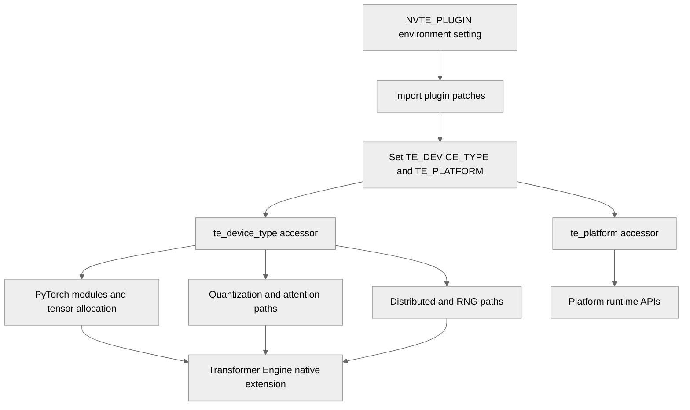

# Abstract CUDA hardcodes into configurable te_device_type / te_platform

[Upstream PR](https://github.com/NVIDIA/TransformerEngine/pull/3513) · state: open · merged: False

## Original PR description

# FlagOS Proposal: Plugin Architecture & Device-Agnostic Abstraction for TransformerEngine

## Device-Type Abstraction: Replacing Hardcoded `"cuda"` References

The current TE PyTorch layer contains ~100 hardcoded `"cuda"` string literals and ~165 `torch.cuda.*` API calls. These span device placement (`device="cuda"`), autocast context (`device_type="cuda"`), device-type guards (`device.type == "cuda"`), and RNG state management (`torch.cuda.CUDAGraph`, `torch.cuda._lazy_call`). This makes TE non-functional on alternative accelerator platforms without invasive patching.

### Proposed Design

  1. **Soft abstraction** – A global `te_device_type()` / `te_platform()` accessor replaces ~200 literal `"cuda"` strings across the Python codebase.

  2. **Platform monkey-patch** – A vendor-provided `apply_patch()` hook runs at import time to directly remap `torch.cuda.*` APIs (e.g. `torch.cuda.device`, `torch.cuda.current_device`, `torch.cuda.current_stream`) to the vendor equivalents (e.g. `torch.other_vendor.*`). 

## Review and discussion

### reviews

- greptile-apps[bot] · COMMENTED · 2026-09-14T08:04:42Z · [source](https://github.com/NVIDIA/TransformerEngine/pull/3513#pullrequestreview-5195271791)

(No body; status only.)

### issue_comments

- greptile-apps[bot] · comment · 2026-09-14T08:04:38Z · [source](https://github.com/NVIDIA/TransformerEngine/pull/3513#issuecomment-5660895516)

<!-- greptile_summary -->

<h2><a href="https://app.greptile.com/api/retrigger?id=63824896"><picture><source media="(prefers-color-scheme: dark)" srcset="https://greptile-static-assets.s3.amazonaws.com/badges/RetriggerDark.svg?v=2"><source media="(prefers-color-scheme: light)" srcset="https://greptile-static-assets.s3.amazonaws.com/badges/Retrigger.svg?v=2"></picture></a>Confidence Score: 5/5</h2>

**[High impact]** No accepted new issue or outstanding previous finding blocks merging.

<h3>Summary</h3>

This PR introduces a configurable PyTorch accelerator abstraction and import-time platform plugin hook, replacing many hardcoded CUDA device selections throughout modules, attention, quantization, tensor storage, distributed execution, and debugging utilities. Changes since the previous review also expand compiler integration and harden native quantization kernels.
- Adds `te_device_type()` and `te_platform()` accessors backed by plugin-configurable package state.
- Applies the device abstraction across PyTorch allocation, autocast, device-check, RNG, and attention paths.
- Adds compiled custom-op execution for fused attention and Linear/Bias operation pipelines, including packed attention layouts and autograd support.
- Updates FP8 recipe state restoration and broadens numerical, compiler, distributed, and determinism coverage.
- Revises CUDA TMA synchronization, bounds handling, and kernel eligibility checks across quantization and Hadamard paths.

<h3>Diagram</h3>

<!-- greptile_confidence_score:5 -->

Reviews (10) · Last reviewed commit: ["merge latest main and fix conflicts"](https://github.com/nvidia/transformerengine/commit/8fbfcfe7ddadc692ab8dd49095b052fa8f46681b) · [Reviewed by Greptile](https://www.greptile.com/?utm_source=greptile_expert&utm_medium=github&utm_campaign=code_reviews&utm_content=nvidia/transformerengine)

- greptile-apps[bot] · comment · 2026-09-22T03:01:47Z · [source](https://github.com/NVIDIA/TransformerEngine/pull/3513#issuecomment-5770602128)

<!-- greptile_outside_diff -->

<h3>Comments Outside Diff</h3>

No findings outside the diff remain.

- ptrendx · comment · 2026-10-09T23:14:15Z · [source](https://github.com/NVIDIA/TransformerEngine/pull/3513#issuecomment-6090857957)

@lxd-cumt Please fix the lint errors (not sure about those documentation errors, maybe they are also caused by the undefined variable?). Generally LGTM afterwards

### inline_comments

- greptile-apps[bot] · comment · 2026-09-14T08:04:41Z · [source](https://github.com/NVIDIA/TransformerEngine/pull/3513#discussion_r4003246484)

File: `transformer_engine/pytorch/attention/dot_product_attention/backends.py` · line None

 **Malformed imports prevent loading**

The new `te_platform` import is inside the preceding parenthesized import list, which is invalid Python syntax. Importing the attention backend therefore raises `SyntaxError` and prevents `transformer_engine.pytorch` from loading. Move this helper import outside the list and correct the same malformed insertion in the other affected modules, including the debug statistics, context-parallel, dot-product-attention, inference, Triton, and transformer modules.

**Knowledge Base Used:**
- [PyTorch runtime and public API](https://app.greptile.com/nvidia-public-github/-/custom-context/knowledge-base/nvidia/transformerengine/-/docs/pytorch-runtime.md)
- [Restore Eager Framework Imports](https://app.greptile.com/nvidia-public-github/-/custom-context/knowledge-base/nvidia/transformerengine/-/reverts/revert_851-20240515-lazy-framework-import-failure-05eb6de.md)

- greptile-apps[bot] · comment · 2026-09-14T08:04:41Z · [source](https://github.com/NVIDIA/TransformerEngine/pull/3513#discussion_r4003246493)

File: `transformer_engine/pytorch/attention/dot_product_attention/flex_attention.py` · line None

 **Device helper is undefined**

This module imports only `te_platform`, but the changed Flex Attention paths call `te_device_type()` while creating device cache keys and cuDNN handles. Executing those paths therefore raises `NameError`. Import both helpers wherever both are used; the same omission also breaks `FusedAdam` construction and appears in other changed modules such as `utils.py`, `rope.py`, and `gemm.py`.

**Knowledge Base Used:**
- [PyTorch runtime and public API](https://app.greptile.com/nvidia-public-github/-/custom-context/knowledge-base/nvidia/transformerengine/-/docs/pytorch-runtime.md)
- [PyTorch attention execution](https://app.greptile.com/nvidia-public-github/-/custom-context/knowledge-base/nvidia/transformerengine/-/docs/pytorch-attention.md)

## Changed files and fixed code

- `transformer_engine/__init__.py` · modified · additions 20 / deletions 0
  - [head](https://github.com/lxd-cumt/TransformerEngine-FL/blob/8fbfcfe7ddadc692ab8dd49095b052fa8f46681b/transformer_engine/__init__.py)
  - [base](https://github.com/NVIDIA/TransformerEngine/blob/39c30c577f5dd4f9fba921ee011b5cd797ae667e/transformer_engine/__init__.py)
- `transformer_engine/debug/features/fake_quant.py` · modified · additions 4 / deletions 1
  - [head](https://github.com/lxd-cumt/TransformerEngine-FL/blob/8fbfcfe7ddadc692ab8dd49095b052fa8f46681b/transformer_engine/debug/features/fake_quant.py)
  - [base](https://github.com/NVIDIA/TransformerEngine/blob/39c30c577f5dd4f9fba921ee011b5cd797ae667e/transformer_engine/debug/features/fake_quant.py)
- `transformer_engine/debug/features/log_fp8_tensor_stats.py` · modified · additions 6 / deletions 1
  - [head](https://github.com/lxd-cumt/TransformerEngine-FL/blob/8fbfcfe7ddadc692ab8dd49095b052fa8f46681b/transformer_engine/debug/features/log_fp8_tensor_stats.py)
  - [base](https://github.com/NVIDIA/TransformerEngine/blob/39c30c577f5dd4f9fba921ee011b5cd797ae667e/transformer_engine/debug/features/log_fp8_tensor_stats.py)
- `transformer_engine/debug/features/per_tensor_scaling.py` · modified · additions 4 / deletions 1
  - [head](https://github.com/lxd-cumt/TransformerEngine-FL/blob/8fbfcfe7ddadc692ab8dd49095b052fa8f46681b/transformer_engine/debug/features/per_tensor_scaling.py)
  - [base](https://github.com/NVIDIA/TransformerEngine/blob/39c30c577f5dd4f9fba921ee011b5cd797ae667e/transformer_engine/debug/features/per_tensor_scaling.py)
- `transformer_engine/debug/features/utils/stats_buffer.py` · modified · additions 3 / deletions 2
  - [head](https://github.com/lxd-cumt/TransformerEngine-FL/blob/8fbfcfe7ddadc692ab8dd49095b052fa8f46681b/transformer_engine/debug/features/utils/stats_buffer.py)
  - [base](https://github.com/NVIDIA/TransformerEngine/blob/39c30c577f5dd4f9fba921ee011b5cd797ae667e/transformer_engine/debug/features/utils/stats_buffer.py)
- `transformer_engine/pytorch/__init__.py` · modified · additions 19 / deletions 0
  - [head](https://github.com/lxd-cumt/TransformerEngine-FL/blob/8fbfcfe7ddadc692ab8dd49095b052fa8f46681b/transformer_engine/pytorch/__init__.py)
  - [base](https://github.com/NVIDIA/TransformerEngine/blob/39c30c577f5dd4f9fba921ee011b5cd797ae667e/transformer_engine/pytorch/__init__.py)
- `transformer_engine/pytorch/attention/dot_product_attention/backends.py` · modified · additions 3 / deletions 2
  - [head](https://github.com/lxd-cumt/TransformerEngine-FL/blob/8fbfcfe7ddadc692ab8dd49095b052fa8f46681b/transformer_engine/pytorch/attention/dot_product_attention/backends.py)
  - [base](https://github.com/NVIDIA/TransformerEngine/blob/39c30c577f5dd4f9fba921ee011b5cd797ae667e/transformer_engine/pytorch/attention/dot_product_attention/backends.py)
- `transformer_engine/pytorch/attention/dot_product_attention/context_parallel.py` · modified · additions 8 / deletions 4
  - [head](https://github.com/lxd-cumt/TransformerEngine-FL/blob/8fbfcfe7ddadc692ab8dd49095b052fa8f46681b/transformer_engine/pytorch/attention/dot_product_attention/context_parallel.py)
  - [base](https://github.com/NVIDIA/TransformerEngine/blob/39c30c577f5dd4f9fba921ee011b5cd797ae667e/transformer_engine/pytorch/attention/dot_product_attention/context_parallel.py)
- `transformer_engine/pytorch/attention/dot_product_attention/dot_product_attention.py` · modified · additions 5 / deletions 2
  - [head](https://github.com/lxd-cumt/TransformerEngine-FL/blob/8fbfcfe7ddadc692ab8dd49095b052fa8f46681b/transformer_engine/pytorch/attention/dot_product_attention/dot_product_attention.py)
  - [base](https://github.com/NVIDIA/TransformerEngine/blob/39c30c577f5dd4f9fba921ee011b5cd797ae667e/transformer_engine/pytorch/attention/dot_product_attention/dot_product_attention.py)
- `transformer_engine/pytorch/attention/dot_product_attention/flex_attention.py` · modified · additions 6 / deletions 5
  - [head](https://github.com/lxd-cumt/TransformerEngine-FL/blob/8fbfcfe7ddadc692ab8dd49095b052fa8f46681b/transformer_engine/pytorch/attention/dot_product_attention/flex_attention.py)
  - [base](https://github.com/NVIDIA/TransformerEngine/blob/39c30c577f5dd4f9fba921ee011b5cd797ae667e/transformer_engine/pytorch/attention/dot_product_attention/flex_attention.py)
- `transformer_engine/pytorch/attention/dot_product_attention/softmax.py` · modified · additions 2 / deletions 1
  - [head](https://github.com/lxd-cumt/TransformerEngine-FL/blob/8fbfcfe7ddadc692ab8dd49095b052fa8f46681b/transformer_engine/pytorch/attention/dot_product_attention/softmax.py)
  - [base](https://github.com/NVIDIA/TransformerEngine/blob/39c30c577f5dd4f9fba921ee011b5cd797ae667e/transformer_engine/pytorch/attention/dot_product_attention/softmax.py)
- `transformer_engine/pytorch/attention/dot_product_attention/utils.py` · modified · additions 14 / deletions 10
  - [head](https://github.com/lxd-cumt/TransformerEngine-FL/blob/8fbfcfe7ddadc692ab8dd49095b052fa8f46681b/transformer_engine/pytorch/attention/dot_product_attention/utils.py)
  - [base](https://github.com/NVIDIA/TransformerEngine/blob/39c30c577f5dd4f9fba921ee011b5cd797ae667e/transformer_engine/pytorch/attention/dot_product_attention/utils.py)
- `transformer_engine/pytorch/attention/inference.py` · modified · additions 1 / deletions 1
  - [head](https://github.com/lxd-cumt/TransformerEngine-FL/blob/8fbfcfe7ddadc692ab8dd49095b052fa8f46681b/transformer_engine/pytorch/attention/inference.py)
  - [base](https://github.com/NVIDIA/TransformerEngine/blob/39c30c577f5dd4f9fba921ee011b5cd797ae667e/transformer_engine/pytorch/attention/inference.py)
- `transformer_engine/pytorch/attention/multi_head_attention.py` · modified · additions 3 / deletions 2
  - [head](https://github.com/lxd-cumt/TransformerEngine-FL/blob/8fbfcfe7ddadc692ab8dd49095b052fa8f46681b/transformer_engine/pytorch/attention/multi_head_attention.py)
  - [base](https://github.com/NVIDIA/TransformerEngine/blob/39c30c577f5dd4f9fba921ee011b5cd797ae667e/transformer_engine/pytorch/attention/multi_head_attention.py)
- `transformer_engine/pytorch/attention/rope.py` · modified · additions 2 / deletions 1
  - [head](https://github.com/lxd-cumt/TransformerEngine-FL/blob/8fbfcfe7ddadc692ab8dd49095b052fa8f46681b/transformer_engine/pytorch/attention/rope.py)
  - [base](https://github.com/NVIDIA/TransformerEngine/blob/39c30c577f5dd4f9fba921ee011b5cd797ae667e/transformer_engine/pytorch/attention/rope.py)
- `transformer_engine/pytorch/cpp_extensions/gemm.py` · modified · additions 6 / deletions 2
  - [head](https://github.com/lxd-cumt/TransformerEngine-FL/blob/8fbfcfe7ddadc692ab8dd49095b052fa8f46681b/transformer_engine/pytorch/cpp_extensions/gemm.py)
  - [base](https://github.com/NVIDIA/TransformerEngine/blob/39c30c577f5dd4f9fba921ee011b5cd797ae667e/transformer_engine/pytorch/cpp_extensions/gemm.py)
- `transformer_engine/pytorch/custom_recipes/quantizer_factories.py` · modified · additions 2 / deletions 1
  - [head](https://github.com/lxd-cumt/TransformerEngine-FL/blob/8fbfcfe7ddadc692ab8dd49095b052fa8f46681b/transformer_engine/pytorch/custom_recipes/quantizer_factories.py)
  - [base](https://github.com/NVIDIA/TransformerEngine/blob/39c30c577f5dd4f9fba921ee011b5cd797ae667e/transformer_engine/pytorch/custom_recipes/quantizer_factories.py)
- `transformer_engine/pytorch/custom_recipes/quantizer_factory_zoo.py` · modified · additions 2 / deletions 1
  - [head](https://github.com/lxd-cumt/TransformerEngine-FL/blob/8fbfcfe7ddadc692ab8dd49095b052fa8f46681b/transformer_engine/pytorch/custom_recipes/quantizer_factory_zoo.py)
  - [base](https://github.com/NVIDIA/TransformerEngine/blob/39c30c577f5dd4f9fba921ee011b5cd797ae667e/transformer_engine/pytorch/custom_recipes/quantizer_factory_zoo.py)
- `transformer_engine/pytorch/custom_recipes/reference_current_scaling.py` · modified · additions 2 / deletions 1
  - [head](https://github.com/lxd-cumt/TransformerEngine-FL/blob/8fbfcfe7ddadc692ab8dd49095b052fa8f46681b/transformer_engine/pytorch/custom_recipes/reference_current_scaling.py)
  - [base](https://github.com/NVIDIA/TransformerEngine/blob/39c30c577f5dd4f9fba921ee011b5cd797ae667e/transformer_engine/pytorch/custom_recipes/reference_current_scaling.py)
- `transformer_engine/pytorch/distributed.py` · modified · additions 10 / deletions 9
  - [head](https://github.com/lxd-cumt/TransformerEngine-FL/blob/8fbfcfe7ddadc692ab8dd49095b052fa8f46681b/transformer_engine/pytorch/distributed.py)
  - [base](https://github.com/NVIDIA/TransformerEngine/blob/39c30c577f5dd4f9fba921ee011b5cd797ae667e/transformer_engine/pytorch/distributed.py)
- `transformer_engine/pytorch/dynamo/tensor_spec.py` · modified · additions 3 / deletions 2
  - [head](https://github.com/lxd-cumt/TransformerEngine-FL/blob/8fbfcfe7ddadc692ab8dd49095b052fa8f46681b/transformer_engine/pytorch/dynamo/tensor_spec.py)
  - [base](https://github.com/NVIDIA/TransformerEngine/blob/39c30c577f5dd4f9fba921ee011b5cd797ae667e/transformer_engine/pytorch/dynamo/tensor_spec.py)
- `transformer_engine/pytorch/ep.py` · modified · additions 2 / deletions 1
  - [head](https://github.com/lxd-cumt/TransformerEngine-FL/blob/8fbfcfe7ddadc692ab8dd49095b052fa8f46681b/transformer_engine/pytorch/ep.py)
  - [base](https://github.com/NVIDIA/TransformerEngine/blob/39c30c577f5dd4f9fba921ee011b5cd797ae667e/transformer_engine/pytorch/ep.py)
- `transformer_engine/pytorch/graph.py` · modified · additions 1 / deletions 0
  - [head](https://github.com/lxd-cumt/TransformerEngine-FL/blob/8fbfcfe7ddadc692ab8dd49095b052fa8f46681b/transformer_engine/pytorch/graph.py)
  - [base](https://github.com/NVIDIA/TransformerEngine/blob/39c30c577f5dd4f9fba921ee011b5cd797ae667e/transformer_engine/pytorch/graph.py)
- `transformer_engine/pytorch/jit.py` · modified · additions 14 / deletions 6
  - [head](https://github.com/lxd-cumt/TransformerEngine-FL/blob/8fbfcfe7ddadc692ab8dd49095b052fa8f46681b/transformer_engine/pytorch/jit.py)
  - [base](https://github.com/NVIDIA/TransformerEngine/blob/39c30c577f5dd4f9fba921ee011b5cd797ae667e/transformer_engine/pytorch/jit.py)
- `transformer_engine/pytorch/module/base.py` · modified · additions 4 / deletions 3
  - [head](https://github.com/lxd-cumt/TransformerEngine-FL/blob/8fbfcfe7ddadc692ab8dd49095b052fa8f46681b/transformer_engine/pytorch/module/base.py)
  - [base](https://github.com/NVIDIA/TransformerEngine/blob/39c30c577f5dd4f9fba921ee011b5cd797ae667e/transformer_engine/pytorch/module/base.py)
- `transformer_engine/pytorch/module/grouped_linear.py` · modified · additions 5 / deletions 3
  - [head](https://github.com/lxd-cumt/TransformerEngine-FL/blob/8fbfcfe7ddadc692ab8dd49095b052fa8f46681b/transformer_engine/pytorch/module/grouped_linear.py)
  - [base](https://github.com/NVIDIA/TransformerEngine/blob/39c30c577f5dd4f9fba921ee011b5cd797ae667e/transformer_engine/pytorch/module/grouped_linear.py)
- `transformer_engine/pytorch/module/layernorm_linear.py` · modified · additions 3 / deletions 2
  - [head](https://github.com/lxd-cumt/TransformerEngine-FL/blob/8fbfcfe7ddadc692ab8dd49095b052fa8f46681b/transformer_engine/pytorch/module/layernorm_linear.py)
  - [base](https://github.com/NVIDIA/TransformerEngine/blob/39c30c577f5dd4f9fba921ee011b5cd797ae667e/transformer_engine/pytorch/module/layernorm_linear.py)
- `transformer_engine/pytorch/module/layernorm_mlp.py` · modified · additions 5 / deletions 4
  - [head](https://github.com/lxd-cumt/TransformerEngine-FL/blob/8fbfcfe7ddadc692ab8dd49095b052fa8f46681b/transformer_engine/pytorch/module/layernorm_mlp.py)
  - [base](https://github.com/NVIDIA/TransformerEngine/blob/39c30c577f5dd4f9fba921ee011b5cd797ae667e/transformer_engine/pytorch/module/layernorm_mlp.py)
- `transformer_engine/pytorch/module/linear.py` · modified · additions 4 / deletions 3
  - [head](https://github.com/lxd-cumt/TransformerEngine-FL/blob/8fbfcfe7ddadc692ab8dd49095b052fa8f46681b/transformer_engine/pytorch/module/linear.py)
  - [base](https://github.com/NVIDIA/TransformerEngine/blob/39c30c577f5dd4f9fba921ee011b5cd797ae667e/transformer_engine/pytorch/module/linear.py)
- `transformer_engine/pytorch/ops/_common.py` · modified · additions 2 / deletions 1
  - [head](https://github.com/lxd-cumt/TransformerEngine-FL/blob/8fbfcfe7ddadc692ab8dd49095b052fa8f46681b/transformer_engine/pytorch/ops/_common.py)
  - [base](https://github.com/NVIDIA/TransformerEngine/blob/39c30c577f5dd4f9fba921ee011b5cd797ae667e/transformer_engine/pytorch/ops/_common.py)
- `transformer_engine/pytorch/ops/basic/activation.py` · modified · additions 3 / deletions 2
  - [head](https://github.com/lxd-cumt/TransformerEngine-FL/blob/8fbfcfe7ddadc692ab8dd49095b052fa8f46681b/transformer_engine/pytorch/ops/basic/activation.py)
  - [base](https://github.com/NVIDIA/TransformerEngine/blob/39c30c577f5dd4f9fba921ee011b5cd797ae667e/transformer_engine/pytorch/ops/basic/activation.py)
- `transformer_engine/pytorch/ops/basic/bias.py` · modified · additions 2 / deletions 1
  - [head](https://github.com/lxd-cumt/TransformerEngine-FL/blob/8fbfcfe7ddadc692ab8dd49095b052fa8f46681b/transformer_engine/pytorch/ops/basic/bias.py)
  - [base](https://github.com/NVIDIA/TransformerEngine/blob/39c30c577f5dd4f9fba921ee011b5cd797ae667e/transformer_engine/pytorch/ops/basic/bias.py)
- `transformer_engine/pytorch/ops/basic/grouped_linear.py` · modified · additions 3 / deletions 2
  - [head](https://github.com/lxd-cumt/TransformerEngine-FL/blob/8fbfcfe7ddadc692ab8dd49095b052fa8f46681b/transformer_engine/pytorch/ops/basic/grouped_linear.py)
  - [base](https://github.com/NVIDIA/TransformerEngine/blob/39c30c577f5dd4f9fba921ee011b5cd797ae667e/transformer_engine/pytorch/ops/basic/grouped_linear.py)
- `transformer_engine/pytorch/ops/basic/swiglu.py` · modified · additions 4 / deletions 3
  - [head](https://github.com/lxd-cumt/TransformerEngine-FL/blob/8fbfcfe7ddadc692ab8dd49095b052fa8f46681b/transformer_engine/pytorch/ops/basic/swiglu.py)
  - [base](https://github.com/NVIDIA/TransformerEngine/blob/39c30c577f5dd4f9fba921ee011b5cd797ae667e/transformer_engine/pytorch/ops/basic/swiglu.py)
- `transformer_engine/pytorch/ops/fused/forward_linear_bias_add.py` · modified · additions 2 / deletions 1
  - [head](https://github.com/lxd-cumt/TransformerEngine-FL/blob/8fbfcfe7ddadc692ab8dd49095b052fa8f46681b/transformer_engine/pytorch/ops/fused/forward_linear_bias_add.py)
  - [base](https://github.com/NVIDIA/TransformerEngine/blob/39c30c577f5dd4f9fba921ee011b5cd797ae667e/transformer_engine/pytorch/ops/fused/forward_linear_bias_add.py)
- `transformer_engine/pytorch/ops/fused/forward_linear_scale_add.py` · modified · additions 2 / deletions 1
  - [head](https://github.com/lxd-cumt/TransformerEngine-FL/blob/8fbfcfe7ddadc692ab8dd49095b052fa8f46681b/transformer_engine/pytorch/ops/fused/forward_linear_scale_add.py)
  - [base](https://github.com/NVIDIA/TransformerEngine/blob/39c30c577f5dd4f9fba921ee011b5cd797ae667e/transformer_engine/pytorch/ops/fused/forward_linear_scale_add.py)
- `transformer_engine/pytorch/ops/fused/grouped_mlp.py` · modified · additions 1 / deletions 1
  - [head](https://github.com/lxd-cumt/TransformerEngine-FL/blob/8fbfcfe7ddadc692ab8dd49095b052fa8f46681b/transformer_engine/pytorch/ops/fused/grouped_mlp.py)
  - [base](https://github.com/NVIDIA/TransformerEngine/blob/39c30c577f5dd4f9fba921ee011b5cd797ae667e/transformer_engine/pytorch/ops/fused/grouped_mlp.py)
- `transformer_engine/pytorch/ops/fused/userbuffers_backward_linear.py` · modified · additions 1 / deletions 1
  - [head](https://github.com/lxd-cumt/TransformerEngine-FL/blob/8fbfcfe7ddadc692ab8dd49095b052fa8f46681b/transformer_engine/pytorch/ops/fused/userbuffers_backward_linear.py)
  - [base](https://github.com/NVIDIA/TransformerEngine/blob/39c30c577f5dd4f9fba921ee011b5cd797ae667e/transformer_engine/pytorch/ops/fused/userbuffers_backward_linear.py)
- `transformer_engine/pytorch/ops/fused/userbuffers_forward_linear.py` · modified · additions 3 / deletions 2
  - [head](https://github.com/lxd-cumt/TransformerEngine-FL/blob/8fbfcfe7ddadc692ab8dd49095b052fa8f46681b/transformer_engine/pytorch/ops/fused/userbuffers_forward_linear.py)
  - [base](https://github.com/NVIDIA/TransformerEngine/blob/39c30c577f5dd4f9fba921ee011b5cd797ae667e/transformer_engine/pytorch/ops/fused/userbuffers_forward_linear.py)
- `transformer_engine/pytorch/optimizers/fused_adam.py` · modified · additions 2 / deletions 1
  - [head](https://github.com/lxd-cumt/TransformerEngine-FL/blob/8fbfcfe7ddadc692ab8dd49095b052fa8f46681b/transformer_engine/pytorch/optimizers/fused_adam.py)
  - [base](https://github.com/NVIDIA/TransformerEngine/blob/39c30c577f5dd4f9fba921ee011b5cd797ae667e/transformer_engine/pytorch/optimizers/fused_adam.py)
- `transformer_engine/pytorch/permutation.py` · modified · additions 23 / deletions 12
  - [head](https://github.com/lxd-cumt/TransformerEngine-FL/blob/8fbfcfe7ddadc692ab8dd49095b052fa8f46681b/transformer_engine/pytorch/permutation.py)
  - [base](https://github.com/NVIDIA/TransformerEngine/blob/39c30c577f5dd4f9fba921ee011b5cd797ae667e/transformer_engine/pytorch/permutation.py)
- `transformer_engine/pytorch/quantization.py` · modified · additions 9 / deletions 7
  - [head](https://github.com/lxd-cumt/TransformerEngine-FL/blob/8fbfcfe7ddadc692ab8dd49095b052fa8f46681b/transformer_engine/pytorch/quantization.py)
  - [base](https://github.com/NVIDIA/TransformerEngine/blob/39c30c577f5dd4f9fba921ee011b5cd797ae667e/transformer_engine/pytorch/quantization.py)
- `transformer_engine/pytorch/quantized_tensor.py` · modified · additions 4 / deletions 2
  - [head](https://github.com/lxd-cumt/TransformerEngine-FL/blob/8fbfcfe7ddadc692ab8dd49095b052fa8f46681b/transformer_engine/pytorch/quantized_tensor.py)
  - [base](https://github.com/NVIDIA/TransformerEngine/blob/39c30c577f5dd4f9fba921ee011b5cd797ae667e/transformer_engine/pytorch/quantized_tensor.py)
- `transformer_engine/pytorch/tensor/float8_blockwise_tensor.py` · modified · additions 4 / deletions 2
  - [head](https://github.com/lxd-cumt/TransformerEngine-FL/blob/8fbfcfe7ddadc692ab8dd49095b052fa8f46681b/transformer_engine/pytorch/tensor/float8_blockwise_tensor.py)
  - [base](https://github.com/NVIDIA/TransformerEngine/blob/39c30c577f5dd4f9fba921ee011b5cd797ae667e/transformer_engine/pytorch/tensor/float8_blockwise_tensor.py)
- `transformer_engine/pytorch/tensor/float8_tensor.py` · modified · additions 2 / deletions 1
  - [head](https://github.com/lxd-cumt/TransformerEngine-FL/blob/8fbfcfe7ddadc692ab8dd49095b052fa8f46681b/transformer_engine/pytorch/tensor/float8_tensor.py)
  - [base](https://github.com/NVIDIA/TransformerEngine/blob/39c30c577f5dd4f9fba921ee011b5cd797ae667e/transformer_engine/pytorch/tensor/float8_tensor.py)
- `transformer_engine/pytorch/tensor/grouped_tensor.py` · modified · additions 2 / deletions 1
  - [head](https://github.com/lxd-cumt/TransformerEngine-FL/blob/8fbfcfe7ddadc692ab8dd49095b052fa8f46681b/transformer_engine/pytorch/tensor/grouped_tensor.py)
  - [base](https://github.com/NVIDIA/TransformerEngine/blob/39c30c577f5dd4f9fba921ee011b5cd797ae667e/transformer_engine/pytorch/tensor/grouped_tensor.py)
- `transformer_engine/pytorch/tensor/identity_tensor.py` · modified · additions 2 / deletions 1
  - [head](https://github.com/lxd-cumt/TransformerEngine-FL/blob/8fbfcfe7ddadc692ab8dd49095b052fa8f46681b/transformer_engine/pytorch/tensor/identity_tensor.py)
  - [base](https://github.com/NVIDIA/TransformerEngine/blob/39c30c577f5dd4f9fba921ee011b5cd797ae667e/transformer_engine/pytorch/tensor/identity_tensor.py)
- `transformer_engine/pytorch/tensor/mxfp8_tensor.py` · modified · additions 2 / deletions 1
  - [head](https://github.com/lxd-cumt/TransformerEngine-FL/blob/8fbfcfe7ddadc692ab8dd49095b052fa8f46681b/transformer_engine/pytorch/tensor/mxfp8_tensor.py)
  - [base](https://github.com/NVIDIA/TransformerEngine/blob/39c30c577f5dd4f9fba921ee011b5cd797ae667e/transformer_engine/pytorch/tensor/mxfp8_tensor.py)
- `transformer_engine/pytorch/tensor/storage/mxfp8_tensor_storage.py` · modified · additions 3 / deletions 2
  - [head](https://github.com/lxd-cumt/TransformerEngine-FL/blob/8fbfcfe7ddadc692ab8dd49095b052fa8f46681b/transformer_engine/pytorch/tensor/storage/mxfp8_tensor_storage.py)
  - [base](https://github.com/NVIDIA/TransformerEngine/blob/39c30c577f5dd4f9fba921ee011b5cd797ae667e/transformer_engine/pytorch/tensor/storage/mxfp8_tensor_storage.py)
- `transformer_engine/pytorch/tensor/storage/nvfp4_tensor_storage.py` · modified · additions 3 / deletions 2
  - [head](https://github.com/lxd-cumt/TransformerEngine-FL/blob/8fbfcfe7ddadc692ab8dd49095b052fa8f46681b/transformer_engine/pytorch/tensor/storage/nvfp4_tensor_storage.py)
  - [base](https://github.com/NVIDIA/TransformerEngine/blob/39c30c577f5dd4f9fba921ee011b5cd797ae667e/transformer_engine/pytorch/tensor/storage/nvfp4_tensor_storage.py)
- `transformer_engine/pytorch/transformer.py` · modified · additions 4 / deletions 2
  - [head](https://github.com/lxd-cumt/TransformerEngine-FL/blob/8fbfcfe7ddadc692ab8dd49095b052fa8f46681b/transformer_engine/pytorch/transformer.py)
  - [base](https://github.com/NVIDIA/TransformerEngine/blob/39c30c577f5dd4f9fba921ee011b5cd797ae667e/transformer_engine/pytorch/transformer.py)
- `transformer_engine/pytorch/triton/mhc.py` · modified · additions 1 / deletions 1
  - [head](https://github.com/lxd-cumt/TransformerEngine-FL/blob/8fbfcfe7ddadc692ab8dd49095b052fa8f46681b/transformer_engine/pytorch/triton/mhc.py)
  - [base](https://github.com/NVIDIA/TransformerEngine/blob/39c30c577f5dd4f9fba921ee011b5cd797ae667e/transformer_engine/pytorch/triton/mhc.py)
- `transformer_engine/pytorch/triton/permutation.py` · modified · additions 19 / deletions 12
  - [head](https://github.com/lxd-cumt/TransformerEngine-FL/blob/8fbfcfe7ddadc692ab8dd49095b052fa8f46681b/transformer_engine/pytorch/triton/permutation.py)
  - [base](https://github.com/NVIDIA/TransformerEngine/blob/39c30c577f5dd4f9fba921ee011b5cd797ae667e/transformer_engine/pytorch/triton/permutation.py)
- `transformer_engine/pytorch/utils.py` · modified · additions 8 / deletions 7
  - [head](https://github.com/lxd-cumt/TransformerEngine-FL/blob/8fbfcfe7ddadc692ab8dd49095b052fa8f46681b/transformer_engine/pytorch/utils.py)
  - [base](https://github.com/NVIDIA/TransformerEngine/blob/39c30c577f5dd4f9fba921ee011b5cd797ae667e/transformer_engine/pytorch/utils.py)

## Evidence and interpretation boundary

[Original JSON, discussions and patches](../../../../../../evidence/prs/NVIDIA--TransformerEngine/3513-5ccaa98dd9615d51d3cf3f389c9795edb7fef1137d232152060e0c595344f0e2.json) · SHA-256 `5ccaa98dd9615d51d3cf3f389c9795edb7fef1137d232152060e0c595344f0e2`.

Diff complete: True. Missing/binary/truncated patches require pinned source inspection. This is a source page, not an independently verified optimization case. Open, merged and released are different states; recheck the deployed dependency.
