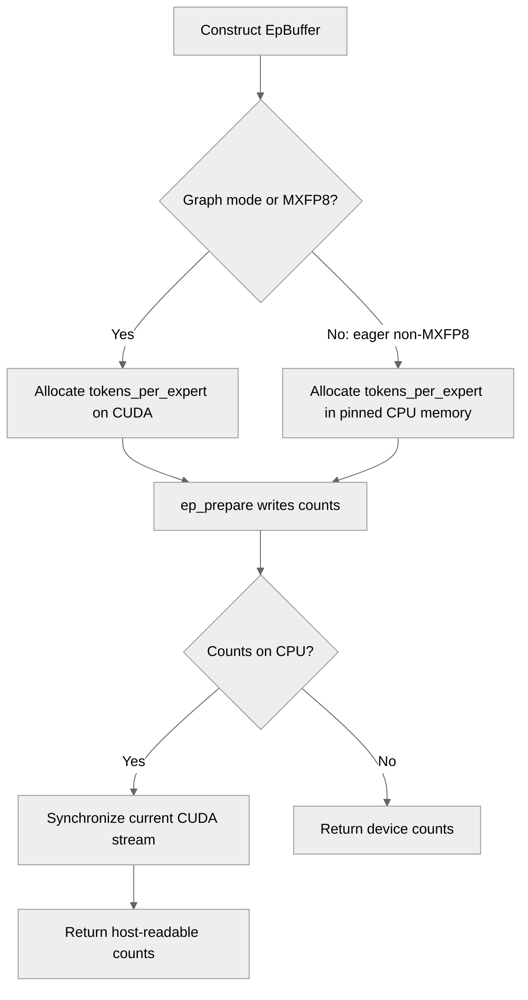

# [Pytorch][NCCL EP] Create tokens_per_expert on pinned CPU memory when running eager

[Upstream PR](https://github.com/NVIDIA/TransformerEngine/pull/3526) · state: closed · merged: False

## Original PR description

# Description

Create tokens_per_expert on pinned CPU memory when running eager so when downstream convert it to list there is no need for extra D2H

Fixes # (issue)

## Type of change

- [ ] Documentation change (change only to the documentation, either a fix or a new content)
- [x] Bug fix (non-breaking change which fixes an issue)
- [ ] New feature (non-breaking change which adds functionality)
- [ ] Breaking change (fix or feature that would cause existing functionality to not work as expected)
- [ ] Infra/Build change
- [ ] Code refactoring

# Checklist:

- [x] I have read and followed the [contributing guidelines](https://github.com/NVIDIA/TransformerEngine/blob/main/CONTRIBUTING.rst)
- [x] The functionality is complete
- [x] I have commented my code, particularly in hard-to-understand areas
- [x] I have made corresponding changes to the documentation
- [x] My changes generate no new warnings
- [x] I have added tests that prove my fix is effective or that my feature works
- [x] New and existing unit tests pass locally with my changes

## Review and discussion

### reviews

- greptile-apps[bot] · COMMENTED · 2026-09-16T02:13:40Z · [source](https://github.com/NVIDIA/TransformerEngine/pull/3526#pullrequestreview-5217770458)

(No body; status only.)

### issue_comments

- YangFei1990 · comment · 2026-09-16T02:11:50Z · [source](https://github.com/NVIDIA/TransformerEngine/pull/3526#issuecomment-5690971033)

/te-ci L1 pytorch

- greptile-apps[bot] · comment · 2026-09-16T02:13:36Z · [source](https://github.com/NVIDIA/TransformerEngine/pull/3526#issuecomment-5690984121)

<!-- greptile_summary -->

<h2><a href="https://app.greptile.com/api/retrigger?id=64787984"><picture><source media="(prefers-color-scheme: dark)" srcset="https://greptile-static-assets.s3.amazonaws.com/badges/RetriggerDark.svg?v=2"><source media="(prefers-color-scheme: light)" srcset="https://greptile-static-assets.s3.amazonaws.com/badges/Retrigger.svg?v=2"></picture></a>Confidence Score: 5/5</h2>

The pull request appears safe to merge; the added synchronization resolves the host-read readiness issue without introducing a new actionable defect.

<h3>Summary</h3>

This PR places eager, non-MXFP8 per-expert token counts in pinned CPU memory while retaining device-resident counts for graph and MXFP8 paths.
- Synchronizes the current CUDA stream before returning host-resident counts from `ep_prepare()`.
- Keeps MXFP8 counts on CUDA for device-side grouped-tensor construction.
- Adds tests covering pinned eager counts and CUDA-resident MXFP8 counts.

<h3>Diagram</h3>

Reviews (2) · Last reviewed commit: ["remove cutlass bump and add sync for sta..."](https://github.com/nvidia/transformerengine/commit/16a62c31d959db44b7f5e1d961e167258385421f)

- YangFei1990 · comment · 2026-09-16T02:25:07Z · [source](https://github.com/NVIDIA/TransformerEngine/pull/3526#issuecomment-5691079979)

/te-ci L1 pytorch

### inline_comments

- greptile-apps[bot] · comment · 2026-09-16T02:13:40Z · [source](https://github.com/NVIDIA/TransformerEngine/pull/3526#discussion_r4021894708)

File: `transformer_engine/pytorch/ep.py` · line 318

 **Host counts may be stale**

In eager non-MXFP8 mode, `ep_prepare()` now returns a pinned CPU `tokens_per_expert` tensor while its CUDA writer remains asynchronous. A caller that immediately invokes `.tolist()`, `.sum()`, or another host read no longer gets the implicit synchronization provided by reading a CUDA tensor, so it can observe stale or uninitialized expert counts. The fused eager dispatch path synchronizes while sizing its outputs, but the standalone public `ep_prepare()` path does not. Please synchronize that path before exposing the host counts or preserve and document an explicit readiness contract.

## Changed files and fixed code

- `tests/pytorch/distributed/run_ep.py` · modified · additions 4 / deletions 0
  - [head](https://github.com/YangFei1990/TransformerEngine/blob/16a62c31d959db44b7f5e1d961e167258385421f/tests/pytorch/distributed/run_ep.py)
  - [base](https://github.com/NVIDIA/TransformerEngine/blob/65cf30f56ea506b8c58f6ca795dd9908ec1989ab/tests/pytorch/distributed/run_ep.py)
- `transformer_engine/pytorch/ep.py` · modified · additions 28 / deletions 20
  - [head](https://github.com/YangFei1990/TransformerEngine/blob/16a62c31d959db44b7f5e1d961e167258385421f/transformer_engine/pytorch/ep.py)
  - [base](https://github.com/NVIDIA/TransformerEngine/blob/65cf30f56ea506b8c58f6ca795dd9908ec1989ab/transformer_engine/pytorch/ep.py)

## Evidence and interpretation boundary

[Original JSON, discussions and patches](../../../../../../evidence/prs/NVIDIA--TransformerEngine/3526-5abd4166fa18d85c6d2a4c35004e4470b7cc1540dc363b13fc0dc0942fefa934.json) · SHA-256 `5abd4166fa18d85c6d2a4c35004e4470b7cc1540dc363b13fc0dc0942fefa934`.

Diff complete: True. Missing/binary/truncated patches require pinned source inspection. This is a source page, not an independently verified optimization case. Open, merged and released are different states; recheck the deployed dependency.
